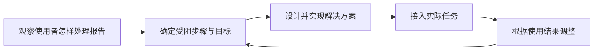

先看一个虚构的检查系统场景。一名内容制作人员收到报告，里面列出了异常编号、对象路径和规则名称。他知道检查失败了，却找不到自己正在编辑的对象，也不确定该修改内容还是调整规则，只好把报告发给工程师。

检查功能已经运行，使用者的工作却停住了。这正是理解 FDE 的一个起点：产品提供了能力，还需要有人把它接入具体任务，让使用者能够继续工作。

**Forward Deployed Engineer 通常指前线部署工程师；Forward Deployed Engineering 则指相应的工作方式。** 本文关注工程师怎样在真实使用环境中理解问题、直接参与实现，并跟进方案的使用结果。下面的检查系统用于教学推演，不是作者的项目记录。

## 1. 现场信息为什么会改变工程方案？

软件按输入、规则和输出工作，使用者面对的是一项需要完成并交接的任务。两者之间常见的距离有三种：

- **对象不同**：报告写的是内部路径，使用者认识的是作品名称或编辑界面中的对象。
- **终点不同**：程序输出报告就结束了，使用者还要完成修正、复检和提交。
- **权限不同**：制作人员可以改内容，却未必能决定检查规则是否适用。

因此，“检查工具不好用”背后可能是不同问题。增加检查规则能提高发现能力；如果困难在于找不到对象，这项投入就没有落在受阻步骤上。

现场观察的价值，是让这些差异进入设计。工程师陪使用者处理一条报告，看到他复制路径、切换工具、再找同事核对，才知道原先被当作一个按钮的功能，实际上依赖了一段人工工作。

这会改变工程问题的表述：从“怎样把异常报出来”，变成“怎样让有处理权限的人找到对象，完成修正，并确认结果”。调查方法和记录方式留到[下一篇]()展开。

## 2. FDE 怎样把问题理解接到工程实现？

Palantir 的岗位说明把贴近客户、架构与设计决策、开发具体应用，以及从最初沟通到交付的项目责任放在一起。直接参与工程实现，是这份岗位说明中的明确要求。[来源：Palantir 岗位说明](https://jobs.lever.co/palantir/5168e8fd-fec1-4fea-b7a1-81bdaea65850)

在本文的检查系统中，可以这样理解这条工作链：

假设核对后发现，报告里的对象标识无法直接用于编辑器定位。工程师要进一步决定两边用什么标识关联、接口放在哪里、对象变化后如何判断定位是否仍有效，然后实现、调试并接入使用入口。这些技术选择依赖现场认识，也会反过来限制方案能承诺的范围。

例如，对象关联只在同一份内容快照内可靠，报告就需要带上对应版本，避免旧结果打开新对象。这个限制应进入产品交互和验收条件，而不只留在代码注释里。

FDE 与产品、核心研发和业务负责人共同完成这项工作：工程师负责把问题推进到可运行的方案，业务方确认规则与目标，相关研发团队约定接口、质量要求和维护归属。不同组织的具体分工会有差异，这些职责也会与其他工程岗位重叠。

OpenAI 对其 FDE 团队的说明同样强调，与客户共同理解问题、建设可用于实际工作的系统，再把发现带回产品和研究。[来源：What FDE means at OpenAI](https://openai.com/index/forward-deployed-engineering-means/)

从这些实践看，理解 FDE 时值得关注的是一段连续的责任：现场发现能否进入设计，设计能否得到实施，实施者能否继续看到实际结果。

## 3. 功能完成以后，还要确认什么？

回到对象定位功能，开发测试可以证明按钮能打开对象。要判断工作是否已经交付，还需看使用者能否借此处理原来的问题。

| 完成层次 | 检查系统中的判断 |
| --- | --- |
| 技术能力成立 | 定位正确；过期报告、对象缺失和权限不足有明确处理 |
| 进入实际工作 | 目标使用者能找到入口，并在日常任务中完成操作 |
| 原有问题改善 | 查找、等待或返工有所减少，且没有引入误操作等新代价 |

这三个层次分别需要测试、使用观察和任务结果来支持。功能调用次数无法回答使用者是否仍然需要工程师逐步指导；一次顺畅演示也不足以说明长期收益。

交付还包括维护安排：规则由谁更新，接口变化由谁处理，使用者遇到错误到哪里反馈。约定范围内的目标通过验收、遗留问题有人承接后，工作才能转入常规维护。

## 4. 一次定制怎样改善后续交付？

深入现场容易产生针对某个团队的定制。它能解决眼前问题，但每个团队都维护一套接口和逻辑，下一次交付仍然要重新做。

PagerDuty 的工程回顾讨论了独立客户方案的维护与复用困难，以及后来加强与产品研发协作的调整。这说明，把现场成果带回公共产品也需要工程规范和维护安排。[来源：PagerDuty 工程文章](https://www.pagerduty.com/eng/from-embedded-to-everywhere-how-forward-deployed-engineering-was-born-at-pagerduty/)

对本文的系统，可以先分清稳定的能力与具体规则：

- 报告到编辑对象的定位接口，可以供其他检查工具接入。
- 某团队允许哪些异常，应保留为配置或扩展规则。
- 输入、检查任务和结果之间的关联，如果多处都需要，可以进入公共产品。

推广时，要核对新场景是否具有相同的对象、版本和权限含义。先保留差异，再根据实际使用决定抽象范围，能够减少为了统一而制造的额外限制。

公共产品补齐能力后，原来的定制也可以缩小或退出。后续团队能少做重复调查和开发，就是能力回流的一种结果。

## 5. 这种工作方式适合哪些问题？

当问题还不清楚、现场数据会影响技术选择，或者任务横跨多个系统与角色时，值得让工程师持续参与问题理解和实施。问题已经明确、已有功能和标准配置就能解决时，常规交付与支持流程通常更合适。

这类工作还需要基本的组织条件：能接触实际使用者和必要数据，有人决定目标与优先级，工程师有实施渠道，成果有人验收和维护。责任与这些条件要一起约定。

对于内部交付工程，使用者可以是美术、策划、程序或 QA，成果可以进入工具集与生产管线。我们可以借用这套工作方式，审视需求怎样进入工程决策；外部客户与内部团队的权责安排则需要分别处理。

下一篇将沿着几条具体反馈，展示怎样核实问题、归纳交付热点、选择改进项，再回到原任务复验。

**FDE 把现场理解、工程实现和使用结果接在一起，让一次交付为后续工作留下可复用的能力。**
