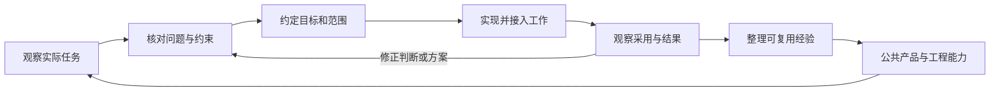

> 本文用一个通用示意场景贯穿解释：团队上线了自动检查系统，系统能够报告异常，使用者却仍然需要工程师帮助才能继续工作。场景及其后续推演均为教学构造，不是作者的历史项目，也没有实际部署与效果数据。

设想一名内容制作人员收到检查报告，里面列出了异常编号、对象路径和规则名称。他知道检查失败了，却不知道这条记录对应自己正在编辑的哪个对象，也不确定应该修改内容还是请别人调整规则。最终，他把报告发给工程师，等待对方解释。

检查系统完成了“发现并报告异常”的功能。使用者要完成的任务还包括理解异常、找到对象、确定处理方式，以及确认修改后的内容能否继续交付。两者之间有一段需要工程设计来连接的距离。

**Forward Deployed Engineer 通常指前线部署工程师；Forward Deployed Engineering 则指相应的工作方式。** 本文主要讨论后者：工程师贴近用户实际工作的环境，参与理解和界定问题，直接推动方案实施，并跟进使用结果。

Palantir 的官方岗位说明将贴近客户、参与工程设计和从最初沟通到交付的责任放在一起；这些是其岗位的具体要求。[来源：Palantir 岗位说明](https://jobs.lever.co/palantir/5168e8fd-fec1-4fea-b7a1-81bdaea65850)

从这个起点看，FDE 值得研究的地方，是现场认识怎样进入工程决策，工程结果又怎样接受实际工作的检验。本文结合公司公开实践提炼一套理解框架；不同组织的岗位分工会有差异，下面的六个问题也不是统一行业标准。

## 1. 产品能力与实际工作之间，为什么存在距离？

软件功能通常有相对明确的输入、处理过程和输出。实际工作还包含任务目标、参与者、环境差异、交接关系，以及大量没有完全写进接口的约定。

例如，检查系统接受一份内容数据，生成一组异常记录。从程序接口看，这个过程已经完整；从使用者的任务看，还需要知道报告检查的是哪个版本，异常是否与自己负责的内容有关，以及修改后应该触发哪一次复检。

这段距离可以从三个方面理解。

**首先，软件中的对象与使用者认识的对象可能不同。** 工具用数据库编号、文件路径或内部组件名定位问题，使用者记住的可能是作品名称、业务单据或编辑界面中的某个区域。两套表示之间缺少对应，技术上精确的报告仍然会增加查找成本。

**其次，功能边界与任务边界可能不同。** 一次检查在输出报告时结束，但人的工作需要继续到修正、提交、复检和交接。如果每一步都需要重新复制信息或寻找负责人，单个功能的正确性不能说明整个过程顺畅。

**最后，完成任务需要的权限与判断分散在不同角色手中。** 使用者可以修改内容，却未必有权改变检查规则；工程师可以修程序，却未必能决定业务上允许什么例外。方案必须能把问题交给有能力、有权限处理的人。

OpenAI 在其 FDE 团队自述中，将关注点放在模型表现出的能力与人们能可靠用于工作的系统之间，并讨论了生产使用与后续重复部署的关系。这是 AI 场景中的一种具体表现。[来源：What FDE means at OpenAI](https://openai.com/index/forward-deployed-engineering-means/)

回到本文的检查系统，增加更多规则可能提高异常发现能力，却未必改善对象定位、修正和复检。要决定下一步改什么，工程师需要理解使用者真正卡住的位置。

## 2. 工程师进入现场，究竟获得了什么？

这里的“现场”是实际任务、数据、系统与协作关系所在的环境。走到使用者身边、共同处理一项任务、远程观察真实操作，都可能帮助工程师获得这些信息。关键在于能否看到问题发生的过程，并与当事人核对理解。

在示意场景中，使用者可能提出“希望报错通知更及时”。这是一条值得追查的反馈。工程师陪他处理一条报告时，还可能观察到：

- 他先在多个群消息中查找报告，因为不知道当前哪条对应最新内容。
- 打开报告后，他把路径复制到另一个工具，反复尝试找到正在编辑的对象。
- 他把同一条异常转发给两个人，因为不确定它属于内容问题还是规则问题。
- 修改完成后，他仍然等待别人确认，因为没有把新结果与原问题联系起来的入口。

这些是场景中的候选观察，不是已经确定的原因。报告难找，可能来自通知入口分散，也可能来自版本标识不足；定位困难，可能来自标识转换，也可能是使用者尚不熟悉已有功能。工程师需要核对日志、操作过程和已有能力，才能判断。

现场工作的重要产出，是把笼统感受变成可以继续调查的问题。例如，将“工具不好用”推进为“使用者无法确认报告对应的输入版本，因此修正前需要人工核对”。后者已经指出受阻的任务、缺失的信息，以及下一步应验证的假设。

同时，临时绕行办法会暴露系统没有承担的工作。有人维护自己的对照表，有人固定找某位同事解释规则，有人每次都重跑整个流程来确认结果。这些做法可能很有效，也可能代价很高；先理解它们承担了什么作用，才知道新的方案需要承接什么。

一次走访获得的是特定人、特定任务和特定环境中的证据。它可以修正设计假设，但还不足以直接推定整个团队都有同样的问题。后续需要寻找其他使用者或不同任务进行对照，并保留不一致的观察。

## 3. 这些认识怎样改变工程决策？

现场信息只有进入目标、范围和方案选择，才会影响工程结果。

下面这张图是本文用于分析的反馈关系。实际工作可能多次返回前面的环节，尤其是在试用推翻了原有问题判断时。

对检查系统而言，可以先约定一个有限目标：在指定的一类异常中，让有处理权限的使用者找到对应对象，完成允许的修改，并核对这次修改后的检查结果。遇到规则含义有争议或需要更高权限的情况，能够明确交接。

这个目标限定了问题类型、处理角色和完成条件。它没有承诺所有异常都能自动修好，也为后续验收提供了具体对象。

接下来，团队可以比较不同方案：

| 核对后的问题 | 可以考虑的方案 | 需要验证的前提 |
| --- | --- | --- |
| 规则名称难理解，但对象已经能找到 | 补充规则说明与处理示例 | 规则本身正确，说明能帮助使用者作出判断 |
| 报告标识与编辑对象无法对应 | 提供对象定位或标识转换入口 | 对应关系可靠，版本变化不会让定位指向错误对象 |
| 使用者拿着旧结果判断新内容 | 关联检查输入、任务和结果，标明时效 | 系统能够辨认输入变化及结果所属的检查任务 |
| 问题已经明确，但没有处理权限 | 提供有上下文的交接路径 | 接收方、所需材料和后续确认方式已经约定 |

这些方案分别改变信息、交互、状态关系或协作方式。工程投入应由已核对的问题推动。若试用表明说明已经足够，就可以先观察效果；若对象关系本身无法可靠建立，继续增加界面按钮也解决不了根本约束。

FDE 在这里承担连接责任：让现场理解影响设计，让技术限制回到目标讨论，让尚未解决的依赖得到处理。客户或业务负责人需要参与定义目标、规则和验收，核心研发负责其产品范围内的设计与质量约束。跨越权限或能力边界时，需要协商、调整范围或升级处理。

软件工程师、产品经理、解决方案工程师和技术支持，也可能承担这些工作中的一部分。具体边界应从所在组织的职责与权限判断。讨论 FDE 的价值，更适合观察“谁能把问题理解、实施和反馈持续接起来”，而不是只按职位名称划分。

## 4. 怎样判断方案已经落地？

给示意系统增加了定位和复检入口后，开发验证可以回答按钮能否打开对象、检查任务能否提交。要判断它是否解决了使用者的问题，还需要其他证据。

可以把完成程度分成三个层次：

| 层次 | 需要回答的问题 | 在示意场景中可以收集的证据 |
| --- | --- | --- |
| 技术能力成立 | 功能在约定输入和异常条件下能否正确运行？ | 对象定位、权限处理、任务关联与失败路径的测试结果 |
| 进入实际工作 | 目标使用者能否在真实任务中采用它？ | 使用观察、被中断的位置、仍需人工协助的原因、是否继续使用旧办法 |
| 问题得到改善 | 原先的障碍是否减少，是否引入新的代价？ | 同类任务中的处理过程、等待与返工记录，以及误判、误操作或维护负担 |

三个层次彼此相关，但证据不能随意替代。功能调用次数只能说明入口被使用过；某条异常不再出现在报告中，还需要确认检查确实执行、输入正确、规则适用，才能判断对应问题是否通过了这项检查。

验收也不应只选择最顺利的一条路径。使用者拿到过期报告、对象已变化、权限不足或检查服务暂时不可用时，系统应当给出可理解的状态和继续处理的办法。否则，原先对工程师的依赖可能只是从正常流程转移到了异常流程。

如果希望讨论节省了多少时间，需要先确定记录口径：比较哪些类型的任务，计入哪些等待，是否包含工程师协助，以及使用者熟练程度是否发生变化。样本不足时，可以先陈述定性观察和仍存在的问题，避免把演示时的一次顺畅操作当作稳定收益。

最后还要确认维护怎样继续。规则由谁更新，外部系统变化后由谁修正接口，错误结果如何上报，交接材料是否足以让维护者接手，这些都影响方案能否持续使用。

对一项约定范围内的工作而言，能够说明“目标如何验收、遗留问题如何处理、后续由谁维护”，才有条件讨论结束驻场或转入常规维护。持续负责并不意味着工程师需要永久成为每个问题的人工入口。

## 5. 一次解决怎样成为后续能力？

在一个团队中解决问题之后，接下来的判断是：这次工作有哪些部分值得由更多人使用，它们应该放在哪里？

一个容易出现的困难，是每次都围绕客户或团队单独搭一套方案。局部交付可以完成，维护方式和接口却逐渐分散。下一次遇到类似问题时，工程师又需要重新调查、重新实现。

PagerDuty 的工程文章回顾了这类困难：围绕客户建设的独立方案带来了维护与复用问题，后续团队开始加强与产品研发的协作，并按产品的工程规范贡献能力。这是该团队对自身演进的总结，也说明现场成果进入公共产品需要协作接口和维护条件。[来源：PagerDuty 工程文章](https://www.pagerduty.com/eng/from-embedded-to-everywhere-how-forward-deployed-engineering-was-born-at-pagerduty/)

在本文的示意系统里，可以把不同部分放到不同位置：

| 已识别的内容 | 可能的沉淀方式 | 推广前还需要判断什么 |
| --- | --- | --- |
| 报告对象与编辑对象的关联 | 可复用接口或定位组件 | 其他工具的对象模型是否兼容，失败时怎样处理 |
| 某团队特有的检查要求 | 配置或扩展规则 | 谁确认语义，规则与公共能力怎样隔离 |
| 检查输入和结果的关联 | 共享状态模型或产品能力 | 不同任务的版本、重试和完成含义能否统一 |
| 一类常见问题的处理经验 | 操作说明、诊断指引或培训材料 | 适用前提是否明确，过时后由谁更新 |

这里的公共能力可以包含代码，也可以包含经过核对的规则、接口约定和操作知识。是否进入核心产品，需要与产品和研发团队共同判断，不能只凭某次交付紧急就默认具有普遍性。

复用也有两个方向的代价。过早抽象，容易把尚未理解的差异隐藏在统一接口后面；长期保留大量特例，又会让每次维护都变成独立项目。一个可行的起点，是先保留真实差异，再通过新的使用场景核对哪些部分稳定、哪些部分需要扩展。

新的使用者采用了方案，仍然需要重新验证其数据、权限和工作流程是否满足前提。“能够复制代码”和“能够以较少代价解决另一处问题”是不同的结论。

能力回流还有一种有价值的结果：原有产品已经补上所需功能，现场的定制代码可以缩小或退出。工程成果的价值可以体现在后续少做重复工作，而不必体现在工具数量持续增加。

## 6. 什么条件下值得采用这种工作方式？

深入现场需要时间，也需要使用者与工程团队投入协作。是否值得采用，应结合问题的不确定性、影响和组织条件判断。

当问题描述还很模糊、真实数据与环境显著影响方案，或者一项任务跨越多个系统与角色时，让工程师持续参与现场理解和实施，可能有助于减少反复转述与试错。这里的“可能”需要通过实际工作检验，不能把人员到场本身当作收益。

如果问题已经清楚、产品已有成熟能力、差异能够通过标准配置或文档处理，那么常规交付与支持流程可能就足够。对于短期影响很小、后续使用有限的需求，也应比较定制投入与预期价值。

更重要的是组织是否提供了完成工作的条件：使用者愿意参与，工程师能获得必要的环境和证据，目标有决策人，方案有实施权限，结果有人验收，后续有人维护。只有结果责任、缺少这些条件时，应先澄清约束和协作安排。

FDE 与客户团队、产品团队和核心研发之间，需要能讨论优先级、分歧与退出条件。现场问题提供新的事实，但不能自动替代产品整体取舍；公共产品的规范约束方案，同时也需要接收现场发现的不足。

对内部研发工具与交付工程，这套视角同样可以用于分析工作：使用者可能是美术、策划、程序或 QA，公共能力可能是工具集与生产管线。组织关系与外部客户交付有所不同，具体职责仍需重新约定。方法是否有用，应通过它能否帮助理解问题、改善使用和维护结果来判断。

## 回到最初的检查系统

现在再看“系统已经能报告异常，使用者却仍然需要反复找工程师”，需要调查的对象已经更完整：报告对应什么输入，使用者怎样找到对象，谁能决定修正方式，修改后怎样确认结果，以及这些能力能否由团队持续使用。

本文没有为这个示意团队报告一个成功结局。它展示的是一条可以继续验证的思路：让现场信息改变问题判断，让判断约束工程方案，再用实际采用与结果修正原先的认识。

继续阅读[将 FDE 方法用于交付工程——需求发现、热点判断与能力沉淀]()，把这套视角转化为现场观察、问题核实、热点判断与使用复验的具体方法。Missing 的真实工具链案例后续补充。

**FDE 的工程价值，需要在现场问题被理解、方案被实际使用、经验能够改善后续工作这条关系中检验。**

---

[返回 FDE 方法与实践]() · [工程与交付]()
