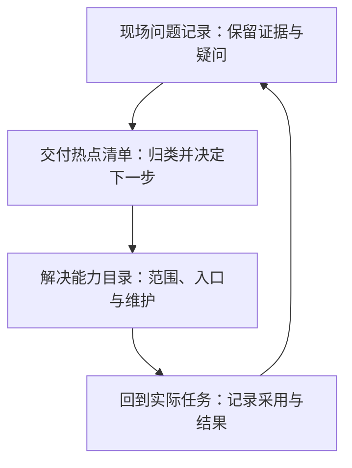

> **读这篇之前**：建议先读 [FDE 基础：从现场问题到工程落地]()，了解现场认知、工程实施、实际采用与能力回流之间的关系。本文继续使用通用检查系统的教学场景；人物操作、记录编号和方案演进均为示意，没有新增真实项目经历或效果数据。

一位内容制作人员提出：“检查结束后，能不能再提醒我一下？”工程师把它记成“增加通知”，排入开发计划。功能上线以后，对方仍然在群里问：“这个结果检查的是我刚交的内容吗？”

这个示意场景提醒我们，收到的功能请求还需要继续理解。通知是否送达、报告是否容易找到、结果对应哪一份输入，可能分别影响使用者的判断。它们需要不同的解决办法。

交付工程中，美术、策划、程序和 QA 都可能提供反馈。工程师还会从构建失败、人工协助和交接等待中发现问题。要把这些信息变成持续改进，需要保留三类相互关联的记录：

- **现场问题记录**：谁在什么任务中受阻，看到了什么，还有什么尚未核实。
- **交付热点清单**：哪些记录指向相近障碍，影响多大，当前决定调查、处理还是暂缓。
- **解决能力目录**：针对这些障碍有什么可用办法，怎样使用、由谁维护、验证到什么范围。



下文用 P-001、H-001、C-001 追踪同一个示意问题。实际工作中，一个热点可以关联多条问题记录，也可能由工具、说明和流程共同解决；一种能力也可能服务多个热点。编号只是为了保留关系。

这套组织方式是本站面向内部交付场景的实践框架。它借用了现场观察和研究分析的方法，不代表所有 FDE 团队采用同一种流程。

## 1. 发现需求：跟随一项实际任务

### 先确定这一轮想看清什么

一次走访可以从很小的范围开始，例如：“内容提交后，制作人员怎样判断检查已经覆盖这次修改？”这句话明确了参与者、工作阶段和需要理解的判断。

选择参与者时，除了主动求助的人，也应考虑熟悉工具的人、不常使用工具的人，以及接收交付结果的人。熟练使用者可能已经建立了自己的绕行办法；很少反馈的人可能一直由同事代为处理。没有提出需求，不能直接解释为没有困难。

在现场，可以请使用者带着最近的一次实际任务，从收到输入开始，走到他认为可以交给下一位同事的位置。如果只能复述历史过程，就明确记为回忆材料；为演示临时准备的任务也应单独说明。

GOV.UK 的情境研究指南强调在日常环境中观察真实活动，了解遇到的障碍及应对方式。这里采用的是这一观察原则；游戏团队的具体任务边界仍需自行确定。[来源：Contextual research and observation](https://www.gov.uk/service-manual/user-research/contextual-research-and-observation)

### 沿着动作追问，少替使用者选择答案

对示意场景，可以准备一组围绕任务的问题：

- “你刚才准备交付什么，怎样判断这一步完成了？”
- “你现在为什么打开这条消息？它和刚才的操作有什么关系？”
- “这里你在等什么？接下来谁能让任务继续？”
- “如果找不到工程师，你通常怎么处理？”
- “有没有一次你可以自己完成？当时和这次有什么不同？”

这些问题让使用者解释自己的依据。“加一个通知按钮是不是就好了”则提前指定了解法，容易让讨论跳过真正的障碍。

观察时要保留动作的顺序：提交内容、打开群消息、搜索报告、询问工程师、等待确认。尤其留意信息在哪里被复制、重新输入、人工解释或跨工具核对。对使用者而言，这些可能已经是习惯；对工程师而言，它们能指出系统尚未承接的工作。

在示意场景中，工程师可能看到：通知已经到达，使用者也打开了报告，但仍然返回提交记录寻找时间，再向工程师确认两者的关系。此时值得继续调查的是“如何判断检查覆盖了哪次提交”。通知功能本身是否仍有问题，需要另行核实。

### 把协助造成的变化也记下来

走访前应说明这次关注的是任务和工具，记录会用于什么；涉及截图或录屏时先征得同意，并保留与问题有关的必要信息。参与者知道现场不是在考核个人熟练程度，才更容易展示平时的处理办法。

如果任务正在阻断交付，可以先帮助恢复。记录中同时写明工程师在什么位置介入、提供了哪些信息。被指导后完成任务，不能算作使用者已经能够独立完成。

结束前，用自己的话复述观察到的困难，请对方修正；同时说清下一步是补证据、试方案还是交给其他负责人。对方应当知道反馈去了哪里，尚未决定的方案也不要提前承诺。

## 2. 核实问题：把原话、观察和解释拆开

现场记录最容易在整理时丢失区别：使用者说“每次都这样”，被写成了稳定频率；工程师怀疑“消息太多”，被写成了根因。为了避免判断越传越确定，可以在 P-001 中分别保留以下内容。

| 记录类型 | 本文场景中的示意填写 | 能支持的判断 |
| --- | --- | --- |
| 用户原话 | 希望检查结束后再提醒一次 | 使用者提出了通知方面的请求 |
| 现场观察 | 打开已有报告后，仍查找提交记录并求助 | 这次任务中，打开报告没有结束人工核对 |
| 用户解释 | 不确定结果对应的是哪次修改 | 使用者给出了自己的困难描述 |
| 工程假设 | 报告缺少可辨认的输入关联 | 候选原因，需要核对界面与任务数据 |
| 待补信息 | 后端是否记录输入版本；已有入口是否被忽略 | 当前尚不能确定应该改哪一层 |

GOV.UK 的研究分析指南将观察、归类、发现和后续行动分开处理。本文把这个区分用于交付记录，避免把解释混进原始事实。[来源：Analyse a research session](https://www.gov.uk/service-manual/user-research/analyse-a-research-session)

### 写出可以继续调查的问题

比“用户需要更强的通知”更有用的表述是：

> P-001：内容制作人员提交修改后，需要确认检查结果覆盖了哪份输入。在这次示意观察中，他打开报告后仍请求工程师核对，因此尚不能独立完成检查结果确认。发生频率、等待时长和受影响范围待补。

这段描述保留了任务、受阻位置和影响，也保留了未知。它还没有指定增加通知、修改界面或重建检查服务。

随后，工程师可以沿着一次检查任务核对：提交记录是什么，检查实际接收了什么输入，结果关联哪个任务，界面显示了哪些信息，使用者能否辨认这些信息之间的关系。

仅比较时间接近与否通常不足以证明对应关系。排队、重试、不同分支或检查期间输入发生变化，都可能让时间看起来合理而实际对象不同。调查需要找到系统实际使用的关联依据；找不到时就记为缺失，不能自行补成确定关系。

也要主动寻找能够推翻假设的材料。如果已有清晰的版本入口，只是这位使用者不知道，改进重点可能在入口位置与说明。如果后端本来就没有记录检查输入，仅调整报告文字无法解决关联问题。如果关联正确，但报告迟迟不出现，还应继续调查执行或通知环节。

### 和使用者确认目标，与负责人确认约束

核实后的需求可以写成：“在指定的提交与检查流程中，制作人员能够辨认结果对应的输入，并知道结果不足以判断当前内容时该做什么。”接着再明确可覆盖的任务类型、权限、允许修改的系统，以及验收参与者。

使用者可以确认自己的任务和困难；规则负责人需要确认结果怎样解释；检查系统维护者需要确认数据与实现条件。这些判断可能来自不同的人。工程师负责把分歧展开，不能用一次访谈替代所有人的决定。

证据不够时，问题可以停在“待调查”。下一步应当具体，例如“请检查系统维护者核对这一任务是否保存输入标识”，同时约定回看时间或触发条件，避免问题长期停留在模糊的待办中。

## 3. 判断热点：归纳共同障碍，再决定投入

### 热点要能解释一组问题为什么值得共同处理

本文把“交付热点”用于指代需要持续关注的一类交付障碍：它可能在同类任务中反复出现，也可能发生不多，却足以阻断关键交付。这里的“热”包含影响和风险，不只表示反馈数量多。

从 P-001 出发，可以暂建候选热点 H-001：“提交后难以辨认检查结果覆盖的输入”。先保留候选身份，再寻找其他记录与日志佐证。只有一条记录时，不应写成“全组普遍存在”。

归类时可以比较受阻任务、工作阶段、环境条件和用户需要作出的判断。都出现“检查失败”，不一定属于同一个问题；都要求“加通知”，也可能分别涉及消息未送达、入口难找或结果无法辨认。

根因尚未查清时，可以先按共同障碍归类，但必须保留子问题和未知原因。后续发现处理方式、责任人或数据约束明显不同，就拆开热点。为了让清单整齐而过早合并，会掩盖实际差异。

### 频率需要事件口径和观察范围

群里的一条求助可能被转发、追问和重复提醒。统计时，应围绕同一次任务受阻建立事件关联，保留各方观察，避免把消息数直接当成问题次数。如果同一任务在修正后再次遇到独立障碍，可以单独记录，并说明与前一次的关系。

每个频率结论都应附上范围：观察了什么时间段、哪些团队与任务、数据来自走访还是完整日志。若想计算发生率，还需要知道同一范围内共有多少次相关任务。主动求助者的样本可以揭示问题，不能直接推算整个团队的比例。

人工成本也需要拆开：使用者实际操作了多久，等待了多久，工程师介入多久，是否造成返工。不同角色可能并行工作，等待时间也不一定全部阻断其他任务。没有测量时，先记录具体动作和定性影响，不填写看起来精确的总成本。

### 将影响、证据和实施成本分开讨论

热点评审可以围绕四个判断展开：

- **影响**：影响哪些角色和任务，是局部不便、持续返工，还是会阻断验收或交付？
- **证据**：哪些已经看到，哪些只被转述，什么信息可能改变目前结论？
- **处理条件**：是否能先用现有能力缓解，关键依赖和实施、维护成本是什么？
- **下一步**：立即恢复、继续调查、小范围试用、推广，还是暂缓？由谁负责，何时复看？

这些维度共同支持判断，未必需要合成一个总分。把未知频率填成零，会压低尚未观测充分的问题；把一次严重事件的损失无限外推，也会扭曲优先级。

低频但已经阻断关键交付的问题，可以先恢复工作，再决定长期改进如何排期。紧急处理与公共能力建设需要分别判断：恢复一次交付，并不自动意味着应立即建设通用平台。

对于 H-001，假如当前只有 P-001 和一份尚待核对的任务记录，合理的下一步可以是确认输入关联，再观察另一类使用者如何完成同一任务。先投入调查，是为了判断后续该改报告、补数据还是调整使用说明；此时还没有足够依据承诺大范围开发。

优先级最终应由有权安排资源和承担结果的人确认。清单中保留取舍理由，下一次出现反例、影响扩大或依赖变化时，团队才知道应该重开哪一项讨论。

## 4. 形成解决能力：让热点连接有限方案和可用入口

### 先比较能够改变受阻步骤的办法

H-001 进入方案讨论后，可以比较不同调查结果对应的改进方向：

| 核对后的条件 | 可考虑的改进 | 需要保留的边界 |
| --- | --- | --- |
| 关联信息已有且可靠，使用者找不到 | 调整入口、补充说明或进行任务演练 | 验证其他使用者也能辨认，不能只依赖讲解者在场 |
| 关联已保存，但报告未展示 | 在报告中展示可理解的输入与任务关系 | 与实际执行记录核对，避免展示错误或过时的信息 |
| 检查输入没有被可靠记录 | 补齐输入关联与结果记录的工程能力 | 先确认数据来源与一致性，不能只改界面 |
| 结果明确，但交接双方对通过条件理解不同 | 澄清规则、职责与交接材料 | 由对应负责人确认，工具只能执行已明确的约定 |

为了继续推演，下面假设核对结果属于第二种：后端已经保存可靠关联，报告尚未呈现。由此提出 C-001：“检查结果的输入辨认能力”，状态为**拟议**。

它的初始范围可以限定为一种提交与检查流程：展示输入标识、检查任务和结果状态，提供进一步核对入口。缺少关联、执行未完成或记录不可用时，要说明当前无法给出哪项判断。报告能够展示关联，也不意味着它知道使用者此刻所有尚未提交的本地修改。

验收时，可以从已知输入发起检查，再验证结果是否关联正确，并覆盖重试、输入变化和记录缺失等情况。实施任务、测试记录和试用反馈都链接到 C-001；没有执行的验证保持待执行。

### 能力目录应该帮助人完成任务

工具集可以按“我要确认这次提交的检查结果”提供入口，同时附上适用流程、必要输入、权限、预期结果和失败时的处理办法。脚本名、菜单名和仓库地址作为执行细节放在后面。

这样，使用者可以从自己的任务找到解决办法；维护者则可以从能力条目追溯它解决的 H-001，以及最初的 P-001。若功能可运行但使用者仍不会判断结果，就能回到原问题检查遗漏。

工具、规则、文档、培训和交接流程都可以构成解决能力。维护责任也要随之明确：谁维护实现，谁确认规则含义，依赖系统变化后由谁判断是否仍然适用。尚无人承接的部分应留在方案约束中。

在这个阶段，不必先建设新的门户。现有文档或问题跟踪系统就可以承载关联记录。只有实际检索、维护或协作规模提出了进一步要求，再判断是否需要系统化。

公共化范围同样应逐步确认。如果 C-001 后续只在一种流程中完成验证，就先写明这一范围；其他团队的数据模型或版本含义不同，需要重新核对。已有公共产品后来覆盖了该能力时，也应考虑迁移使用者、停用旧入口和收回重复维护。

## 5. 使用复验：回到当初受阻的位置

方案试用时，拿回 P-001 描述的任务，观察目标使用者能否辨认输入、理解状态并决定下一步。第一次讲解有助于学习，后续还应记录没有逐步提示时的表现。工程师介入了哪一步，就保留哪一步的协助记录。

复验可以沿着任务回答几个具体问题：使用者是否找到入口，是否正确辨认了对应输入，结果不充分时是否知道怎样继续，最终交接是否被接收方认可。完成状态不能只由工具按钮点击或检查任务启动来代替。

还要查看旧办法是否继续存在。使用者仍然在群里请求核对，可能是新入口难找、关联信息难理解、某类任务没有覆盖，也可能是他在等待规则层面的确认。应重新观察原因，而不是直接把未采用归为习惯问题。

对于错误关联、执行未完成或结果无法读取的情况，试用方案需要明确人工核对与回退路径。若报告让人误以为当前内容已经通过，就应暂停依赖该判断，修正方案后再验证。提升使用率不能以隐藏不确定状态为代价。

复验结果分别回写三处：P-001 更新该类任务还在哪一步受阻；H-001 更新影响、范围和下一步；C-001 更新适用条件、使用说明与验证记录。某次试用完成，可以说明这次任务的表现；宣称问题稳定改善，需要持续观察同类任务并说明范围。

跨团队推广则增加了一层验证。其他团队能否理解相同的输入标识、具备所需权限、遵守相同的交接规则，都要重新确认。新增差异可能要求扩展能力，也可能说明应保留独立方案。

到这里，本文仍没有报告一次真实试用成功。它给出的是可以执行和修正的方法；实际结果由使用记录决定。

## 三份可以从小范围开始使用的模板

下面的模板可复制到现有协作文档或问题跟踪系统。首次记录先填任务、证据、未知和下一步；其他字段随调查补充，不必为了填满表格打断工作。字段中的时间、频率和效果没有依据时，写“未知”并注明怎样补齐。

### 现场问题记录

```text
问题编号：
观察时间与环境：团队／流程／工具或输入版本
使用者与任务：要完成什么；怎样判断完成
用户原话：保留表达；标明当场所说、转述或回忆
用户解释：使用者怎样理解原因；与工程假设分开
实际过程与受阻位置：附相关任务、日志或截图索引
当前绕行与协助：谁做了什么；等待、操作和返工分别记录
问题假设与待核信息：哪些依据支持；什么情况会推翻
影响与范围：本次已知影响；频率及统计范围未知时明确写出
下一步与负责人：要核对什么；何时或在什么条件下回看
关联热点与复验记录：
```

本文的 P-001 先记录“打开报告后仍需人工核对输入”，把“报告缺少输入关联”放在假设中。后续核对得到的新事实追加进去，不覆盖最初观察。

### 交付热点清单条目

```text
热点编号与名称：用受阻任务或共同障碍命名
关联问题：保留原记录编号；重复事件注明关联
纳入与排除范围：哪些场景相同；哪些仍应分开
证据状态与未知：候选或已核实范围；支持依据、反例与待查条件
频率、范围与代价：时间窗口、事件口径、数据来源
风险与时效：是否阻断交付；当前恢复办法
当前决定与理由：调查／恢复／试用／推广／暂缓等
负责人及复看条件：决策人、推进人；时间或事件触发
关联能力与复验结果：
```

本文的 H-001 最初只有一个示意问题支撑，状态应保留为候选；“待确认输入关联”可以成为明确的调查决定。后续证据不足以支持共同处理时，可以拆分或撤销该热点。

### 解决能力目录条目

```text
能力编号与名称：使用者要完成的任务
解决范围：关联热点；适用角色、流程与不覆盖的情况
当前状态：拟议／开发／试用／可用／停用
使用入口与说明：所需输入、权限；预期输出与下一步
实现与依赖：工具、规则、文档或流程；关联实施任务
验收与复验：执行环境、输入、结果、协助和已知限制
维护责任：实现维护者、规则负责人及问题反馈入口
失败与退出：人工处理、回退、替代或停用条件
最近复核与后续动作：何时复核；谁处理剩余问题
```

本文的 C-001 是拟议能力，因此入口、维护承接和复验都可以标为待落实。只有对应工作实际完成，状态才随证据更新；一张填写完整的卡片不能代替工程实施或用户采用。

一轮小范围实践可以从一项任务、一条问题记录和一次回访开始。先让这条记录真正改变某个判断，再决定是否扩展观察范围和管理方式。Missing 的真实工具链案例将在后续结合走访、设计变化与既有证据补充。

**让每项交付改进都能追溯到现场问题，并回到实际使用中验证，工具集才有持续积累解决能力的依据。**

---

[上一篇：FDE 基础]() · [返回 FDE 方法与实践]()
