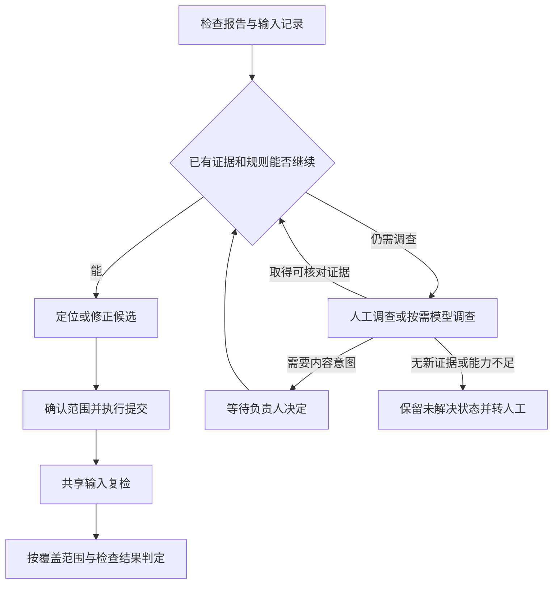

> **文稿状态：正文已写（研究设计）。实验状态：未执行。** 已有实践来自作者的资源完整性文章；本文提出的处理服务、记录关联和模型调查方式均为待验证方案。尚未核对现有工具的当前源码与接口，未实现新增服务或适配器，也未执行工具与模型实验。

提交后，Jenkins 已经能检查资源，把 Missing 报告发出来。编辑器里有定位工具，补交时也有依赖收集工具。接下来却仍然可能需要人问：这条报错有人处理了吗？修改提交了吗？检查机用的是哪个版本？这一次检查真的通过了吗？

这些问题包含两类不同的工作。一类是把已知步骤接起来，让每一步都有输入、回执和下一步；另一类是在现有证据不足时，判断接下来应该查什么。前一类可以大量交给固定流程，后一类才是本系列准备研究的模型参与空间。

是否需要 Agent，要从具体的判断任务说起。把检查、通知和提交重新包装成模型工具，并不能自动回答这个问题。

## 1. 已有工具解决了什么，人工又在接住什么

在[资源完整性实践]()中，我记录过三个工具的形成过程：

- **Missing 检查与通知**：Jenkins 同步 SVN，在独立工作副本中调用 Unity 批处理检查，生成报告并通知相关人员。
- **MissingFind**：在编辑器中检查场景或正在编辑的 Prefab，列出缺失引用所在的对象、组件和属性，帮助使用者定位。作者本地查不出问题时，还可以到人工更新的仲裁机上对照排查。
- **依赖提交**：从选中的资源递归收集依赖，处理父目录、资源及其 meta 文件，结合 SVN 状态形成候选，再由使用者确认提交。

那套实践也包含提交后的再次检查、使用文档、宣讲与人工跟进。原文明确记录了：对长时间未解决的问题，需要上门跟进；临近项目节点时，项目经理也会协同督促。

因此，历史上已经有处理闭环。这里要继续研究的是：**闭环中由人记住、解释和推动的交接，哪些可以交给程序维护？**

例如，通知工具能告诉人“哪里出了问题”，却不能仅凭通知证明“这次提交修正了它”。依赖工具能给出候选文件，候选也仍需与当前问题、目标版本和使用者确认的范围对应。复检确实执行后，还要把结果关联回原来的问题。

这些是本系列希望明确记录的关系，不能据此断言现有工具完全没有相关能力。历史文章没有逐项给出当前接口、持久化记录和自动关联能力，本轮也没有检查这些实现。

原文对历史效果的描述属于定性观察，没有同口径的次数、耗时统计。本文不会把那段效果归到尚未实现的 Agent 上，也不会用它推算未来节省多少人力。

## 2. 从报错到完成，至少要交接四类信息

先把一次处理缩成四个问题，就能看出哪些工作并不需要模型推理。

| 要交接的信息 | 需要回答什么 | 缺少它时，哪种判断站不住 |
| --- | --- | --- |
| 问题位置 | 哪个场景或 Prefab，哪个对象、组件和属性报告异常？ | 只知道“有 Missing”，无法定位本次修正对象 |
| 输入版本 | 哪个项目、分支、实际检出内容与检查范围产生了报告？ | 作者本地正常，不能直接反驳另一个输入上的报错 |
| 修正范围 | 改了什么、确认提交哪些文件、实际形成哪次提交？ | 本地改好或打开提交窗口，不能证明共享版本已改变 |
| 复检结果 | 检查实际读取了什么输入，是否完整执行，原问题是否仍在？ | 任务排队成功、旧版本通过或没有新提醒，都不足以关闭问题 |

版本这里指可核对的实际输入。只写一个 revision 数字仍可能遗漏本地未提交修改、不同分支或检查范围差异。拟议服务需要记录这些差异；无法取得的信息要保留为未知。

同样，“修正完成”也需要限定范围。某条 Missing 在一次有效复检中消失，可以支持关闭这条问题；它不能单独证明整包资源完整、运行时表现正确，或这次提交没有引入其他问题。

这也是历史实践里“机器人不再提醒”需要谨慎解释的原因。原文说明机器人不会额外发送“已修复”通知；只有确认检查确实执行，并看过对应结果，才能判断那条异常是否消失。

[第 02 篇]()把这些关系展开成记录模型。首篇先确定一个原则：每一次状态推进，都要回答它依据了哪条结果。

## 3. 普通漏交，固定流程可以组织到哪一步

下面是一条**设计示例，未实际运行**：共享版本中的场景缺少一个音频依赖，作者本地存在匹配的资源及 meta，预览证据支持它们尚未提交，使用者也确认场景应该保留这项引用。

这组前提已经足够明确。服务可以按事先写好的规则，组织定位、候选确认、提交关联和复检，无需每一步都询问模型。

| 步骤 | 固定流程可以负责什么 | 继续推进需要什么 |
| --- | --- | --- |
| 接收报告 | 保存报告与输入标识，按已配置规则分派；无法匹配时进入人工接单 | 一次可识别的检查结果和问题位置 |
| 定位与对照 | 把报告位置交给定位入口，提示核对本地与检查输入 | 对应对象被找到，或明确记录定位失败 |
| 生成补交候选 | 调用依赖预览，结合版本状态列出候选 | 有证据支持候选与这项缺失相关；结果为空时不能硬走补交 |
| 确认并提交 | 展示文件清单与修改范围，等待使用者确认，再记录执行结果 | 确认对象与实际提交范围一致；取得真实提交回执 |
| 发起复检 | 在约定的共享输入上启动检查，等待并接收结果 | 检查输入可关联到修正提交，执行结束且报告完整 |
| 判定本次结果 | 按范围与结果核对原问题，更新状态或进入后续处理 | 原对象确实被检查且异常消失；仍有异常则继续处理 |

这里的“可以负责”是改造方向。现有编辑器工具是否支持由服务调用、能否返回这些字段，都留待接口核对。若某一步仍需人操作，第一版也可以接收其操作回执，前提是清楚标记来源和证据强度。

**固定流程可以包含人工确认。** 程序完全可以规定“等待使用者确认这份候选清单，确认后才进入提交”，不需要模型来决定是否等待。人在此承担范围和内容决策，程序承担等待、记录与后续衔接。

候选文件变化后，原来的确认也不能自动沿用。等待超时、任务失败、重复回执等情况，可以预先定义状态和恢复动作；它们并不会因为属于异常，就天然需要模型处理。

复检同样应有确定判据。例如，约定检查包含本次修正的共享快照，并确认报告覆盖原问题所在对象。若实际输入与约定不符，就先处理输入差异；不能把任意一次 Jenkins 任务变绿当作该问题已解决。

这条基线首先要回答的是：**不调用模型时，现有工具加明确的交接规则，已经能把多少问题处理完？** 当前还没有运行结果，不能预填覆盖比例。

## 4. 流程停下来，先分清缺的是规则、事实还是意图

Missing 是检查发现的现象。漏提交只是其中一种可能原因。不能看到这类报错，就直接生成补交操作。

即使固定流程无法继续，后续也有几种不同的去向：

| 遇到的情况 | 优先处理方式 | 模型在这里的研究位置 |
| --- | --- | --- |
| 检查未启动、已知同步失败、等待回执超时 | 执行已定义的查询、恢复或转人工规则 | 已知恢复步骤可由程序决定 |
| 缺少版本、检查范围或预览范围 | 按固定清单补齐；取不到就记录证据缺口 | 不能靠语言推测补出工具事实 |
| 多份有效证据无法解释为同一个输入或原因 | 比较差异，选择能区分假设的下一项调查 | 可研究由模型选择调查方向，并与人工、固定排查表比较 |
| 两种修正都能消除报错，但内容效果不同 | 向内容负责人确认预期 | 可整理选项与依据，最终意图来自负责人 |
| 根本没有可取得的新证据 | 停止自动调查，转交带上下文的任务 | 继续生成解释不会增加事实 |

因此，“需要判断”和“需要大模型”是两个问题。比较版本是否一致，是判断，但完全可以写成规则。某类 Missing 一旦有稳定的诊断条件与修法，也可以继续交给固定流程。

本系列所说的 Agent，特指一个受约束的调查过程：模型读取任务和已有证据，选择下一项允许的动作；服务执行工具、保存返回，再决定是否继续让模型参与。值得研究的是那些**尚未被规则覆盖、可以取得更多证据、不同调查顺序可能改变处理结果**的任务。

这只是候选范围。它是否优于一张排查表，仍要比较实际结果。

## 5. 用一个 Missing 例外，说明模型究竟选什么

再构造一个场景：作者本地检查正常，检查机报告 Missing，依赖预览没有给出可用的补交方案。

“没有方案”需要先展开：预览是不是执行成功、选中了什么范围、返回的是没有新增依赖还是没有任何待提交文件？尤其不能把“没有新增依赖”解释为“场景本身没有未提交修改”。这些前置核对适合固定清单，不应都包装成模型能力。

假设上述结果、双方实际输入及其差异已经记录，但原因仍未明确。接下来可以看引用差异、资源变更历史，也可以重跑检查。若重跑不会取得新输入或新证据，它的价值通常有限；调查更需要找到能区分现有解释的信息。

在这个拟议设计里，交给模型的任务可以是：**解释同一报错位置为何出现不同检查结果，提出有证据支持的下一步；当前只允许调查，不允许修改资源。**

输入还应包括报告、两边的输入信息、预览结果及范围、已经尝试的动作、尚缺的信息，以及当前可用工具的能力说明。没有取得作者本地文件，就不能在输入里写“已确认本地引用正确”。

下面只截取调查中的三个转折。**所有工具能力、选择和返回都是设计示意，不是一次真实模型运行的记录。**

| 此时掌握的证据 | 可以研究的模型选择 | 新结果怎样影响流程 |
| --- | --- | --- |
| 本地与检查机结果不同，普通补交条件尚未成立 | 请求比较报告位置在双方输入中的实际引用，说明要区分“同一引用缺资源”与“引用本身不同” | 若工具返回引用目标不同，只能确认差异；还不能决定应保留哪一边 |
| 已观察到引用目标不同 | 查询相关场景和资源的变更记录，寻找差异的来源 | 若记录显示发生过替换，却没有说明替换意图，就形成待确认事项 |
| 缺少内容意图，工具事实不足以决定修法 | 整理“恢复原资源”与“保留新资源并修正引用”等选项，提交给负责人 | 取得有来源的决定后，按适用规则回到修正、确认提交和复检 |

这里的“引用不同”也不能只靠文件名判断。Unity 用资源标识维持引用，meta 保存该标识；路径看起来相同，并不足以证明是同一个资源。[Unity 2022.3 的资产元数据说明](https://docs.unity3d.com/2022.3/Documentation/Manual/AssetMetadata.html)解释了这一机制。这里引用它说明身份与路径的区别，不推定历史项目的版本，也不假定现有 Missing 报告已经提供完整引用标识。

模型在这段设计中承担的是：综合已有材料，提出下一项有区分力的查询；收到结果后更新解释；把仍缺的意图变成负责人能回答的问题。事实来自工具，内容意图来自负责人。

这三个转折仍然可能被写成固定排查流程。如果同类样本反复证明“先对照引用，再查历史，再确认意图”就足够稳定，应考虑固化它。模型是否必要，取决于真实样本中调查路径的变化与选择质量，不能由这张作者预先写好的表来证明。

完整的逐轮输入、工具选择和状态推进留给[第 06 篇提纲]()。后续真实实验要保留模型实际请求和工具返回，不能把作者写出的合理路径充当模型表现。

## 6. 服务负责推进，模型只承担分配给它的判断

接到 Jenkins、SVN 和 Unity 时，拟议服务首先要保留一条不依赖模型的主线。它接收报告、维护待办和等待状态、记录操作结果，再依据约定判据处理复检。

这张图是待实现的职责设计。模型不负责维持长时间等待，也不负责凭一句“应该已经好了”关闭问题。

| 参与者 | 负责的部分 | 交给下一步的东西 |
| --- | --- | --- |
| 工具与适配器 | 读取明确范围内的事实，执行允许的操作，返回成功、失败或未知 | 报告、差异、候选、提交与检查回执 |
| 固定流程服务 | 保存记录，校验动作条件，管理等待和恢复，按判据推进 | 当前状态、已知事实、缺口与待办 |
| 模型调查 | 在允许范围内选下一项调查，提出解释和修正建议 | 工具请求、证据依据、待确认的问题 |
| 使用者与内容负责人 | 提供不可由工具推断的意图，确认修正与提交范围 | 可追溯的决定和确认 |

模型选择一个工具，只是提出请求。服务仍要检查工具是否可用、目标是否属于本次问题、参数与前提是否成立，再执行并记录返回。模型说“建议补交”，不能代替依赖候选；模型说“已经修复”，不能代替有效复检。

调查也需要停止条件。工具不可用、连续查询没有新增证据、达到约定调用预算时，应留下未解决原因和已有材料。预算值与具体退出策略要由后续实验确定，本文不把某个轮数当作通用答案。

## 7. 第一阶段应该验证什么

第一阶段最有价值的结果，是看清人究竟在哪些节点提供了判断。可以先选一条经脱敏、能够复现的 Missing 处理记录，沿报告、定位、候选、提交和复检整理证据，再实现不调用模型的处理基线。

如果卡点只是工具没有回执、版本没有记录或状态没有关联，就先补这些能力。否则比较时，很容易把新增接口带来的收益全部记到模型名下。

之后再用相同样本比较三种处理方式：已有工具加人工操作、补齐固定流程、固定流程加按需模型调查。比较时尽量保持工具能力、输入条件和完成判据一致，分别记录工具改造、流程补齐和模型选择的贡献。

至少应观察：是否正确处理原问题，是否误关闭或提出错误修正，人工实际花了多少时间，等待占了多久，以及有没有重复、无效的工具调用。模型成本也要单独记录。普通漏交之外，还需要工具失败、证据取不到、旧结果晚到和内容意图不明等反例。

这些是待执行的验证方向。**本文完成了问题拆分和职责设计，没有完成接口核对、服务实现或效果验证。** 若固定流程已经覆盖目标任务，或者人工判断更直接，研究应允许得到“不需要模型”的结论。

接下来可以沿[第 02 篇：版本、问题与修正记录]()继续，把交接关系变成可维护的记录；[第 04 篇：固定流程基线]()与[第 05 篇：模型介入条件]()再分别展开两条路径。这里链接的第 02、04、05 篇均已有正文，新增方案仍待验证。

需要补通用机制时，可按需阅读 [State Machine 与 Workflow]()。

**先让已知步骤凭证据接续，再验证模型能否帮助处理尚无稳定规则的调查。**

<!-- DATA-TODO: 补一条经授权脱敏的报告、定位、修正提交与复检记录；核对当前工具接口，并区分历史材料、设计示例与真实实验。 -->
