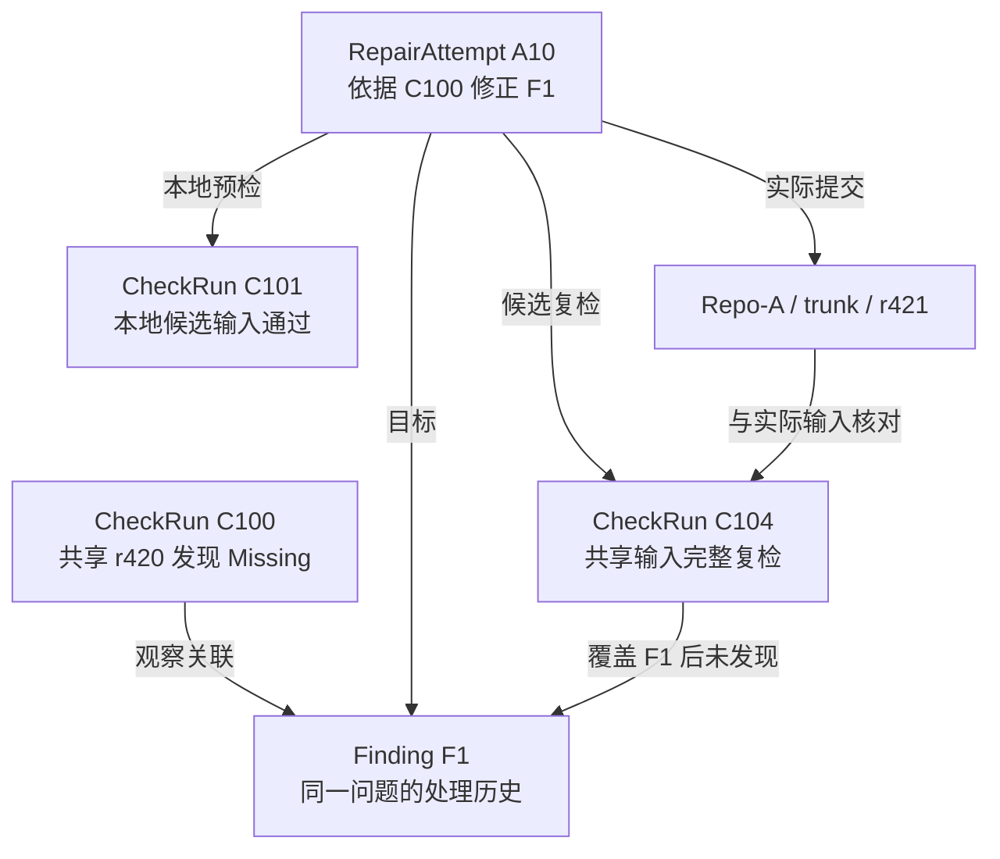

> **文稿状态：正文已写（研究设计）。实验状态：未执行。** 已有实践说明 Missing 检查、定位、依赖提交和提交后检查的使用过程；CheckRun、Finding、RepairAttempt 及下文的关联规则是本系列提出的记录方案。尚未核对当前工具接口，未实现存储、自动关联或状态管理，也未执行对应实验。示例中的项目、路径、标识、版本号和检查结果均为构造数据。

一条 Missing 通知发出来以后，使用者说“资源已经补交”，Jenkins 随后又有一次任务结束。此时要回答“这条问题解决了吗”，还缺几项对应关系：补交针对哪条问题？实际提交了什么？后来的任务检查了哪个版本？原来报错的位置有没有被覆盖？

把这些信息堆在一段聊天记录里，人还能凭上下文追问；准备交给固定流程或 Agent 服务时，就需要把关系写清楚。[第 01 篇]()提出了问题位置、输入版本、修正范围和复检结果四类交接信息，这篇将它们组织成三类记录。

## 1. 一次检查、一个问题和一次修正，分别回答什么

先给三类记录一个直接的定义：

| 记录 | 要回答的问题 | 需要保留的核心内容 |
| --- | --- | --- |
| **CheckRun：一次检查** | 对什么输入做了什么检查，实际得到了什么结果？ | 请求与实际输入、执行状态、规则和覆盖范围、报告及完整性 |
| **Finding：一个待处理的问题** | 哪项异常在什么版本被观察到，后来经历了怎样的处理？ | 问题身份、各次检查中的观察、相关修正及有依据的处理结论 |
| **RepairAttempt：一次修正尝试** | 为解决哪些问题，准备和提交了什么，又用什么检查验证？ | 目标问题、依据、候选与确认范围、本地预检、真实提交和复检关联 |

三类记录的数量不会总是一一对应。一次检查可以发现多条问题；同一条 Missing 可以连续被多次检查发现；一个问题也可能经历几次修正，才能得到有效复检。

例如，连续两次检查都报告同一场景、同一属性的缺失，应该有两条 CheckRun 和两次观察，但未必需要两条 Finding。通知重发也不应凭空增加一次检查。

这套分法延续了[已有资源完整性实践]()的处理顺序：检查、定位、修正提交、再次检查。原文并未证明这些对象名称、持久化关系或自动关闭机制已经存在；它们是接下来要研究的改造方案。

## 2. CheckRun 保存实际输入，不能只保存一个版本号

拟议的 CheckRun 从检查请求开始，允许在排队时还不知道实际检出内容。请求的输入与执行时确认的输入要分开保存：前者表达“想查什么”，后者才说明“查了什么”。

| 输入信息 | 拟记录什么 | 为什么需要 |
| --- | --- | --- |
| 来源与位置 | 项目标识、仓库身份、分支或仓库路径 | 相同的 revision 数字和文件路径，脱离仓库与分支不能解释 |
| 版本内容 | 请求的 revision、实际检出状态，以及必要的文件或内容清单 | 防止把请求参数直接当成检出事实 |
| 工作副本差异 | 未提交修改、未纳入版本控制的相关文件、混合版本及切换子目录等情况 | 本地工作副本可能不等于任一干净的共享版本 |
| 外部输入 | 实际使用的外部依赖版本、影响检查的配置 | 主目录的版本不能自动说明外部输入 |
| 检查条件 | Unity、检查器与规则版本，必要的执行环境信息 | 规则或环境改变后，前后结果未必可以直接比较 |
| 覆盖范围 | 请求扫描什么、实际扫描了什么、哪些对象跳过或失败 | “没有报告该 Missing”需要有覆盖证据支持 |

Subversion 的 revision 标记整个仓库树，而非某个项目独立推进的编号；其[官方 FAQ](https://subversion.apache.org/faq.html#globalrev)解释了这一点。工作副本也可能包含不同工作版本的文件，《Version Control with Subversion》的[混合版本说明](https://svnbook.red-bean.com/en/1.7/svn.basic.in-action.html#svn.basic.in-action.mixedrevs)给出了这种情况。

因此，“任务参数填了 r421”与“检查读取了约定分支在 r421 的完整输入”是两件事。只看根目录的一个数字，也不能证明所有相关路径与外部依赖都符合约定。

这些字段并不等于完整快照已经采集。第一版可以先约定：**共享复检只接受指定分支、固定 revision、相关输入可核对的干净副本**；混合版本或未知外部输入先标记为不可用于自动判定。作者本地的预检则如实记录差异，不能把这些差异抹成一个 revision。

输入还需要在检查期间保持固定。同一个工作副本若在扫描中途又被更新或编辑，开始时记下的 r421 就无法完整描述本次扫描。拟议执行约定应防止这种变化；无法保证时，记录输入不稳定并停止将结果用于自动判定。具体采用独立副本还是其他隔离方式，由后续工具接入设计确定。

如果检查还依赖未保存的配置或外部内容，记录只能支持有限回查，不能宣称已经可完整复现。第 03 篇将这些字段整理为待核对的工具契约，当前项目能力仍需实际盘点。

### 执行状态与检查结论要分开

CheckRun 还应区别以下结果：

| 实际情况 | 对执行的描述 | 对领域结果的描述 |
| --- | --- | --- |
| 排队，尚未开始 | 未执行 | 未知 |
| 扫描完整结束，发现 Missing | 执行完成、报告完整 | 有问题；保存具体观察 |
| 扫描完整结束，范围内没有异常 | 执行完成、报告完整 | 该规则在该范围内通过 |
| Unity 退出、扫描中断或报告缺失 | 执行失败或结果不完整 | 不能据此判定目标问题消失 |

检查器可以成功地发现问题。反过来，外层任务结束，也不保证检查完整执行。拟议服务应依据实际检查回执解释结果，而不直接把 Jenkins 的整体颜色当成每条 Finding 的结论。

## 3. 先固定一次 Missing 示例的身份和版本

下面用一个普通音频漏交场景贯穿关系。**这是一组未运行的设计数据，所有后续结果都是为解释记录模型构造的。**

| 示例项 | 约定 |
| --- | --- |
| 来源 | 示例仓库 `Repo-A` 的 `Game-A / trunk`，与真实内部地址无关 |
| 初次检查 | `C100`，读取干净的共享输入 r420，规则为 `MissingReference / v1` |
| 报错位置 | `Assets/Example/Room.unity` 中 `Environment/AmbientAudio` 的 AudioSource 音频属性 |
| 问题标识 | 服务分配 `F1`；将报告中的这项观察关联到它 |
| 已核对的漏交条件 | 本地有与该引用匹配的音频及 meta，相关目录已纳入版本控制，二者尚未提交；使用者确认应该保留此音频 |
| 修正尝试 | `A10`，依据 `C100` 对 `F1` 的观察，准备补交这两个文件 |

`C100`、`F1`、`A10` 是服务内拟议的标识；r420、r421 是示意的 SVN revision。两类编号含义不同。CheckRun 还需要关联真实外部任务标识，但不能把自己的编号假装成 Jenkins 已有字段。

此处已把“普通漏交”的前提写明。若实际只能看到 Missing 文本，还不能直接建立“漏交已确认”的事实，更不能默认所有 Missing 都适用补交。

## 4. Finding 串起各次观察，问题身份要与版本分开

Finding `F1` 负责连接这项异常的处理历史。它可以记住首次发现来自 `C100`，后续又在哪些 CheckRun 中出现，哪次修正以它为目标，以及什么证据支持最后的处理状态。

每次观察至少指向具体 CheckRun，并保留当时的位置、原始报告条目与关联依据。这里的“观察”是关系上的记录，不必为了本文先决定数据库要拆成几张表。

问题匹配可以研究使用“项目与分支、规则类别、所属资源的身份、对象与组件的可取得标识、属性位置”等信息。**revision 主要记录这次观察发生在哪个输入上，不宜直接并入跨版本问题的匹配条件。** 否则换一个版本检查，就可能给同一项异常新建一条问题。

不过，场景节点改名、组件替换或规则升级，都会影响匹配。人类可读的对象路径有助于定位，却不能保证始终唯一、稳定。Missing 目标的标识也未必能从当前报告中取得。

第一版应保存原始定位信息与匹配依据；能够可靠识别时才关联到原 Finding。只有文本路径、存在歧义或规则不兼容时，可以保留为待确认的候选关联，不能让模型凭语义相似就合并问题。哪些标识实际可取得，仍是接口核对和样本验证的内容。

### 没有再次出现，也是一项需要解释的观察

对 `F1`，一次检查至少可能形成三种不同记录：

- **再次发现**：报告中有可关联到 `F1` 的异常条目。
- **覆盖后未发现**：原目标或经确认对应的目标被规则完整检查，未再报告该异常。
- **无法判定**：未覆盖、被跳过、目标无法匹配，或报告不完整。

如果报表只列异常条目，没有扫描范围和完成信息，列表里找不到 `F1`，就只能说明“没有这条报告”。它还不足以提供“覆盖后未发现”的证据。

例如，删掉整个场景也会让文本路径不再出现。若修正目标本来是补齐音频，就不能把这种消失当作该目标已完成；有意移除内容则应记录相应决定与验收依据。

## 5. RepairAttempt 将准备修改、实际提交与复检接起来

`A10` 表达的是一次有目标的处理，不保证它最终成功。它先指向 `F1` 和作为依据的 `C100` 观察，再逐步附上实际取得的结果。

| 处理环节 | `A10` 拟保存的内容 | 暂时还不能得出的结论 |
| --- | --- | --- |
| 准备修正 | 目标 `F1`、依据 `C100`、候选文件、预览时的本地输入与内容意图 | 候选已经提交 |
| 使用者确认 | 谁以何种方式确认哪一版候选及变更内容 | 确认之后的文件变化也自动获准 |
| 本地预检 | 对本地输入的一次独立 CheckRun，例如 `C101` | 共享版本已经修正 |
| 正式提交 | 仓库、分支、实际提交 revision、变更清单和提交回执 | 这次提交已经通过共享复检 |
| 请求复检 | 请求标识、约定输入、规则与范围 | 检查已按请求实际执行 |
| 取得结果 | 实际 CheckRun、输入核对结果、对 `F1` 的观察与判定依据 | 未覆盖的其他问题也已解决 |

在示例中，使用者确认补交音频及 meta，SVN 返回实际提交 r421。服务需要核对实际变更与已确认的候选内容是否对应，再把 `(Repo-A, trunk, r421)` 关联到 `A10`。若实际范围不一致，就保留差异并等待核对，不能悄悄沿用旧确认。

提交说明里写上 `A10`，或者由提交入口携带关联标识，都可以帮助找到候选提交；它们仍是关联线索。真正记录的提交事实要来自版本控制回执及可核对的变更，不能仅凭聊天中的“已经交了”就填写 r421。

本地预检使用的也应是独立 CheckRun。`C101` 的输入包含未提交的音频及 meta，即使它通过，也只能说明那个本地输入的检查结果。提交本身不会把 `C101` 自动变成 r421 的共享检查。

一次修正可以帮助多个 Finding，同一 Finding 也可以经历多个 RepairAttempt；应显式列出关联，并逐项评价结果。第一版可以先限制一次尝试对应一次明确提交。若以后需要多次提交，必须列明哪些提交共同构成候选输入，不能用“最近一次提交”替代整组变更。

## 6. 沿时间线看，哪次复检真正对应 r421

把示例中的记录按发生顺序排开：

| 事件与记录 | 实际输入或回执 | 对 `F1` 和 `A10` 的意义 |
| --- | --- | --- |
| `C100` 首次检查 | 共享 r420；完整执行，发现音频 Missing | 建立 `F1` 及首次观察 |
| 创建 `A10` | 目标 `F1`，依据 `C100`，候选为本地音频及 meta | 进入准备修正，尚无提交 |
| `C101` 本地预检 | 本地 r420 基础加候选文件；完整执行，原位置无 Missing | 关联为 `A10` 的本地预检，`F1` 仍待共享验证 |
| 正式提交 | 实际提交 r421，变更核对与确认内容一致 | `A10` 已提交，等待合格共享复检 |
| `C102` 候选复检 | 请求 r421，但实际仍读取 r420；完整执行，又发现 `F1` | 是 r420 的有效观察；不符合 `A10` 本次复检约定，不能判定 r421 的修正失败 |
| `C103` 再次检查 | 实际为共享 r421，但扫描中断，报告不完整 | 不能支持通过，也不能凭缺少条目判定 `F1` 消失 |
| `C104` 有效复检 | 共享 r421；输入、规则和覆盖范围符合约定，完整检查原目标，未发现该 Missing | 可作为 `A10` 对 `F1` 的有效验证证据 |

这些 CheckRun 都应留下来。`C102`、`C103` 不能拿来证明修正成功，却分别记录了“旧输入仍有问题”与“新输入检查未完成”。覆盖或删掉它们，会让后续无法解释为什么多触发了检查。

三类记录的关系可以压成下面这张图：



图中每条边都需要有来源。尤其是 `A10 → C104`，既要说明这是为该次修正安排的检查，也要保留实际输入与目标覆盖的核对结果。

### 一条请求关联，不能代替四项核对

拟议服务在把 `C104` 用作验证证据前，至少要检查：

1. **关联对象明确**：知道正在验证 `A10` 对 `F1` 的处理；主动发起的复检有请求到真实任务、CheckRun 的映射。若采用其他检查结果，也要记录如何将其选为证据。
2. **输入对应修正**：本例约定检查干净的 trunk@r421，实际输入也符合约定；本地补丁、其他分支或旧版本不能冒充这一输入。
3. **检查可比较且覆盖目标**：规则版本兼容，原报错对象可识别，范围没有跳过它。规则变化需要额外说明，不能把关闭该规则后的安静当成修正。
4. **结果可用于判定**：扫描与报告完整，读取到了覆盖后未发现 `F1` 的结果；模型建议和任务排队回执都不满足这一项。

关联的结果也不应只有“通过／失败”两个值。若输入和覆盖都合格但仍发现 `F1`，可以记录“本次修正在该输入下未消除问题”；若输入不匹配、未执行或报告不完整，则记录“不能用于本次判定”，继续等待或转入后续处理。

### 复检版本更高，也要说明接受的是哪个结论

实际运行时，检查机可能已经同步到 r422。本例第一版可以先要求精确检查 r421；如果工具只能检查更晚版本，就如实记录差异，不能把“请求 r421、实际 r422”改写成完全一致。

后续若允许使用 r422，需要核对仓库与分支、实际内容是否包含预期修正，以及中间变更、回退和规则变化是否影响目标；只比较 `422 ≥ 421` 不够。SVN 的全局编号也可能因其他目录提交而推进，数字大小无法替代这些关系。

即使确认 r422 包含修正且该问题检查通过，结论也应写成“包含 `A10` 变更的 r422 输入中，未再观察到 `F1`”。若有其他修改参与，单次结果不能证明仅由 `A10` 造成改善。要取得 r421 自身的证据，仍需检查那个确切输入。

## 7. 把证据转换成有范围的处理状态

有了上述关联，正常路径可以由固定规则推进，不必让模型反复解释状态：

| 取得的依据 | RepairAttempt 可以记录什么 | Finding 可以怎样呈现 |
| --- | --- | --- |
| `C100` 的异常观察与目标关联 | 尚无尝试，或准备创建尝试 | 在 r420 被发现，待处理 |
| `A10` 已有依据、候选与确认 | 待提交；本地预检结果另列 | 正在处理，共享版本尚无修正证据 |
| r421 的真实提交及内容核对 | 已提交，待共享复检 | 等待验证，不因本地通过而关闭 |
| `C102` 或 `C103` 这类不合格证据 | 保留原因，尚无有效验证结论 | 待验证或验证受阻 |
| `C104` 符合约定且覆盖后未发现 | 对 `F1` 的修正在 r421 验证通过 | 在指定输入与规则范围内已解决，附 `A10`、r421、`C104` |

这里的“已解决”必须能展开成一条回执，例如：

```text
设计回执，未实际执行
问题：F1，Room 场景的音频引用 Missing
修正：A10；真实提交记录指向 Repo-A / trunk / r421
验证：C104；实际共享输入为约定的 trunk@r421
判据：MissingReference / v1 完整覆盖原目标，未再发现该项异常
结论范围：本条引用检查；包内表现与运行时功能未验证
```

若同一次检查还发现 `F2`，`F1` 的结果可以独立记录，但整个版本仍可能不满足交付条件。一个尝试针对多个问题时，也可能部分通过、部分仍存在，不能用一个总体绿色状态替代逐项结果。

旧结果与新提交的先后关系、重复事件、问题再次出现和服务重启后的恢复，留给[第 07 篇提纲]()。本篇先把正常关联及其证据含义固定下来，后续恢复才能知道要恢复哪项事实。

## 8. 这套记录怎样交给后续工具与 Agent

三类对象首先服务于工具和固定流程。模型即使参与调查，读取的也应是有来源的 CheckRun 观察、Finding 历史和 RepairAttempt 当前证据。

“建议补交音频”“可能检查了旧版本”可以作为解释或建议保存，但正式提交仍需版本控制事实，输入差异仍需工具核对。模型不能为了让记录完整，就把未知 revision 或缺失报告补成确定值。

[第 03 篇：工具要交出什么]()已把这些需要映射为 Jenkins、SVN、Unity 与本地工具的拟议契约，实际项目能力仍待核对。优先核对的能力包括：请求与真实任务怎样对应，检出和扫描范围怎样返回，提交如何给出可核对回执，报告怎样区分完整无异常与执行失败。

验证记录设计时，应至少准备本例中的几种输入：连续两次观察同一问题、本地通过但未提交、请求版本与实际输入不同、完整发现问题、完整未发现问题、工具失败及报告缺失。还要补上一次修正对应多个 Finding、同一 Finding 多次尝试、对象无法可靠匹配等样本。

**当前完成的是记录与关联规则的设计说明。** 尚无真实数据证明问题匹配准确、输入可以完整采集或状态推进可靠；存储、适配器与实验均未实现或执行。后续验证需要保存原始回执，逐条检查预期关系是否成立，不能用手填的 `C104` 回执当作验证结果。

需要通用证据组织背景时，可以按需阅读 [Evidence Contract]()。普通漏交的完整流程由[第 04 篇设计推演正文]()继续展开。

**修正提交说明改变了什么，复检记录说明检查了什么；只有两者连同问题目标对得上，才能给出有范围的修正结论。**

<!-- DATA-TODO: 核对实际检查输入与报告格式，收集完整发现问题、完整无异常、工具失败及输入不匹配的脱敏样本；验证问题身份、实际提交、目标覆盖和复检关联。 -->
