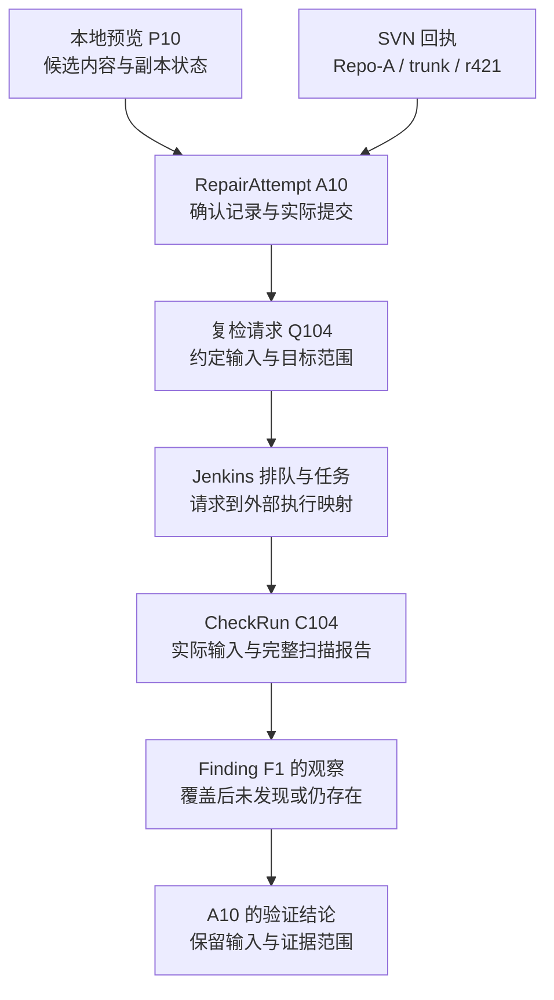

> **文稿状态：正文已写（研究设计）。实验状态：未执行。** 已有项目能力依据作者的资源完整性实践；Jenkins、SVN、Unity 的通用入口依据本文所引文档。现有项目的具体版本、源码、接口与权限尚未核对。下列能力名称、字段、回执与 Missing 轨迹均为拟议契约，适配器未实现，未调用真实项目工具进行接入实验。

检查任务能运行，编辑器菜单也能使用，服务仍然可能接不上这条处理链：它拿不到稳定的任务标识，不知道检查实际读了什么版本，也无法区分“没有候选文件”和“预览根本没执行”。

[第 02 篇]()用 CheckRun、Finding、RepairAttempt 组织检查、问题与修正。本篇继续回答一个更具体的问题：**现有工具要交出哪些输入、输出和回执，才能让这些记录有事实可填？**

先从操作的业务含义定义契约，再决定调用形式。接口可以由命令行、进程包装、编辑器入口或服务实现；是否采用 MCP 可以后续选择。换一种调用协议，并不会自动补出实际版本、覆盖范围或提交证据。

## 1. 先区分已有操作与尚未确认的调用能力

[已有资源完整性实践]()记录了 Jenkins 同步 SVN、调用 Unity 批处理检查、发送 Missing 通知，以及 MissingFind、仲裁机和依赖提交的使用过程。这些材料支持“已经做过哪些操作”，但不能据此推定每项操作都已有独立的远程接口。

| 工具环节 | 既有材料支持的能力 | 本系列仍需核对或补齐的契约 |
| --- | --- | --- |
| Jenkins 检查任务 | 同步 SVN，调用检查并组织报告、通知 | 请求如何对应排队项和实际任务；是否支持固定 revision；如何取回完整报告 |
| Unity Missing 扫描 | 检查引用并生成缺失位置信息 | 机器可读报告、实际扫描范围、跳过与失败条目、检查器和规则版本 |
| MissingFind 与仲裁机 | 在编辑器中定位对象；本地正常时可到仲裁机对照 | 能否导入报告定位项，是否能返回匹配结果，本地输入与报错输入是否一致 |
| 依赖提交 | 收集依赖、处理目录与 meta、结合 SVN 状态生成候选，由使用者确认提交 | 能否独立导出预览；怎样绑定候选内容、确认与实际提交；失败怎样回传 |
| 群通知与协作 | 按目录配置或版本记录寻找通知对象，人工跟进 | 通知怎样关联 Finding，人工操作如何形成有来源的回执 |

SVN 自身提供查询和提交能力，但项目是否已将这些能力包装成服务可调用、能保留来源的接口，仍需另行核对。通知送达也只是一次协作动作，不能据此把 Finding 改成已修正。

因此，第一版适配工作可以先做一张能力核对表：每项操作在哪里运行，现有入口是什么，谁有权限，能导出什么，以及缺少哪项关键事实。某步只能由人完成时，也可以先接操作回执；此时应标明它是人工提供的材料，避免与工具自动采集混写。

## 2. 接口要交出两层回执，再映射到三类记录

一次请求通常会经历“被接收”和“实际结束”两个时刻。对异步检查，接收回执只承诺有一个可继续查询的请求或任务；完成回执才提供执行状态与结果。同步查询可以在一次返回中交齐这些信息，但含义仍要分开。

下面的字段是**拟议的公共约定，不是现有工具字段清单**：

| 信息 | 要表达什么 | 怎样进入记录 |
| --- | --- | --- |
| `request_id`、操作名、契约版本 | 这是哪次请求，怎样解释字段 | 用于追踪一次调用，关联 CheckRun 或 RepairAttempt |
| 调用目标与请求输入 | 哪个项目、分支、副本、版本与范围 | 写入请求部分，不直接冒充实际输入 |
| 外部执行标识 | 哪个 Jenkins 排队项或任务、哪次本地执行 | 与服务标识建立可查询的映射 |
| 执行状态与实际输入 | 是否开始、完成、失败；实际读取了什么 | 更新 CheckRun，或为 RepairAttempt 保存操作事实 |
| 结果、完整性与证据入口 | 发现了什么，结果能解释到什么范围，原始材料在哪里 | 形成 Finding 的观察，或修正与复检的核对依据 |
| 错误类别与未知项 | 不支持、无权限、输入不符、执行失败、结果缺失等 | 保存受阻原因，不把未知填成通过或空结果 |

三类业务记录仍由处理服务组织。工具返回一个报告条目，不必自行决定它是不是历史 Finding `F1`；服务根据定位信息和关联规则形成观察。版本工具返回一次提交事实，也不能直接替 RepairAttempt 宣布复检通过。

沿用第 02 篇的构造示例：`F1` 是场景音频引用 Missing，`A10` 准备补交匹配的音频与 meta，示意提交为 `Repo-A / trunk / r421`，有效复检为 `C104`。本篇新增的请求、预览和外部任务标识也都是设计示意，没有实际执行。

## 3. Jenkins 适配：从请求追到具体检查任务

拟议检查接口至少需要两项能力，名称仅用于说明职责：

- **`start_check`**：输入项目与受支持的任务入口、请求标识、固定输入要求、规则和检查范围；返回已接受的请求及可追踪的外部任务线索。
- **`get_check`**：按已保存的标识查询排队、运行与结束状态，取得实际任务、检查输入、报告和错误信息。

这里不把整个 Jenkins 管理 API 暴露给模型。项目与任务映射、凭据和允许的参数由适配器配置；模型或流程只选择已开放的检查能力。某个 Job 若没有实现按指定 revision 检出，适配器就应返回不支持或实际差异，不能仅添加一个同名参数便声称能力成立。

Jenkins 的[远程访问 API 文档](https://www.jenkins.io/doc/book/using/remote-access-api/)说明了程序化读取信息和触发任务的通用入口。其[队列对象文档](https://javadoc.jenkins.io/hudson/model/Queue.Item.html#getId())也说明了队列标识与后续 Run 的对应关系。这些是设计映射的依据，当前项目采用的 Jenkins 版本、插件、权限及实际暴露字段仍待核对。

对 `A10` 的共享复检，拟议映射可以这样组织：

```text
设计请求，未实际发送
request_id: Q104
check_run_id: C104
repair_attempt_id: A10
requested_input: Repo-A / trunk / r421
requested_rule: MissingReference / v1
requested_scope: Room 场景及原报错目标

接收回执：Q104 已受理；外部排队项已记录；实际任务尚未开始
运行回执：排队项已对应到具体任务；实际输入待检出与检查环节确认
完成回执：外部任务、实际输入说明、扫描报告和执行状态均可关联回 Q104 / C104
```

服务不能靠“这个 Job 最近一次成功运行”来补出对应关系。多人并行触发时，最近一次任务可能属于另一个请求。需要保存实际请求到排队项、任务及报告的映射；若同一外部执行承载多个请求，也应明确记录，而不是假装产生了多次独立执行。

触发调用超时也不代表任务未创建。此时先按已有标识核对，保留“受理状态未知”，不能立即重复触发并期待没有副作用。`request_id` 只是关联基础，幂等处理和恢复需要适配器、服务共同实现；具体策略留给第 07 篇。

## 4. Unity 扫描：把报告完整性与目标覆盖交出来

Jenkins 知道外部任务何时结束，具体检查了哪些对象，仍需要同步与扫描环节提供事实。可由任务包装器汇总 SVN 输入说明，再与 Unity 扫描报告关联；不要求 Unity 单独推断所有版本信息。

Unity 提供批处理与静态方法调用的通用方式，见 [Unity 2022.3 Editor 命令行参数](https://docs.unity3d.com/2022.3/Documentation/Manual/EditorCommandLineArguments.html)。Missing 扫描规则、报告格式和业务判据属于项目工具。本篇引用该文档说明调用形式，不推定历史项目版本，也未验证当前项目可直接运行这些入口。

拟补的扫描契约需要接收请求标识、项目输入、规则配置、扫描范围与报告输出位置，并返回：

| 报告部分 | 示例中要交出的事实 | 对应第 02 篇的用途 |
| --- | --- | --- |
| 身份与版本 | `Q104 / C104`、检查器版本、规则版本、实际 Unity 版本 | 防止将其他任务或规则的报告归到本次 CheckRun |
| 输入引用 | 本次实际输入说明的标识，扫描期间是否保持固定 | 核对 `C104` 是否确实验证 r421 |
| 请求与实际范围 | 请求的场景，实际成功检查的目标，跳过或失败项 | 支持对 `F1` 判断覆盖、未覆盖或未知 |
| 异常条目 | 资源路径、对象定位、组件与属性、规则，以及实际能取得的标识 | 给 Finding 保存观察与匹配依据 |
| 执行与完整性 | 是否完成约定扫描，报告是否完整，异常与错误分别是什么 | 区分完整无异常、完整发现问题和扫描失败 |
| 原始证据 | 与本次执行绑定的报告和日志入口，格式版本与必要的内容校验信息 | 允许回查结果来源，避免报告被另一轮覆盖 |

完整扫描后没有异常，应显式返回“范围已检查，异常条目为空”。如果没有生成报告，或者场景打开失败，就返回失败或不完整；不能用同一个空数组表达。

覆盖信息也不要求起步就逐个记录场景中所有对象。可以先返回成功扫描的资源范围、跳过项和规则语义，再提供按 Finding 定位查询覆盖情况的能力。关键在于能够解释“原目标是否确实被检查”，而不是单纯增加一个扫描数量。

对同一个 `F1`，范围内检查完成且未发现它，可以支持第 02 篇的“覆盖后未发现”；目标无法匹配、检查规则被关闭或对象被跳过，就不能自动得到相同结论。

进程退出码、外部任务状态、扫描执行状态与 Missing 条目应分别保存。即使扫描已经生成完整的异常报告，外层任务也可能因质量门或后续步骤失败；此时报告仍可能是有效观察，但不代表整个任务通过。反过来，外层成功而领域报告缺失，也不足以判定引用检查通过。

## 5. SVN 适配：查询过去的事实，确认实际的提交

定位差异时，服务需要查询指定版本的内容与变更。本地预览时，则需要查询某个工作副本的实际状态。这两种目标应在接口中区分，不能都叫“读取当前资源”。

| 拟议能力 | 必须说明的输入 | 应返回什么 |
| --- | --- | --- |
| 查询输入状态 | 工作副本标识、目标范围 | 仓库与路径、版本状态、本地修改及相关未纳管文件、混合或切换情况，无法取得的字段 |
| 查询指定内容 | 仓库、分支或路径、指定 revision | 该输入上的内容或存在性，以及查询失败原因 |
| 查询差异与历史 | 两个明确输入或 revision 范围、目标路径 | 变更清单、来源版本、可回查的历史记录 |
| 核对提交 | 仓库身份、实际 revision、目标路径或已知操作标识 | 实际提交涉及的路径、动作和可核对的变更内容 |

SVN 的 `info`、`status`、`cat`、`diff`、`log` 等通用命令可以作为适配来源，见 [Subversion 命令行参考](https://svnbook.red-bean.com/en/1.7/svn.ref.svn.html)。支持结构化输出的命令可优先使用该输出；具体可用选项、客户端版本和编码仍需核对。不能只从中文控制台的一句提示中抽取事实。

例如，调查 r420 的 Missing 时，要取 r420 对应的场景和资源信息。拿今天的 HEAD 文件来解释过去的报错，会把两个输入混在一起。路径移动等情况也需要保留查询身份和定位依据，不能把无法查询都写成“文件不存在”。

没有该资源、没有读取权限、连接失败和路径无法解析，是不同结果。只有工具成功查询且明确表明指定输入中缺少目标，才能保存相应的存在性事实。

SVN 历史和提交者信息可以提供调查、协作线索，不能直接推出内容意图或根因责任。资源是否应该恢复、场景应改用哪个音频，仍需要相应的内容决定及依据。

## 6. 本地工具：定位、预览、确认与提交分别交接

作者的工作副本与检查机是两个执行环境。服务能读取检查机，不表示它已经能访问作者电脑。第一版可以先由使用者在编辑器里操作，再导出结果；若后续添加本地连接程序，也必须明确它接入的是哪个项目、副本和会话。

### MissingFind 返回匹配与定位结果

拟议的 `locate_missing` 接收 `F1` 对应的报告条目：来源 CheckRun、资源、对象路径、组件与属性，以及实际取得的稳定标识。工具先核对当前项目和本地输入，再尝试定位。

返回结果应区别：唯一匹配并定位、多个候选、对象未找到、当前输入不符、工具不可用。找到一个同名节点，不能直接当作原对象；打开了场景，也不代表缺失引用已经修正。

这些信息作为定位证据附在 Finding 的处理历史或当前 RepairAttempt 中。当前 MissingFind 能否接收这样的输入、返回机器可读结果，尚未查证。界面有一个定位按钮，不等于接口已经存在。

### 依赖提交先提供独立预览

拟议的 `preview_dependencies` 接收 `A10`、选择的资源和目标提交范围，返回一份与采集时副本绑定的候选。例如 `P10`：

- 本地项目、副本身份、基础输入及相关差异；
- 选择的资源与依赖收集范围、收集方式或版本；
- 候选路径、SVN 状态、纳入原因、资源与 meta 关系，以及需要补齐的目录；
- 文件及相关属性变更的内容标识，供确认与执行时核对；
- 未能收集的对象、失败与未知项。

`P10` 是设计中的预览标识。它需要绑定候选内容，而不只是绑定文件名；同一路径的文件在预览后仍可能被编辑。依赖收集范围也决定结果含义：“没有新增依赖”与“没有任何待提交修改”不能共用一个模糊的空结果。

历史依赖提交工具已经会组织候选供使用者确认；能否不打开提交窗口就独立导出上述信息，仍需核对。如果暂时做不到，可以先保存人工导出的材料和来源，不将它描述成已完成无人值守预览。

### 提交回执绑定确认内容与实际变更

拟议的 `submit_candidate` 引用 `A10`、`P10` 的确定版本和服务保存的确认记录，执行前重新核对相关内容与副本状态。确认来源和允许范围由服务验证，不能靠模型传入一个 `approved: true` 就获得提交授权。

执行必须限定到确认的候选，避免顺带提交作者工作副本里的其他修改。核对到提交期间也要防止候选内容变化；做不到时应停止或采用能保持内容固定的执行方式。仅在开始时检查一次摘要，不能自动保证整个过程都没有变化。

完成回执至少要说明：

```text
设计提交回执，未实际执行
request_id: S10
repair_attempt_id: A10
candidate_ref: P10 的已确认版本
execution: 提交已由版本控制确认
actual_commit: Repo-A / trunk / r421
actual_changes: 已核对的音频、meta 及相关变更清单
evidence: 本次操作回执与该 revision 的查询材料
verification: 共享复检尚未完成
```

提交窗口已打开或文件已加入版本控制，都不能填写为“提交完成”。调用超时、网络断开时，也要保留“是否提交成功未知”，先查询和核对实际版本记录；不能直接重做提交。如何恢复未知操作的细节由第 07 篇继续展开。

## 7. 用 A10 的复检把接口回执接回记录模型

把前述契约放回第 02 篇的 Missing 示例，服务需要连接两条证据链：本地修正怎样成为共享变更，共享检查怎样覆盖原问题。



图里的回执均为待实现方案。各环节对应的记录可以再核对一遍：

| 取得的材料 | 保存到哪里 | 程序还要核对什么 |
| --- | --- | --- |
| 首次检查报告与原始条目 | `C100`，以及关联到 `F1` 的观察 | 实际输入、规则、条目身份与报告来源 |
| 定位、预览 `P10` 与确认 | `A10` 的处理依据和候选记录 | 本地输入、匹配结果、范围及确认内容是否一致 |
| 提交 `S10` 与 r421 的版本事实 | `A10` 的实际提交关系 | 仓库、路径、实际变更是否对应候选 |
| `Q104` 的受理、排队与任务映射 | `C104` 的执行关系，并关联 `A10` | 真实外部任务是否属于此请求 |
| 实际输入说明与 Unity 完整报告 | `C104`；由服务为 `F1` 解释观察 | 是否符合 r421 的输入约定，原目标是否被兼容规则覆盖 |
| 对目标的有效观察 | `A10` 对 `F1` 的验证结果 | 是否足以支持本项修正结论，仍有哪些未知项 |

如果得到第 02 篇中的 `C102`——请求 r421，实际却检查 r420——接口要如实交出不一致，服务才能保留旧版本观察并拒绝将其用作这次修正的验证。若得到 `C103` 的不完整报告，则保留执行失败，继续等待有效结果。适配器不应为了让流程顺畅而把两者改成空异常列表。

这些核对大多可以由固定规则完成。模型可以请求更多版本差异、解释证据缺口或提出调查方向，但模型输出不能替代任务映射、提交回执或覆盖报告。

## 8. 第一版先补什么，怎样判断接入真的成立

第一版可以优先补最影响闭环判定的缺口：

1. 让一次共享检查返回可追踪的请求、外部任务、实际输入及完整报告。
2. 让版本查询能读指定输入，核对实际提交；让扫描结果区别无异常、未覆盖与执行失败。
3. 让本地定位与预览能提供有来源的结果，明确哪些步骤仍由使用者操作。
4. 将候选、确认和实际提交分开记录，再接回固定输入的共享复检。

调用方式按已有入口选择。现有方法可复用时可以加函数包装；已有命令行或报告时可以加进程适配；只能在编辑器中操作的能力则先保留交互约束。单机调用与跨机器调用都需要相同的业务语义，是否引入远程服务或 MCP 不改变这些事实要求。

接入验证至少要准备这些样本：任务受理但尚未运行、两个请求交错执行、请求 revision 与实际输入不同、完整报告无异常、完整报告有 Missing、扫描失败、作者电脑不可用、预览后文件变化，以及提交结果未知。

验证时不只看接口有没有返回 JSON，还要对照真实任务、工作副本、版本记录和报告，确认回执没有串号、遗漏或错误解释。返回原始证据入口，也需要验证材料能读取、属于本次执行，且不会被下一次检查覆盖。

**当前完成的是适配契约设计，没有完成项目能力盘点、接口实现或接入验证。** 第 02 篇的记录模型与本文字段都需要在真实样本上修订；本轮没有配置 Jenkins、访问项目 SVN 或运行 Unity 工具，也没有模型调用与效果数据。

接下来沿[第 04 篇：普通 Missing 的固定流程]()阅读普通漏交的完整设计推演，该篇正文已写、流程未运行；异步结果、重试与恢复由[第 07 篇提纲]()进一步展开。通用执行分层可按需阅读 [Tool Runtime]()与 [Harness 在交付工程里的位置]()。

**工具接口要交出一次操作实际做了什么的证据，服务才能把它接成一次有依据的修正与复检。**

<!-- DATA-TODO: 固定实际 Jenkins、SVN、Unity 和自研工具版本，核对输入、权限、报告与回执；采集受理、执行完成、失败、不完整和结果未知的脱敏样本，验证请求到任务、提交到复检的关联。 -->
