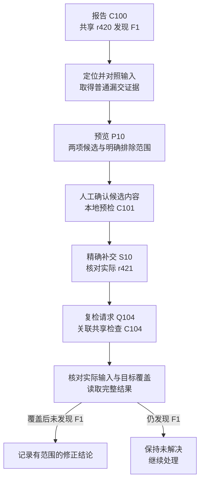

> **文稿状态：正文已写（设计推演）。实验状态：未执行。** 本篇将前文的记录模型与拟议工具契约放入一个构造的音频漏交场景。所有路径、标识、版本、工具回执和分支结果均为设计数据；流程、适配器和样本尚未实现或运行。已有工具实践与本篇方案分开记录，不能把下面的完整路径视为已跑通的实验。

收到 Missing 报告后，人打开场景、找到对象、确认依赖没有提交，再补交并检查。这串操作中，很多“下一步做什么”其实已经有明确规则：定位结果可靠才生成候选，候选经确认才提交，取得对应的共享复检才给出结论。

这一篇用一条具体路径，把这些规则接起来。目标是定义一个后续可实现、可对照的基线：**在证据足够且修正意图明确的普通漏交中，固定流程怎样组织一次处理？**

[第 02 篇]()已经定义 CheckRun、Finding、RepairAttempt 的拟议关系，[第 03 篇]()给出工具输入输出需求。这里使用它们，不再展开全部字段，也不假定当前工具已经满足这些契约。

## 1. 先固定样例，Missing 还不能直接叫漏交

沿用前文的 `Repo-A / Game-A / trunk` 示例：干净的共享输入 r420 中，一个场景报告音频引用 Missing；作者本地打开同一场景却正常。

为了让正常路径可以判定，样例需具备以下条件。**这些是为本次推演准备的条件，不是收到一条 Missing 后可以自动假定的事实。**

| 项目 | 本例约定 |
| --- | --- |
| 检查位置 | `Assets/Example/Room.unity` 的 `Environment/AmbientAudio`，AudioSource 的音频引用属性 |
| 引用目标 | 用别名 `G_audio` 表示已核对的目标身份，包含资源标识及必要的对象信息；不是一个真实 GUID |
| 共享输入 | `C100` 检查干净的 trunk@r420，场景保留该引用，对应音频及 meta 尚未纳入版本库 |
| 本地输入 | 副本 `W10` 以 r420 为基础，场景及相关已有输入与共享版本对应；本地保留匹配的音频及 meta |
| 准备补交 | `Assets/Example/Audio/RoomAmbience.wav` 与同路径的 `.meta`；父目录已纳入版本控制 |
| 无关修改 | `Assets/OtherWork/Unused.mat` 有本地修改；样例约定它不属于这次修正，也不在本次目标的依赖范围内 |
| 内容意图 | 使用者确认场景应该保留这项音频，目标是补齐依赖 |
| 判定范围 | 固定的 `MissingReference / v1` 检查覆盖原场景与目标；包内表现和运行时功能另行验收 |

认定普通漏交，至少要取得三项证据：场景实际引用什么，本地文件是否与该目标对应，以及共享输入中是否确实缺少这些文件。只有文件名相同不够；查询失败也不能直接解释为共享版本没有文件。

本例还假设定位与依赖工具能交出足以核对这些关系的结果。当前项目能否提供这些信息仍待盘点；取不到时，应记录未知并停在前置核对，而不是直接进入补交。

## 2. 从 C100 的报告进入 F1 的定位

推演从 `C100` 的完整报告开始。服务保存实际输入、规则、范围和原始条目，建立或可靠关联到 Finding `F1`。随后创建以 `F1` 为目标、以该次观察为依据的 RepairAttempt `A10`。

定位动作使用第 03 篇拟议的 MissingFind 入口：传入来源检查、场景、对象、组件、属性及实际能取得的标识。使用者打开本地副本 `W10`，工具先核对项目与输入，再定位到对应对象。

本地没有 Missing 并不使 `C100` 失效。它只是提示两边输入可能不同。本例的对照结果应能说明：场景引用目标一致，本地保留了共享 r420 中缺少的依赖。

这一段的交接可以写成：

| 输入 | 执行者 | 拟议回执 | 继续条件 |
| --- | --- | --- | --- |
| `C100` 的报告与实际输入 | 服务 | `F1` 的观察、`A10` 的处理目标 | 报告可解释，问题关联有依据 |
| 报告位置与 `W10` | 使用者和定位工具 | 对象匹配结果、本地输入及引用对照 | 原目标可靠对应，输入差异可说明 |

如果只是找到一个同名节点，或者当前场景已发生无法对应的修改，就保留候选位置和差异。正常路径的入口条件尚未满足，应先解决定位或输入问题。

## 3. 预览 P10：两个目标文件与一份无关修改

确认漏交条件后，依赖工具从选定的 Room 场景收集依赖，结合 SVN 状态形成预览 `P10`。依赖集合回答“这个内容依赖什么”，待提交集合还需要回答“这次修正需要交什么”。两者不能直接画等号。

本例的目标候选是：

| 文件 | 纳入依据 | 本次处理 |
| --- | --- | --- |
| `Assets/Example/Audio/RoomAmbience.wav` | 本地存在并匹配目标，支撑原引用，尚未提交 | 纳入候选 |
| `Assets/Example/Audio/RoomAmbience.wav.meta` | 与目标资源配套，保存相应身份及导入信息，尚未提交 | 与资源一起纳入候选 |
| `Assets/Example/Room.unity` | 与共享输入对应，本例无需修改该场景 | 不制造额外场景修改 |
| `Assets/OtherWork/Unused.mat` | 有本地修改，但与本次目标无关 | 排除并保留原修改 |

表中前两项共同构成本例的补交范围。若父目录也未纳入版本控制，还需要按实际状态补齐必要目录及其相关元数据；那会形成另一份候选，不能继续声称“只提交这两个文件”。本例已限定父目录为现有目录，以便固定比较条件。

`P10` 还要保存采集时的副本状态、选择范围、候选内容和纳入原因。它不能只有两个路径字符串，否则文件在预览后被改写，使用者确认的就可能不再是实际提交的内容。

无关材质修改是一项明确的验收条件。拟议提交动作应使用精确候选范围，不能为了方便提交整个工作副本。未来运行样本时，需要检查该材质是否被保留、是否被意外修改或带入提交；目前没有执行结果。

如果递归依赖中出现其他已修改文件，也不能简单以“属于依赖”为由全部交出。需要说明它与本次修正的关系，并取得相应的范围决定。普通路径的确定性来自明确的条件和选择规则，不来自盲目扩大候选。

## 4. 人工确认与本地预检，分别提供什么依据

使用者查看 `P10`，确认场景应该保留该音频，以及准备提交的是哪一版候选内容。服务保存有来源的确认，`A10` 才能向后推进。

**不调用模型的流程仍可以包含人工确认。** 等待谁确认、确认什么、回执到了怎样继续，都可以事先定义。人在这里提供内容意图与范围决定，程序维护等待和证据关联。

随后进行本地预检 `C101`。它使用记录过的本地输入，检查原场景和目标。设计中的预期结果是完整执行且不再报告这项 Missing；如果检查未完成或候选发生变化，就先停止这次推进。

即使 `C101` 得到预期结果，也不能关闭 `F1`：音频和 meta 此时还可能只在作者本地。`C101` 的输入说明必须保留本地候选及其他相关差异，它不会自动成为一个干净共享版本的证据。

确认与预检还应对应即将提交的候选。若音频内容、meta、相关属性或候选范围改变，就需要重新核对受影响的确认与预检；不能仅因路径没有变化便沿用它们。执行期间也要维持这种对应关系，具体隔离与恢复手段仍待后续实现验证。

此时 `A10` 可以呈现为“候选已确认、本地预检已有结果、待正式提交”；`F1` 仍是“处理中，尚无共享修正证据”。

## 5. 精确补交，从 S10 取得 r421 的实际事实

在确认与候选仍一致的前提下，服务或使用者按既有提交规则执行补交。第 03 篇将拟议操作记作 `S10`，它引用 `A10`、`P10` 的确定版本与有效确认。

推演预期是：版本控制确认生成 r421，实际变更仅包含本例确认的音频及 meta；无关材质修改仍留在本地。这里还需要核对实际变更，而不只是保存一个返回的 revision 数字。

| 取得的结果 | 可以记录什么 | 暂时还不能记录什么 |
| --- | --- | --- |
| 提交窗口打开、文件准备完成 | 操作已进入提交阶段 | r421 已存在 |
| 版本控制确认提交，实际变更可核对 | `A10` 的实际提交为 `Repo-A / trunk / r421` | 共享检查已通过 |
| 调用超时，是否提交未知 | `S10` 的结果待核对 | 提交失败或允许直接再交一次 |

若实际变更与候选不符，就记录差异并暂停这次正常推进。若结果未知，先查证操作与版本记录；时间到了并不能证明操作没有发生。具体恢复机制留给第 07 篇。

完成这一步后，`A10` 进入“已提交、待共享复检”。即使聊天里已经有人说“交好了”，`F1` 也还没有获得关闭所需的证据。

## 6. 从 Q104 追到 C104 的共享复检

服务根据 `A10` 的实际提交发起请求 `Q104`：约定检查 trunk@r421，沿用兼容的规则，覆盖 Room 场景与原报错目标。请求、排队项和实际任务应能关联回 CheckRun `C104`。

本例采用前文提出的固定输入基线：使用可核对的干净共享副本，在检查期间保持输入不变。它应从共享版本取得修正内容，不借用作者本地尚未提交的文件。

后续结果要经过几项明确核对：

1. 实际任务与 `Q104 / C104` 对应，报告来自这次执行。
2. 实际输入符合 trunk@r421 的约定，相关依赖、规则和配置可说明。
3. 原目标确实被兼容规则覆盖，没有因跳过、定位丢失或关闭规则而从报告中消失。
4. 检查与报告完整，能够形成“覆盖后未发现 `F1`”或“仍发现 `F1`”的观察。

第 02 篇的 `C102` 和 `C103` 正好可以作反例：前者实际检查旧 r420，不能评价 r421 的修正；后者虽然读取 r421，但报告不完整，也不能用缺少异常条目证明通过。两者都要保存，但不能替代本例所需的有效复检。

如果检查机已经到 r422，也应先记录输入差异。本例不以“版本更大”为接受条件，不能将它改写成检查了 r421。是否接受更晚输入以及怎样解释其结论，沿第 02 篇的关联规则另行处理。

这条路径的全部交接可概括为：

| 阶段 | 执行者与动作 | 必须交回的依据 | 依据成立后 |
| --- | --- | --- | --- |
| 报告 | 服务接收 `C100` | 输入、规则、完整报告与原始条目 | 关联 `F1`，创建 `A10` |
| 定位与对照 | 使用者及定位、版本工具 | 可靠定位、引用对应、两边输入差异 | 确认普通漏交条件 |
| 候选 | 依赖预览 | `P10`、两项候选内容、范围及排除依据 | 等待人工确认 |
| 确认与本地预检 | 使用者确认，工具执行 `C101` | 确认记录、对应输入的完整本地结果 | 准备精确补交 |
| 提交 | 按既有规则执行 `S10` | 实际 r421 与变更核对 | 等待共享复检 |
| 共享复检 | `Q104` 对应的任务执行 `C104` | 实际输入、目标覆盖与完整结果 | 按规则记录本条修正结论 |



图中每条箭头都以本节表中的依据成立为前提。任一步缺少回执，都应停在相应的等待或受阻状态，而不是沿图自动走到终点。

## 7. 闭环结束时，交出一份有范围的回执

假设 `C104` 满足上述约定，完整覆盖原位置并未再发现该 Missing，服务可以按固定规则记录 `A10` 对 `F1` 的验证结果。设计回执可以这样呈现：

```text
设计回执：下列结果均为推演，未实际执行
问题：F1，Room 场景的音频引用 Missing
首次观察：C100，trunk@r420
处理依据：本地目标匹配，共享输入缺少对应依赖，使用者确认保留音频
候选与确认：P10 的确定版本，音频及 meta 两项
本地预检：C101，保留本地输入说明
实际提交：S10 对应 Repo-A / trunk / r421，变更与确认内容一致
共享复检：Q104 对应 C104，干净 r421，规则和覆盖符合约定，报告完整
目标结果：覆盖后未发现 F1
结论范围：该共享输入下的这项引用检查
另需验收：包内音频表现、运行时功能及其他交付条件
```

这份回执把“做过什么”和“什么证据支持完成”放在一起。模型即使没有参与，也能由程序根据记录与判据生成它。

如果同次复检还发现其他 Finding，就分别记录。`F1` 得到有效通过，不代表整个版本可以交付；反过来，另一个问题使外层任务失败，也不应抹掉已经完整采集的 `F1` 观察。

历史实践中，机器人在后续检查不再报告对应异常时不再提醒，也不会额外发送“已修复”通知。本文提出的是在这类处理链上补充明确的记录与回执；不能将新设计倒写成历史工具已经具有的能力。背景可参见[资源完整性实践]()。

## 8. 正常路径走不下去时，先保留哪种问题

普通漏交的基线有边界。离开这条路径，不等于立即调用模型。

| 停止位置 | 需要保留的事实 | 固定流程可以先做什么 |
| --- | --- | --- |
| 定位不可靠或输入不符 | 报告位置、候选对象与输入差异 | 要求核对正确副本或补齐定位证据，暂停修正 |
| 预览为空 | 执行是否成功、选择范围、空结果的含义 | 区分无新增依赖、无待提交文件与预览失败 |
| 候选或内容变化 | 原确认、当前差异、受影响的预检 | 停止沿用旧确认，重新核对 |
| 工具失败或结果未知 | 操作标识、已知回执、未确认事项 | 执行已知查询或恢复规则，必要时转人工 |
| 共享输入或报告不合格 | 实际版本、未覆盖项、完整性错误 | 保留 CheckRun，不将其用作本次修正的通过证据 |
| 引用身份冲突或意图不明 | 两边引用、已有历史与待决定事项 | 建立有上下文的调查或人工任务，停止普通补交流程 |

其中有些问题可以继续固化为规则。例如，固定检查总是漏传一个必要参数，应修正调用约定；没有新证据时反复重跑，也不会自动消除未知。

当已有排查规则仍不能决定下一项有效调查，但存在可取得的新证据时，才进入后续研究的问题：由谁选择先查引用、版本还是历史，模型是否能提供帮助。缺少内容意图时，则把问题交给能作决定的人。[第 05 篇正文]()已展开候选调查与退出条件，这些策略仍待验证。

## 9. 这条基线将来怎样验证

目前完成的是一条条件明确的设计推演。接下来若实施验证，需要准备可复现的场景、匹配的音频及 meta、独立共享检查副本，以及那份应保留的无关材质修改，再取得真实的前后报告、候选和提交记录。

除了正常完成样本，还要改变关键条件观察是否正确停止：候选被改写、使用者尚未确认、本地通过但没有提交、复检读取旧输入、检查未运行、报告不完整，以及正确输入中仍存在原 Missing。不能只演示一次成功路径就认定闭环可靠。

未来的验收既要看 `F1` 是否得到正确的共享检查结论，也要看无关修改是否保留、是否出现越界提交、回执能否回查。人工确认和处理时间应如实记录，不将“不调用模型”解释成“没有人工投入”。

这些条件为[第 08 篇提纲中的对照验证]()提供候选基线。**本轮没有创建真实 SVN 样本、运行 Unity 检查、实施流程服务或调用模型，也没有成功率、耗时与收益数据。** 后续实验应允许得到固定流程已经足够的结论。

**固定流程的闭环，是让每个动作都凭对应证据接续，并在证据不足时停在正确的位置。**

<!-- DATA-TODO: 准备经授权的可复现漏交样本、匹配音频及 meta、独立检查副本和无关材质修改；取得真实定位、候选确认、精确提交与补交前后完整报告，并保留停止分支样本。 -->
