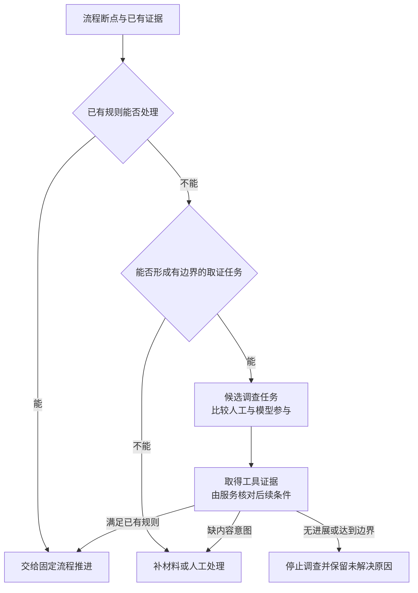

> **文稿状态：正文已写（研究设计）。实验状态：未执行。** 本文提出流程断点分类、候选调查条件和退出规则，均属于待验证方案。新增路由、任务管理与模型调查尚未实现；没有实际模型轨迹、已校准的触发阈值或收益数据。Missing 示例和工具选择说明均为构造设计，不是真实事故或运行结果。

[第 04 篇]()把普通漏交组织成一条固定流程：取得漏交证据、确认候选、精确补交，再用有效共享复检判断原问题。那条路径在关键条件不成立时会停下来。

停止之后，工作并没有自然变成模型任务。一个检查尚未开始，可能只需要按任务标识查询；一份候选改了内容，需要重新确认；负责人还没决定用哪个音频，则需要一个内容决定。

本篇要研究的是：**先把断点组织成清楚的任务，再判断哪些任务值得比较模型参与。** 模型的候选作用是综合证据、选择下一项调查和整理未解决问题；程序仍负责校验动作与推进状态，工具和负责人分别提供事实与意图。

## 1. 先问流程缺什么，再决定谁来处理

一次流程暂停可能有几种不同原因。第一步应保留原始回执，再按能确认的事实分类。

| 断点类型 | Missing 中可能看到什么 | 优先处理方向 |
| --- | --- | --- |
| 尚未执行或仍在等待 | 检查已受理，暂时没有执行结果 | 按已有标识查询或等待，保留超时状态 |
| 已知错误或条件变化 | 输入版本不符、候选内容已变、已识别的同步失败 | 走已定义的核对、恢复或重新确认分支 |
| 缺少必要事实 | 不知道实际检查版本，未取得本地引用或完整报告 | 从明确的来源补齐；不可取得时记录缺口 |
| 多份结果尚无法解释 | 本地正常、共享检查 Missing，已有对照仍不能确定原因 | 检查证据是否可比较，再形成有目标的调查 |
| 缺少内容意图 | 恢复旧音频和改用新音频都可能消除报错 | 向有权决定内容的人提出具体问题 |
| 未识别错误 | 工具返回无法归类的错误，或结果语义不明确 | 先确认执行、输入与报告含义，必要时人工分流 |

这里的“多份结果尚无法解释”，也可能只是不同输入产生了不同结果。本地与检查机不能直接比较时，应先补输入说明；不能只因表面上一个正常、一个异常，就认定事实互相矛盾。

分类本身也有实现成本。第一版可以先使用明确的工具状态、已知错误类别和人工标注；缺少稳定分类依据时，由维护者带着材料分流。若未来让模型参与初始分类，那部分调用、错误和人工复核也要单独计入验证，不能默认进入模型的任务已经被完美挑选。

有些未知错误值得让模型帮助阅读材料，但“尝试解释错误文本”仍不等于取得了错误原因。形成修正或恢复动作前，需要核对相应证据。

## 2. 哪些断点可以成为候选模型调查

本系列准备把以下条件作为候选调查的设计要求。它们用于限定研究范围，尚不是经过验证的自动触发策略。

1. **目标可以说清楚。** 要消除哪一项不确定性，结果准备交给哪个处理步骤，而不是笼统要求修好整个项目。
2. **已有规则暂时不足。** 必要的输入和结果语义已核对，已知分支仍不能决定下一项有效调查；或者需要结合多项证据解释差异。
3. **还有可取得的新证据。** 至少有一个允许的查询能补充或区分现有解释，并且确实具备访问该材料的能力。
4. **行动与退出有边界。** 可调用工具、目标范围、允许的动作、预算和交还条件能够由服务约束。

条件满足后，也只是得到一项可比较的调查任务。维护者、固定排查表和模型都可以是候选执行方式；选择模型还需要考虑任务价值、已有人工经验和调用成本。

例如，已知报告漏记了实际 revision，且版本查询可以直接取得它，这通常可以补成固定步骤。如果连作者本地副本都无法访问，模型也不能凭“本地正常”的一句描述完成引用对照。

另一个常见误区是把复杂当作介入条件。流程步骤很多，但每步条件明确，仍适合由程序组织；步骤不多却需要选择调查方向，也可能值得研究模型参与。这里需要评价的是具体选择任务。

## 3. 用一条独立的 Missing 例外固定讨论对象

下面使用与第 04 篇普通漏交路径不同的独立样例，避免把尚未解释的例外套进已经确认的补交条件。**所有记录与结果均为构造数据，未执行。**

| 示例记录 | 当前设计中已知什么 | 还不能据此认定什么 |
| --- | --- | --- |
| `C200` 与 Finding `F2` | 干净的 `Repo-A / trunk@r520` 完整执行约定检查，在 Room 场景的音频属性报告 Missing | 根因一定是音频漏交 |
| 本地预检 `C201` | 本地副本 `W20` 在约定目标范围内检查正常，已记录其基础版本及修改差异 | 本地与共享引用身份相同，或本地内容一定正确 |
| 预览 `P20` | 预览已执行，选择范围与结果含义可解释，没有形成可直接确认的普通补交方案 | 没有新增依赖就等于没有场景修改，或根本不需要修正 |
| 尝试 `A20` | 已保存定位、预览及相关依据，尚无正式修正提交 | 应恢复旧资源、保留新资源或修改引用 |

此时可以先核对已知规则：是否读错分支，是否拿到旧报告，预览是否失败，是否只收集新增依赖却遗漏场景修改。若其中一项已经解释问题，就回到相应流程。

假设这些基础核对已经留有记录，现有材料仍不足以决定修正方向，而且工具可以继续读取指定输入上的场景引用、资源信息和变更历史，才有必要形成下一项调查。

候选任务可以写成：**解释 `C200` 与 `C201` 对应目标为何产生不同检查结果，给出有证据支持的后续路径，或明确还需负责人决定什么。** 此时尚未确定根因，也没有给调查者修改与提交权限。

这里使用的是第 03 篇拟议能力。当前项目能否实际取得本地引用、版本内容和历史，仍待核对；没有这些能力时，该样例不能假装已经满足取证条件。

## 4. 给模型一份可核对的调查任务包

调查任务需要复用前文记录，而不是重新写一份脱离版本和来源的故事。可以把它作为附属工作记录，关联 Finding、RepairAttempt 和证据入口；本篇不另行规定数据库结构。

以下是样例 `I20` 的**拟议任务包**：

| 内容 | 本例应该交付什么 |
| --- | --- |
| 目标与关联 | `F2 / A20`；解释指定目标的结果差异，输出可支持下一步的证据或待决定事项 |
| 当前输入 | `C200` 的共享 r520；`C201` 对应的本地 `W20` 输入说明、相关差异及采集时间 |
| 已有事实 | 完整报告、定位结果、预览 `P20` 的范围与结果语义，均附来源 |
| 尚未确认 | 两边实际引用是否相同，差异从何而来，预期应保留什么内容 |
| 已尝试动作 | 已做的版本、报告和预览核对，工具请求、返回及未解决原因 |
| 可用能力 | 读取指定输入、对照引用、查询相关资源与场景历史；每项注明参数、执行位置和可用性 |
| 允许范围 | 本问题所需的调查查询；不修改资源、不提交、不改变检查规则 |
| 继续与退出 | 新证据进入规则核对；缺意图转负责人；能力缺失、无进展或达到预算时停止并保留原因 |

任务包中的材料还要保留证据身份。例如，使用者说“我这边正常”是人工描述；已有 `C201` 报告才是指定输入上的检查记录。两者都可以有价值，但不能自动互换。

本地文件内容是否固定，也需要说明。若调查期间 `W20` 又被修改，旧预检与新读取的文件可能不再属于同一输入。服务应记录变化，重新判断哪些证据可比较，而不是继续沿用旧摘要。

工具返回、日志和历史说明中的文字属于待解释材料，不能改写任务允许的操作与完成判据。工具能读到什么、允许调用什么，由实际接入配置和本次任务约束决定。

如果任务缺少某项必要材料，可以先形成一个具体的补充请求，例如“提供 `C201` 对应副本中原音频属性的引用信息及输入说明”。它比要求负责人重新描述整个问题更容易核对。按需背景可参见 [Context Engineering]()，本篇的字段仍是 Missing 场景下的设计建议。

## 5. 模型的候选判断，是选择下一项有区分力的证据

面对 `I20`，调查者可能选择重新检查、比较引用，或者查询历史。选择的价值取决于它准备消除哪项不确定性。

| 候选动作 | 可以回答什么 | 什么情况下先做它更有依据 |
| --- | --- | --- |
| 核对实际输入与覆盖 | 两份结果是否在讨论可对应的对象与条件 | 输入说明缺失、范围或规则不兼容时；常可固定为前置步骤 |
| 对照两边引用与目标资源信息 | 相同位置是否实际指向同一个目标，是否满足普通补交前提 | 基础输入已核对，但仍无法说明为何结果不同 |
| 查询相关变更历史 | 已观察的差异怎样形成，哪些修改与它有关 | 已有具体差异和相关路径，需要进一步解释来源 |
| 重新执行检查 | 在明确输入与条件下能否再次观察到现象 | 输入、环境已改变，或前次执行缺少有效结果 |
| 向负责人提问 | 哪种内容效果或资源选择才符合预期 | 技术事实已经整理，但工具无法确定内容意图 |

同样是“查历史”，漫无目标地读取近期全部提交，与围绕已观察的引用变化读取相关记录，作用并不相同。模型可以研究的判断包括：从已有材料中挑出待核对的解释，选择能区分它们的查询，并在新结果出现后调整剩余问题。

因此，工具请求最好附上可审查的简短说明：**本次要取得什么证据、区分哪种解释、结果可能支持什么后续处理。** 这是对可见选择的说明，不要求披露模型内部思维，也不能由作者事后补写成模型真实输出。

例如，若完整检查已经覆盖目标且输入未变，再跑一次相同检查未必增加信息；引用对照可能更直接。但如果完整结果尚未取得，先补执行证据才是有效动作。选择顺序需要随当前材料变化，不能把某一条作者预设路径认定为唯一正确答案。

本篇不写成一次实际的三轮模型轨迹。[第 06 篇提纲]()会进一步展开每轮可见输入、请求、回执和状态推进；将来若运行实验，应保留真实选择，包括走偏、重复查询和转人工的情况。

## 6. 什么时候交还固定流程，什么时候结束调查

模型可以建议一条后续路径，服务仍需核对该建议所依赖的事实与条件。拿到更多信息后，不必让模型继续掌握原本已经确定的步骤。

| 当前证据支持的情况 | 调查应交出什么 | 服务的后续处理 |
| --- | --- | --- |
| 普通漏交前提已经成立 | 可回查的引用、资源存在性及版本证据，必要的内容决定 | 核对后回到候选预览、确认、提交和共享复检 |
| 两种修法涉及不同内容效果 | 各选项的事实依据、影响及负责人需要回答的问题 | 等待有来源的内容决定，再选择适用流程 |
| 必要工具或本地证据不可得 | 缺少哪项事实、已尝试什么、需要谁补充 | 保留受阻状态，提出具体材料请求或转人工 |
| 查询没有新增信息 | 已有结果与重复动作记录，仍未知的事项 | 停止自动调查，避免重复同一输入上的无效操作 |
| 达到预算或允许范围边界 | 当前证据、未解决问题与停止原因 | 结束本次自动调查，交接上下文；Finding 保持相应未解决状态 |

从 `I20` 交还普通流程，不代表 `F2` 已修复。即使模型找到了可能原因，也仍需确认修正范围、执行实际提交，并取得对应的有效复检。调查任务结束与交付问题解决，是两个不同的完成条件。

预算可以包含调用次数、执行耗时和成本上限，也要考虑工具长时间等待。服务应有可执行的计量与停止方式，不能只在提示词里要求模型“不要查太久”。具体数值需要实验配置和校准，当前没有可推广的轮数或阈值。

“没有新增信息”也需要有核对依据：相同版本、目标和参数的查询已经取得同样结果，且没有指出要检查的新变化。可以先用明确重复条件约束，再研究更复杂的进展判断；不能仅凭模型说“我还想再看看”无限继续。

图中是待验证的分流设计。它没有让模型直接提交修正或关闭 Finding；详细的等待、重启与异步恢复继续由[第 07 篇提纲]()研究。通用分工可按需阅读 [State Machine 与 Workflow]()。

## 7. 哪些调查应该逐步沉淀成规则

如果多个可核对样本表明，某类断点总能按明确顺序补齐事实，并且分支条件可以由工具结果可靠判定，就可以考虑把这部分移入固定流程。

例如，“完整报告必须先核对实际输入与覆盖”本来就是前置规则，不需要每次重新让模型决定。某类明确的预览错误如果已有稳定恢复方式，也可以作为已知分支维护。

但一次成功调查不能直接推广。固化前需要保留适用条件和反例：哪些版本、工具与报告格式支持该判断，哪些情况会把缺少报告误读成没有问题，哪些内容意图仍需要人决定。规则也需要版本和验证，不能因为没有模型调用就默认可靠。

维护者还要比较规则维护、人工排查与模型调查的成本。若模型给出的路径已经能由一张稳定排查表覆盖，继续保留模型是否有价值，就应由真实结果回答。

## 8. 怎样验证介入条件，而不是只展示一次合理回答

后续可以先收集若干脱敏断点样本，分别标注已知规则、可取得的事实、需要人工决定的事项和预期交接结果，再比较固定排查、人工调查和按需模型调查。

应同时观察：哪些任务被错误地送入模型，哪些本来值得调查的任务被漏掉；选择的工具是否取得新证据；是否误把假设写成事实；是否在证据足够时交还流程；是否正确转人工或停止。

如果样本是由维护者提前筛选、整理甚至指明调查方向，要把这些人工投入计入记录。这种实验可以评价给定任务包下的调查，不能据此宣称系统已经会自主识别所有流程断点。后续自动分类也需要单独验证。

同样，“正确补齐事实”“得到负责人决定”和“最终修正复检通过”应分开评价。一次调查提出合理选项，未必已经解决交付问题；最终成功也未必全部来自模型，可能是新增工具或固定规则补齐的结果。[第 08 篇提纲]()继续负责对照口径。

**当前完成的是介入与退出条件的设计，没有实现路由、调查服务或模型运行。** 本例的工具可用性、任务包完整性、停止规则及介入价值都未在真实样本中验证。后续结果仍可能支持直接使用人工或固定排查表。

**先把断点变成有目标、有证据来源和有退出条件的任务，再验证模型是否改善了其中的调查选择。**

<!-- DATA-TODO: 收集经授权脱敏的流程断点、人工分类理由、可用证据与内容决定样本；分别验证任务分流、工具选择、交还流程和停止行为，记录人工整理与模型调用成本，不以构造任务替代真实结果。 -->
