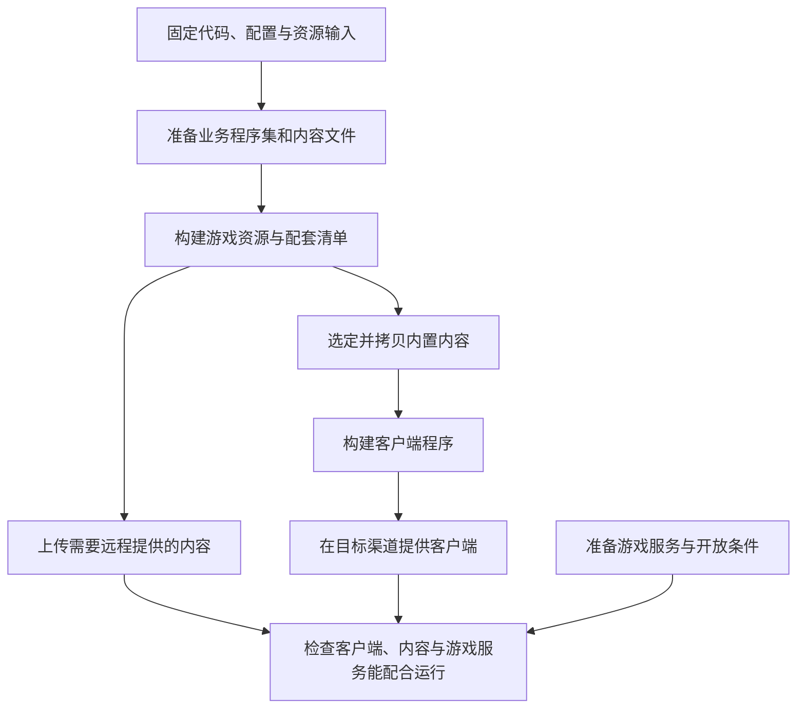
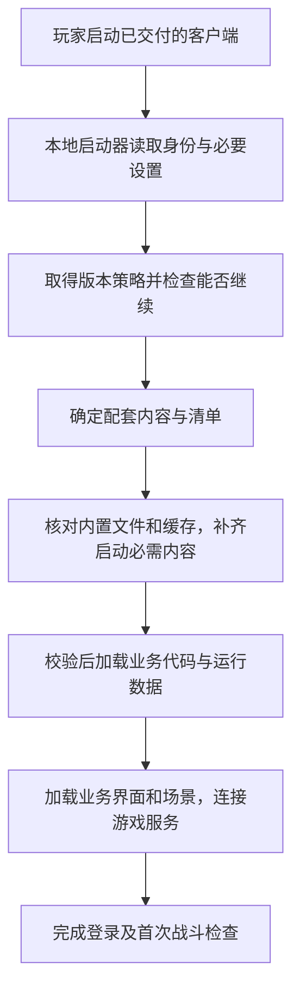

在 Unity 编辑器里点击 Play，一名英雄可以释放技能、命中敌人、播放特效。准备第一次上线时，团队却需要回答另一组问题：玩家安装什么？哪些内容要在启动时下载？文件放到服务器之后，游戏又靠什么把它们连起来？

这些问题会决定后续怎样修 Bug、增加英雄和开放活动。第一次发布时，先把游戏的组成和交付位置分清楚，后面的更新方式才有判断依据。

本文用一款准备首次发布的联网战斗游戏作教学案例。我们把它的第一版客户端叫作“客户端 100”；100 只是便于后文辨认的版本号。先用中文解释每个概念，具体的版本映射和组合编号留到第 4 篇。

## 1. 一名英雄背后，需要哪些组成

假设英雄有一个火球技能：玩家按下按钮，英雄播放施法动画，火球飞向敌人，命中后产生伤害。

把这个行为拆开，会发现它由多种材料配合完成。

| 组成 | 在这个技能里负责什么 | 常见形式 |
|---|---|---|
| 客户端程序 | 启动游戏，提供渲染、输入、网络和内容加载等基础能力 | 平台可运行的程序及随包代码、运行库 |
| 业务代码 | 判断施法条件，驱动技能流程，处理表现与交互 | 随包代码，或按热更方案交付的业务程序集 |
| 运行数据 | 描述伤害、冷却、技能编号及特效引用 | 配置表、关卡数据、模板等构建后的文件 |
| 游戏资源 | 提供玩家看见和听见的内容 | 模型、动画、材质、特效、图标、音频和场景 |

业务代码定义“怎样施法”，运行数据填入“这次施法用哪些参数”，游戏资源提供“施法看起来是什么样”。客户端程序让这些内容有地方运行。

这是一种职责划分，不代表四类材料一定各自放在独立文件夹或资源包里。一个预制体里可以保存组件参数和资源引用；一个配置文件也可能引用模型、技能或音效。划分的目的，是判断改动需要哪些运行能力，以及哪些材料必须一起交付。

联网游戏还需要服务端。比如，本案例由服务端校验技能请求、计算权威伤害并保存奖励，客户端负责输入和表现。别的游戏可以采用不同分工，但必须明确：**把一套客户端文件交给玩家，不等于服务端规则也已经准备好。**

## 2. 客户端程序和热更代码是什么关系

Unity 文档中的 Player 指构建后运行游戏的应用程序。本文用“客户端程序”称呼它：在 Android 上，它随应用安装交付；在浏览器或小游戏环境里，则以对应宿主支持的构建形式启动。

代码在客户端里也有不同职责。启动器负责最早的初始化、读取本地身份、检查更新、显示下载界面；平台 SDK、原生插件和部分基础逻辑提供已经随包交付的能力。采用热更方案的项目，还可以把一部分业务代码作为独立内容交付。

以 IL2CPP 构建为例，Unity 会把代码预先编译成目标平台可执行的代码，这类方式称为 AOT（提前编译）。它说明了一个边界：远端多出一个文件，不会自动让已经安装的程序获得执行它的能力。[Unity 6.0 的 IL2CPP 说明](https://docs.unity3d.com/6000.0/Documentation/Manual/scripting-backends-il2cpp.html)

采用 HybridCLR 等方案时，客户端需要在构建时集成相应运行能力，启动后再取得并加载可热更的业务程序集。程序集通常以 DLL 文件交付，可以先简单理解为“一组编译好的 C# 代码”。**热更能力要在第一次发布的客户端里准备好。**

YooAsset 在这条链路中帮助管理、取得和加载文件；热更运行方案负责让其中的代码执行。即使把 DLL 字节作为文件装进资源包，也仍然需要后续的程序集加载过程。Unity AssetBundle 的资源分发机制不会自动执行它携带的数据文件。[Unity AssetBundle 介绍](https://docs.unity3d.com/6000.0/Documentation/Manual/AssetBundlesIntro.html)、[HybridCLR 加载和运行](https://www.hybridclr.cn/docs/basic/runhotupdatecodes)

为了与后续构建选项对应，本系列会使用三个简称：

| 中文概念 | 后续使用的简称 | 范围 |
|---|---|---|
| 热更代码 | HotCode | 项目选择为可热更的那部分业务代码 |
| 运行数据 | Data | 由客户端读取的配置、关卡、模板等内容文件 |
| 游戏资源 | Res | 模型、动画、特效、界面、音频和场景等 |

三类合称“内容”。普通业务代码不一定全部属于热更代码，服务端在线调整的活动开关也不一定属于客户端 Data 文件。本文后面仍以中文概念为主。

## 3. 安装包、远端文件和内存是三个不同位置

“资源放在哪里”至少包含三个问题：交付时从哪里取得、运行时怎样加载、使用期间在内存里保留多久。

比如，英雄模型可以随安装包交付，但直到进入战斗才加载；另一个模型也可以首次启动时下载到本地缓存，之后才加载。随包或远程，决定交付来源；是否已经加载、何时释放，则是运行时的另一组决定。

首次发布时，可以先按接收者安排材料：

| 交付位置 | 本案例放什么 | 负责解决什么问题 |
|---|---|---|
| 客户端安装包 | 启动程序、基础代码、必要运行库、加载界面和选定的内置内容 | 让程序能启动，并具备继续取得内容的能力 |
| 内容文件服务 | 远程游戏资源、业务程序集、运行数据及配套清单 | 让客户端取得本次允许使用的内容文件 |
| 游戏服务 | 登录、战斗规则、活动条件与玩家状态 | 让联网业务可以运行 |
| 团队归档存储 | 构建输入、产物、报告和后续更新所需材料 | 让团队知道首次交付了什么，并能制作兼容更新 |

内容文件服务通常由对象存储、Web 服务或 CDN 提供。CDN 可以把文件分发给玩家，但不会替游戏判断某份技能代码能否读取某份配置。

客户端还需要“清单”。可以先把清单理解成文件目录：记录内容有哪些、去哪里找、怎样核对文件。YooAsset 的资源清单承担所选资源包的索引、文件身份与依赖描述；项目还要决定客户端这次应该采用哪套内容。具体的两层清单与选择规则，在[第 4 篇]()展开。

这里有一个启动依赖：最早使用的更新入口、下载界面和必要本地信息，要能在远程内容尚未就绪时工作。如果下载界面本身也只能从尚未完成的下载中取得，启动流程就缺少了第一步。

## 4. 首次整包怎样带上配套内容

第一次发布一定要准备可运行的客户端。对本案例来说，还要准备它能够使用的业务代码、运行数据和游戏资源。

这里的“完整交付”指整套材料能够一起运行。安装包可以只内置启动所需的一部分内容，其余通过网络提供。热更代码和运行数据也可以先随包交付；能热更，并不要求第一次就全部远程下载。

第 5 篇会把构建客户端及配套内容的范围称为 Full（完整客户端构建）。哪些内容内置，仍由首包策略决定。

下面是一条采用 YooAsset 和 C# 热更方案的示例生产流程。图中的“构建”是把工程输入加工成可交付产物。

这张图表达交付依赖，不规定所有项目必须采用同一套构建脚本。实际工程还要按热更工具要求安排代码生成、裁剪和资源构建步骤；不能把图当成可直接执行的打包命令。

在 YooAsset 3.0.x 中，构建内容与把哪些文件拷入首包是可以分别配置的。使用默认内置文件系统时，还要保证内置文件与其查询目录相匹配，不能随意拷几个资源文件就认为首包准备完成。[YooAsset 资源构建说明](https://www.yooasset.com/docs/guide-editor/AssetBundleBuilder)

对于客户端 100，这次先做一个明确选择：安装包内置启动界面和首次体验必需的内容，后续章节和额外外观可以远程提供。这里的“必需”要按真实依赖检查：进入第一场战斗需要的不只是场景文件，还可能包括英雄模型、通用材质、技能配置和音效。

## 5. 首包内置多少，取决于玩家体验

内置更多内容，通常会增加安装时需要交付的体积，也可能减少首次启动等待；远程提供更多内容，可以减小初始安装内容，但会增加对网络、缓存和下载恢复的依赖。最终体验还取决于压缩、渠道下载方式和实际设备，需要测量。

| 内容 | 本案例的初始选择 | 选择理由 |
|---|---|---|
| 更新与错误提示界面 | 随包可用 | 网络失败时仍能告诉玩家发生了什么 |
| 首次进入所需的代码、数据和资源 | 随包或在进入业务前准备完成 | 不让缺失依赖进入第一场战斗 |
| 后续章节与额外外观 | 按进入场景或预下载策略取得 | 避免所有玩家首次进入都等待暂时用不到的内容 |
| 活动入口与开放条件 | 由已实现的逻辑配合服务端决定 | 文件已准备好与活动正式开放分别判断 |

这不是 Android 与 WebGL 的固定分界。Android 可以按需下载资源，WebGL 也要选择启动前准备哪些内容；小游戏还要分别核对具体宿主的缓存、分发和更新机制。YooAsset 的下载器可以按全部资源、标签或指定资源依赖组织下载范围，范围由产品与工程策略决定。[YooAsset 资源更新说明](https://www.yooasset.com/docs/guide-runtime/ResourceUpdate)

还要先决定离线目标。本案例是联网战斗游戏，即使内容文件齐全，玩家也需要连接游戏服务才能完成在线业务。若要支持离线玩法，则要同时准备离线所需的规则、数据和资源。

## 6. 玩家第一次启动时发生什么

团队完成文件交付后，客户端还要把它们变成正在运行的游戏。

这张图描述本案例的成功路径。下载失败、客户端必须升级或服务不可用时，需要在相应阶段停下并提供恢复方式，不能直接跳到业务入口。具体分支留到第 6 篇。

采用普通 HybridCLR 加载流程时，取得 DLL 字节、加载程序集和执行业务入口也是不同步骤；如果需要 AOT 补充元数据，还要在相关代码使用它之前准备好。资源预制体若依赖热更脚本类型，同样要协调代码与资源加载顺序。[HybridCLR 加载与运行说明](https://www.hybridclr.cn/docs/basic/runhotupdatecodes)

因此，下载完成只说明某个准备步骤完成。进入登录界面、完成服务端交互、释放一次技能和重新启动后仍可进入，才分别提供了后续阶段的证据。

## 7. 首次发布还要给团队留下什么

假如客户端 100 上线后，团队只保存了工程最新代码，没有保存当时的构建输入与结果。等到准备修复技能时，就很难判断线上客户端究竟有什么能力，以及新代码是不是仍与它配套。

首次交付时，需要同时保存一份“当时怎样构建、实际交付了什么”的材料：

- 代码、配置和资源的输入修订，以及 Unity、依赖包和构建工具版本。
- 目标平台、渠道、环境、客户端版本和关键构建设置。
- 客户端产物、配套清单与内容文件的身份，以及内置和远程内容的分配结果。
- 构建报告、检查结果和后续热更需要复用的材料。

这套可追溯的归档，是后续讨论**构建基线**的基础。“基线”可以先理解为后续更新要参照的已发布起点，具体包含什么由构建方案决定。

例如，使用 HybridCLR 的 AOT 补充元数据方案时，要保留该客户端打包时生成的相应 AOT DLL。后续给旧客户端补充元数据，需要对应它的构建材料，不能随手换成最新打包生成的一份。[HybridCLR AOT 泛型说明](https://www.hybridclr.cn/docs/basic/aotgeneric)

这些材料主要服务开发、构建和发布团队，不要求全部发给玩家。玩家需要的内容文件与团队需要的追溯材料有不同的交付范围。

## 8. 怎样确认第一次交付走通了

对客户端 100，可以沿下面几个层次记录结果。表格是待执行的检查安排，不是本案例已经获得的线上成绩。

| 层次 | 需要检查什么 | 能说明什么 |
|---|---|---|
| 构建产物 | 客户端、清单和选定内容完整，身份可核对 | 这次构建产出了预期材料 |
| 交付位置 | 目标渠道可取得客户端，内容入口与文件可访问 | 玩家具备取得材料的条件 |
| 新安装启动 | 使用全新缓存，检查内置内容与首次下载，能进入登录或明确报告失败 | 首次安装路径是否成立 |
| 实际业务 | 服务端可连接，英雄与技能表现正确，结算与状态符合规则 | 配套材料能否完成规定的业务行为 |
| 重启与故障 | 再次启动、网络中断及恢复时观察内容选择和用户提示 | 已缓存内容与恢复路径是否可靠 |

真机检查还应记录设备、网络条件、首次下载量、等待时间和存储占用。这样才能决定哪些内容值得提前内置，哪些更适合预下载或按需加载，而不是只根据安装包大小作判断。

## 接下来，改动会落在哪一层 {#series-case}

第一次交付建立以后，同一个游戏会继续变化：修正伤害数值，可能涉及运行数据；修改技能执行过程，可能涉及业务代码；替换特效，可能涉及游戏资源；接入旧客户端没有的底层能力，则可能需要重新构建客户端。

这些判断还要继续检查依赖。一个新配置引用了旧代码不认识的技能机制，就不能只因为它是配置文件而单独发布。需要更新的材料与是否必须更新，也分别决定：内容补丁可以是进入游戏的必要条件，客户端整包也可以先作为建议升级提供。

下一篇从三个线上故障出发，讨论[应该改配置、热更代码，还是重新出包]()。到第 4 篇，再把“这版客户端应该使用哪套内容”写成明确的版本契约。

> 资料范围：本文按 Unity 6.0 手册、YooAsset 3.0.x 与 HybridCLR 9.x 官方文档核对相关机制，查阅于 2026-10-23。流程和客户端版本是教学设计，不代表某个生产项目已按此完成构建或真机验收；具体 API、平台支持与发布规则以项目实际采用版本为准。
