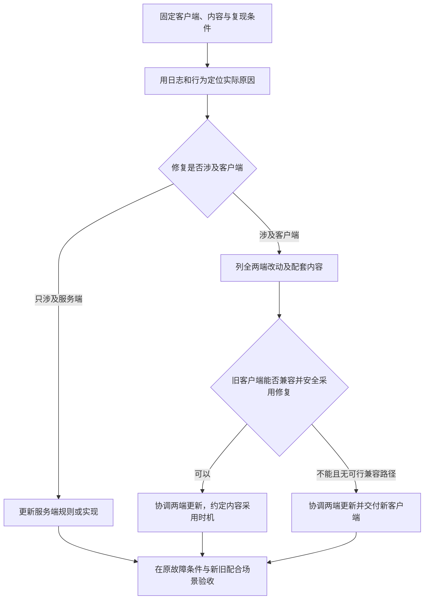

客户端 100 已经发布，玩家可以登录、进入战斗、释放火球技能。现在收到三个反馈：技能伤害与说明不一致，同一次施法偶尔出现两次火球，部分设备的命中特效显示异常。

这些反馈看起来分别对应配置、代码和资源，但表现还不能直接决定修复方式。伤害可能只是界面显示错误，也可能是服务端结算错误；两次火球可能来自重复播放，也可能来自重复请求；特效异常则可能涉及文件、依赖或客户端的渲染能力。

本文沿用[第 1 篇的中文概念]()，把每个故障走完五步：**定位原因、确定改动、选择构建范围、检查兼容与生效方式、验证修复。** 客户端 100 是教学版本号，三个故障是教学场景，不是线上事故记录。

## 1. 先固定出问题的那套内容

开始修改前，先回答“谁在什么条件下出了问题”。至少留下这些信息：客户端版本、平台和渠道、实际采用的代码与内容、设备、复现操作，以及相关日志或画面。

这里的“实际采用”很重要。服务器上已经上传新文件，不代表玩家已经取得；文件下载到磁盘，也不代表当前进程已经加载。若只用编辑器里的最新工程重现，很容易修好另一套内容，却没有解释玩家为什么仍然出错。

对三个故障，可以这样准备证据：

| 故障 | 先核对的事实 | 不能直接作出的推断 |
|---|---|---|
| 伤害与说明不一致 | 技能等级、加成条件、客户端显示值、服务端结算值及各自输入 | 看到数字不对，就只改客户端配置 |
| 一次施法出现两次火球 | 施法次数、输入与网络请求、服务端确认、表现事件和回调次数 | 看到两次表现，就认定扣了两次血 |
| 特效显示异常 | 设备与图形环境、资源加载结果、材质和依赖、当前使用的文件 | 在编辑器显示正常，就认定线上文件正常 |

如果问题正在影响玩家，可以先评估已有的活动开关、技能禁用或其他止损能力。但关闭功能只是限制影响；它不能代替原因定位，也不能自动修复已产生的玩家状态。本文后续的修复判断仍然要完成。

## 2. 故障一：伤害数值错了，先判断谁在使用它

假设技能说明显示伤害为 1000，而设计预期是 100。先不要急着搜索一个配置字段改掉，要沿数据的使用过程查：说明面板读哪里，客户端表现读哪里，服务端结算又读哪里。

本系列的联网战斗案例由服务端校验技能并计算权威伤害。因此需要区分三种情况：

| 定位结果 | 应当修改哪里 | 客户端是否需要更新 |
|---|---|---|
| 服务端实际伤害正确，客户端说明使用的数值填错 | 客户端显示所用的运行数据 | 可能只需更新客户端数据 |
| 客户端说明正确，服务端实际结算用错数值 | 服务端规则或配置 | 不一定需要；若客户端有配套显示或预测，也需核对 |
| 两端使用同一份设计数据的不同构建结果，且两边都错 | 修正源数据并重新生成两端需要的产物 | 需要协调两端生效，不能只发布其中一边就算完成 |

### 只更新数据，需要满足什么

接着限定一个具体分支：服务端实际结算正确，只有客户端说明所用的数据填错。字段名称、数值单位和读取规则均不变化，只把错误值改回预期值。

如果客户端 100 已经能读取这种格式，文件也能通过现有更新流程替换，就可以考虑只构建并更新运行数据。已有代码继续负责读取它，不需要因为一个数值改变就重新编译全部程序。

但“只改配置”有前提。把数值字段换成新结构、增加旧代码不认识的枚举，或让配置引用一种尚未实现的技能机制，都可能超出旧客户端的理解范围。即使文件能解析，也要检查单位、默认值和引用的实际含义。

例如，修复要新增一个“伤害计算方式”选项，而旧代码从未处理过它，那么代码与数据就要一起准备。**文件格式看起来没变，不代表旧逻辑一定懂它。**

### 怎样让修复被玩家采用

这个显示错误分支的交付过程可以写成：修正数据源 → 重新生成客户端数据文件 → 检查旧代码可读 → 构建内容并核对清单 → 准备远端文件 → 调整客户端可采用的内容 → 在约定时机重新读取。

最后一步不能省略。配置文件被下载后，如果界面或战斗对象仍持有内存中的旧数据，修改不会自然替换这些对象。是重新打开面板、下一场战斗读取，还是重新启动后采用，需要由工程规定；涉及战斗规则的数据尤其不能在一场战斗中随意切换。

验收时应分别记录：文件是否换对、客户端是否读到预期值、面板是否显示正确，以及服务端结算是否仍然正确。若两端都要更新，还要验证生效期间的新旧配合方式。

## 3. 故障二：技能重复执行，先找到错误代码所在的位置

现在看“一次施法出现两次火球”。先对齐输入、请求、服务端结果和表现事件。如果只是同一个表现回调被重复注册，玩家可能看见两个火球，但服务端只结算了一次；如果请求本身重复发送，就还要检查服务端是否正确处理重复请求。

我们选择第一个分支作热更案例：在可热更的技能表现代码中，进入战斗时注册了回调，退出时没有清理，第二次进入后同一事件触发了两次表现。

### 能否热更，取决于旧客户端已有的能力

如果修复只需要调整可热更程序集中的注册与清理逻辑，所调用的接口都已存在于客户端 100，就有机会通过热更代码交付。

“在热更代码目录中改了文件”仍然不够。新代码调用的随包接口、保留的类型，以及运行时所需材料，都要与客户端 100 对应。AOT 可以先理解为已经提前编译进客户端的代码；补丁不能默认拥有工程最新版本中的全部底层能力。

采用 HybridCLR 的 AOT 补充元数据方案时，还要使用与目标客户端构建相配套的材料。官方文档要求保存客户端打包时的相关 AOT DLL，不能在后续补丁中随意替换成最新构建生成的一份，也不能跨构建平台复用。[HybridCLR AOT 泛型说明](https://www.hybridclr.cn/docs/basic/aotgeneric)

如果原因实际位于服务端，修客户端回调不能代替服务端修复；如果修复确实需要修改随包代码、原生插件或引擎能力，则要考虑新客户端。这个判断来自错误位置和修复依赖，不能只按“技能逻辑”四个字决定。

### 这次构建什么

对“重复注册表现回调”这个限定分支，先修复热更代码，再编译目标客户端可用的业务程序集；运行数据和资源没有变化时，保留已经配套的旧内容。

如果修复同时调整配置含义，则把新代码与新数据作为一组完整的配套内容检查。它们可以分开构建，但不能让玩家先采用只有新数据、没有新逻辑的组合。版本怎样表达这些配套关系，在第 4 篇展开。

### 热更代码何时生效

程序集可以先理解为一组编译好的代码。YooAsset 帮助取得文件字节，HybridCLR 等运行方案再把程序集加载起来并执行；这是两个步骤。[HybridCLR 加载和运行](https://www.hybridclr.cn/docs/basic/runhotupdatecodes)

本文按普通 HybridCLR 加载流程讨论：已经运行的进程下载新 DLL，并不会自动把已加载的旧程序集、事件回调和对象替换掉。因此，这个案例把采用新代码安排在重新启动的加载流程中，并在那里检查实际加载的程序集。

运行中动态修复或卸载重载属于特定能力，有额外版本与业务要求，不能因为工程支持热更，就默认具备这些能力。[HybridCLR 的动态热修复与重载边界](https://www.hybridclr.cn/docs/business/hotfix)

验收也要针对最初的触发过程：反复进入和退出战斗后释放技能，检查回调与表现是否只发生一次，并确认没有重复请求或重复结算。还要用保留的旧客户端安装产物执行更新，避免只在编辑器最新代码上验证。

## 4. 故障三：特效异常，沿资源引用与构建结果查影响

第三个反馈是部分设备上命中特效显示异常。先确认特效是否加载成功，再查看它引用的材质、纹理、着色器和运行时参数。粉色、缺图或完全不显示可以作为排查线索，不能只凭画面就确定该换哪个文件。

这里区分三个方向：

- 资源内容不正确，例如材质引用了错误纹理。
- 文件或依赖准备不完整，例如清单、资源文件与实际加载过程没有配套。
- 当前客户端的运行能力或图形环境不支持预期效果，需要继续定位代码、着色器及平台条件。

我们先选择一个纯资源分支：特效预制体引用的材质填错，旧客户端的代码和渲染能力已经能够正常使用修正后的效果。

### 改一个源文件，为什么可能需要更新多个文件

修复材质引用后，需要按原有的平台和资源构建规则生成新的资源与清单。交付的是构建后的结果，不是直接把编辑器里的源文件发给玩家。

一个特效可能引用材质，材质又引用纹理或着色器；资源可能被放入同一文件，也可能形成文件间依赖。Unity 的 AssetBundle 文档说明了这种引用与依赖关系；原生加载接口不会自动替项目解决全部依赖协调。[Unity 6.0 的 AssetBundle 依赖说明](https://docs.unity3d.com/6000.0/Documentation/Manual/AssetBundles-Dependencies.html)

因此，需要对比修复前后的资源清单、依赖和文件身份，而不是根据改动的源文件数量推算客户端下载量。共享资源、打包分组或其他共同输入变化，都可能扩大构建影响；本次是否发生，要看实际产物。

构建器复用缓存解决的是构建工作量。构建后的完整版本输出、需要上传的差异文件，以及某个玩家缺少的下载文件，仍然是不同范围。[YooAsset 资源构建说明](https://www.yooasset.com/docs/guide-editor/AssetBundleBuilder)

### 内置资源能不能修复

资源曾经随安装包交付，并不意味着它永远只能靠重新安装替换。若它由可更新的资源系统管理，客户端已经具备选择新清单、取得新文件并在后续加载中采用它的能力，就可以考虑远程更新。YooAsset 官方也明确说明首包资源可以通过热更新更新。[YooAsset 首包资源说明](https://www.yooasset.com/docs/guide-editor/AssetBundleBuilder)

但如果异常发生在更新系统尚未可用的启动内容中，或者旧客户端根本没有远程替换这部分内容的路径，就不能只上传文件后等待生效。要核对现有恢复能力，必要时重新交付客户端。

即使磁盘上的新资源已准备好，场景和对象也可能仍然持有旧材质。此案例可以安排在下一次安全加载场景或重新启动后采用，实际何时释放、重新加载和重建对象由资源生命周期决定。

验收要覆盖报告问题的设备和图形环境、旧缓存与全新缓存，并确认特效依赖的文件都能取得。只看编辑器中的预览，无法证明旧客户端更新后的效果正确。

## 5. 把三个案例放进同一套判断流程

到这里，三个故障已经不只是“配置、代码、资源”三个文件分类，而是带着条件的交付决定。

| 限定后的原因 | 主要构建或更新对象 | 旧客户端继续使用的条件 | 采用时机与验证重点 |
|---|---|---|---|
| 客户端说明所用数值填错，服务端结算正确 | 客户端运行数据 | 格式、含义和引用被旧代码理解，已有更新路径 | 约定的重新读取时机；显示与实际结算分别核对 |
| 热更代码重复注册表现回调 | 热更代码；必要时连同配套数据 | 修复依赖的接口与运行材料在旧客户端中可用 | 本例重新启动采用；反复进出战斗，检查表现、请求和结算 |
| 特效材质引用错误，旧渲染能力可用 | 游戏资源及受影响依赖、清单 | 内容可远程替换，平台和引用兼容 | 安全重新加载或重启；核对问题设备和不同缓存状态 |

这张图允许一次修复同时涉及服务端和客户端；代码、数据与资源也可以一起变化。实际操作中要列全涉及的路径，而不是强迫问题只走一个类别。

后续构建选项中，Data、HotCode、Res 分别表示运行数据、热更代码和游戏资源；HotUpdate 表示三类热更内容的构建范围，Full 表示完整客户端构建。它们是本系列的名称约定。具体工具怎样分配版本与生成产物，放到第 5 篇，本篇先确定这次需要哪些材料。

## 6. 什么时候重新出包，什么时候要求玩家必须更新

新客户端和强制升级是两个决定。

如果修复必须依赖旧客户端没有的随包接口、原生插件能力、引擎修正，或无法通过已有更新路径修复的启动流程，就需要准备新的客户端构建。可以先评估是否有兼容旧能力的替代修复，但不能用一个下载成功的 DLL 代替缺失的底层能力。

新包准备好之后，还要决定旧客户端是否继续受到支持。不能等到玩家被拦截时，才发现他们所在渠道还拿不到可用的新包。

另一方面，严重的技能问题也可能通过内容补丁修复，要求玩家在下一次进入业务前采用修复即可，客户端程序仍是 100。**必须更新内容，不等于必须安装新客户端；需要重启，也不等于需要重新下载安装包。**

如果暂时无法让旧客户端安全继续运行，应采用已有的停用、限制进入或维护流程，并清楚提示原因。关闭入口、要求补丁、要求安装新包，需要按实际故障和恢复路径分别选择。

## 7. 更新之后，怎样证明这次修好了

每次修复都可以留下一张简短记录，把问题、改动、产物和采用结果连起来：

| 记录项 | 要回答的问题 |
|---|---|
| 原始故障 | 哪个客户端、平台、内容与操作能复现？ |
| 修复原因 | 证据指向数据、代码、资源、服务端，还是它们的配合？ |
| 实际改动 | 哪些输入和产物改变，哪些旧材料继续使用？ |
| 兼容条件 | 旧客户端能否读取、调用和加载，服务端是否配套？ |
| 玩家采用 | 实际下载、读取或加载了什么，何时开始使用？ |
| 验收与恢复 | 原问题是否消失，有没有新错误，失败时允许恢复到什么状态？ |

下面是三个案例的待执行检查，不是已经通过的实验结果：

1. 对数值错误，验证修改前可复现、修改后读到预期值，并分别检查显示与结算；切换读取时机不破坏当前战斗的一致性。
2. 对重复回调，用旧客户端更新后多次进出战斗，观察注册与清理、技能表现、请求次数和最终结算。
3. 对特效错误，在问题设备上检查修复后的引用与表现，同时测试旧缓存、全新缓存和依赖缺失时的处理。
4. 对配套补丁，模拟下载中断，确认不会先采用只有一部分准备好的新内容；也要检查取消或失败后的提示与重试。
5. 对恢复路径，确认旧内容仍与当前代码、数据和服务端相容。战斗结算、奖励发放或其他持久化状态的变化，不能靠切回文件自动撤销。

本系列采用的普通程序集加载流程，代码已加载后按重启恢复设计；是否允许重新选择旧内容，还取决于当前准入要求与兼容条件。严重修复若仍是进入游戏的必要条件，就不能让客户端无条件回到带故障的旧内容。

构建成功说明产物生成了，上传成功说明文件送到了目标位置。只有实际客户端采用了对应修复，并通过原故障和相关业务检查，才有依据判断修复生效。

## 下一次更新，也可能来自正常内容需求

三个故障给出的判断方式，也适用于新英雄与活动：先确定需要的能力和材料，再判断旧客户端是否支持，以及哪些内容需要一起交付。

不同的是，正常内容更新还要协调开放时间、入口和玩家资格。下一篇讨论[一次活动、新英雄、新技能如何上线]()；兼容关系与版本选择在[第 4 篇]()具体建模，构建、启动更新和发布恢复则在第 5～7 篇继续展开。

> 资料范围：本文按 Unity 6.0 的 AssetBundle 文档、YooAsset 3.0.x 与 HybridCLR 9.x 官方文档核对相关机制，查阅于 2026-10-25。三个故障、数值和处理分支均为教学设计；未据此宣称执行过 Unity 构建、设备验收或生产修复。实际工程需要固定自身的工具版本、热更能力和渠道条件后验证。
