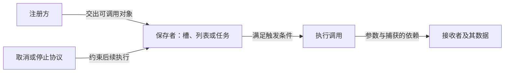

窗口把按键处理函数存进列表，编辑器把字段绘制函数放进表，任务系统把一段行为留到下一轮执行。注册时这些代码都合法，为什么工具关闭以后，某次调用才出问题？

还有一种相反的现象：接收者已经从业务列表移除了，对象却一直没有析构。保存函数的地方究竟只保存了一个入口，还是同时保存了对象的拥有者？

前面的公共课已经讲过访问、所有权与成员调用。现在把它们连起来：**回调保存的是调用方式及其依赖；每次执行前，都要确认这些依赖仍然有效，而且这次执行仍然被允许。**

> **读这篇之前**：先掌握 [CXX-01 值与访问]()、[CXX-02 生命周期与所有权]() 和 [CXX-03 类与调用]()。编译与错误分层回看 [CXX-10]()。
>
> **材料与范围**：复用 [设计模式前置的行为注入模型]()、[Piccolo 窗口与编辑器回调]() 的绑定与接收者寿命分析，以及 CXX-02 的强弱持有模型。下面使用不依赖引擎的 C++17 程序，先在单线程中验证；项目的线程、Delegate、托管委托和取消协议另行核对。

## 1. 把一次注册拆成五个问题

先把回调想成“把以后怎么调用交给别人”。它可以稍后执行，也可以在当前调用栈立刻执行；是否异步、是否换线程，都由保存者和调度者决定。



读代码时，至少留下五项记录：

| 问题 | 要找到什么 |
| --- | --- |
| 怎样调用 | 参数、返回值、是否还需要一个接收对象 |
| 谁保存 | 函数参数、成员表、事件源、队列；是否复制到其他位置 |
| 保存了什么 | 独立值、指针、引用、强拥有者或弱观察者 |
| 谁决定执行 | 真正的分发点、调用条件、执行上下文 |
| 怎样结束 | 谁移除注册，已排队或正在执行的调用如何处理 |

函数签名只能回答第一项。`std::function<void(int)>` 没有表达“回调只执行一次”“目标已经准备好”或“取消返回时不会再调用”等业务承诺。

## 2. 函数指针、成员函数指针和可调用对象

下面几种类型都与调用有关，但保存的信息不同：

| 写法 | 保存或表达什么 | 调用时还需要什么 |
| --- | --- | --- |
| `int (*)(int)` | 指向匹配类型的普通函数 | 一个 int 参数，指针必须有效 |
| `int (Receiver::*)(int) const` | 某类的 const 非静态成员函数 | 有效 Receiver 对象与 int 参数 |
| 定义了 `operator()` 的对象 | 行为和对象自身的状态 | 符合该调用接口的参数 |
| Lambda 的闭包对象 | 编译器产生的可调用类型及捕获状态 | 参数，以及捕获依赖有效 |
| `std::function<int(int)>` | 以统一接口包装一个调用目标 | 包装非空，目标及其依赖有效 |

`using Transform = int (*)(int);` 是给类型起别名，不是在创建函数。读普通指针别名时，可以把名字放回括号理解为“指针所指函数接收 int、返回 int”。成员指针中的 `Receiver::` 则多出了所属类，末尾 const 限定接收对象的访问方式。

非静态成员函数要和对象一起调用，可以写 `(receiver.*member)(value)`；如果已有对象指针，则使用 `->*`。C++17 的 `std::invoke` 为这些调用形式提供统一入口。成员函数指针不能按普通函数地址猜测其表示，也不能靠强制转换把接收对象和调用约定补出来。[成员指针运算](https://timsong-cpp.github.io/cppwp/n4659/expr.mptr.oper)、[std::invoke](https://timsong-cpp.github.io/cppwp/n4659/func.invoke)

### 程序一：同一个调用接口怎样接入不同目标

保存为 `callable_forms.cpp`，作为一个独立程序编译：

```cpp
#include <cassert>
#include <functional>
#include <iostream>

int Twice(int value) { return value * 2; }

struct Receiver
{
    int offset = 3;
    int Apply(int value) const { return value + offset; }
    static int Negate(int value) { return -value; }
};

struct Scale
{
    int factor;
    int operator()(int value) const { return value * factor; }
};

int main()
{
    using Transform = int (*)(int);
    using Member = int (Receiver::*)(int) const;

    Transform ordinary = &Twice;
    Transform static_member = &Receiver::Negate;
    Member member = &Receiver::Apply;
    Receiver receiver;
    assert(ordinary(4) == 8 && static_member(4) == -4);
    assert((receiver.*member)(5) == 8);
    assert(std::invoke(member, receiver, 5) == 8);

    Transform noncapturing = [](int value) { return value + 1; };
    assert(noncapturing(4) == 5);
    Scale scale{3};
    assert(scale(4) == 12);

    std::function<int(int)> bound =
        std::bind(member, &receiver, std::placeholders::_1);
    std::function<int(int)> adapted =
        [&receiver](int value) { return receiver.Apply(value); };
    assert(bound(5) == 8 && adapted(5) == 8);

    int offset = 4;
    std::function<int(int)> captured =
        [offset](int value) { return value + offset; };
    assert(captured(5) == 9);

    std::function<int(int)> empty;
    assert(!empty);
    bool threw = false;
    try { empty(1); }
    catch (const std::bad_function_call&) { threw = true; }
    assert(threw);

    std::cout << "ordinary=" << ordinary(4) << '\n';
    std::cout << "member=" << std::invoke(member, receiver, 5) << '\n';
    std::cout << "bound=" << bound(5) << '\n';
    std::cout << "empty=throws\n";
}
```

输出应为：

```text
ordinary=8
member=8
bound=8
empty=throws
```

静态成员函数没有隐含的接收对象，所以可以放进匹配的普通函数指针。这里无捕获的非泛型 Lambda 也能转换成匹配的函数指针；带捕获的闭包则需要连同状态保存，不能依赖这种转换。

`std::bind` 的表达式分三部分读：保存成员指针、保存 `&receiver`、用 `_1` 接收未来的第一个参数。它在这里保存的是接收者指针值，不拥有 Receiver。后面的 Lambda 是等效意图的阅读示意；一般 bind 还可能做参数重排、固定部分参数或忽略未使用参数，不能机械地逐字替换。[C++17 bind](https://timsong-cpp.github.io/cppwp/n4659/func.bind.bind)

`std::function` 把不同目标放到同一个调用接口后，调用者无需知道具体闭包类型。这通常称为类型擦除；它没有擦除寿命要求。默认构造的包装为空，调用它会抛 `std::bad_function_call`；目标自身抛出的异常也会向外传播，边界处的异常策略仍需设计。[function 调用规则](https://timsong-cpp.github.io/cppwp/n4659/func.wrap.func.inv)

## 3. Lambda 保存的状态，跟原变量是什么关系

Lambda 表达式产生一个闭包对象，可以把它理解为“带有调用操作的对象”。这种模型便于追踪状态，不承诺字段排列、对象大小、是否分配堆内存或编译器实际生成的类名。[C++17 闭包类型](https://timsong-cpp.github.io/cppwp/n4659/expr.prim.lambda.closure)

先按保存关系阅读捕获列表：

| 捕获 | 阅读时先怎样判断 |
| --- | --- |
| `[value]` | 保存 value 的副本；副本的拥有/借用性质由它的类型决定 |
| `[&value]` | 借用 value 所指的实体，不延长其寿命 |
| `[pointer]` | 复制指针值，目标没有因此被复制或保活 |
| `[this]` | 保存访问当前对象的指针，不复制当前对象 |
| `[*this]` | C++17 支持复制当前对象；其指针/共享成员仍按自己的复制语义处理 |
| `[hold = owner]` | 初始化一个捕获；若 owner 是 shared_ptr，就增加强持有 |
| `[owned = std::move(owner)]` | 可以把 unique_ptr 等资源转入闭包，闭包也随之受复制限制 |

`[=]` 与 `[&]` 是默认捕获方式，不是“复制/引用当前作用域所有东西”。在 C++17 成员函数里，通过 `[=]` 隐式捕获 this 也不会复制整个对象。对于要保存出去的回调，明确列出捕获更便于检查依赖。

引用捕获要追到真正被引用的对象。如果局部名字本身是引用别名，不能仅因这个名字离开作用域就判定悬空；需要检查它绑定的对象是否还在。反过来，返回一个捕获普通局部对象引用的闭包，也不会替那个局部对象延寿。[C++17 捕获规则](https://timsong-cpp.github.io/cppwp/n4659/expr.prim.lambda.capture)

### 程序二：快照、借用与包装副本

下面是另一个独立程序 `capture_state.cpp`：

```cpp
#include <cassert>
#include <functional>
#include <iostream>
#include <memory>
#include <type_traits>

std::function<int()> MakeReader(const int& backing)
{
    const auto& alias = backing;
    return [&alias] { return alias; };
}

struct Model
{
    int value;
    auto Borrow() { return [this] { return value; }; }
    auto Snapshot() { return [*this] { return value; }; }
};

int main()
{
    int value = 1;
    auto snapshot = [value] { return value; };
    auto borrowed = [&value] { return value; };
    auto pointer = [p = &value] { return *p; };
    value = 5;
    assert(snapshot() == 1 && borrowed() == 5 && pointer() == 5);
    std::cout << "snapshot=" << snapshot() << " borrowed=" << borrowed() << '\n';

    std::function<int()> counter = [count = 0]() mutable { return ++count; };
    auto copied = counter;
    const int a = counter();
    const int b = counter();
    const int c = copied();
    assert(a == 1 && b == 2 && c == 1);
    std::cout << "copies=" << a << ',' << b << ',' << c << '\n';

    Model model{3};
    auto view = model.Borrow();
    auto object_copy = model.Snapshot();
    model.value = 9;
    assert(view() == 9 && object_copy() == 3);
    std::cout << "this=" << view() << " object-copy=" << object_copy() << '\n';

    int backing = 8;
    auto reader = MakeReader(backing);
    backing = 12;
    assert(reader() == 12);
    auto owned = [p = std::make_unique<int>(7)] { return *p; };
    static_assert(!std::is_copy_constructible_v<decltype(owned)>);
    assert(owned() == 7);
    std::cout << "alias=" << reader() << " unique=" << owned() << '\n';
}
```

预期输出：

```text
snapshot=1 borrowed=5
copies=1,2,1
this=9 object-copy=3
alias=12 unique=7
```

第一行是独立 int 副本与对原对象访问的区别。复制一个裸指针也只是保留访问路径；这里所有调用都发生在原 value 存活期间。

第二行说明 `mutable` 允许修改闭包中的捕获副本，没有把外部变量改成可写，也不提供线程同步。本例包装复制时，里面的计数闭包被复制，所以两份独立 int 状态各自推进；若捕获的是 shared_ptr，复制后则可能仍访问同一个目标，不能推广成“复制包装就深拷贝全部状态”。

第三行中 `model` 一直存活。`view` 通过 this 观察原对象的新值，`object_copy` 访问捕获的 Model 副本。Model 只有一个 int；真实对象若包含借用指针，复制 `*this` 不会自动复制指针所指对象。

第四行的 `MakeReader` 已经返回，但 `backing` 仍在 main 中存活，所以引用别名捕获有效。这里若改成在 MakeReader 内定义一个普通局部 int，并返回捕获它引用的闭包，返回后再读取就不成立；本篇不运行这种悬空访问。

最后，unique_ptr 被转入闭包后，闭包不能复制，但仍可直接调用。**语言能够表达一种闭包，不代表每一种回调容器都能保存它。**

## 4. std::function 拥有包装目标，却未必拥有接收者

C++17 的 `std::function` 保存符合接口要求的调用目标，复制非空包装时会复制目标。对于这里通过常规构造保存的闭包，复制的是闭包及其捕获状态；通过 `std::ref` 等方式保存引用包装时，则需另追被引用对象。[包装的构造与复制](https://timsong-cpp.github.io/cppwp/n4659/func.wrap.func.con)

于是需要分开判断：

1. 包装有没有目标？`if (callback)` 只能检查这一点。
2. 捕获的裸指针、引用和 this 所依赖的对象是否有效？非空检查无法回答。
3. 捕获的拥有者是否过度保活？目标自己拥有回调，而回调又强持有目标时，可能形成环。
4. 复制包装是否把更多引用或拥有者送到了其他地方？移除原注册项未必释放这些副本。

`std::function` 还涉及目标复制、间接调用及可能的动态分配。实现可以对某些小目标采用内部存储，不能由一个小 Lambda 推断所有包装都零分配或成本相同。具体选择应结合 API 的保存需求、类型约束与测量，不把完整模板性能课塞进这里。[function 包装接口](https://timsong-cpp.github.io/cppwp/n4659/func.wrap.func)

### 两个编译失败练习

分别另存为文件，只做编译检查。

`member_pointer_error.cpp`：

```cpp
struct Receiver { void On(int) {} };
using Callback = void (*)(int);
Callback callback = &Receiver::On; // 错误：还缺接收对象，类型也不同。
```

`move_only_function_error.cpp`：

```cpp
#include <functional>
#include <memory>
#include <utility>

int main()
{
    auto task = [p = std::make_unique<int>(7)] { return *p; };
    std::function<int()> stored = std::move(task); // C++17 目标须可复制。
}
```

第二个用例中，移动实参不会改变 `std::function` 对目标可复制性的要求。可以直接保留这种闭包，或采用满足工程要求的其他保存接口；不能为了通过编译就机械改成裸指针捕获。后续标准另有不同包装能力，本课始终按 C++17 判断。

## 5. 用一个单槽订阅观察取消与保活

先选一个有意简单的契约：一个 Slot 同时只保存一条订阅；注册返回 ID；匹配 ID 才能取消；分发同步执行，并先复制当前包装。这个副本代表本轮已经取得的调用任务。**它是教学设计，不是四条路线已有的统一实现。**

保存为第三个独立程序 `callback_lifetime.cpp`：

```cpp
#include <cassert>
#include <functional>
#include <iostream>
#include <memory>
#include <utility>

class Slot
{
public:
    using Callback = std::function<void(int)>;
    using Id = unsigned;

    Id Connect(Callback fn)
    {
        assert(fn && !callback_);
        callback_ = std::move(fn);
        return ++id_;
    }
    bool Disconnect(Id id)
    {
        if (id != id_ || !callback_) return false;
        callback_ = nullptr;
        return true;
    }
    Callback Snapshot() const { return callback_; }
    bool Connected() const { return bool(callback_); }
    void Emit(int value)
    {
        auto task = Snapshot();
        if (task) task(value);
    }

private:
    Id id_ = 0;
    Callback callback_;
};

struct Receiver
{
    inline static int alive = 0;
    int total = 0;
    Receiver() { ++alive; }
    ~Receiver() { --alive; }
    void On(int value) { total += value; }
};

int main()
{
    Slot slot;
    {
        Receiver receiver;
        auto id = slot.Connect([p = &receiver](int v) { p->On(v); });
        slot.Emit(2);
        assert(receiver.total == 2);
        const bool removed = slot.Disconnect(id);
        assert(removed && !slot.Connected());
    }
    assert(Receiver::alive == 0);
    std::cout << "raw=disconnected before destruction\n";

    int delivered = 0;
    int skipped = 0;
    auto owner = std::make_shared<Receiver>();
    auto weak_id = slot.Connect(
        [weak = std::weak_ptr<Receiver>(owner), &delivered, &skipped](int v)
        {
            if (auto live = weak.lock())
            {
                live->On(v);
                ++delivered;
            }
            else { ++skipped; }
        });
    slot.Emit(4);
    assert(owner->total == 4);
    owner.reset();
    slot.Emit(4);
    assert(delivered == 1 && skipped == 1 && slot.Connected());
    const bool removed_weak = slot.Disconnect(weak_id);
    assert(removed_weak);
    std::cout << "weak=delivered once, skipped once\n";

    auto strong = std::make_shared<Receiver>();
    std::weak_ptr<Receiver> observed = strong;
    auto strong_id = slot.Connect([hold = strong](int v) { hold->On(v); });
    auto scheduled = slot.Snapshot();
    strong.reset();
    slot.Emit(2);
    const bool removed_strong = slot.Disconnect(strong_id);
    assert(removed_strong && !slot.Connected() && !observed.expired());
    scheduled(3); // 注册已移除，取得的独立副本仍可执行。
    {
        auto live = observed.lock();
        assert(live && live->total == 5);
    }
    std::cout << "copied task=still callable after disconnect\n";
    scheduled = nullptr;
    assert(observed.expired() && Receiver::alive == 0);
    std::cout << "last copy released=receiver destroyed\n";
}
```

预期输出：

```text
raw=disconnected before destruction
weak=delivered once, skipped once
copied task=still callable after disconnect
last copy released=receiver destroyed
```

第一段使用裸目标，在目标退出作用域前取消；没有把失效调用当作测试。程序也没有留下指向该对象的任务副本。这些前提缺一不可。

第二段捕获 weak_ptr。成功 `lock()` 得到的局部 shared_ptr 覆盖此次访问；目标结束后，再触发会走跳过分支。**弱目标过期不会自动删除注册项**，所以程序最后仍显式取消。这里另外引用了两个计数器，它们一直活到 main 结束；weak 捕获不会保护闭包里的其他引用。[weak_ptr::lock](https://timsong-cpp.github.io/cppwp/n4659/util.smartptr.weak.obs)

第三段捕获强拥有者。移除原始拥有者后目标仍在；取消注册只清掉 Slot 里的包装，`scheduled` 副本还强持有目标，也仍可执行。直到最后一个任务副本释放，接收者才析构。

这段程序刻意展示“允许已取得任务继续执行”的协议。若业务要求取消后跳过已排队任务，需要让那些任务也检查有效令牌或版本等共享状态；若还要求取消返回时没有任何调用在执行，则必须处理已经进入函数体的调用。不能只删注册项，就宣称达成了这些更强的保证。

## 6. 从对象有效走到业务允许执行

shared_ptr 成功保活，只说明对象寿命覆盖访问。窗口可能已经关闭，角色可能已逻辑移除，资源可能正在关闭；“对象还活着”与“还能处理这一条通知”需要分别判断。强捕获也可能让对象在业务结束后继续存活。

一个更完整的订阅设计，需要逐项定义：

| 阶段 | 取消究竟保证什么 |
| --- | --- |
| 注册表中 | 取消后能否再次取得这一订阅 |
| 已复制、已排队 | 旧任务是否仍会执行，是否检查取消状态 |
| 正在执行 | 是否等待结束；在回调里取消自己会不会形成等待问题 |
| 接收者清理 | 什么时候不再依赖它的状态，谁允许它析构 |

RAII connection 可以在离开作用域时调用取消，但它依赖事件源仍有效，以及取消接口确实提供所需保证。析构时擦掉一个 ID，并不自动等待其他线程或撤回任务副本。

多播列表还涉及分发中增删、重入和异常传播。直接在正在遍历的 vector 上擦除或追加可能破坏遍历；快照、延迟应用修改等方案又会带来不同的本轮执行语义。本篇单槽模型只验证所列路径，没有实现这些完整契约。

跨线程时，取消状态、接收者数据与回调容器都要有对应同步。weak_ptr 的成功 lock 不会把接收者所有成员访问变成线程安全；也不能用 mutable 或 volatile 代替同步。并发的基础留到 CXX-11，容器失效继续由 CXX-04 负责。

## 7. 带着同一套问题进入四条路线

本篇复用项目材料的模型，但没有重新执行四个项目。继续阅读时可以画一条短链：**注册点 → 保存位置 → 实际调用点 → 捕获/参数来源 → 取消与销毁顺序**。

| 路线 | 公共模型怎样接上项目 |
| --- | --- |
| Piccolo | 在 [窗口与编辑器回调]() 继续对应 bind 的对象和占位符、窗口转接、UI 引用别名及退出顺序。原文保留固定源码的已接通/未接通路径与验证记录。 |
| Unreal | 从 [UE 阅读入口]() 找 Delegate 的具体绑定形式、对象管理规则与取消句柄。逐项核对强弱关系和调用资格，不能仅按 std::function 的行为推断引擎包装。 |
| HybridCLR | 沿 [源码起步]() 与 [ABI 桥接]() 区分普通指针、桥接入口和参数协议；原生回调还要查接收上下文、托管委托保活及线程接入责任。 |
| IL2CPP | 从 [运行时产物地图]() 追生成入口、方法信息、目标对象与 runtime 分派。托管委托对象、原生函数指针和 C++ 闭包各自有语义，不能只因都能调用就互相替换。 |

例如外部 API 只接收函数指针时，捕获对象还需要由另外的上下文机制连接起来；只接收一个函数地址不会顺带保存任意 C++ 闭包。具体 C 链接、调用约定、异常与参数布局继续按 CXX-10 和项目 ABI 契约核验。

## 8. 自测与验证边界

先预测三个程序的输出，再回答：

1. 为什么非静态成员函数指针还需要对象，静态成员函数却不需要？
2. `[pointer]` 是值捕获，为什么不等于复制或保活目标？
3. 包装为真、weak 过期、注册已移除，分别说明哪一件事？
4. 程序二的两个 counter 为什么独立，而强捕获的任务副本为什么共享接收者？
5. 为什么把 move-only 闭包以 std::move 传入 C++17 std::function 仍然不成立？
6. 若取消必须阻止已排队任务，需要在本例之外增加什么协议？

正常程序分别保存、独立编译。使用 PowerShell 时，例如：

```powershell
g++ -std=c++17 -O0 -g -Wall -Wextra -Wpedantic callable_forms.cpp -o callable_forms.exe
if ($LASTEXITCODE -ne 0) { throw 'compile failed' }
.\callable_forms.exe
if ($LASTEXITCODE -ne 0) { throw 'run failed' }
```

另外两个正常程序分别替换文件名。保留断言，不定义 NDEBUG。两个失败文件分别执行 `g++ -std=c++17 -Wall -Wextra -Wpedantic -fsyntax-only 文件名.cpp`，预期非零退出，不生成或运行失败产物。

资料核对日为 2026-10-25，语言与标准库依据为 C++17 工作草案 N4659。

本地验证环境为 Windows x64、GCC 8.3.0（`x86_64-posix-seh`），日期为 2026-10-25。三个正常程序分别以所列 C++17 参数编译，在这些警告选项下无警告；运行退出码均为 0，断言全部通过。

| 用例 | 本次结果 | 验证内容 |
| --- | --- | --- |
| callable_forms.cpp | 编译、运行成功，4 行输出一致 | 函数/成员指针、invoke、bind、Lambda 适配及空包装异常 |
| capture_state.cpp | 编译、运行成功，4 行输出一致 | 副本与借用、mutable 状态复制、this 与对象副本、引用别名、独占捕获 |
| callback_lifetime.cpp | 编译、运行成功，4 行输出一致 | 提前取消、弱捕获过期、取消后副本仍执行、最后拥有者释放时析构 |
| member_pointer_error.cpp | 编译退出码为 1，符合预期 | 诊断指出成员函数指针不能转换成普通函数指针 |
| move_only_function_error.cpp | 编译退出码为 1，符合预期 | 诊断涉及闭包复制及 unique_ptr 被删除的复制构造 |

这些独立程序不包含四条路线的构建、实际窗口事件、托管调用、跨线程取消或性能验证。没有执行悬空指针、失效引用或对象销毁后的 this 调用；不能用这些错误路径的一次偶然输出判断安全性。

按补写顺序，下一篇进入 [CXX-06：从一段字节读到一个值]()，继续补布局、偏移、对齐与类型转换，再写 CXX-04 移动与容器失效。完整目录见 [C++ 公共基础]()。

**保存了行为以后，还要追清它依赖谁，以及哪一条协议允许它继续执行。**
