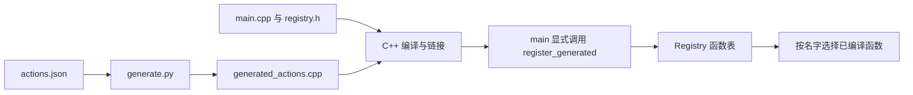

读引擎源码时，常会碰到这样的断点：类里只写了几个标记，实际函数却在别的文件；刚下载的工程找不到某个头文件，构建之后它才出现；生成文件明明存在，运行时按名字查询却仍然失败。

这些现象的共同点是“眼前的代码不是全部输入”。我们还需要找到改写它的宏、选择分支的配置、生产文件的工具，以及把已编译函数接入运行时的入口。少追其中一层，就容易把缺文件、缺定义和缺注册当成同一种故障。

本篇的判断方法是：**对每段代码和表项，记录它的输入、生产者、配置、输出、消费者与生效时刻。**

> **读这篇之前**：先掌握 [CXX-03 类与调用]()、[CXX-07 模板阅读]()；编译/链接和函数指针分别回看 [CXX-10]()、[CXX-05]()。
>
> **复用与范围**：复用 [Piccolo 模板、宏与反射篇]() 的阶段模型、[UE 工程地图]() 的构建分工，以及 [HybridCLR 工具链]() 与 [IL2CPP 转换器篇]() 的产物阅读入口。下面使用自有 C++17/Python 小工程，不复制引擎实现。

## 1. 先分清四种工作

| 工作 | 输入与输出 | 谁消费结果 | 怎样确认它发生了 |
|---|---|---|---|
| 宏展开 | 预处理 token → 替换后的 token | 后续 C++ 翻译 | 检查相同参数下的预处理输出 |
| 条件编译 | 宏环境、条件指令 → 本次保留的源码 | 当前翻译单元 | 核对命令行定义、包含文件与保留分支 |
| 外部生成 | 清单、IDL、带标记源码等 → 文件 | 编译器、打包器或其他工具 | 找到生成命令、输入版本与实际输出 |
| 运行时注册 | 已有函数/描述信息 → 内存中的表项 | 按名字、ID 或类型查询的代码 | 追启动入口、插入结果、查询与撤销 |

前三行没有自动完成第四行。生成一个函数、把它编进程序、启动时把地址放进表，分别需要自己的连接。反过来，注册表也可以完全手写，不必经过外部生成。

C++ 模板另负责类型推导、选择和实例化，见 CXX-07；它与生成器使用的文本模板不是一回事。外部工具可能先按某组宏预处理源码、再读取 AST，也可能像本篇只读 JSON；不能用一条固定流水线替代所有项目的实际命令。

## 2. 宏改写 token，不替你理解类型协议

对象式宏可以替换一个名字，函数式宏按参数改写 token。宏不会因为名字写在 `object->` 后就自动遵守类成员作用域，也不会因尖括号长得像模板就按 C++ 类型语法拆参数。[C++17：宏替换][replace]

下面的程序同时观察原始拼写、展开后拼写、token 拼接与表达式优先级：

```cpp
// macro_tokens.cpp
#include <cassert>
#include <iostream>
#include <string_view>
#define DEMO_TYPE Actor
#define RAW_TEXT(x) #x
#define TEXT(x) RAW_TEXT(x)
#define RAW_JOIN(a, b) a##b
#define JOIN(a, b) RAW_JOIN(a, b)
#define RAW_SQUARE(x) x*x
#define SET_VALUE(object, value) do { (object) = (value); } while (false)
constexpr int square(int x) { return x * x; }
int JOIN(make_, DEMO_TYPE)() { return 7; }
int main()
{
    using namespace std::literals;
    assert(RAW_TEXT(DEMO_TYPE) == "DEMO_TYPE"sv);
    assert(TEXT(DEMO_TYPE) == "Actor"sv);
    assert(TEXT(RAW_JOIN(make_, DEMO_TYPE)) == "make_DEMO_TYPE"sv);
    assert(TEXT(JOIN(make_, DEMO_TYPE)) == "make_Actor"sv);
    assert(RAW_SQUARE(1 + 2) == 5 && square(1 + 2) == 9);
    int value = 0;
    if (true) SET_VALUE(value, make_Actor()); else value = -1;
    assert(value == 7);
    std::cout << "raw=DEMO_TYPE expanded=Actor\n";
    std::cout << "raw-join=make_DEMO_TYPE join=make_Actor\n";
    std::cout << "macro-square=5 function-square=9 value=7\n";
}
```

编译运行后输出：

```text
raw=DEMO_TYPE expanded=Actor
raw-join=make_DEMO_TYPE join=make_Actor
macro-square=5 function-square=9 value=7
```

`#x` 把对应实参的拼写字符串化；紧邻 `#` 或 `##` 的形参，不走普通实参的完整预展开路径。因此 `RAW_TEXT(DEMO_TYPE)` 得到 `"DEMO_TYPE"`，多套一层的 `TEXT(DEMO_TYPE)` 则先展开为 Actor，再字符串化。`JOIN` 用同样的两层安排，让 `DEMO_TYPE` 先展开，再与 `make_` 拼成标识符。[C++17：实参替换][substitute]、[字符串化][stringize]、[拼接][concat]

这些只是标识符与字符串的生产规则。`"Actor"` 不会因此携带 Actor 的构造、字段或对象身份；别名的类型相等，也不保证经过 `#` 后的名字字符串相等。Piccolo 原文中的组件查询正需要分别检查类型和名字。

`RAW_SQUARE(1 + 2)` 展开成 `1 + 2*1 + 2`，所以得到 5。给每个实参和整体加括号能修正这里的优先级，却不能消除重复求值：`((x)*(x))` 仍把 x 放了两次。本篇不执行带自增等副作用的这类调用；普通值计算优先用类型明确的函数、constexpr 或模板。[GCC：重复求值风险][side-effects]

`do { ... } while (false)` 则让一组语句在本例中作为一个语句使用，调用处的分号能与 if/else 正常组合。它不保证宏捕获的名字、break/continue 或实参求值都安全；阅读复杂宏仍要看完整展开。[GCC：多语句宏与分号][semicolon]

### 不猜展开，保存预处理输出

在 Windows PowerShell 的练习目录中执行：

```powershell
g++ -std=c++17 -O0 -g -Wall -Wextra -Wpedantic macro_tokens.cpp -o macro.exe
if ($LASTEXITCODE -ne 0) { throw 'compile failed' }
.\macro.exe
if ($LASTEXITCODE -ne 0) { throw 'run failed' }
g++ -std=c++17 -E -P macro_tokens.cpp -o macro.ii
if ($LASTEXITCODE -ne 0) { throw 'preprocess failed' }
```

GCC 的 `-E` 在预处理后停止，`-P` 去掉行标记，便于对照；真实排障时保留行标记也有定位价值。搜索 `int make_Actor()`、两个名字字符串，以及 `1 + 2*1 + 2`，能确认这次替换。包含标准库后输出会很长，只看目标附近，不把整份输出当成手写源码维护。[GCC 8.3：预处理选项][gcc-options]

`#undef` 只影响其后继续处理的内容，不会回头恢复之前的替换。命令行 `-D/-U`、包含目录和强制包含同样属于环境；复制源文件而遗漏这些参数，得到的展开结果可能不同。

## 3. 定义了，不等于启用了

`#ifdef FEATURE` 问“FEATURE 是否定义”；`#if FEATURE` 在宏替换后检查条件值。用 `-DFEATURE=0` 定义一个关闭开关，仍然会进入 `#ifdef FEATURE` 分支。[C++17：条件包含][conditional]

这个程序先记录命令行是否定义，再为未定义情形补默认值 0：

```cpp
// conditional.cpp
#include <cassert>
#include <iostream>
#ifdef DEMO_ENABLED
constexpr bool was_defined = true;
#else
constexpr bool was_defined = false;
#endif
#ifndef DEMO_ENABLED
#define DEMO_ENABLED 0
#endif
#if DEMO_ENABLED
int step(int value) { return value + 1; }
#else
int step(int value) { return value; }
#endif
#if 0
MissingType ignored;
#endif
int main()
{
    static_assert(DEMO_ENABLED == 0 || DEMO_ENABLED == 1);
    assert(step(10) == 10 + DEMO_ENABLED);
    std::cout << "defined=" << was_defined << " enabled=" << DEMO_ENABLED
              << " result=" << step(10) << '\n';
}
```

分别以三组参数编译运行，保留各自的 exe：

| 编译参数，其他选项同上一程序 | 实际输出 |
|---|---|
| 不传 `-DDEMO_ENABLED` | `defined=0 enabled=0 result=10` |
| `-DDEMO_ENABLED=0` | `defined=1 enabled=0 result=10` |
| `-DDEMO_ENABLED=1` | `defined=1 enabled=1 result=11` |

例如启用版本使用 `g++ -std=c++17 -O0 -g -Wall -Wextra -Wpedantic -DDEMO_ENABLED=1 conditional.cpp -o one.exe`，再运行 `.\one.exe`。预处理时同样带该 `-D`，在输出中核对 step 的函数体；没有保留的 `MissingType ignored;` 不会进入本次 C++ 语义检查。被跳过区域仍受相应词法和预处理指令结构约束，不能把 `#if 0` 当作包住任意损坏文本的注释工具。

`#if` 中未定义的普通标识符在相应处理后按 0 解释，拼错开关名可能静默走错分支；GCC 的 `-Wundef` 可以帮助发现。团队应明确某个开关采用“存在即启用”还是数值 0/1，不要在不同文件中混用。没有替换值的空宏，也不能直接当作数值 0/1 使用。

再与前两课的分支区分：

| 形式 | 决定什么 | 不能由它推断什么 |
|---|---|---|
| `#if` | 预处理时保留哪些源码 | 当前进程已经启用了对应系统 |
| 普通 `if` | 执行时走哪条合法分支；优化另说 | false 分支里的错误类型能躲过编译 |
| 模板里的 `if constexpr` | 按编译期条件决定实例化时丢弃哪个分支 | 可以隐藏所有语法/非依赖错误；详见 CXX-07 |

跨翻译单元还要保持约定：同一个外部类或 inline 定义若因宏不同而形成不一致定义，可能违反 ODR；布局、声明与实现也可能不匹配。链接成功不是这种一致性的证明。本篇不构造这类未定义行为实验。[C++17：ODR][odr]

## 4. 让外部工具真的写出一份 C++

前两个程序没有运行反射生成器。下面单独建一个练习目录，使用显式动作清单生成注册函数；这是实际生成，不用手写一段“模拟生成”代替执行记录。

本例的输入只有 JSON，不解析 C++ 类、AST 或字段注解，也不实现对象反射。它保留最小的生产与消费关系：



### 输入与生成器

先保存 `actions.json`：

```json
[
  {"name": "jump", "delta": 2},
  {"name": "wait", "delta": 0}
]
```

再保存 `generate.py`，使用 Python 3.10 或更新版本。它先校验完整清单，再输出 C++；名字限定为本例允许的 ASCII 拼写，数值限定在小范围，重复名直接拒绝。输出按名字排序、使用固定换行，不加入时间戳，因此同样的输入能得到同样的文本。

```python
# generate.py
import json
import pathlib
import re
import sys

source, output = map(pathlib.Path, sys.argv[1:])
rows = json.loads(source.read_text(encoding="utf-8"))
if not isinstance(rows, list):
    raise ValueError("expected an action list")
seen = set()
for row in rows:
    if not isinstance(row, dict) or set(row) != {"name", "delta"}:
        raise ValueError("expected name and delta")
    name, delta = row["name"], row["delta"]
    if not isinstance(name, str) or not re.fullmatch(r"[a-z][a-z0-9_]*", name):
        raise ValueError("invalid name")
    if name in seen:
        raise ValueError("duplicate name")
    if type(delta) is not int or not -100 <= delta <= 100:
        raise ValueError("invalid delta")
    seen.add(name)
lines = ['// Generated by generate.py; edit actions.json instead.',
         '#include "registry.h"', '#include <stdexcept>',
         'void register_generated(Registry& registry)', '{']
for row in sorted(rows, key=lambda item: item["name"]):
    name = json.dumps(row["name"])
    delta = row["delta"]
    lines += [f'    if (!registry.add({name}, +[](int value) {{ return value + ({delta}); }}))',
              '        throw std::logic_error("duplicate name");']
lines += ['}', '']
output.parent.mkdir(parents=True, exist_ok=True)
output.write_text("\n".join(lines), encoding="utf-8", newline="\n")
print(f"generated={len(rows)}")
```

校验规则只覆盖本教学清单，不能当成完整的反射 schema。写文件也没有实现原子替换、并发写入和失败恢复；“坏清单在写入前被拒绝”不等于所有 I/O 故障都不会破坏旧输出。

### 消费接口与显式注册

`registry.h` 定义一个普通函数指针表和生成函数的声明：

```cpp
// registry.h
#ifndef CXX08_REGISTRY_H
#define CXX08_REGISTRY_H
#include <cstddef>
#include <optional>
#include <string>
#include <unordered_map>
class Registry
{
public:
    using Action = int (*)(int);
    bool add(const std::string& name, Action action)
    {
        return action && actions.emplace(name, action).second;
    }
    std::optional<int> run(const std::string& name, int value) const
    {
        const auto it = actions.find(name);
        if (it == actions.end()) return std::nullopt;
        return it->second(value);
    }
    std::size_t size() const { return actions.size(); }
    void clear() { actions.clear(); }
private:
    std::unordered_map<std::string, Action> actions;
};
void register_generated(Registry& registry);
#endif
```

`main.cpp` 先验证未注册状态，再显式执行生成函数，最后验证重复注册、未知名字与清理后查询：

```cpp
// main.cpp
#include "registry.h"
#include <cassert>
#include <iostream>
#include <stdexcept>
int main(int argc, char** argv)
{
    const int expected = argc == 2 ? std::stoi(argv[1]) : 12;
    Registry registry;
    assert(!registry.run("jump", 10));
    std::cout << "before=missing\n";
    register_generated(registry);
    const auto jump = registry.run("jump", 10);
    const auto wait = registry.run("wait", 10);
    assert(registry.size() == 2 && jump && *jump == expected && wait && *wait == 10);
    std::cout << "registered=" << registry.size() << " jump=" << *jump << " wait=" << *wait << '\n';
    bool rejected = false;
    try { register_generated(registry); }
    catch (const std::logic_error&) { rejected = true; }
    assert(rejected && !registry.run("unknown", 10));
    std::cout << "duplicate=rejected unknown=missing\n";
    registry.clear();
    assert(!registry.run("jump", 10));
    std::cout << "cleared=missing\n";
}
```

在同一目录中先手动跑通一次：

```powershell
python generate.py actions.json manual/generated_actions.cpp
if ($LASTEXITCODE -ne 0) { throw 'generation failed' }
g++ -std=c++17 -O0 -g -Wall -Wextra -Wpedantic -I. main.cpp manual/generated_actions.cpp -o manual.exe
if ($LASTEXITCODE -ne 0) { throw 'compile/link failed' }
.\manual.exe
if ($LASTEXITCODE -ne 0) { throw 'run failed' }
```

生成器输出 `generated=2`。正常清单实际生成的文件如下，**用于核对，不作为手工维护输入**：

```cpp
// Generated by generate.py; edit actions.json instead.
#include "registry.h"
#include <stdexcept>
void register_generated(Registry& registry)
{
    if (!registry.add("jump", +[](int value) { return value + (2); }))
        throw std::logic_error("duplicate name");
    if (!registry.add("wait", +[](int value) { return value + (0); }))
        throw std::logic_error("duplicate name");
}
```

本例以无捕获 Lambda 转换得到普通函数指针；函数没有绑定外部对象。运行时名字只选择已经编译进程序的操作，不会在运行中把 `"jump"` 变成一个新的 C++ 类型或函数定义。程序输出：

```text
before=missing
registered=2 jump=12 wait=10
duplicate=rejected unknown=missing
cleared=missing
```

这里的重复名策略是拒绝，并在第一次插入失败时抛异常；它没有实现一批注册的事务回滚。`clear()` 清掉的是表项，既没有卸载机器码，也没有销毁某个业务对象。若项目保存的是带捕获回调或动态库函数地址，还要另查对象寿命、注销协议、模块卸载与并发访问；本文不执行这些场景。

## 5. 生成一次还不够，要把依赖接进构建

手动运行只能证明“这次得到了一份文件”。之后改了清单，若仍拿旧文件编译，编译器没有理由知道它过期。文件名带 generated，也不提供新鲜度保证。

把下面 `CMakeLists.txt` 放到同一目录。生成文件作为 lesson 的源文件，生成规则列出输出、命令与文件依赖；同目录中的目标据此取得生产规则。[CMake：add_custom_command][cmake-command]

```cmake
# CMakeLists.txt
cmake_minimum_required(VERSION 3.25)
project(Cxx08 LANGUAGES CXX)
find_package(Python3 3.10 REQUIRED COMPONENTS Interpreter)
set(generated "${CMAKE_CURRENT_BINARY_DIR}/generated_actions.cpp")
add_custom_command(
    OUTPUT "${generated}"
    COMMAND "${Python3_EXECUTABLE}" "${CMAKE_CURRENT_SOURCE_DIR}/generate.py"
            "${CMAKE_CURRENT_SOURCE_DIR}/actions.json" "${generated}"
    DEPENDS "${CMAKE_CURRENT_SOURCE_DIR}/generate.py"
            "${CMAKE_CURRENT_SOURCE_DIR}/actions.json"
    VERBATIM)
add_executable(lesson main.cpp "${generated}")
target_include_directories(lesson PRIVATE "${CMAKE_CURRENT_SOURCE_DIR}")
target_compile_features(lesson PRIVATE cxx_std_17)
set_target_properties(lesson PROPERTIES CXX_EXTENSIONS OFF)
if(CMAKE_CXX_COMPILER_ID MATCHES "GNU|Clang")
    target_compile_options(lesson PRIVATE -O0 -g -Wall -Wextra -Wpedantic)
endif()
```

本机验证使用 CMake 4.3.1、MinGW Makefiles、GCC 8.3.0 和 Python 3.12。下面是该工具链组合的 PowerShell 命令示例；路径需换成自己的安装位置，不能把 GCC 实验当作四个引擎的工具链要求：

```powershell
cmake -S . -B build -G "MinGW Makefiles" -DCMAKE_CXX_COMPILER=C:/Strawberry/c/bin/g++.exe -DCMAKE_MAKE_PROGRAM=C:/TDM-GCC-64/bin/mingw32-make.exe -DPython3_EXECUTABLE="C:/Program Files/Python312/python.exe"
if ($LASTEXITCODE -ne 0) { throw 'configure failed' }
cmake --build build --verbose
if ($LASTEXITCODE -ne 0) { throw 'build failed' }
.\build\lesson.exe
if ($LASTEXITCODE -ne 0) { throw 'run failed' }
```

生成的是构建目录中的 `build/generated_actions.cpp`；手动生成的 manual 副本不参与这个目标。`registry.h` 的改变由 C++ 包含依赖跟踪，清单和生成脚本则明确列在 DEPENDS 中。若生成器未来读取外部文本模板，那份模板也必须进入依赖；若输出多份文件，要按各自产物补 OUTPUT/BYPRODUCTS。只安排任务先后，而漏掉实际文件依赖，不能自动证明增量更新正确。

用四次动作核对这条链：

| 动作 | 本机观察 | 说明的边界 |
|---|---|---|
| 从没有 build 目录开始配置并构建 | 先生成，再编译两个 cpp 并链接，程序输出 jump=12 | 生成文件确实进入本次目标 |
| 不改输入，立即再 build | 未再次执行生成命令，生成文件修改时间不变 | 当前生成器/构建工具下的增量观察 |
| 把 jump 的 delta 从 2 改成 3，再 build | 重新生成，编译/链接；运行 `lesson.exe 13` 输出 jump=13 | 清单依赖已连通 |
| 给 generate.py 加一行注释，再 build | 生成命令重新执行，生成文本内容不变 | 脚本本身也属于输入 |

main 的可选参数是本次预期 jump 结果，因此改清单后用 `.\build\lesson.exe 13`；原来的无参数断言仍预期 12。实验期间，之前的 manual.exe 继续输出 jump=12，因为没有重生成、重编译那份手动快照。最后还原清单与脚本、重新 build，正常结果恢复为 12，两种方式的生成文本逐字相同。

这些是这一组构建的实测，不是所有构建系统对所有故障的保证。时间戳、缓存键、输入遗漏、工具版本与平台配置，都可能影响实际是否重跑；排障时留存 verbose 命令与输入身份，不能只看“Build Succeeded”。生成文件通常应回到输入/工具修正；是否版本化生成物由项目约定决定，不能一律删除或提交。

## 6. 三类失败，分别在哪一层修

### 宏参数被逗号拆开

```cpp
// macro_comma_error.cpp: expected preprocessing failure
#include <utility>
#define ID(type) type
ID(std::pair<int, int>) value;
int main() {}
```

宏参数识别不会把模板尖括号当作保护逗号的括号。这里 ID 收到两个宏实参，预处理失败。先写 `using Pair = std::pair<int, int>;`，再用 `ID(Pair) value;`，可以避开这次拆分；不要盲目给类型外面套圆括号，因为替换回 C++ 声明后未必合法。宏接口本身是否应该接收这种类型表达式，也值得重新判断。

### 运行时不执行，也要先通过编译

```cpp
// runtime_if_error.cpp: expected compile failure
int main()
{
    if (false) { MissingType value; }
}
```

普通 if 的 false 条件不能隐藏 MissingType 的类型错误；这与前面 `#if 0` 中没有进入语义检查的声明不同。先确认需要的是构建开关、模板分支，还是运行时配置，不要为了绕过错误随意互换。

### 生成了、链接了，仍可能没有注册

对完整工程只执行 `g++ -std=c++17 -O0 -g -Wall -Wextra -Wpedantic -I. -c main.cpp -o main.o`，该编译可以成功；再执行 `g++ main.o -o missing.exe`，由于漏了生成实现的目标文件，链接应失败并报告缺少 register_generated。

再把下面保存为另一个入口，**与生成 cpp 一起链接**：

```cpp
// skip_registration.cpp
#include "registry.h"
#include <cassert>
#include <iostream>
int main()
{
    Registry registry;
    assert(registry.size() == 0 && !registry.run("jump", 10));
    std::cout << "linked-but-not-registered=missing\n";
}
```

执行 `g++ -std=c++17 -O0 -g -Wall -Wextra -Wpedantic -I. skip_registration.cpp manual/generated_actions.cpp -o skip.exe`，再运行，得到 `linked-but-not-registered=missing`。本次有生成函数的实现参与链接，却没有调用它去填表，因此查询为空。

两个单文件失败用例可以分别用 `g++ -std=c++17 -fsyntax-only 文件名.cpp` 检查，预期非零退出；不要执行失败产物。另将清单复制为 bad-actions.json，让两条记录使用相同名字，再调用生成器：预期在校验阶段失败。已有正常输出在这个验证错误下保持不变；这不包含磁盘写入中断测试。

## 7. 把模型放回四条源码路线

| 路线 | 先区分哪几层 | 接回已有文章后查什么 |
|---|---|---|
| Piccolo | 普通编译宏、解析器宏、Mustache 输出与 metaRegister | 哪组宏让解析器看见注解，谁生成访问器，哪个翻译单元纳入实现，启动是否注册 |
| Unreal | UHT 解析/生成与配置的 C++ 编译 | UBT 实际目标和模块、生成日志、生成头/实现的消费者；不靠 IDE 文件树判断是否接入 |
| HybridCLR | 各生成任务的输入、产物和下游消费者 | 当前版本/平台使用哪批程序集与定义，桥接代码等是否进入目标构建；不同文件不能按“都叫 Generate”互相替代 |
| IL2CPP | 托管输入、生成 C++/元数据与平台编译、运行时接线 | 源码来自转换器还是手写 runtime；生成、链接、初始化与按表使用分别在哪里 |

Piccolo 的具体标记、输出路径和注册入口继续见 [模板、宏与反射篇]()。这里复用其固定提交的源码阅读结论，没有把 JSON 生成器的成功记作 PiccoloParser 成功。

Epic 官方把 UHT 描述为支持 UObject 的解析与代码生成工具：UBT 调用 UHT 处理相关头文件并生成代码，再调用配置的 C++ 编译器处理结果。本篇只据此区分职责，具体 UE 版本、模块规则与执行记录仍沿 [UE 工程地图]() 核对；没有运行 UHT。[Epic：Unreal Header Tool][uht]

HybridCLR 官方当前 9.x 手册说明 MethodBridge 的生成依赖 AOT 与热更新 DLL；该依赖本身就说明它不是一次普通 C++ 宏展开。已有 [工具链篇]() 保留原版本语境，读时按项目版本逐项对照，不用公共示例验证其菜单顺序或版本兼容。[HybridCLR：Package 手册][hybrid-tools]

Unity 官方将 IL2CPP 构建描述为托管程序集处理、生成 C++、再由平台工具链编译的过程。继续阅读 [转换器篇]() 时，先问某段代码是由谁生产、在哪个阶段使用；不要把教学字符串表当成 IL2CPP 注册表的实际格式。本篇没有读取或搬运受限的 Unity 引擎源码。[Unity：Introduction to IL2CPP][il2cpp]

如果实际项目使用全局静态对象“自动注册”，还要继续追注册入口所在目标文件是否进入最终程序、对象初始化依赖与可见范围、重复项和模块寿命。把注册藏进宏不会消除这些条件。本例采用局部 Registry 与显式调用，未测试静态注册、链接裁剪/保留策略、动态库卸载或并发注销。

## 8. 本篇验证到了哪里

2026-10-25，在 Windows x64、GCC 8.3.0（x86_64-posix-seh）下，宏程序、条件程序的未定义/0/1 三种构建、手动生成工程与漏注册程序均编译运行成功，在所列选项下无警告，全部断言通过。预处理输出已核对字符串化、拼接、优先级与 step 分支。

Python 3.12.4 实际执行生成器；同一清单重复生成文本一致，重复名清单以退出码 1 被拒绝且旧输出未变。两个单文件失败分别诊断宏参数数量与缺少类型；只链接 main.o 的变体报告缺少 register_generated，均以退出码 1 失败。类型别名修复变体通过编译检查，没有运行失败产物。

CMake 4.3.1/MinGW Makefiles 的全新构建与三种增量情形均通过：无改动不重生成，改清单重生成并得到 jump=13，改脚本注释重生成但输出文本相同。还原后重建运行恢复 jump=12；手动与 CMake 两份正常生成内容相同。没有执行四条引擎路线、跨平台工具链、静态自动注册、链接裁剪、并发/动态库卸载或性能验证。

按补写顺序，下一篇进入 [CXX-09：有内存为什么还没有对象]()，继续区分存储、构造、析构与未定义行为。完整顺序见 [C++ 公共基础目录]()。

**先找到代码的生产者，再证明它怎样进入程序并开始被使用。**

[replace]: https://timsong-cpp.github.io/cppwp/n4659/cpp.replace
[substitute]: https://timsong-cpp.github.io/cppwp/n4659/cpp.subst
[stringize]: https://timsong-cpp.github.io/cppwp/n4659/cpp.stringize
[concat]: https://timsong-cpp.github.io/cppwp/n4659/cpp.concat
[conditional]: https://timsong-cpp.github.io/cppwp/n4659/cpp.cond
[odr]: https://timsong-cpp.github.io/cppwp/n4659/basic.def.odr
[gcc-options]: https://gcc.gnu.org/onlinedocs/gcc-8.3.0/gcc/Preprocessor-Options.html
[side-effects]: https://gcc.gnu.org/onlinedocs/gcc-8.3.0/cpp/Duplication-of-Side-Effects.html
[semicolon]: https://gcc.gnu.org/onlinedocs/gcc-8.3.0/cpp/Swallowing-the-Semicolon.html
[cmake-command]: https://cmake.org/cmake/help/v4.3/command/add_custom_command.html
[uht]: https://dev.epicgames.com/documentation/en-us/unreal-engine/unreal-header-tool-for-unreal-engine
[hybrid-tools]: https://www.hybridclr.cn/docs/basic/com.code-philosophy.hybridclr
[il2cpp]: https://docs.unity3d.com/Manual/il2cpp-introduction.html
