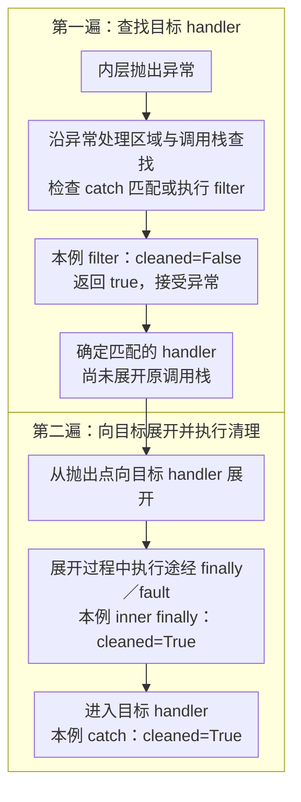

> 一个方法被调用时，runtime 到底做了几件事——查 vtable、准备参数、建栈帧、处理异常——每个 runtime 实现不同，但规范层的契约是同一份。

这是 ECMA-335 主线的调用与异常篇，保留原 A4 标号作为旧文对应。

前面已经建立类型、签名和 CIL 栈模型。这篇讨论调用时如何消费参数、决定目标，并在异常发生后转移控制权。类型信息准备可能惰性发生，不能假定所有工作都在程序集加载时完成。

### 异常的查找与展开 {#exception-two-pass}

先用后文已验证的 filter 示例看清两阶段：查找阶段尚未展开原调用栈，但可以执行 filter 中的用户代码。下图画的是 filter 接受异常、清理正常完成并进入目标 handler 的路径。



filter 返回 false 时继续查找；没有匹配 handler 时则涉及未处理异常策略，不能从这条成功匹配路径推导所有 finally 都一定执行。图中的日志与状态对应后文桌面 .NET 示例，未替代跨 AOT／解释器的 Player 验证。

## 为什么要讲执行模型

Metadata 和 CIL 是静态结构。TypeDef 表告诉 runtime 一个类型有哪些字段和方法，MethodDef 表告诉 runtime 一个方法的签名和 IL body。但光有这些结构不够——它们只描述了"有什么"，没有定义"怎么运行"。

执行模型定义的就是这些静态结构在运行时被"激活"的方式：

- 遇到 `call` 指令时，参数怎么从 eval stack 传递给目标方法
- 遇到 `callvirt` 指令时，runtime 怎么根据对象的实际类型查找 vtable
- 进入一个 try block 后抛了异常，runtime 怎么找到匹配的 catch handler
- 一个方法调用另一个方法时，栈帧怎么创建和销毁

所有 runtime 的方法调用、异常处理都遵循——或者有意识地偏离——这份规范。CoreCLR 用 JIT 生成 native 调用，IL2CPP 在构建时把 IL 翻译成 C++ 函数调用，LeanCLR 在解释器内部模拟栈帧，但它们要保证的外部可观测行为是同一套。

理解执行模型，就是理解这些 runtime 的公共契约。

## 先分清目标、接收者与参数

CLI 方法调用以签名和求值栈为基础，native ABI 则决定实际寄存器、栈槽和结构体传递方式。它们是两个层次，不要把 CLI 的 HASTHIS 等签名标志直接当成 ARM64 寄存器分配规则。

| 指令 | 需要记住的语义 |
|---|---|
| call | 调用引用所指定的目标，不按接收者实际类型进行虚分派；也可以直接调用某个虚方法实现 |
| callvirt | 用于实例方法，具有空引用检查语义；对虚方法按实际类型分派，也可以调用非虚实例方法 |
| calli | 依据调用点签名通过函数指针间接调用，必须满足指针、签名与调用约定的要求 |
| newobj | 调用实例构造函数；引用类型产生对象引用，值类型产生构造后的值 |

`call` 不额外提供 callvirt 的接收者空检查，不等于方法体访问空引用就安全。`newobj` 产生值类型值，也不规定其最后一定存放在硬件栈上。

普通 C# 委托调用常表现为对委托 Invoke 的调用，不能直接说“所有 delegate 底层都是 calli”。运行时如何完成分派属于实现层。

### 参数按值还是按位置传递

```csharp
public static void Swap(ref int a, ref int b)
{
    int temp = a;
    a = b;
    b = temp;
}
```

Swap 的两个参数在 IL 签名中为 int32&。调用方加载的是变量位置，方法内的写入能够改变调用方变量。

普通值参数复制值；普通 class 参数复制对象引用。两种情况都不是“调用方变量本身按引用传入”。返回值与签名相容，并成为调用方求值栈中的结果。

### callvirt 不总等于查一遍 vtable

对非虚实例方法使用 callvirt，可以保留空引用检查而不进行虚分派。对虚方法或接口调用，runtime 也可能通过分析确定唯一目标并去虚化。

vtable、接口映射、缓存与具体 slot 组织都是实现方法。规范要求选择正确的方法，不要求所有 runtime 使用相同的表布局和查找次数。

## constrained. 为什么对值类型调用重要

```csharp
public interface IResettable { void Reset(); }

public struct Counter : IResettable
{
    public int Value;
    public void Reset() { Value = 0; }
}

public static class Calls
{
    public static void Reset<T>(ref T value) where T : IResettable
        => value.Reset();
}
```

Reset 的核心 IL 可表示为：

```il
ldarg.0
constrained. !!0
callvirt instance void IResettable::Reset()
ret
```

这里接收者是指向 T 的托管指针。constrained. 让同一段泛型 IL 能根据 T 的类别完成调用：对引用类型取得对象引用，对直接实现相关方法的值类型可直接使用其地址；某些需要对象表示的路径仍可能发生装箱。它不是“所有泛型接口调用都无装箱”的承诺。

对比两条路径：

```csharp
Counter counter = new Counter { Value = 7 };
IResettable boxed = counter;  // 装箱的是副本
boxed.Reset();               // 修改装箱中的值，counter.Value 仍为 7
Calls.Reset(ref counter);    // 对原变量位置调用，counter.Value 变为 0
```

这个差别同时影响行为、分配和传参。排查 HybridCLR 的结构体接口调用时，先看实际 IL 是否经过 box、是否使用 constrained.，再分析桥接实现，不能只按 C# 表面语法猜测。

## 异常处理模型

ECMA-335 Partition I 12.4.2 定义了 CLI 的异常处理模型。这个模型的核心是两遍扫描（two-pass）机制。

### 四种异常处理子句

每个 try block 可以关联四种异常处理子句：

**catch** — 按类型匹配异常。当抛出的异常对象是 catch 子句声明的类型（或其子类型）时匹配成功。

**filter** — 动态过滤。运行一段用户代码来决定是否匹配，返回 true 则匹配。C# 6.0 的 `when` 子句就编译为 filter。

**finally** — 正常离开或按异常展开离开受保护区域时执行清理；不能据此保证进程终止、FailFast 等情形一定执行。

**fault** — 在因异常展开离开受保护区域时执行。C# 没有直接的 fault 语法；不要把它与通常以 try/finally 表达的 using 混同。

### 两遍扫描模型

runtime 抛出异常后，执行两遍扫描：

**第一遍（查找阶段）** — 从抛出点开始，沿调用栈向上遍历每一帧。在每一帧中，检查当前 IP（instruction pointer）是否在某个 try block 的 protected region 内。如果是，检查该 try 关联的 catch/filter 子句是否匹配。找到第一个匹配的 handler 后停止。

**第二遍（展开阶段）** — 从抛出点重新开始，沿调用栈向上展开（unwind）到匹配的 handler 所在帧。展开过程中，逐帧执行途经的所有 finally 和 fault 子句。到达目标帧后，把控制权交给匹配的 catch handler。

```csharp
void A()
{
    try
    {
        B();
    }
    catch (InvalidOperationException ex)  // ← 第一遍找到匹配
    {
        Console.WriteLine(ex.Message);    // ← 第二遍最终到达这里
    }
}

void B()
{
    try
    {
        C();
    }
    finally
    {
        Cleanup();  // ← 第二遍展开时执行
    }
}

void C()
{
    throw new InvalidOperationException("error");  // 抛出点
}
```

执行顺序：
1. 第一遍：C（无 handler）→ B（finally 不是 catch，跳过）→ A（catch InvalidOperationException 匹配）
2. 第二遍：从 C 展开到 B，执行 B 的 finally（调用 Cleanup），然后展开到 A，进入 A 的 catch handler

两遍扫描的设计意图是：在实际展开栈帧之前，先确认有 handler 能处理这个异常。如果整个调用栈上没有匹配的 handler，runtime 可以在第一遍结束时直接报告未处理异常，而不需要执行任何 finally（某些 runtime 的策略）。

### 用 filter 看见查找先于展开

只有 finally 和 catch 的日志，还不容易看出两阶段的区别。异常过滤器在查找阶段执行，可以观察到内层 finally 尚未完成的状态。把下面代码作为独立控制台项目的 Program.cs：

```csharp
using System;

public static class Program
{
    private static bool cleaned;

    private static bool Accept(Exception error)
    {
        Console.WriteLine($"filter: cleaned={cleaned}, {error.GetType().Name}");
        return true;
    }

    private static void Inner()
    {
        try
        {
            throw new InvalidOperationException("sample");
        }
        finally
        {
            cleaned = true;
            Console.WriteLine("inner finally");
        }
    }

    public static void Main()
    {
        try { Inner(); }
        catch (InvalidOperationException error) when (Accept(error))
        {
            Console.WriteLine($"catch: cleaned={cleaned}");
        }
    }
}
```

预期输出：

```text
filter: cleaned=False, InvalidOperationException
inner finally
catch: cleaned=True
```

filter 接受异常后，才进入展开并执行内层 finally，最后进入 catch。因此不要在 filter 中假定内层清理已经完成。若过滤器返回 false，查找会继续寻找其他匹配项；这个样例没有演示后续匹配、未处理异常或 native 异常传播。

本机验证：2026-10-25，Windows、.NET SDK 10.0.402、net10.0、Release，从本文提取代码独立编译运行，实际输出与上面三行一致。这验证了该桌面样例的可观察顺序；跨 AOT／HybridCLR 解释器的同类路径仍需在对应 Player 中单独验证。

### Protected Region 在 metadata 中的表示

每个方法的异常处理信息存储在方法体的 exception handling clause 表中（不是 metadata 表，而是 method body 的一部分，跟在 CIL 指令之后）。每个子句记录：

- `Flags` — 子句类型（catch = 0、filter = 1、finally = 2、fault = 4）
- `TryOffset` + `TryLength` — try block 的 IL 偏移范围
- `HandlerOffset` + `HandlerLength` — handler 的 IL 偏移范围
- `ClassToken`（catch 子句）— 捕获的异常类型 token
- `FilterOffset`（filter 子句）— filter 代码的起始 IL 偏移

runtime 在方法加载时解析这些子句，建立"IL 偏移 → 异常处理区域"的映射。抛异常时根据当前 IP 查找所在的 protected region。

### 控制流指令与异常区域

`leave` 用于按规则离开受保护区域，会清空求值栈并执行需要经过的 finally；普通 br 不能随意跨越这些边界。`endfinally` 结束 finally／fault 处理并继续原来的控制流，不能用普通 ret 替代。

在 catch 中用 `rethrow` 继续抛出当前异常，与把异常对象重新放到栈上执行 throw 不同。C# 的 `throw;` 与 `throw ex;` 因而可能保留不同的调用栈信息。filter 在查找阶段执行，不能误以为它总在所有内层 finally 之后执行。

## AOT 与解释器如何共同遵守这些语义

IL2CPP 的 native 栈帧和 HybridCLR 的解释器帧可以出现在同一条逻辑调用链上。跨边界时，不仅要传对参数与返回值，还要使异常能按支持的路径传播，并完成相应清理。

```text
AOT 调用方
  → 调用桥接
  → 解释执行的热更方法
  → AOT 被调用方
  → 正常返回或异常传播
```

这张图表达职责，不指定当前版本必须经过哪个内部函数。具体 bridge、invoker、帧布局与异常实现放到 [ABI 桥接篇]() 和 [HybridCLR 调用主链]()。

不要从“解释器没有直接使用每个方法的 native 栈帧”推导“异常一定更快”，也不要从某个 IL2CPP 平台的实现推导所有平台的 EH 机制。性能和支持范围需要版本、平台与实测条件。

## 动手验证

1. 对上述 Counter 示例分别执行装箱调用与 constrained 泛型调用，检查原变量值。
2. 在 IL 工具中核对 box、constrained.、callvirt 与参数类型。
3. 运行上面的 filter 示例，核对 filter、内层 finally、catch 的顺序及 cleaned 的变化，再设计返回 false 且外层仍有 catch 的变体。
4. 若用于验证 HybridCLR，分别记录纯 AOT 与跨 AOT／解释器路径。桌面 CLR 结果只验证示例语义，不代表后者已通过。

规范依据：[ECMA-335](https://ecma-international.org/publications-and-standards/standards/ecma-335/) Partition I §12.4、Partition III 中 call、callvirt、calli、constrained.、leave 等条目。

**跨执行边界之前，先确认调用目标、接收者表示、参数和异常语义；桥接的职责是维持这些语义。**

## 系列位置

- 上一篇：[CIL 与最小验证规则]()
- 下一篇：[程序集身份、引用与加载]()
- 返回：[ECMA-335 主线索引]()
