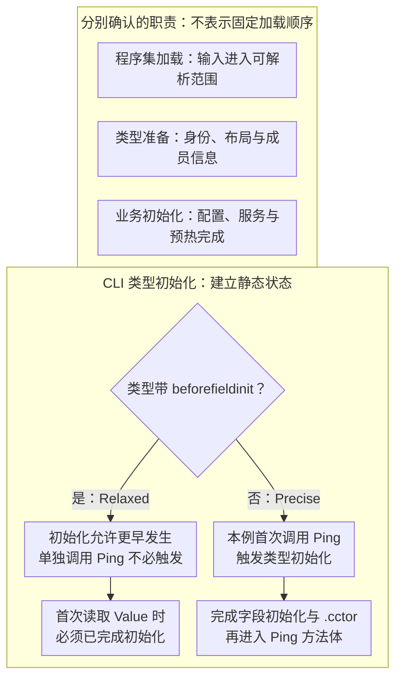

> **读这篇之前**：先读 [程序集身份、引用与加载]()。本文讨论 CLI 类型初始化，Unity 的 Awake、OnEnable 等组件回调属于另一套生命周期。

项目把热更 DLL 加载完，再通过反射枚举所有类型，接着发现“自动注册”的处理器并没有进入注册表。注册代码写在静态构造函数中，作者以为类型被发现就会执行它。

另一个常见现象恰好相反：第一次调用很慢，后面却正常。第一次访问可能同时触发类型信息准备、静态字段初始化、泛型准备、解释器转换和业务缓存构建。把它们都叫“类初始化”，会让排查失去方向。

这篇要分开四件事：**程序集加载、类型解析／准备、CLI 类型初始化，以及项目主动安排的业务初始化。**

## 同一个“初始化”，其实有四种状态

| 层次 | 解决的问题 | 不能直接推出什么 |
|---|---|---|
| 程序集加载 | 输入程序集进入运行时的可解析范围 | 不代表其中每个类型都已经使用过 |
| 类型解析与准备 | 确认类型身份，准备执行需要的布局、成员等信息 | 不代表静态构造函数已经执行 |
| CLI 类型初始化 | 按触发规则执行 .cctor，建立静态状态 | 不代表网络、资源、配置等业务依赖就绪 |
| 业务初始化 | 按项目顺序加载依赖、注册服务、预热 | 需要团队定义完成、失败和重试机制 |

这是一张职责图，不是所有 runtime 都采用的固定四步函数调用链。类型准备可以惰性进行，也可以在构建期完成一部分。

尤其不能只因为某个内部函数叫 `Class::Init`，就推断它等同于运行用户的 `.cctor`。要查当前版本的实际调用路径或观察行为。后续 [IL2CPP runtime 篇]() 中的类型信息准备，应与这里的语言语义分开理解。

## .ctor 与 .cctor 各自初始化什么

`.ctor` 是实例构造函数，为某次对象构造服务。`.cctor` 是类型初始化器，通常承担静态字段的初始化；它无参数、无返回值，由运行时按规则触发。

```csharp
public sealed class Registry
{
    public static readonly object Gate = new object();

    static Registry()
    {
        System.Console.WriteLine("Registry .cctor");
    }

    public Registry()
    {
        System.Console.WriteLine("Registry .ctor");
    }
}
```

两次 `new Registry()` 可以执行两次实例构造，但不会因此正常执行两次该类型的静态构造。也不要反过来推断“只有 new 对象才初始化类型”：访问静态字段、调用静态方法也可能触发。

**源代码里没写 static 构造函数，不代表 IL 中没有 .cctor。** 静态字段初始化表达式可能被编译器放入生成的 .cctor。判断触发规则，还要看类型上的 `beforefieldinit` 标志。

## beforefieldinit 放宽的是时机

[ECMA-335 第六版](https://ecma-international.org/publications-and-standards/standards/ecma-335/) Partition I §8.9.5 区分了两种触发语义：

| 类型标志 | 最重要的观察边界 |
|---|---|
| 有 beforefieldinit | 初始化必须在首次访问该类型所定义的静态字段时或更早发生；单独调用静态方法不必触发 |
| 无 beforefieldinit | 首次访问其静态字段、调用其静态方法或实例构造函数会触发；值类型的实例／虚方法调用还有对应规则 |

精确规则需要结合类型类别阅读，不能概括成“所有第一次碰到类型的动作都触发”。`typeof(T)` 或发现一个 Type 对象本身，不是强制执行 T 的静态构造的契约。

C# 显式声明静态构造函数时，编译器不会给该类型添加 beforefieldinit。仅有静态字段初始化时，编译器通常采用宽松语义。参见 Microsoft 的 [CA1810 说明](https://learn.microsoft.com/en-us/dotnet/fundamentals/code-analysis/quality-rules/ca1810)。

这里“允许更早”很重要。如果某次测试在调用一个空静态方法前就打印了初始化日志，它只能证明该次运行选择了这个时机，不能证明所有运行时都必须如此。

### 初始化职责与触发窗口 {#initialization-window}

图中先把不同职责分开，再用下文的两个静态类说明 CLI 初始化时机。职责卡片之间没有调用箭头；下半部分仅画首次使用、初始化正常完成的示例，不代替上表对其他类型类别的规则。



`Relaxed` 这条路径表达允许的时机范围，不规定初始化日志必须出现在 `Ping` 前还是后；CLI 静态状态已经建立，也不能推出业务初始化已经完成。

## 动手验证：比较标志和触发点

将下面代码作为普通 .NET 控制台项目的 Program.cs；放入 Unity 时，把 Console 输出换成日志，并由明确入口调用同样的步骤。

```csharp
using System;
using System.Reflection;

public static class Relaxed
{
    public static readonly int Value = Init();
    private static int Init() { Console.WriteLine("Relaxed init"); return 1; }
    public static void Ping() { Console.WriteLine("Relaxed Ping"); }
}

public static class Precise
{
    public static readonly int Value = Init();
    static Precise() { Console.WriteLine("Precise .cctor"); }
    private static int Init() { Console.WriteLine("Precise field"); return 2; }
    public static void Ping() { Console.WriteLine("Precise Ping"); }
}

public static class Program
{
    public static void Main()
    {
        Console.WriteLine((typeof(Relaxed).Attributes & TypeAttributes.BeforeFieldInit) != 0);
        Console.WriteLine((typeof(Precise).Attributes & TypeAttributes.BeforeFieldInit) != 0);
        Console.WriteLine("before calls");
        Relaxed.Ping();
        Precise.Ping();
        Console.WriteLine(Relaxed.Value);
        Console.WriteLine(Precise.Value);
    }
}
```

观察三个点：

1. C# 编译产物中，Relaxed 带 BeforeFieldInit，Precise 不带。
2. Precise 的字段初始化和静态构造体在其 Ping 方法体执行前完成。
3. Relaxed 的初始化必须赶在读取 Value 之前完成；不要断言它一定发生在 Ping 之前或之后。

本机验证：2026-10-23，.NET SDK 10.0.402，Release。标志输出为 True、False；Precise 的初始化早于其 Ping 方法体，Relaxed 在本次运行中晚于 Ping、早于 Value 读取。后面两个实验得到独立的 7／9，以及一次 Broken attempt、两次初始化异常。这是当时桌面 .NET 的观察；下文另列本轮 AOT／热更 Player 的独立输入与结果，Editor 行为仍未验收。不能把 Relaxed 的任一次日志顺序当成规范要求。

## 泛型共享代码，不等于共享静态字段

下面的泛型类型为每个封闭类型保留自己的静态字段：

```csharp
public static class Cache<T>
{
    public static int Count;
    static Cache() { System.Console.WriteLine(typeof(T).Name); }
}
```

在 Main 中执行：

```csharp
Cache<int>.Count = 7;
Cache<string>.Count = 9;
System.Console.WriteLine(Cache<int>.Count);     // 7
System.Console.WriteLine(Cache<string>.Count);  // 9
```

`Cache<int>` 和 `Cache<string>` 是不同封闭类型；各自的 Count 和类型初始化状态需要区分。IL2CPP 是否让某些方法共享 native 代码，是代码生成策略，不会把它们的静态字段合成一个变量。

这也解释了为什么预热一个泛型组合，不能自动证明其他组合的静态状态已经建立。若不同字段被显式赋成同一个引用对象，当然仍可共享那个对象；“字段独立”不是“对象图完全隔离”。

## 静态构造失败不是业务重试入口

再加入：

```csharp
public static class Broken
{
    static Broken()
    {
        System.Console.WriteLine("Broken attempt");
        throw new InvalidOperationException("missing configuration");
    }
    public static void Ping() { }
}
```

在 Main 中调用两次：

```csharp
for (int i = 0; i < 2; i++)
{
    try { Broken.Ping(); }
    catch (TypeInitializationException e)
    {
        System.Console.WriteLine(e.InnerException?.GetType().Name);
    }
}
```

预期看到一次构造尝试、两次初始化失败；第二次调用并不是重新执行一遍初始化逻辑。Microsoft 的 [静态构造说明](https://learn.microsoft.com/en-us/dotnet/csharp/programming-guide/classes-and-structs/static-constructors)也明确指出，失败的静态构造不会被运行时重新调用。

因此网络请求、可重试下载、等待异步任务等业务动作，不适合依赖 .cctor 来调度。更稳的做法是显式的初始化入口，自己表达未开始、进行中、完成和失败状态。静态构造适合建立局部且确定的类型不变量。

还有一个边界：循环初始化、初始化中的递归访问，以及多线程互相等待，可能暴露尚未完成的静态状态或形成死锁风险。“运行时通常保证一次初始化”不是任意初始化代码都安全的证明。

## Player 实测：类型初始化与首次调用 {#type-initialization-player}

前面的控制台示例验证语言层面的观察方法。2026-10-26 又在 [hybridclr-runtime-lab](https://github.com/TwoEggDu/hybridclr-runtime-lab) 新建 `projects/type-initialization`，把同一份自有场景分别编进 AOT 和 HotUpdate；两份场景源码仅命名空间不同。外部通过反射进入 Cases，场景内直接调用目标静态方法。AOT 程序集随 Player 启动加载，热更程序集由本例显式 Assembly.Load，两者的程序集装载路径并不相同。

本轮仍是本机自定义 Unity `2022.3.62f3_96770f904ca7`、package v9.0.3／runtime v9.0.1、Windows x64 Development／IL2CPP C++ Debug／Minimal stripping。build_id 为 `5b177115-e8ae-4e58-8808-2a0bc54b092a`；43 个输入与 227 个产物有哈希绑定。最终裁剪后的 Probe.AOT.dll 与随包 HotUpdate.dll 的只读元数据结果一致：Strict、`Cache<T>`、Failed 不带 beforefieldinit，Relaxed 带该标志，四种目标类型都有 .cctor；热更 DLL 未进入 AOT 编译产物。

### 四组问题，加一条失败捕获边界对照

每个路径各运行三个独立进程。四组基础问题中的失败组增加外层捕获路径，共 30 个普通 Player：27 个完成并退出 0；3 个热更内部捕获对照退出 2，作为实际差异保留，不能写成全部语义通过。

| 场景 | AOT 观察 | 热更观察 |
|---|---|---|
| 显式 .cctor：Strict | 首次调用标记后，字段初始化与构造体先于 Ping 方法体；第二次不重跑。两次返回 7，字段为 41 | 三轮相同 |
| beforefieldinit：Relaxed | 本例在首次调用标记后、Ping 方法体前完成一次字段初始化；读取字段为 41 | 三轮相同；这只是规范允许的一种时机 |
| 泛型静态字段 | `Cache<int>` 依次返回 42、43；`Cache<string>` 返回 82、83；两个封闭类型各初始化一次 | 三轮相同 |
| 失败：场景内部 catch | 两次捕获 TypeInitializationException，内部为 InvalidOperationException；构造体执行一次 | 首次初始化异常逃逸到外层反射调用边界；本路径没有到达第二次访问 |
| 失败：共用 AOT 外层 catch | 两次独立反射调用都得到 TargetInvocationException → TypeInitializationException → InvalidOperationException；构造体执行一次 | 三轮相同，第二次没有重跑构造体 |

本例在加载程序集、解析入口、读取目标类型标志时没有记录到 Strict 的初始化事件。显式 .cctor 的第一次方法调用才接上字段初始化、构造体和方法体事件。这说明这些步骤需要分别观测，不能拿“GetType 成功”代替静态状态就绪。

Relaxed 的结果也不能改写成“带 beforefieldinit 的类型必在首次静态方法前初始化”。[ECMA-335 第六版 §I.8.9.5](https://ecma-international.org/wp-content/uploads/ECMA-335_6th_edition_june_2012.pdf)规定的是触发语义范围，本轮只采到了当前实现与输入下的一种合法顺序。

### 失败差异必须保留到捕获边界

原始失败场景把 `Failed.Ping()` 放在自己的 `try/catch (TypeInitializationException)` 内。最终两个 DLL 的自有 CIL 都显示：call 位于偏移 30，受保护区间为 `[29,47)`，catch 类型确为 System.TypeInitializationException。因此不能把热更侧的差异解释成“源码忘了把调用放进 try”。

为继续观察第二次访问，额外提供无内部 catch 的 AccessFailed；由同一个 AOT 驱动逐次反射调用并捕获。这里的 TargetInvocationException 是反射边界包装，内层才是类型初始化失败和原始业务异常。这个路径验证了两侧构造体均未因第二次访问重跑，却不消除原来内部捕获路径的差异。

当前只确认该自定义版本中的可复现现象。异常捕获差异的准确根因、普通方法抛出对照、其他构建和版本仍待验证；没有修改上游 runtime，也没有将外层捕获包装成修复方案。

### 转换缓存就绪，不等于目标方法体执行过

同一 Player 另跑两个匹配 PDB 的 native 取证进程，分别观察热更 strict 与 failed 路径。两者都先准备 Ping 的转换缓存，再进入 .cctor；.cctor 的调用栈含 Runtime::ClassInit，转换一次、Execute 函数入口一次。退出前检查同一个 Ping MethodInfo，其 interpData 已非空。

但 strict 的自有 Ping 方法体事件为两次，failed 为零次。**一个方法可以已经转换并缓存，却因类型初始化失败而没有进入方法体。** 此处原生 Execute 函数入口计数也不能当成解释器内部调用次数；需要同时看转换身份、缓存和自有方法体事件。

### 复现和证据边界

依次使用 `tools/init_lab.py build --editor <Unity.exe>`、`run`、`trace --cdb <x64 cdb.exe>`、`verify`、`export`。本轮本地记录为 `evidence/2026-10-26-type-initialization/README.md`、results.json 与 32 份自有事件文件；其中 30 份属于普通运行，2 份属于独立 native 取证。原始日志、Player 和 PDB 留在忽略目录。

本轮固定提交为 [46ac71c](https://github.com/TwoEggDu/hybridclr-runtime-lab/commit/46ac71c74cd068bc177d653dd143b7bb9dc482bd)，可查看[实验工程](https://github.com/TwoEggDu/hybridclr-runtime-lab/tree/46ac71c74cd068bc177d653dd143b7bb9dc482bd/projects/type-initialization)、[实验记录](https://github.com/TwoEggDu/hybridclr-runtime-lab/blob/46ac71c74cd068bc177d653dd143b7bb9dc482bd/evidence/2026-10-26-type-initialization/README.md)与[结构化结果](https://github.com/TwoEggDu/hybridclr-runtime-lab/blob/46ac71c74cd068bc177d653dd143b7bb9dc482bd/evidence/2026-10-26-type-initialization/results.json)。复现请先检出该提交；前轮 `74da063` 只包含资源实验。这里只验证单线程输入，不覆盖初始化锁竞争、循环初始化、性能、其他平台或所有异常展开路径。[源码起步篇]()解释如何把首次调用的证据分层，[IL2CPP runtime 篇]()补充类型准备与 .cctor 的区别。

## 回到热更新启动流程

把业务启动安排成显式依赖，而不是依赖扫描顺序：

```text
确认主包、补充元数据与热更 DLL 的版本匹配
  → 在需要的 AOT 泛型执行前准备相应支持
  → 加载热更程序集及其依赖
  → 主动调用热更入口
  → 按业务顺序加载配置、注册服务、预热
```

这是一种工程组织方式，不是 CLI 强制的唯一加载次序。HybridCLR 的 [补充元数据说明](https://www.hybridclr.cn/docs/basic/aotgeneric)要求在使用相关 AOT 泛型之前完成必要准备；它不意味着每次补充都会重跑已有类型的 .cctor。

加载一个同名 DLL、重启编辑器 Play Mode、关闭 Domain Reload、采用某种程序集卸载功能，也不是同一件事。是否存在新的类型身份、旧引用是否仍被持有、静态状态是否重建，取决于具体机制与版本。需要重置业务状态时，应有明确的 Reset／Shutdown 契约，不能靠“再加载一次”猜测。

**程序集可见、类型可解析、静态状态已建立、业务已经就绪，是四个需要分别确认的事实。**

## 系列位置

- 上一篇：[程序集身份、引用与加载]()
- 下一篇：[对象布局与 GC 契约]()
- 返回：[ECMA-335 主线索引]()
