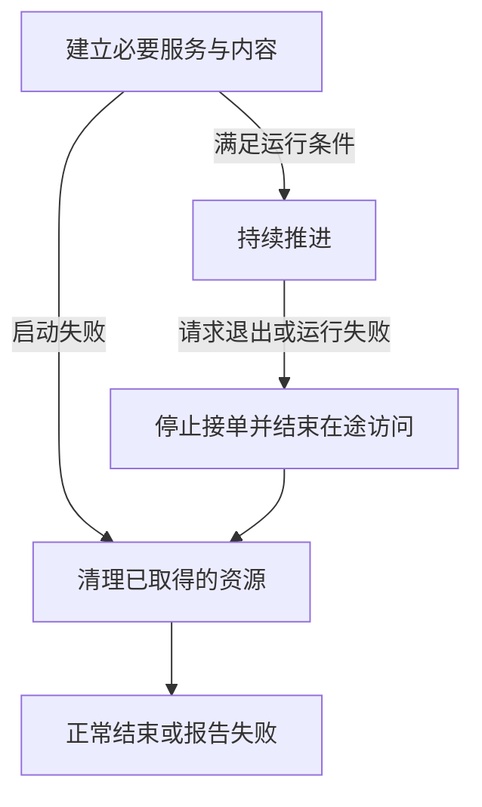

做过游戏以后，我们通常知道把角色移动写进更新函数，把资源准备放在初始化阶段，把清理放在退出阶段。但把这三段连接起来，仍然会遇到一些不好解释的现象：初始化函数已经返回，世界却还没加载；一帧卡了很久，接下来连续执行多次模拟；窗口已经收到关闭请求，后台工作却仍在访问对象。

要理解这些现象，需要同时看三件事：**当前有哪些状态已经可用，允许游戏时间前进多少，以及谁负责结束还活着的工作。** 主循环把它们连接起来；它的结构也决定了后面的输入、物理、动画和资源系统怎样合作。

> **读这篇之前**：已经写过游戏更新逻辑即可。想先看整体分工，可以读 [游戏引擎架构总论]()，它承担本课程 GEF-01 的地图入口。
>
> **示例与证据**：公共模型和 Python 程序是本篇自有教学例子。Piccolo 对照固定提交 `f5053707fed4`；Unity 对照 6.0 文档，Unreal 对照 5.6 文档。具体引擎的完整调用顺序、运行时序和 GPU 行为要回到各自实现核对。

## 1. 已有 Piccolo 流程，怎样和本篇配合

如果已经读过 Piccolo 系列，你已经见过启动与帧循环的真实路径。下面这些内容可以直接接着用：

| 已有文章 | 已经回答的问题 | 本篇补上的公共解释 |
| --- | --- | --- |
| [02：从启动走到第一帧]() | 系统怎样建立，世界何时加载，关闭怎样回到入口 | 启动依赖、完成条件和部分失败后的清理责任 |
| [03：一帧怎样推进]() | 真实调用顺序、字段交接、delta time、物理步长与内部任务 | 模拟时间怎样累计，固定步怎样补，表现怎样插值 |

本篇先建立可以独立推演的模型，再带着模型回看这些文章。尤其要保留一个区别：某台引擎使用了固定的物理步长，不代表它已经采用下面这套时间累积与插值设计。

## 2. 启动的目标，是交出可以使用的状态

把启动想成“依次调用几个 initialize”还不够。我们真正需要的是：下一阶段要使用什么，上一阶段是否已经建立了它，以及失败时留下了什么。

例如一个最小客户端可以选择这样的依赖：窗口提供绘制目标；渲染服务依赖窗口；一份需要渲染服务的场景实例依赖渲染服务。这个例子的启动顺序可以写成：

```text
窗口可用 → 渲染服务可用 → 场景实例可用 → 开始推进场景
```

箭头表示本例的依赖。真实引擎还可能先创建世界管理器、后加载世界内容，或者先运行加载界面、再让游戏场景进入可玩状态。无画面的服务器也不需要照搬这条依赖链。

因此至少要区分：

| 状态 | 可以确认什么 | 还不能推出什么 |
| --- | --- | --- |
| 管理器已创建 | 有对象承接后续调用 | 它管理的内容已经加载 |
| 基础设施已就绪 | 本阶段需要的服务可以使用 | 所有场景对象都已准备完毕 |
| 场景满足运行条件 | 规定的必要内容与依赖已经到位 | 所有可选资源都已驻留 |
| 一次表现工作已提交 | 请求已交给后续执行环节 | 屏幕已经显示这次结果 |

“就绪”必须带着具体用途：允许进入菜单，和允许角色参与战斗，可以有不同条件。异步加载只是在这些状态之间增加了等待和失败分支，并没有取消完成条件。

下面的图是应用状态模型，箭头表示状态转换，不是线程或函数调用关系：



### 启动失败，要分别处理当前步骤和之前的步骤

假设窗口建立成功，渲染服务创建到一半失败。这里有两层责任：

1. 渲染服务的创建过程，负责回收本次尚未交给调用者的部分资源。
2. 外层启动过程，负责关闭已经成功建立的窗口。

一种容易理解的做法是：**每完成一个步骤，就登记它的清理动作；失败时按依赖允许的顺序执行已登记动作。** 后文程序用一个列表表达这个意思。

反向遍历创建记录适用于依赖按顺序建立、没有额外在途访问的简单模型。真实系统若存在回调、共享资源或工作线程，还需要先让使用者停止。仅仅把初始化函数倒过来调用，并不能证明清理正确。

## 3. 先说清楚，这里的“一帧”指什么

下面用一个串行的教学循环理解职责：

```text
取得事件与时间 → 推进游戏状态 → 准备表现 → 提交表现工作 → 等待合适的下一次机会
```

事件处理放在哪里、哪些系统可以并行、最后是否等待，要由具体平台和实现决定。在浏览器或其他宿主环境里，也可能由宿主反复回调程序。持续运行不要求应用自己一直占着一个 `while`。

更容易混淆的是，我们会把不同次数都叫作“帧”：

| 名称 | 本篇中的含义 |
| --- | --- |
| 外层迭代 | 程序获得一次推进机会，处理事件、时间和表现准备 |
| 模拟步 | 用一个规定的时间跨度更新游戏状态 |
| 表现提交 | 把选定的表现状态交给渲染等系统 |
| 显示刷新 | 显示设备更新画面，具体呈现关系由后续链路决定 |

一次外层迭代可以执行零次、一次或多次模拟；提交一次表现工作，也不保证它立即出现在屏幕上。后面的示例只模拟外层迭代和状态推进，把表现结果打印出来，没有创建窗口或执行 GPU 工作。

相应地，外层两次时间采样的间隔也不只是“逻辑执行耗时”。它可能包含计算、阻塞、等待显示和操作系统调度。要判断某个系统用了多久，仍需围住那个系统单独测量。

## 4. 真实时间与模拟时间，需要各自记账

设上一轮和这一轮之间实际经过了 `elapsed`，我们可以选择把多少时间交给模拟。正常运行时可以全部接纳；暂停时可以接纳零；过长间隔也可以按明确规则限制。

本篇使用四个量：

- **接纳时间**：决定交给模拟处理的时间总量。
- **已模拟时间**：已经通过状态更新推进的时间总量。
- **累计余量**：已经接纳，但还没拿去模拟的时间。
- **丢弃时间**：已经接纳，后来按过载策略放弃模拟的时间。

从零开始、没有重置账本时，应有：

```text
接纳时间 = 已模拟时间 + 累计余量 + 丢弃时间
```

暂停期间没有接纳的真实时间不在右边，也不偷偷欠给恢复后的第一轮。若在接纳前截断了一段过长间隔，那部分同样不进入这份账本，诊断时可以另外记录。

### 可变步长解决什么，固定步长又解决什么

可变步长直接把本次接纳的时间交给更新，例如 `position += velocity * dt`。对速度恒定的运动，在忽略舍入误差时，同样总时长得到同样位移；不能笼统地说用了可变步长就一定移动错误。界面动画和许多视觉变化也可以适合这种方式。

问题在于，真实状态更新往往还包含加速度、碰撞和条件判断。离散积分的误差、跨越碰撞边界的可能性，以及一次更新内触发哪些事件，都可能随步长变化。乘上 `dt` 解决了单位换算，却不能包办这些问题。

固定步长则规定每次模拟只推进相同的 `h`。它让单步计算面对更一致的时间条件，但还没有回答“现在该执行几步”。如果每个外层迭代只执行一次 `simulate(1/60)`，机器一秒只完成 30 次迭代，模拟就只前进半秒。

**固定的是每步模拟跨度；要追上接纳时间，还需要一个调度规则。** 固定步长也不自动保证跨平台确定性，输入序列、遍历顺序、浮点行为和并发等条件仍需另行约束。

## 5. 用一张表看懂累积与补步

先取一个方便计算的固定步长 `h = 20 ms`，也就是每模拟一秒执行 50 步。这是教学参数。每轮把接纳时间加进余量，只要余量够 20 ms，就执行一步并扣掉 20 ms。

给定四轮间隔 `[16, 16, 50, 8] ms`，暂不丢弃时间：

| 外层迭代 | 本轮接纳 / ms | 加入后的余量 / ms | 本轮模拟次数 | 累计模拟 / ms | 剩余 / ms |
| --- | ---: | ---: | ---: | ---: | ---: |
| 1 | 16 | 16 | 0 | 0 | 16 |
| 2 | 16 | 32 | 1 | 20 | 12 |
| 3 | 50 | 62 | 3 | 80 | 2 |
| 4 | 8 | 10 | 0 | 80 | 10 |

最后一共接纳 90 ms，已经模拟 80 ms，还留着 10 ms。第三轮的三次模拟可以在很短的一段真实执行时间里接连发生，它们不需要各自真的等待 20 ms。

这也解释了为什么“固定更新每隔 20 ms 准时调用”容易误导：时间跨度固定，真实调用时刻未必均匀。

### 插值在两个已知状态之间选择表现位置

假设一个点从 0 开始，以每秒 10 个单位匀速前进。每步 20 ms，所以每次模拟增加 0.2。保存上一次模拟状态 `previous` 和最新状态 `current`，再用余量计算：

```text
alpha = 剩余时间 / 固定步长
shown = previous × (1 - alpha) + current × alpha
```

对应上表，表现结果为：

| 迭代 | previous | current | alpha | shown |
| --- | ---: | ---: | ---: | ---: |
| 1 | 0 | 0 | 0.8 | 0 |
| 2 | 0 | 0.2 | 0.6 | 0.12 |
| 3 | 0.6 | 0.8 | 0.1 | 0.62 |
| 4 | 0.6 | 0.8 | 0.5 | 0.70 |

第四轮没有新模拟状态，但余量增长，所以仍然能在两个已知状态之间前进。`shown` 只用于表现，不写回 `current`，否则下一步的模拟起点就被表现帧率改变了。

这种插值有明确代价：在已有前后两份状态、步长恒定且没有暂停或丢步的区间里，表现时间比接纳时间落后一个固定步长。第四轮接纳到了 90 ms，插值呈现的是 70 ms 的状态；它没有预测 90 ms 的未来位置。第一步之前没有历史，示例把两份状态都初始化为 0。

瞬移或重新加载时，旧历史也可能不再适合插值，通常需要重设这对状态。相机、UI 等也不必一律采用相同的插值方案。累积与插值的另一份原始讲解可参阅 [Fix Your Timestep!](https://gafferongames.com/post/fix_your_timestep/)。

## 6. 追不上和暂停，都需要主动选择策略

如果一次模拟本身就很慢，毫无限制地补步会让本轮更慢，下一轮又积累更多工作。循环必须对过载作出选择，而每种选择都保留不同的东西。

| 策略 | 保留什么 | 需要接受的代价 |
| --- | --- | --- |
| 本轮少做几步，欠账留到以后 | 接纳的模拟时间 | 积压可能继续增长；余量可超过一步，不能直接当普通插值系数 |
| 限制本轮接纳的时间 | 单轮输入给模拟的时间上限 | 游戏时间可能落后真实时间；仍需关注此前积压 |
| 限制步数，丢弃剩余的完整步 | 本轮模拟调用次数和小于一步的余量 | 一部分时间没有被模拟，运动和事件进程会受影响 |

后面的程序选择第三种：每轮最多三步，然后丢弃余量中的完整步，只保留不足一步的部分。这是演示策略，并不适合直接拿去维持权威联网模拟或精确回放的时间约束。

例如已有 10 ms 余量，又接纳 100 ms：共 110 ms；三步用掉 60 ms；剩下 50 ms，其中丢弃 40 ms、保留 10 ms。限制的是模拟调用次数，并不是严格的 CPU 耗时预算，一步仍然可能非常慢。

暂停则是另一种决定。本例暂停游戏模拟，却继续处理外层控制；暂停间隔不加入余量，并保持最后一次表现结果。如果暂停期间还在逐轮采样，就持续更新真实时钟的采样点；如果整个循环都挂起了，恢复时应重设采样基准，避免把停留在后台的几分钟一次性交给模拟。

暂停菜单、网络超时、后台下载是否继续，分别由各自时间域和平台规则决定。把所有系统的时间差统一改成零，不一定能表达项目需要的暂停语义。

## 7. 退出，要先结束访问，再结束被访问的对象

关闭请求到来时，程序可能还持有待处理事件、资源请求或图形工作。一条有用的清理思路是：

```text
记录停止请求 → 不再派发新工作 → 取消或完成在途访问 → 释放依赖资源
```

收到请求并不等于可以立刻删除所有对象。如果工作线程仍在写场景对象，或者回调仍能访问已经释放的接收者，外层循环停止也没有结束这条访问路径。取消请求还需要确认取消生效或工作完成；等待又必须避免阻塞完成动作所依赖的线程。

在没有异步访问的简单例子里，这些步骤可以很短；系统越复杂，越需要把停止接单、等待完成和最终释放分开。具体的线程、回调与 GPU 完成协议分别留给后续课程。

还有两个边界需要从一开始就保留：

- **部分初始化失败**：只能清理已经取得的资源，失败步骤自己处理尚未交出的部分资源。
- **被强制终止**：普通退出代码可能没有机会执行。重要状态应在业务过程中的合适时机持久化，不能只寄托在最后一个关闭回调上。

## 8. 一个可以直接运行的最小程序

下面的 Python 3 程序不需要第三方库。把整个代码块保存为 `gef02_loop.py`，运行 `python gef02_loop.py`。时间来自给定序列，便于逐行对照；真实循环需要换成单调时钟的采样间隔，并加入平台事件与等待机制。

`start` 和 `stop` 只打印模拟的资源操作，不创建真实窗口、线程或 GPU 对象。故障注入演示的是“当前失败步骤先回滚自己的部分状态，再由外层清理已完成步骤”；本例打印式清理不会失败，实际实现还需要处理清理自身的错误。

```python
STEP_MS = 20
MAX_STEPS = 3
FRAMES = [(16, "run"), (16, "run"), (50, "run"), (8, "run")]


def start(name, fail_at):
    print("start", name)
    if name == fail_at:
        print("rollback-partial", name)
        raise RuntimeError("startup failed: " + name)
    return name  # 只有成功后，清理责任才交给调用者


def run(frames, fail_at=None):
    opened = []
    rows = []
    try:
        for name in ("window", "renderer", "world"):
            opened.append(start(name, fail_at))

        previous = current = 0.0
        accumulator = simulated = 0
        for frame, (elapsed, mode) in enumerate(frames, 1):
            if mode == "quit":
                print("quit requested")
                break
            if mode == "pause":
                print(frame, "paused; keep last presentation")
                continue  # 外层仍在推进，暂停时间不欠给模拟
            if mode != "run" or elapsed < 0:
                raise ValueError("invalid frame input")

            accumulator += elapsed
            steps = 0
            while accumulator >= STEP_MS and steps < MAX_STEPS:
                previous = current
                current += 10.0 * STEP_MS / 1000  # 速度：10 单位/秒
                simulated += STEP_MS
                accumulator -= STEP_MS
                steps += 1

            dropped = (accumulator // STEP_MS) * STEP_MS
            accumulator -= dropped  # 丢完整步，保留不足一步的余量
            alpha = accumulator / STEP_MS
            shown = previous * (1 - alpha) + current * alpha
            row = (frame, steps, simulated, accumulator, dropped,
                   alpha, shown)
            rows.append(row)
            print(f"frame={frame} steps={steps} sim={simulated} "
                  f"left={accumulator} drop={dropped} "
                  f"alpha={alpha:.2f} shown={shown:.2f}")
    finally:
        for name in reversed(opened):
            print("stop", name)
    return rows


if __name__ == "__main__":
    run(FRAMES)
```

正常输出为：

```text
start window
start renderer
start world
frame=1 steps=0 sim=0 left=16 drop=0 alpha=0.80 shown=0.00
frame=2 steps=1 sim=20 left=12 drop=0 alpha=0.60 shown=0.12
frame=3 steps=3 sim=80 left=2 drop=0 alpha=0.10 shown=0.62
frame=4 steps=0 sim=80 left=10 drop=0 alpha=0.50 shown=0.70
stop world
stop renderer
stop window
```

序列耗尽表示结束这个有界演示；持续运行的程序则继续等下一轮。`finally` 让正常结束、运行中异常和启动异常都经过清理记录，但它不能保证进程被强制杀死时还能执行。

接下来可以在另一个 Python 文件里写 `from gef02_loop import run, FRAMES`，逐项调用：

| 调用 | 应检查的结果 |
| --- | --- |
| `run(FRAMES, fail_at="renderer")` | 报出预期异常；回滚 renderer 的部分状态，只对已完成的 window 执行 stop，不进入帧循环 |
| `run(FRAMES + [(100, "run")])` | 第五轮三步，累计模拟 140 ms，余量 10 ms，本轮丢弃 40 ms |
| `run([(16, "run"), (16, "run"), (500, "pause"), (20, "run")])` | 暂停不累计；恢复这一轮只模拟一步，累计模拟 40 ms、余量 12 ms |
| `run([(16, "run"), (50, "quit"), (20, "run")])` | 关闭标志在本轮模拟前检查，后两项不产生模拟或表现结果，随后清理三项服务 |

这些输入都是教学约定。比如本例在看到 quit 时不接纳该条记录的时间；具体引擎在哪个阶段看到停止请求，要按它的调用路径判断。

## 9. 带着公共模型进入三台引擎

### Piccolo：用已有两篇检查模型的适用边界

固定提交中的 [WorldManager](https://github.com/BoomingTech/Piccolo/blob/f5053707fed4d3f94d270a436fb0d3a8ae54e3e5/engine/source/runtime/function/framework/world/world_manager.cpp) 在初始化时记录默认世界地址，在未加载的 tick 中尝试加载。这正好对应前面的区别：管理器对象已经存在，不表示世界内容已经可用。完整入口与退出路径继续读 [Piccolo 02]()。

再看 [engine.cpp](https://github.com/BoomingTech/Piccolo/blob/f5053707fed4d3f94d270a436fb0d3a8ae54e3e5/engine/source/runtime/engine.cpp)：外层以 `steady_clock` 计算间隔；世界更新和输入 tick 在逻辑阶段，事件轮询与关闭检查位于渲染调用之后。这与本例“模拟前检查 quit”的安排不同，阅读时要先确定实际检查点。

更值得比较的是 [PhysicsScene::tick](https://github.com/BoomingTech/Piccolo/blob/f5053707fed4d3f94d270a436fb0d3a8ae54e3e5/engine/source/runtime/function/physics/physics_scene.cpp)。它向物理更新传入 `1 / m_update_frequency`，但该函数没有本篇的累积器和按余量补步循环。读 [Piccolo 03]() 时，分别标出外层间隔、物理步长和调用次数；不要从“固定参数”推导出“一定按真实时间追赶”。

这些是固定源码能确认的路径。正常退出能走通的源码分析，也不等于任意半初始化状态都支持安全关闭；完整引擎运行和时序观察仍需单独验证。

### Unity：回调是循环的入口之一，先确认所在阶段

Unity 6.0 的官方说明把 MonoBehaviour 生命周期图限定为 PlayerLoop 的部分阶段，完整循环包含更多系统。因此 `Awake`、`Start`、`Update` 等名称适合帮助定位业务入口，不能直接代替整台引擎的启动和执行地图。[Event function execution order](https://docs.unity3d.com/6000.0/Documentation/Manual/execution-order.html)

固定更新文档也明确区分了模拟步长与真实调用间隔：一轮可能没有固定更新，也可能执行多次，追赶还有上限。对应到本篇，要检查项目的固定步长、实际调用次数，以及哪些状态由固定更新产生、哪些由表现阶段消费。[Fixed updates](https://docs.unity3d.com/6000.0/Documentation/Manual/fixed-updates.html)

退出时，`OnApplicationQuit` 还受平台与挂起/终止方式限制。业务应区分正常清理与关键状态持久化，不能把这个回调当成所有平台都保证执行的最后机会。[OnApplicationQuit](https://docs.unity3d.com/6000.0/Documentation/ScriptReference/MonoBehaviour.OnApplicationQuit.html)

后续从 [Unity 阅读路线]() 进入对象、资源和运行时专题；观察时记录版本、运行环境和更新阶段，本篇没有提供 Unity Player 实测时间线。

### Unreal：世界中的开始、Tick 和结束，各有自己的范围

UE 5.6 的 Actor 生命周期文档区分了从磁盘加载、PIE 复制和运行时生成等路径。`BeginPlay` 是 Actor 进入玩法阶段的观察点；`EndPlay` 又可能来自关卡切换、PIE 结束或销毁等情形，不能把它直接等同于进程退出或内存已经释放。[Actor Lifecycle](https://dev.epicgames.com/documentation/en-us/unreal-engine/unreal-engine-actor-lifecycle?application_version=5.6)

对于每帧工作，Actor/Component 的 Tick 可以按组安排，还可以建立先决依赖。关注点是“谁必须在谁之后使用哪份状态”，而不只是每个对象有没有 Tick。Tick 组及依赖的具体保证见 [Actor Ticking](https://dev.epicgames.com/documentation/en-us/unreal-engine/actor-ticking-in-unreal-engine?application_version=5.6)。

继续读 [Unreal 阅读路线]() 时，可以先选一个 Actor，追它从哪条路径进入世界、在哪个阶段更新、何时结束玩法责任，再进入对象与线程专项。Actor Tick 本身并不证明使用了本篇的固定步调度；物理时间策略需要另外核对项目配置与实现。

## 10. 自检：先推演，再运行

1. 固定步长仍为 20 ms，从零开始，连续三个外层间隔都是 10 ms。每轮执行几步，最终余量多少？沿用每秒 10 单位的速度，第三轮的表现位置是多少？
2. 原四轮之后再接纳 100 ms，每轮最多三步且丢弃多余完整步。为什么总共经过 190 ms，模拟却只有 140 ms？余下的时间去了哪里？
3. 渲染服务启动失败时，为什么既不能漏掉 window 的清理，也不能直接对一个尚未成功建立的 renderer 执行完整 stop？
4. 暂停 500 ms 后恢复，为什么不一定应该补 25 步？若整个循环都曾挂起，应该检查哪一个采样状态？
5. 看到 `simulate(1/60)`，是否就能确认游戏每秒执行 60 次模拟？看到 `EndPlay` 或收到窗口关闭事件，又能否确认所有资源已经释放？
6. 如果回调还会访问一个场景对象，只把这个对象从世界容器移除，是否足以安全退出？下一步需要追什么？

### 参考答案

1. 次数依次为 0、1、0，累计模拟 20 ms，余量 10 ms。第三轮 `previous=0`、`current=0.2`、`alpha=0.5`，表现位置是 0.1；最新模拟位置仍是 0.2。
2. 190 ms 接纳时间 = 140 ms 已模拟 + 10 ms 余量 + 40 ms 丢弃。这 40 ms 没有被状态更新追上，是所选策略的代价。
3. window 是外层已经取得的资源；renderer 失败时的部分状态应由创建步骤负责回滚。完整 stop 是否允许用于半初始化对象，要由接口另行保证，不能从正常退出路径猜测。
4. 本例暂停的是模拟时间，暂停期间没有接纳这 500 ms。若连外层采样都停了，恢复时重设上次采样点，防止把后台停留计入第一轮。
5. 不能。固定参数只限定单次模拟跨度，还要检查调度次数；对象结束玩法、收到退出请求、工作完成和内存释放也分别属于不同阶段。
6. 不足以确认。继续追订阅或回调的持有者、能否继续派发、已经派发的访问是否结束，以及对象的最终持有关系。取消和完成需要各自证据。

## 11. 验证范围与继续阅读

2026-10-25 使用 Python 3.12.4 从正文提取程序执行，正常输出与上表逐项一致；三处启动失败、超载丢步、暂停、主动退出、运行异常，以及表现插值不回写模拟状态均通过独立检查。自检第 1 题的数值也已用同一程序复核。

本篇程序的时间输入是人为给定的，检查的是状态推进与清理顺序，不能用于比较帧率、输入延迟或性能。具体引擎部分分别依据 Piccolo 固定源码和 Unity/Unreal 公开文档；三引擎运行、真实窗口事件、线程采样和 GPU 捕获不在本次验证范围内。

接下来可以按目标选择：

- 想读一台引擎的真实控制流：顺着 [Piccolo 02]() → [Piccolo 03]()，再从 [Piccolo 阅读入口]() 选择具体系统，跟踪一个状态的生产与消费。
- 想补资源与对象的清理责任：读 [C++ 对象与资源由谁结束]()，再回各引擎对象系统。
- 想把时间模型接到性能诊断：读 [一帧到底是怎么完成的]()，继续区分计算、等待、提交和显示。
- 想继续公共课：下一单元 GEF-03 将讨论世界、对象与组件怎样组织；正文尚待补齐，可先读 [GameObject 与 Actor]() 建立映射。

持续运行的每一步，都应说明它依赖什么状态、推进多少时间，以及结束时由谁收回责任。
