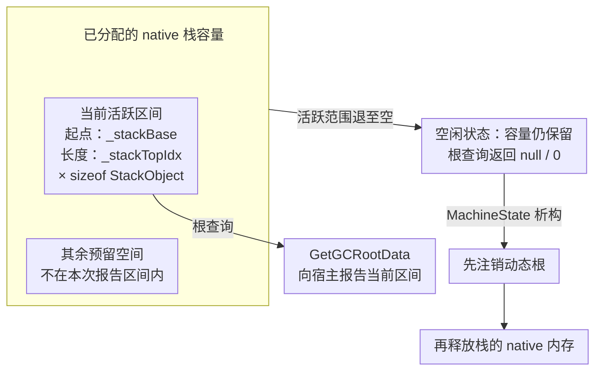

AOT 代码把对象交给热更方法后，调用线程并没有进入另一座独立的托管堆。解释器继续使用 IL2CPP 的对象体系，却把参数、局部值和执行状态放进自己的数据结构里。GC 要怎样发现这些引用，写入对象字段时又怎样保持跟踪正确？

这是桥接篇 F。收集器、内存指标和终结语义由 [IL2CPP D6]() 与 [ECMA GC 前置]()承担；本篇聚焦解释器接入。

> 源码基线：runtime v9.0.1（`83929787581bce6c7219418f62348a10c33582ee`），配套 il2cpp_plus v2022.3.x-9.0.1（`ba3a76c9979d14cee404fb5d44301773e0768866`）。与下文实验使用同一组合，完整环境锁见 [源码阅读起步]()。旧稿的 v6.1.0 保留为历史阅读对照，不再与当前实验混用。下文分别标明源码契约和 Player 观察。

## 共享对象，额外维护执行状态

先区分三类东西：

| 内容 | 例子 | 生命周期由什么决定 |
|---|---|---|
| 托管对象 | 热更类实例、数组、装箱对象、委托 | 对 GC 可见的引用关系与收集过程 |
| 线程执行状态 | MachineState、解释器栈和帧数组 | 线程上的解释执行需求与 runtime 清理路径 |
| 程序与方法数据 | image、类型描述、转换后的指令缓存 | 装载、缓存及具体产品的卸载机制 |

一个线程暂时没有解释器帧，不代表它的栈容量已释放；一个热更对象被收集，也不代表该程序集的 metadata 可以回收。这两种混淆都会把正常缓存、生命周期遗漏和真正的泄漏混到一起。

## 根是可达性的起点，不是所有变量的清单

静态状态、活跃执行引用和显式强句柄是常见根来源。它们不是一份跨版本穷尽清单：静态字段可能为空、局部引用可能已不再活跃、弱句柄也不等同强根。

例如长期存在的 AOT 事件发布者持有委托，委托再指向热更订阅者，便形成一条保留链。解除订阅后是否还有其他根，要查快照；单次强制 GC 后对象还活着，并不能直接指向解释器错误。可运行对照见 [静态容器与事件生命周期实验]()。

普通强 GCHandle 保留对象，Pinned 才增加固定地址要求。保守、非移动的收集器也不能替你管理句柄与回调的所有权：native 仍在使用句柄时不能释放，native 已停止使用后也不能永久遗留。

## MachineState 如何提供活跃根

这一版 `MachineState` 定义在 [interpreter/Engine.h](https://github.com/focus-creative-games/hybridclr/blob/83929787581bce6c7219418f62348a10c33582ee/hybridclr/interpreter/Engine.h)。可按下面的路径读，不必先通读解释器全部指令：

1. `InterpreterModule::GetCurrentThreadMachineState` 从 TLS 取当前线程状态，没有则创建。它不会提前为所有 OS 线程创建解释器。
2. `MachineState::InitEvalStack` 分配解释器栈，并把 **MachineState 实例与 GetGCRootData 回调**交给宿主的 `GarbageCollector::RegisterDynamicRoot`。
3. `GetGCRootData` 在栈存在且 `_stackTopIdx > 0` 时，报告从 `_stackBase` 开始、长度为 `_stackTopIdx * sizeof(StackObject)` 的区间；否则报告空区间。
4. 析构时，已分配的栈先取消动态根注册，再释放其 native 内存；帧和异常流数组也有对应清理。

这里注册的不是“永远扫描整个预分配栈容量”的固定区间。容量、活跃范围和是否已经释放是三个量。进入和退出解释器帧会影响活跃范围，而线程存活期间可以继续保留已分配容量。

### 图解：容量、活跃区间与释放 {#active-root-range}

下图概括固定 v9.0.1 的源码契约，只画已分配解释器栈的几种状态；区间长度随执行变化，不代表每次调用都使用相同数量的槽位。

图中的空闲状态可以重新进入解释执行；方法返回只影响相应帧，不自动触发最下方的析构清理。报告区间包含目标引用，也不等于已经证明该区间是目标的唯一根来源。

宿主端在配套 `libil2cpp/gc/BoehmGC.cpp` 的动态根集合中保存回调，在根枚举时取得区间并交给收集器。`RegisterDynamicRoot` 是这套宿主集成接口的名字，不应写成 Boehm 原生提供了一个同名 `GC_register_dynamic_root` API。

这也说明为什么随意把托管指针存到 native 内存里并不充分：关键在于该区域是否被正确枚举、引用是否仍在有效范围、所在线程是否正确接入。线程创建与退出的完整链路见 [线程接入篇]()。

## 根枚举与写屏障解决不同时间段的问题

根枚举告诉 GC 从哪里开始追踪；写屏障帮助它跟踪引用关系的变化。把解释器栈登记成根，并不意味着解释器对任意对象、静态字段或数组的写入都可以跳过宿主协议。

以“已扫描的容器随后获得一个新引用”为例，增量收集的不同片段与业务执行交错时，需要有机制让相关变化被重新考虑。这个例子解释的是协议需求，不是每次漏 barrier 都会立即回收目标的确定性重现步骤。

v9.0.1 可沿两层入口查看：

- [Interpreter_Execute.cpp](https://github.com/focus-creative-games/hybridclr/blob/83929787581bce6c7219418f62348a10c33582ee/hybridclr/interpreter/Interpreter_Execute.cpp)：字段、数组、间接写入和含引用值类型复制等执行分支。
- [Il2CppCompatibleDef.h](https://github.com/focus-creative-games/hybridclr/blob/83929787581bce6c7219418f62348a10c33582ee/hybridclr/Il2CppCompatibleDef.h)：`HYBRIDCLR_SET_WRITE_BARRIER` 的兼容封装及条件。

原始 CIL 先被转换成内部指令，再由解释器分派执行。是否选择某个带 barrier 的指令变体，需要同时看转换阶段、类型中是否含引用，以及执行端和宿主的配置；不能仅凭指令名称判断所有路径都已覆盖。

也不要反向写成“关闭增量后可以自行删掉 barrier”。运行时拥有不同配置下的实现选择，业务和插件应遵守其接口契约。栈上的临时槽位与堆上引用字段可能使用不同跟踪方式，但“只要注册成根就永远不需要写入处理”同样不是通用规则。

GC write barrier 不使共享 `List` 的并发操作变安全。跨线程发布和互斥另看 [线程内存模型]()。

## 线程多了，为什么 native 内存也会涨

在这套实现中，进入解释执行的线程可各自拥有 MachineState；解释器栈和帧数组属于 native 状态。频繁新建线程和复用线程池，表现出的分配与清理节奏可能不同。不要把“一次热更调用返回”视作“当前线程所有解释器内存已释放”。

验证时分别记录：进入过解释器的线程、仍活跃的帧、栈容量、动态根注册／注销，以及线程退出清理是否发生。具体退出入口和断点表见线程接入篇。仅观察托管堆大小无法回答这组问题。

## GC 完成不是卸载程序集的充分条件

旧稿把卸载压成“对象不可达 → 完整 GC → 释放 metadata”，省掉了真正困难的执行和所有权边界。至少还需要确认：

- 不再创建指向旧模块的新任务、订阅与回调；在途执行已退出。
- 旧模块的委托、句柄、反射对象以及相关缓存已按产品协议处理。
- 运行时内部描述符和跨模块依赖不再访问将被释放的数据。
- 使用的是明确提供卸载／热重载能力的产品与版本，并完成它要求的步骤。

GC 只回答其对象体系中的可达性与回收问题，不会自动证明 native 缓存和执行入口可以失效。社区版普通动态加载也不能因为手工收集一次就获得任意卸载能力。产品能力继续看 [程序集热重载专题]()，其中的商业实现描述需保留公开事实与推断的区分。

## 验证时分别记录什么

| 场景 | 关键观察 | 不能据此推出什么 |
|---|---|---|
| AOT 静态事件持有热更实例 | 委托目标与根路径，退订前后对象数 | 单次 GC 证明程序集已卸载 |
| 工作线程反复调用热更方法 | MachineState 复用、帧退出、线程清理 | 线程池不退出就是状态泄漏 |
| 开启增量后修改引用 | 相同输入下的完整性检查、GC 模式和崩溃证据 | 跑几轮不崩就证明 barrier 完整 |
| 多轮加载后内存增长 | 托管对象、native metadata、转换缓存分别计数 | 全部增长都来自 GC |

## 配套实验：分别验证可达性、根区间和引用修改

下面几轮实验均使用本机自定义 Unity `2022.3.62f3_96770f904ca7`、上述固定 v9 组合与 Windows x64 IL2CPP Development。前三轮使用 GCMode=Enabled，跨片段实验改为 Manual；它们回答的问题不同，不能把结果合并成“GC 已全面验证”。

| 要回答的问题 | 已观察到的结果 | 固定记录与边界 |
|---|---|---|
| 谁保留热更对象？ | AOT 静态数组／实例委托分别保留 16 个目标；清空相应持有后，弱引用在观察窗口失效 | [对象与托管线程 `a387d28`](https://github.com/TwoEggDu/hybridclr-runtime-lab/blob/a387d2807f4251fce0e5fc24e8d1debddb4ca79d/evidence/2026-10-25-lifetime-threads/README.md)；不测 native 释放量 |
| 原生回调活跃时引用是否可用？ | Normal GCHandle 保留 Context；无 Context 句柄的活跃回调局部 Node 跨三次收集后仍可校验。压力组每轮 1024 次回调、8 MiB payload 分配，数据检查通过 | [回调 GC `449a994`](https://github.com/TwoEggDu/hybridclr-runtime-lab/blob/449a9949122e791010624f4c799495d493cca9f4/evidence/2026-10-25-gc-callbacks/README.md)；128 次增量请求均返回 false，未展示持续跨片段标记过程 |
| 已分配容量与活跃根区间是否相同？ | 活跃回调实际返回 36 槽／288 字节，包含目标引用；空闲线程仍有 1 MiB backing 栈，但返回 null／0 | [根区间 `4861bed`](https://github.com/TwoEggDu/hybridclr-runtime-lab/blob/4861bedd35f9785038a15d34c8de38f261746867/evidence/2026-10-25-gc-roots/README.md)；不证明唯一根来源或标记器逐字遍历 |
| 对象快照能否直接显示解释器动态根？ | 21 份快照可见强句柄 → Context → 数组路径；ManagedStacks 均为 0。官方读取器交叉校验 189 组缓冲 | 同上；对象引用路径、原生分配的 root 字段和动态根区间必须分别解释 |
| 同一增量周期中修改引用会走哪些路径？ | 连续 12 帧 more=True 时写字段、数组与含引用结构体；关联目标槽屏障、dirty 位与后续页重扫，最终图校验通过 | 本地 `evidence/2026-10-25-incremental-barriers/`，尚无固定提交；详见下一段 |

最后一轮 build_id 为 `70a8a176-4eee-43b2-8aa8-a75754ac0bfb`。AOT／hot 各三个普通 Player 与三个 CDB Player，目标周期 GC 编号从 4 到 5，checksum 均为 12078。Box 写入前有标记，候选在 writer 返回前仍未标记；周期完成、Join 之前 12 个目标均有标记。每进程只观察到两次 dirty 从 0 变 1，AOT 16／hot 24 是屏障重载入口命中数，不能换算为写入次数或性能比例。

该样本先预热常驻托管 worker，再以事件串行交替推进收集和引用修改。目标周期收尾的两次 hot 根查询入口 top／frames 为 0，说明采样时 writer 已返回；本轮没有重新采真实返回缓冲，也没有禁用屏障的反事实。Box 有标记不等于其字段已完成扫描，存活结果不能证明屏障是唯一保留原因。

完整数据、采样方法和限制集中在 [IL2CPP GC 篇]()；回调、句柄与 Join 的所有权顺序见 [线程接入篇]()。这里的实验支持特定路径和负载，完整动态根归因、屏障路径覆盖、并发／长期压力、性能及其他平台仍需分别验证。

**解释器接入 GC，必须同时维护可见的活跃引用、正确的写入协议和有所有者的 native 状态。**

## 系列位置

- 前置：[IL2CPP GC 集成]()
- 继续：[线程接入与退出清理]()
- 返回：[HybridCLR 索引]()
