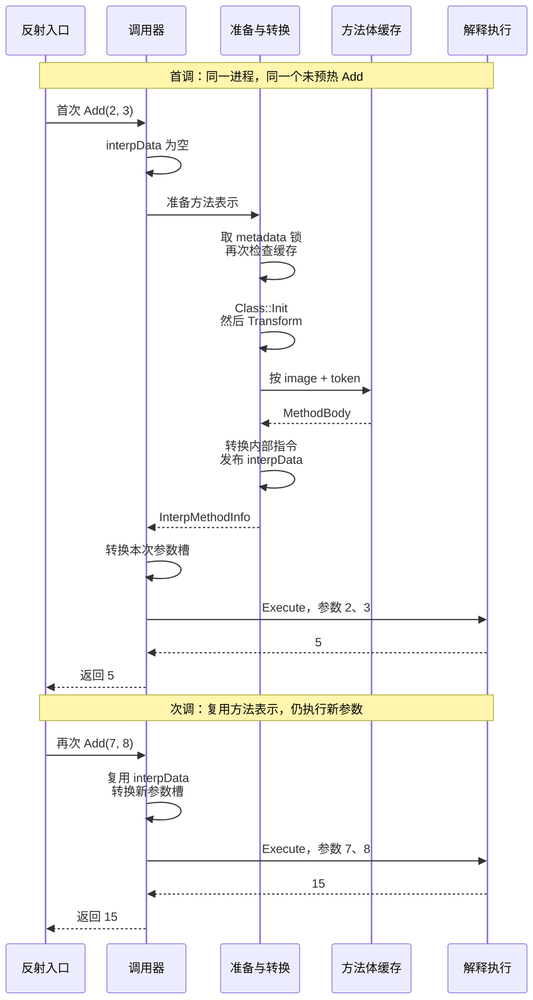

热更 DLL 已经加载，反射也取到了方法，调用后返回了正确结果。这些现象能证明业务入口可用，却还没有回答：参数经过了哪个 invoker，什么时候转换方法体，第二次调用又复用了什么？

这篇沿着一个独立的 `HotUpdate.ReadingProbe.Add(int, int)` 回答这些问题。工程准备、版本身份和符号检查放在 [源码阅读起步]()，这里集中跟状态变化，不依赖业务项目的启动框架。

> **版本与证据范围**：前八跳按 runtime v9.0.1（`83929787581bce6c7219418f62348a10c33582ee`）与 package v9.0.3 核对。Player 实测使用同一套 runtime 与本机自定义 Unity；完整 commit 见起步篇。v6.1.0 仅保留在历史差异表，不能把旧版源码与新版断点拼成一条链。

## 先把装载、准备与执行分开

一条调用链里有三种不同的状态变化：

| 阶段 | 输入 | 产生的状态 | 不能据此推定 |
|---|---|---|---|
| 装载 | 热更 DLL 字节 | InterpreterImage 与程序集注册信息 | 所有方法都已转换 |
| 方法准备 | 方法身份、image、token、方法体 | invoker 和解释执行需要的内部表示 | 已完成本次业务调用 |
| 执行 | 已准备的方法与本次参数 | 当前栈帧、指令执行和返回值 | 下一次无需执行 |

同一个方法第一次调用可能需要准备内部表示；第二次仍要处理新参数、建立执行现场并返回结果。我们要证明的是转换结果复用，而不是“第二次不经过解释器”。

## 固定一个能排除业务干扰的入口

实验只有两个程序集。AOT 入口读取本次编译的 `HotUpdate.dll`，调用 `Assembly.Load(byte[])`，随后通过反射获取 `HotUpdate.ReadingProbe.Add`。热更程序集中的方法只有整数加法，没有显式静态构造、模块初始化和预热代码。

```csharp
var assembly = Assembly.Load(dllBytes);
var method = assembly.GetType("HotUpdate.ReadingProbe", true)
    .GetMethod("Add", BindingFlags.Public | BindingFlags.Static);
var first = (int)method.Invoke(null, new object[] { 2, 3 });
var second = (int)method.Invoke(null, new object[] { 7, 8 });
```

完整样本和加载位置见起步篇。这里复用同一个反射方法对象，只装载一次 DLL，预期结果为 `5` 和 `15`。原生调试时还要核对两次调用的 `MethodInfo*`、类型与签名，不能仅凭同名方法归为同一对象。

## 第一跳：DLL 字节怎样进入 runtime

在配套 `il2cpp_plus` 中，先沿 `icalls/mscorlib/System/AppDomain.cpp` 的 `LoadAssemblyRaw` 找到 `vm/MetadataCache.cpp` 的 `LoadAssemblyFromBytes`，再进入 HybridCLR 的 `metadata/Assembly.cpp`。这些路径用于定位接入点；公开正文不复制 Unity C++ 实现。

观察这一跳时先记录 DLL 的构建来源、字节长度和 SHA-256，再核对装载入口收到的长度。这样才能把磁盘文件与本次装载关联起来。仅凭程序集名相同，不能证明装载的是本次生成物。

## 第二跳：装载后得到什么

固定版本的 [Assembly.cpp](https://github.com/focus-creative-games/hybridclr/blob/83929787581bce6c7219418f62348a10c33582ee/hybridclr/metadata/Assembly.cpp) 中，`LoadFromBytes` 调用 `Create`，后者创建和加载 `InterpreterImage`，初始化相关 metadata，并构造、注册程序集与 image 信息。

断点观察应放在相应对象创建之后：输入长度是否匹配，image 是否属于本次 DLL，程序集名是否为 `HotUpdate`。这一步把 DLL 接入 runtime 的 metadata 体系，为后面的类型、方法和 token 解析建立依据，并不意味着每个方法都已生成内部指令。

`LoadFromBytes` 后续还会处理模块初始化。因此“装载期绝不会执行方法”也不成立。本样本去掉模块初始化逻辑，目的是把 `Add` 的第一次触发留在显式反射调用处。

## 第三跳：方法为什么选中解释器 invoker

接下来沿 `vm/Class.cpp` 的方法初始化入口，观察 `MethodInfo` 的 `invoker_method`。在配套 runtime 中，invoker 选择会区分普通 AOT image 与解释 image；后者继续进入 `MetadataModule`、`InterpreterImage::GetMethodInvoker` 和 `InterpreterModule::GetMethodInvoker`。

本例的普通静态加法方法预期绑定 `InterpreterInvoke`。其他方法形态存在不同分支，例如委托相关入口，不要把本例扩展成所有方法的唯一实现。

这一跳完成的是调用方式的绑定。`invoker_method` 已经可用，与 `interpData` 已经包含转换结果，是两个不同的观察点。

## 第四跳：反射怎样进入已经绑定的 invoker

`MethodInfo.Invoke` 处理参数和返回值，再由 runtime 调用该方法绑定的 invoker。跟踪 `vm/Runtime.cpp` 时，重点核对目标方法身份、传入参数，以及函数指针最终指向哪里。

对本例而言，反射调用把控制权交给 `InterpreterInvoke`。反射查找成功不能替代这个观察；同样的托管反射 API 也可以调用 AOT 方法。

第一轮不必单步每一层反射内部实现。先确认本次调用确实抵达目标方法的 invoker，再回看中间的参数封送和异常处理。

## 第五跳：InterpreterInvoke 怎样准备参数

在 [InterpreterModule.cpp](https://github.com/focus-creative-games/hybridclr/blob/83929787581bce6c7219418f62348a10c33582ee/hybridclr/interpreter/InterpreterModule.cpp) 中，`InterpreterInvoke` 先检查 `method->interpData`；没有转换结果时调用 `GetInterpMethodInfo`。随后按方法描述准备 `StackObject` 参数槽，把调用参数转换为解释器需要的布局，再调用 `Interpreter::Execute`。

因此实际顺序是“准备方法表示 → 转换参数 → 执行”。在断点中依次看：

- 入口的 `method->interpData` 是否为空。
- `imi->argStackObjectSize` 与参数布局是否对应当前签名。
- 参数转换后，槽中的两个整数是否为本次输入。

该入口的临时参数区使用 native 栈分配；这不能推出“每一次解释器内部调用都会新增同样的 native 调用层”，也不能据此断言 native 栈一定先溢出。跨边界调用与解释器内部建帧需要分别追踪。

## 第六跳：第一次怎样准备 InterpMethodInfo

固定版本的 `InterpreterModule::GetInterpMethodInfo` 在 [InterpreterModule.cpp](https://github.com/focus-creative-games/hybridclr/blob/83929787581bce6c7219418f62348a10c33582ee/hybridclr/interpreter/InterpreterModule.cpp#L529) 中。它取得 metadata 锁、再次检查 `interpData`，调用 `Class::Init`，随后由 `HiTransform::Transform(methodInfo)` 返回 `InterpMethodInfo`，最后经内存屏障发布到 `methodInfo->interpData`。

这里有三个必须分开的细节：

1. 这里的 `Class::Init` 不能直接等同于执行 C# 静态构造函数。静态构造触发应沿实际调用入口和类型初始化路径核对；本样本没有显式静态构造，避免混入额外业务调用。
2. invoker 的快速缓存检查与锁内再次检查承担不同职责，不能删掉第二次检查来理解并发行为。
3. `interpData` 保存转换后的方法表示。它不是本次参数或返回值的缓存。

两次调用都应核对方法身份。只看到 `GetInterpMethodInfo` 命中，不能说明命中的是 `Add`；类型初始化和其他热更代码也可能走到这里。

## 第七跳：从哪个 image 取方法体，再转换什么

v9 的 [HiTransform::Transform](https://github.com/focus-creative-games/hybridclr/blob/83929787581bce6c7219418f62348a10c33582ee/hybridclr/transform/Transform.cpp#L34) 接收 `MethodInfo`，先用 `MetadataModule::GetUnderlyingInterpreterImage` 取得对应 image，再经 `MethodBodyCache::GetMethodBody(image, token)` 获取方法体。本例走热更解释 image；AOT 补充元数据的同源 image 是另一组需独立验证的输入。

随后创建转换上下文，调用 `TransformBody` 解析、转换 CIL，返回解释器需要的 `InterpMethodInfo`。方法体不可用时存在显式异常分支，不能把它概括成必然 native 崩溃。

`MethodBodyCache` 缓存原始方法体，`methodInfo->interpData` 持有转换后的解释方法信息，两者不是同一层缓存。读取方法体与转换缓存的维护位置在 v6、v9 之间有变化，历史对照列在后文。

在这一跳记录 image 来源、token、方法体输入，以及 Transform 返回后的 `codes`、`codeLength`。第二次调用没有进入目标 Transform，只有和同一方法的有效 `interpData` 一起观察，才构成复用证据。

## 第八跳：Execute 执行的是内部指令

[Interpreter_Execute.cpp](https://github.com/focus-creative-games/hybridclr/blob/83929787581bce6c7219418f62348a10c33582ee/hybridclr/interpreter/Interpreter_Execute.cpp) 中的 `Interpreter::Execute` 为从 native 进入的调用建立执行现场，随后按内部 `HiOpcode` 分派。第一次跟读只需要关注当前方法、参数、建帧后的指令指针和返回位置，不必遍历所有分支。

这里执行的是 Transform 的产物，不是直接拿原始 CIL 字节逐条分派。第二次复用转换结果后仍需进入 Execute，处理 `(7, 8)`，产生新的返回值 `15`。这也不是一次 native JIT 编译。

## 两次调用怎样形成证据闭环

### 首次与再次调用的时序 {#first-repeat-call}



调用器是 `InterpreterInvoke`；图中将 `GetInterpMethodInfo` 与其内部 Transform 合为一条参与线，仅表示本文静态 Add 的正常反射路径。`MethodBodyCache` 的原始方法体与 `interpData` 的转换结果是两层数据，`Class::Init` 也不能据此等同于执行 C# 静态构造。

以下是固定源码下的**预期观察表**。必须在新进程、未预热同一目标方法的条件下采集，不应照抄成实测结果。

| 位置 | 首次调用 | 再次调用 |
|---|---|---|
| InterpreterInvoke | 同一 Add；interpData 为空 | 同一 Add；interpData 已有值 |
| GetInterpMethodInfo | 取目标方法体并准备表示 | invoker 已有缓存时不需进入 |
| HiTransform::Transform | 目标 Add 命中一次 | 目标 Add 不再命中 |
| Interpreter::Execute | 参数 2、3 | 参数 7、8 |
| 返回日志 | 5 | 15 |

推荐按装载、invoker、方法准备、Transform、Execute 顺序下断点。记录目标 `MethodInfo*` 后，用地址条件过滤其他方法。首次已有缓存时先查预热和提前调用；再次转换时先查方法对象、泛型实例和进程身份。

只有正确返回值，证明的是样本功能结果；目标断点、缓存值和调用栈才支持这条执行路径。原生断点未绑定时，应先回到起步篇检查模块与 PDB。

## v9 Player 实测：同一方法转换一次、执行两次

2026-10-25，使用本机自定义 Unity `2022.3.62f3_96770f904ca7`，构建 Windows x64、IL2CPP、Development、C++ Debug Player。package v9.0.3 配套 runtime v9.0.1（`83929787581bce6c7219418f62348a10c33582ee`）和 il2cpp_plus v2022.3.x-9.0.1。这个实验没有沿用旧版兼容补丁，构建输入核对与完整版本表见 [源码阅读起步]()。

### 历史对照：v6 与当前 v9 的路径差异

| 位置 | v6.1.0 历史对照 | v9.0.1 阅读与实验基线 |
|---|---|---|
| GetInterpMethodInfo | 处理 RuntimeInitClassCCtor，选择 image 并读取 body | 锁内检查缓存，Class::Init 后调用 Transform |
| Transform 签名 | 接收 image、MethodInfo、body、输出对象 | 接收 MethodInfo，返回 InterpMethodInfo |
| 方法体来源 | 上层调用 image->GetMethodBody | Transform 内经 MethodBodyCache 读取 |
| 转换结果发布 | 写入 methodInfo->interpData | 仍写入 methodInfo->interpData |

v6 对照固定在 [5567f367](https://github.com/focus-creative-games/hybridclr/blob/5567f367502d916c6742873d8ed2ab13d0f6900a/hybridclr/interpreter/InterpreterModule.cpp#L588)。`MethodBodyCache` 是 v9 的真实入口，不应反写进旧版链路。对应公开源码见 [v9 InterpreterModule.cpp](https://github.com/focus-creative-games/hybridclr/blob/83929787581bce6c7219418f62348a10c33582ee/hybridclr/interpreter/InterpreterModule.cpp#L521) 和 [v9 Transform.cpp](https://github.com/focus-creative-games/hybridclr/blob/83929787581bce6c7219418f62348a10c33582ee/hybridclr/transform/Transform.cpp#L34)。本次缓存结论来自下面的实际断点，不靠两份源码“看起来相似”推定。

### 首次隔离实验记录

CDB 从进程创建时设置断点，`lmv m GameAssembly` 指向本次构建的模块，显示 `private pdb symbols`。被加载的 HotUpdate.dll 长度为 4608 字节，SHA-256 为 `BA0096D4CA773599ED664FD1D47CC2507D7C55F36EF0BD0CF44349EE46A9645C`；最终 AOT 裁剪目录中没有 HotUpdate.dll。

| 观测项 | 第一次 | 第二次 |
|---|---|---|
| 托管目标 | HotUpdate.ReadingProbe.Add，Int32 Add(Int32, Int32) | 同一反射方法对象 |
| 原生 MethodInfo 地址 | `0x00000208f01353e8` | `0x00000208f01353e8` |
| invoker 入口 interpData | null | `0x00000208f0140ac8` |
| GetInterpMethodInfo / Transform | 目标方法各命中一次 | 目标方法均未再次命中 |
| Execute 入口 interpData | `0x00000208f0140ac8` | 同一地址 |
| Execute 参数 | 2、3 | 7、8 |
| 托管返回日志 | PROBE_FIRST=5 | PROBE_SECOND=15 |

地址只标识本次进程，重启后不能照抄为条件断点。记录中两个 Execute 都携带同一目标方法地址；首调的 Transform 栈上可见 `GetInterpMethodInfo → InterpreterInvoke → Runtime::InvokeWithThrow`，Execute 栈上可见 `InterpreterInvoke → Runtime::InvokeWithThrow`。因此可以把反射入口、准备阶段和两次解释执行关联起来。

最终日志包含 `PROBE_PASS`。同一构建脱离调试器再次启动也返回 5、15，进程退出码为 0；这是普通启动验收，缓存结论仍来自前一次原生跟踪。原始日志、PDB 和 runtime 留在本地。

### 公开实验仓库的复跑记录

样本现维护在 [hybridclr-runtime-lab](https://github.com/TwoEggDu/hybridclr-runtime-lab)，固定提交为 [`e0220099`](https://github.com/TwoEggDu/hybridclr-runtime-lab/commit/e0220099d293f7a1a4601ee9931b49a10dd519f9)（完整 SHA：`e0220099d293f7a1a4601ee9931b49a10dd519f9`）。[Add 工程](https://github.com/TwoEggDu/hybridclr-runtime-lab/tree/e0220099d293f7a1a4601ee9931b49a10dd519f9/projects/call-chain) 与 [CDB 指令](https://github.com/TwoEggDu/hybridclr-runtime-lab/blob/e0220099d293f7a1a4601ee9931b49a10dd519f9/debugger/call-chain-v9.cdb) 可按 [README](https://github.com/TwoEggDu/hybridclr-runtime-lab/blob/e0220099d293f7a1a4601ee9931b49a10dd519f9/README.md) 复现。

新仓库重新构建后，[公开摘要](https://github.com/TwoEggDu/hybridclr-runtime-lab/blob/e0220099d293f7a1a4601ee9931b49a10dd519f9/evidence/2026-10-25/call-chain.json) 再次确认装载 1 次、invoker 2 次、Transform 1 次、Execute 2 次，同一方法与缓存返回 5、15。构建标识为 `136f3c65-0c8b-4944-a838-39a5f4024e27`，热更 DLL SHA-256 为 `3A0BE651942B13C706EC2369D6F9CE5F6174858672C75863796B643C2C3A3E98`。这是另一份构建和进程，不能套用上表原始记录中的地址与 DLL 哈希。

这组记录验证了当前样本的转换结果复用。它没有测量速度，不证明所有方法形态、AOT 泛型、GC、线程接入或移动端行为；v6.1.0 也没有因为这次 v9 成功而获得 Player 验收。

## 把方法体准备与实际调用再分开一次

[constrained.／装箱 Player 实测]()沿用同一自定义 Editor/v9 环境，把跟踪对象从 Add 换成结构体泛型调用。cross/on/value 读取了 Probe.AOT 的 ByValue（MethodDef 0x06000008），随后准备、转换和解释帧入口各一次，并完成“返回 11、原值 10”。cross/off/value 则在目标体前报告 MissingMethod。

cross/ref 的 on/off 都实际命中 native ByRef（MethodDef 0x06000009），再由 native constrained 调用进入 hot Counter.Increment。这里的入口委托由反射创建，目标调用使用缓存委托，不把 MethodInfo.Invoke 的包装异常混入比较。

有意思的反例是 on/ref：Run 准备期间同样读取过 ByValue body，栈含 MethodBodyCache::IsInlineable，但没有执行 ByValue。要把转换期查询、缓存准备、native 实际命中和解释帧入口逐一对应到方法身份，不能用前两项代替执行证据。

另一个可直接跟读的对象身份例子是[值与箱内副本对照]()：两次接口调用共享箱内 payload，拆箱副本使用另一 this 地址。先核对本构建 PDB 布局和最终 DLL token，再解释地址；不把地址套给其他进程或版本。本轮固定提交为 [5638131](https://github.com/TwoEggDu/hybridclr-runtime-lab/commit/563813195813cc2d618bdf301e12ab1af0556d79)，见[实验记录](https://github.com/TwoEggDu/hybridclr-runtime-lab/blob/563813195813cc2d618bdf301e12ab1af0556d79/evidence/2026-10-26-constrained-boxing/README.md)与[结构化结果](https://github.com/TwoEggDu/hybridclr-runtime-lab/blob/563813195813cc2d618bdf301e12ab1af0556d79/evidence/2026-10-26-constrained-boxing/results.json)。

## 系列位置

准备环境从 [源码阅读起步]() 进入；要解释跨边界参数约定，继续 [ABI 桥接]()；区分解释执行、补充元数据和其他能力时，回到 [边界与 trade-off]()。

**这条链的关键，是把程序集身份、方法准备和本次执行分别核对，再用同一方法的两次调用证明转换结果如何复用。**
