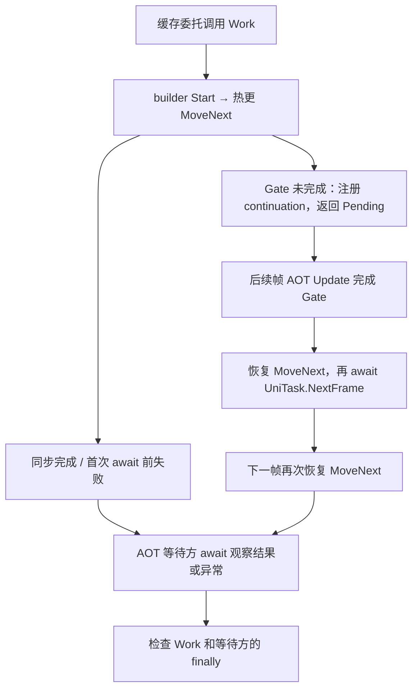

历史 async 崩溃记录出现了重复的 builder 与解释器栈。旧文先把空 RefMethods 当根因，后来又把 Development 不一致写成必然导致 metadata 失效的完整链。两种说法都超过了现存证据。

> **证据状态**：这是系列第 17 篇的历史案例复核。原 Android Release 记录没有完整固定源码、补充 DLL hash/返回码、状态机对照和修复后回归材料。本篇保留历史观察与两条验证路线，并在下文补入固定自定义 Editor／v9 的 async Player 实测；新样本不替代原 Android 现场。

## 目前能确认与不能确认的事

| 原记录 | 支持的判断 | 尚不能推出 |
|---|---|---|
| 符号化后出现 Start、AwaitUnsafeOnCompleted 与 Execute | 调用经过 async 与解释器相关路径 | 泛型缺失是唯一根因 |
| 若干 native 帧重复 | 需要检查递归、重入及展开可靠性 | 必然是同一状态机无出口循环 |
| RefMethods 只有注释 | 生成文件没有手写调用 | 补充 metadata 路径无效 |
| 怀疑生成与最终 Build 的 Development 不同 | 需要检查输入一致性 | 一定失配、一定 SIGSEGV |

旧的“确定性因果链”图已移除，避免读者把待验证假设继续当作事实。

## 为什么空 RefMethods 不是失败条件

自动生成的 AOTGenericReferences 主要是一份需求清单。正确补充方法定义所在 AOT 程序集的 IL 后，相应泛型可以走解释实现，不要求把清单填满。

即使要保留 native 实例，声明 `AsyncUniTaskMethodBuilder<int>` 也没有说明 `TStateMachine` 和 `TAwaiter` 是什么。为一个 dummy struct 生成 `Start<DummyStateMachine>`，不能作为覆盖其他热更 struct 状态机的保证。

[UniTask 2.5.10 的公开 builder 实现](https://github.com/Cysharp/UniTask/blob/2.5.10/src/UniTask/Assets/Plugins/UniTask/Runtime/CompilerServices/AsyncUniTaskMethodBuilder.cs)显示，Start 调用 MoveNext，AwaitUnsafeOnCompleted 设置相应状态机并注册 continuation。这一正常机制不包含“每次 await 必然重新 Start 同一状态机”的结论。历史项目仍需补录当时实际 UniTask 版本，不能用该参考版本替代现场身份。

## 路线一：验证输入与补充方法体

固定 Player、package/runtime、UniTask 版本及一个能正常完成的最小 async 方法。先建立一组匹配输入的正向基线，记录：

- 热更、定义 builder 的 AOT DLL、补充 DLL 的 hash 与模式。
- LoadMetadataForAOTAssembly 返回结果和首次使用时机。
- 实际生成的状态机是 class 还是 struct。
- 目标 Start / Await 方法的泛型参数、方法体来源及执行路径。
- 状态推进、完成结果与进程退出状态。

再一次只改变一个变量，例如 development、补充文件或加载时机；每组使用新进程，避免已登记 metadata/缓存遮住差异。不要同时换主包和热更 DLL 后，把恢复运行归因于其中一个 flag。

## 路线二：验证递归或重入

若仍出现重复栈，记录每次进入的具体 MethodInfo、状态机身份和状态值，区分同一状态机重复进入、不同 async 方法相互调用、同步 continuation 重入以及 unwind 失真。

同时保存 fault address、寄存器、栈界和完整线程信息，判断是否真正耗尽原生栈。`Il2CppFullySharedGenericAny` 只是一条调用形态线索，不证明缺方法体，也不证明已启用商业 FGS。

## 修法怎样跟证据对应

若已证实补充 DLL 选错，修复其主包绑定、模式与加载门槛，并复跑同样样本。若已证实 bridge/调用布局问题，核对匹配的运行时与生成物；若是业务递归或 continuation 重入，修业务路径。

只有在性能需求明确、共享条件成立时，才添加具体 native seeds。它可以优化目标调用，不应被当作绕开未知 runtime 故障的通用补丁。

构建参数统一有长期价值，见 [打包工程化]()，但流程变整齐本身不是历史根因已确认的证据。

## 固定 Player：挂起、恢复和异常怎样穿过边界

这轮先建立一个能逐步核对的 async 样本。它回答的是“哪些状态已经推进、调用走到哪里”，不会用一次 Windows 成功覆盖历史 Android 崩溃。

### 从一次方法调用拆成两次恢复

入口委托调用、未完成 await 注册、continuation 恢复与等待方取结果，是四个不同的观察点。`Work` 返回一个 Faulted UniTask，也不等于入口委托直接抛出异常。等待方必须实际 `await`，才能确认异常从哪个阶段被观察。

图是本样本的调用与调度模型；builder 与 MoveNext 的执行位置要分别取证，不能因热更方法经过解释器就把 builder 也画成解释执行。

### 版本与变量

沿用本机自定义 Unity `2022.3.62f3_96770f904ca7`、HybridCLR package v9.0.3／runtime v9.0.1 配套组合、Windows x64 Development／IL2CPP C++ Debug；额外固定 [UniTask 2.5.10](https://github.com/Cysharp/UniTask/tree/7c0f199fe0d3fc528024488ccd671e6c7b27745b)。未应用前轮初始化异常的反事实补丁，919 个运行时实现文件与原始准备源相同。

独立工程 `projects/async-unitask` 的 build ID 为 `c2a81f08-12d1-4f70-b333-d4bd26705388`，44 项输入和 264 份产物有哈希绑定。AOT／热更场景同源，反射仅创建缓存委托，目标调用不走 `MethodInfo.Invoke`；热更程序集从最终 AOT 产物排除。

同一 Player 同时携带 Development／Release 编译的两份热更 DLL。读取实际状态机基类后，前者是 class，后者是 struct，AOT 对照为 class。两种热更编译形态是独立维度；只有同一形态的 metadata on/off 才是加载条件对照，不能把 Development 差异直接当成 metadata 失效。

on 组在加载热更前，以 SuperSet 模式补充与最终 Player 裁剪 DLL 逐字节一致的 `UniTask.dll`，返回码均为 0。**本样本显式保留整个 UniTask 程序集**；off 只表示不加载这份补充 metadata，不表示移除了已有 native 泛型实现。

### 60 个普通 Player 的实际结果

四组路径分别是：同步完成 await、真正跨帧、await 前抛出、两次恢复后抛出。每格均为 3 个新进程。

| 状态机／metadata | 同步完成 | 跨帧恢复 | await 前异常 | 恢复后异常 |
|---|---|---|---|---|
| AOT class／off | 3 次返回 42 | 3 次返回 42 | 3 次等待方捕获 | 3 次等待方捕获 |
| hot class／off | 3 次返回 42 | 3 次返回 42 | 3 次等待方捕获 | 3 次等待方捕获 |
| hot class／on | 3 次返回 42 | 3 次返回 42 | 3 次等待方捕获 | 3 次等待方捕获 |
| hot struct／off | 3 次返回 42 | 3 次返回 42 | 3 次等待方捕获 | 3 次等待方捕获 |
| hot struct／on | 3 次返回 42 | 3 次返回 42 | 3 次等待方捕获 | 3 次等待方捕获 |

30 次结果为 42，30 次预期 `InvalidOperationException` 由 AOT 等待方的实际 await 捕获；每次 Work finally 和等待方 finally 各执行一次。没有观察到入口同步 escape 或未观察异常。await 前抛出组先返回 Faulted UniTask，不能把这条正常异步异常路径归入入口调用失败。

30 个挂起样本均记录：帧 1 注册自有 Gate 的 continuation，入口与等待方 Pending；帧 3 由 AOT Update 完成 Gate 并触发第一次恢复，随后实际 await `UniTask.NextFrame`；帧 4 第二次恢复并完成或抛出。事件中的托管线程 ID 始终为主线程 1。另 30 个同步／await 前异常样本没有 Gate 注册，不拿它们证明挂起。

### 补充 metadata 前后为何都成功

12 个匹配 private PDB 的独立进程进一步对照 class/off/跨帧、struct/off/跨帧、struct/on/跨帧、struct/on/恢复后异常，各 3 次：

| 观察对象 | 本次证据 |
|---|---|
| 热更 Work | 每进程 Execute 1 次、转换 1 次 |
| 热更 MoveNext | 每进程 Execute 3 次、转换 1 次；后两次复用同一非空 interpData |
| 方法身份 | class MoveNext token 为 `0x06000005`，struct 为 `0x06000004`，与最终 DLL 对应 |
| class 的 builder | 实际命中 native 引用共享 Start 和两种 AwaitUnsafeOnCompleted |
| struct 的 builder | 实际命中带 `Il2CppFullySharedGenericAny` 名称的 native Start／AwaitUnsafeOnCompleted |
| struct 的 on/off | 命中相同 native 符号；所跟踪路径未读取补充 UniTask 方法体，也未把 builder 转成解释实现 |

这组结果支持“当前样本已经有可用 native builder 实现，加载 metadata 不强制替换已有路径”。它不支持“所有 struct async 都不需要补充”，也没有建立 metadata 缺失失败与恢复的因果对照。

带 `FullySharedGenericAny` 名称的入口在这轮完成了正常调用，因此该名称不是缺失实现占位或无限递归的证据；也不能据此判断启用了 HybridCLR 商业 FGS。热更 MoveNext 的三次执行分别对应首次进入和两次恢复，不能只数重复符号就认定没有状态推进。

### 复现、证据与剩余问题

自有工程、解析工具与 72 份结构化事件随 [hybridclr-runtime-lab](https://github.com/TwoEggDu/hybridclr-runtime-lab) 本轮提交发布。本轮固定提交为 [b34ac10](https://github.com/TwoEggDu/hybridclr-runtime-lab/commit/b34ac104fa72504d1d2a480ca936ea57a7a0fb22)，见[实验记录](https://github.com/TwoEggDu/hybridclr-runtime-lab/blob/b34ac104fa72504d1d2a480ca936ea57a7a0fb22/evidence/2026-10-26-async-unitask/README.md)与[结构化结果](https://github.com/TwoEggDu/hybridclr-runtime-lab/blob/b34ac104fa72504d1d2a480ca936ea57a7a0fb22/evidence/2026-10-26-async-unitask/results.json)。复现使用[固定实验工程](https://github.com/TwoEggDu/hybridclr-runtime-lab/tree/b34ac104fa72504d1d2a480ca936ea57a7a0fb22/projects/async-unitask)；旧 `f5ba510` 不包含本轮 async 样本。

先运行 `tools/prepare_async.py` 获取固定 UniTask，再运行 `tools/async_lab.py build/run`、`tools/async_trace.py` 和 `tools/async_lab.py verify/export`。验收重读原始日志、哈希与最终 DLL；普通 Player 与 native 进程分开统计，生成 C++、完整日志、PDB 和二进制留在本地。

本轮没有复现历史 Android arm64 Release 崩溃，没有验证错误 metadata、取消、同步重入、递归、并发、其他平台或性能。历史现场仍需原始构建身份及相同失败条件，才能继续定因。

<!-- DATA-TODO: 历史 Android async 故障仍需原版本/构建身份、相同失败条件和修复前后对照；当前样本未复现 metadata 缺失失败。 -->

## 系列位置

原始观察见 [历史案例]()，已有普通泛型对照见 [综合实验]()，容器泛型案例继续 [Dictionary 与热更类型]()。

**修法要对应已证实的失败条件，未知根因应继续保持未知。**
