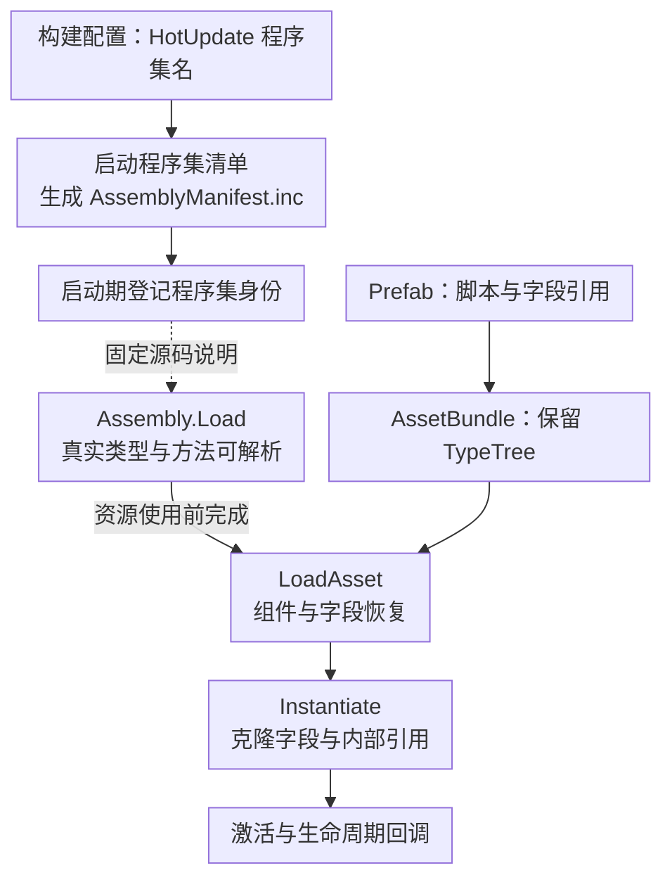

代码里能成功 AddComponent，并不证明 Prefab 上挂着的热更组件也能恢复。资源反序列化发生时，Unity 必须把保存的脚本身份解析到实际类型；这条链还包含构建时保留的程序集信息和 runtime 装载状态。

> **阅读基线**：本篇按 runtime v9.0.1（`83929787581bce6c7219418f62348a10c33582ee`）与 package v9.0.3 核对公开源码。实际 Player 使用本机自定义 Unity；环境与固定提交见 [源码阅读起步]()。源码判断与实测范围分别标明。

这是系列第 4 篇，解释资源身份链。本文保留固定源码分析，并补入了**本机自定义 Editor／v9 组合的独立 Player 资源对照**；实测结果与适用边界见后文。普通方法调用结果仍不能代替资源链验收。

## 代码路径与资源路径各需要什么

代码路径先拿到 `Type`，再调用 `AddComponent(type)`。资源路径从序列化脚本引用开始，要求程序集、类型与资源构建时记录的身份匹配。

Editor 的资源引用会涉及 GUID 与 local fileID。它们用于定位资产或资产内对象，**fileID 不是 CLI 程序集内的类型 token**；Player 构建还会转换资源引用。不能把 Editor YAML 中的 GUID/fileID 直接当作 runtime metadata 查找键。

阅读时把三件事分开：

| 身份 | 需要核对的内容 |
|---|---|
| 资源中的脚本引用 | 资源构建版本、脚本资产、程序集及类型名称 |
| 构建产物中的程序集登记 | 热更程序集名是否进入目标平台需要的清单 |
| runtime 中的程序集和类型 | 真实 DLL 是否已加载、类型是否可解析 |

### 图解：资源身份与执行入口怎样接上 {#resource-identity-flow}

图中启动登记与 placeholder 关联来自固定源码；本轮实际取证的是构建清单、DLL 调用、资源读取、实例字段和生命周期。各个节点的成功都不能代替下一步的验证。

## 构建期先区分 AOT 与热更

package 的 [FilterHotFixAssemblies.cs](https://github.com/focus-creative-games/hybridclr_unity/blob/6cadd24d101f4cbd00cd80190106f6621132d24d/Editor/BuildProcessors/FilterHotFixAssemblies.cs) 按热更配置过滤相关程序集，避免它们作为普通 AOT 代码进入主包编译链。热更 DLL 仍可作为数据文件随包分发；“不进 AOT 编译”不等于“主包里不能带 DLL 字节”。

过滤之后，资源系统仍需要这些程序集的身份。可沿 [PatchScriptingAssemblyList.cs](https://github.com/focus-creative-games/hybridclr_unity/blob/6cadd24d101f4cbd00cd80190106f6621132d24d/Editor/BuildProcessors/PatchScriptingAssemblyList.cs) 及相应 patcher 核对目标平台产物。具体载体与 Unity 分支有关，不能只在某个目录找到 `ScriptingAssemblies.json` 就认定所有平台都适用。

本次固定 v9 的另一条生成输入是 `AssemblyManifest.inc`，实际位于项目的 `Library/HybridCLR/LocalIl2CppData-WindowsEditor/il2cpp/libil2cpp/hybridclr/generated/`。它记录预登记的热更程序集名称，供 runtime 建立 placeholder；名单应与 package 配置和资源使用的程序集保持一致。

## runtime 为什么需要 placeholder

固定版本 [Assembly.cpp](https://github.com/focus-creative-games/hybridclr/blob/83929787581bce6c7219418f62348a10c33582ee/hybridclr/metadata/Assembly.cpp) 的 `InitializePlaceHolderAssemblies` 为配置中的名称创建并登记 placeholder。它先提供程序集身份，真实 metadata 内容要等 DLL 装载后补全。

实际装载时，`Assembly::Create` 按名称查找 placeholder。找到时复用已有程序集/image 外壳，未找到时走其他创建分支。这个对象复用关系，解释了构建期登记和运行时真实 DLL 如何接到同一身份上。

placeholder 并不意味着脚本已经可执行，也不允许把同一程序集的任意新版本反复覆盖。社区版的普通装载路径与商业热重载能力应分开判断。

## 怎样跟读这条链

按下列顺序观察，不必首先单步类型初始化的全部细节：

1. 记录资源构建身份、脚本程序集名称与热更 DLL hash。
2. 核对 AOT 编译过滤结果、generated manifest 与脚本程序集登记产物。
3. 观察 placeholder 创建时的程序集名及对象身份。
4. 加载真实 DLL，核对实际命中的 placeholder 或新建分支。
5. 确认目标组件类型已经可解析，再触发资源反序列化及实例化。

这样才能区分“资源指向错误身份”“DLL 没加载”“类型无法解析”和“组件生命周期执行失败”。单看 Inspector 的 Missing Script 或单次 AddComponent 成功，都不能唯一定位。

## 最小资源验证应怎么做

以代码 AddComponent 作基线，将挂有同一热更组件的 Prefab 打入 AssetBundle，再按 DLL 装载、LoadAsset、Instantiate 和激活顺序观察。主包 Resources Prefab 单独作为对照。正向组先加载 DLL，负向改变加载时机或启动清单；每组使用新进程，防止前一组的程序集/资源状态遮住问题。

观测组件类型、字段数据、Awake/OnEnable 等实际调用，而不只看对象是否创建。若资源热更改变字段或程序集身份，还需独立验证序列化兼容性。

## 已完成：固定 Player 的资源挂载对照 {#resource-mounting-player}

2026-10-26，在公开实验仓库 [hybridclr-runtime-lab](https://github.com/TwoEggDu/hybridclr-runtime-lab) 新增独立 `projects/resource-mounting`，build_id `7adc9fed-3322-4778-8a64-c7e6bb2018eb`。本机自定义 Unity `2022.3.62f3_96770f904ca7`、package v9.0.3／runtime v9.0.1，Windows x64 Development、IL2CPP C++ Debug、Minimal stripping；使用本地未压缩 AssetBundle，保留 TypeTree。旧调用链、泛型、GC 和线程实验不改。

样本只有一个自有热更组件 `ResourceHot.MountProbe`，含整数、字符串、子 Transform 和 TextAsset 引用。源码初值为 Number=11、Label=constructor-default；Prefab 保存为 Number=42、Label=resource-prefab-v1。代码基线在未激活对象上赋 Number=7、Label=code-runtime，以区分运行时赋值与资源恢复。

五组各三个独立进程，最终矩阵 15 个 Player 全部退出 0。退出 0 只表示实验过程完成，是否恢复组件单独验收：

| 组别 | DLL 加载与静态 Ping | 启动清单登记 | 资源读取时 | 实例化与激活后 |
|---|---|---|---|---|
| code：AddComponent(Type) | 成功 | 有 | 不经过资源读取 | 1 个组件；运行时赋值正确，五个生命周期回调完整 |
| bundle：AB 中的 Prefab | 成功，先于资源使用 | 有 | 1 个热更组件，missing=0 | Number=42、Label与引用正确，五个回调完整 |
| late：不加载 DLL 就用 AB | 不加载 | 有 | 0 个热更组件，missing=1 | 仍缺组件，无热更回调 |
| unregistered：启动清单缺项 | 成功 | 无 | 0 个热更组件，missing=1 | 仍缺组件，无热更回调 |
| resources：主包 Resources Prefab | 成功 | 有 | 0 个热更组件，missing=1 | 仍缺组件，无热更回调 |

正向先在未激活实例上读取字段，再激活、等待 Start、禁用并 Destroy，观察顺序为 `Awake → OnEnable → Start → OnDisable → OnDestroy`。Number=42 与源码初值不同；`anchor_matches=true` 核对引用指向克隆实例自己的 Anchor 子节点，Payload 的 TextAsset 类型、名称与文本也一致。不是只看 GameObject 存在或字段名字相同。

AssetBundle.LoadAsset 阶段已能观察到组件恢复，Instantiate 继续保留字段和内部引用关系。负向组在资源读取阶段已经能看到 missing 和缺脚本诊断，后续 Instantiate 没有补回组件；本轮未测试此后再加载 DLL 并重试，不能据此判断失败是否永久。

### 为什么清单缺项组更有区分力

该组使用原 Player 的独立副本，只删除 `ScriptingAssemblies.json` 中的 HotUpdate.dll 及对应 types 项，清单从 72 项变为 71 项。逐文件比较副本运行文件，唯一差异是这份 JSON；GameAssembly、热更 DLL、AB 和其他运行文件保持原哈希。生成的 AssemblyManifest.inc 仍含 HotUpdate，Assembly.Load 和静态 Ping 仍成功，但资源中的脚本无法恢复。

这给出了代码可执行与资源可反序列化的直接区别；不能只靠一次 Assembly.Load 或 AddComponent 成功验收资源链。Resources 组使用独立的 MainPackageProbe Prefab，形状和字段相同，但资源身份/打包路径不同；它是符合当前工作流限制的额外对照，不是仅改变同一份 Player 文件的单变量因果证明。[官方 MonoBehaviour 工作流](https://www.hybridclr.cn/en/docs/basic/monobehaviour)也区分了代码挂载与 AB 资源恢复的条件。

### 复现、记录与边界

从实验仓库根目录依次使用 `tools/resource_lab.py build --editor <Unity.exe>`、`run`、`verify`、`export`。本轮固定提交为 [74da063](https://github.com/TwoEggDu/hybridclr-runtime-lab/commit/74da063e0fe2a4cbac894acfa77d3b0df4074356)，见[实验记录](https://github.com/TwoEggDu/hybridclr-runtime-lab/blob/74da063e0fe2a4cbac894acfa77d3b0df4074356/evidence/2026-10-26-resource-mounting/README.md)、[结构化结果](https://github.com/TwoEggDu/hybridclr-runtime-lab/blob/74da063e0fe2a4cbac894acfa77d3b0df4074356/evidence/2026-10-26-resource-mounting/results.json) 与同目录 15 份自有事件 JSONL。复现请先检出该提交；前轮 `64938d5` 不包含本轮源码。

记录绑定 46 份输入和 256 项构建产物，以及工具、原始日志和独立副本的差异。131 项 Python 测试通过，其中 35 项覆盖本轮验收与工具回归；公开事件重新解析后的判据摘要与原日志一致。原始 Unity 日志、调用栈、PDB、AB 和 Player 留在忽略目录；公开内容只有自有源码、资产、事件和哈希。

本轮没有用原生断点采 placeholder 的对象地址；前文复用机制是固定源码说明，不是这次 Player 的指针身份实测。未覆盖字段 schema 演进、程序集改名/重复装载、关闭 TypeTree、Addressables、远程分发、其他平台或性能。Destroy 与 Unload 调用也不证明共享资源释放量、GC 时机或无泄漏。

<!-- DATA-TODO: schema演进、TypeTree关闭、Addressables、其他平台与独立性能验证仍待补。 -->

## 系列位置

构建输入见 [工具链篇]()，方法执行见 [调用链实战]()，整体取舍见 [边界篇]()。

**资源上挂的热更组件能恢复，需要资源身份、程序集登记与真实类型装载在同一时刻对得上。**
