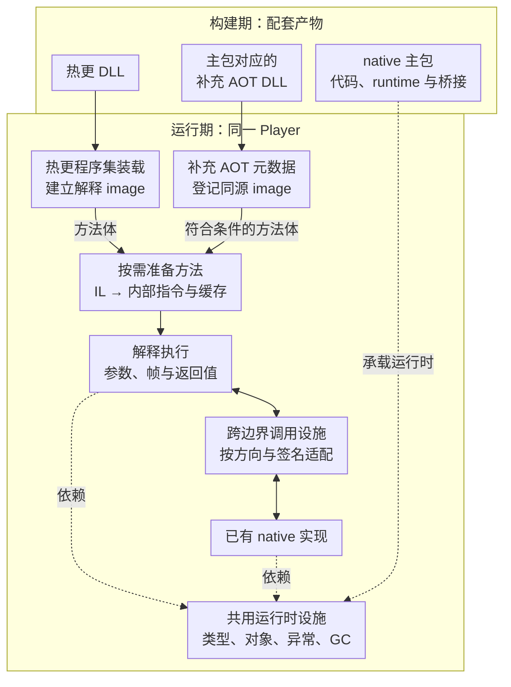

热更 DLL 已经加载，反射也能找到类型，调用时却仍可能失败。“文件进入进程”“方法有可调用实现”和“这次调用完成”是三个不同状态。HybridCLR 要把它们接成完整的运行时链。

> **阅读基线**：本篇按 runtime v9.0.1（`83929787581bce6c7219418f62348a10c33582ee`）与 package v9.0.3 核对公开源码。实际 Player 使用本机自定义 Unity；环境与固定提交见 [源码阅读起步]()。源码判断与实测范围分别标明。

这是系列第 1 篇，只建立总地图。准备跟读时先看 [源码阅读起步]()，逐个观察状态变化则进入 [调用链实战]()。

## 从构建输入到一次调用

IL2CPP 把构建期可见的托管代码转成 C++，再编译成 native 产物。运行时仍需要类型、对象、异常、GC 与调用设施；提前编译不等于这些职责消失。HybridCLR 在这套 runtime 上增加动态程序集与解释执行能力：

| 层次 | 输入与产物 | 本层成功还不能证明什么 |
|---|---|---|
| 构建准备 | 热更 DLL、保留规则、AOT 快照、桥接代码 | 设备实际加载了这些文件 |
| 程序集装载 | DLL 字节 → image、程序集及 metadata 注册信息 | 每个方法都已经转换 |
| 方法准备 | 方法身份与 IL → invoker、内部指令及缓存 | 当前参数已经执行完 |
| 执行 | 当前参数、解释帧、指令 → 返回值或异常 | 其他方法与平台也成立 |

热更方法、AOT 泛型解释实现、普通 AOT 方法可能汇入相同的设施，但来源和路径需要逐个辨认。

### 构建与运行的职责图 {#runtime-architecture}

这是职责与数据来源图；两种装载入口各有用途，程序集登记后仍按实际需求准备方法。补充方法体不生成 native 代码，首次与再次调用的具体先后见[调用链时序图]()。

## 两种装载入口分别负责什么

`Assembly.Load(byte[])` 用于加载热更程序集。沿配套 IL2CPP 的 `AppDomain::LoadAssemblyRaw`、`MetadataCache::LoadAssemblyFromBytes` 可以进入 HybridCLR 的 `Assembly::LoadFromBytes`。公开正文保留 Unity 接入点名称与路径，不复制其 C++ 实现。

[Assembly.cpp](https://github.com/focus-creative-games/hybridclr/blob/83929787581bce6c7219418f62348a10c33582ee/hybridclr/metadata/Assembly.cpp) 建立 `InterpreterImage`，解析并注册程序集信息；预登记的 placeholder 还涉及对象复用。模块初始化也可能执行代码，因此不能说装载阶段绝不会调用方法。

`RuntimeApi.LoadMetadataForAOTAssembly` 给**已有 AOT 程序集**登记同源 image，提供解释执行需要的原始泛型方法体。它不把这个 AOT DLL 重新变成热更程序集，也不现场生成 native 机器码。补充的 IL 可以让缺少合适 native 实现的泛型方法走解释路径，见 [泛型与补充元数据]()。

## 方法怎样获得解释执行所需的表示

runtime 按类型和方法身份选择调用入口。`MethodInfo` 中的 invoker、native 指针、解释器缓存是不同字段，反射查找成功不能代替检查调用目标。

v9 的 [InterpreterModule.cpp](https://github.com/focus-creative-games/hybridclr/blob/83929787581bce6c7219418f62348a10c33582ee/hybridclr/interpreter/InterpreterModule.cpp) 中，`GetInterpMethodInfo` 在 metadata 锁内检查 `interpData`，准备类型相关状态后调用 `HiTransform::Transform`，最终发布结果。外层入口也可能直接复用缓存。必须结合锁、缓存检查与发布协议理解并发，不能把单条内存屏障当作任意无锁读写都安全的依据。

[Transform.cpp](https://github.com/focus-creative-games/hybridclr/blob/83929787581bce6c7219418f62348a10c33582ee/hybridclr/transform/Transform.cpp) 选择底层 image，经 [MethodBodyCache.cpp](https://github.com/focus-creative-games/hybridclr/blob/83929787581bce6c7219418f62348a10c33582ee/hybridclr/metadata/MethodBodyCache.cpp) 取得方法体，再产生 `InterpMethodInfo`。两层缓存要分开：

- `MethodBodyCache` 保存原始 `MethodBody`，用于转换、内联等分析，有自己的淘汰策略。
- `methodInfo->interpData` 指向转换后的解释执行表示，不缓存本次参数或返回值。

**历史版本差异**：v6.1.0 在 `GetInterpMethodInfo` 中读取 body，并向 Transform 传入 image、method、body 和输出对象；该版本没有 `MethodBodyCache.cpp`。不要把 v9 的文件与签名拼进 v6 的跟读链，差异表见调用链实战。

## 为什么先转换 CIL

CIL 用求值栈表达运算。HybridCLR 先分析方法体，转换成内部指令与槽位访问，再执行这些产物：

`CIL 方法体 → Transform → HiOpcode 与相关数据 → Interpreter::Execute`

“寄存器式”描述内部表示通过槽位组织操作数，不表示所有值都放进 CPU 物理寄存器。这里也没有把 IL JIT 成 native 代码。

[Interpreter_Execute.cpp](https://github.com/focus-creative-games/hybridclr/blob/83929787581bce6c7219418f62348a10c33582ee/hybridclr/interpreter/Interpreter_Execute.cpp) 中，`Interpreter::Execute` 为从 native 进入的调用准备现场并分派指令。解释器内部调用还有自己的建帧路径，不能把每个托管调用都画成新增一次 native `Execute` 递归。

## 跨边界与构建链为什么不能省略

解释器参数槽和平台 ABI 不是同一种布局。解释器调 AOT、AOT 调解释器、委托和原生回调需要对应调用设施。`MethodBridge` 与 reverse P/Invoke wrapper 是这些边界的一部分，排查时核对方向、签名和生成物，不能按崩溃信号直接定因。

package 的 [PrebuildCommand.cs](https://github.com/focus-creative-games/hybridclr_unity/blob/6cadd24d101f4cbd00cd80190106f6621132d24d/Editor/Commands/PrebuildCommand.cs) 准备构建输入。v9 的 Generate/All 包含空桥接占位步骤，随后获取裁剪后 AOT DLL，再生成正式桥接与泛型清单。完整依赖见 [工具链篇]()。

`AOTGenericReferences.cs` 提供分析清单，不保证自动生成全部 native 泛型实例。补充 metadata 可以是常规方案；测量说明某条路径需要 native 性能时，再维护相应 AOT 引用。

## 第一轮怎样验证这张地图

最小样本保留一个静态加法方法，连续调用两次，记录 DLL hash、方法身份、invoker、`interpData`、Transform/Execute 命中与返回值。

现有 [调用链实战]() 给出固定 v9 Player 记录：同一方法转换一次、执行两次，返回 5 和 15。它支持这个样本的缓存复用，不证明全部方法形态、平台或性能。

`PreJitMethod` 将符合条件的方法转换前移，后续业务调用仍要执行。测量方法见 [性能与预热策略]()。

## 系列位置

先确认 [IL2CPP 运行时地图]()，再读 [AOT 泛型与补充元数据]()。

**读懂主链，要分别核对装载状态、方法实现和当前这次执行。**
