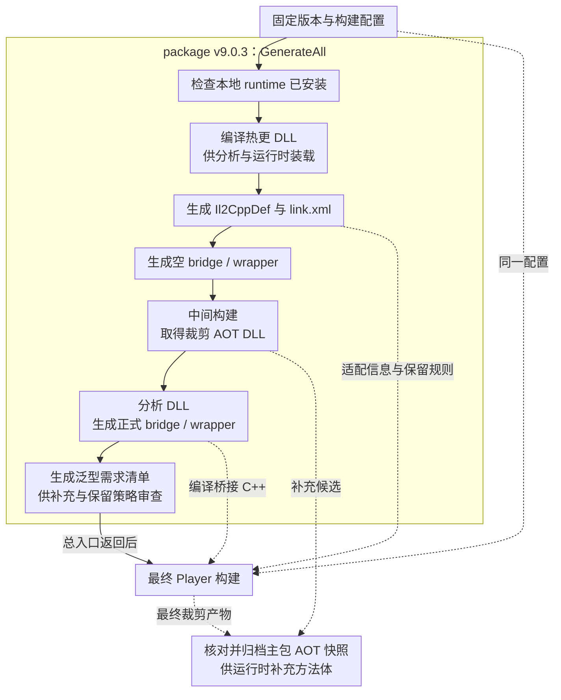

本地跑过生成菜单，CI 却仍可能使用旧桥接、另一套裁剪 DLL 或错误的 il2cpp 目录。问题往往在产物依赖，而不是菜单有没有被点过。

> **阅读基线**：本篇按 runtime v9.0.1（`83929787581bce6c7219418f62348a10c33582ee`）与 package v9.0.3 核对公开源码。实际 Player 使用本机自定义 Unity；环境与固定提交见 [源码阅读起步]()。源码判断与实测范围分别标明。

这是系列第 3 篇，解释输入、产物与消费方。CI 验收见 [打包工程化]()与 [泛型回归防线]()。

## 先画清产物依赖

| 阶段 | 主要输入 | 产物与消费方 |
|---|---|---|
| Installer | Editor 工具与配套 runtime/package | 项目本地 il2cpp，供 Player 构建 |
| CompileDll | target、development、宏与程序集配置 | 热更 DLL，供分析和运行时加载 |
| Il2CppDef | Unity 版本、热更程序集清单 | generated 适配信息与 placeholder 清单 |
| LinkXml | 热更 DLL 静态引用 | AOT 保留规则，供 UnityLinker 使用 |
| AOTDlls | 构建配置、场景与保留规则 | 裁剪 AOT DLL，供分析及补充 metadata |
| MethodBridge | 热更/AOT DLL 与签名分析 | 桥接 C++，编入 Player native 产物 |
| AOTGenericReference | 引用图与可解析程序集 | 泛型需求、建议补充程序集的清单 |

表格表达职责，不要求手工逐项调用；优先采用固定 package 的官方总入口。

## Generate/All 的固定版本顺序

v9.0.3 [PrebuildCommand.cs](https://github.com/focus-creative-games/hybridclr_unity/blob/6cadd24d101f4cbd00cd80190106f6621132d24d/Editor/Commands/PrebuildCommand.cs) 包含：

1. 检查本地安装状态。
2. 按当前 target 与 development 编译 DLL。
3. 生成 Il2CppDef 与 link.xml。
4. **生成空 MethodBridge / reverse P/Invoke 占位**，为部分平台的中间构建提供链接输入。
5. 构建并取得裁剪后 AOT DLL。
6. 生成正式桥接与泛型引用清单。

省略占位步骤的旧代码不能当作可复制的 v9 实现。升级时重新核对顺序与参数，不长期维护脱离官方入口的手抄函数。

### 生成步骤与产物消费方 {#build-artifacts}

实线是固定版本的生成顺序及后续构建，虚线标出产物被谁消费；最终 Player Build 不属于 GenerateAll 内部步骤。中间裁剪 DLL 要与最终主包核对，泛型清单也需要审查，不能直接当作 native 实例生成证明。

## Installer 与构建选择

[InstallerController.cs](https://github.com/focus-creative-games/hybridclr_unity/blob/6cadd24d101f4cbd00cd80190106f6621132d24d/Editor/Installer/InstallerController.cs) 准备配套 runtime，并结合 Editor 自带工具形成项目本地 il2cpp。[CheckSettings.cs](https://github.com/focus-creative-games/hybridclr_unity/blob/6cadd24d101f4cbd00cd80190106f6621132d24d/Editor/BuildProcessors/CheckSettings.cs) 处理相关构建设置与 `UNITY_IL2CPP_PATH`。

package 安装成功、本地 runtime 已准备、本次构建实际使用该目录，是三项不同证据。记录路径、版本与源码 hash，才能排除用错运行时。不同版本检查项会变化，不应依赖未经核对的所谓通用版本文件。

## 两类 DLL 的生命周期

热更 DLL 是按目标平台编译、准备运行时装载的新代码。裁剪 AOT DLL 是 Player 构建中的托管裁剪快照，描述主包保留了什么，也可提供补充 metadata 所需的 IL；它不是“热更 DLL 的 AOT 版”。

生成时与目标主包配置对齐；发版后保存快照，按主包版本选择补充文件。热更代码变化时，不能用最新主包构建的 DLL 无条件替换旧玩家基线。

Development 可能改变条件编译与编译器生成代码，例如 async 状态机形态，不只是调试符号开关。是否失配要比较产物与加载结果，不能从 flag 不同直接推出必然崩溃。

## link.xml 与 MethodBridge 怎样生效

UnityLinker 先处理托管可达性，后续 IL2CPP 再生成 native 代码。热更 DLL 的未来引用需通过保留规则等途径表达。自动生成规则可暴露静态依赖，反射字符串与外部配置仍需额外检查。定义保留与具体泛型实例保留的区别见 [修法决策]()。

桥接 C++ 则编入 native 产物，连接解释器参数槽与平台 ABI。固定 runtime 的 [InterpreterModule.cpp](https://github.com/focus-creative-games/hybridclr/blob/83929787581bce6c7219418f62348a10c33582ee/hybridclr/interpreter/InterpreterModule.cpp) 可沿 `InitMethodBridge`、`GetMethodPointer`、`GetManaged2NativeMethodPointer` 阅读。

缺桥时要查调用方向和失败分支；该版本存在 `NotSupportNative2Managed` 等抛异常路径，不能统一写成“缺桥一定 SIGABRT”或“必定 NotSupportedException”。

新签名是否被旧 Player 覆盖，取决于生成规则与实际产物。开发机重新生成 C++ 不会改变已上线 Player 的 native 文件；原生回调还需检查 wrapper 和生命周期，见 [线程专题]()。

## 泛型清单怎样使用

`AOTGenericReferences.cs` 主要以注释列出泛型需求。它不是缺失实例的精确证明：需求可能已被 native 共享满足，也可能正常走补充 metadata。

按清单定位定义程序集、共享形态和性能敏感路径。新增 native seeds 应放到独立、受保护的 AOT helper，避免生成覆盖；不能把生成文件里有没有真实引用代码当作项目通过标准。

## 怎样验收生成链

记录 Editor、package/runtime/il2cpp_plus 提交、target、development、宏、裁剪、场景，以及加载 DLL 和 native 产物标识。

生成成功后再验证消费方：最终包是否带入目标文件，Player 使用哪份 native 模块，加载返回码与最小样本是否匹配。目录非空只能排除完全没产物，不证明本轮生成或兼容。

## 系列位置

机制前置见 [泛型与补充元数据]()，下一篇进入 [MonoBehaviour 资源挂载]()。

**生成链完成，要以配套产物被本次 Player 实际消费为准。**
