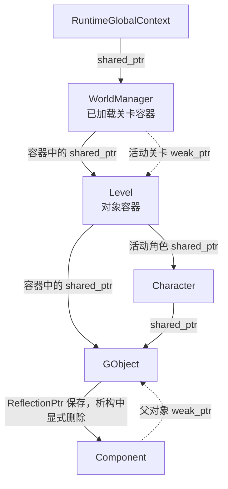

在引擎里删除一个对象，通常要经过几件不同的事：它从世界中消失，停止接受更新，释放关联资源，最后结束 C++ 对象本身的生命周期。这些时刻可能相邻，也可能被其他持有者分开。

Piccolo 中就能看到这种区别。关卡容器保存对象，角色也可能持有同一个对象；组件需要回看父对象，却不能仅因为保留了这条关系，就让父对象一直存活。读懂这些代码，需要同时追踪“谁负责保活”和“这个对象现在还能做什么”。

这篇从这两个问题进入智能指针。先建立最小模型，再沿 Piccolo 的世界、关卡和组件代码找真实关系，最后用一个可以独立运行的小程序观察析构。

> 源码基线：[BoomingTech/Piccolo，固定提交 `f5053707fed4`][revision]。实现关系来自源码核对；文中的独立程序用于验证 C++ 所有权语义，不代表已经运行 Piccolo。Piccolo 的断点与关卡删除观察仍待执行。

## 先分清对象、持有者和逻辑状态

考虑一个关卡中的角色对象。读代码时，可以先问三个问题：

1. 对象本身在哪里创建，由谁执行最终的销毁动作？
2. 当前有哪些变量或成员在共同持有它？
3. 即使对象还存在，它是否仍属于当前关卡、仍允许更新？

智能指针主要帮助表达前两个问题。第三个问题由引擎的状态和清理协议决定。

以普通的 `std::make_shared<T>()` 创建的对象为例，指针包装和被管理对象是不同的东西。复制一个 `shared_ptr<T>`，增加的是同一组共享所有权中的持有者；不会因此再复制一个 `T`。这组共享关系由通常称为控制块的管理信息维护，可以先把它理解为记录共享所有权和删除方式的部分。最后一个强持有者释放后，默认删除方式才结束被管理对象的生命周期。带自定义删除器、别名构造等情况还需要读具体契约，本文先围绕 Piccolo 中的常见创建方式展开。[共享所有权规则][std-shared]、[构造规则][std-construct]、[析构规则][std-destroy]

可以先把常见写法放回职责，而不是先记成员函数：

| 写法 | 表达什么关系 | 阅读时要继续确认什么 |
| --- | --- | --- |
| `std::unique_ptr<T>` | 独占销毁责任，可通过移动转交 | 谁持有包装，使用什么删除器 |
| `std::shared_ptr<T>` | 参与同一组共享所有权 | 还有谁持有，最后一次释放可能在哪里 |
| `std::weak_ptr<T>` | 观察某组共享所有权，不维持对象存活 | 使用前能否获得有效的强持有者 |
| `T*`、`T&` | 提供访问对象的路径 | 是借用还是项目另有手动释放约定 |

裸指针的类型本身不能说明所有权。项目可以用它做借用，也可以配合显式 `new/delete` 管理资源；必须回到创建、保存和释放位置判断。`unique_ptr` 则适合表达一个明确的拥有者，通常无需为了方便访问就把它升级成共享所有权。[独占所有权规则][std-unique]

## Piccolo 的持有关系长什么样

下面只画与本篇有关的一部分。实线注明强持有或显式管理，虚线注明弱观察；组件管理路径单独标注，避免把项目自定义指针当成标准智能指针。



这张图来自 [全局系统][global-h]、[世界管理器][world-h]、[关卡][level-h]、[角色][character-h]、[对象][object-h] 与 [组件][component-h] 的成员定义。它给出了后续搜索的方向：如果对象还没有析构，沿实线找强持有者；如果访问可能失效，沿虚线找提升为临时强持有者的位置。

它也说明了一点：世界中的父子关系，与 C++ 的销毁责任并非天然一一对应。对象关联了组件，但这条关联采用的是 Piccolo 自己的管理方式；组件能找到父对象，也不意味着组件拥有父对象。

## shared_ptr：复制的是持有关系

[系统启动代码][global-cpp] 中有这样的创建：

```cpp
m_world_manager = std::make_shared<WorldManager>();
m_world_manager->initialize();
```

`make_shared` 创建对象并返回参与共享所有权的指针，成员 `m_world_manager` 接住这个结果。这里先追踪的是一个系统对象，以及它在全局上下文中的一个强持有者。

如果随后执行下面的教学写法：

```cpp
auto world = g_runtime_global_context.m_world_manager;
```

`world` 是另一个 `shared_ptr<WorldManager>`，与原成员共同持有同一对象。它离开作用域，只释放自己这一份持有关系。不要把这一行理解成复制整套世界管理器。

同样，`auto* view = world.get();` 取得的是访问路径，不增加强持有者。`view` 的非空值也不能证明对象未来仍然存活。使用裸指针期间，必须有明确的生命周期约束；不要再用 `std::shared_ptr<WorldManager>(view)` 建立另一组独立所有权，否则可能对同一对象重复执行删除动作。

调试时可以观察 `use_count()`，但应把它用于解释当前这个受控场景。临时对象、函数参数、容器副本都会改变计数；不能拿某次计数判断多线程下是否可以安全地修改对象。[共享指针观察规则][std-observers]、[共享指针与数据竞争的边界][std-shared]

## weak_ptr：记住对象关系，使用时再尝试保活

[世界管理器][world-h] 同时保存了两种关系：

```cpp
std::unordered_map<std::string, std::shared_ptr<Level>> m_loaded_levels;
std::weak_ptr<Level> m_current_active_level;
```

已加载关卡容器中的 `shared_ptr` 负责保活；活动关卡成员记录当前选中了哪一个关卡。仅保留活动关卡弱引用，不会让一个已经失去全部强持有者的关卡继续存活。

真正使用活动关卡时，[`WorldManager::tick()`][world-cpp] 会这样处理：

```cpp
std::shared_ptr<Level> active_level = m_current_active_level.lock();
if (active_level)
{
    active_level->tick(delta_time);
    m_level_debugger->tick(active_level);
}
```

逐句读：`lock()` 尝试取得与原有所有权组关联的 `shared_ptr`；成功时，局部变量 `active_level` 在这段使用期间维持对象存活；失败时，它为空，分支不进入。这里没有从磁盘重新加载关卡，也没有复活已经析构的对象。[弱引用提升规则][std-lock]

这个函数名里的 `lock` 也不是对 `Level` 内部状态加互斥锁。它处理的是弱引用提升和存活问题；其他线程能否修改关卡、组件能否被移除，仍由引擎自己的同步和执行约束决定。

## 组件怎样获得父对象的弱引用

Piccolo 的 [GObject 定义][object-h] 继承了 `std::enable_shared_from_this<GObject>`。[关卡创建流程][level-cpp] 先用 `make_shared<GObject>` 创建对象，再调用它的 `load()`；[对象加载流程][object-cpp] 则把 `weak_from_this()` 传给组件的 `postLoadResource()`。

这样，组件取得的是与父对象既有共享所有权组关联的弱引用。[Component][component-h] 将它保存在 `m_parent_object` 中，供后续访问父对象。

这也避免了这条父子关系中的循环保活：如果组件改为强持有父对象，而父对象又只能在自己的析构中删除组件，外部释放对象后，组件仍会维持父对象存活，父对象的析构就无法启动。弱回指不参与这份保活。它只解决这一条关系，不能据此推断整个工程都没有所有权环。

这里有两个不同机制：

- `enable_shared_from_this` 提供取得既有共享/弱引用的能力，不会自己把一个栈对象变成共享对象。
- `weak_from_this()` 返回弱引用，不会因为调用它就增加强持有者。

Piccolo 当前创建路径中的关键顺序是：**先建立共享所有权，再加载对象并把弱引用交给组件。** 如果换成尚未被适当 `shared_ptr` 管理的对象，`weak_from_this()` 可能取得空弱引用；也不能在构造函数里假定共享关系已经接好。需要共享自身时，应沿已有所有权组取得引用，不要用 `shared_ptr<GObject>(this)` 另起一组管理同一地址。[enable_shared_from_this 规则][std-self]

## ReflectionPtr 需要读项目自己的释放协议

看到组件容器时，不能继续套用标准智能指针的规则。Piccolo 的 `m_components` 保存的是 `Reflection::ReflectionPtr<Component>`。

[ReflectionPtr 实现][reflection] 保存类型名和实例指针，其复制操作复制这些信息；它没有在包装自身的析构中自动删除所指组件。在这份源码中，组件销毁需要继续追到 [`GObject::~GObject()`][object-cpp]：析构循环调用 `PICCOLO_REFLECTION_DELETE`，该宏显式执行 `delete`，并把当前包装里的指针置空。

因此，阅读这条路径时应该记录：

1. `GObject` 在该析构路径中承担组件的显式清理责任。
2. `ReflectionPtr` 副本不会像 `shared_ptr` 副本一样参与标准引用计数，也不会自动保活组件。
3. 把当前包装里的指针置空，不会让其他副本都自动失效；组件指针的使用范围仍要受对象和组件管理流程约束。

这并不是完整的组件内存管理审计。对象重复加载、失败回退等路径需要分别检查；本篇先确认实际析构路径，不据此推断所有路径都已经正确清理。

**指针包装的名字不足以说明所有权，要读它的复制、析构和显式删除入口。**

## reset、从关卡移除和析构，是三个时间点

### reset 只释放当前这一份持有关系

`shared_ptr::reset()` 让当前包装不再拥有原对象。如果它是最后一个强持有者，就触发对应删除动作；如果还有其他强持有者，对象会继续存在。[reset 规则][std-reset]、[析构规则][std-destroy]

系统关闭时，[全局上下文][global-cpp] 对多个系统先调用业务方法 `clear()`，再重置自己的 `shared_ptr`。这两步要分别理解：`clear()` 做项目规定的资源与状态清理，`reset()` 放弃当前持有关系。仅看这一处 `reset()`，无法断言系统析构一定就在该行发生。

### 从容器中移除，可能还有别的持有者

[关卡对象表][level-h] 的元素是 `shared_ptr<GObject>`。擦除条目会释放这个容器元素的强持有关系，但角色、外部调用者或正在执行的局部变量还可能持有同一个对象。

这也是 [`Level::deleteGObjectByID()`][level-cpp] 值得读完整的原因：它先检查活动角色是否关联该对象，必要时调用 `setObject(nullptr)`，再擦除对象条目。[Character][character-cpp] 中的 `m_character_object` 确实是另一条强持有关系。

因此，删除后若没有立刻命中 `GObject` 析构断点，应先找剩余持有者。不要仅凭“容器里找不到了”就判断必然已经析构，也不要仅凭“还没析构”就判断泄漏。

### 对象存活，不等于仍可参与世界更新

世界清理时，[WorldManager][world-cpp] 先对关卡调用 `unload()`，再清空关卡容器。[Level 的清理][level-cpp] 会清理角色、对象表和关联物理场景。

如果外部仍保留关卡的 `shared_ptr`，关卡 C++ 对象可能继续存活，但其中的游戏内容已经被清理。智能指针不保证“仍属于当前世界”“资源仍就绪”或“允许继续调用 tick”。这些逻辑条件必须按项目的卸载和状态协议核对。

## 为什么使用前最好保留一次 lock 的结果

在 [MeshComponent::tick()][mesh] 中，可以看到实际的多次 `m_parent_object.lock()`：入口先检查一次，随后取得 Transform、Animation 等组件时又分别调用。

入口处没有保存的 `lock()` 结果是临时 `shared_ptr`，只在当前完整表达式内承担保活作用；后面再次 `lock()` 是一次新的尝试。这种写法要结合调用它的上下文判断。在当前 `GObject::tick()` 从关卡对象容器推进的路径中，还存在外层持有关系，不能脱离这条调用链就断言源码必然有悬空访问。

如果要把父对象的使用边界写在局部，教学上可以改写为：

```cpp
// 教学改写：表达局部保活边界，未修改 Piccolo 源码。
auto parent = m_parent_object.lock();
if (!parent)
    return;

auto* transform = parent->tryGetComponent(TransformComponent);
if (!transform)
    return;

// 在 parent 的作用域内使用父对象和按约定借用的组件。
```

这能让父对象的强持有者贯穿这一段代码。它仍然不会自动解决组件被另一路移除、对象已卸载或多线程修改的问题。`transform` 是借用的组件裸指针，其有效性还需要组件管理和执行时序提供保证。

类似地，先检查 `expired()` 再调用 `lock()`，会把检查和取得持有者分成两步；直接检查本次 `lock()` 的返回值，才能判断这一次是否真正取得保活关系。[弱引用观察与提升规则][std-lock]

## 一个小程序，看见持有关系怎样结束

下面是独立教学程序，使用 C++17。它借用了“对象持有组件，组件弱观察父对象”的形状；为了让释放关系集中可见，组件采用 `unique_ptr`，**与 Piccolo 的 ReflectionPtr 管理方式不同**。

先预测：复制、`lock()` 和移动之后分别有几个强持有者？两个外部强持有者都释放后，为什么对象还没析构？停止状态与析构又在什么时刻发生？

```cpp
// lifetime.cpp: standalone teaching example, not Piccolo source.
#include <cassert>
#include <iostream>
#include <memory>
#include <utility>

struct Actor;

struct Component
{
    std::weak_ptr<Actor> parent;
    ~Component() { std::cout << "Component destructed\n"; }
};

struct Actor : std::enable_shared_from_this<Actor>
{
    std::unique_ptr<Component> component = std::make_unique<Component>();
    bool active = true;

    Actor() { std::cout << "Actor constructed\n"; }
    ~Actor() { std::cout << "Actor destructed\n"; }
    void stop() { active = false; }
};

int main()
{
    std::cout << std::boolalpha;
    auto owner = std::make_shared<Actor>();
    owner->component->parent = owner->weak_from_this();
    std::weak_ptr<Actor> observer = owner;

    auto another_owner = owner;
    auto* view = owner.get();
    assert(view == another_owner.get());
    assert(owner.use_count() == 2);
    std::cout << "owners after copy: " << owner.use_count() << '\n';

    {
        auto pinned = observer.lock();
        assert(pinned && pinned.use_count() == 3);
        assert(pinned->component->parent.lock().get() == view);
        std::cout << "owners after lock: " << pinned.use_count() << '\n';

        auto transferred = std::move(another_owner);
        assert(!another_owner && pinned.use_count() == 3);
        std::cout << "owners after move: " << pinned.use_count() << '\n';

        owner.reset();
        transferred.reset();
        assert(pinned.use_count() == 1);
        pinned->stop();
        std::cout << "active after stop: " << pinned->active << '\n';
        std::cout << "expired while pinned: " << observer.expired() << '\n';
    }

    // view 不再用于访问；它不会因对象销毁而自动置空。
    assert(observer.expired() && !observer.lock());
    std::cout << "expired after pin: " << observer.expired() << '\n';
}
```

把完整代码保存为 `lifetime.cpp`。使用已有支持 C++17 的工具链即可；例如在 GCC 环境执行：

```text
g++ -std=c++17 -O0 -g -Wall -Wextra -pedantic lifetime.cpp -o lifetime-demo.exe
```

运行程序，核对这些事件：

```text
Actor constructed
owners after copy: 2
owners after lock: 3
owners after move: 3
active after stop: false
expired while pinned: false
Actor destructed
Component destructed
expired after pin: true
```

本节完整程序已在 Windows x64、GCC 8.3.0 下使用上述 C++17 参数编译运行；编译成功，全部断言通过，输出与这九行一致。这项验证只覆盖独立程序中的所有权和析构顺序。

移动 `shared_ptr` 转交已有持有关系，来源变空；它没有额外创建一个 Actor，也没有新增一份长期强持有。`stop()` 改变逻辑状态，对象仍由 `pinned` 持有。直到离开内层作用域，最后一个强持有者才释放。

`Actor destructed` 是 Actor 析构函数体中的输出；之后其成员继续析构，组件随 `unique_ptr` 的析构被删除，因此组件日志出现在后面。观察者仍存在，也不会阻止这两个析构动作。

弱引用可能让相关的控制信息继续存在；使用 `make_shared` 等实现时，也可能涉及合并分配的存储保留。要区分对象析构、管理信息和分配存储的释放，不能只凭进程内存暂未下降判断对象还活着。[共享创建规则][std-create]

## 再回到 Piccolo，断点应该停在哪里

完成小程序后，可以沿实际工程核对下面这些问题。它们是待执行的 Piccolo 调试任务。

| 问题 | 入口 | 需要记录什么 |
| --- | --- | --- |
| 对象创建后，谁接住第一份长期持有关系？ | `Level::createObject()` | 创建、load、放入对象表的顺序，以及失败返回路径 |
| 临时保活发生在哪一段？ | `WorldManager::tick()`、`Level::getGObjectByID()` 的调用者 | weak_ptr 返回后，谁 lock，得到的 shared_ptr 持续到哪里 |
| 删除对象时，角色关联是否也被解除？ | `Level::deleteGObjectByID()`、`Character::setObject()` | 对象 ID、角色关联、容器移除和实际析构时刻 |
| 组件到底由谁销毁？ | `GObject::~GObject()`、组件析构 | 显式删除宏、组件实际析构以及外部借用的范围 |
| 业务清理与对象析构是否发生在同一处？ | `WorldManager::clear()`、`Level::unload()`、对应析构函数 | 清理后的状态、仍存在的强持有者及最后释放位置 |

临时观察对象时，也要留意自己增加的 `shared_ptr`：为了方便调试而保存的强引用，会改变本来想研究的析构时刻。应在记录中说明是否人为增加了持有者。

读这一类代码，可以固定采用同一条顺序：**找创建 → 找长期持有者 → 找弱观察和局部保活 → 找业务清理 → 找最后释放。** 它比仅根据 `Ptr`、`reset` 或 `delete` 等局部名字判断生命周期更可靠。

<!-- DATA-TODO: 固定 Piccolo 提交后，补 Level::createObject、删除活动角色对象、GObject 与组件析构的实际调用栈；记录是否人为增加强引用。独立教学程序的结果与 Piccolo 工程运行结果分别归档。 -->

## 继续阅读

- [Piccolo 架构地图]()：把这些持有关系放回世界、资源与渲染协作中。
- [从 C# 到 C++：对象由谁持有，代码怎样变成程序]()：按需回看值、借用、RAII、移动与编译链接。
- [Piccolo 阅读入口]()：继续进入构建、启动、一帧和对象恢复。

Piccolo 源码节选版权：Copyright (c) 2022 Contributors to the Piccolo Engine，按 [MIT License][license] 提供。教学改写与独立小程序已在对应位置标明。

**读懂生命周期，要同时知道谁让对象活着，以及引擎何时停止使用它。**

[revision]: https://github.com/BoomingTech/Piccolo/tree/f5053707fed4d3f94d270a436fb0d3a8ae54e3e5
[global-h]: https://github.com/BoomingTech/Piccolo/blob/f5053707fed4d3f94d270a436fb0d3a8ae54e3e5/engine/source/runtime/function/global/global_context.h
[global-cpp]: https://github.com/BoomingTech/Piccolo/blob/f5053707fed4d3f94d270a436fb0d3a8ae54e3e5/engine/source/runtime/function/global/global_context.cpp
[world-h]: https://github.com/BoomingTech/Piccolo/blob/f5053707fed4d3f94d270a436fb0d3a8ae54e3e5/engine/source/runtime/function/framework/world/world_manager.h
[world-cpp]: https://github.com/BoomingTech/Piccolo/blob/f5053707fed4d3f94d270a436fb0d3a8ae54e3e5/engine/source/runtime/function/framework/world/world_manager.cpp
[level-h]: https://github.com/BoomingTech/Piccolo/blob/f5053707fed4d3f94d270a436fb0d3a8ae54e3e5/engine/source/runtime/function/framework/level/level.h
[level-cpp]: https://github.com/BoomingTech/Piccolo/blob/f5053707fed4d3f94d270a436fb0d3a8ae54e3e5/engine/source/runtime/function/framework/level/level.cpp
[object-h]: https://github.com/BoomingTech/Piccolo/blob/f5053707fed4d3f94d270a436fb0d3a8ae54e3e5/engine/source/runtime/function/framework/object/object.h
[object-cpp]: https://github.com/BoomingTech/Piccolo/blob/f5053707fed4d3f94d270a436fb0d3a8ae54e3e5/engine/source/runtime/function/framework/object/object.cpp
[component-h]: https://github.com/BoomingTech/Piccolo/blob/f5053707fed4d3f94d270a436fb0d3a8ae54e3e5/engine/source/runtime/function/framework/component/component.h
[character-h]: https://github.com/BoomingTech/Piccolo/blob/f5053707fed4d3f94d270a436fb0d3a8ae54e3e5/engine/source/runtime/function/character/character.h
[character-cpp]: https://github.com/BoomingTech/Piccolo/blob/f5053707fed4d3f94d270a436fb0d3a8ae54e3e5/engine/source/runtime/function/character/character.cpp
[reflection]: https://github.com/BoomingTech/Piccolo/blob/f5053707fed4d3f94d270a436fb0d3a8ae54e3e5/engine/source/runtime/core/meta/reflection/reflection.h
[mesh]: https://github.com/BoomingTech/Piccolo/blob/f5053707fed4d3f94d270a436fb0d3a8ae54e3e5/engine/source/runtime/function/framework/component/mesh/mesh_component.cpp
[license]: https://github.com/BoomingTech/Piccolo/blob/f5053707fed4d3f94d270a436fb0d3a8ae54e3e5/LICENSE
[std-shared]: https://eel.is/c++draft/util.smartptr.shared
[std-construct]: https://eel.is/c++draft/util.smartptr.shared.const
[std-destroy]: https://eel.is/c++draft/util.smartptr.shared.dest
[std-observers]: https://eel.is/c++draft/util.smartptr.shared.obs
[std-unique]: https://eel.is/c++draft/unique.ptr
[std-lock]: https://eel.is/c++draft/util.smartptr.weak.obs
[std-self]: https://eel.is/c++draft/util.smartptr.enab
[std-reset]: https://eel.is/c++draft/util.smartptr.shared.mod
[std-create]: https://eel.is/c++draft/util.smartptr.shared.create
