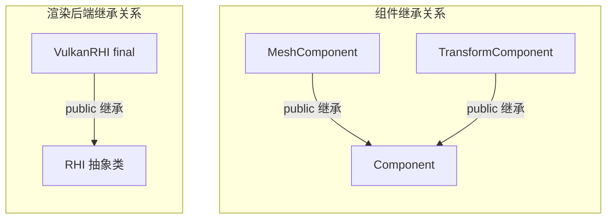

读引擎源码时，经常会遇到这样的困惑：更新循环只写了一次调用，运行时却要分别更新位置、网格和动画；渲染系统保存的是一个通用接口，具体执行的却是 Vulkan 后端。跳转到声明后，眼前可能只有一个空函数，或者连函数体都没有。

这时需要补上的，是从“调用处看见的类型”走到“对象实际采用的实现”的方法。只按函数名搜索，很容易停在基类；只看某个派生类，又可能漏掉外层调度条件和销毁责任。

上一篇讨论谁让对象活着。这一篇接着问：**对象仍然活着时，通过基类访问它，到底会调用谁？通过基类释放它，又会怎样结束？** 先建立最小模型，再沿 Piccolo 的组件和 RHI 两条路径阅读，最后用独立程序核对语言行为。

> **读这篇之前**：静态/动态类型、重载、覆盖、切片和虚析构的逐步解释已整理到 [CXX-03：一次成员调用执行谁]()。初学者先完成公共课，再回到本篇的模型速查和 Component / RHI 项目路径；Piccolo 的持有关系见 [智能指针与对象生命周期]()。本篇不要求已经构建 Piccolo。
>
> 源码基线：[BoomingTech/Piccolo，固定提交 `f5053707fed4`][revision]。引擎实现关系来自源码核对；独立程序验证 C++17 语言行为。Piccolo 本身的构建、运行与断点观察尚未开展。

## 类、对象和访问它的类型，先分别看

一个类描述成员与操作；一个对象是按某个类型创建出来的具体实例。同一个类可以有许多对象，每个对象有自己的非静态成员状态。头文件中的类定义描述结构，通常并不因此创建出游戏中的组件实例。

派生类对象中包含基类子对象。例如，一个 `MeshComponent` 对象具有 `Component` 这一基类部分，也有网格组件自己声明的成员。把它的指针转换成基类指针，并没有另外创建一个组件。[派生类与基类子对象][std-derived]

阅读时，可以把问题拆成四项：

| 要区分的事 | 本篇中的例子 | 它决定什么 |
| --- | --- | --- |
| 对象的实际类型，也称动态类型 | 当前对象是 `MeshComponent` | 在正常生命周期内，虚调用采用哪个最终覆盖实现 |
| 表达式的静态类型 | `Component* p` 中，`p` 是基类指针，`*p` 的静态类型是 `Component` | 编译时查找哪些成员、怎样检查这次调用 |
| 调用方式 | `p->tick(dt)` 或 `p->Component::tick(dt)` | 是否按虚调用规则选择实现，还是显式指定基类版本 |
| 所有权与存活范围 | `shared_ptr` 持有，或者裸指针借用 | 这次访问是否合法，以及谁负责最终销毁 |

因此，一个指针的声明同时涉及两个问题：它向调用者提供什么接口，它现在指向什么对象。这两者可以不同；是否拥有对象，还需要另外看指针包装和项目约定。

例如，即使 `Component* p` 指向网格组件，也不能直接通过 `p->getRawMeshes()` 访问只在 `MeshComponent` 中声明的接口。动态类型参与虚函数分派，不会让基类接口自动暴露派生类的所有成员。

## 先读懂一个类头，再进入函数体

Piccolo 的 [网格组件声明][mesh-h] 使用了项目宏：

```cpp
CLASS(MeshComponent : public Component, WhiteListFields)
```

先去 [reflection.h][reflection] 看 `CLASS` 的定义。普通编译分支把这个类头展开成：

```cpp
class MeshComponent : public Component
```

反射解析分支还会添加注解。这里先读出普通 C++ 的骨架：`MeshComponent` 公开继承 `Component`。在这条无歧义的公开继承关系中，外部代码可以把网格组件指针转换成组件基类指针，借用其基类接口。[公开继承与访问规则][std-access]

继续看类体里的访问区：

- `public` 成员提供给调用者，例如组件的 `tick()`。
- `protected` 成员供本类和派生类等允许的上下文访问，例如 `Component` 的父对象弱引用。
- `private` 成员留给本类及友元访问，例如网格组件自己的资源状态。

基类的私有成员也属于对象的基类部分；派生类成员函数通常不能直接访问它们。`class` 默认的成员访问权限是 private，`struct` 默认是 public，不能因为看到继承就把所有状态都当成公开接口。

再把声明与定义接起来：头文件中的 `void tick(float delta_time) override;` 声明一个成员函数；`.cpp` 中的 `void MeshComponent::tick(float delta_time)` 给出其定义。`::` 在这里说明函数属于哪个类；不要把它当成另一个同名的全局函数。

## Component 的空函数为什么还值得继续追

[Component 基类][component-h] 中有以下成员，节选如下：

```cpp
virtual ~Component() {}

virtual void postLoadResource(std::weak_ptr<GObject> parent_object) { m_parent_object = parent_object; }

virtual void tick(float delta_time) {};
```

这里的 `tick()` 有一个合法的空实现。它允许派生类沿用默认行为，也允许派生类覆盖。它没有写 `= 0`，所以不能把这个空函数读成“派生类必须实现的纯虚接口”；这份 `Component` 本身也不是抽象类。

在 [MeshComponent][mesh-h] 和 [TransformComponent][transform-h] 的声明里，都能找到：

```cpp
void tick(float delta_time) override;
```

这两个函数覆盖了基类的虚函数。派生类声明可以不重复写 `virtual`；一旦覆盖关系成立，它仍然是虚函数。

下面的箭头都只表示 **public 继承，方向从派生类指向基类**。两组类型关系互相独立，图中没有表达调用顺序或对象持有关系。



## 沿组件调用链，找到真正执行的 tick

[GObject][object-h] 的组件容器保存 `Reflection::ReflectionPtr<Component>`。这个包装的 [`operator->()`][reflection] 返回 `Component*`：它让调用处通过基类指针访问对象，并没有在这个运算符里根据类型名选择 `tick()`。

真正的调用在 [`GObject::tick()`][object-cpp]：

```cpp
void GObject::tick(float delta_time)
{
    for (auto& component : m_components)
    {
        if (shouldComponentTick(component.getTypeName()))
        {
            component->tick(delta_time);
        }
    }
}
```

逐层核对这段代码：

1. `shouldComponentTick()` 决定本轮是否允许调用。该函数在编辑器模式下检查组件类型集合，其他情况下返回 true。
2. 进入分支后，`ReflectionPtr<Component>` 提供 `Component*`，让成员查找找到基类的虚函数声明。
3. 如果它指向一个完整、有效的 `MeshComponent` 对象，这次虚调用就进入 `MeshComponent::tick()`；指向 `TransformComponent` 时，则进入对应的覆盖实现。

这里先有调度条件，再有虚调用。即使派生类写好了覆盖函数，外层筛选没有通过，它也不会被这一处循环调用。反过来，类型名在这里参与筛选，不是 C++ 虚分派本身的依据。[成员查找][std-lookup]、[函数调用与最终覆盖实现][std-call]

打开两个 `.cpp`，就能看见共同接口下的不同职责：[TransformComponent::tick()][transform-cpp] 交换变换缓冲索引，并按状态处理刚体更新等工作；[MeshComponent::tick()][mesh-cpp] 读取变换等组件，在脏状态条件下组织数据交给逻辑侧交换数据。

到这里已经可以把源码调用关系写成：

```text
GObject::tick
  → shouldComponentTick 通过
  → ReflectionPtr<Component>::operator-> 返回 Component*
  → 对 tick 做虚调用
  → 当前具体组件的覆盖实现
```

这是源码能够确认的路径，尚不代表已经记录了实际运行调用栈。

### 覆盖以后，基类函数会自动一起执行吗

不会因为发生覆盖，就自动先调用一次基类版本。对普通虚成员函数，进入覆盖实现后执行哪些语句，由这个实现自己决定；显式写 `Component::postLoadResource(...)` 才表示调用那个基类版本。

Piccolo 的 [MeshComponent::postLoadResource()][mesh-cpp] 自己给 `m_parent_object` 赋值，然后准备网格相关状态。[TransformComponent 的版本][transform-cpp] 也自行赋值，并初始化变换缓冲与脏标记。读这两个函数，应以函数体为准，不能假设基类初始化逻辑会因继承自动跑一次。

这与基类构造、析构会按语言规则参与对象生命周期，是不同的事。

## override 检查关系，final 收紧扩展边界

重载与覆盖要分开：重载先根据可见的函数声明和调用参数选择函数；覆盖则让派生类为基类虚函数提供自己的实现。它们不是“同名函数有多个”这一个概念。

`override` 的价值是让编译器检查“我声称覆盖的函数，是否真的覆盖了基类虚函数”。例如下面是故意写错的教学片段：

```cpp
struct Base
{
    virtual void tick(float) {}
};

struct Wrong : Base
{
    void tick(double) override {} // 编译错误：没有覆盖 tick(float)
};
```

如果去掉 `override`，`tick(double)` 可以成为派生类里的另一个同名函数，但不会覆盖 `tick(float)`；派生类的同名声明还可能隐藏基类名字。通过 `Base*` 调用这里的 `tick(float)`，仍会执行基类版本。参数类型、成员函数尾部的 `const` 和引用限定等都可能影响覆盖关系；不是名字一样就行。返回类型还存在受规则限制的协变情形，不必在这一篇展开。[覆盖检查规则][std-virtual]

读到 `final` 时，再区分两个位置：类上的 `final` 禁止继续派生；虚函数上的 `final` 禁止后续派生类再次覆盖它。它们表达扩展约束，不能直接作为运行更快的证据；也不需要先假定某种虚表布局，才能判断这次调用的语言行为。

## 换到 RHI：抽象接口怎样落到 Vulkan 后端

RHI 是渲染硬件接口（Rendering Hardware Interface）的缩写，在这里为渲染系统提供后端操作接口。组件允许默认不做事，而 RHI 采用另一种约束。[rhi.h][rhi-h] 中的相关声明节选如下，省略其余接口：

```cpp
class RHI
{
public:
    virtual ~RHI() = 0;
    virtual void initialize(RHIInitInfo initialize_info) = 0;
    virtual void prepareContext() = 0;
};

inline RHI::~RHI() = default;
```

`= 0` 是纯虚声明。存在尚未得到非纯最终覆盖实现的纯虚函数时，类是抽象类，不能直接创建该类的对象；可以声明它的指针或引用，让具体实现通过这个接口被使用。[抽象类规则][std-abstract]

这里还藏着一个容易漏掉的细节：**纯虚析构函数仍然需要定义**，因为派生对象析构时也会经过基类析构。文件末尾的 `inline RHI::~RHI() = default;` 就提供了定义。不要只看到类体中的 `= 0`，便判断它永远不会执行。[析构函数规则][std-dtor]

[VulkanRHI][vulkan-h] 的类头是 `class VulkanRHI final : public RHI`，对应函数声明为：

```cpp
virtual void initialize(RHIInitInfo init_info) override final;
virtual void prepareContext() override final;
```

接着找创建点。[RenderSystem 的成员][render-h] 为 `std::shared_ptr<RHI> m_rhi`；其 [initialize()][render-cpp] 中执行：

```cpp
m_rhi = std::make_shared<VulkanRHI>();
m_rhi->initialize(rhi_init_info);
```

创建的是 `VulkanRHI`，成员暴露的是 `RHI` 接口。共享指针转换接住的是同一个对象的共享所有权，不会把它复制成一个独立的 RHI 对象。随后 `RenderSystem::tick()` 调用 `m_rhi->prepareContext()`，沿这条创建与保存路径，对应的实现就是 [`VulkanRHI::prepareContext()`][vulkan-cpp]。

该函数选择当前帧的 Vulkan 命令缓冲，并把资源接到 RHI 命令缓冲包装上。这次调用在准备上下文；不能因为它位于渲染系统更新中，就把它当成已完成绘制或 GPU 提交。

这条路径说明了阅读接口代码的方法：**先找成员类型，再找具体对象的创建与赋值，最后找覆盖定义。** 它也没有证明引擎已经具备其他可运行的图形后端；增加一种后端，还需要实现、接线与验证。

## 通过 Component* 删除时，虚析构怎样接上生命周期

上一篇已经追到 [`GObject::~GObject()`][object-cpp]：它循环执行 `PICCOLO_REFLECTION_DELETE(component)`。[删除宏][reflection] 内部有：

```cpp
delete value.operator->();
```

当 `value` 是 `ReflectionPtr<Component>` 时，删除表达式取得的是 `Component*`。如果它实际指向一个派生组件，通过这个基类接口正确删除的关键，就是 `Component` 有公开的虚析构函数。在本篇 C++17 的普通单对象 delete 场景下，通过不具备虚析构的基类指针删除派生对象，是未定义行为，不能把结果描述成“只是少打印一次派生析构日志”。[delete 规则][std-delete]

派生类没有手写析构函数，也不意味着基类可以省掉虚析构：编译器隐式声明的派生析构仍会参与这条链。反过来，有普通虚函数也不会自动让基类析构变成虚函数。

把两篇的关注点接起来：

- 所有权决定**什么时候**发起最后的销毁动作。
- 删除表达式及虚析构规则决定通过基类接口时，**怎样**进入正确的析构链。

正确进入析构链，也不保证所有业务资源已经释放。例如固定版本的 [`VulkanRHI::~VulkanRHI()`][vulkan-cpp] 函数体只有一个 TODO 注释。是否正确释放 Vulkan 资源，还要追 `clear()`、资源包装与关闭时序；仅凭虚析构声明不能下结论。本篇只核对 C++ 的调用和销毁机制。

## 按基类值复制，会把派生行为一起带过去吗

先看两个教学表达式，假设 `mesh` 是一个具体网格组件对象：

```cpp
Component& view = mesh;  // 借用同一对象的基类部分
Component copy = mesh;  // 创建一个独立的 Component 值对象
```

第一行没有创建新的组件对象；在正常生命周期内，通过 `view.tick()` 可以调用具体派生实现。第二行以基类复制构造创建一个基类对象，复制的是对应的基类部分。新对象的动态类型就是 `Component`，不会保留网格组件的完整状态与覆盖行为。这种现象通常称为**对象切片**。[基类子对象][std-derived]、[复制构造规则][std-copy]

所以，`vector<Component>` 与 Piccolo 的 `vector<ReflectionPtr<Component>>` 不能等同：前者按值保存基类对象，后者包装指向具体对象的指针。把多态对象改成按基类值传参，也会遇到同样的切片问题。

不要把这里的教学值复制直接用于引擎对象。类是否应该允许复制、复制后父对象关联是否合理，是另外的设计约束。本节只解释这种表达式的类型效果。

如果原本拿着 `Component*`，也不应该为访问派生接口而随意强转。先找具体对象的创建来源和项目的类型检查协议；类型名字符串、指针转换与 C++ 虚调用是不同机制。Piccolo 的组件查询模板与反射协议，可以在后续模板与代码生成文章中继续拆解。

## 构造和析构期间，虚调用还有阶段限制

前面的分派描述针对正常使用中的完整对象。构造与析构期间，如果调用作用于正在构造或析构的这个对象，虚调用采用当前构造或析构所属类的最终覆盖实现，不会跳到更派生类的覆盖版本。[构造析构期间的调用规则][std-cdtor]

因此，不能在基类构造函数里调用一个虚初始化函数，就期望它完成派生类初始化；也不能在基类析构时依靠虚调用回到已经结束的派生层。若这种构造或析构路径虚调用到纯虚函数，还会涉及未定义行为。[纯虚函数调用边界][std-abstract]

Piccolo 中也能看到“创建后再加载”的实际组织方式：[`GObject::load()`][object-cpp] 遍历已有组件，再调用 `postLoadResource()`。阅读时应先确认对象怎样创建、什么时候加载，别把后加载函数与 C++ 构造函数当成同一阶段。

## 一个独立程序，把类型、调用和析构放到一起

下面是完整的 C++17 教学程序。类名借用了组件语境，未使用 Piccolo 的反射或资源代码；日志用于观察语言行为。它故意允许基类值复制，以展示切片，生产中的多态基类不一定应该允许这种复制。

```cpp
// dispatch.cpp: standalone teaching example, not Piccolo source.
#include <cassert>
#include <iostream>
#include <memory>
#include <string>
#include <type_traits>
#include <utility>
#include <vector>

std::vector<std::string> events;

class Component
{
public:
    Component()
    {
        events.emplace_back(std::string("Component ctor: ") + kind());
    }

    virtual ~Component()
    {
        events.emplace_back(std::string("Component dtor: ") + kind());
    }

    const char* label() const { return "Component label"; } // 非虚函数
    virtual const char* kind() const { return "Component"; }
    virtual void tick(float) { events.emplace_back("Component tick"); }
};

class MeshComponent final : public Component
{
public:
    ~MeshComponent() override { events.emplace_back("MeshComponent dtor"); }
    const char* label() const { return "MeshComponent label"; } // 同名隐藏
    const char* kind() const override { return "MeshComponent"; }
    void tick(float) override { events.emplace_back("MeshComponent tick"); }
};

int main()
{
    static_assert(std::is_base_of_v<Component, MeshComponent>);
    static_assert(std::has_virtual_destructor_v<Component>);

    {
        auto owner = std::make_unique<MeshComponent>();
        Component* base = owner.get(); // 借用；对象仍由 owner 持有
        assert(std::string(base->kind()) == "MeshComponent");

        events.emplace_back(base->label());
        events.emplace_back(owner->label());
        base->tick(0.016f);
        base->Component::tick(0.016f); // 显式限定基类版本

        {
            Component sliced = *base; // 按基类值复制
            assert(std::string(sliced.kind()) == "Component");
            sliced.tick(0.016f);
        }

        std::unique_ptr<Component> polymorphic = std::move(owner);
        assert(!owner && polymorphic.get() == base);
    } // 默认删除器通过 Component* 删除；虚析构接上派生析构

    const std::vector<std::string> expected {
        "Component ctor: Component",
        "Component label",
        "MeshComponent label",
        "MeshComponent tick",
        "Component tick",
        "Component tick",
        "Component dtor: Component",
        "MeshComponent dtor",
        "Component dtor: Component"
    };
    assert(events == expected);
    for (const auto& event : events)
        std::cout << event << '\n';
}
```

保存为 `dispatch.cpp`，用已有的 C++17 工具链编译，例如：

```text
g++ -std=c++17 -O0 -g -Wall -Wextra -pedantic dispatch.cpp -o dispatch-demo.exe
```

输出应当是：

```text
Component ctor: Component
Component label
MeshComponent label
MeshComponent tick
Component tick
Component tick
Component dtor: Component
MeshComponent dtor
Component dtor: Component
```

本节完整程序已从正文提取，在 Windows x64、GCC 8.3.0 下用上述 C++17 参数编译运行：无编译诊断，全部断言通过，输出与这九行一致。前面的错误 `override` 片段也单独做了语法检查，编译器按预期报告未覆盖基类函数；它不属于本节可运行程序。

按事件解释这九行：

1. 第一行在基类构造中产生，调用 `kind()` 得到基类版本。
2. 两次 `label()` 是非虚调用，分别通过基类与派生类接口找到不同的同名函数。
3. `base->tick()` 进入派生覆盖；带 `Component::` 的限定调用则明确执行基类版本。
4. `sliced` 是独立基类值对象，所以其 `tick()` 和析构都走基类。它由复制构造创建，没有执行默认构造函数里的日志语句。
5. 最后一个拥有者保存 `unique_ptr<Component>`。释放时先进入 `MeshComponent` 析构，再进入 `Component` 析构；此时基类析构里的 `kind()` 返回基类版本。

这里选择 `unique_ptr<Component>` 的默认删除器，是为了直接观察通过基类指针删除的规则。不要把它机械套成“所有智能指针都以包装声明类型做 delete”：例如上一篇 `make_shared<Derived>()` 后转换为基类共享指针，会保留原先建立的销毁机制。阅读具体代码时，仍要同时核对创建与删除协议。

## 不启动引擎，也可以先完成的源码练习

用固定提交做下面四项静态追踪，每项写出“声明 → 创建或来源 → 调用条件 → 实现”，先检验自己能否把源码接起来。

| 练习 | 建议入口 | 应该能回答的问题 |
| --- | --- | --- |
| 从更新循环找到具体组件 | `GObject::tick()`、`Component`、`MeshComponent` | 谁决定调用资格，谁决定实际函数体？ |
| 从通用接口找到后端 | `RenderSystem::m_rhi`、`initialize()`、`VulkanRHI` | 对象在哪里创建，接口类型是什么，prepareContext 定义在哪里？ |
| 从删除宏找到析构链 | `GObject::~GObject()`、ReflectionPtr、`Component::~Component()` | delete 看到什么指针类型，为什么能够正确进入派生析构？ |
| 从后加载找到状态初始化 | `GObject::load()`、两个组件的 `postLoadResource()` | 派生函数有没有显式调用基类版本，父对象关联在哪里设置？ |

完成这些追踪，已经能解决一类常见阅读卡点：跳到声明时看见空函数，不再停在那里；找到派生实现后，也能回头交代它为什么会被调用。以后进入调试时，再用对象实际类型与调用栈验证这些源码判断。

## 继续阅读

- [模板、宏与反射代码生成]()：接着拆开组件查询、字段标记、生成访问器和类型注册。
- [智能指针与对象生命周期]()：回看创建、持有、清理与最后释放。
- [Piccolo 架构地图]()：把组件和图形后端放回系统协作中。
- [Piccolo 阅读入口]()：按需补前置，再进入启动、一帧与渲染主线。

Piccolo 源码节选版权：Copyright (c) 2022 Contributors to the Piccolo Engine，按 [MIT License][license] 提供。类头展开、删节与独立教学程序已在对应位置标明。

**读懂一次基类调用，要连起接口声明、对象来源、实际实现和有效生命周期。**

[revision]: https://github.com/BoomingTech/Piccolo/tree/f5053707fed4d3f94d270a436fb0d3a8ae54e3e5
[component-h]: https://github.com/BoomingTech/Piccolo/blob/f5053707fed4d3f94d270a436fb0d3a8ae54e3e5/engine/source/runtime/function/framework/component/component.h
[mesh-h]: https://github.com/BoomingTech/Piccolo/blob/f5053707fed4d3f94d270a436fb0d3a8ae54e3e5/engine/source/runtime/function/framework/component/mesh/mesh_component.h
[mesh-cpp]: https://github.com/BoomingTech/Piccolo/blob/f5053707fed4d3f94d270a436fb0d3a8ae54e3e5/engine/source/runtime/function/framework/component/mesh/mesh_component.cpp
[transform-h]: https://github.com/BoomingTech/Piccolo/blob/f5053707fed4d3f94d270a436fb0d3a8ae54e3e5/engine/source/runtime/function/framework/component/transform/transform_component.h
[transform-cpp]: https://github.com/BoomingTech/Piccolo/blob/f5053707fed4d3f94d270a436fb0d3a8ae54e3e5/engine/source/runtime/function/framework/component/transform/transform_component.cpp
[object-h]: https://github.com/BoomingTech/Piccolo/blob/f5053707fed4d3f94d270a436fb0d3a8ae54e3e5/engine/source/runtime/function/framework/object/object.h
[object-cpp]: https://github.com/BoomingTech/Piccolo/blob/f5053707fed4d3f94d270a436fb0d3a8ae54e3e5/engine/source/runtime/function/framework/object/object.cpp
[reflection]: https://github.com/BoomingTech/Piccolo/blob/f5053707fed4d3f94d270a436fb0d3a8ae54e3e5/engine/source/runtime/core/meta/reflection/reflection.h
[render-h]: https://github.com/BoomingTech/Piccolo/blob/f5053707fed4d3f94d270a436fb0d3a8ae54e3e5/engine/source/runtime/function/render/render_system.h
[render-cpp]: https://github.com/BoomingTech/Piccolo/blob/f5053707fed4d3f94d270a436fb0d3a8ae54e3e5/engine/source/runtime/function/render/render_system.cpp
[rhi-h]: https://github.com/BoomingTech/Piccolo/blob/f5053707fed4d3f94d270a436fb0d3a8ae54e3e5/engine/source/runtime/function/render/interface/rhi.h
[vulkan-h]: https://github.com/BoomingTech/Piccolo/blob/f5053707fed4d3f94d270a436fb0d3a8ae54e3e5/engine/source/runtime/function/render/interface/vulkan/vulkan_rhi.h
[vulkan-cpp]: https://github.com/BoomingTech/Piccolo/blob/f5053707fed4d3f94d270a436fb0d3a8ae54e3e5/engine/source/runtime/function/render/interface/vulkan/vulkan_rhi.cpp
[license]: https://github.com/BoomingTech/Piccolo/blob/f5053707fed4d3f94d270a436fb0d3a8ae54e3e5/LICENSE
[std-derived]: https://eel.is/c++draft/class.derived
[std-access]: https://eel.is/c++draft/class.access.base
[std-lookup]: https://eel.is/c++draft/class.member.lookup
[std-call]: https://eel.is/c++draft/expr.call
[std-virtual]: https://eel.is/c++draft/class.virtual
[std-abstract]: https://eel.is/c++draft/class.abstract
[std-dtor]: https://eel.is/c++draft/class.dtor
[std-delete]: https://eel.is/c++draft/expr.delete
[std-copy]: https://eel.is/c++draft/class.copy.ctor
[std-cdtor]: https://eel.is/c++draft/class.cdtor
