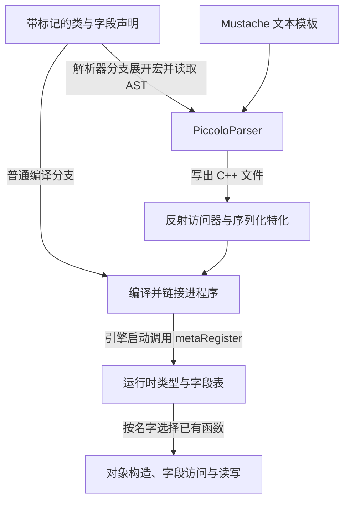

引擎源码里有一些调用，看起来比普通函数多做了许多事：传入一个类名，就能找到对应组件；在字段前加一个标记，就能让编辑器或序列化代码访问它；头文件里还引用着刚下载源码时没有找到的生成文件。

如果把这些现象都归为“反射”，阅读很快就会卡住。类名究竟是编译器认识的类型，还是运行时比较的字符串？字段访问函数在哪里出现？某个宏为什么在普通编译时展开为空，却仍然有作用？

这篇从这些问题进入 Piccolo。我们沿两条线阅读：一条从组件查询走到类型参数与名字比较；另一条从字段声明走到代码生成，再接到运行时注册与序列化。

> **读这篇之前**：建议先读 [类、继承与虚函数]()，理解基类指针、派生对象和虚调用；指针的持有与释放约定可回看 [智能指针篇]()。
>
> 源码基线：[BoomingTech/Piccolo，固定提交 `f5053707fed4`][revision]。源码事实来自固定版本核对，生成代码示意来自模板推导。本篇不运行 PiccoloParser 或 Piccolo；独立教学程序只验证文中使用的 C++17 机制。

## 先问这件事发生在哪个阶段

先把“自动完成”拆成几种不同的工作：

| 机制 | 主要发生在哪里 | 它在本篇解决什么 |
| --- | --- | --- |
| 宏展开 | 源码预处理 | 把简写改写成另一段 token，例如补出模板实参和字符串 |
| C++ 模板 | 编译期类型处理与按需实例化 | 对不同类型使用一套有类型约束的代码，例如返回 `TComponent*` |
| 外部代码生成 | 构建流程中的独立工具 | 读取类与字段描述，写出具体的 C++ 访问器和序列化代码 |
| 注册表 | 程序运行时 | 根据名字找到已经编译好的字段操作、构造或读写函数 |
| 虚函数调用 | 程序运行时的语言行为 | 通过基类接口选择对象的覆盖实现，承接上一篇 |

这些机制可以协作，但互相不能替代。宏不能因为看见一个标识符，就自动知道它是什么类；C++17 模板也不会自行枚举一个任意类的所有字段。Piccolo 在这里使用的是项目自建的解析、生成与注册方案。

尤其要区分两种“模板”：`template<typename T>` 是 C++ 语言模板；仓库里的 `.mustache` 是生成器使用的文本模板。后者先产生 C++ 文件，产生的文件随后才进入编译。

## 先把类型参数与运行时值分开

先读一个类模板。在 [reflection.h][reflection-h] 中，`ReflectionPtr` 的骨架可以概括为下面这样。这里只保留本节需要的成员，是教学删节：

```cpp
template<typename T>
class ReflectionPtr
{
public:
    ReflectionPtr(std::string type_name, T* instance);
    std::string getTypeName() const;
    T* operator->();

private:
    std::string m_type_name;
    T* m_instance;
};
```

`T` 是类型形参。写 `ReflectionPtr<Component>` 时，类型实参是 `Component`，于是包装里的指针成员是 `Component*`。构造时传入的 `type_name` 则是一个字符串值：模板不会自动把 `T` 的名字写进这个成员。实际源码中的构造函数分别保存传入的名字和指针。

本节处理的是类型形参；C++ 模板也可以接收非类型参数等。看到尖括号，要先读模板声明，不能一律认定里面只能放类型。

因此，`ReflectionPtr<Component>` 可以包装指向具体派生组件的基类指针，同时另外保存具体类型名。这两个信息是否一致，要由创建、反序列化和使用协议保证。它也没有因为是模板就获得引用计数；所有权仍按第一篇核对的显式删除流程判断。

遇到 `std::vector<Reflection::ReflectionPtr<Component>>`，从里面往外读即可：组件指针包装，再由 vector 保存多个包装。尖括号的嵌套是在组合类型，不是在执行两次运行时函数调用。[模板实例化规则][std-inst]

函数模板同样可以带类型形参。[GObject 的查询函数][object-h] 是一个实际例子：

```cpp
template<typename TComponent>
TComponent* tryGetComponent(const std::string& compenent_type_name)
{
    for (auto& component : m_components)
    {
        if (component.getTypeName() == compenent_type_name)
        {
            return static_cast<TComponent*>(component.operator->());
        }
    }

    return nullptr;
}
```

这里保留了源码中的参数拼写。`TComponent` 决定返回指针和转换的目标类型；字符串参数决定在容器里匹配哪个名字。它们承担不同职责。

## 一个查询宏，怎样同时补出类型和名字

[MeshComponent::tick()][mesh-cpp] 中使用了这样的调用形式：

```cpp
m_parent_object.lock()->tryGetComponent(TransformComponent)
```

先沿查询名字回到 [object.h][object-h]，会发现同名宏：

```cpp
#define tryGetComponent(COMPONENT_TYPE) tryGetComponent<COMPONENT_TYPE>(#COMPONENT_TYPE)
```

于是，这个调用在预处理后对应：

```cpp
m_parent_object.lock()->tryGetComponent<TransformComponent>("TransformComponent")
```

两边的 `TransformComponent` 已经由不同机制处理：

- 尖括号里的部分交给 C++ 编译器，作为类型实参。
- 引号里的部分成为普通字符串，运行时参与名字比较。

`#COMPONENT_TYPE` 是宏参数字符串化。[字符串化规则][std-stringize] 解释了为什么原来写下的类型名会变成字符串；它不是 C++ 运行时从对象中查询类型。宏名位于 `->` 后也不妨碍展开，预处理器并不按 C++ 类成员作用域理解这个名字。[宏替换规则][std-macro]

展开后的 `tryGetComponent` 没有发生无限递归：函数式宏需要名字后接 `(`，这里后接的是 `<`；宏重扫描本身也有禁止当前宏递归替换的规则。[宏重扫描][std-rescan]

再读一遍函数体，就能确认其边界：先比较保存的名字，再做 `static_cast`。这个转换不会动态检查指针当前是否真的指向对应派生对象。错误的名字与对象配对，可能破坏向下转换的前提；不能把模板返回类型当成运行时身份校验。[static_cast 规则][std-cast]

还有一个很实用的阅读细节：

```cpp
using TransformAlias = TransformComponent;
// 教学示意：宏会生成名字字符串 "TransformAlias"。
object.tryGetComponent(TransformAlias);
```

别名代表同一个 C++ 类型，却不等于同一个名字字符串。若容器记录的是 `"TransformComponent"`，这次查询不会匹配。看到 `#` 时，要追实际拼写与注册名，不能只检查类型是否等价。

## 模板参数有时显式给出，有时来自函数实参

查询函数只接收一个字符串值，不能从这个参数的类型推导出想要的 `TComponent`，所以宏显式补出了 `<TransformComponent>`。

[AssetManager::loadAsset()][asset-h] 则采用另一种形式：

```cpp
template<typename AssetType>
bool loadAsset(const std::string& asset_url, AssetType& out_asset) const
```

调用者传入一个有确定类型的 `out_asset`，编译器可以据此推导 `AssetType`。函数在读文件、解析 JSON 后调用 `Serializer::read(asset_json, out_asset)`，继续让参数类型参与函数选择。[函数调用的模板实参推导][std-deduction]

这并不表示 JSON 字符串自己变成了 C++ 类型：外层资源对象的类型由调用代码确定，资源内部的多态指针则需要后面要讲的名字协议。

普通模板的定义通常需要在实例化处可见，这也是很多模板实现放在头文件里的原因；不要只凭“头文件里有函数体”就判断组织方式异常。显式特化与显式实例化还会带来其他组织方式，本篇先看 Piccolo 实际用到的特化声明与定义。

## CLASS 与 META：同一份声明给谁看

再看 [TransformComponent 的声明][transform-h]，以下为相关部分的删节：

```cpp
REFLECTION_TYPE(TransformComponent)
CLASS(TransformComponent : public Component, WhiteListFields)
{
    REFLECTION_BODY(TransformComponent)
    // 省略公开接口
protected:
    META(Enable)
    Transform m_transform;

    Transform m_transform_buffer[2];
    size_t m_current_index {0};
    size_t m_next_index {1};
};
```

[reflection.h][reflection-h] 为解析器与普通编译提供两种宏定义：

```cpp
#if defined(__REFLECTION_PARSER__)
#define META(...) __attribute__((annotate(#__VA_ARGS__)))
#define CLASS(class_name, ...) class __attribute__((annotate(#__VA_ARGS__))) class_name
#else
#define META(...)
#define CLASS(class_name, ...) class class_name
#endif
```

普通编译分支留下正常类声明，`META(Enable)` 展开为空。解析器分支则把 `WhiteListFields`、`Enable` 等信息放进注解，让工具能够读取。它们不是普通字段值，也不是运行时自动扫描整个程序的指令。

到 [解析器参数][parser-h] 中，可以找到 `-D__REFLECTION_PARSER__`；再到 [MetaInfo][meta-info] 中，可以看到工具读取 `CXCursor_AnnotateAttr` 并拆分属性。因此，“普通编译时为空”与“生成阶段有用”并不矛盾：两次处理采用了不同的预处理环境。

### WhiteListFields 怎样决定要处理哪些字段

不要仅凭标记的英文意思推断规则，直接读 [Field::isAccessible()][field-cpp]：类采用 `WhiteListFields` 时，字段要带 `Enable` 才会被该规则选中。若类采用 `Fields` 或 `All`，则是另一条“未标 Disable”的选择分支。

在当前变换组件声明中，`m_transform` 被标记，缓冲数组与两个索引没有标记。它们都属于 C++ 对象状态，但不是都进入这一组生成的字段操作。还原运行时缓冲的工作，要继续结合 `postLoadResource()` 阅读，不能简单要求序列化逐字保存对象的整块内存。

## REFLECTION_BODY 怎样让生成的访问器进入类内部

宏里还会遇到 `##`。例如 [REFLECTION_BODY][reflection-h] 中有：

```cpp
friend class Reflection::TypeFieldReflectionOparator::Type##class_name##Operator;
friend class Serializer;
```

传入 `TransformComponent` 后，拼出的标识符是 `TypeTransformComponentOperator`。`##` 拼接预处理 token，`#` 则产生字符串，两者要分别读。[token 拼接规则][std-concat]

配套的 `REFLECTION_TYPE` 宏先在对应命名空间前置声明访问器类；`REFLECTION_BODY` 再把它和 `Serializer` 声明为友元。这样，生成的具体访问器可以合法访问目标类的 protected 或 private 成员。[友元规则][std-friend]

这里既没有把字段改成 public，也没有由 friend 声明直接实现字段遍历。友元只给访问权限；真正的访问函数体还要由生成器写出。

命名空间中的 `Oparator` 就是固定源码采用的拼写。搜索生成类时，需要沿这个实际名字找，不能根据常见拼写自行修正。

## 从注解到普通 C++：生成器具体补出了什么

[MetaParser][parser-cpp] 使用 libclang 建立抽象语法树，也就是 AST；随后把选中的类按源文件组织为 schema，交给反射与序列化两个生成器。这里的 schema 是工具整理出的类名、基类、字段类型与标记等描述，不是已经创建出来的游戏对象。

两类输出可以这样对照：

| 输出 | 主要内容 | 后续使用方式 |
| --- | --- | --- |
| 反射代码 | 类型名、字段名与类型名、具体 get/set、按名字构造、注册函数 | 注册进运行时表，供按名字查询与访问 |
| 序列化代码 | 特定类型的 `Serializer::read/write` 显式特化 | 把字段与 JSON 读写逐项接起来 |

例如，[commonReflectionFile.mustache][reflection-template] 中的字段 getter 会把 `void*` 转回具体类指针，再取具体成员地址。把类名与字段名填入后，其形状可推导为：

```cpp
// 按固定版本文本模板推导的示意，非本次实际生成文件。
static void* get_m_transform(void* instance)
{
    return static_cast<void*>(
        &(static_cast<TransformComponent*>(instance)->m_transform));
}
```

编译器最终看到的是具体成员访问。编辑器一侧可以用统一的字段接口调用这个函数，而生成函数知道自己操作的具体类型。这是用预先生成的代码连接“统一接口”与“具体字段”，不代表 `void*` 本身携带了类型安全检查。

### template<> 是定制实现，不是运行时注册

[序列化声明模板][serializer-decl-template] 会生成这类声明，以下同样是模板推导示意：

```cpp
template<>
TransformComponent& Serializer::read(
    const Json& json_context, TransformComponent& instance);
```

`template<>` 引出显式特化，为某个具体类型提供特定实现。与前面的 `template<typename T>` 通用定义不同，它针对这里的具体类型。[显式特化规则][std-specialization]

[allSerializer.ipp.mustache][serializer-impl-template] 提供定义的文本模板：先处理基类，再对选中字段调用 `Serializer::read/write`，vector 字段还会逐项处理。它采用的 JSON 键来自字段显示名；[字段描述][field-cpp] 与 [名字处理函数][meta-utils] 会去掉开头的 `m_`。所以按模板推导，`m_transform` 对应的 JSON 键是 `transform`，不能把源代码成员拼写与文件键名直接等同。

这些实现也解释了为什么只写一个通用 `Serializer::read` 不够。[serializer.h][serializer-h] 的非指针通用回退路径包含依赖类型的 `static_assert`：没有对应实现时，它不会自动遍历字段。具体类型需要接入基础实现或生成的特化。

## 找不到 _generated 时，沿构建依赖找生产者

读到 [AssetManager][asset-h] 引用 `_generated/serializer/all_serializer.h`，先别急着把它当成普通手写头文件。在固定版本中，[反射生成器][reflection-generator] 和 [序列化生成器][serializer-generator] 把输出目录分别设为传入源码目录下的 `_generated/reflection`、`_generated/serializer`。

[构建接线][engine-cmake] 与 [precompile.cmake][precompile-cmake] 给出了生产顺序：

```text
PiccoloParser 构建完成
  → PiccoloPreCompile 调用解析器
  → 产生 source/_generated 下的反射与序列化代码
  → PiccoloRuntime 按依赖进入构建
```

解析器的参数文件由 `precompile.json.in` 配置生成，包含运行时与编辑器头文件清单；工具把清单整理成构建目录里的 `parser_header.h` 再解析。`PiccoloPreCompile` 在这里是一项代码生成任务，不能只凭名字把它理解成 C++ 预编译头。

生成文件的接入也分两处：[all_serializer.h 的文本模板][serializer-all-h] 汇总各文件的特化声明头；[reflection_register.cpp][reflection-register] 则包含 `all_reflection.h` 和 `all_serializer.ipp`。`.ipp` 在这里仍是通过 include 接入翻译单元的 C++ 实现文本，不是一门独立语言。

下面的箭头表示构建产物与运行时接线关系。生成的访问器先成为程序的一部分，启动注册之后，运行时才能按名字找到这些操作。



本篇核对的是这份构建规则与生成模板，尚未执行解析器。因此，示意片段与预期输出路径不能记作本机生成成功的回执。

## 运行时：类型字符串怎样找到已编译的函数

生成出来的函数还要接到表里。[反射文本模板][reflection-template] 为每个选中字段组合访问、名字等操作，并生成相应注册函数；[allReflectionFile.mustache][reflection-all-template] 定义 `TypeMetaRegister::metaRegister()`，调用各文件的注册入口。

[PiccoloEngine::startEngine()][engine-cpp] 在启动系统之前调用这个注册函数。关闭时先关闭系统，再调用 `metaUnregister()`。因此，生成、编译、注册和使用是四个不同的时刻。

资源内部的多态指针则通过 [Serializer][serializer-h] 的协议接线：

1. `ReflectionPtr<T>` 的序列化记录 `$typeName`，并把对象内容放在 `$context`。
2. 读取时保存类型名；对于采用类型名构造的分支，调用 `TypeMeta::newFromNameAndJson()`。
3. [TypeMeta 实现][reflection-cpp] 查找类型表，找到后调用已注册的构造函数。
4. 模板提供的具体构造函数执行 `new 具体类`，再用该类型的 `Serializer::read` 恢复字段。

这里也有采用 `"*"` 标记、按已知静态类型创建普通指针的分支，不能把所有指针读取都描述成类型名工厂。

运行时名字选择的是预先准备好的函数，并没有把任意 JSON 字符串直接变成编译器类型。名字、实际对象、字段类型与指针转换必须按同一套协议匹配；查表、强转或 JSON 解析中的任一环节，都不能单独证明数据一定合法。

回到上一篇就能看清两条不同路径：`component->tick()` 依据虚调用规则进入覆盖实现；`newFromNameAndJson(name, ...)` 根据项目注册表选择构造函数。不能用理解其中一条的方式替代另一条。

## 一个小程序，同时看见宏、模板与查表

下面是独立的 C++17 教学程序。`ReflectionPtr` 和对象容器只保留阅读所需的形状，借用栈对象；没有 Piccolo 的反序列化、资源管理与代码生成器。标为“模拟生成”的访问器与表项由手写提供，用来观察生成代码接入后的机制。

```cpp
// meta_bridge.cpp: standalone teaching example, not Piccolo source.
#include <cassert>
#include <iostream>
#include <string>
#include <unordered_map>
#include <vector>

struct Component
{
    virtual ~Component() = default;
};

#define DEMO_REFLECTION_TYPE(TYPE) class Type##TYPE##Operator;
#define DEMO_REFLECTION_BODY(TYPE) friend class Type##TYPE##Operator;

DEMO_REFLECTION_TYPE(TransformComponent)
class TransformComponent final : public Component
{
    DEMO_REFLECTION_BODY(TransformComponent)
private:
    float m_x = 1.0f;
};

template<typename T>
struct ReflectionPtr
{
    std::string name;
    T* instance;
    const std::string& getTypeName() const { return name; }
    T* operator->() const { return instance; }
};

class GObject
{
public:
    std::vector<ReflectionPtr<Component>> components;

    template<typename TComponent>
    TComponent* tryGetComponent(const std::string& name)
    {
        for (const auto& component : components)
            if (component.getTypeName() == name)
                return static_cast<TComponent*>(component.operator->());
        return nullptr;
    }
};

#define tryGetComponent(COMPONENT_TYPE) tryGetComponent<COMPONENT_TYPE>(#COMPONENT_TYPE)

// 模拟生成代码：friend 访问器知道具体类型与成员。
class TypeTransformComponentOperator
{
public:
    static float get(void* instance)
    {
        return static_cast<TransformComponent*>(instance)->m_x;
    }
    static void set(void* instance, float value)
    {
        static_cast<TransformComponent*>(instance)->m_x = value;
    }
};

struct FieldInfo
{
    float (*get)(void*);
    void (*set)(void*, float);
};

int main()
{
    TransformComponent transform;
    GObject object;
    object.components.push_back({"TransformComponent", &transform});

    auto* found = object.tryGetComponent(TransformComponent);
    auto* explicit_query = object.tryGetComponent<TransformComponent>("TransformComponent");
    assert(found == &transform && explicit_query == found);
    std::cout << "macro query: found\n";
    std::cout << "explicit query: same object\n";

    using TransformAlias = TransformComponent;
    auto* alias_query = object.tryGetComponent(TransformAlias);
    assert(alias_query == nullptr);
    std::cout << "alias query: not found\n";

    // 模拟生成的注册项；表中只放本例的一个 float 字段。
    std::unordered_map<std::string, FieldInfo> registry;
    registry.emplace("TransformComponent", FieldInfo {
        &TypeTransformComponentOperator::get,
        &TypeTransformComponentOperator::set
    });

    const auto it = registry.find("TransformComponent");
    assert(it != registry.end() && it->second.get(found) == 1.0f);
    std::cout << "field before: " << it->second.get(found) << '\n';
    it->second.set(found, 7.0f);
    assert(it->second.get(found) == 7.0f);
    std::cout << "field after: " << it->second.get(found) << '\n';

    assert(registry.find("Unknown") == registry.end());
    std::cout << "unknown metadata: not found\n";
}
```

保存为 `meta_bridge.cpp`，用已有工具链编译运行，例如：

```text
g++ -std=c++17 -O0 -g -Wall -Wextra -pedantic meta_bridge.cpp -o meta-bridge.exe
```

输出应为：

```text
macro query: found
explicit query: same object
alias query: not found
field before: 1
field after: 7
unknown metadata: not found
```

本节完整程序已从正文提取，在 Windows x64、GCC 8.3.0 下用上述 C++17 参数编译运行：无编译诊断，全部断言通过，实际输出与这六行一致。它核对了查询、别名名字差异与访问器接线，没有执行 Piccolo 的代码生成。

再只做预处理，查看宏到底补了什么：[GCC 预处理选项][gcc-preprocess]

```text
g++ -std=c++17 -E -P meta_bridge.cpp -o meta_bridge.ii
```

在输出文件中搜索 `auto* found` 和 `auto* alias_query`，应该分别找到带 `"TransformComponent"` 和 `"TransformAlias"` 的模板调用。搜索 `friend class TypeTransformComponentOperator`，能看到 `##` 拼接后的友元声明。

这三处预处理结果也已逐项核对；程序使用的查询宏与固定 Piccolo 源码中的宏定义一致。

这份程序把四件事放在了不同的位置：宏补出类型与字符串，模板约束查询返回类型，具体访问器操作私有字段，运行时表按名字找到访问器。它没有真的运行代码生成，手写模拟段也不能作为 Piccolo 生成成功的证据。

## 再读工程时，按生产者与使用者追踪

遇到跳转或类型问题，可以先完成下面这些静态阅读任务：

| 卡点 | 先去哪里 | 要核对什么 |
| --- | --- | --- |
| 类名参数看起来不像普通表达式 | `object.h` 的宏和函数模板 | 展开后类型实参与字符串分别是什么 |
| 加了字段却没有对应读写 | 类标记、`Field::isAccessible()`、生成模板 | 字段是否被选中，生成器得到什么字段名与类型 |
| 生成访问器能读非公开字段 | `REFLECTION_TYPE/BODY`、具体访问器类 | 前置声明、friend 名字与生成类是否接上 |
| include 指向不存在的文件 | `precompile.cmake`、两个生成器、构建依赖 | 谁生产文件、输出在哪里、何时进入编译 |
| 有类型名却无法构造对象 | `metaRegister()`、注册模板、`newFromNameAndJson()` | 生成项有没有接入程序与注册表，名字是否一致 |
| Serializer 的模板报错很长 | 特化声明、定义与调用参数类型 | 调用落到哪个重载或特化，是否误入通用回退路径 |

这些判断先帮助我们解释源码怎样接线。以后执行构建与调试时，再补解析器命令、真实输出文件、编译诊断与调用栈；不要用文件名猜测代替生产记录，也不要因为看见模板就把运行时问题都归给编译器。

## 继续阅读

- [14：Lua 脚本怎样读写组件并调用引擎方法]()：沿默认 Player 的三个绑定，观察字段名、类型元组和方法访问器怎样服务脚本，并核对生命周期与业务消费边界。

- [对象容器修改后，持有者、借用与遍历怎样变化]()：继续区分容器中的包装、所指对象与遍历有效性。

- [读懂渲染管线：从场景对象到一帧画面]()：用这些 C++ 阅读基础继续追踪渲染表示、Pass、绘制与呈现。
- [类、继承与虚函数]()：回看基类接口、具体对象与覆盖实现。
- [智能指针与对象生命周期]()：区分指针包装、保活关系与显式删除。
- [Piccolo 阅读入口]()：按需回到架构、资源与渲染主线。

Piccolo 源码节选版权：Copyright (c) 2022 Contributors to the Piccolo Engine，按 [MIT License][license] 提供。教学删节、模板推导与独立程序已在对应位置标明。

**读懂反射接线，要分别找到源码标记、生成代码、编译入口与运行时注册。**

[revision]: https://github.com/BoomingTech/Piccolo/tree/f5053707fed4d3f94d270a436fb0d3a8ae54e3e5
[reflection-h]: https://github.com/BoomingTech/Piccolo/blob/f5053707fed4d3f94d270a436fb0d3a8ae54e3e5/engine/source/runtime/core/meta/reflection/reflection.h
[object-h]: https://github.com/BoomingTech/Piccolo/blob/f5053707fed4d3f94d270a436fb0d3a8ae54e3e5/engine/source/runtime/function/framework/object/object.h
[mesh-cpp]: https://github.com/BoomingTech/Piccolo/blob/f5053707fed4d3f94d270a436fb0d3a8ae54e3e5/engine/source/runtime/function/framework/component/mesh/mesh_component.cpp
[asset-h]: https://github.com/BoomingTech/Piccolo/blob/f5053707fed4d3f94d270a436fb0d3a8ae54e3e5/engine/source/runtime/resource/asset_manager/asset_manager.h
[transform-h]: https://github.com/BoomingTech/Piccolo/blob/f5053707fed4d3f94d270a436fb0d3a8ae54e3e5/engine/source/runtime/function/framework/component/transform/transform_component.h
[parser-h]: https://github.com/BoomingTech/Piccolo/blob/f5053707fed4d3f94d270a436fb0d3a8ae54e3e5/engine/source/meta_parser/parser/parser/parser.h
[parser-cpp]: https://github.com/BoomingTech/Piccolo/blob/f5053707fed4d3f94d270a436fb0d3a8ae54e3e5/engine/source/meta_parser/parser/parser/parser.cpp
[meta-info]: https://github.com/BoomingTech/Piccolo/blob/f5053707fed4d3f94d270a436fb0d3a8ae54e3e5/engine/source/meta_parser/parser/meta/meta_info.cpp
[field-cpp]: https://github.com/BoomingTech/Piccolo/blob/f5053707fed4d3f94d270a436fb0d3a8ae54e3e5/engine/source/meta_parser/parser/language_types/field.cpp
[meta-utils]: https://github.com/BoomingTech/Piccolo/blob/f5053707fed4d3f94d270a436fb0d3a8ae54e3e5/engine/source/meta_parser/parser/meta/meta_utils.cpp
[reflection-template]: https://github.com/BoomingTech/Piccolo/blob/f5053707fed4d3f94d270a436fb0d3a8ae54e3e5/engine/template/commonReflectionFile.mustache
[serializer-decl-template]: https://github.com/BoomingTech/Piccolo/blob/f5053707fed4d3f94d270a436fb0d3a8ae54e3e5/engine/template/commonSerializerGenFile.mustache
[serializer-impl-template]: https://github.com/BoomingTech/Piccolo/blob/f5053707fed4d3f94d270a436fb0d3a8ae54e3e5/engine/template/allSerializer.ipp.mustache
[serializer-h]: https://github.com/BoomingTech/Piccolo/blob/f5053707fed4d3f94d270a436fb0d3a8ae54e3e5/engine/source/runtime/core/meta/serializer/serializer.h
[reflection-generator]: https://github.com/BoomingTech/Piccolo/blob/f5053707fed4d3f94d270a436fb0d3a8ae54e3e5/engine/source/meta_parser/parser/generator/reflection_generator.cpp
[serializer-generator]: https://github.com/BoomingTech/Piccolo/blob/f5053707fed4d3f94d270a436fb0d3a8ae54e3e5/engine/source/meta_parser/parser/generator/serializer_generator.cpp
[engine-cmake]: https://github.com/BoomingTech/Piccolo/blob/f5053707fed4d3f94d270a436fb0d3a8ae54e3e5/engine/CMakeLists.txt
[precompile-cmake]: https://github.com/BoomingTech/Piccolo/blob/f5053707fed4d3f94d270a436fb0d3a8ae54e3e5/engine/source/precompile/precompile.cmake
[serializer-all-h]: https://github.com/BoomingTech/Piccolo/blob/f5053707fed4d3f94d270a436fb0d3a8ae54e3e5/engine/template/allSerializer.h.mustache
[reflection-register]: https://github.com/BoomingTech/Piccolo/blob/f5053707fed4d3f94d270a436fb0d3a8ae54e3e5/engine/source/runtime/core/meta/reflection/reflection_register.cpp
[reflection-all-template]: https://github.com/BoomingTech/Piccolo/blob/f5053707fed4d3f94d270a436fb0d3a8ae54e3e5/engine/template/allReflectionFile.mustache
[engine-cpp]: https://github.com/BoomingTech/Piccolo/blob/f5053707fed4d3f94d270a436fb0d3a8ae54e3e5/engine/source/runtime/engine.cpp
[reflection-cpp]: https://github.com/BoomingTech/Piccolo/blob/f5053707fed4d3f94d270a436fb0d3a8ae54e3e5/engine/source/runtime/core/meta/reflection/reflection.cpp
[license]: https://github.com/BoomingTech/Piccolo/blob/f5053707fed4d3f94d270a436fb0d3a8ae54e3e5/LICENSE
[std-inst]: https://eel.is/c++draft/temp.inst
[std-deduction]: https://eel.is/c++draft/temp.deduct.call
[std-stringize]: https://eel.is/c++draft/cpp.stringize
[std-macro]: https://eel.is/c++draft/cpp.replace
[std-rescan]: https://eel.is/c++draft/cpp.rescan
[std-cast]: https://eel.is/c++draft/expr.static.cast
[std-concat]: https://eel.is/c++draft/cpp.concat
[std-friend]: https://eel.is/c++draft/class.friend
[std-specialization]: https://eel.is/c++draft/temp.expl.spec
[gcc-preprocess]: https://gcc.gnu.org/onlinedocs/gcc/Preprocessor-Options.html
