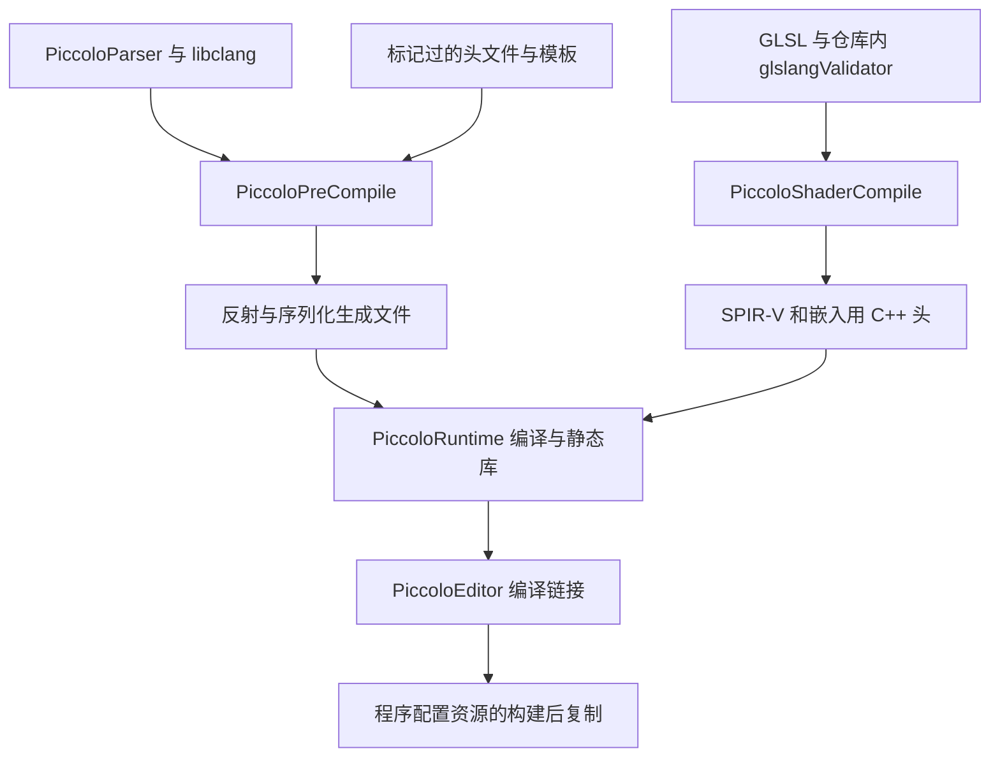

阅读引擎源码之前，最好先回答一个问题：调试器将要运行的程序，究竟对应哪一份源码、哪次生成结果，以及哪组配置和资源？

能打开工程，只说明开发工具认识这组文件。生成解决方案、执行代码生成、编译出编辑器、加载正确资源和命中源码断点，分别跨过不同边界。如果这些身份没有固定，后面看似是引擎逻辑的问题，也可能只是旧产物、错误路径或不匹配的符号。

本篇用一次从编译失败走到首帧断点的 Windows 实验，把这条关系逐层核对。读者已经熟悉调试器，这里重点关注陌生工程中的输入、产物和验证终点。

> **当前实测范围（2026-10-26）**：固定提交 `f5053707fed4` 加两处第三方兼容补丁，已完成 x64 Debug 的配置、生成和完整 `PiccoloEditor` 构建。CDB 已加载对应 PDB，沿启动走到首次世界加载及第一次 Vulkan 提交/呈现返回，正常关闭进程退出 0；另一次 RenderDoc 运行取得默认场景图像。原提交在本机 MSVC 19.51 下的失败记录仍保留，不能把成功归于未修补的上游源码。
>
> 源码基线：[BoomingTech/Piccolo，完整提交 `f5053707fed4d3f94d270a436fb0d3a8ae54e3e5`][revision]。本篇为主线 01，置于前置知识之后、[02 启动篇]() 之前。补丁、命令文件、日志与完整指纹见[实验材料][lab-files]；本机结果不代表其他工具版本、平台或全系列功能验收。

## 最小基线，是一条能够核对身份的链

可以把基线拆成七层，每层留下独立证据：

| 层次 | 必须固定或记录的内容 | 不能直接推出的结论 |
| --- | --- | --- |
| 源码输入 | 提交、工作区改动、仓库内第三方版本 | 当前工具链能编译它 |
| 工具与配置 | CMake、编译器、生成器、架构、构建配置 | 生成工具和全部目标都成功 |
| 生成结果 | 反射、序列化、shader 中间文件及日志 | 运行时已编译或注册这些结果 |
| 编译产物 | 实际目标、退出码、exe/PDB 与构建身份 | 调试器会启动这份 exe |
| 配置与资源 | 实际 ini、root folder、世界和资源文件 | 场景已被完整加载 |
| 进程与符号 | 进程加载的模块、PDB 与源码路径 | 业务状态已经正确 |
| 断点现场 | 调用栈、参数、对象与关键状态 | 后续一帧或画面已完成 |

后面的工作都围绕这张表进行。一次失败也有价值，前提是能指出失败发生在哪一层，而不是把所有未通过的步骤压成一句“环境没配好”。

## 固定源码，同时给生成输出留出位置

[根 CMake][root-cmake] 拒绝 source dir 与 binary dir 完全相同的构建，但这不意味着所有生成文件都会进入 binary dir。

这份工程还会写入源码树内的几个位置：

- `engine/bin`：PiccoloParser、libclang 和预编译输入。
- `engine/source/_generated`：反射与序列化输出。
- `engine/shader/generated`：SPIR-V 与嵌入用 C++ 头。
- 源码根的 `bin`：编辑器构建后的程序、配置与资源布局。

这些路径由 [Parser 配置][parser-cmake]、[预编译目标][precompile]、[shader 生成][shader-cmake] 和 [Editor 后处理][editor-cmake] 分别决定。只在 CMake 命令里换一个 `-B`，仍可能改变阅读副本中的生成文件。

本次先确认阅读用克隆干净，再从固定提交的 Git archive 展开独立实验副本。源码与构建目录位于系统临时目录下，后续生成没有修改原克隆。读者复现时也应固定一份实验副本，并记录：

```powershell
git rev-parse HEAD
git status --short
```

如果实验副本来自 archive，它没有自己的 Git 元数据，需要由展开时的提交记录证明来源。不要因为找不到 `.git` 就丢掉版本身份，也不要把临时目录当成长期可追溯的产物库。

## 先发现实际工具，不从 PATH 缺项推断未安装

本次使用的环境如下：

| 项目 | 实测值 |
| --- | --- |
| CMake | 4.3.1 |
| Visual Studio | Community 2026，安装版本 18.11.12315.225 |
| MSVC 编译器 | 19.51.36260；工具目录版本 14.51.36231 |
| Windows SDK | CMake 选中 10.0.26100.0 |
| Generator / 架构 | Visual Studio 18 2026 / x64 |
| 请求构建配置 | Debug |

普通 PowerShell 中没有直接找到 `cl`，并不能证明编译器不存在。本次通过 Visual Studio Installer 的 `vswhere` 查到 C++ 工具安装，再用 `cl.exe` 的绝对路径核对版本；CMake 后续也识别到了同一编译器。

[固定提交的 README][readme] 给出 Windows 工具要求；它是工程起点，而本机使用的新工具组合仍需要实际验证。工具版本越新，不能据此推断旧第三方代码一定兼容。

还要区分系统 SDK 与工程真正使用的输入。[engine/CMakeLists.txt][engine-cmake] 明确选择仓库内 Vulkan 头文件、Windows 导入库、glslangValidator 和验证层路径。本机虽然存在系统 Vulkan SDK，但本次 shader 生成使用的是仓库所带的程序。不要仅凭 `VULKAN_SDK` 环境变量，就认定编译输入已经切换。

## 配置阶段：从错误摘要追到实际失败边界

本次第一次受限执行环境中的配置，摘要是：

```text
No CMAKE_C_COMPILER could be found.
No CMAKE_CXX_COMPILER could be found.
```

直接调用 cl 能输出版本。继续检查 `CMakeFiles/CMakeConfigureLog.yaml`，发现 MSBuild 在编译器识别项目中执行 CL 任务时，FileTracker 初始化抛出了 UnauthorizedAccessException，HRESULT 为 `0x80070005`，即 E_ACCESSDENIED。

经过工具权限审核，在常规权限环境执行同一隔离实验的配置后，CMake 正常识别 MSVC。这支持一个有限结论：前一次摘要不足以证明没有安装编译器；本次失败与受限环境下的文件跟踪组件有关。它不构成所有类似错误都应提升权限的通用修法。

越过这一层后，配置又停在 tinyobjloader 的最低 CMake policy 兼容要求：CMake 4.x 已移除对旧 policy 版本的兼容。根据 [CMake 官方说明][cmake-policy]，本次从命令行传入 `CMAKE_POLICY_VERSION_MINIMUM=3.5`，没有改第三方 CMake 文件，随后配置与工程生成通过。

下面的命令展示本次使用的参数结构。`$labRoot` 是读者自己的实验根目录，`source` 应事先准备为固定提交副本；生成器名称也必须与实际安装匹配。

```powershell
$labRoot = 'E:/piccolo-lab'
$piccoloSource = Join-Path $labRoot 'source'
$piccoloBuild = Join-Path $labRoot 'build-vs18-debug'

cmake -S $piccoloSource -B $piccoloBuild `
  -G 'Visual Studio 18 2026' -A x64 `
  '-DCMAKE_POLICY_VERSION_MINIMUM=3.5'
```

最后一个参数在 PowerShell 中整体加引号。本次一度遇到未整体加引号的值被拆开，最终执行和上面的示例均采用完整引号写法。

兼容开关只帮助配置阶段继续，不等于第三方源码兼容性已经修复。生成器、编译器、架构改变，或者前一次失败留下可疑缓存时，应使用新的构建目录。本次就另建了全新目录复核，避免让首次识别失败留下的空 Debug flags 影响判断。

## 选中 Debug，要看实际目标和参数

[build_windows.bat][build-bat] 执行的是：

```bat
cmake -S . -B build
cmake --build build --config Release
```

脚本里的构建配置固定为 Release，不能因为自己想做调试，就把该脚本的产物记成 Debug。

Visual Studio 是多配置生成器，具体配置在构建时选择。本次使用 `--config Debug`；单独设置 `CMAKE_BUILD_TYPE=Debug` 不能替代这一步。[官方配置说明][cmake-config]

生成日志中还会出现第三方项目的 `Build type: Release`。判断实际构建时，应对照请求的 `--config`、生成项目的条件和编译命令，而不能只取其中一条提示。

全新目录的 CMakeCache 中，Debug flags 为 `/Zi /Ob0 /Od /RTC1`。但目标或子目录仍然可能覆盖参数。例如 [PiccoloParser 的 CMake][parser-cmake] 在 Windows 下把该目录的 Debug 参数设成 `/O2 /Ob2`。这说明 Debug 是配置名称；某个工具能否稳定查看局部变量、是否包含相应符号，还要继续检查实际编译与链接结果。

## 先看目标依赖，再分辨生成工具与引擎程序

这份工程中几条关键依赖如下。箭头表示生成或构建依赖，不表示游戏运行期间的函数调用。



[engine 的依赖声明][engine-cmake] 让 PiccoloRuntime 等待 PiccoloPreCompile，后者依赖 PiccoloParser；[Runtime 目标][runtime-cmake] 还依赖 shader 生成，并被 Editor 链接。PiccoloParser.exe 是构建工具，它成功运行不代表 PiccoloEditor.exe 已经生成。

为了分开观察，本次先执行：

```powershell
cmake --build $piccoloBuild --config Debug `
  --target PiccoloPreCompile PiccoloShaderCompile --parallel 2
```

该次命令退出码为 0。日志记录 Parser 完成 39 个类的生成，随后完成 shader 中间文件与 C++ 头生成。按实际输出目录统计：

| 产物目录 | 实际文件数量 | 代表文件 |
| --- | --- | --- |
| engine/source/_generated/reflection | 40 | 各类反射头及 all_reflection.h |
| engine/source/_generated/serializer | 41 | 各类声明头、all_serializer.h、all_serializer.ipp |
| engine/shader/generated/spv | 29 | mesh.vert.spv |
| engine/shader/generated/cpp | 29 | mesh_vert.h |

数量只说明本次产物集合，不是所有版本都应相同的硬编码指标。还需要检查文件内容是否对应预期类型和 shader。

例如，本次生成的 `all_serializer.ipp` 中，TransformComponent 写出函数包含：

```cpp
ret_context.insert_or_assign("transform", Serializer::write(instance.m_transform));
```

LevelRes 的写出函数则包含：

```cpp
ret_context.insert_or_assign("gravity", Serializer::write(instance.m_gravity));
ret_context.insert_or_assign("character_name", Serializer::write(instance.m_character_name));
```

这两段来自本次实际生成文件，可以与 [05 资源和类型恢复]() 及 [08 保存重载]() 中的声明、模板推导对照。它们证明写出代码已经生成，仍不能证明引擎已编译、运行注册或执行过保存。

## 完整 Debug 构建：先分离两处根因，再重新构建

生成目标成功后，本次继续执行：

```powershell
cmake --build $piccoloBuild --config Debug `
  --target PiccoloEditor --parallel 2
```

2026-10-25 的原源码构建退出码为 1。在全新构建目录复核时，生成步骤仍然执行成功，完整编辑器构建仍然失败。日志中至少有两组需要分别处理的编译问题：

| 位置 | 实际错误标识 | 当前能下的结论 |
| --- | --- | --- |
| 仓库内 spdlog/fmt 的 format.h | C2653：stdext；C2061：checked_array_iterator | 旧依赖的这条代码路径未通过当前工具链编译 |
| Jolt 的 JobSystemThreadPool.cpp | C3688：us 字面量；伴随 sleep_for 的 C2672 | 另一个第三方目标也有独立的编译阻塞 |

表格摘录错误码和标识符，没有把随后的一串语法错误全部当成独立根因。[fmt 对应代码][fmt-header]、[Jolt 对应代码][jolt-threadpool] 可以用来定位当前失败入口；下面把两处问题分别缩成最小编译探针，再回到完整目标验证。

2026-10-26 从同一提交重新展开隔离副本，保持编译器、架构和 Debug 配置不变，分别复现 fmt 头文件使用和 Jolt 的 `100us`。两个探针修复前都退出 1，补齐各自条件后都退出 0，随后只修改真实源码中的两处：

| 根因 | 实际补丁 | 为什么足够小 |
| --- | --- | --- |
| fmt 旧分支引用已移除的 `stdext::checked_array_iterator` | 将该分支条件补为 `_SECURE_SCL` 有效且 `(!defined(_MSC_VER) || _MSC_VER < 1951)` | MSVC 19.51 起走 fmt 已有的普通指针分支，不全局关闭 Debug 检查 |
| Jolt cpp 使用 chrono 字面量却依赖间接头文件提供声明 | `JobSystemThreadPool.cpp` 显式 `#include <chrono>` | 给使用处补直接依赖，不改等待时长或任务调度 |

Microsoft 文档明确说明 `checked_array_iterator` 在 Build Tools 14.51 中移除；`us` 等字面量由 `<chrono>` 定义。[移除说明][checked-iterator]、[chrono 字面量][chrono-literals]。第二处修复还利用了该版本 Jolt 既有的命名空间导入，不能把“任意位置加一个头就能裸写 `100us`”当成通用规则。

完整补丁保存在[实验材料][lab-files]，本轮没有升级 spdlog/Jolt，也没有把 `_SECURE_SCL`、迭代器调试或断言全局关掉。带补丁输入的新构建目录使用前述配置参数，随后执行：

```powershell
cmake --build $piccoloBuild --config Debug `
  --target PiccoloEditor --parallel 8
```

本次完整目标退出 **0**，并执行了构建后的程序、配置和资源复制。记录身份为 `piccolo-debug-msvc1951-20261026`：

| 阶段 | 当前结果 |
| --- | --- |
| 源码输入 | 固定提交加两处已保存补丁；原阅读用克隆保持干净 |
| 工具发现与 CMake 配置 | 退出 0；外部 policy 兼容参数保留 |
| 反射/序列化与 shader 生成 | 随完整构建通过，有实际生成文件 |
| PiccoloEditor Debug 完整目标 | 退出 0，生成并复制 exe/PDB |
| 进程与符号 | CDB 加载部署 bin 中的 exe 及其 private PDB symbols |
| 启动与第一帧 | 世界加载后走到第一次 queue submit / present 返回，均为 `VK_SUCCESS` |
| 正常关闭 | 命中 `shutdownEngine`，卸载默认关卡，进程退出 0 |

成功仍带有边界：日志保留 LNK4098（MSVCRT 默认库冲突）、MSB8029（临时目录增量构建）和原有 Lua `get<bool>` 的 C4715 等警告。没有用 `/NODEFAULTLIB` 隐去冲突，也没有把这次启动通过当成所有运行库搭配、脚本分支或泄漏检查都已通过。正式开发应把实验目录迁到稳定位置，并单独处理这些构建卫生问题。

## 编译通过之后，先核对程序和资源布局

以下布局先由构建脚本解释，本轮也在成功产物中核对到对应 exe、PDB、ini、asset 与 resource。[Editor 的构建后命令][editor-cmake] 主要做四件事：

1. 创建源码根的 bin，并复制编辑器界面资源。
2. 把目标输出目录中的文件复制到 bin。
3. 给 bin 放部署版 ini，给目标输出目录放开发版 ini。
4. 更新 bin 下的 asset 副本。

这意味着，至少有两处可能找到编辑器程序：构建树内的配置输出目录，以及源码根的 bin。调试器启动哪一处，不能靠文件名判断。

[main.cpp][main] 对配置文件的选择是：

```cpp
std::filesystem::path executable_path(argv[0]);
std::filesystem::path config_file_path = executable_path.parent_path() / "PiccoloEditor.ini";
```

随后，[ConfigManager][config] 用配置路径父目录和 BinaryRootFolder 的值组合 root folder；[AssetManager][asset-cpp] 再将资源 URL 解析为绝对路径。

两种 ini 的关键区别是：

| 配置 | BinaryRootFolder | 原脚本预期的用途 |
| --- | --- | --- |
| 开发版 | ../../../../../bin | 从常见构建树目标目录回到源码根的 bin |
| 部署版 | . | 使用程序与 ini 所在的 bin 布局 |

具体内容可看[开发版 ini][development-ini] 和[部署版 ini][deployment-ini]。

这里有一个容易被复制命令掩盖的条件。设源码位于 `<lab>/source`：

```text
常见构建位置：
  <lab>/source/build/engine/source/editor/Debug/
  开发版相对路径 → <lab>/source/bin

本次实验采用的并列构建位置：
  <lab>/build-vs18-debug-clean/engine/source/editor/Debug/
  同一相对路径   → <lab>/bin

构建脚本实际准备的资源目标：
  <lab>/source/bin
```

这组路径计算已核对；第二种布局的两个根目录不同。2026-10-26 实际选择构建后复制到 `<lab>/source/bin` 的程序，以绝对 exe 路径启动，使用原部署 ini 的 `BinaryRootFolder=.`，没有改写开发 ini。调试现场的 root folder 为 `<lab>/source/bin\.`，asset folder 为其下 `asset`；默认世界成功从这套布局加载。并列构建目录的开发 ini 问题仍只是路径推导，本轮没有故意用错配置复现故障。

它给出的操作原则很明确：**换构建目录后，要重新计算运行配置中的相对路径。** 后续可以选择保持默认目录层级，或在实验配置中明确使用正确 root folder；如果启动构建后准备的 bin 副本，则应核对其部署 ini、资源和匹配符号。任何调整都要作为运行输入记录。

工作目录也应记录，但不能用“把 Working Directory 改对”替代上面这条路径追踪。这里的配置选择直接依赖 argv[0]，root folder 又依赖配置路径；使用绝对程序路径启动，有助于让这些输入明确。

## 有了产物，再让实际模块、符号与配置互相对应

本轮使用已安装的 CDB 10.0.19041.685 AMD64 调试器执行这些检查；VS 的 Modules 窗口可承接相同核对问题，但本次没有把命令行结果写成 VS 窗口验收。

首先给准备运行的编辑器产物分配构建身份，记录完整 exe 路径及对应 PDB。源码提交相同，不代表不同次链接得到的符号可以混用；Visual Studio 要求符号与对应构建精确匹配。[Microsoft 符号说明][vs-symbols]

在 VS 中将调试 Command 明确指向选定的绝对 exe 路径，记录工作目录和参数。启动后，在 Modules 窗口检查实际模块路径、符号加载状态及符号文件位置，避免项目配置指向 A，实际观察的却是另一份 B。

不要只根据目录里“有一个 PDB”就认定匹配，也不要在源码已变化时关闭匹配检查来掩盖问题。先回到本次构建产物及其原始源码路径，确认调试器正在解释正确的二进制。

然后分三个观察终点推进：

| 观察终点 | 断点位置与应记录的数据 | 通过后能证明什么 |
| --- | --- | --- |
| 入口对应 | main；实际模块路径、argv[0]、config_file_path | 当前程序、符号与配置入口能够对应 |
| 系统启动 | startEngine、ConfigManager::initialize；root folder、默认世界和全局资源路径 | 配置实际进入了这次启动 |
| 首次世界加载 | WorldManager::tick / loadWorld / Level::load；加载条件、URL、结果与调用栈 | 启动链走到了内容恢复，并能解释关键状态 |

这些位置的后续细节由 [02 启动篇]() 展开。进入 main 不能证明 Vulkan 初始化完成；世界加载函数返回，也不能证明首帧图形工作已经完成。观察终点应随着验证问题逐步后移。

本次 `lmvm PiccoloEditor` 显示实际加载 `<lab>/source/bin/PiccoloEditor.exe`，符号为同目录 `PiccoloEditor.pdb` 的 `private pdb symbols`，源码行能解析到隔离副本。产物 SHA-256 前缀分别为 exe `18f308810512da53`、PDB `292a6d2751cc1703`；完整值与 ini 指纹在[回执][lab-files]中。哈希用于识别这次产物，不要求读者重新链接后产生相同字节。

```text
PiccoloEditor.exe  -> <lab>/source/bin/PiccoloEditor.exe
private pdb symbols -> <lab>/source/bin/PiccoloEditor.pdb
root folder         -> <lab>/source/bin\.
asset folder        -> <lab>/source/bin\.\asset
DefaultWorld        -> asset/world/hello.world.json
```

若复现时停在 Vulkan 初始化，继续核对实际加载模块。本机设备清单有 RTX 2060；CDB 模块日志显示运行时验证层来自 `D:/VulkanSDK/1.3.261.1/Bin/VkLayer_khronos_validation.dll`。编译使用仓库内 SDK，与 Loader 实际选择哪份层 DLL 是两件事，不能从 CMake 路径替代模块现场。这里也不把一次成功启动扩大成驱动、验证层和全部图形功能的兼容性验收。

## 以后复现时，留下怎样的一张记录

不必把所有日志贴进正文，但应能从文章回到明确的实验身份。建议至少记录下面这些字段：

```text
source_revision: 固定提交
source_changes: 是否有额外修改及对应补丁
build_attempt_id: 本次配置/编译尝试的唯一记录
toolchain: CMake、生成器、编译器、SDK、架构
configuration: Debug / Release / 其他
generation_result: 目标退出码、代表文件和内容指纹
build_result: 全量目标退出码与首个有效错误
artifact_identity: 成功产物的 exe/PDB 路径与指纹
run_id: 实际启动一次进程后再记录
runtime_inputs: 程序、ini、root folder 和资源路径
debug_evidence: 模块、符号、调用栈与状态
```

本轮已经把源码与补丁身份、完整构建回执、exe/PDB/ini 指纹、实际模块和运行输入接起来。复现时使用[实验材料][lab-files]中的补丁与 CDB 命令，并新建自己的日志；CDB 的 `-y`、`-srcpath`、`-logo` 与 `-cf` 分别指定符号、源码、日志和命令文件，含义见[官方参数说明][cdb-options]。

函数入口断点还有一个现场陷阱：栈帧序言尚未执行时，`dv` 中的局部变量可能显示 `0xcccc` 或无法读取。本轮原始日志保留了这类探索输出；有效路径与世界状态取自第一次 present 后、对象已建立的全局上下文。不要把无效的局部读取当成引擎持有了坏路径。

[02 启动篇]() 展开实际启动、世界状态、present 调用栈和正常退出；[03 一帧执行]() 记录另一轮断点中的槽位与线程。RenderDoc 图像来自独立运行的后续帧，不能替代 CDB 首次 present 的状态记录。输入运动、编辑保存和逐 Pass 的专项验证继续按各篇计划推进。

## 继续阅读

- [从启动走到第一帧：初始化、世界加载与退出怎样衔接]()：用本篇固定的程序和配置身份，继续核对启动链。
- [模板、宏与反射代码生成]()：理解构建阶段为何需要 Parser，以及生成代码怎样参与运行时注册。
- [编辑器怎样修改、保存并恢复场景状态]()：实际保存前，先确认程序解析出的资源路径，避免核对错误的文件副本。
- [Piccolo 阅读入口]()：返回目录，区分已有正文与尚待完成的运行验证。

Piccolo 源码、脚本与实际生成片段版权：Copyright (c) 2022 Contributors to the Piccolo Engine，按 [MIT License][license] 提供。本文环境和退出码来自本次实验；布局图与后续断点表分别为源码/路径核对和验证设计。

**可复现的调试基线，要把源码、生成结果、程序、配置、符号和现场逐项对应，并如实标出停在哪一层。**

[revision]: https://github.com/BoomingTech/Piccolo/tree/f5053707fed4d3f94d270a436fb0d3a8ae54e3e5
[readme]: https://github.com/BoomingTech/Piccolo/blob/f5053707fed4d3f94d270a436fb0d3a8ae54e3e5/README.md
[root-cmake]: https://github.com/BoomingTech/Piccolo/blob/f5053707fed4d3f94d270a436fb0d3a8ae54e3e5/CMakeLists.txt
[engine-cmake]: https://github.com/BoomingTech/Piccolo/blob/f5053707fed4d3f94d270a436fb0d3a8ae54e3e5/engine/CMakeLists.txt
[build-bat]: https://github.com/BoomingTech/Piccolo/blob/f5053707fed4d3f94d270a436fb0d3a8ae54e3e5/build_windows.bat
[parser-cmake]: https://github.com/BoomingTech/Piccolo/blob/f5053707fed4d3f94d270a436fb0d3a8ae54e3e5/engine/source/meta_parser/CMakeLists.txt
[precompile]: https://github.com/BoomingTech/Piccolo/blob/f5053707fed4d3f94d270a436fb0d3a8ae54e3e5/engine/source/precompile/precompile.cmake
[shader-cmake]: https://github.com/BoomingTech/Piccolo/blob/f5053707fed4d3f94d270a436fb0d3a8ae54e3e5/engine/shader/CMakeLists.txt
[runtime-cmake]: https://github.com/BoomingTech/Piccolo/blob/f5053707fed4d3f94d270a436fb0d3a8ae54e3e5/engine/source/runtime/CMakeLists.txt
[editor-cmake]: https://github.com/BoomingTech/Piccolo/blob/f5053707fed4d3f94d270a436fb0d3a8ae54e3e5/engine/source/editor/CMakeLists.txt
[main]: https://github.com/BoomingTech/Piccolo/blob/f5053707fed4d3f94d270a436fb0d3a8ae54e3e5/engine/source/editor/source/main.cpp
[config]: https://github.com/BoomingTech/Piccolo/blob/f5053707fed4d3f94d270a436fb0d3a8ae54e3e5/engine/source/runtime/resource/config_manager/config_manager.cpp
[asset-cpp]: https://github.com/BoomingTech/Piccolo/blob/f5053707fed4d3f94d270a436fb0d3a8ae54e3e5/engine/source/runtime/resource/asset_manager/asset_manager.cpp
[development-ini]: https://github.com/BoomingTech/Piccolo/blob/f5053707fed4d3f94d270a436fb0d3a8ae54e3e5/engine/configs/development/PiccoloEditor.ini
[deployment-ini]: https://github.com/BoomingTech/Piccolo/blob/f5053707fed4d3f94d270a436fb0d3a8ae54e3e5/engine/configs/deployment/PiccoloEditor.ini
[fmt-header]: https://github.com/BoomingTech/Piccolo/blob/f5053707fed4d3f94d270a436fb0d3a8ae54e3e5/engine/3rdparty/spdlog/include/spdlog/fmt/bundled/format.h
[jolt-threadpool]: https://github.com/BoomingTech/Piccolo/blob/f5053707fed4d3f94d270a436fb0d3a8ae54e3e5/engine/3rdparty/JoltPhysics/Jolt/Core/JobSystemThreadPool.cpp
[license]: https://github.com/BoomingTech/Piccolo/blob/f5053707fed4d3f94d270a436fb0d3a8ae54e3e5/LICENSE
[cmake-policy]: https://cmake.org/cmake/help/v4.3/variable/CMAKE_POLICY_VERSION_MINIMUM.html
[cmake-config]: https://cmake.org/cmake/help/v4.3/manual/cmake-buildsystem.7.html#build-configurations
[vs-symbols]: https://learn.microsoft.com/en-us/visualstudio/debugger/specify-symbol-dot-pdb-and-source-files-in-the-visual-studio-debugger?view=visualstudio

[lab-files]: https://github.com/TwoEggDu/twoegg-tech-stack/tree/main/examples/piccolo-debug-validation
[checked-iterator]: https://learn.microsoft.com/en-us/cpp/standard-library/checked-array-iterator-class?view=msvc-170
[chrono-literals]: https://learn.microsoft.com/en-us/cpp/standard-library/chrono-literals?view=msvc-170
[cdb-options]: https://learn.microsoft.com/en-us/windows-hardware/drivers/debugger/cdb-command-line-options
