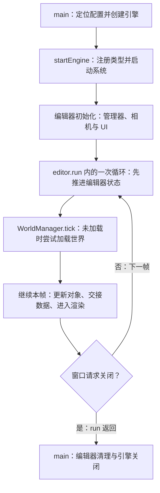
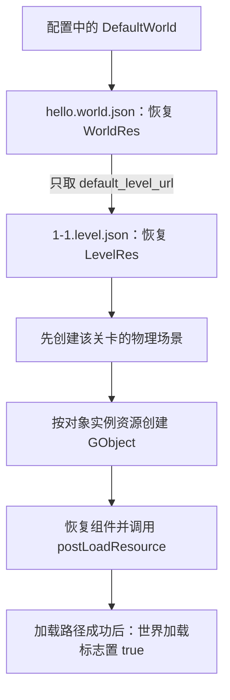

接手一台陌生引擎，找到 `main()` 通常不难。困难在于：哪些函数只是把系统建起来，哪些函数才把场景变成对象，第一帧又从哪里开始？如果启动后没有看到预期场景，应该先查路径、对象加载，还是渲染？

只按函数名往下读，很容易得到一条过于整齐的印象：初始化完成，世界就准备好了；进入循环，就开始运行游戏；退出循环，所有对象自然销毁。但实际代码经常把这些工作分散在不同阶段。

这篇沿 Piccolo 的编辑器入口走一次，重点寻找每个阶段交给下一个阶段的状态。读完后，我们应该能自己指出：**谁启动系统，谁第一次加载世界，谁推进帧，以及谁负责结束这段生命周期。**

> **读这篇之前**：先看 [架构地图]() 认识系统职责；遇到 `shared_ptr`、`weak_ptr` 和 `reset()`，可回看 [智能指针与对象生命周期]()。[渲染管线基础]() 已展开从场景到画面的链路，本篇聚焦它怎样第一次被启动。
>
> 源码基线：[BoomingTech/Piccolo，固定提交 `f5053707fed4`][revision]。本篇为主线 02，依据源码阅读与静态核对写作；[01 构建与调试基线]() 已记录配置与代码生成实测、完整 Debug 编译阻塞。本篇的引擎启动和后文断点表仍待运行验证。

## 先把启动分成几个不同的完成状态

启动不是一个布尔值。可以先用下面的最小模型读任何一台引擎：

| 阶段 | 要做的事 | 到这里能确认什么 |
| --- | --- | --- |
| 基础设施建立 | 读配置，创建文件、资源、窗口、渲染等系统 | 相关服务已执行创建或初始化流程，具体可用性还看各自结果 |
| 内容恢复 | 读世界与关卡，建立对象和组件，接入依赖 | 内容达到代码规定的加载状态 |
| 逐帧推进 | 更新状态，交接数据，组织渲染工作 | CPU 已推进到相应帧阶段；图形提交、GPU 完成和屏幕显示仍需分别观察 |
| 退出清理 | 停止推进，卸载内容，清理系统 | 按实际协议释放状态与持有关系 |

这里要同时记录两件事：**控制流走到了哪里，数据状态达到了什么条件。** 一个系统对象已经存在，不表示它管理的内容已经加载；一个加载函数返回成功，也只代表它自身定义的成功条件。

下面沿成功且正常返回的路径落到 Piccolo。错误分支和退出边界会在后面单独核对。

## 真正的入口：先启动引擎，再让编辑器推进它

[编辑器的 main.cpp][main] 中，核心流程如下，省略空行：

```cpp
int main(int argc, char** argv)
{
    std::filesystem::path executable_path(argv[0]);
    std::filesystem::path config_file_path = executable_path.parent_path() / "PiccoloEditor.ini";
    Piccolo::PiccoloEngine* engine = new Piccolo::PiccoloEngine();
    engine->startEngine(config_file_path.generic_string());
    engine->initialize();
    Piccolo::PiccoloEditor* editor = new Piccolo::PiccoloEditor();
    editor->initialize(engine);
    editor->run();
    editor->clear();
    engine->clear();
    engine->shutdownEngine();
    return 0;
}
```

先记住两个容易读错的地方。

第一，不能因为函数叫 `initialize()`，就把主要初始化工作归到它身上。在这个版本的 [engine.cpp][engine] 中，`PiccoloEngine::initialize()` 和 `clear()` 都是空函数。真正的系统启动在 `startEngine()`：先注册反射元信息，再调用全局上下文的 `startSystems()`。

第二，入口调用的是 `editor->run()`。引擎确实另有 `PiccoloEngine::run()`，但它不是这里的主循环。阅读器里“找到一个 run 函数”和“确定当前程序执行哪个 run 函数”是两步工作。

下图箭头表示正常路径上的推进顺序；其中世界加载发生在首次引擎 tick 内，图中没有表示启动耗时或独立线程。



## 配置路径决定我们究竟在加载哪份世界

在追世界加载之前，先把路径闭环。否则很容易盯着仓库里的 JSON，却运行了另一份部署目录中的资源。

`main()` 根据 `argv[0]` 的父目录拼出 `PiccoloEditor.ini`。这里用的是传入的路径字符串，没有调用操作系统接口重新取得并规范化可执行文件的绝对位置；如果传入相对路径，还要结合启动时的工作目录理解。

[ConfigManager::initialize()][config] 读这个 ini，再按下面的关系记录配置：

- `BinaryRootFolder`：配置文件父目录与配置值拼接，成为 `m_root_folder`。
- `DefaultWorld`：先保留为字符串 URL，稍后交给世界管理器。
- `GlobalRenderingRes`、`GlobalParticleRes`：分别给全局渲染资源和粒子资源提供入口。

[开发配置][development-config] 的 `BinaryRootFolder` 是 `../../../../../bin`，[部署配置][deployment-config] 是 `.`。两份配置都把默认世界写为 `asset/world/hello.world.json`。[AssetManager::getFullPath()][asset-cpp] 最终用根目录与资源 URL 拼接，再转成绝对路径。

所以，阅读默认世界时应记录这条链：**实际 ini 路径 → 根目录 → 世界 URL → 最终文件路径**。不能把 `AssetFolder=asset` 再无条件加在 DefaultWorld 前面，因为默认世界字符串本身已经带有 `asset/`。

[编辑器 CMake 文件][editor-cmake] 声明了构建后复制规则：开发配置复制到目标程序目录，部署配置及资源复制到二进制根目录。这解释了两套相对路径的用途；它只是构建规则，不能证明我们当前磁盘上已经生成了对应程序与资源。

## 系统初始化的顺序，来自具体依赖

[RuntimeGlobalContext::startSystems()][global-context] 的实际创建顺序可以分成五段读。下表保留源码顺序；每个对象是否另有显式 `initialize()`，以右侧说明和源码为准。

| 顺序 | 创建的系统 | 这里要核对的依赖 |
| --- | --- | --- |
| 1 | ConfigManager → FileSystem → LogSystem → AssetManager | 先解析路径，建立文件、日志与资源服务 |
| 2 | PhysicsManager → WorldManager | 初始化物理管理器；世界管理器记录默认世界 URL |
| 3 | WindowSystem → InputSystem | 创建窗口；输入系统初始化时向窗口注册事件函数 |
| 4 | ParticleManager → RenderSystem | 粒子初始化读全局资源；渲染初始化取得窗口并建立 RHI、全局渲染资源、相机、场景和管线 |
| 5 | DebugDrawManager → RenderDebugConfig | 初始化调试绘制，创建渲染调试配置 |

为什么 WorldManager 比 WindowSystem 和 RenderSystem 更早初始化，却没有立刻创建需要它们的完整场景？答案是：**WorldManager 的 initialize 尚未加载世界。**

另一方面，也不能把“世界还没加载”理解成“所有资源都没读”。[RenderSystem::initialize()][render-system] 已经读取全局渲染资源并准备相应基础设施。全局渲染配置与某个关卡的对象内容，处在不同的初始化层次。

如果在这里遇到依赖疑问，继续读被调用函数的函数体。例如，InputSystem 初始化时注册窗口事件，不能因为它后续 tick 会用相机，就倒推它此刻一定要求 RenderSystem 已创建。这种区分能避免把“整个类最终会用到什么”误当作“本次调用马上依赖什么”。

## 编辑器接入之后，才进入真正的帧循环

[PiccoloEditor::initialize()][editor] 将 `g_is_editor_mode` 设为 `true`，把引擎指针和运行时的窗口、渲染系统接给编辑器上下文，然后设置编辑器相机、上传坐标轴资源并初始化 UI。这些操作直接使用已经建立的运行时系统，因此位于 `startEngine()` 之后。

它的 `run()` 则是当前入口真正执行的循环：

```cpp
void PiccoloEditor::run()
{
    assert(m_engine_runtime);
    assert(m_editor_ui);
    float delta_time;
    while (true)
    {
        delta_time = m_engine_runtime->calculateDeltaTime();
        g_editor_global_context.m_scene_manager->tick(delta_time);
        g_editor_global_context.m_input_manager->tick(delta_time);
        if (!m_engine_runtime->tickOneFrame(delta_time))
            return;
    }
}
```

每次循环先推进编辑器场景管理器与编辑器输入，再调用引擎的 `tickOneFrame()`。因此，第一次进入编辑器循环和第一次进入世界更新也不是同一个位置：两者之间还有明确的调用顺序。

这也解释了以后设置断点时为什么要从当前入口出发。只在没有被此入口调用的 `PiccoloEngine::run()` 里停断点，无法用来判断编辑器是否进入了帧循环。

## 第一次 WorldManager::tick，才真正尝试加载世界

[WorldManager][world] 中，初始化与逐帧更新的代码对照阅读最清楚。下面摘出两个函数，省略行注释：

```cpp
void WorldManager::initialize()
{
    m_is_world_loaded   = false;
    m_current_world_url = g_runtime_global_context.m_config_manager->getDefaultWorldUrl();
    m_level_debugger = std::make_shared<LevelDebugger>();
}

void WorldManager::tick(float delta_time)
{
    if (!m_is_world_loaded)
    {
        loadWorld(m_current_world_url);
    }
    std::shared_ptr<Level> active_level = m_current_active_level.lock();
    if (active_level)
    {
        active_level->tick(delta_time);
        m_level_debugger->tick(active_level);
    }
}
```

`initialize()` 记录 URL、清除加载标志并创建关卡调试器；`tick()` 看到世界尚未加载，才调用 `loadWorld()`。这是一种把实际加载推迟到逐帧入口的组织方式。

在加载成功的路径中，同一次 tick 会继续取得活动关卡并推进它。源码里没有在两者之间强制等待下一帧，因此不能自动画成“第一帧只加载，第二帧才开始更新”。反过来，这种同步调用结构也不能用于推断真实加载耗时。

### 从世界文件走到默认关卡

默认的 [hello.world.json][hello-world] 内容很短：

```json
{
    "name": "HelloWorld",
    "level_urls": ["asset/level/1-1.level.json"],
    "default_level_url": "asset/level/1-1.level.json"
}
```

这张图的箭头表示文件引用与内容恢复关系，不表示跨线程任务：



注意这里的“只取”。虽然 WorldRes 有 `level_urls` 列表，这个版本的 `loadWorld()` 实际调用的是 `loadLevel(world_res.m_default_level_url)`，没有遍历加载全部关卡列表。资源结构能表达什么，与此处实际执行什么，需要分别核对。

成功后，`loadWorld()` 从 `m_loaded_levels` 找到默认关卡，写入活动关卡弱引用，再把 `m_is_world_loaded` 设为 `true`。这个标志描述的是这段加载流程达到成功出口，含义还不能扩展成所有对象与画面都正确。

### 为什么关卡还没加载完，就先被设为活动关卡

`loadLevel()` 中有一个值得停下来的顺序：

```cpp
bool WorldManager::loadLevel(const std::string& level_url)
{
    std::shared_ptr<Level> level = std::make_shared<Level>();
    m_current_active_level = level;
    const bool is_level_load_success = level->load(level_url);
    if (is_level_load_success == false)
    {
        return false;
    }
    m_loaded_levels.emplace(level_url, level);
    return true;
}
```

这里先临时设置活动关卡，再调用 `level->load()`。要理解它，继续追一次内容恢复中的依赖：

1. [Level::load()][level] 读关卡资源，先通过 PhysicsManager 创建物理场景。
2. 它遍历对象资源，创建并加载 GObject。
3. [GObject::load()][object] 在恢复组件时调用 `postLoadResource()`。
4. [RigidBodyComponent::postLoadResource()][rigidbody] 通过 WorldManager 的当前活动关卡取得物理场景，并创建刚体。

因此，组件恢复期间已经需要找到当前关卡的物理场景。临时活动引用为这条调用链提供了入口。

这也带来一个重要的阅读边界：**活动关卡的 weak_ptr 能 lock 成功，只能证明此时对象仍然存在，不能单独证明整个关卡已加载完。** 正在恢复内容的对象可被访问，与对象达到完整就绪状态，是不同的条件。

## 世界加载之后，同一帧怎样接到渲染

回到 [PiccoloEngine::tickOneFrame()][engine]。它先执行 `logicalTick()`，其中先调用 `WorldManager::tick()`，再调用运行时输入系统的 `tick()`。之后计算 FPS，交换逻辑与渲染数据，进入 `rendererTick()`，最后处理窗口事件并检查关闭状态。启用物理调试渲染时，还会在窗口事件处理前执行对应绘制工作。

在首次加载成功的路径里，可以沿下面的状态继续读：

- [TransformComponent::postLoadResource()][transform] 从资源恢复变换，并把变换标为脏数据。
- 关卡推进对象，GObject 根据当前模式选择要 tick 的组件。编辑器构造函数注册了 TransformComponent 与 MeshComponent 作为编辑器模式下更新的组件类型。
- [MeshComponent::tick()][mesh] 在满足更新条件时整理网格 part 描述，加入逻辑侧的脏对象数据。
- `swapLogicRenderData()` 完成交接，RenderSystem 的 tick 消费数据、组织渲染表示与后续图形工作。

所以，“进入编辑器”不等于“所有游戏组件都按游戏模式更新”。[GObject 的组件筛选][object] 与 [Level 中活动角色的模式判断][level] 都参与其中；同时，Level 的物理场景 tick 仍有自己的执行分支，也不能概括成编辑器模式下逻辑和物理全部停止。

至于 RenderEntity、可见性、Pass、命令提交和呈现，可以沿上一篇 [从场景对象到一帧画面]() 继续向下。这篇需要先分清四个观察点：

| 观察点 | 源码中的位置或状态 | 不能据此直接推出什么 |
| --- | --- | --- |
| 运行时初始化流程返回 | `startEngine()` 返回 | 默认世界已经加载 |
| 世界加载达到成功出口 | `m_is_world_loaded == true` | 每个对象都成功创建、网格都已显示 |
| CPU 推进到本帧结束 | `tickOneFrame()` 返回 | GPU 已完成这一帧或屏幕已显示 |
| 图形工作提交与呈现 | 后续 Vulkan 提交、同步和呈现路径 | 仅凭上层循环返回值无法验证这些结果 |

特别是 `tickOneFrame()` 的 bool 返回值：它返回的是 `!should_window_close`，含义是是否继续循环。`rendererTick()` 调用 RenderSystem 的 void tick 后也直接返回 `true`，没有把它变成完整的渲染成功回执。

## 成功标志还要沿失败分支检查一次

到这里已经连起正常路径，但读懂引擎还需要问：某一层失败时，上一层是否知道？

[ConfigManager::initialize()][config] 返回 void，函数中没有把配置文件打开失败或必需字段缺失汇总成一个成功结果。不能因为该函数返回，就认为整份配置通过了完整校验。

[AssetManager::loadAsset()][asset-h] 对文件打开和 JSON 解析失败会返回 `false`；`WorldManager::loadWorld()` 会检查世界资源加载和 `loadLevel()` 的结果。但 WorldManager 的 tick 没有接收 `loadWorld()` 的 bool 返回值。如果失败后仍正常返回且加载标志保持 false，下次 tick 会再次尝试。这说明源码里存在重试入口，不代表失败前已经完成的状态变更都被回滚。

再往下一层，[Level::load()][level] 遍历对象时直接调用 `createObject()`，没有汇总每次返回的对象 ID。`createObject()` 可以因为对象加载失败而返回无效 ID，Level 后面的正常路径仍可能把 `m_is_loaded` 设为 true 并返回成功。

因此，关卡日志、世界标志、对象数量与组件实际状态，都有各自的验证范围。以后调试“世界加载成功但少了一个对象”时，就应该沿对象创建的失败分支继续追，而不是先认定世界文件完全没有读到。

## 窗口关闭怎样让控制流回到 main

退出时同样要追真实调用链。[WindowSystem::initialize()][window-cpp] 把 GLFW 的关闭回调设为 `windowCloseCallback`，而该回调在 [window_system.h][window-h] 中的实现只有：

```cpp
static void windowCloseCallback(GLFWwindow* window) { glfwSetWindowShouldClose(window, true); }
```

GLFW 的关闭标志可由 `glfwWindowShouldClose()` 查询；请求关闭与实际销毁窗口是两件事。这一行为可对照 [GLFW 官方窗口关闭说明][glfw-close]。

在本篇入口的正常路径中，窗口事件被处理、关闭标志生效后：

1. `tickOneFrame()` 读到关闭状态，返回 false。
2. 编辑器的 `run()` 返回。
3. `main()` 依次执行 `editor->clear()`、`engine->clear()` 与 `engine->shutdownEngine()`。

这里还有一个很容易误判的细节：[EditorInputManager::registerInput()][editor-input] 注册了 `onWindowClosed()`，其函数体会调用 `shutdownEngine()`。但注册函数只是把回调放入 `m_onWindowCloseFunc` 列表；此版本的 `windowCloseCallback` 没有遍历这个列表，源码中也没有读出并分发它的其他位置。

所以不能仅凭“存在这个关闭处理函数”就把实际退出画成“窗口事件中立即关闭引擎，回到 main 再关闭一次”。当前窗口回调接起来的路径是设置标志，再由主循环返回。**找到注册，还要找到分发；找到处理函数，还要证明它由这条入口调用。**

## 清理顺序要读实际代码，不能只背逆序销毁

[编辑器 clear][editor-context] 删除编辑器场景和输入管理器；引擎的空 `clear()` 之后，真正的运行时清理在 `shutdownEngine()`：先调用 `shutdownSystems()`，最后注销反射元信息。

[shutdownSystems()][global-context] 按下面顺序执行。表中“重置”表示释放全局上下文这一处 shared_ptr 持有，并不自动等同于对象立即析构。

| 顺序 | 操作 |
| --- | --- |
| 1 | 重置 RenderDebugConfig、DebugDrawManager |
| 2 | `RenderSystem::clear()`，重置 RenderSystem，再重置 WindowSystem |
| 3 | `WorldManager::clear()`，重置 WorldManager |
| 4 | `PhysicsManager::clear()`，重置 PhysicsManager |
| 5 | `InputSystem::clear()`，重置 InputSystem |
| 6 | 依次重置 AssetManager、LogSystem、FileSystem、ConfigManager、ParticleManager |

这不是把启动清单机械倒排。例如 ParticleManager 在源码中最后才重置。解释顺序时应先记录事实，再逐项检查依赖，不能把“所有系统严格逆序销毁”当作代码已经实现的保证。

世界清理提供了一个具体的依赖例子：WorldManager 先对已加载关卡调用 `unload()`；Level 清理活动角色与对象，再通过 PhysicsManager 删除物理场景。因此，走到这里时仍需要物理管理器存在。只清空关卡容器，不能代替这段显式业务清理。

这与 C++ 前置篇中的区分一致：`clear()` 结束哪些业务状态，看函数体；`reset()` 释放哪一处持有，看所有权；何时真正析构，再看最后一个强引用。不能把这三个动作合并成同一件事。

最后还要限制结论的范围：入口以 `new` 创建引擎和编辑器，没有在这里配对 `delete`，也没有统一包住启动阶段的异常回滚流程。`shutdownSystems()` 中还直接使用多个系统指针，所以也不能未经检查就重复调用或在任意半初始化状态调用。本文说明的是这条正常退出协议，不据此宣称所有初始化失败都能完整清理。

## 先完成一次静态追踪，再带着明确问题调试

现在可以不运行程序，先在固定源码里完成四个任务：

1. 从 main 写出 ini、根目录、默认世界和默认关卡的路径关系，指出哪些只是配置字符串，哪些已经被解析成资源。
2. 找到世界加载标志第一次变为 true 的位置，再找出 Level 对单个对象失败的处理方式，说明两者为何不是同一个成功条件。
3. 从刚体组件恢复追到当前物理场景，解释为什么 loadLevel 临时设置活动关卡。
4. 从窗口回调追到主循环返回，再写出关卡卸载与物理管理器清理的先后关系。

等构建与调试基线建立后，可以按下面的观察表验证。它不是本次已取得的断点记录：

| 后续停在哪里 | 要记录什么 |
| --- | --- |
| main 与 ConfigManager 初始化后 | 实际可执行入口参数、工作目录、ini 路径与根目录 |
| WorldManager 初始化结束与首次 tick | 默认世界 URL、加载标志，确认加载发生在哪次调用 |
| loadLevel 与刚体 postLoadResource | 临时活动关卡、物理场景引用与调用栈 |
| 世界加载成功出口与首个渲染 tick | 实际对象数量、脏描述以及渲染侧是否消费到数据 |
| 窗口关闭回调与 shutdownSystems | 关闭标志、run 返回路径及清理调用顺序 |

真正开始调试时，再把源码路径、断点事实、画面观察和图形捕获分别记录。第一帧没有出现预期内容时，就能先判断停在哪个阶段，而不是在初始化、资源和渲染之间反复猜测。

## 继续阅读

- [一帧怎样推进：调用顺序、状态交接与线程怎样核对]()：继续沿一次循环追输入、世界、两槽位交接与内部任务的执行边界。
- [智能指针与对象生命周期]()：补充显式清理、持有释放与实际析构的区别。
- [模板、宏与反射代码生成]()：继续追组件怎样从序列化信息恢复。
- [从场景对象到一帧画面]()：继续追首次渲染工作的数据、命令与呈现边界。
- [Piccolo 阅读入口]()：返回系列目录。

Piccolo 源码节选版权：Copyright (c) 2022 Contributors to the Piccolo Engine，按 [MIT License][license] 提供。两张图为正常路径的阅读模型，未包含真实运行时序。

**读启动链，要把每个阶段交出的状态、依赖和清理责任一起读出来。**

[revision]: https://github.com/BoomingTech/Piccolo/tree/f5053707fed4d3f94d270a436fb0d3a8ae54e3e5
[main]: https://github.com/BoomingTech/Piccolo/blob/f5053707fed4d3f94d270a436fb0d3a8ae54e3e5/engine/source/editor/source/main.cpp
[engine]: https://github.com/BoomingTech/Piccolo/blob/f5053707fed4d3f94d270a436fb0d3a8ae54e3e5/engine/source/runtime/engine.cpp
[global-context]: https://github.com/BoomingTech/Piccolo/blob/f5053707fed4d3f94d270a436fb0d3a8ae54e3e5/engine/source/runtime/function/global/global_context.cpp
[config]: https://github.com/BoomingTech/Piccolo/blob/f5053707fed4d3f94d270a436fb0d3a8ae54e3e5/engine/source/runtime/resource/config_manager/config_manager.cpp
[asset-cpp]: https://github.com/BoomingTech/Piccolo/blob/f5053707fed4d3f94d270a436fb0d3a8ae54e3e5/engine/source/runtime/resource/asset_manager/asset_manager.cpp
[asset-h]: https://github.com/BoomingTech/Piccolo/blob/f5053707fed4d3f94d270a436fb0d3a8ae54e3e5/engine/source/runtime/resource/asset_manager/asset_manager.h
[development-config]: https://github.com/BoomingTech/Piccolo/blob/f5053707fed4d3f94d270a436fb0d3a8ae54e3e5/engine/configs/development/PiccoloEditor.ini
[deployment-config]: https://github.com/BoomingTech/Piccolo/blob/f5053707fed4d3f94d270a436fb0d3a8ae54e3e5/engine/configs/deployment/PiccoloEditor.ini
[editor-cmake]: https://github.com/BoomingTech/Piccolo/blob/f5053707fed4d3f94d270a436fb0d3a8ae54e3e5/engine/source/editor/CMakeLists.txt
[editor]: https://github.com/BoomingTech/Piccolo/blob/f5053707fed4d3f94d270a436fb0d3a8ae54e3e5/engine/source/editor/source/editor.cpp
[world]: https://github.com/BoomingTech/Piccolo/blob/f5053707fed4d3f94d270a436fb0d3a8ae54e3e5/engine/source/runtime/function/framework/world/world_manager.cpp
[hello-world]: https://github.com/BoomingTech/Piccolo/blob/f5053707fed4d3f94d270a436fb0d3a8ae54e3e5/engine/asset/world/hello.world.json
[level]: https://github.com/BoomingTech/Piccolo/blob/f5053707fed4d3f94d270a436fb0d3a8ae54e3e5/engine/source/runtime/function/framework/level/level.cpp
[object]: https://github.com/BoomingTech/Piccolo/blob/f5053707fed4d3f94d270a436fb0d3a8ae54e3e5/engine/source/runtime/function/framework/object/object.cpp
[rigidbody]: https://github.com/BoomingTech/Piccolo/blob/f5053707fed4d3f94d270a436fb0d3a8ae54e3e5/engine/source/runtime/function/framework/component/rigidbody/rigidbody_component.cpp
[transform]: https://github.com/BoomingTech/Piccolo/blob/f5053707fed4d3f94d270a436fb0d3a8ae54e3e5/engine/source/runtime/function/framework/component/transform/transform_component.cpp
[mesh]: https://github.com/BoomingTech/Piccolo/blob/f5053707fed4d3f94d270a436fb0d3a8ae54e3e5/engine/source/runtime/function/framework/component/mesh/mesh_component.cpp
[render-system]: https://github.com/BoomingTech/Piccolo/blob/f5053707fed4d3f94d270a436fb0d3a8ae54e3e5/engine/source/runtime/function/render/render_system.cpp
[window-cpp]: https://github.com/BoomingTech/Piccolo/blob/f5053707fed4d3f94d270a436fb0d3a8ae54e3e5/engine/source/runtime/function/render/window_system.cpp
[window-h]: https://github.com/BoomingTech/Piccolo/blob/f5053707fed4d3f94d270a436fb0d3a8ae54e3e5/engine/source/runtime/function/render/window_system.h
[editor-input]: https://github.com/BoomingTech/Piccolo/blob/f5053707fed4d3f94d270a436fb0d3a8ae54e3e5/engine/source/editor/source/editor_input_manager.cpp
[editor-context]: https://github.com/BoomingTech/Piccolo/blob/f5053707fed4d3f94d270a436fb0d3a8ae54e3e5/engine/source/editor/source/editor_global_context.cpp
[license]: https://github.com/BoomingTech/Piccolo/blob/f5053707fed4d3f94d270a436fb0d3a8ae54e3e5/LICENSE
[glfw-close]: https://www.glfw.org/docs/latest/window_guide.html#window_close
