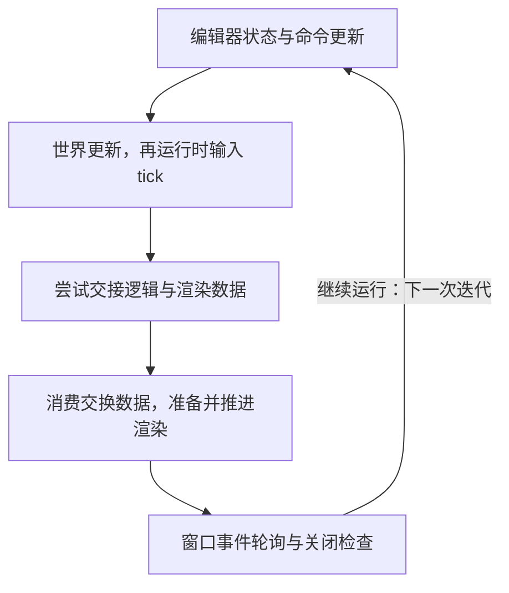
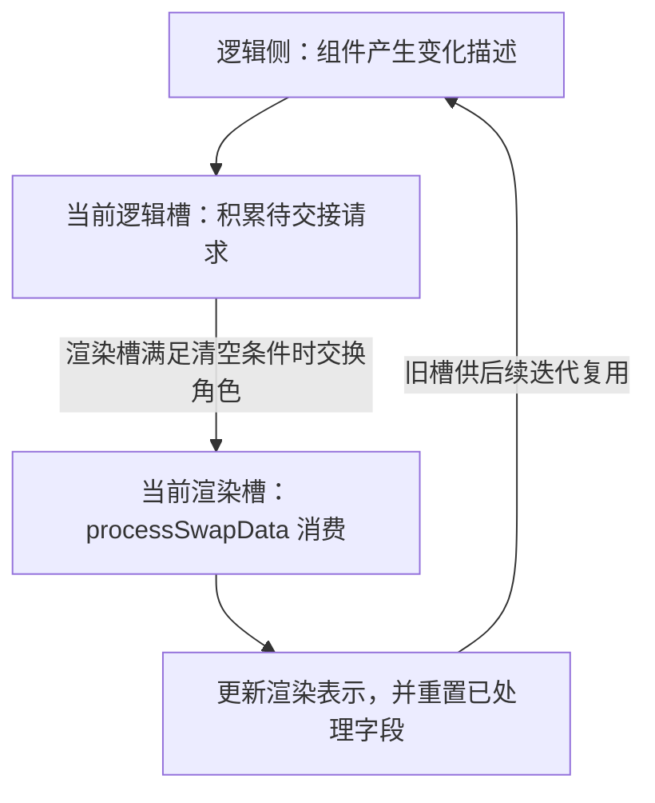

世界已经加载，窗口也显示出来了，接下来该怎样读这台引擎？最直接的入口是一帧：输入在哪里进入，谁更新对象，渲染读到的是哪次变化，窗口事件又在什么时候处理？

但只列出“输入、逻辑、物理、渲染”几个系统仍然不够。即使每个系统都执行了 tick，先写后读和先读后写也会得到不同结果。看到两份缓冲区，不能马上认定它们由两个线程处理；看到外层函数按顺序调用，也不能据此判断内部没有工作线程。

这篇接着启动篇，沿 Piccolo 的一次编辑器循环，把**调用顺序、状态交接和实际执行载体**分别核对。目标是读懂“这个阶段为什么拿到这份数据”，并为以后的断点观察准备明确的问题。

> **读这篇之前**：建议先读 [从启动走到第一帧]()，确认当前执行的是编辑器循环。[渲染管线基础]() 已展开场景、Pass 和呈现，本篇重点看它们在一帧中怎样接起来。
>
> 源码基线：[BoomingTech/Piccolo，固定提交 `f5053707fed4`][revision]。本篇为主线 03，网页位置按已完成文章的阅读顺序排列。以下以编辑器入口、世界已加载且相关调用正常返回的循环为主；首次世界加载见上一篇。尚未构建或运行 Piccolo，图表与案例都是源码推导，没有实测线程时间线或输入延迟。

> 缓冲中的值与借用、发布/复用条件及 Jolt/日志的实际线程入口，见 [状态缓冲怎样交接，哪些地方真的跨线程]()。

> 窗口事件怎样转接到输入管理器、回调捕获与注销边界，见 [窗口与编辑器回调怎样绑定、调用和注销]()。

## 读一帧，先分别回答三个问题

可以先建立一个不依赖具体引擎的阅读模型：

| 要回答的问题 | 应该追什么 | 只看名字容易漏掉什么 |
| --- | --- | --- |
| 谁先执行，谁后执行 | 真实入口、调用链、条件和返回位置 | 某个系统可能被模式筛掉，或者中途返回 |
| 谁写，谁读，交的是什么 | 状态字段、描述数据、缓冲槽位与消费后的清理 | 系统执行了，不代表读到刚写入的状态 |
| 工作由谁执行，何时完成 | 当前调用线程、任务分发、等待与图形提交 | 同步函数内部可以并行；CPU 返回也不代表 GPU 完成 |

这三种关系可以相互印证，但不能互相替代。先画调用顺序，再标出数据的生产和消费位置，最后核对线程与等待，通常比一开始画一张笼统的多线程架构图更容易落到证据。

本篇把“一帧”限定为**编辑器外层循环的一次迭代**。引擎帧计数、物理模拟步长、GPU 使用的在途帧资源，以及显示器的一次刷新，各有自己的含义，后面再逐项区分。

## 从当前入口走一次，先确定外层顺序

[main.cpp][main] 调用 `PiccoloEditor::run()`。在 [编辑器循环][editor] 内，每次先计算 delta time，再依次推进 EditorSceneManager、EditorInputManager，最后调用引擎的 `tickOneFrame()`。

编辑器这两步确实会修改状态：[EditorSceneManager::tick()][editor-scene] 会为选中对象的变换设置脏标记；[EditorInputManager::tick()][editor-input] 处理编辑器命令，其中相机移动直接作用于编辑器相机。因此，进入引擎帧之前，已有明确的编辑器工作。

继续读 [tickOneFrame()][engine]，函数体如下，省略多余空行：

```cpp
bool PiccoloEngine::tickOneFrame(float delta_time)
{
    logicalTick(delta_time);
    calculateFPS(delta_time);

    // single thread
    // exchange data between logic and render contexts
    g_runtime_global_context.m_render_system->swapLogicRenderData();

    rendererTick(delta_time);

#ifdef ENABLE_PHYSICS_DEBUG_RENDERER
    g_runtime_global_context.m_physics_manager->renderPhysicsWorld(delta_time);
#endif

    g_runtime_global_context.m_window_system->pollEvents();
    g_runtime_global_context.m_window_system->setTitle(
        std::string("Piccolo - " + std::to_string(getFPS()) + " FPS").c_str());
    const bool should_window_close = g_runtime_global_context.m_window_system->shouldClose();
    return !should_window_close;
}
```

其中 `logicalTick()` 的内容也要打开，不能根据名字补出想象中的更新顺序：

```cpp
void PiccoloEngine::logicalTick(float delta_time)
{
    g_runtime_global_context.m_world_manager->tick(delta_time);
    g_runtime_global_context.m_input_system->tick();
}
```

**这里是世界先更新，运行时输入系统后 tick。** 两者的实际职责还需要继续向下读。

下图的箭头表示当前入口上的 CPU 调用先后，不表示节点各占一个线程，也没有标出真实耗时。FPS 统计、窗口标题和可选物理调试绘制在上面的函数中保留，图中只画主要阶段：



## 世界内部还有顺序，但顺序保证有不同范围

[WorldManager::tick()][world] 取得活动关卡并调用其 tick；世界未加载时，还会先尝试加载。进入 [Level::tick()][level] 后，正常路径依次是：

1. 检查关卡是否已加载。
2. 遍历关卡对象，推进每个 GObject。
3. 在游戏模式且存在活动角色时，推进活动角色。
4. 在能取得物理场景时，调用 PhysicsScene 的 tick。

所以，物理更新在这些对象和可选活动角色更新之后。与此同时，不能从这个循环推断对象 A 总在对象 B 前面更新：[LevelObjectsMap][level-h] 是 `std::unordered_map`，这里没有定义按对象 ID、创建时间或业务依赖排序的协议。

再往下，[GObject::tick()][object] 遍历的是 `m_components`；[其声明][object-h] 是 vector，执行顺序跟随当前组件存储顺序。组件的实例资源与定义资源怎样合并，会影响这个列表，具体恢复过程留到场景对象篇展开。这里先记住：代码没有先按组件类型重排，再统一执行某种假定的“Transform → Motor → Mesh”阶段。

编辑器模式还会经过 `shouldComponentTick()` 筛选。[编辑器构造函数][editor] 注册了 TransformComponent 与 MeshComponent；不能把游戏模式下 Motor 的调用，直接套到默认编辑器循环上。Level 中的角色模式判断与物理场景分支也要分别看，不能把整个世界概括成全部运行或全部暂停。

因此，核对顺序时至少写清三层：**系统之间的顺序、对象遍历的规则、单个对象内部的组件顺序。** 外层顺序明确，并不自动给内层建立所有业务依赖。

## 输入从哪里来：事件回调与输入 tick 分开读

如果输入 tick 在世界之后，是否意味着本次世界更新完全没有输入？要回答它，需要找到状态的写入位置。

[WindowSystem::initialize()][window-cpp] 注册 GLFW 键盘等回调；[keyCallback 与 onKey 分发][window-h] 再把事件交给已注册的函数。运行时 InputSystem 和编辑器输入管理器都接入窗口，但各自根据 `g_is_editor_mode` 选择是否处理按键。

[InputSystem::onKeyInGameMode()][input] 在按下、释放等事件路径修改 `m_game_command` 的位字段；[MotorComponent][motor] 则在游戏模式下的相应组件更新中读取 `getGameCommand()`。按键命令不是等到 `InputSystem::tick()` 才从无到有地产生。

运行时输入 tick 做的是另外一些工作：计算鼠标位移对应的 yaw/pitch，清零原始位移，再根据窗口焦点模式更新命令的 invalid 位。原始位移、派生角度、按键命令和有效性标志，都有各自的写入时机。因此，不能用“输入”这一个词，替代对具体字段的追踪。

### 做一次带条件的跨迭代推导

假设世界已稳定加载，并且某个按键事件**恰好在第 n 次迭代末尾的 `pollEvents()` 中被分发**，随后没有其他回调或 UI 操作覆盖相关状态：

1. 第 n 次的世界更新已经发生，新事件无法改变这次已经完成的读取。
2. 回调写入命令字段后，下一次循环中相应的编辑器命令处理，或游戏模式组件更新，才有机会消费它。
3. 若某个消费者读的是鼠标派生角度，还要继续追 `calculateCursorDeltaAngles()`。它位于世界更新之后，不能直接套用按键命令的消费时机。

这是根据指定事件位置做的纸上推导。GLFW 官方说明，除了显式处理事件的函数，一些窗口系统调用也可能在返回前触发回调。因此，**不能把它推广成所有输入都只能在帧尾到达，也不能据此给出固定一帧或几毫秒的实测延迟**。[GLFW 事件处理说明][glfw-events]

以后调试输入时，应记录“哪个回调写了哪个字段、哪个消费者第一次读到它”，而不只是分别在两个名为 tick 的函数里停一次。

## 逻辑交给渲染的，是变化描述

沿 [MeshComponent::tick()][mesh] 继续追：满足变换脏条件时，它整理对象各个 part 的网格、材质、变换和相关动画描述，取得逻辑侧的交换数据，再加入脏对象记录，最后清除变换脏标记。

[RenderSwapData][swap-h] 除了脏对象描述，还有关卡资源、删除对象、相机、粒子创建与更新等请求。这些字段由 optional 表示当前是否携带相应数据。它们组成的是**需要交接的变化与请求集合**，不能直接当作世界中所有对象的一份完整快照。

消费端是 [RenderSystem::processSwapData()][render-system]。它取得渲染侧数据，按描述建立或更新 RenderEntity、按需准备资源，也处理删除、相机和粒子请求。对象描述队列逐项处理并 pop 后，还会调用 `resetGameObjectResourceSwapData()`；其他已处理字段也有对应的 reset。

下图箭头表示 CPU 侧描述的生产、交接和消费关系。RenderScene 可以继续保留已有渲染表示，交换数据则按协议清理和复用：



这里不包含 GPU 图像，也不是 Vulkan 的交换链。两者名称里都有交换，但交换的对象与完成条件不同。

## 两份缓冲怎样交换：跟踪槽位比跟踪名字更清楚

[RenderSwapContext][swap-h] 中有两个 RenderSwapData 槽位。初始逻辑索引为 0，渲染索引为 1；`getLogicSwapData()` 和 `getRenderSwapData()` 根据当前索引返回对应引用。

先看 [交换入口与就绪检查][swap-cpp]：

```cpp
void RenderSwapContext::swapLogicRenderData()
{
    if (isReadyToSwap())
    {
        swap();
    }
}

bool RenderSwapContext::isReadyToSwap() const
{
    return !(m_swap_data[m_render_swap_data_index].m_level_resource_desc.has_value() ||
             m_swap_data[m_render_swap_data_index].m_game_object_resource_desc.has_value() ||
             m_swap_data[m_render_swap_data_index].m_game_object_to_delete.has_value() ||
             m_swap_data[m_render_swap_data_index].m_camera_swap_data.has_value() ||
             m_swap_data[m_render_swap_data_index].m_particle_submit_request.has_value() ||
             m_swap_data[m_render_swap_data_index].m_emitter_tick_request.has_value() ||
             m_swap_data[m_render_swap_data_index].m_emitter_transform_request.has_value());
}
```

检查的是**当前渲染槽的七项 optional 是否全部无值**。它没有检查 GPU 是否完成，也不只是检查对象队列有没有元素。

这就是消费后 reset 的意义：某个 optional 里面即使装着空队列，只要 optional 本身仍有值，检查就不会通过。清空内部容器与把外层 optional 置为无值，是两个动作。

就绪之后，`swap()` 做下面这些事：

```cpp
void RenderSwapContext::swap()
{
    resetLevelRsourceSwapData();
    resetGameObjectResourceSwapData();
    resetGameObjectToDelete();
    resetCameraSwapData();
    resetEmitterTickSwapData();
    resetEmitterTransformSwapData();
    resetPartilceBatchSwapData();
    std::swap(m_logic_swap_data_index, m_render_swap_data_index);
}
```

各个 reset 都作用于交换前的渲染槽；之后交换两个索引，原逻辑槽成为渲染侧要消费的槽，原渲染槽成为新的逻辑槽。这里没有逐对象复制整份世界，索引交换也不会自动创建线程。

### 用两次迭代检查自己是否读懂

令 Dₙ 表示第 n 次迭代产生的一批描述，不是源码中的类名或字段。假设每次到交接点时，旧渲染槽的七项 optional 都已经无值，消费正常完成：

| 时刻 | 逻辑索引 / 渲染索引 | 槽 0 | 槽 1 |
| --- | --- | --- | --- |
| 初始 | 0 / 1 | 空 | 空 |
| 逻辑产生 Dₙ | 0 / 1 | Dₙ | 空 |
| 第一次交换后 | 1 / 0 | Dₙ，等待渲染消费 | 空，可供逻辑写入 |
| processSwapData 完成并 reset | 1 / 0 | 空 | 空 |
| 下次逻辑产生 Dₙ₊₁，再交换 | 0 / 1 | 空，可供逻辑写入 | Dₙ₊₁，等待渲染消费 |

外层调用顺序是先逻辑、再交换、再渲染，因此在这些条件下，Dₙ 可以在同一次 CPU 迭代被 `processSwapData()` 读到。双缓冲的数量本身不意味着固定落后一帧。

若渲染槽仍有任一 optional 携带数据，交换函数直接不换索引。这是条件分支，没有等待循环；后面的 rendererTick 仍会继续进入消费路径。读到“尝试交换”时，应实际核对索引是否变化，不能仅凭函数被调用就判定交接已完成。

还有一个 C++ 阅读细节：getter 返回的是某个槽位的引用。如果长期缓存它，交换索引后，引用仍指向原来的槽位，不会自动跟随“逻辑侧”这个角色。引用指向的对象与索引赋予它的用途，也要分开理解。

## 进入渲染后，还要辨认准备、执行入口与返回条件

[RenderSystem::tick()][render-system] 先消费交换数据，再准备 RHI 上下文、逐帧资源和可见对象，准备 Pass 数据，推进调试绘制，最后选择前向或延迟渲染入口。完整的图形链路见 [渲染管线基础]()，这里补两个对读顺序很有用的边界。

第一，编辑器工作不全在外层两个编辑器 tick 里。[UIPass::draw()][ui-pass] 还会调用窗口 UI 的 `preRender()`，组织 UI 并录制相关绘制工作。因此，追一项编辑器操作时，也可能沿渲染路径走回编辑器代码，不能只搜索编辑器循环的前半段。

第二，进入渲染函数，不保证该次调用一定走到主画面的提交。[默认延迟路径][render-pipeline] 在等待帧资源、准备交换链图像时有重建后提前返回的分支；正常主画面提交之后，还存在粒子的图像复制与模拟调用。主图可以突出关键链路，但不能当成所有分支、所有 GPU 工作的完整清单。

`tickOneFrame()` 返回的 bool 依然只表示窗口是否请求关闭。它不是“该次渲染成功”或“显示器已呈现”的统一结果。

## delta time、物理步长与 FPS 分别告诉我们什么

[calculateDeltaTime()][engine] 用 steady_clock 计算两次采样的时间差，并更新上次采样点；编辑器循环把这一值传给本次引擎 tick。它表达外层采样间隔，不能单独拆出世界、输入和渲染各自用了多长时间。

接到 `PhysicsScene::tick(float delta_time)`，也不能默认物理必然使用传入的 delta。[实际函数][physics] 传给 Jolt Update 的参数为：

```cpp
const float time_step = 1.f / m_config.m_update_frequency;

m_physics.m_jolt_physics_system->Update(time_step,
                                      m_physics.m_collision_steps,
                                      m_physics.m_integration_substeps,
                                      m_physics.m_temp_allocator,
                                      m_physics.m_jolt_job_system);
```

[配置默认值][physics-config] 将更新频率设为 60，因此默认单次调用的模拟步长为 1/60 秒。但这段函数没有依据真实经过时间做累积、判断需要补多少步或执行追赶循环。不能仅凭这个常量，就认定引擎已经建立了独立于渲染帧率的完整固定步调度。

`calculateFPS()` 则增加帧计数，对 delta 做平滑平均再取倒数。窗口标题上的 FPS 是这种统计结果；它既不是某个系统的独立耗时，也不证明显示器完成了相同次数的刷新。以后做性能观察时，需要另行测量各段和等待位置。

## 核对线程，要分清外层调用、内部任务和 GPU

现在回到源码的 `single thread` 注释。它与外层调用共同说明：**本篇入口的逻辑更新、数据交换、渲染入口由当前调用线程按顺序推进。** 在这里没有把逻辑 tick 和渲染 tick 分派到两个独立循环。

但结论应该停在这个范围。继续读物理实现，会得到更多事实：

- [PhysicsScene 构造函数][physics] 创建 `JPH::JobSystemThreadPool`，参数来自 PhysicsConfig；Update 调用把这个任务系统传给 Jolt。
- 固定仓库附带的 [Jolt 线程池实现][jolt-pool] 从构造函数进入 Init，再调用 StartThreads；后者根据线程参数创建执行 ThreadMain 的工作线程。
- [Jolt PhysicsSystem::Update][jolt-update] 使用任务 barrier，并在本次更新路径中调用 `WaitForJobs()`，之后销毁 barrier。

这是一条“外层调用物理更新，内部通过任务系统工作，再在更新流程中等待”的源码证据链。它支持内部并行工作的判断，同时不能据此声称物理一定跨到下一次主循环才完成。实际启动了哪些线程、每个任务跑在哪个线程、哪些任务发生重叠，要留到运行时观察。

| 层次 | 当前能从源码确认什么 | 后续怎样取得运行证据 |
| --- | --- | --- |
| 逻辑与渲染外层 | 直接调用、先后推进，中间尝试交换数据 | 在逻辑、交换与渲染入口记录线程 ID 和调用栈 |
| 物理内部任务 | 接入线程池，依赖库创建工作线程，更新路径有 WaitForJobs | 在 ThreadMain、任务执行和等待位置观察线程与时间线 |
| 图形设备工作 | VulkanRHI 录制、提交并使用同步对象 | 结合图形捕获与 GPU 时间线观察提交、执行和等待 |

CPU 线程与 GPU 执行又是不同维度。[VulkanRHI][vulkan-rhi] 的主渲染路径会等待相应在途帧 fence，并通过 `vkQueueSubmit()` 提交工作。Khronos 对该接口的定义也将提交与设备执行完成区分开来，提交可以关联完成时发信号的 fence。[vkQueueSubmit 规范][vk-submit]

因此，CPU 的调用顺序不能直接当成 GPU 完成顺序；内部出现线程池，也不能反过来证明逻辑与渲染已经独立并行。

同理，这份 RenderSwapContext 的两个槽位和普通索引没有自动提供多线程生产、消费协议。若未来要改成并行逻辑与渲染，还需要核对槽位何时归谁、怎样发布数据、何时允许复用及怎样同步。把现有索引交换函数放到两个线程中，不能单独构成并发正确性的证明。

## 不运行程序，也能先检查一次阅读结果

先完成三个静态练习：

1. 用源码写出编辑器一次迭代的主要顺序，再标出 UI `preRender()` 的实际位置。检查有没有把所有编辑器工作都放在帧头。
2. 在两槽位表中加入一个条件：旧渲染槽的对象 optional 有值，但内部队列为空。判断本次交换是否发生，指出还需要哪个清理动作。
3. 沿 PhysicsScene 的任务系统追到 Jolt 的线程创建与 WaitForJobs，分别解释外层顺序、内部并行与返回前等待，避免只用一个“多线程”概括。

等构建与调试基线完成后，再按下面的表记录实际观察。以下是验证计划，本次没有执行这些断点或采样：

| 位置 | 要一起记录的状态 |
| --- | --- |
| editor.run、logicalTick、rendererTick | 迭代编号、线程 ID、调用栈和编辑器模式 |
| Level 与 GObject tick | 对象 ID、当前组件列表及实际更新顺序 |
| 输入回调与对应消费者 | 事件发生位置、具体字段、第一次消费位置和模式条件 |
| swapLogicRenderData 前后 | 两个索引、七项 optional 的有值状态，是否真正交换 |
| processSwapData 前后 | 读的是哪个槽位、描述内容、pop 与 reset 是否完成 |
| 物理 Update、ThreadMain 与 WaitForJobs | 调用线程、工作线程、任务执行与等待关系 |
| Vulkan 提交与同步位置 | 在途帧资源索引、提交结果、等待及 GPU 执行证据 |

这样，一次“变化没有按预期出现”的问题就可以沿具体状态缩小：生产者没有写、交接条件不满足、消费者读了另一份状态，还是后续图形工作没有到达预期阶段。先找到证据在哪一层，再判断是否需要改更新顺序或线程模型。

## 继续阅读

- [10：刚体与碰撞查询怎样参与角色运动]()：分别核对组件查询、固定每 tick 步进与 Update 后删除，不由线程池名称推断整段异步执行。
- [09：从一次按键到角色位移]()：用真实输入、Motor、Transform 和 Character 消费点检验本篇逐帧地图。
- [场景文件怎样成为世界中的对象与组件]()：从默认关卡的一面墙继续追实例、定义合并与组件运行状态的建立。
- [从启动走到第一帧]()：回看当前循环从哪里进入，世界何时首次加载，退出怎样衔接。
- [类、继承与虚函数]()：从组件接口和 RHI 接口继续追实际实现。
- [从场景对象到一帧画面]()：沿渲染表示继续读可见性、Pass、绘制与呈现。
- [Piccolo 阅读入口]()：返回系列目录。

Piccolo 源码节选版权：Copyright (c) 2022 Contributors to the Piccolo Engine，按 [MIT License][license] 提供。依赖库 Jolt 的实现链接指向同一固定仓库版本；两张图、槽位表和输入案例均为阅读推导。

**读懂一帧，要同时核对调用先后、数据交接，以及每层工作的执行与完成条件。**

[revision]: https://github.com/BoomingTech/Piccolo/tree/f5053707fed4d3f94d270a436fb0d3a8ae54e3e5
[main]: https://github.com/BoomingTech/Piccolo/blob/f5053707fed4d3f94d270a436fb0d3a8ae54e3e5/engine/source/editor/source/main.cpp
[editor]: https://github.com/BoomingTech/Piccolo/blob/f5053707fed4d3f94d270a436fb0d3a8ae54e3e5/engine/source/editor/source/editor.cpp
[editor-scene]: https://github.com/BoomingTech/Piccolo/blob/f5053707fed4d3f94d270a436fb0d3a8ae54e3e5/engine/source/editor/source/editor_scene_manager.cpp
[editor-input]: https://github.com/BoomingTech/Piccolo/blob/f5053707fed4d3f94d270a436fb0d3a8ae54e3e5/engine/source/editor/source/editor_input_manager.cpp
[engine]: https://github.com/BoomingTech/Piccolo/blob/f5053707fed4d3f94d270a436fb0d3a8ae54e3e5/engine/source/runtime/engine.cpp
[world]: https://github.com/BoomingTech/Piccolo/blob/f5053707fed4d3f94d270a436fb0d3a8ae54e3e5/engine/source/runtime/function/framework/world/world_manager.cpp
[level]: https://github.com/BoomingTech/Piccolo/blob/f5053707fed4d3f94d270a436fb0d3a8ae54e3e5/engine/source/runtime/function/framework/level/level.cpp
[level-h]: https://github.com/BoomingTech/Piccolo/blob/f5053707fed4d3f94d270a436fb0d3a8ae54e3e5/engine/source/runtime/function/framework/level/level.h
[object]: https://github.com/BoomingTech/Piccolo/blob/f5053707fed4d3f94d270a436fb0d3a8ae54e3e5/engine/source/runtime/function/framework/object/object.cpp
[object-h]: https://github.com/BoomingTech/Piccolo/blob/f5053707fed4d3f94d270a436fb0d3a8ae54e3e5/engine/source/runtime/function/framework/object/object.h
[input]: https://github.com/BoomingTech/Piccolo/blob/f5053707fed4d3f94d270a436fb0d3a8ae54e3e5/engine/source/runtime/function/input/input_system.cpp
[window-cpp]: https://github.com/BoomingTech/Piccolo/blob/f5053707fed4d3f94d270a436fb0d3a8ae54e3e5/engine/source/runtime/function/render/window_system.cpp
[window-h]: https://github.com/BoomingTech/Piccolo/blob/f5053707fed4d3f94d270a436fb0d3a8ae54e3e5/engine/source/runtime/function/render/window_system.h
[motor]: https://github.com/BoomingTech/Piccolo/blob/f5053707fed4d3f94d270a436fb0d3a8ae54e3e5/engine/source/runtime/function/framework/component/motor/motor_component.cpp
[mesh]: https://github.com/BoomingTech/Piccolo/blob/f5053707fed4d3f94d270a436fb0d3a8ae54e3e5/engine/source/runtime/function/framework/component/mesh/mesh_component.cpp
[swap-h]: https://github.com/BoomingTech/Piccolo/blob/f5053707fed4d3f94d270a436fb0d3a8ae54e3e5/engine/source/runtime/function/render/render_swap_context.h
[swap-cpp]: https://github.com/BoomingTech/Piccolo/blob/f5053707fed4d3f94d270a436fb0d3a8ae54e3e5/engine/source/runtime/function/render/render_swap_context.cpp
[render-system]: https://github.com/BoomingTech/Piccolo/blob/f5053707fed4d3f94d270a436fb0d3a8ae54e3e5/engine/source/runtime/function/render/render_system.cpp
[render-pipeline]: https://github.com/BoomingTech/Piccolo/blob/f5053707fed4d3f94d270a436fb0d3a8ae54e3e5/engine/source/runtime/function/render/render_pipeline.cpp
[ui-pass]: https://github.com/BoomingTech/Piccolo/blob/f5053707fed4d3f94d270a436fb0d3a8ae54e3e5/engine/source/runtime/function/render/passes/ui_pass.cpp
[physics]: https://github.com/BoomingTech/Piccolo/blob/f5053707fed4d3f94d270a436fb0d3a8ae54e3e5/engine/source/runtime/function/physics/physics_scene.cpp
[physics-config]: https://github.com/BoomingTech/Piccolo/blob/f5053707fed4d3f94d270a436fb0d3a8ae54e3e5/engine/source/runtime/function/physics/physics_config.h
[jolt-pool]: https://github.com/BoomingTech/Piccolo/blob/f5053707fed4d3f94d270a436fb0d3a8ae54e3e5/engine/3rdparty/JoltPhysics/Jolt/Core/JobSystemThreadPool.cpp
[jolt-update]: https://github.com/BoomingTech/Piccolo/blob/f5053707fed4d3f94d270a436fb0d3a8ae54e3e5/engine/3rdparty/JoltPhysics/Jolt/Physics/PhysicsSystem.cpp
[vulkan-rhi]: https://github.com/BoomingTech/Piccolo/blob/f5053707fed4d3f94d270a436fb0d3a8ae54e3e5/engine/source/runtime/function/render/interface/vulkan/vulkan_rhi.cpp
[license]: https://github.com/BoomingTech/Piccolo/blob/f5053707fed4d3f94d270a436fb0d3a8ae54e3e5/LICENSE
[glfw-events]: https://www.glfw.org/docs/latest/input_guide.html#events
[vk-submit]: https://docs.vulkan.org/refpages/latest/refpages/source/vkQueueSubmit.html
