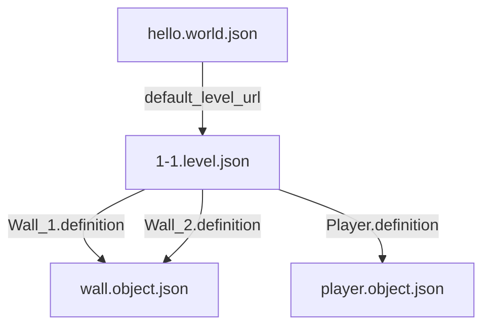
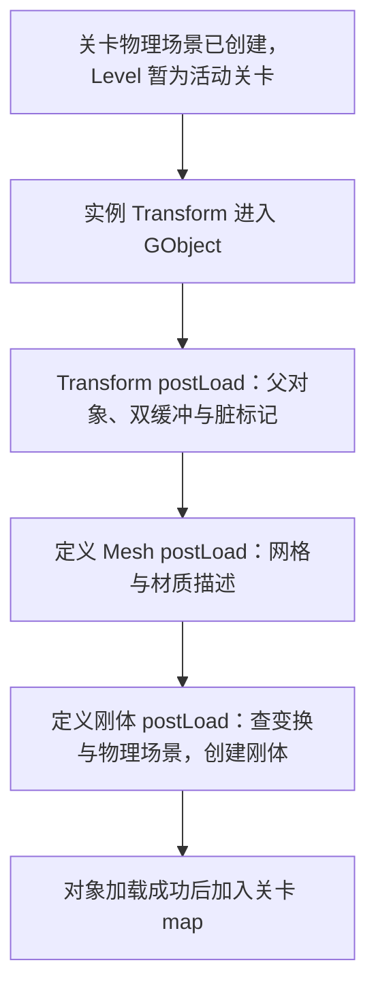

场景文件里写着一面墙的名字、位置和模型路径，运行时却需要一个能被查找、更新、绘制和参与碰撞的对象。这两者之间到底发生了什么？

如果只把过程理解成“读 JSON，然后 new 对象”，就很难解释几个具体问题：同一份墙体定义怎样出现在不同位置？文件中的组件什么时候已经有了 C++ 实例？字段读完以后，刚体和网格还需要做什么？关卡显示加载成功，又是否意味着每条对象记录都恢复成功？

这篇沿 Piccolo 默认场景中的 `Wall_1` 走一次，把文件引用、对象组装和运行时接线连起来。我们要找的是：**每份数据在哪里变成对象，对象何时获得身份，以及组件怎样接入它依赖的系统。**

> **读这篇之前**：[从启动走到第一帧]() 说明默认世界何时加载，[一帧怎样推进]() 说明加载后怎样更新。容器复制、擦除与借用有效性可回看 [对象容器修改后，持有者、借用与遍历怎样变化]()。遇到类型名、反射指针或生成代码，可按需回看 [模板、宏与反射代码生成]()。
>
> 源码基线：[BoomingTech/Piccolo，固定提交 `f5053707fed4`][revision]。本篇为主线 04；依据实际资源、源码与生成模板做静态追踪，未构建或运行 Piccolo，也未执行其解析器生成和断点验证。文中的对象数量是文件记录或规则推导，不是运行统计。

## 先把描述、对象组装与系统接线分开

一份可持久化的场景描述，通常需要回答“有哪些内容、各自是什么、放在哪里”。运行时还要补上对象身份、组件间联系，以及物理、资源、渲染等系统的状态。

可以用三层模型阅读：

| 层次 | 负责什么 | 在 Piccolo 中看什么 |
| --- | --- | --- |
| 内容描述 | 保存世界、关卡、实例差异和可复用定义 | WorldRes、LevelRes、ObjectInstanceRes、ObjectDefinitionRes |
| 对象组装 | 创建运行身份，组合组件并纳入容器 | Level::createObject、GObject::load |
| 系统接线 | 让恢复的字段成为可用的运行状态 | 各组件的 postLoadResource |

三层并非严格互不交叉的内存分区。Piccolo 的资源结构里已经可以持有反射组件指针，读文件时就会进入组件构造路径。这个模型用于区分责任：**字段被读出来、组件进入最终列表、外部系统状态建立，是不同的完成条件。**

## 先找到默认世界与关卡的实际文件

[默认配置][config] 将 DefaultWorld 指向 `asset/world/hello.world.json`；资源路径相对于配置得到的根目录解析。路径怎样定位，见启动篇，这里继续追文件中的引用。

[hello.world.json][world-json] 保存世界名、关卡列表和默认关卡 URL：

```json
{
  "name": "HelloWorld",
  "level_urls": ["asset/level/1-1.level.json"],
  "default_level_url": "asset/level/1-1.level.json"
}
```

[WorldRes][world-res] 对应这份描述。[WorldManager::loadWorld()][world] 读出 WorldRes 后，实际调用 `loadLevel(world_res.m_default_level_url)`。虽然文件保存了关卡列表，这条路径没有遍历加载整个列表。

再打开 [1-1.level.json][level-json]，可以看到三类关卡数据：重力、活动角色名字和对象数组。固定版本中，重力为 `(0, 0, -15)`，`character_name` 为 `Player`，对象数组有 **31 条记录**；对应的结构是 [LevelRes][level-res]。

这里的“场景文件”是阅读时对这组内容文件的统称，代码具体使用 World、Level 和对象资源来组织它们。不要先假定必须存在一个包揽所有内容的 Scene 类，再到工程里硬找同名实现。

下图只表示文件中的引用关系，箭头不表示内存所有权或实际加载耗时：



## 用一面真实的墙，分清实例与定义

在关卡对象数组里，`Wall_1` 的完整记录如下。仅调整了排版与键的显示顺序，没有修改数值：

```json
{
  "name": "Wall_1",
  "definition": "asset/objects/environment/wall/wall.object.json",
  "instanced_components": [
    {
      "$typeName": "TransformComponent",
      "$context": {
        "transform": {
          "position": { "x": 1.94597, "y": -0.38554, "z": 0 },
          "rotation": { "x": 0, "y": 0, "z": -0.707683, "w": 0.70653 },
          "scale": { "x": 0.999993, "y": 0.999993, "z": 1 }
        }
      }
    }
  ]
}
```

[ObjectInstanceRes][object-res] 保存的正是名字、定义 URL 和实例组件列表。`Wall_2` 引用相同的定义文件，但它的实例位置是 `(-7.9951, -0.38554, 0)`，缩放也有自己的数值。

因此，两面墙复用的是“这种对象由哪些组件、哪些资源描述”的内容定义，各自在关卡中保留实例差异。共享同一个定义 URL，不等于两个 GObject 共享同一个 TransformComponent 指针。

继续打开 [wall.object.json][wall-json]，定义中的组件依次为：

| 定义组件 | 保存的主要内容 | 本案例怎样使用 |
| --- | --- | --- |
| TransformComponent | 默认位置、旋转和缩放 | 实例中已有同名组件，组装时跳过定义中的这一项 |
| MeshComponent | sub_meshes、模型 URL、材质 URL 和局部变换 | 加入最终组件列表，准备网格与材质描述 |
| RigidBodyComponent | 刚体参数与碰撞形状 | 加入最终组件列表，接入关卡物理场景 |

网格项引用 `asset/objects/environment/wall/components/mesh/wall.obj`，材质项引用 `asset/objects/environment/_material/gold.material.json`。这些是定义继续引用的内容依赖，不是关卡中新添的两个 GObject。

还要区分三种身份：`Wall_1` 是对象名字，definition 是内容路径，GObjectID 则由 [ObjectIDAllocator][id-allocator] 在创建运行对象时分配。当前 ObjectInstanceRes 没有保存这个运行 ID，不能默认它是跨加载保持不变的持久标识。

## 读出 LevelRes 时，组件构造路径已经开始

[AssetManager::loadAsset()][asset-h] 的主要过程是：用 [getFullPath()][asset-cpp] 解析路径，读文件，解析 JSON，再调用 `Serializer::read(asset_json, out_asset)`。读取关卡时，out_asset 是 LevelRes；读对象定义时，则是 ObjectDefinitionRes。

这里有一个容易错过的细节：[ObjectInstanceRes 与 ObjectDefinitionRes][object-res] 的组件列表并非单纯的类型字符串数组，而是 `ReflectionPtr<Component>` 的 vector。

[Serializer 对反射指针的读取入口][serializer] 读取 `$typeName`，记录类型名，再根据 `$context` 进入指针恢复路径。对本例这样的具体组件名，它会通过 [TypeMeta::newFromNameAndJson()][reflection-cpp] 查找已注册的构造函数。[生成模板][reflection-template] 中的构造函数负责创建具体类型，再读取字段；[数组读取模板][serializer-template] 则逐项调用 read。

所以，按这条实现路径理解，**LevelRes 读出后，实例组件已经通过类型恢复机制取得指针；之后 GObject::load 负责把它们接到具体对象，而不是从类型名重新构造一遍。** 对象定义的组件也会在读取定义资源时进入同样的类型恢复机制。

本篇只把这个分界说明白。生成器怎样得到字段、注册函数怎样连接到类型名，以及字段缺失时的具体规则，留到主线 05 展开；这里没有把模板核对当作实际生成与运行结果。

## 从资源记录走到一个有运行身份的 GObject

[WorldManager::loadLevel()][world] 先创建 Level，并临时设置为活动关卡，再调用 Level 的 load。这个临时入口让组件恢复时能够找到当前关卡，下面的刚体例子会用到它。

[Level::load()][level] 成功读取 LevelRes 后，先创建物理场景，再遍历对象数组。源码中的这一段为：

```cpp
ASSERT(g_runtime_global_context.m_physics_manager);
m_physics_scene = g_runtime_global_context.m_physics_manager->createPhysicsScene(level_res.m_gravity);
ParticleEmitterIDAllocator::reset();

for (const ObjectInstanceRes& object_instance_res : level_res.m_objects)
{
    createObject(object_instance_res);
}
```

`createObject()` 分配 GObjectID，使用 `make_shared<GObject>(object_id)` 创建对象，再调用 `gobject->load(object_instance_res)`。只有对象加载返回 true，才把它加入 `m_gobjects`；失败路径记录日志并返回无效 ID。

这一步把内容记录变成了有运行身份、能被关卡容器找到的对象。[GObject][object-h] 继承 enable_shared_from_this，且此时已经由 shared_ptr 持有，因此其加载过程中可以把 `weak_from_this()` 交给组件作为父对象引用。

对象名不会因为进入 map 就自动变成唯一键：[关卡对象容器][level-h] 的键是 GObjectID。创建顺序、名字和运行 ID，各自承担不同用途。

## GObject::load 怎样组合实例组件与定义组件

这是本篇的核心。[GObject::load()][object] 的实际函数如下，省略行注释和多余空行：

```cpp
bool GObject::load(const ObjectInstanceRes& object_instance_res)
{
    m_components.clear();
    setName(object_instance_res.m_name);

    m_components = object_instance_res.m_instanced_components;
    for (auto component : m_components)
    {
        if (component)
        {
            component->postLoadResource(weak_from_this());
        }
    }

    m_definition_url = object_instance_res.m_definition;
    ObjectDefinitionRes definition_res;
    const bool is_loaded_success = g_runtime_global_context.m_asset_manager->loadAsset(m_definition_url, definition_res);
    if (!is_loaded_success)
        return false;

    for (auto loaded_component : definition_res.m_components)
    {
        const std::string type_name = loaded_component.getTypeName();
        if (hasComponent(type_name))
            continue;

        loaded_component->postLoadResource(weak_from_this());
        m_components.push_back(loaded_component);
    }

    return true;
}
```

可以分成三个动作读：

1. 把实例组件放进对象列表，并对有效实例组件调用 postLoadResource。
2. 读取对象定义，得到定义组件列表。
3. 逐项检查类型名；当前对象已有同名组件就跳过，否则先 postLoad，再追加到列表。

因此，Wall_1 的最终组件来源可以写成：

| 最终顺序 | 组件 | 来源与处理 |
| --- | --- | --- |
| 1 | TransformComponent | 来自关卡实例，保留 Wall_1 的变换并完成 postLoad |
| 2 | MeshComponent | 来自墙体定义，postLoad 后追加 |
| 3 | RigidBodyComponent | 来自墙体定义，postLoad 后追加 |

定义里的 Transform 不进入最终列表，Wall_1 的位置保持实例记录中的数值。Wall_2 按相同规则组装，但使用自己的实例 Transform。

这里的覆盖粒度是**组件类型名**，不是把定义中每个字段当作默认值，再用实例中出现的字段逐一覆盖。若实例已经提供 MeshComponent，代码会跳过定义中的整个同名组件；某个字段没写全时怎样恢复，属于该组件本身的反序列化规则，不能指望这段合并循环自动补齐定义字段。

还要注意“跳过”发生在整份定义资源读取之后。它说明定义中的这一项不再进入对象列表、也不走这里的 postLoad；不能倒推这个组件此前完全没有经过反序列化或构造。

### 列表拷贝，也不等于组件深拷贝

`m_components = object_instance_res.m_instanced_components` 复制了 vector 中的反射指针包装。[ReflectionPtr 的拷贝实现][reflection-h] 复制类型名与内部指针，没有在这里克隆组件对象。

因此，追踪 Wall_1 的实例 Transform 时，应继续跟踪同一个组件指针怎样获得父对象、初始化运行字段。不要根据“赋值给另一个列表”就额外画出一份组件实例，也不要把 ReflectionPtr 自动套成 shared_ptr 的引用计数所有权。

## postLoadResource：把字段接成可用的运行状态

组件的 C++ 实例存在之后，还需要完成与父对象及外部系统的联系。[Component 基类][component] 的默认 postLoadResource 保存弱父对象引用，各个派生组件再做自己的工作。

下图箭头表示 Wall_1 组装的先后，节点注明各步准备或使用的状态。这是本案例的调用路径，没有表示自动依赖调度：



### Transform：配置值进入两份运行缓冲

[TransformComponent::postLoadResource()][transform] 很短：

```cpp
void TransformComponent::postLoadResource(std::weak_ptr<GObject> parent_gobject)
{
    m_parent_object       = parent_gobject;
    m_transform_buffer[0] = m_transform;
    m_transform_buffer[1] = m_transform;
    m_is_dirty            = true;
}
```

序列化恢复的 m_transform 在这里复制到两份运行缓冲，并标为脏状态。因此，“JSON 中有 position”与“之后 getPosition/getMatrix 读取的运行缓冲已初始化”，之间有一段明确的衔接。

### Mesh：资源引用被整理为后续渲染描述

[MeshComponent::postLoadResource()][mesh] 保存父对象，按 sub_meshes 数量准备原始网格描述，将模型 URL 解析为完整路径，读取材质资源并整理纹理路径，同时保存网格 part 的局部变换。

这时可以说网格组件正在为后续渲染准备描述，不能直接说墙已经出现在屏幕上。其 tick 还要根据脏状态，把结合对象变换的描述交给逻辑侧交换数据，再由渲染系统消费。相关链路接到 [03 一帧执行篇]() 和 [渲染管线基础]()。

### RigidBody：组件恢复时就建立物理系统状态

[RigidBodyComponent::postLoadResource()][rigidbody] 先从父对象查询 TransformComponent，再通过 WorldManager 取得当前活动物理场景，最后创建刚体。取得变换之后的关键代码为：

```cpp
std::shared_ptr<PhysicsScene> physics_scene =
    g_runtime_global_context.m_world_manager->getCurrentActivePhysicsScene().lock();
ASSERT(physics_scene);

m_rigidbody_id = physics_scene->createRigidBody(parent_transform->getTransformConst(), m_rigidbody_res);
```

这就连起了前面的几个先后关系：Level 已临时成为活动关卡，物理场景先创建，Wall_1 的实例 Transform 已完成初始化，然后才接入定义中的刚体组件。

但这套顺序不是一个通用依赖排序器。实例列表是先整体赋给对象，再逐项 postLoad；定义组件则在逐项 postLoad 后追加。一个指针能被查询到，与它自己的运行字段已初始化，也不是同一个条件。以后调整组件组织时，需要重新核对具体依赖，不能仅凭“所有组件最终都会在列表里”判断它们已经就绪。

## 加载完成后，谁持有这些对象

文件引用关系到这里已经转成运行状态，但内存持有关系要另外读：

- [WorldManager][world-h] 的已加载关卡 map 用 shared_ptr 持有关卡，活动关卡引用是 weak_ptr。
- [Level][level-h] 的对象 map 用 shared_ptr 持有 GObject；物理场景由 [PhysicsManager][physics-manager] 的场景容器强持有，Level 保存弱引用。
- GObject 保存反射组件列表，组件用弱父引用回到 GObject；[GObject 析构函数][object] 通过显式删除宏删除列表中的组件。

所以，一条“对象定义引用网格文件”的箭头，不能拿来解释 GObject 或组件何时析构；文件路径复用也不等于运行组件指针复用。

关卡还会在已加入 map 的对象中，寻找名字与 `character_name` 相同的对象。默认场景指定 Player；找到后创建 Character。[Character::setObject()][character] 保存的是这个已有 GObject，并读取它的变换，不能把这一步算成场景中又创建了一个独立的 Player GObject。

正常卸载时，[WorldManager 与 Level 的清理路径][world] 会卸载关卡、清理角色和对象，再通过 PhysicsManager 删除物理场景。具体的持有释放与析构区别可回看 [智能指针与对象生命周期]()；这条正常路径也不能自动充当任意半加载失败的完整回滚保证。

## 怎样判断自己追到的是哪一层成功

现在回到开头的问题：默认关卡有 31 条对象记录，能否直接说场景成功创建了 31 个对象？需要分别检查各层：

| 看到的结果 | 它能说明什么 | 还要继续核对什么 |
| --- | --- | --- |
| JSON 能解析、loadAsset 返回 true | 文件读取与本次序列化调用走到了成功返回位置 | 字段、类型、资源依赖与后续接线是否符合要求 |
| GObject::load 返回 true | 当前对象走完组件组装路径 | 各个 void postLoad 的具体资源和系统结果 |
| Level 标记已加载 | 关卡流程到达成功出口 | createObject 是否有失败、实际 map 中有哪些对象 |
| 世界加载标志为 true | 默认关卡加载流程返回成功 | 对象状态、后续更新、渲染描述与实际画面 |

在 [createObject()][level] 中，对象定义加载失败会导致对象不加入 map。但 Level 遍历资源记录时，没有汇总各次 createObject 返回的 ID。因此，不能把 `level load succeed` 日志当成每条记录都成功的证明。

同样，[刚体 postLoad][rigidbody] 找不到 Transform 时会记录错误并直接返回；[网格 postLoad][mesh] 对内部材质读取也有自己的处理方式。这些函数返回 void，没有把所有接线结果统一汇总成 GObject::load 的 bool。

以后遇到“关卡加载成功，但少了一面墙”，可以按这条链缩小范围：实例记录是否存在、定义是否读到、最终组件列表是否正确、postLoad 的依赖是否成立、对象是否加入 map，再到更新与渲染交接。不同层的成功条件要分别取证。

## 先做一次真实文件的静态核对

不启动引擎，也可以先完成三件事：

1. 在默认关卡中找到 Wall_1 与 Wall_2，对照它们的 definition 和 Transform，说明哪些内容复用、哪些是实例差异。
2. 按 GObject::load 的规则写出 Wall_1 的最终组件列表，再对照定义文件，指出被跳过的是哪一个组件。继续想：若实例提供同名 Mesh，代码是否会逐字段补齐它？
3. 从刚体 postLoad 反向列出需要事先成立的条件，分别找到临时活动关卡、物理场景创建和 Transform 初始化的位置。

本次静态核对确认，默认关卡的 31 条记录引用了 9 个不同的对象定义 URL；Wall_1 和 Wall_2 都由实例 Transform 加上定义中的 Mesh、RigidBody 组成。这个结果是依据固定资源与合并规则推导，没有证明 Piccolo 实际运行后取得相同数量的对象、组件或刚体。

后续建立调试基线后，可按下面的观察表验证：

| 停在哪里 | 要记录什么 |
| --- | --- |
| LevelRes 读取完成 | 实际文件路径、对象记录数、Wall_1 的实例组件指针与字段 |
| Level::createObject | 运行 ID、对象名字、load 返回值及 map 插入结果 |
| GObject::load 的两段组件循环 | 组件类型与地址、来自实例还是定义、被跳过的项 |
| 三种 postLoad | 父对象、变换缓冲、网格描述、活动物理场景与刚体创建结果 |
| 活动角色选择 | character_name、匹配到的 GObject ID，确认使用已有对象 |
| 首次对象更新和渲染消费 | 脏状态、交接描述和实际渲染表示 |

这份表是后续验证计划，本次没有执行断点、场景修改或画面验收。

## 继续阅读

- [资源、类型信息与序列化怎样共同恢复对象]()：继续追静态类型字段读取、多态构造与类型注册怎样连接。
- [一帧怎样推进]()：理解恢复后的对象怎样进入更新与数据交接。
- [模板、宏与反射代码生成]()：继续辨认组件类型名与构造、字段读取之间的连接。
- [从场景对象到一帧画面]()：继续追网格描述怎样成为渲染表示和画面。
- [Piccolo 阅读入口]()：返回系列目录。

Piccolo 源码与资源节选版权：Copyright (c) 2022 Contributors to the Piccolo Engine，按 [MIT License][license] 提供。两张图分别表示文件引用和案例接线关系，均不是实测加载时序。

**读场景加载，要追清内容从哪里来、组件怎样组合，以及运行依赖何时接好。**

[revision]: https://github.com/BoomingTech/Piccolo/tree/f5053707fed4d3f94d270a436fb0d3a8ae54e3e5
[config]: https://github.com/BoomingTech/Piccolo/blob/f5053707fed4d3f94d270a436fb0d3a8ae54e3e5/engine/configs/deployment/PiccoloEditor.ini
[world-json]: https://github.com/BoomingTech/Piccolo/blob/f5053707fed4d3f94d270a436fb0d3a8ae54e3e5/engine/asset/world/hello.world.json
[level-json]: https://github.com/BoomingTech/Piccolo/blob/f5053707fed4d3f94d270a436fb0d3a8ae54e3e5/engine/asset/level/1-1.level.json
[wall-json]: https://github.com/BoomingTech/Piccolo/blob/f5053707fed4d3f94d270a436fb0d3a8ae54e3e5/engine/asset/objects/environment/wall/wall.object.json
[world-res]: https://github.com/BoomingTech/Piccolo/blob/f5053707fed4d3f94d270a436fb0d3a8ae54e3e5/engine/source/runtime/resource/res_type/common/world.h
[level-res]: https://github.com/BoomingTech/Piccolo/blob/f5053707fed4d3f94d270a436fb0d3a8ae54e3e5/engine/source/runtime/resource/res_type/common/level.h
[object-res]: https://github.com/BoomingTech/Piccolo/blob/f5053707fed4d3f94d270a436fb0d3a8ae54e3e5/engine/source/runtime/resource/res_type/common/object.h
[world]: https://github.com/BoomingTech/Piccolo/blob/f5053707fed4d3f94d270a436fb0d3a8ae54e3e5/engine/source/runtime/function/framework/world/world_manager.cpp
[world-h]: https://github.com/BoomingTech/Piccolo/blob/f5053707fed4d3f94d270a436fb0d3a8ae54e3e5/engine/source/runtime/function/framework/world/world_manager.h
[level]: https://github.com/BoomingTech/Piccolo/blob/f5053707fed4d3f94d270a436fb0d3a8ae54e3e5/engine/source/runtime/function/framework/level/level.cpp
[level-h]: https://github.com/BoomingTech/Piccolo/blob/f5053707fed4d3f94d270a436fb0d3a8ae54e3e5/engine/source/runtime/function/framework/level/level.h
[object]: https://github.com/BoomingTech/Piccolo/blob/f5053707fed4d3f94d270a436fb0d3a8ae54e3e5/engine/source/runtime/function/framework/object/object.cpp
[object-h]: https://github.com/BoomingTech/Piccolo/blob/f5053707fed4d3f94d270a436fb0d3a8ae54e3e5/engine/source/runtime/function/framework/object/object.h
[id-allocator]: https://github.com/BoomingTech/Piccolo/blob/f5053707fed4d3f94d270a436fb0d3a8ae54e3e5/engine/source/runtime/function/framework/object/object_id_allocator.cpp
[asset-h]: https://github.com/BoomingTech/Piccolo/blob/f5053707fed4d3f94d270a436fb0d3a8ae54e3e5/engine/source/runtime/resource/asset_manager/asset_manager.h
[asset-cpp]: https://github.com/BoomingTech/Piccolo/blob/f5053707fed4d3f94d270a436fb0d3a8ae54e3e5/engine/source/runtime/resource/asset_manager/asset_manager.cpp
[serializer]: https://github.com/BoomingTech/Piccolo/blob/f5053707fed4d3f94d270a436fb0d3a8ae54e3e5/engine/source/runtime/core/meta/serializer/serializer.h
[reflection-cpp]: https://github.com/BoomingTech/Piccolo/blob/f5053707fed4d3f94d270a436fb0d3a8ae54e3e5/engine/source/runtime/core/meta/reflection/reflection.cpp
[reflection-h]: https://github.com/BoomingTech/Piccolo/blob/f5053707fed4d3f94d270a436fb0d3a8ae54e3e5/engine/source/runtime/core/meta/reflection/reflection.h
[reflection-template]: https://github.com/BoomingTech/Piccolo/blob/f5053707fed4d3f94d270a436fb0d3a8ae54e3e5/engine/template/commonReflectionFile.mustache
[serializer-template]: https://github.com/BoomingTech/Piccolo/blob/f5053707fed4d3f94d270a436fb0d3a8ae54e3e5/engine/template/allSerializer.ipp.mustache
[component]: https://github.com/BoomingTech/Piccolo/blob/f5053707fed4d3f94d270a436fb0d3a8ae54e3e5/engine/source/runtime/function/framework/component/component.h
[transform]: https://github.com/BoomingTech/Piccolo/blob/f5053707fed4d3f94d270a436fb0d3a8ae54e3e5/engine/source/runtime/function/framework/component/transform/transform_component.cpp
[mesh]: https://github.com/BoomingTech/Piccolo/blob/f5053707fed4d3f94d270a436fb0d3a8ae54e3e5/engine/source/runtime/function/framework/component/mesh/mesh_component.cpp
[rigidbody]: https://github.com/BoomingTech/Piccolo/blob/f5053707fed4d3f94d270a436fb0d3a8ae54e3e5/engine/source/runtime/function/framework/component/rigidbody/rigidbody_component.cpp
[physics-manager]: https://github.com/BoomingTech/Piccolo/blob/f5053707fed4d3f94d270a436fb0d3a8ae54e3e5/engine/source/runtime/function/physics/physics_manager.cpp
[character]: https://github.com/BoomingTech/Piccolo/blob/f5053707fed4d3f94d270a436fb0d3a8ae54e3e5/engine/source/runtime/function/character/character.cpp
[license]: https://github.com/BoomingTech/Piccolo/blob/f5053707fed4d3f94d270a436fb0d3a8ae54e3e5/LICENSE
