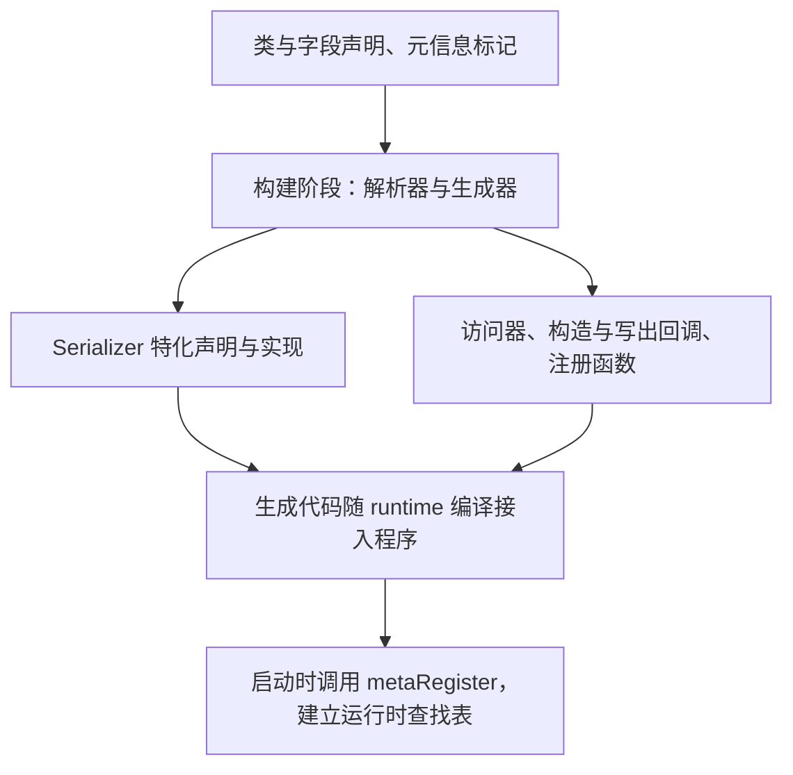
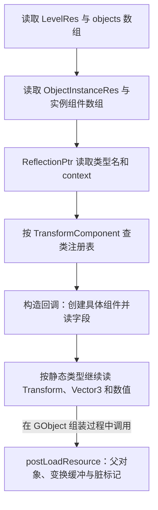

上一章已经把一面墙从关卡记录追到了 GObject 和组件列表，但还留着一个关键问题：文件里只有字符串和数字，引擎怎样知道应该构造 TransformComponent，又怎样把 position 写进正确的 C++ 字段？

JSON 解析器能读出对象、数组和数值，却不会自动知道 C++ 类的布局。模板参数能确定一种资源结构，却不能只靠基类指针判断文件要求的是哪一种派生组件。类型名、字段读写和具体构造之间，还需要明确的连接。

这篇继续使用默认关卡里的 `Wall_1`，追踪它的 Transform 从 JSON 进入组件的过程。重点是区分：**资源从哪里读，字段按什么类型读，具体对象由谁构造，以及恢复后还要补哪些运行状态。**

> **读这篇之前**：建议先看 [04 场景文件与对象组件]()。若模板特化、宏与生成文件仍不熟悉，可回看 [C++ 前置：模板、宏与反射代码生成]()；本篇重点把这些机制接成实际资源恢复链。
>
> 源码基线：[BoomingTech/Piccolo，固定提交 `f5053707fed4`][revision]。本篇为主线 05，依据源码、资源和生成模板核对。当前克隆中没有 `engine/source/_generated`，本次未运行 PiccoloParser、编译或启动 Piccolo。下文手工展开的模板分支明确标为示意，不是实际生成结果或断点记录。

## 先把四种职责放到各自的位置

读这条链时，可以先用下面的模型：

| 职责 | 要回答的问题 | Piccolo 中的主要位置 |
| --- | --- | --- |
| 资源定位与读取 | 哪个文件，怎样取得 JSON | AssetManager、ConfigManager |
| 按已知类型读写字段 | JSON 的哪个键，对应实例中的哪个成员 | 生成的 Serializer 特化、基础类型读写函数 |
| 按类型名选择具体对象 | 基类指针背后应该创建哪个派生类型 | ReflectionPtr、类注册表与构造回调 |
| 恢复运行关系与状态 | 父对象、缓冲、物理场景等怎样建立 | GObject::load、组件 postLoadResource |

因此，路径、字段键和类型名有不同用途。`asset/level/1-1.level.json` 定位文件；`instanced_components`、`transform` 是字段键；`TransformComponent` 用来选择具体组件类型。它们之间靠程序规则连接，不能把其中任何一种名字当成自动完成全部工作的指令。

## AssetManager 负责把读取推进到 Serializer

[AssetManager::loadAsset()][asset-h] 是函数模板，调用者提供目标类型。例如读取关卡时，传入的是 LevelRes；读取对象定义时，传入的是 ObjectDefinitionRes。JSON 根对象不必再写一个顶层 `$typeName`，因为这一步的目标 C++ 类型已经由调用确定。

它先通过 [getFullPath()][asset-cpp] 解析路径，读出文本，再解析成 Json。文件打开失败或 JSON 语法解析失败时返回 false；成功路径的尾部是：

```cpp
Serializer::read(asset_json, out_asset);
return true;
```

这两行把一项边界说得很清楚：loadAsset 把 JSON 交给类型读取逻辑，但没有在这里统一汇总所有嵌套类型、组件依赖和系统接线的结果。

这个 loadAsset 实现每次会打开文件并读取，也没有在该函数里建立按 URL 返回同一个资源对象的缓存协议。它的“资源读取”与后续渲染系统管理网格、材质和 GPU 资源的工作，要分别看。

## 从 Wall_1 看静态类型在哪里遇到动态类型

[默认关卡][level-json] 中，Wall_1 的实例 Transform 组件记录如下，仅调整排版：

```json
{
  "$typeName": "TransformComponent",
  "$context": {
    "transform": {
      "position": { "x": 1.94597, "y": -0.38554, "z": 0 },
      "rotation": { "x": 0, "y": 0, "z": -0.707683, "w": 0.70653 },
      "scale": { "x": 0.999993, "y": 0.999993, "z": 1 }
    }
  }
}
```

要读到这段内容，会先经过 [LevelRes][level-res] 的对象数组，再经过 [ObjectInstanceRes][object-res] 的实例组件数组。可以把类型链写成：

| 当前读取的内容 | 此时程序知道的目标类型 | 怎样继续 |
| --- | --- | --- |
| 关卡根对象 | LevelRes | 生成代码读取各字段与 objects 数组 |
| 一条对象记录 | ObjectInstanceRes | 读取 name、definition 和 instanced_components |
| 一个实例组件 | ReflectionPtr<Component> | 读取 `$typeName`，选择具体组件 |
| TransformComponent 的 `$context` | 构造回调已经确定具体类型 | 对具体组件调用生成的字段读取 |
| transform、position 与 x/y/z | Transform、Vector3、float | 继续按成员的已知类型读取 |

前两步不是靠 JSON 字符串查找 LevelRes 或 ObjectInstanceRes，而是沿静态已知类型调用相应的读取函数。到 `ReflectionPtr<Component>` 这里，容器中的静态类型只表达到 Component，才需要文件里的类型名选择具体派生类。

动态选择之后，具体构造回调又把目标类型确定下来，继续进入按已知类型读字段的路径。**这两种分派在一条链上交替出现，并非所有字段都通过运行时类型表读取。**

## 生成器为这条链准备了两类代码

运行时能够调用这些函数之前，构建阶段要先把类与字段描述转成代码。[PiccoloPreCompile 的构建声明][precompile] 会调用解析器；[序列化生成器][serializer-generator] 和 [反射生成器][reflection-generator] 分别输出对应文件。

两类产物的用途不同：

- **序列化产物**：声明和实现具体类型的 `Serializer::read/write` 特化，直接访问该类型的选定成员，并按字段键递归读写。
- **反射产物**：提供字段、数组等访问器，以及按类名构造对象、按类名写出对象的回调，并生成注册函数。

下面箭头表示生成、编译接入和启动注册的阶段关系，不表示程序运行时重新解析 C++ 头文件：



一个常见误解是：既然有反射字段表，序列化必然每次调用 `getFieldsList()`，逐个遍历 FieldAccessor 读字段。Piccolo 这条路径采用了更具体的实现：[Serializer 模板][serializer-template] 直接生成成员读写代码；[反射模板][reflection-template] 生成的构造回调，再调用这些 Serializer 函数。

字段访问器也有自己的实际消费者。[EditorUI::createLeafNodeUI()][editor-ui] 会取得字段列表，查询字段类型和数组访问器，再组织属性 UI。它和序列化共享生成的类型知识，但不意味着两者执行完全相同的遍历过程。

## 字段怎样被选中，JSON 键怎样得到

[Field::isAccessible()][field] 根据类上的 Fields、All、WhiteListFields，以及字段的 Enable、Disable 等元信息筛选字段。对应的语言和宏展开已在 CPP-03 说明，这里看它怎样影响实际恢复结果。

[TransformComponent][transform-h] 使用 WhiteListFields，`m_transform` 前有 `META(Enable)`；两份 transform buffer 和当前/下一份索引没有这一标记。于是，持久化描述关注 m_transform，运行缓冲仍由后续 postLoad 初始化。

生成器还保存字段原始名字与显示名字。[getNameWithoutFirstM()][meta-utils] 对以 `m_` 开头的名字去掉这两个字符，[生成器模板数据][generator] 把结果作为字段键使用。因此本例的 `m_transform` 对应 JSON 中的 `transform`，`m_position` 对应 `position`；Vector3 的 x、y、z 则保持原名。

下面只把模板中 **m_transform 的非数组字段读取分支手工展开**，省略函数外壳、基类读取和其他模板内容，用来解释字段映射；它不是本次生成的源文件：

```cpp
if (!json_context["transform"].is_null())
{
    Serializer::read(json_context["transform"], instance.m_transform);
}
```

这里 m_transform 的静态类型是 [Transform][transform-type]。继续往下，position 的目标是 [Vector3][vector3]，数值项最后进入 [基础类型的 Serializer 特化][serializer-cpp]。例如 float 的读取断言 JSON 是数字，再转换并写入 float 实例。

数组也由生成代码处理：[模板][serializer-template] 取得对应 JSON 数组，调整目标 vector 长度，再逐项调用 Serializer::read。并不是先把任意 JSON 全部压成通用字典，之后才恢复成这套对象结构。

## 运行时注册：把字符串连接到已编译的函数

[reflection_register.cpp][register-cpp] 包含生成的 `all_reflection.h` 和 `all_serializer.ipp`。前者的 [总入口模板][register-template] 定义 metaRegister，并依次调用生成的文件级注册函数；后者提供具体字段读写实现。没有真实生成文件时，应回到生成器和模板核对，不能把预期文件内容说成已经编译验证的结果。

[PiccoloEngine::startEngine()][engine] 先调用 `TypeMetaRegister::metaRegister()`，再调用全局上下文 startSystems。系统启动过程中就可能读取含类型信息的资源，所以这里的注册位于资源恢复之前。

具体的 [类型注册模板][reflection-template] 会把类名与 ClassFunctionTuple 登记到类表。该 tuple 在 [reflection.h][reflection-h] 中包含三类回调：基类反射信息、按 JSON 构造实例，以及按名字写出 JSON。

以 TransformComponent 为例，构造回调的模板做两件事：`new` 一个具体类型，再调用这个类型的 Serializer::read。登记到表中的不是一份可供 JSON 临时编译的类定义，而是已经编入程序的函数入口。

因此，想恢复一个新组件，需要让声明、生成结果、程序中的实现和注册入口相互对应。只在文件中写一个新的 `$typeName`，不会让程序自动获得对应 C++ 类型。

## ReflectionPtr 的读取怎样走到具体构造

[Serializer 对 ReflectionPtr 的读取重载][serializer-h] 先保存类型名：

```cpp
template<typename T>
static T*& read(const Json& json_context, Reflection::ReflectionPtr<T>& instance)
{
    std::string type_name = json_context["$typeName"].string_value();
    instance.setTypeName(type_name);
    return readPointer(json_context, instance.getPtrReference());
}
```

接着进入同一文件中的 readPointer：

```cpp
template<typename T>
static T*& readPointer(const Json& json_context, T*& instance)
{
    assert(instance == nullptr);
    std::string type_name = json_context["$typeName"].string_value();
    assert(!type_name.empty());
    if ('*' == type_name[0])
    {
        instance = new T;
        read(json_context["$context"], *instance);
    }
    else
    {
        instance = static_cast<T*>(
            Reflection::TypeMeta::newFromNameAndJson(type_name, json_context["$context"]).m_instance);
    }
    return instance;
}
```

这个通用函数有两个分支：以 `*` 开头的类型标记使用静态 T 构造；本例的 `TransformComponent` 则走按名字构造的分支。不能把前者误当成默认组件记录的实际路径。

[TypeMeta::newFromNameAndJson()][reflection-cpp] 的实现继续把连接揭开：

```cpp
ReflectionInstance TypeMeta::newFromNameAndJson(std::string type_name, const Json& json_context)
{
    auto iter = m_class_map.find(type_name);
    if (iter != m_class_map.end())
    {
        return ReflectionInstance(TypeMeta(type_name), (std::get<1>(*iter->second)(json_context)));
    }
    return ReflectionInstance();
}
```

它按字符串查类表，再调用 tuple 中的构造回调。于是，Wall_1 的读取链可以完整画成下面这样。箭头表示读取与后续组装的推进，其中最后一步由 GObject 组装过程调用：



到字段恢复结束，组件已有具体类型和序列化字段；父对象、双缓冲、物理场景等状态还要按 [04 的组装与接线过程]() 建立。[TransformComponent::postLoadResource()][transform-cpp] 正是把 m_transform 复制到两份运行缓冲并设置脏标记的位置。

这也说明，类型工厂构造成功与对象已经可以正确更新，是不同阶段的证据。

## 写回资源时，同样要选择具体类型

读取建立了“类型名 → 构造回调 → 具体字段”的链，写出则从当前组件指针与保存的类型名出发。[ReflectionPtr 的 write][serializer-h] 为：

```cpp
template<typename T>
static Json write(const Reflection::ReflectionPtr<T>& instance)
{
    T*          instance_ptr = static_cast<T*>(instance.operator->());
    std::string type_name    = instance.getTypeName();
    return Json::object {{"$typeName", Json(type_name)},
                          {"$context", Reflection::TypeMeta::writeByName(type_name, instance_ptr)}};
}
```

[writeByName()][reflection-cpp] 查类表并调用 tuple 中的写出回调；生成回调把指针转换为具体类型，再调用该类型的 Serializer::write。字段写出模板按已选择的字段组织 JSON，AssetManager 的 saveAsset 再把它转换成文本写入文件。

这里恢复的是所选字段的 JSON 表达，不是原始文件的字节副本。未知字段、原来的排版和成员出现顺序，不会因为已经读入过就自动完整保留。

还要分清输出内容由谁选择：[GObject::save()][object] 把当前组件列表赋给 out_object_instance_res 的实例组件列表。序列化器负责把收到的结构写出来，不负责推断哪些组件最初来自定义、哪些来自关卡实例。编辑器保存与重载怎样处理这件事，留到主线 08 继续追。

## 缺字段、未知类型与读取成功怎样区分

有了完整链路，才能判断不同问题在哪一层发生。

### 缺失字段与 null：跳过赋值，保留已有成员值

生成读取模板对字段使用 `is_null()` 判断；[json11 的对象取键实现][json11] 在键不存在时也返回 null。因此，缺少某个键或明确写成 null，都会跳过该字段分支。

“跳过”不等于自动取得对象定义文件中的同名字段。若当前对象刚默认构造，就保留默认构造留下的值；若是在已有实例上读取，则可能保留它此前的成员值。本例 Transform 的默认位置为零、缩放为一、旋转为单位四元数，来自 [Transform 声明][transform-type]，不是序列化器根据另一份资源推导出来的。

这与 04 中“实例已有同名组件，就跳过定义中的整个组件”正好衔接：缺字段不会让那段组件合并自动变成逐字段回退。

### 未注册类型：名字可能已保存，指针仍然为空

当非空类型名不在 m_class_map 中时，newFromNameAndJson 返回默认 ReflectionInstance；[默认构造][reflection-h] 把实例指针设为 nullptr。ReflectionPtr 的类型名却已经在前一步写入。

因此，看到 `getTypeName()` 返回一个字符串，不能单独证明对应组件已经恢复。要同时看查表结果、实际指针和字段内容。这个分支也没有把“未知类型”统一转换成 loadAsset 的 false 返回值；后者在 Serializer::read 返回后直接返回 true。

这不是未知类型可以安全忽略的保证。后续对象组装还有实际使用指针的位置，必须继续检查消费者怎样处理失败。

### JSON 语法正确，不等于完整的数据兼容性验证

[基础类型读取][serializer-cpp] 和生成模板使用 assert 检查若干 JSON 类型条件，但这套机制不是统一的版本迁移与错误报告协议。字段重命名、类型名变化、资源版本与生成代码不一致，都需要单独分析。

| 观察到的问题 | 优先沿哪里查 | 要取得的证据 |
| --- | --- | --- |
| 文件打不开或 JSON 语法错误 | 路径解析、文件读取与 Json::parse | 实际路径、原始错误与 loadAsset 返回值 |
| 类型名存在但组件指针为空 | metaRegister、类表与构造回调 | 实际注册键、查找结果和返回指针 |
| 具体字段保持旧值或默认值 | 字段筛选、生成键与 is_null 分支 | JSON 键、对应成员、分支是否执行 |
| 类型恢复成功但运行状态不对 | GObject::load 与 postLoadResource | 父对象、运行缓冲及外部系统接线 |

从工程上看，JSON 键与类型名已经参与持久化协议。改 C++ 名字时，应核对生成后的键或注册名是否变化，并检查已有资源需要怎样兼容。这个判断来自上面的命名与查表规则；它不表示当前代码已提供自动兼容迁移。

## 先做一次静态追踪，再准备后续断点

不运行程序，也可以先完成三个任务：

1. 从 LevelRes 的 objects，沿字段类型追到 ReflectionPtr<Component>，指出哪一步首次需要读取 `$typeName`，哪几步目标类型在编译时已知。
2. 在两个生成模板中分别找到直接成员读写、具体类型构造和注册函数，再到 EditorUI 找到 FieldAccessor 的使用处，区分它们的用途。
3. 对照 Wall_1 的 Transform，解释缺少 scale、写成 null 或类型名拼错分别会走到哪个分支。只做源码推导，不修改真实资产。

等构建与调试基线完成，再按下面的观察表记录实际行为。以下是后续验证任务，本次没有执行：

| 停在哪里 | 要记录什么 |
| --- | --- |
| metaRegister 与具体注册函数 | 本次程序实际接入的生成产物、类表键与回调 |
| AssetManager::loadAsset | 真实资源路径、目标 AssetType、解析与返回结果 |
| LevelRes/ObjectInstanceRes 的生成读取函数 | JSON 键、数组长度与当前元素类型 |
| Serializer 的反射指针读取与 newFromNameAndJson | 类型字符串、目标静态类型、类表命中与具体指针 |
| 构造回调与 Transform 字段读取 | 实际具体类型、字段分支与成员值 |
| GObject 组装及 Transform postLoad | 指针是否延续、父对象和运行缓冲何时建立 |
| 写出回调与 saveAsset | 输出结构的选择、类型名与字段 JSON；保存工作流另行验证 |

这样读完之后，资源、反射和序列化就不再只是三个目录名，而是一条能逐步核对的路径：调用者确定资源结构，生成代码读写字段，多态位置用注册表选择具体类型，业务层再把恢复出的状态接成可运行的对象。

## 继续阅读

- [改一个位置，怎样沿逻辑数据追到渲染表示]()：从已恢复的 Wall_1 出发，追踪变换缓冲、脏描述与渲染实体中的具体值。
- [场景文件怎样成为世界中的对象与组件]()：回看实例、定义合并与组件接线。
- [模板、宏与反射代码生成]()：按需复习生成机制和 C++ 语法。
- [一帧怎样推进]()：继续看恢复后的状态如何更新和交接。
- [Piccolo 阅读入口]()：返回系列目录。

Piccolo 源码与资源节选版权：Copyright (c) 2022 Contributors to the Piccolo Engine，按 [MIT License][license] 提供。字段分支为明确标注的手工展开示意，两张图表示实现关系，均不作为实际生成、编译或运行结果。

**对象恢复需要连起资源结构、字段读写、类型构造与运行状态接线，每一层都有自己的完成条件。**

[revision]: https://github.com/BoomingTech/Piccolo/tree/f5053707fed4d3f94d270a436fb0d3a8ae54e3e5
[asset-h]: https://github.com/BoomingTech/Piccolo/blob/f5053707fed4d3f94d270a436fb0d3a8ae54e3e5/engine/source/runtime/resource/asset_manager/asset_manager.h
[asset-cpp]: https://github.com/BoomingTech/Piccolo/blob/f5053707fed4d3f94d270a436fb0d3a8ae54e3e5/engine/source/runtime/resource/asset_manager/asset_manager.cpp
[level-json]: https://github.com/BoomingTech/Piccolo/blob/f5053707fed4d3f94d270a436fb0d3a8ae54e3e5/engine/asset/level/1-1.level.json
[level-res]: https://github.com/BoomingTech/Piccolo/blob/f5053707fed4d3f94d270a436fb0d3a8ae54e3e5/engine/source/runtime/resource/res_type/common/level.h
[object-res]: https://github.com/BoomingTech/Piccolo/blob/f5053707fed4d3f94d270a436fb0d3a8ae54e3e5/engine/source/runtime/resource/res_type/common/object.h
[precompile]: https://github.com/BoomingTech/Piccolo/blob/f5053707fed4d3f94d270a436fb0d3a8ae54e3e5/engine/source/precompile/precompile.cmake
[serializer-generator]: https://github.com/BoomingTech/Piccolo/blob/f5053707fed4d3f94d270a436fb0d3a8ae54e3e5/engine/source/meta_parser/parser/generator/serializer_generator.cpp
[reflection-generator]: https://github.com/BoomingTech/Piccolo/blob/f5053707fed4d3f94d270a436fb0d3a8ae54e3e5/engine/source/meta_parser/parser/generator/reflection_generator.cpp
[serializer-template]: https://github.com/BoomingTech/Piccolo/blob/f5053707fed4d3f94d270a436fb0d3a8ae54e3e5/engine/template/allSerializer.ipp.mustache
[reflection-template]: https://github.com/BoomingTech/Piccolo/blob/f5053707fed4d3f94d270a436fb0d3a8ae54e3e5/engine/template/commonReflectionFile.mustache
[editor-ui]: https://github.com/BoomingTech/Piccolo/blob/f5053707fed4d3f94d270a436fb0d3a8ae54e3e5/engine/source/editor/source/editor_ui.cpp
[field]: https://github.com/BoomingTech/Piccolo/blob/f5053707fed4d3f94d270a436fb0d3a8ae54e3e5/engine/source/meta_parser/parser/language_types/field.cpp
[transform-h]: https://github.com/BoomingTech/Piccolo/blob/f5053707fed4d3f94d270a436fb0d3a8ae54e3e5/engine/source/runtime/function/framework/component/transform/transform_component.h
[meta-utils]: https://github.com/BoomingTech/Piccolo/blob/f5053707fed4d3f94d270a436fb0d3a8ae54e3e5/engine/source/meta_parser/parser/meta/meta_utils.cpp
[generator]: https://github.com/BoomingTech/Piccolo/blob/f5053707fed4d3f94d270a436fb0d3a8ae54e3e5/engine/source/meta_parser/parser/generator/generator.cpp
[transform-type]: https://github.com/BoomingTech/Piccolo/blob/f5053707fed4d3f94d270a436fb0d3a8ae54e3e5/engine/source/runtime/core/math/transform.h
[vector3]: https://github.com/BoomingTech/Piccolo/blob/f5053707fed4d3f94d270a436fb0d3a8ae54e3e5/engine/source/runtime/core/math/vector3.h
[serializer-cpp]: https://github.com/BoomingTech/Piccolo/blob/f5053707fed4d3f94d270a436fb0d3a8ae54e3e5/engine/source/runtime/core/meta/serializer/serializer.cpp
[register-cpp]: https://github.com/BoomingTech/Piccolo/blob/f5053707fed4d3f94d270a436fb0d3a8ae54e3e5/engine/source/runtime/core/meta/reflection/reflection_register.cpp
[register-template]: https://github.com/BoomingTech/Piccolo/blob/f5053707fed4d3f94d270a436fb0d3a8ae54e3e5/engine/template/allReflectionFile.mustache
[engine]: https://github.com/BoomingTech/Piccolo/blob/f5053707fed4d3f94d270a436fb0d3a8ae54e3e5/engine/source/runtime/engine.cpp
[reflection-h]: https://github.com/BoomingTech/Piccolo/blob/f5053707fed4d3f94d270a436fb0d3a8ae54e3e5/engine/source/runtime/core/meta/reflection/reflection.h
[serializer-h]: https://github.com/BoomingTech/Piccolo/blob/f5053707fed4d3f94d270a436fb0d3a8ae54e3e5/engine/source/runtime/core/meta/serializer/serializer.h
[reflection-cpp]: https://github.com/BoomingTech/Piccolo/blob/f5053707fed4d3f94d270a436fb0d3a8ae54e3e5/engine/source/runtime/core/meta/reflection/reflection.cpp
[transform-cpp]: https://github.com/BoomingTech/Piccolo/blob/f5053707fed4d3f94d270a436fb0d3a8ae54e3e5/engine/source/runtime/function/framework/component/transform/transform_component.cpp
[object]: https://github.com/BoomingTech/Piccolo/blob/f5053707fed4d3f94d270a436fb0d3a8ae54e3e5/engine/source/runtime/function/framework/object/object.cpp
[json11]: https://github.com/BoomingTech/Piccolo/blob/f5053707fed4d3f94d270a436fb0d3a8ae54e3e5/engine/3rdparty/json11/json11.cpp
[license]: https://github.com/BoomingTech/Piccolo/blob/f5053707fed4d3f94d270a436fb0d3a8ae54e3e5/LICENSE
