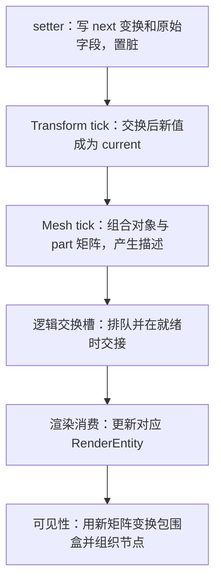
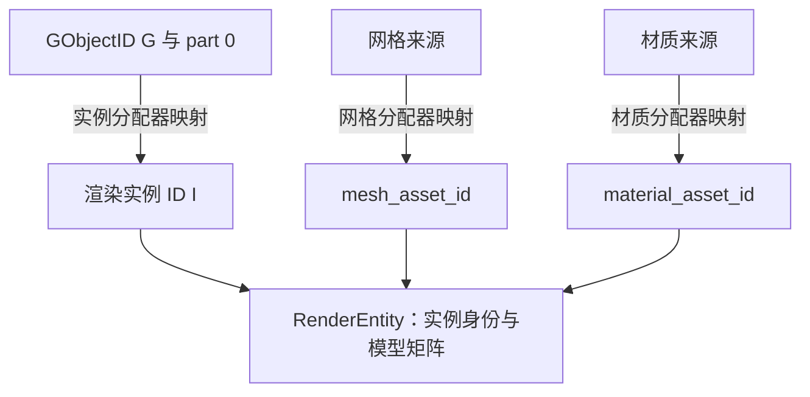

给一个对象改了位置，怎样证明渲染系统也收到了这个变化？只看到 setter 被调用，或者看到 Transform 的某个字段已经变化，还不足以回答这个问题。中间可能隔着当前与下一份缓冲、脏描述、交接条件，以及另一套用于绘制的对象表示。

这篇用 Piccolo 默认场景里的 `Wall_1` 做一次具体追踪。我们不再重画整条渲染管线，而是固定对象、数值和写入时机，一直追到对应 RenderEntity 的模型矩阵，再看看可见性阶段怎样使用它。

目标是建立一种读代码的方法：**沿同一个对象的身份，核对每一处写了什么、下一步实际读了什么，以及变化在哪个边界完成交接。**

> **读这篇之前**：建议读过 [03 一帧执行]()、[04 场景对象与组件]()。[05 资源与类型恢复]() 说明初始字段怎样进入组件；[渲染管线基础]() 提供后续 Pass 与呈现的完整地图。
>
> 源码基线：[BoomingTech/Piccolo，固定提交 `f5053707fed4`][revision]。本篇为主线 06。以下是依据真实资源与源码建立的条件推导，不是已执行的场景修改、断点快照或画面验收。本次未构建、运行 Piccolo，也未进行图形捕获。

> 两种缓冲的角色、描述复制与可见节点借用，以及跨线程所需的额外协议，见 [状态缓冲怎样交接，哪些地方真的跨线程]()。

## 先固定对象、改动与观察终点

[默认关卡][level-json] 中，Wall_1 的实例 Transform 提供初始变换；[墙体定义][wall-json] 为它补上 Mesh 和 RigidBody。按 04 的组装规则，相关组件顺序为 Transform、Mesh、RigidBody。

本篇选一个足够小的变化：

| 项目 | 本篇使用的值或条件 |
| --- | --- |
| 对象 | Wall_1；运行时 ID 记为 G，实际数值以后从调试器取得 |
| 原位置 P₀ | 约 `(1.94597, -0.38554, 0)` |
| 目标位置 P₁ | P₀ 加 `(1, 0, 0)`，约 `(2.94597, -0.38554, 0)` |
| 其他对象字段 | 保持原旋转、缩放，不改变网格与材质来源 |
| 网格 part | 墙体定义只有一个 sub_mesh，part 索引为 0，局部变换为单位变换 |
| 观察终点 | 该 part 对应 RenderEntity 的模型矩阵，以及可见性阶段对它的使用 |

小数用于阅读比较；实际 C++ 字段是 float，断点值应按合适误差比较。

再限定主路径：世界已加载，墙体已有渲染实体，网格和材质资源正常准备；处于编辑器模式；在下一次 Transform tick **之前**调用位置 setter；没有其他位置写入覆盖它，交接时渲染槽满足就绪条件。

这些条件很重要。它们让我们能推导一条明确路径；后文会改变写入时机，检查结论怎样变化。

## 位置可以从哪里改入

工程里有真实的 setter 调用入口：[EditorInputManager::onCursorPos()][editor-input] 在相应鼠标分支调用 [EditorSceneManager::moveEntity()][editor-scene]。平移分支计算新矩阵，分解后调用 `setPosition()`、`setRotation()` 和 `setScale()`。

本篇先单独追位置 setter，设它收到 P₁。这个设定没有推导鼠标移动多少像素，也没有声称完整拖轴操作只调用一个 setter；实际拖轴同时涉及旋转、缩放和它们的脏状态，后续观察时应把这些参数一起记录。

另外，属性面板有另一条路径：[EditorUI 的 Transform 编辑逻辑][editor-ui] 经字段访问器拿到 Transform，直接编辑其中的位置等字段。它不能未经核对就等同于 `TransformComponent::setPosition()`。完整编辑器属性修改、保存与恢复留到主线 08，这篇先把受控的 setter 路径读透。

## 最小追踪模型：从写入到消费

一次变化至少需要跨过下面几步。箭头表示与这次变化有关的数据推进，不表示这些节点各占一个线程：



这里同时存在两套“双缓冲”：Transform 的两份运行变换，以及 RenderSwapContext 的两份交换数据。前者决定组件此刻读哪份变换，后者决定渲染消费哪批描述。它们的索引、作用和就绪条件各不相同。

## 第一步：setter 写入下一份，getter 读取当前份

[TransformComponent::setPosition()][transform-cpp] 的实现为：

```cpp
void TransformComponent::setPosition(const Vector3& new_translation)
{
    m_transform_buffer[m_next_index].m_position = new_translation;
    m_transform.m_position                      = new_translation;
    m_is_dirty                                  = true;
}
```

它同时写入下一份运行缓冲与 m_transform，并设置脏标记。[getPosition()][transform-h] 则读取当前缓冲：

```cpp
Vector3 getPosition() const { return m_transform_buffer[m_current_index].m_position; }
```

`getMatrix()` 同样从 `m_transform_buffer[m_current_index]` 构造矩阵。因此，setter 返回后马上调用 getter，不一定已经读到新位置。

为方便说明，设本次推导的起点为 current 索引 0、next 索引 1，两份位置都为 P₀，m_transform 也为 P₀。真实运行中的两个索引可能相反，应以断点为准。

| 时刻 | current / next | 缓冲 0 | 缓冲 1 | m_transform 中的位置 | 脏标记 |
| --- | --- | --- | --- | --- | --- |
| 本次写入前 | 0 / 1 | P₀ | P₀ | P₀ | 设为 false |
| setPosition(P₁) 返回 | 0 / 1 | P₀ | P₁ | P₁ | true |
| Transform tick 交换后 | 1 / 0 | P₀ | P₁ | P₁ | true |
| 编辑器复制 next 后 | 1 / 0 | P₁ | P₁ | P₁ | true |

第二行中，getPosition 仍从缓冲 0 读 P₀；第三行开始，当前值才是 P₁。这里的起点、索引和值是条件推导，不是引擎运行记录。

## 第二步：Transform tick 让新值进入当前状态

[TransformComponent::tick()][transform-cpp] 的顺序为：

```cpp
void TransformComponent::tick(float delta_time)
{
    std::swap(m_current_index, m_next_index);

    if (m_is_dirty)
    {
        // update transform component, dirty flag will be reset in mesh component
        tryUpdateRigidBodyComponent();
    }

    if (g_is_editor_mode)
    {
        m_transform_buffer[m_next_index] = m_transform;
    }
}
```

先交换索引，再按脏标记同步刚体，最后在编辑器模式下把 m_transform 复制到下一份缓冲。主路径中 setter 在这次交换之前写入，因此交换后的 current 已包含 P₁。

Wall_1 有刚体组件，`tryUpdateRigidBodyComponent()` 会用 current 的变换调用刚体更新。这条调用不依赖 RigidBodyComponent 自己的 tick 被编辑器模式放行；它是 Transform 主动调用的旁路。

[RigidBodyComponent::updateGlobalTransform()][rigidbody] 又会根据 scale dirty 决定更新现有刚体，还是删除后重建。单独位置 setter 与真实拖轴的三个 setter，不一定产生相同的物理分支；本篇只追踪位置进入渲染表示，不把这段旁路省略成“只更新了图像”。

编辑器下的 next 复制也解释了一个细节：修改 m_transform 原始字段，与调用 setter 同时写 next，不是同一个动作。判断字段面板的结果何时成为 current，要按它的实际写入时机重新走表。

## 第三步：Mesh 把当前矩阵复制到变化描述

[GObject::tick()][object] 按组件存储顺序更新，并经过模式筛选。Wall_1 的 Transform 在 Mesh 之前；在上述条件下，Mesh 读取到的是已经切换到 P₁ 的 current。

[MeshComponent::tick()][mesh] 检查 Transform 是否脏，然后遍历 m_raw_meshes。在每个 part 中，矩阵相关的关键代码是：

```cpp
Matrix4x4 object_transform_matrix = mesh_part.m_transform_desc.m_transform_matrix;

mesh_part.m_transform_desc.m_transform_matrix =
    transform_component->getMatrix() * object_transform_matrix;
dirty_mesh_parts.push_back(mesh_part);

mesh_part.m_transform_desc.m_transform_matrix = object_transform_matrix;
```

这里名为 object_transform_matrix 的局部变量，从原始 part 描述里取值。结合 [MeshComponent::postLoadResource()][mesh] 的初始化，它保存的是 sub_mesh 的局部变换。组合关系应读成：

`待交接的 part 矩阵 = 对象当前矩阵 × part 局部矩阵`

这是按矩阵顺序组合，不是把两个位置向量简单相加。一般对象的旋转和缩放也会影响局部偏移。

### Wall_1 可以把数值追到哪一列

墙体定义的唯一网格 part，局部位置为零、旋转为单位四元数、缩放为一，所以局部矩阵 L₀ 是单位矩阵。令对象在 P₀、P₁ 时的矩阵分别为 M₀、M₁，则本例描述中的矩阵为 `M₁ × L₀ = M₁`。

[Matrix4x4::makeTransform()][matrix4] 直接把 position.x/y/z 写入第 0、1、2 行的第 3 列。因此，在保留旋转和缩放的本次推导里，模型矩阵平移列的比较为：

| 位置 | 写入前 | 本次描述中预期值 |
| --- | --- | --- |
| 矩阵 `[0][3]` | 约 1.94597 | 约 2.94597 |
| 矩阵 `[1][3]` | 约 -0.38554 | 约 -0.38554 |
| 矩阵 `[2][3]` | 约 0 | 约 0 |

这张表只核对本例的模型矩阵，不是在比较投影后坐标或屏幕像素。若换成有局部偏移的 part，应重新计算乘积，不能把对象位置直接当成该 part 的世界位置。

### 原始 part 矩阵会恢复，描述中的矩阵会保留

`dirty_mesh_parts.push_back(mesh_part)` 把组合后的描述复制进临时列表，之后代码恢复 m_raw_meshes 中原 part 的局部矩阵。这避免下一次又拿已经乘过对象矩阵的值继续累乘。

所以，如果在函数末尾看到原始 part 矩阵仍为单位矩阵，不能据此判断变化消失了。此时应去看 dirty_mesh_parts，以及随后进入交换数据的那份拷贝。

接下来的入队与清脏为：

```cpp
RenderSwapContext& render_swap_context = g_runtime_global_context.m_render_system->getSwapContext();
RenderSwapData&    logic_swap_data     = render_swap_context.getLogicSwapData();

logic_swap_data.addDirtyGameObject(GameObjectDesc {m_parent_object.lock()->getID(), dirty_mesh_parts});

transform_component->setDirtyFlag(false);
```

[GameObjectDesc][render-object] 保存 GObjectID 和 part 描述 vector。这里没有把 TransformComponent 指针直接交给渲染系统；要追的值已经变成描述中的矩阵副本。

## 第四步：清脏之后，还要确认描述真正交接

[RenderSwapData::addDirtyGameObject()][swap-cpp] 把描述加入对象队列；队列的 add 继续使用 push_back。因此，相同对象可以出现多条记录，这里不是按 GObjectID 自动合并成一条最新状态。

主路径假设没有另一条位置写入覆盖本次变化。后续实际调试时，仍应检查队列里同一 G 的所有记录及消费顺序，不能随意取第一条当成最终状态。

[tickOneFrame()][engine] 在逻辑更新之后尝试交换，再进入渲染。交换是否发生，要继续看 [RenderSwapContext][swap-cpp] 的就绪判断和两个索引；具体七项 optional 的条件已在 03 展开。

本次主路径中，旧渲染槽已清理，交换成功后，带着 `(G, part 0, M₁)` 的数据成为渲染侧消费对象。此时仍要分别理解：

- Mesh 清脏：本次描述已经产生并排入逻辑槽。
- 索引交换：这批描述进入渲染侧角色。
- processSwapData 消费：渲染表示实际接到描述内容。

若交换条件未满足，Mesh 清脏本身不会把逻辑槽中的记录删除；函数只是暂不交换索引。不能用一个 false 脏标记代替这三步的完成证据。

## 第五步：用对象与 part 身份找到对应 RenderEntity

[RenderSystem::processSwapData()][render-system] 从当前渲染槽取对象描述，再遍历每个 part。关键身份与矩阵接收代码为：

```cpp
const auto&      game_object_part = gobject.getObjectParts()[part_index];
GameObjectPartId part_id          = {gobject.getId(), part_index};

bool is_entity_in_scene = m_render_scene->getInstanceIdAllocator().hasElement(part_id);

RenderEntity render_entity;
render_entity.m_instance_id =
    static_cast<uint32_t>(m_render_scene->getInstanceIdAllocator().allocGuid(part_id));
render_entity.m_model_matrix = game_object_part.m_transform_desc.m_transform_matrix;
```

本例对应 `(G, 0)`。[GuidAllocator::allocGuid()][guid] 发现元素已存在时返回原来的 GUID；在对象未删除、part 结构未变的本次条件下，渲染实例 ID 仍为原来的 I，模型矩阵则从描述取为 M₁。

不要把 I 当成 G，也不要把网格与材质资源 ID 当成对象 ID。下图箭头表示映射或引用关系；字母只是本篇符号，不是实测 ID：



### 更新的是已有实体，但代码使用整体赋值

同一个消费函数会准备实体的资源 ID、包围盒、材质和动画等字段。对于已经存在的实例，它通过实例 ID 找到列表元素：

```cpp
for (auto& entity : m_render_scene->m_render_entities)
{
    if (entity.m_instance_id == render_entity.m_instance_id)
    {
        entity = render_entity;
        break;
    }
}
```

因此，调试时应核对找到的 entity，而不只看局部临时变量 render_entity。现有代码是用新整理的整个 RenderEntity 替换原元素，并非只给原对象的一个矩阵字段赋值。

在本例资源来源未变、资源状态正常准备的条件下，网格和材质分配器仍识别原来源，不会仅因位置变化就再次进入首次加载与上传对应资源的分支。逐帧矩阵或实例数据怎样提供给 GPU，则是后续渲染阶段的工作，不能扩展成“这次没有任何 GPU 数据更新”。

消费完后，代码 pop 对象记录并 reset 对应交换字段。至此，我们才在渲染实体列表中取得 `(实例 I, 模型矩阵 M₁)` 这一阶段的结果。

## 新矩阵怎样继续影响可见性

[RenderSystem::tick()][render-system] 先 processSwapData，再更新可见对象。因此，正常顺序中，本次更新后的实体会参与随后 [主相机可见性处理][render-scene]。

该函数用 `entity.m_model_matrix` 变换网格包围盒，再进行视锥相交测试；通过测试时，生成可见网格节点，并令节点的 `model_matrix` 指向实体的模型矩阵。

这意味着位置变化会影响两件事：用于后续绘制的模型变换，以及当前观察用途下的候选可见性。网格资产的局部包围盒可以继续复用，变换后的空间位置则随着 M₁ 改变。

如果实体矩阵已经更新，却没有进入主相机可见节点，应继续核对包围盒与相机条件。它也可能参与其他观察用途的列表，不能直接判定交换数据丢失。

本篇到这里完成“逻辑位置 → 渲染表示”的追踪。可见节点进入哪个 Pass、怎样写入绘制数据并提交 Vulkan，留到主线 07；实体或节点更新仍不等于实际像素已改变。

## 换一个写入时机，结论就可能不同

现在保持其他条件，只把 setPosition 的调用移到 **Transform tick 之后、Mesh tick 之前**，并假设暂时没有其他置脏者：

1. 本次 Transform 已交换完，current 仍是 P₀。
2. setter 把 P₁ 写到 next 和 m_transform，并设置 dirty=true。
3. Mesh 检查到脏状态，却从 current 读取 P₀，产生的描述仍携带旧矩阵 M₀，然后清脏。
4. 后续 Transform 交换可能让 P₁ 成为 current，但仅凭这几段函数，不能保证又产生一条 M₁ 描述。

这说明，**有脏标记与读取到了最新版本是两个条件**。把更新函数都排进一帧，并不自动解决它们之间的数据时序。

同时，不能把这个局部推导直接写成当前编辑器必然永久丢失更新。[EditorSceneManager::tick()][editor-scene] 会为选中对象重新置脏，其他写入也可能改变后续结果。是否补发、在哪次循环生效，要把实际入口和所有置脏位置一起追踪。

这也是主路径明确声明“setter 在 Transform tick 之前调用”的原因。属性面板直接修改 m_transform，又需要根据它在 UI 绘制路径中的实际位置，重新核对复制和交换顺序；不应沿用 setter 表格推断统一延迟。

## 把推导变成后续可验证的观察表

先做三个静态练习：

1. 在 Wall_1 资源与定义中确认唯一 part 的局部变换，再指出组合前的原始矩阵和组合后描述矩阵分别存在哪里。
2. 从 setPosition 走到 entity 赋值，沿途写出 current/next、dirty、G、part_index、实例 I 与模型矩阵，检查有没有把不同身份或不同缓冲合并。
3. 对比主路径和较晚写入的反例，指出“写入发生在 Mesh 前面”为什么仍不充分。

之后建立工程调试基线，可以按下面的顺序验证。本次没有执行这些断点：

| 观察位置 | 要记录的值与条件 |
| --- | --- |
| 实际 setter 调用前后 | 对象 G、入参 P₁、调用栈、发生在当前迭代哪个阶段 |
| Transform tick 前后 | current/next 索引、两份位置、m_transform、dirty 与 scale dirty |
| Mesh 组合矩阵处 | 读取的 current、part 0 的局部矩阵、乘积 M₁；对照近似平移列 |
| 描述入队与交换前后 | 队列中同一 G 的记录、描述矩阵、逻辑/渲染槽索引与就绪状态 |
| processSwapData | `(G,0)` 对应的实例 I、是否命中已有实体、临时实体与列表实体的矩阵 |
| 可见性更新 | 变换后的包围盒、列表成员、节点引用的模型矩阵 |

为减少干扰，第一次运行验证应先记录已有对象和资源的稳定状态，再只引入一次明确写入。先证明渲染实体收到了正确矩阵，再进入实际画面与 GPU 证据。

## 继续阅读

- [10：刚体与碰撞查询怎样参与角色运动]()：将同一份 Transform 接到刚体姿态和缩放重建，区分渲染更新与物理清理时点。
- [09：从一次按键到角色位移]()：将位置写入接到输入命令、Motor 与控制器，并按实际组件顺序核对 current/next 与渲染描述。
- [18：编辑器怎样拾取、创建和删除场景对象]()：沿 instance ID 反查逻辑对象，再核对创建和删除怎样改变两端状态，以及多部件删除的实际范围。
- [15：网格与纹理怎样从文件成为 GPU 资源]()：核对只改实例矩阵时为何命中既有资源，以及首次创建时的解码、上传与寿命边界。
- [11：相机怎样跟随角色，并把视角交给渲染系统]()：与本篇的模型矩阵 M 对照，追角色状态怎样成为观察矩阵 V，以及投影 P 怎样更新。
- [一帧怎样推进]()：回看系统顺序、交换就绪条件与线程边界。
- [场景文件怎样成为世界中的对象与组件]()：回看 Wall_1 的组件来源与运行身份。
- [从场景对象到一帧画面]()：继续理解可见节点之后的 Pass、绘制与呈现。
- [从渲染场景进入 Pass 与 Vulkan 提交]()：继续沿主相机可见节点、GBuffer 实例批次和缓冲绑定，追到命令记录、队列提交与呈现请求。
- [Piccolo 阅读入口]()：返回目录。

Piccolo 源码与资源节选版权：Copyright (c) 2022 Contributors to the Piccolo Engine，按 [MIT License][license] 提供。两张图、缓冲表、矩阵列和时序反例均为条件推导，不是运行时截图或测量。

**追一次位置变化，要固定身份和值，并核对写入、读取、交接和消费发生的时机。**

[revision]: https://github.com/BoomingTech/Piccolo/tree/f5053707fed4d3f94d270a436fb0d3a8ae54e3e5
[level-json]: https://github.com/BoomingTech/Piccolo/blob/f5053707fed4d3f94d270a436fb0d3a8ae54e3e5/engine/asset/level/1-1.level.json
[wall-json]: https://github.com/BoomingTech/Piccolo/blob/f5053707fed4d3f94d270a436fb0d3a8ae54e3e5/engine/asset/objects/environment/wall/wall.object.json
[editor-input]: https://github.com/BoomingTech/Piccolo/blob/f5053707fed4d3f94d270a436fb0d3a8ae54e3e5/engine/source/editor/source/editor_input_manager.cpp
[editor-scene]: https://github.com/BoomingTech/Piccolo/blob/f5053707fed4d3f94d270a436fb0d3a8ae54e3e5/engine/source/editor/source/editor_scene_manager.cpp
[editor-ui]: https://github.com/BoomingTech/Piccolo/blob/f5053707fed4d3f94d270a436fb0d3a8ae54e3e5/engine/source/editor/source/editor_ui.cpp
[transform-cpp]: https://github.com/BoomingTech/Piccolo/blob/f5053707fed4d3f94d270a436fb0d3a8ae54e3e5/engine/source/runtime/function/framework/component/transform/transform_component.cpp
[transform-h]: https://github.com/BoomingTech/Piccolo/blob/f5053707fed4d3f94d270a436fb0d3a8ae54e3e5/engine/source/runtime/function/framework/component/transform/transform_component.h
[rigidbody]: https://github.com/BoomingTech/Piccolo/blob/f5053707fed4d3f94d270a436fb0d3a8ae54e3e5/engine/source/runtime/function/framework/component/rigidbody/rigidbody_component.cpp
[object]: https://github.com/BoomingTech/Piccolo/blob/f5053707fed4d3f94d270a436fb0d3a8ae54e3e5/engine/source/runtime/function/framework/object/object.cpp
[mesh]: https://github.com/BoomingTech/Piccolo/blob/f5053707fed4d3f94d270a436fb0d3a8ae54e3e5/engine/source/runtime/function/framework/component/mesh/mesh_component.cpp
[matrix4]: https://github.com/BoomingTech/Piccolo/blob/f5053707fed4d3f94d270a436fb0d3a8ae54e3e5/engine/source/runtime/core/math/matrix4.cpp
[render-object]: https://github.com/BoomingTech/Piccolo/blob/f5053707fed4d3f94d270a436fb0d3a8ae54e3e5/engine/source/runtime/function/render/render_object.h
[swap-cpp]: https://github.com/BoomingTech/Piccolo/blob/f5053707fed4d3f94d270a436fb0d3a8ae54e3e5/engine/source/runtime/function/render/render_swap_context.cpp
[engine]: https://github.com/BoomingTech/Piccolo/blob/f5053707fed4d3f94d270a436fb0d3a8ae54e3e5/engine/source/runtime/engine.cpp
[render-system]: https://github.com/BoomingTech/Piccolo/blob/f5053707fed4d3f94d270a436fb0d3a8ae54e3e5/engine/source/runtime/function/render/render_system.cpp
[guid]: https://github.com/BoomingTech/Piccolo/blob/f5053707fed4d3f94d270a436fb0d3a8ae54e3e5/engine/source/runtime/function/render/render_guid_allocator.h
[render-scene]: https://github.com/BoomingTech/Piccolo/blob/f5053707fed4d3f94d270a436fb0d3a8ae54e3e5/engine/source/runtime/function/render/render_scene.cpp
[license]: https://github.com/BoomingTech/Piccolo/blob/f5053707fed4d3f94d270a436fb0d3a8ae54e3e5/LICENSE
