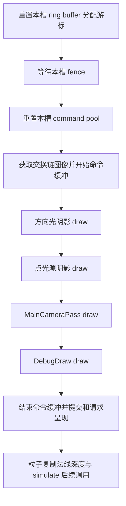
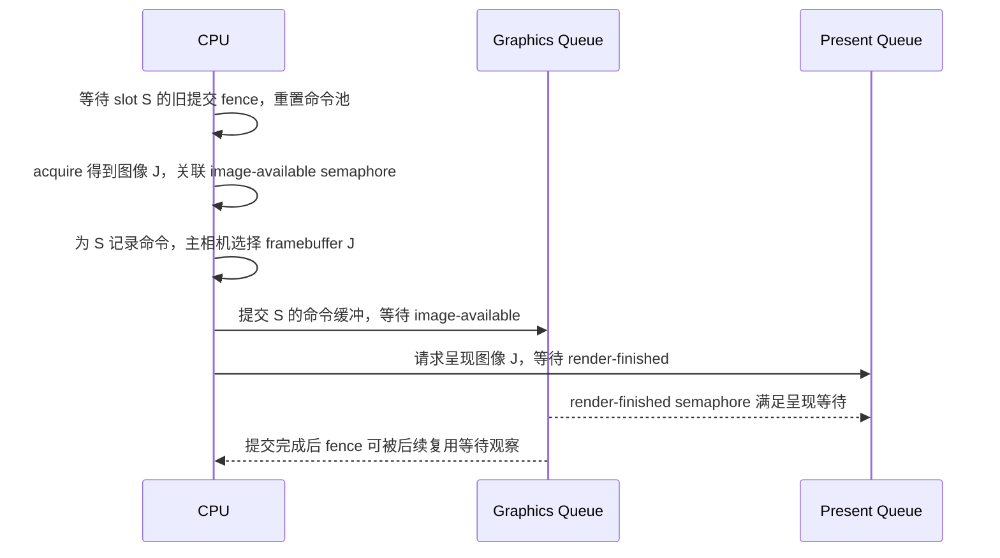

上一篇已经确认：一次位置变化能够沿逻辑描述，更新到对应渲染实体的模型矩阵。接下来的问题是，这份矩阵怎样参与绘制？如果实体里的值正确，画面却没有出现预期变化，应该继续去哪里找证据？

从对象一直单步到某个 Draw 函数，仍然可能找错方向。可见列表会筛选对象，绘制阶段会把多个实例合成批次，模型矩阵要通过缓冲和资源绑定交给 shader；随后 CPU 记录的命令才会被提交给 GPU。最终呈现还涉及另一组图像与同步关系。

本篇接着追 Wall_1，但把观察方法从“检查对象字段”推进到“检查绘制输入、命令参数和提交关系”。

> **读这篇之前**：建议读过 [06 位置变化与渲染表示]() 和 [渲染管线基础]()。如果 RHI 指针和实际后端函数之间的关系不清楚，可以回看 [类、继承与虚函数]()。
>
> 源码基线：[BoomingTech/Piccolo，固定提交 `f5053707fed4`][revision]。本篇为主线 07。2026-10-26 复用 01 的带两处兼容补丁 Debug 产物，已用 CDB 与 RenderDoc 核对 Wall_1 的 GBuffer 批次、缓冲绑定、Draw 参数和回放所得顶点输出；后续又用同一捕获对到目标像素的 GBuffer 与延迟光照输出。实测单列于后文；其他 Pass、完整同步与重建分支仍按源码解释或待验证任务表述。Vulkan 语义参照 Khronos 官方文档。

## 先把一帧的几个边界分开

设 Wall_1 的位置变化已经被消费，渲染实体里的模型矩阵为 M。接下来至少有六层问题：

| 层次 | 要回答的问题 | 此时还不能证明什么 |
| --- | --- | --- |
| 渲染表示 | 对应实例的 M 是否正确 | 它是否进入当前相机的绘制输入 |
| 可见输入 | 节点是否进入该阶段的可见列表 | 它是否进入某条 Draw 的实例数据 |
| 批次与缓冲 | M 在哪一批、哪一个实例槽位，资源怎样绑定 | 命令是否已经交给 GPU |
| 命令记录 | pipeline、descriptor、顶点/索引缓冲和 Draw 参数是否匹配 | GPU 是否已执行并完成 |
| 队列提交 | 提交了哪份命令，等待和发出哪些同步信号 | 屏幕是否已经显示正确内容 |
| 呈现请求 | 请求呈现交换链的哪一张图像 | 画面内容是否符合预期 |

这也是 Khronos 对 command buffer 的基本定义：应用先记录命令，再把命令缓冲提交给设备队列执行。录制顺序本身也不能替代资源访问所需的同步关系。[官方说明][vk-command-buffers]

本文限定一条正常路径：Wall_1 已有渲染实体，网格与材质准备成功；主相机视锥测试通过；选择延迟渲染，交换链获取与提交均成功，本轮没有发生重建。之后再单独检查偏离这条路径的分支。

## 这一层的几个名字，分别指什么

源码里会反复出现 Pass 和 Pipeline。先给它们放好位置，后面才不会把同名概念混成一个对象。

| 名称 | 本篇中的含义 | Piccolo 中的例子 |
| --- | --- | --- |
| 引擎 Pass 类 | 在 C++ 中组织资源、状态和绘制逻辑 | MainCameraPass、ToneMappingPass |
| Vulkan render pass | 描述附件、subpass 及相关依赖的对象；录制时开始一次实例 | MainCameraPass 创建的 render pass |
| Vulkan subpass | render pass 内部的一个阶段，声明输入和输出附件 | BasePass、Deferred Lighting、UI |
| 引擎 RenderPipeline | 安排本轮调用哪些阶段、以什么顺序记录 | RenderPipeline::deferredRender |
| graphics pipeline | 一次绘制使用的 shader 与图形状态组合，并关联兼容的 render pass/subpass | mesh_gbuffer pipeline |
| command buffer | 承载绑定、绘制等命令的记录对象 | 当前 frame slot 的命令缓冲 |

这些关系在 [MainCameraPass 的初始化与 setupRenderPass/setupPipelines][main-camera]、[subpass 枚举][render-pass] 和 [RenderPipeline][pipeline] 中都有对应实现。尤其要注意：一个引擎 Pass 类可以组织多个 subpass，其他 Pass 类的 draw 也可以被调用在其中一个 subpass 里。

## 从 RenderSystem 找到本轮真正走的管线

[RenderSystem::tick][render-system] 在消费交换数据后，依次做几件事：

1. `prepareContext()` 选中当前 frame slot 的命令缓冲句柄。
2. `updatePerFrameBuffer()` 计算相机、光源等本轮 CPU 数据。
3. `updateVisibleObjects()` 更新各阶段可见节点。
4. `preparePassData()` 把所需数据准备给各个 Pass。
5. 根据 `m_render_pipeline_type` 进入 forward 或 deferred 分支。

这里有两个值得停下来读的细节。

第一，`prepareContext()` 只把当前命令缓冲放进 RHI 包装对象，真正的 `vkBeginCommandBuffer` 调用在后面的 `prepareBeforePass()` 中。不能看到“准备上下文”就认为开始录制了。

第二，`updatePerFrameBuffer()` 和 `MainCameraPass::preparePassData()` 此时主要是在准备、复制 CPU 结构。后面 draw 路径还会把相关结构写入 GPU 可访问的映射缓冲。[RenderResource][render-resource] 和 [Pass 数据准备][pipeline-base] 可以用来核对这两个阶段。

[RenderSystem 的成员初值][render-system-h] 是 deferred。这能告诉我们默认选择，却不能替代运行时检查；本文以下沿 `deferredRender()` 读代码。

## Wall_1 怎样进入主相机的绘制输入

[RenderScene::updateVisibleObjectsMainCamera][render-scene] 先清空旧列表，再取相机投影、视图矩阵，对每个渲染实体做视锥与包围盒相交测试。包围盒会使用实体模型矩阵进行变换。

通过测试后，建立的 RenderMeshNode 包含：

- 指向实体模型矩阵的 `model_matrix`。
- 对应实例身份的 `node_id`。
- 网格和材质资源引用 `ref_mesh`、`ref_material`。
- 如适用，骨骼矩阵、数量及蒙皮开关。

因此，沿用 06 的身份关系，我们可以把链路记为：

```text
Wall_1 的 (GObjectID, part 0)
    → 对应 RenderEntity 的 instance ID 与模型矩阵 M
    → 视锥测试通过后的 RenderMeshNode
    → ref_mesh、ref_material 和 model_matrix
```

这里的箭头表示身份或数据引用的传递。M 仍在实体中，节点保存的是指针；它没有在这里变成一条 GPU 命令。

Pass 如何找到这些节点？`RenderScene::setVisibleNodesReference()` 把各列表地址放进 `RenderPass::m_visiable_nodes`，主相机绘制时再读取其中的主相机列表。不要因为 `preparePassData()` 没有传节点数组，就断定输入缺了一段。

阴影阶段还有自己的可见列表。主相机不可见，不代表该对象对光源也不可见；反过来，通过某个阴影测试也不能证明它会进入主相机 GBuffer 绘制。

## 一轮 deferredRender 怎样安排记录工作

[RenderPipeline::deferredRender][pipeline] 的主路径可以压缩成下面的调用顺序。图中箭头表示 **CPU 侧调用与命令记录的推进**，不表示 GPU 严格串行完成这些工作。



`resetRingBufferOffset()` 在等待前执行，但它修改的是 CPU 上的分配游标；本轮 draw 对映射区域的实际写入在等待后发生。不要把“游标归位”和“覆盖 GPU 还在读取的数据”当成同一件事。

本轮要复用的命令池则在 `waitForFences()` 后重置。这个 fence 对应当前 frame slot 上之前的图形提交，作用是让 CPU 在复用相关资源前等待那次提交完成；它不能代表整个引擎的所有 GPU 工作。[VulkanRHI][vulkan-rhi]

另外，`submitRendering()` 后还有粒子的复制与模拟调用。主文追的是主相机图形提交，不能把它误写成整个引擎一帧中唯一的提交或最后一项 GPU 工作。

## 主相机的一次 render pass 里，有八个 subpass

[MainCameraPass::draw][main-camera] 开始 render pass 时，选择 `m_swapchain_framebuffers[current_swapchain_image_index]`，随后按下面的阶段推进：

| subpass | 延迟路径中的主要调用 | 数据作用 |
| --- | --- | --- |
| BasePass | drawMeshGbuffer | 网格写入 GBuffer 与深度 |
| Deferred Lighting | drawDeferredLighting | 读取 GBuffer、深度及光照资源，生成场景颜色 |
| Forward Lighting | particle_pass.draw | 在此路径中记录粒子绘制 |
| Tone Mapping | tone_mapping_pass.draw | 对场景颜色做色调映射 |
| Color Grading | color_grading_pass.draw | 进行颜色分级 |
| FXAA | 条件调用 fxaa_pass.draw | 开启时记录抗锯齿绘制 |
| UI | drawAxis、ui_pass.draw | 清理 UI 目标后记录轴和界面 |
| Combine UI | combine_ui_pass.draw | 合成场景与 UI，写向交换链目标 |

这里不是八次独立的 `begin/end render pass`。主相机开始一次 render pass，通过 `cmdNextSubpassPFN` 向后推进，最后结束它。FXAA 关闭时也仍然经过相应 subpass，只是跳过其中的 FXAA draw。

也不要只根据 “Forward Lighting” 这个名字猜工作量：在本文的 deferred `draw()` 中，它实际调用的是粒子绘制；另一条 `drawForward()` 路径才有不同的组织。函数体比阶段名称更能说明当前发生了什么。

附件关系还需要在 `setupRenderPass()` 中核对：BasePass 的三个颜色输出和深度，成为延迟光照阶段的输入；后处理和 UI 使用另外的颜色附件。函数还声明了 subpass dependencies、访问阶段和附件布局。**这些资源依赖与命令调用顺序共同构成实现，单画一串 Pass 方框不足以说明同步正确。** 本篇不把这份源码当成完整同步审计的结论。

## 一个 Wall_1，为什么不一定对应一条 Draw

进入 [drawMeshGbuffer][main-camera]，代码先重组输入：

```cpp
std::map<VulkanPBRMaterial*, std::map<VulkanMesh*, std::vector<MeshNode>>> main_camera_mesh_drawcall_batch;

// reorganize mesh
for (RenderMeshNode& node : *(m_visiable_nodes.p_main_camera_visible_mesh_nodes))
{
    auto& mesh_instanced = main_camera_mesh_drawcall_batch[node.ref_material];
    auto& mesh_nodes     = mesh_instanced[node.ref_mesh];
```

这是函数开头的节选，后面还会构造 MeshNode 并追加到 `mesh_nodes`。分组键是**材质资源指针，再到网格资源指针**。同一组中，每个节点保存自己的实例矩阵。

因此，追 Wall_1 时不能等着出现一个叫 `drawWall_1()` 的函数。应该先找它进入的材质/网格组，再找它在实例数组中的位置。

每批容量来自 [MeshPerdrawcallStorageBufferObject][render-common] 的实例数组，当前上限是 64；[shader 常量][shader-constants] 中也有对应值。若某组有 N 个可见实例，这段代码把它切成 `ceil(N / 64)` 条 indexed draw。例如，假设该组有 70 个实例，就会拆成 64 和 6 两批。这个数字是说明分批规则的假设，不是默认场景的实测统计。

这个规则只适用于眼前这条 GBuffer 分组路径。一个对象有多个 part，或者同时进入阴影等其他阶段，仍然可能参与多次绘制；也不能仅凭材质参数看起来相同，就认为资源指针一定相同。

## 模型矩阵怎样从 CPU 指针变成 shader 输入

到这里，Wall_1 的 M 还只是节点引用。真正连接 CPU 数据与 shader 的，是 **storage buffer、descriptor set 和动态偏移**。

先用一个最小模型理解它们：缓冲存放字节，descriptor 描述 shader 从哪个资源范围读取；动态偏移让本次绘制选中该缓冲中的具体数据段。它不是把 C++ 对象指针直接交给 shader。

[RenderResource][render-resource] 创建的全局上传 ring buffer 使用 host visible、host coherent 内存，并保留映射地址；各 frame slot 有自己的区域和分配游标。`drawMeshGbuffer()` 依据设备要求的 storage buffer 对齐值分配数据段，再写入逐帧和逐批结构。

其中，模型矩阵写入是：

```cpp
perdrawcall_storage_buffer_object.mesh_instances[i].model_matrix =
    *mesh_nodes[drawcall_max_instance_count * drawcall_index + i].model_matrix;
```

左边是映射缓冲中该批第 i 个实例的数据，右边仍然来自我们一直追的实体矩阵引用。这里才是本篇应重点核对的一次数值复制。

这条路径用到的绑定可以按下面的粒度读：

| 绑定位置 | 内容 | 本篇追踪重点 |
| --- | --- | --- |
| set 0，binding 0 | 逐帧 storage 数据 | 相机 proj_view_matrix、光源等 |
| set 0，binding 1 | 逐批实例 storage 数据 | mesh_instances 中的模型矩阵 |
| set 0，binding 2 | 逐批蒙皮矩阵数据 | 适用时参与顶点蒙皮；静态墙体无需展开此分支 |
| set 1 | 网格相关 descriptor | 蒙皮索引、权重等网格资源 |
| set 2 | 材质 descriptor | 材质参数和贴图等资源 |

`drawMeshGbuffer()` 为 set 0 传入三个动态偏移，对应逐帧、逐批和逐批蒙皮数据段。绑定声明、descriptor 写入和 shader 的 `set/binding` 应一起检查，不能只看到“绑定过一个 descriptor”就认为数据已经对上。[C++ 实现][main-camera]、[顶点 shader][mesh-vert]

GPU 执行该顶点 shader 时，通过实例索引选择矩阵：

```glsl
highp mat4  model_matrix           = mesh_instances[gl_InstanceIndex].model_matrix;
```

对于不走蒙皮的墙体，顶点先使用原始模型位置；随后进入世界和裁剪空间：

```glsl
out_world_position = (model_matrix * vec4(model_position, 1.0)).xyz;

gl_Position = proj_view_matrix * vec4(out_world_position, 1.0f);
```

于是，06 的 M 在这里终于接上了顶点坐标变换。但顶点位置变化仍不保证某个最终像素一定改变：裁剪、背面剔除、深度测试和后续阶段都可能影响最终结果。

## Draw 调用记录了什么

在 GBuffer 绘制中，代码绑定 mesh_gbuffer graphics pipeline、视口与裁剪范围，再按分组绑定材质、网格 descriptor、顶点与索引缓冲，最后为每批绑定动态偏移并调用：

```cpp
m_rhi->cmdDrawIndexedPFN(m_rhi->getCurrentCommandBuffer(),
                         mesh.mesh_index_count,
                         current_instance_count,
                         0,
                         0,
                         0);
```

这段参数分别给出 command buffer、索引数量、实例数量、firstIndex、vertexOffset 和 firstInstance。这里 firstInstance 为 0，因此前面的 `gl_InstanceIndex` 从本批实例数据的起点选择矩阵。

graphics pipeline 本身也要沿创建位置检查：`setupPipelines()` 中的 GBuffer pipeline 绑定 `MESH_VERT`、`MESH_GBUFFER_FRAG`，并把 `pipelineInfo.subpass` 设为 BasePass。只确认“绑定了某条 pipeline”，还不足以说明 shader 和输出阶段正确。[MainCameraPass][main-camera]

这次 RHI 调用在 [VulkanRHI::cmdDrawIndexedPFN][vulkan-rhi] 中拆出 Vulkan command buffer，转交 `_vkCmdDrawIndexed`。到达这一行，说明 CPU 正在记录一条绘制命令，不能据此宣称 GPU 已经画完。

后面，GBuffer fragment shader 把法线、基础色和金属度/粗糙度等信息编码到三个输出。`drawDeferredLighting()` 则记录一个三顶点的 draw，其 fragment shader 用 `subpassLoad` 读取 GBuffer 和深度，再参与光照计算。这时工作单位已经是屏幕上的采样位置，CPU 不会为每面墙重新调用一次延迟光照函数。[GBuffer shader][gbuffer-frag]、[延迟光照 shader][deferred-frag]

## 从记录结束走到提交与呈现

[VulkanRHI::submitRendering][vulkan-rhi] 首先结束当前 command buffer，随后填充提交信息。其中这段原始代码把“提交什么”和“等什么”写得很明确：

```cpp
submit_info.waitSemaphoreCount     = 1;
submit_info.pWaitSemaphores        = &m_image_available_for_render_semaphores[m_current_frame_index];
submit_info.pWaitDstStageMask      = wait_stages;
submit_info.commandBufferCount     = 1;
submit_info.pCommandBuffers        = &m_vk_command_buffers[m_current_frame_index];
```

`wait_stages` 在该函数中设为 `VK_PIPELINE_STAGE_COLOR_ATTACHMENT_OUTPUT_BIT`。等待信号来自本轮获取交换链图像时传给 `vkAcquireNextImageKHR` 的 semaphore。它把图像可用与提交中受约束的工作连接起来；不能把它解释成“CPU 在这里等待整帧 GPU 完成”。[获取图像的官方语义][vk-acquire]

图形提交还会发出两个 semaphore：一个供后续粒子法线/深度复制路径使用，另一个供呈现等待。提交调用关联当前 frame slot 的 fence；CPU 在未来复用该 slot 时通过 fence 等待这次提交完成。[提交的官方语义][vk-submit]

用两个索引画出来更清楚。下面是正常路径的调用和同步关系示意，S 表示当前 frame slot，J 表示本次获取的交换链图像索引；它不是测量时间线。



这里必须分清两个数：

- `m_current_frame_index` 选择 CPU/GPU 协作的资源槽：命令缓冲、同步对象和上传缓冲区域等。该版本 `k_max_frames_in_flight` 为 3。
- `m_current_swapchain_image_index` 是 acquire 返回的图像索引，用来选 framebuffer，并填写呈现请求。

**三份 frame slot 不意味着交换链一定恰好有三张图，也不意味着两个索引应当相等。** [VulkanRHI 成员定义][vulkan-rhi-h] 与 [acquire 的返回参数][vk-acquire] 需要对照着读。

随后 `vkQueuePresentKHR` 等待 render-finished semaphore，请求呈现 J。函数返回成功也不是“用户已经看到正确画面”的证据；它排入的是呈现请求。实际显示与内容正确性还需要画面或捕获检查。[官方说明][vk-present]

## 重建分支里，一个容易读反的 bool

主路径之外，最值得先读的是 `prepareBeforePass()` 与调用方的配合。[管线调用方][pipeline] 把返回值命名为 `recreate_swapchain`，为 true 时直接结束这一轮管线调用。

但被调用函数返回 true 的写法是 `return RHI_SUCCESS`。如果把它脑补成 Vulkan 的 `VK_SUCCESS`，就会读反：[render_type.h][render-type] 明确把 **RHI_SUCCESS 定义为 true**。

实际分支如下：

| acquire / 准备结果 | 该函数的动作 | 返回值与调用方行为 |
| --- | --- | --- |
| 正常获取，开始命令缓冲成功 | 进入本轮命令记录 | 返回 false，调用方继续绘制 |
| OUT_OF_DATE | 重建交换链并调用 Pass 更新回调 | 返回 true，调用方跳过后续绘制 |
| SUBOPTIMAL，相关操作成功 | 重建、更新 Pass，并用空提交等待已获取图像的 semaphore，推进槽索引 | 返回 true，调用方跳过后续绘制 |
| 其他获取错误，或开始命令缓冲失败等 | 记录错误 | 某些错误分支也返回 false |

最后一行说明，这个 bool 不是一个能完整区分“准备成功 / 重建 / 失败”的结果类型。不能给读者一个“返回 false 就证明录制准备成功”的断言。真正调试时还需要看实际 VkResult 和命中的分支。

`submitRendering()` 的呈现阶段也处理 OUT_OF_DATE 和 SUBOPTIMAL，调用同一个重建更新回调。回调会更新主相机 framebuffer 和相关后处理输入等。窗口变化时，应该把“旧目标是否已失效、相关引用是否更新”作为独立问题检查，而不是继续沿 Wall_1 的 Transform 查下去。[VulkanRHI][vulkan-rhi]、[Pass 更新回调][pipeline]

## 实测：把 Wall_1 的矩阵对到一条真实 Draw

实体字段正确，只解决了生产端的问题。这次实验继续问：**这份矩阵是否进入了目标 Draw，顶点输出又是否体现了它？**

实验复用 01 的同一份 exe、PDB 与 ini，没有新增引擎补丁或改写关卡。RenderDoc 1.43 启动编辑器后，在同一进程 PID 187472 先捕获第 6348 帧；CDB 随后在主线程、逻辑更新前调用一次真实 `setPosition`，把 Wall_1 从 `(1.94597, -0.38554, 0)` 移到 `(2.94597, -0.38554, 0)`；继续运行后再捕获第 28131 帧。

两份捕获与断点是三个分开的观察点。CDB 样本的引擎 `m_frame_count=11659`，不能与 RenderDoc 帧号相混，也不能把后续捕获称为 setter 同轮的 GPU 时间线。这里验证的是受控修改后稳定保留的数据及其绘制结果，没有验证鼠标拖轴或属性面板。

### 先找批次槽位，再找缓冲地址

本次重新识别出的 Wall_1 为 `GObjectID=2`、`part=0`、渲染实例 ID `5`。在 `drawMeshGbuffer()` 中，通过模型矩阵指针与网格/材质引用核对，找到它所在的组：

| 观察项 | 本次真实值 |
| --- | --- |
| 网格 / 材质资源 ID | 5 / 2 |
| 批次与实例槽位 | 同材质、同网格的 7 个实例，Wall_1 位于槽 0 |
| 批次容量 / 有效数量 | 64 / 7，不能把容量当成这次 Draw 的实例数 |
| 每实例布局 | stride 80 字节，模型矩阵在实例记录内偏移 16 字节 |
| 动态偏移 | 每帧、每批实例、关节数据分别为 `[4277600, 4314128, 0]` |
| 实例 descriptor | set 0 / binding 1，缓冲 `ResourceId::149`，有效起始偏移 4314128，范围 5120 字节 |
| Indexed Draw | 36 个索引 × 7 个实例；firstIndex、vertexOffset、firstInstance 均为 0 |

**对象 ID 2、渲染实例 ID 5、Draw 内实例槽 0 是三种身份。** shader 本次用 `gl_InstanceIndex=0` 取目标记录，不能因为渲染实例 ID 是 5，就去读数组第 5 项。

矩阵地址按“descriptor 原始偏移 + dynamic offset + 槽位 × 80 + 16”计算。RenderDoc 返回的 descriptor `byteOffset=4314128` 已包含动态偏移，读取时不要再加一次。CDB 中映射基址为 `0x22230380000`，对应七份有效记录的起点为 `0x2223079d410`；导出的 560 字节恰好是 `7×80`。5120 字节 descriptor 范围来自 `64×80`，范围剩余部分不代表有效实例。

前后捕获中的这组三个动态偏移恰好与 CPU 样本相同；这不是跨帧不变的保证。上述地址、资源号、事件号与槽位都只用于关联本次实验，复现时必须重新定位。

### 用捕获核对真正绑定的输入

CDB 在 `vulkan_rhi.cpp:2033` 停到实际 `vkCmdDrawIndexed` 包装调用，栈为 `deferredRender → MainCameraPass::draw → drawMeshGbuffer → cmdDrawIndexedPFN`。RenderDoc 在前后两份捕获中均找到 `/BasePass/Mesh GBuffer` 下的事件 177，render pass 的 subpass 为 0，Draw 参数也是 `36×7`。

该事件的 graphics pipeline 为 `ResourceId::285`，顶点/片元 shader 为 `283/284`。三个顶点缓冲为 `716/717/718`，stride 分别为 `12/24/8`；索引缓冲为 `732`，索引宽度为 2 字节。前后捕获中的这些绑定、输入顶点/索引字节及相机 PV 矩阵均一致。

随后读取 set 0 / binding 1 的实际数据：目标矩阵仅 x 平移由约 `1.94597` 变为 `2.94597`，另外六个实例的矩阵未变；修改后捕获中的**全部七份矩阵**都与 CDB 映射缓冲样本逐元素相等，最大差为 0。反射结果也独立给出数组容量 64、stride 80、矩阵偏移 16，与 CPU 布局相符。实例的蒙皮标志均为 `-1`，本次走静态网格路径。

### 从“绑定正确”继续检查顶点输出

使用 RenderDoc 回放导出的 post-VS 数据，可以把模型矩阵与实际顶点输出联系起来。目标实例有 36 条顶点输出记录；其中第 0 条为：

| 数据 | 修改前 | 修改后 |
| --- | --- | --- |
| 输入位置 | `(0.150000006, 5, 0)` | 相同 |
| 世界位置 | `(6.94568348, -0.54369140, 0)` | `(7.94568348, -0.54369140, 0)` |
| 裁剪坐标 | `(0.77646977, 6.38841248, 11.84686852, 11.94568348)` | `(0.77646959, 6.38841248, 12.84696865, 12.94568348)` |

对全部 36 条记录分别计算 `world=M×position` 和 `clip=PV×world`：世界位置的最大绝对误差小于 `1e-7`，裁剪坐标小于 `1.3e-7`；前后世界坐标差均为 `(1,0,0)`，该差值检查的最大误差为 0。这说明变化已经从实例缓冲传到了该 Draw 的顶点变换结果。

这里的 post-VS 是**捕获回放所得输出**，不是原始执行期间逐顶点采集的硬件轨迹，也不能证明最终像素或显示时刻。本次 post-VS 输出 stride 也恰好为 80 字节，但它与上面的实例记录是两种不同布局，不能共用字段偏移。

下面是两份捕获导出的原始缩略图，用于交代场景与修改前后的画面背景；数值结论来自绑定字节和顶点核对，没有用整图差异代替逐附件、逐像素归因。

| 修改前：捕获帧 6348 | 修改后：捕获帧 28131 |
| --- | --- |
|  |  |

### 这次闭合了哪段链路

本次闭合的是“渲染实体矩阵 → 可见节点引用 → 批次槽位 → 实例缓冲 → descriptor 与 Draw → 回放顶点输出”。setter 同轮的 queue submit 与 present 返回均为 `VK_SUCCESS`；这不扩大为 fence/semaphore 完整时间线、所有 Pass 或显示输出验收。

还需保留两个实际限制：启动控制台出现过 `UNASSIGNED-API-Version-Violation`，捕获内 debug messages 为空不能据此宣布零验证错误；采样结束通过 CDB `q` 终止进程，本轮没有正常关窗退出证据。此前 02 的正常退出记录属于另一轮实验。

完整复现步骤、归一化 CDB 日志、七份 CPU 矩阵、回放脚本、顶点 CSV 与指纹见 [GBuffer 验证材料](https://github.com/twoeggdu/twoegg-tech-stack/blob/main/examples/piccolo-debug-validation/GBUFFER-DRAW.md)。两份原始 `.rdc` 留在本机实验目录，不将大二进制放入站点仓库。

### 后续实测：从顶点接到 GBuffer 与延迟光照

继续回放这两帧后，已将目标槽 0 的网格三角形对到前 `(663,242)`、后 `(650,266)` 两个像素。投影使用实际 viewport `(289,60,668,448)`，经过深度与片元世界位置交叉核对；不能把 1280×720 的整个编辑器窗口都当成场景 viewport。

事件 177 写出的 GBuffer A/B/C 与深度资源 `247/251/255/145`，在事件 186 的 set 1 / binding 0—3 被作为 input attachments 读取。两点在两个事件读回的四份附件字节均一致，延迟光照输出则位于 RGBA16F 图像 `259`。这一轮已从“矩阵与顶点正确”推进到“目标表面数据被光照阶段实际读取，并产生浮点场景颜色”。

旧坐标在新帧仍属于 Wall_1，但已落到另一面，三角形与 UV 都变了；因此没有用同一屏幕坐标的颜色差冒充固定表面点的单变量实验。本次目标点的方向光 `N·L<0`，跳过阴影比较，颜色来自环境项与 IBL。逐点数据、FP16 存储值与调试值的差异，以及 PixelHistory 数值无效的工具边界，集中放在 [16 的表面颜色实测]()。

## 阅读任务与后续验证

先在固定源码中完成下面三项，避免直接从数千行的主相机实现开始无目的单步：

1. **画调用链**：从 RenderSystem::tick 走到 deferredRender、MainCameraPass::draw、drawMeshGbuffer、VulkanRHI 包装和 submitRendering；标出 preparePassData 与实际缓冲写入的位置。
2. **对数据布局**：对照 C++ 的 MeshPerdrawcallStorageBufferObject、descriptor 动态偏移和 mesh.vert 的 set/binding，说明 M 被复制到哪里、由哪个实例索引读取。
3. **对三个索引**：分别解释实例在批次中的索引、frame slot S 和交换链图像 J，说明它们各自解决什么问题。

这些任务只验证我们能否解释代码，不会产生 GPU 执行证据。

下表仍可作为逐层观察清单。实测已覆盖目标批次、实例缓冲、Draw、回放顶点及单点 GBuffer/延迟光照；S/J 与完整同步、重建分支、实际阴影比较及后续合成仍需单独采样：

| 观察位置 | 应记录什么 | 能排查的问题 |
| --- | --- | --- |
| updateVisibleObjectsMainCamera | 实体 ID、包围盒测试结果、模型矩阵和资源引用 | 对象有没有进入主相机输入 |
| drawMeshGbuffer 分组与分批处 | Wall_1 所在组、drawcall_index、本批实例 i | 对象最终参与哪一批绘制 |
| 写入并绑定 storage 数据处 | M 的实际值、逐批动态偏移、descriptor 范围 | 矩阵是否进入 shader 将读取的数据段 |
| cmdDrawIndexedPFN | 当前命令缓冲、indexCount、instanceCount、pipeline | 预期批次是否被正确记录 |
| prepareBeforePass / submitRendering | S、J、VkResult、semaphore 和 fence、重建分支 | 是否提交正确命令并请求呈现正确图像 |
| 图形捕获中的 Mesh GBuffer 事件 | 实例槽、输入资源、模型矩阵、GBuffer 和深度结果 | GPU 所见输入与 CPU 推导是否一致 |
| 后续光照与合成事件 | 场景颜色、后处理输入和最终目标 | 问题是否发生在几何阶段之后 |

断点会改变执行时序，也不能代替 GPU 捕获。捕获时先从本篇的批次定位方法找到对应 Draw 和实例，再检查它的实际资源；不要根据事件树中的第几条 Draw 猜它就是 Wall_1。

<!-- DATA-TODO: 继续记录同一提交的 frame slot S / swapchain image J、fence/semaphore 等待完成关系；验证交换链重建/错误分支。当前已补单点 GBuffer/深度与延迟光照输入输出，尚需实际阴影比较、后处理与最终合成的像素归因，不将该点推广为所有像素或Pass。 -->

## 继续阅读

- [13 粒子发射器与 GPU 模拟]()：沿计算调度、计数回读和后续 billboard Draw，核对 GPU 粒子与本篇提交的衔接。

- [12：一段动画怎样成为骨骼姿态与网格蒙皮]()：把本篇实例缓冲与 dynamic offset 接到关节矩阵、绑定索引和蒙皮 Shader。
- [17：场景颜色怎样经过后处理成为最终画面]()：逐项展开后处理 subpass 的输入输出、FXAA 开关两路附件、UI 选色与呈现边界。
- [16：材质、光照与阴影怎样共同决定表面颜色]()：展开本篇 G-buffer、光源阴影与延迟光照之间的具体数据含义，输出止于浮点场景颜色。
- [15：网格与纹理怎样从文件成为 GPU 资源]()：补齐本篇绑定的顶点、索引缓冲和材质图像的来源，区分资源上传与每帧绘制提交。
- [11：相机怎样跟随角色，并把视角交给渲染系统]()：补齐本篇 P、V 和相机世界位置的生产端，核对第三人称计算与渲染端消费。
- [状态缓冲怎样交接，哪些地方真的跨线程]()：区分 CPU 描述清理、Jolt/日志线程完成与 GPU 帧资源复用。

- [从 GLSL 到 GPU：用 Piccolo 串起渲染引擎、API 与系统]()：补齐 module 的来源、资源接口与矩阵布局，并区分 Vulkan、Loader、驱动、OS 和硬件的证据边界。

- [改一个位置，怎样沿逻辑数据追到渲染表示]()：回看 M 的来源，以及逻辑对象和渲染实例怎样对应。
- [一帧怎样推进]()：回看交接顺序，以及为什么 CPU 调用链不能直接证明线程或 GPU 时间线。
- [RenderDoc 阅读入口]()：补充图形事件、资源和附件的阅读方法；已有目标 Draw 与单点 GBuffer/延迟光照证据，后续合成仍待分项验证。
- [编辑器怎样修改、保存并恢复场景状态]()：把面板修改、运行缓冲、关卡写出和重载重建连起来，核对保存内容与运行身份的边界。
- [Piccolo 阅读入口]()：返回目录。

Piccolo 源码节选版权：Copyright (c) 2022 Contributors to the Piccolo Engine，按 [MIT License][license] 提供。原流程图、分批例子与观察清单为源码解释或验证设计；2026-10-26 实测段另列真实断点、捕获缩略图与回放数据，不将条件分支改写为已测事实。

**从渲染实体追到画面，要逐层核对绘制输入、缓冲绑定、命令记录、队列提交与呈现目标。**

[revision]: https://github.com/BoomingTech/Piccolo/tree/f5053707fed4d3f94d270a436fb0d3a8ae54e3e5
[render-system]: https://github.com/BoomingTech/Piccolo/blob/f5053707fed4d3f94d270a436fb0d3a8ae54e3e5/engine/source/runtime/function/render/render_system.cpp
[render-system-h]: https://github.com/BoomingTech/Piccolo/blob/f5053707fed4d3f94d270a436fb0d3a8ae54e3e5/engine/source/runtime/function/render/render_system.h
[render-scene]: https://github.com/BoomingTech/Piccolo/blob/f5053707fed4d3f94d270a436fb0d3a8ae54e3e5/engine/source/runtime/function/render/render_scene.cpp
[pipeline-base]: https://github.com/BoomingTech/Piccolo/blob/f5053707fed4d3f94d270a436fb0d3a8ae54e3e5/engine/source/runtime/function/render/render_pipeline_base.cpp
[pipeline]: https://github.com/BoomingTech/Piccolo/blob/f5053707fed4d3f94d270a436fb0d3a8ae54e3e5/engine/source/runtime/function/render/render_pipeline.cpp
[main-camera]: https://github.com/BoomingTech/Piccolo/blob/f5053707fed4d3f94d270a436fb0d3a8ae54e3e5/engine/source/runtime/function/render/passes/main_camera_pass.cpp
[render-pass]: https://github.com/BoomingTech/Piccolo/blob/f5053707fed4d3f94d270a436fb0d3a8ae54e3e5/engine/source/runtime/function/render/render_pass.h
[render-common]: https://github.com/BoomingTech/Piccolo/blob/f5053707fed4d3f94d270a436fb0d3a8ae54e3e5/engine/source/runtime/function/render/render_common.h
[render-resource]: https://github.com/BoomingTech/Piccolo/blob/f5053707fed4d3f94d270a436fb0d3a8ae54e3e5/engine/source/runtime/function/render/render_resource.cpp
[vulkan-rhi]: https://github.com/BoomingTech/Piccolo/blob/f5053707fed4d3f94d270a436fb0d3a8ae54e3e5/engine/source/runtime/function/render/interface/vulkan/vulkan_rhi.cpp
[vulkan-rhi-h]: https://github.com/BoomingTech/Piccolo/blob/f5053707fed4d3f94d270a436fb0d3a8ae54e3e5/engine/source/runtime/function/render/interface/vulkan/vulkan_rhi.h
[render-type]: https://github.com/BoomingTech/Piccolo/blob/f5053707fed4d3f94d270a436fb0d3a8ae54e3e5/engine/source/runtime/function/render/render_type.h
[mesh-vert]: https://github.com/BoomingTech/Piccolo/blob/f5053707fed4d3f94d270a436fb0d3a8ae54e3e5/engine/shader/glsl/mesh.vert
[gbuffer-frag]: https://github.com/BoomingTech/Piccolo/blob/f5053707fed4d3f94d270a436fb0d3a8ae54e3e5/engine/shader/glsl/mesh_gbuffer.frag
[deferred-frag]: https://github.com/BoomingTech/Piccolo/blob/f5053707fed4d3f94d270a436fb0d3a8ae54e3e5/engine/shader/glsl/deferred_lighting.frag
[shader-constants]: https://github.com/BoomingTech/Piccolo/blob/f5053707fed4d3f94d270a436fb0d3a8ae54e3e5/engine/shader/include/constants.h
[license]: https://github.com/BoomingTech/Piccolo/blob/f5053707fed4d3f94d270a436fb0d3a8ae54e3e5/LICENSE
[vk-command-buffers]: https://docs.vulkan.org/spec/latest/chapters/cmdbuffers.html
[vk-acquire]: https://docs.vulkan.org/refpages/latest/refpages/source/vkAcquireNextImageKHR.html
[vk-submit]: https://docs.vulkan.org/refpages/latest/refpages/source/vkQueueSubmit.html
[vk-present]: https://docs.vulkan.org/refpages/latest/refpages/source/vkQueuePresentKHR.html
