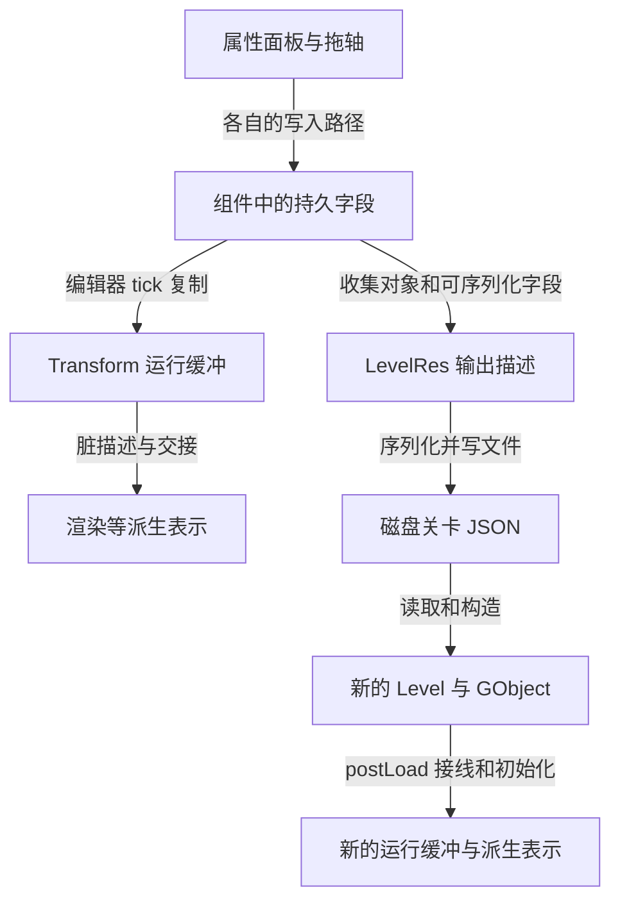
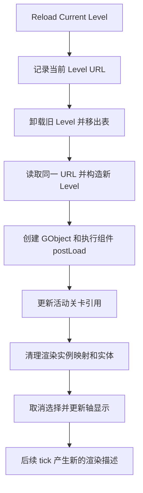

在编辑器里移动一面墙，看到画面变化，按下保存，再重新加载场景。这组操作看起来很自然，却跨过了几套不同的数据：面板正在编辑的字段、逻辑更新正在读取的值、渲染系统收到的表示，以及文件里真正留下的描述。

如果重载后位置正确，能否说明整个关卡都恢复了？如果对象名字相同，能否继续使用重载前的运行 ID？如果改了对象定义，同一场景里的实例会不会跟着变化？这些问题需要沿保存和加载两端一起读代码。

本篇继续使用 Wall_1。前面几篇说明它怎样被建立、修改和绘制；这里把编辑器操作接入这条链，再检查保存结果究竟覆盖哪些内容。

> **读这篇之前**：建议读过 [04 场景对象与组件]()、[05 资源与类型恢复]() 和 [06 位置变化与渲染表示]()。[07 Pass 与 Vulkan 提交]() 说明 UI 位于渲染调用链的哪里。
>
> 源码基线：[BoomingTech/Piccolo，固定提交 `f5053707fed4`][revision]。本篇为主线 08，内容来自源码、资源和生成模板核对。文中的状态表与保存结果为条件推导；未构建、运行 Piccolo，未执行场景编辑、文件保存或重载，也未运行解析器生成代码。

## 先分清我们要恢复哪一层状态

一个可用的编辑器，需要让修改最终变成可重新构建的内容。阅读时，可以先拆成四层：

| 层次 | Wall_1 的对应数据 | 主要问题 |
| --- | --- | --- |
| 持久字段 | TransformComponent::m_transform 等可序列化成员 | 面板写了什么，保存会读取什么 |
| 运行状态 | 当前/下一份 Transform、索引、脏标记、父对象关联 | 修改何时被组件更新使用 |
| 派生表示 | 渲染实体、网格描述、物理对象等 | 怎样从内容和运行状态建立、更新或清理 |
| 磁盘描述 | 关卡中的对象记录、组件类型和字段 | 新进程或重载时可以重建什么 |

编辑器本身还持有选中对象 ID、轴模式和相机等状态。它们是否保存，必须去资源模型和写出路径确认，不能因为它们在界面里可见，就认为属于关卡文件。

先给出本文的阅读模型。图中箭头分别标注写入、复制、序列化和重建关系，并不代表每步都在同一帧完成。



因此，“修改已生效”和“保存后能恢复”是两组需要分别取证的关系。

## 选中一面墙，属性面板拿到的是什么

[EditorUI::showEditorWorldObjectsWindow][editor-ui] 从当前 Level 的对象表中列出名字，用户选择某一项时，把该项的 GObjectID 交给 `onGObjectSelected()`。

[EditorSceneManager][editor-scene] 保存选中 ID；需要对象时，再从**当前活动 Level** 调用 `getGObjectByID()`。属性面板拿到选中对象后，遍历组件，把组件类型名和实例地址组成 ReflectionInstance，再进入通用控件构造流程。

接着，[createLeafNodeUI][editor-ui] 取得字段访问器，调用 `field.get(instance.m_instance)` 取得字段地址，按字段类型选择控件。遇到 Transform，注册的控件会执行：

```cpp
DrawVecControl("Position", trans_ptr->m_position);
DrawVecControl("Rotation", degrees_val);
DrawVecControl("Scale", trans_ptr->m_scale);
```

位置与缩放控件取得的是成员引用，内部 `ImGui::DragFloat` 又取得对应分量地址。因此它们直接修改传入 Transform 的字段。旋转则先转成角度供面板编辑，再回写四元数；这里不展开旋转表示的转换。

这份 Transform 来自哪里？[TransformComponent][transform-h] 采用字段白名单，只显式启用了 `m_transform`。运行双缓冲和索引没有被启用。结合字段选择规则，可以确认这条面板路径编辑的是 `m_transform`，并没有调用 `setPosition()`。[字段筛选实现][field]

## 属性面板与拖轴，是两种不同的写入路径

[拖轴输入][editor-input] 在鼠标移动时进入 `EditorSceneManager::moveEntity()`。该函数计算新的模型变换、分解为平移/旋转/缩放，随后调用三个 setter：

```cpp
transform_component->setPosition(new_translation);
transform_component->setRotation(new_rotation);
transform_component->setScale(new_scale);
```

以位置 setter 为例，[真实实现][transform-cpp] 同时写两处并置脏：

```cpp
void TransformComponent::setPosition(const Vector3& new_translation)
{
    m_transform_buffer[m_next_index].m_position = new_translation;
    m_transform.m_position                      = new_translation;
    m_is_dirty                                  = true;
}
```

两条路径的区别如下：

| 操作 | 直接修改哪里 | 怎样通知后续更新 |
| --- | --- | --- |
| 属性面板位置控件 | m_transform.m_position | 该控件没有调用位置 setter；选中对象由编辑器每轮置脏，编辑器模式的 Transform tick 再复制字段 |
| 拖轴 | setter 写 next 缓冲与 m_transform | setter 置脏；后续 Transform/Mesh tick 推进 |

这也解释了为什么 06 要固定“通过 setter 写入”的条件。不能把那里得到的时序结论原样套在属性面板上。

这个区别还会影响其他副作用。例如 `setScale()` 会设置专门的缩放脏标记，面板直接改缩放字段没有经过同一段逻辑。本文只追位置；不能据此认为面板上所有属性都完成了相同的物理或资源更新。

## 用一个位置变化，走完面板到运行缓冲的时序

固定下面的条件：处于编辑器模式，Wall_1 保持选中；初始位置 P₀ 约为 `(1.94597, -0.38554, 0)`，两份缓冲已经稳定。完成一次面板输入，把位置改为 P₁，约 `(2.94597, -0.38554, 0)`，此后没有其他位置写入。

源资源中的 P₀ 可以在[默认关卡][level-json] 核对。以下记录的是**位置分量的推导**，不代表实测帧数或断点截图。

先定位 UI 的时机：[UIPass::draw][ui-pass] 调用 `m_window_ui->preRender()`，而 EditorUI 的 preRender 进入界面构建。它位于本轮渲染期间，此前这轮逻辑更新已经执行。下一轮[编辑器循环][editor] 先做场景管理器 tick，再进入引擎 tick。

`EditorSceneManager::tick()` 每轮给选中对象的 Transform 置脏；[TransformComponent::tick][transform-cpp] 则先交换 current/next，再在编辑器模式下执行：

```cpp
if (g_is_editor_mode)
{
    m_transform_buffer[m_next_index] = m_transform;
}
```

于是，在上述稳定起点和持续选中条件下，位置沿下面的顺序传播：

| 观察时点 | m_transform 位置 | current 位置 | next 位置 | 后续读取 |
| --- | --- | --- | --- | --- |
| 面板输入前 | P₀ | P₀ | P₀ | 运行读取 P₀ |
| 本轮 UI 写入完成 | P₁ | P₀ | P₀ | 持久字段已改，运行缓冲尚未复制 |
| 下一次 Transform tick 结束 | P₁ | P₀ | P₁ | 本次 Mesh 仍可能生成 P₀ 的描述 |
| 再下一次 Transform tick 结束 | P₁ | P₁ | P₁ | Mesh 可用 P₁ 生成新描述 |

第三行容易漏看：先交换的是两份旧值，随后才把 P₁ 复制到新的 next。持续选中让下一轮再次置脏，因而后续 Mesh 还有机会发出包含新矩阵的描述。[MeshComponent][mesh] 会在生成描述后清理 Transform 的普通脏标记。

这张表说明了两个后果。第一，面板里的值和当前运行值可以暂时不同；第二，保存读取持久字段时，可能已经取得 P₁，而画面还没有走完对应的更新链。保存与显示必须分别观察。

若期间取消选择、切换模式或有其他写入，上述条件就改变了，需要重新推导。这里不承诺统一的屏幕延迟；逻辑描述交换和 GPU 工作仍有 03、06、07 中各自的条件。

## 保存按钮最终写到哪一个文件

[菜单实现][editor-ui] 中，“Save Current Level” 调用 `WorldManager::saveCurrentLevel()`，后者锁定活动 Level，再调用 `Level::save()`。它保存的是当前活动关卡，并没有在这个入口逐个保存世界中的所有关卡或改写 WorldRes。

[Level::save][level-cpp] 新建 `LevelRes output_level_res`，根据当前对象数准备数组，逐个调用对象的 save，最后把描述交给 AssetManager，目标 URL 为这个 Level 加载时记录的 `m_level_res_url`。

实际文件路径还要继续追：[AssetManager::getFullPath][asset-cpp] 将 ConfigManager 的 root folder 与资源 URL 组合，得到绝对路径；[root folder 的来源][config] 与运行配置文件有关。因此，检查保存结果时应记录解析后的路径，不能直接假定程序写的就是源码克隆中的 `engine/asset/level/1-1.level.json`。

这条调用链可以先记为：

```text
Save Current Level
    → 当前活动 Level::save
    → 收集 GObject 为 ObjectInstanceRes
    → Serializer::write(LevelRes)
    → 解析 m_level_res_url 的实际路径并写文件
```

它也给出一个排查起点：如果编辑器说保存过，但手边文件没变化，应先确认活动关卡和绝对输出路径，再查写出的字段。

## 对象保存的是当前组件，而非原始组件清单

[GObject::save][object] 很短，却直接决定了保存语义：

```cpp
void GObject::save(ObjectInstanceRes& out_object_instance_res)
{
    out_object_instance_res.m_name       = m_name;
    out_object_instance_res.m_definition = m_definition_url;

    out_object_instance_res.m_instanced_components = m_components;
}
```

这里取的是对象当前的整份 `m_components`。结合 04 的加载规则，Wall_1 的变化可以这样理解：

| 阶段 | 实例组件 | 定义提供的组件 |
| --- | --- | --- |
| 原始关卡记录 | Transform | 墙体定义中还有 Transform、Mesh、RigidBody |
| 加载合并后 | 运行对象有 Transform、Mesh、RigidBody | 同类型 Transform 已由实例提供，定义中的该项跳过 |
| 保存生成的对象描述 | 当前三个组件都进入 instanced_components 的写出路径 | definition URL 仍保留 |
| 以后从该描述加载 | 已写出的同类型实例组件优先 | 定义只补缺失类型 |

这里的“组件写出”指**该组件可序列化的字段**，不是把全部 C++ 内存保存下来。[原始关卡][level-json]、[墙体定义][wall-json] 和 [GObject::load][object] 可以共同验证这个结论。

这带来一个重要的编辑语义：保存后，原本来自定义的 Mesh、RigidBody 等可能已经成为实例记录。之后修改墙体定义里同类型组件的字段，重载时仍可能由这些实例数据覆盖，不能假定所有墙体都会自动继承新值。

阅读时应问清它保存的是完整实例描述，还是只保存相对于定义的修改量。当前这段代码没有计算组件差量，也没有记录某个字段是否被用户手工改过。

## 哪些字段会留下，哪些状态要重新建立

[Serializer 对 ReflectionPtr 的写出][serializer] 保存组件类型名与 `$context`，再按名字找到具体类型的写出逻辑。[生成模板][serializer-template] 负责将选中的成员逐项写入 JSON。

TransformComponent 的 `m_transform` 被启用，因此位置、旋转和缩放可以进入持久描述。双缓冲、索引和 Component 中未启用的父对象引用、脏标记等，不会因为对象保存了组件列表，就自动成为文件内容。[Transform 声明][transform-h]、[Component 声明][component]

加载时，[TransformComponent::postLoadResource][transform-cpp] 会重新接上父对象，并用持久字段初始化两份运行缓冲：

```cpp
m_parent_object       = parent_gobject;
m_transform_buffer[0] = m_transform;
m_transform_buffer[1] = m_transform;
m_is_dirty            = true;
```

这使保存与恢复形成了明确分工：文件留下内容字段，运行代码负责重建缓冲和关联；渲染描述等派生表示再沿组件更新建立。恢复成功需要这些业务步骤共同成立，生成代码只能完成其中的类型和字段读写。

## 一个实际边界：关卡元数据没有被完整回填

如果只检查 Wall_1 的位置，这次保存看起来可能已经够用。但继续看 [LevelRes][level-res]，关卡还包含 gravity 和 character_name：

```cpp
Vector3     m_gravity {0.f, 0.f, -9.8f};
std::string m_character_name;

std::vector<ObjectInstanceRes> m_objects;
```

[Level::save][level-cpp] 创建新的 LevelRes 后，只填充了 objects，未给 gravity、character_name 赋回当前关卡的对应值。[写出模板][serializer-template] 又会按这些选中的字段写出成员值。因此，依据这份源码可以推导：

| 字段 | 默认关卡中的值 | 当前保存代码构造出的值 |
| --- | --- | --- |
| gravity | `(0,0,-15)` | 新 LevelRes 的默认值，约 `(0,0,-9.8)` |
| character_name | `Player` | 默认构造的空字符串 |
| objects | 原有对象记录 | 从当前运行对象收集的描述 |

这是对字段构造和模板的静态推导，并非实际保存得到的 JSON，也没有把它记成已复现的运行故障。

它足以提醒我们：**位置恢复正确，仍不能证明关卡无损恢复。** `Level::load()` 用资源里的 gravity 创建物理场景，再按 character_name 查找对象以建立活动 Character。角色名变空时，名为 Player 的对象记录仍然可以存在，但原先按名字绑定活动 Character 的条件已经变化。

因此，这篇的验证终点应包含关卡元数据和业务关联，不能只看对象数量或墙的位置。序列化器正常工作，也无法自动补上调用方未收集的状态。

## 保存返回成功，证据还要读到哪一层

[AssetManager::saveAsset][asset-h] 先打开目标文件，检查打开结果，然后执行序列化、写入和 flush：

```cpp
asset_json_file << asset_json_text;
asset_json_file.flush();

return true;
```

这段实现没有在写入/flush 后再次检查流状态，也没有在这条路径中提供临时文件替换和失败回滚。Level 会根据返回 bool 记录成功或失败；WorldManager 的保存入口返回 void，菜单没有取得一份可展示的保存结果。

所以，源码中的“level save succeed”只能按当前返回条件理解。要验证一次真实保存，应进一步读取目标文件，确认它可解析、字段正确，并且能够重新加载。文件写出完成、内容语义完整、重载业务成立，是三项不同的检查。

这里记录的是现有实现边界。本篇不修改保存逻辑，也不把写作验证变成一次对真实资源的覆盖操作。

## 重载怎样清理旧状态并建立新对象

“Reload Current Level”的[菜单代码][editor-ui] 依次调用：

```cpp
g_runtime_global_context.m_world_manager->reloadCurrentLevel();
g_runtime_global_context.m_render_system->clearForLevelReloading();
g_editor_global_context.m_scene_manager->onGObjectSelected(k_invalid_gobject_id);
```

第一个调用进入 [WorldManager::reloadCurrentLevel][world]：记录当前 Level URL，卸载旧 Level，从已加载关卡表移除它，再以同一个 URL 加载新 Level，并更新活动关卡引用。

[Level::clear][level-cpp] 会清理活动 Character、对象表和物理场景管理关系；新 Level 的 load 则重新读取资源、创建物理场景、构造对象，并执行各组件的 postLoad。前文的类型构造和依赖接线在这里重新发生。

第二个调用进入 [RenderScene::clearForLevelReloading][render-scene]，其实际清理范围是：

```cpp
m_instance_id_allocator.clear();
m_mesh_object_id_map.clear();
m_render_entities.clear();
```

这清掉了对应的实例身份分配、映射与渲染实体。它不能被概括成“所有资源缓存、交换队列和 GPU 状态全部清空”；这三个容器之外的状态还需要分别检查。新组件置脏后，后续更新再产生描述、建立相应渲染表示。[RenderSystem 的转发入口][render-system]、[Mesh 更新][mesh]

第三个调用取消编辑器选择，并走相应的轴显示更新，避免编辑器继续把旧选中 ID 当成新关卡中的对象。

图中箭头是这条菜单路径的调用顺序。这里的“重建”表示重新读取内容并创建运行对象。



这条路径先卸载再加载。若新加载失败，WorldManager 记录错误并返回，没有在该函数内恢复旧 Level；菜单调用也没有按加载结果决定是否继续清理。因此它不具备“加载失败就自动还原旧场景”的事务语义。阅读恢复路径时，失败分支同样是状态模型的一部分。

## 恢复内容后，运行身份为什么会变化

[Level::createObject][level-cpp] 每次创建对象都调用 `ObjectIDAllocator::alloc()`。该分配器在进程内递增；这条重载路径没有把它恢复到旧值。[分配器实现][id-allocator]

[ObjectInstanceRes][object-res] 保存名字、定义 URL 和实例组件，没有保存原 GObjectID。因此，重载后的 Wall_1 可以拥有相同名字、定义和位置，却对应新的 GObject、新组件以及新的运行 ID。

后续定位应重新记录它的运行身份。名字可以帮助这个案例查找对象，但资源模型没有在这里为名字提供持久唯一身份的保证，不能推广成任意工程的稳定引用方案。

对象表使用 unordered_map，Level 保存时直接遍历它。这也意味着，比较前后文件时，应按对象及组件含义核对，不要只根据对象数组顺序或整段文本差异判断数据是否丢失。[Level 声明][level-h]

## 未保存、已保存和切换运行模式，分别发生什么

现在可以把三组常见操作放在同一张表里：

| 操作 | 按当前实现可以推导的结果 | 需要另行验证的边界 |
| --- | --- | --- |
| 修改位置后，不保存就重载 | 重新读取磁盘上已有的描述；内存位置修改不参与这次读入 | 新加载是否成功，派生状态是否重新建立 |
| 修改位置并保存，再重载 | 保存的持久位置可以进入新组件，两份 Transform 缓冲从它初始化 | 元数据遗漏、组件实例覆盖、实际写入结果及业务接线 |
| 只切换 Editor Mode / Game Mode | 按钮改变 g_is_editor_mode，并调整输入、轴显示、焦点或相机等相关状态 | 组件更新规则改变；不能据此认为场景自动恢复 |

最后一行需要看[模式按钮的函数体][editor-ui]：它没有在这些按钮分支里调用场景克隆、保存或 reload。游戏模式下组件可能继续改变状态，再切回编辑器模式，并不因此触发一份编辑前场景的恢复。

这和前面的“保存哪些字段”是两个不同问题。要证明模式切换前后的内容一致，必须记录实际修改者和状态，不能从按钮上的文字推断恢复机制。

## 后续怎样验证这条闭环

在尚未运行引擎时，可以先完成三项静态任务：

1. 从面板控件追到 m_transform，逐项对照 setter 的写入与脏标记副作用，复算两次 Transform tick 的位置传播。
2. 从 LevelRes 字段出发，检查 Level::save 是否给每个需要保留的字段赋值，再检查生成模板怎样写出。
3. 沿重载路径标记哪些对象重新构造、哪些容器被清理，以及哪些身份必须重新取得。

实际构建调试时，应在独立资源副本中记录修改前文件，再分别执行未保存重载、保存后重载和模式切换，避免不同操作的结果混在一起。下面是**待执行的观察设计**：

| 检查点 | 记录内容 | 要证明的关系 |
| --- | --- | --- |
| 面板写入与 setter | 写入地址、持久字段、current/next、普通及缩放脏标记 | 这次修改究竟经过哪条路径 |
| 后续 Transform/Mesh tick | 选择状态、缓冲索引、描述矩阵 | 运行和渲染何时使用新值 |
| Level::save | 活动关卡 URL、输出 LevelRes、对象组件类型列表 | 保存收集了哪些内容，有无遗漏 |
| AssetManager 写出与回读 | 实际绝对路径、文件内容和解析结果 | 修改落在正确文件且内容可读 |
| 保存前后语义比较 | 位置、gravity、character_name、组件来源 | 是否发生默认值回填或实例覆盖 |
| reload 与 postLoad | 新 Level、GObject ID、组件父引用、两份 Transform | 内容是否重建为可用运行对象 |
| 重载后的世界和编辑器 | 活动 Character、渲染实体、选择与轴显示 | 业务关联和派生状态是否一致 |

默认关卡中，gravity 和 character_name 尤其值得同时记录。它们能检验我们是否只验证了“墙回到了保存位置”，却漏掉关卡级的内容语义。

<!-- DATA-TODO: 完成 Piccolo 构建基线后，在独立资源副本中记录运行配置和实际输出路径，保存修改前后的关卡 JSON；分别验证未保存重载、保存重载与模式切换，记录 Wall_1 新旧 ID、位置缓冲、组件列表、gravity、character_name、活动 Character 和渲染实体。当前未执行写文件或运行验证。 -->

## 继续阅读

- [场景文件怎样成为世界中的对象与组件]()：回看实例组件为何优先，以及 postLoad 怎样完成接线。
- [资源、类型信息与序列化怎样共同恢复对象]()：回看字段选择、组件类型和生成读写代码的分工。
- [改一个位置，怎样沿逻辑数据追到渲染表示]()：对照 setter 的路径，继续追变化怎样进入渲染描述。
- [建立构建与调试基线]()：查看固定版本的配置与生成实测，以及完整编译、符号和断点验收的当前边界。
- [Piccolo 阅读入口]()：返回目录。主线 00—08 已有正文，实际编辑、保存重载和图形运行仍待验证。

Piccolo 源码与资源节选版权：Copyright (c) 2022 Contributors to the Piccolo Engine，按 [MIT License][license] 提供。图表、位置时序和保存字段结果为源码推导或验证设计，均非运行快照。

**读懂编辑器的保存恢复，要同时核对写入入口、持久字段、磁盘内容，以及重建后的运行关联。**

[revision]: https://github.com/BoomingTech/Piccolo/tree/f5053707fed4d3f94d270a436fb0d3a8ae54e3e5
[editor-ui]: https://github.com/BoomingTech/Piccolo/blob/f5053707fed4d3f94d270a436fb0d3a8ae54e3e5/engine/source/editor/source/editor_ui.cpp
[editor-scene]: https://github.com/BoomingTech/Piccolo/blob/f5053707fed4d3f94d270a436fb0d3a8ae54e3e5/engine/source/editor/source/editor_scene_manager.cpp
[editor-input]: https://github.com/BoomingTech/Piccolo/blob/f5053707fed4d3f94d270a436fb0d3a8ae54e3e5/engine/source/editor/source/editor_input_manager.cpp
[editor]: https://github.com/BoomingTech/Piccolo/blob/f5053707fed4d3f94d270a436fb0d3a8ae54e3e5/engine/source/editor/source/editor.cpp
[ui-pass]: https://github.com/BoomingTech/Piccolo/blob/f5053707fed4d3f94d270a436fb0d3a8ae54e3e5/engine/source/runtime/function/render/passes/ui_pass.cpp
[transform-h]: https://github.com/BoomingTech/Piccolo/blob/f5053707fed4d3f94d270a436fb0d3a8ae54e3e5/engine/source/runtime/function/framework/component/transform/transform_component.h
[transform-cpp]: https://github.com/BoomingTech/Piccolo/blob/f5053707fed4d3f94d270a436fb0d3a8ae54e3e5/engine/source/runtime/function/framework/component/transform/transform_component.cpp
[component]: https://github.com/BoomingTech/Piccolo/blob/f5053707fed4d3f94d270a436fb0d3a8ae54e3e5/engine/source/runtime/function/framework/component/component.h
[mesh]: https://github.com/BoomingTech/Piccolo/blob/f5053707fed4d3f94d270a436fb0d3a8ae54e3e5/engine/source/runtime/function/framework/component/mesh/mesh_component.cpp
[field]: https://github.com/BoomingTech/Piccolo/blob/f5053707fed4d3f94d270a436fb0d3a8ae54e3e5/engine/source/meta_parser/parser/language_types/field.cpp
[world]: https://github.com/BoomingTech/Piccolo/blob/f5053707fed4d3f94d270a436fb0d3a8ae54e3e5/engine/source/runtime/function/framework/world/world_manager.cpp
[level-cpp]: https://github.com/BoomingTech/Piccolo/blob/f5053707fed4d3f94d270a436fb0d3a8ae54e3e5/engine/source/runtime/function/framework/level/level.cpp
[level-h]: https://github.com/BoomingTech/Piccolo/blob/f5053707fed4d3f94d270a436fb0d3a8ae54e3e5/engine/source/runtime/function/framework/level/level.h
[object]: https://github.com/BoomingTech/Piccolo/blob/f5053707fed4d3f94d270a436fb0d3a8ae54e3e5/engine/source/runtime/function/framework/object/object.cpp
[id-allocator]: https://github.com/BoomingTech/Piccolo/blob/f5053707fed4d3f94d270a436fb0d3a8ae54e3e5/engine/source/runtime/function/framework/object/object_id_allocator.cpp
[level-res]: https://github.com/BoomingTech/Piccolo/blob/f5053707fed4d3f94d270a436fb0d3a8ae54e3e5/engine/source/runtime/resource/res_type/common/level.h
[object-res]: https://github.com/BoomingTech/Piccolo/blob/f5053707fed4d3f94d270a436fb0d3a8ae54e3e5/engine/source/runtime/resource/res_type/common/object.h
[asset-h]: https://github.com/BoomingTech/Piccolo/blob/f5053707fed4d3f94d270a436fb0d3a8ae54e3e5/engine/source/runtime/resource/asset_manager/asset_manager.h
[asset-cpp]: https://github.com/BoomingTech/Piccolo/blob/f5053707fed4d3f94d270a436fb0d3a8ae54e3e5/engine/source/runtime/resource/asset_manager/asset_manager.cpp
[config]: https://github.com/BoomingTech/Piccolo/blob/f5053707fed4d3f94d270a436fb0d3a8ae54e3e5/engine/source/runtime/resource/config_manager/config_manager.cpp
[serializer]: https://github.com/BoomingTech/Piccolo/blob/f5053707fed4d3f94d270a436fb0d3a8ae54e3e5/engine/source/runtime/core/meta/serializer/serializer.h
[serializer-template]: https://github.com/BoomingTech/Piccolo/blob/f5053707fed4d3f94d270a436fb0d3a8ae54e3e5/engine/template/allSerializer.ipp.mustache
[render-system]: https://github.com/BoomingTech/Piccolo/blob/f5053707fed4d3f94d270a436fb0d3a8ae54e3e5/engine/source/runtime/function/render/render_system.cpp
[render-scene]: https://github.com/BoomingTech/Piccolo/blob/f5053707fed4d3f94d270a436fb0d3a8ae54e3e5/engine/source/runtime/function/render/render_scene.cpp
[level-json]: https://github.com/BoomingTech/Piccolo/blob/f5053707fed4d3f94d270a436fb0d3a8ae54e3e5/engine/asset/level/1-1.level.json
[wall-json]: https://github.com/BoomingTech/Piccolo/blob/f5053707fed4d3f94d270a436fb0d3a8ae54e3e5/engine/asset/objects/environment/wall/wall.object.json
[license]: https://github.com/BoomingTech/Piccolo/blob/f5053707fed4d3f94d270a436fb0d3a8ae54e3e5/LICENSE
