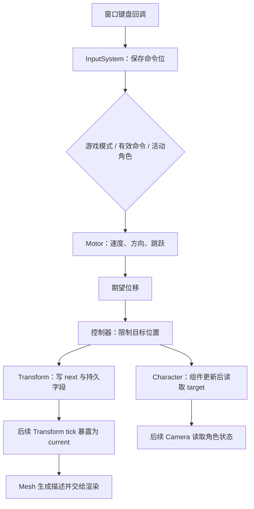

按下 W，角色向前走。这个看似简单的动作里，按键回调究竟修改了什么？角色每帧走多远，是输入系统算的，还是控制器算的？如果命令位已经置上，速度比率也在增加，角色却没动，下一步应该在哪里看？

还有一种更隐蔽的困惑：运动组件已经给出了新位置，但在同一轮更新里，网格和相机仍使用旧位置。这不一定是某个 setter 没生效，也可能是组件顺序和缓冲交接的结果。

本篇沿一条具体路径读代码：键盘事件形成游戏命令，MotorComponent 计算期望运动，控制器限制目标位置，随后把结果交给 Transform 和 Character。图形交接接回 06，相机接回 11，物理查询内部留给后续 10。

> **读这篇之前**：建议先读 [03 一帧怎样推进]()、[04 对象与组件怎样恢复]() 和 [06 位置怎样到达渲染表示]()。窗口回调的绑定与寿命见 [PCPP-2]()。
>
> 源码基线：[BoomingTech/Piccolo，固定提交 `f5053707fed4`][revision]。已核对源码与 Player/关卡资源，独立编译原输入、运动计算与控制器函数的最小 C++ 适配，数学运算使用原实现；窗口、全局上下文和物理返回值由替身提供。未运行完整引擎、真实键盘事件、Jolt 碰撞或 GPU 画面，数值和时序表分别说明条件。

## 先分清事件、意图、目标和已消费的位置

“角色移动”至少有以下几层状态：

| 层次 | 表示什么 | 不能直接推断什么 |
| --- | --- | --- |
| 输入事件 | 某个键按下、松开或重复 | 每帧该走多少距离 |
| 命令状态 | 当前保存着哪些游戏意图 | 最终方向一定非零 |
| 期望运动 | 速度、方向、跳跃状态与 delta_time 组成的位移 | 碰撞条件允许这一步 |
| 目标位置 | 控制器处理后准备采用的位置 | 其他读者已经看到了它 |
| 位置消费 | Transform、Character、网格与相机分别读取自己的输入 | 所有状态在同一时刻自动一致 |

这个拆法能帮助定位：有命令但没位移，先看速度、方向和筛选；有期望位移但没目标变化，再看控制器；目标变了但画面没变，继续看缓冲、组件顺序与渲染描述。

下面表示调用和数据关系，不表示多个独立线程：



## 按键回调保存状态，不直接移动角色

[WindowSystem][window-h] 注册 GLFW 键盘回调，再依次调用已登记的函数。[InputSystem::initialize()][input] 将自己的 onKey 绑定到这份列表。

onKey 只在 `g_is_editor_mode == false` 时进入游戏输入。编辑器模式的 W/A/S/D 由编辑器输入管理器处理相机，不能拿“编辑器相机在移动”证明游戏 Motor 已经执行。

[GameCommand][input-h] 用位标志表达 forward、backward、left、right、jump、sprint 等意图。例如 W 按下后执行：

```cpp
m_game_command |= (unsigned int)GameCommand::forward;
```

W 松开时清除对应位：

```cpp
m_game_command &= (k_complement_control_command ^ (unsigned int)GameCommand::forward);
```

所以 W 与 A 可以同时保存在命令中。只要没有相应 RELEASE 或显式重置，方向位会继续存在；角色连续行走依赖每次运动更新读取这些状态，不依赖键盘反复发出 PRESS。

[GLFW 官方输入说明][glfw-input] 将 PRESS、RELEASE 和 REPEAT 分开，并建议用保存状态或查询状态支持持续输入，避免把文本重复事件当成持续运动时钟。Piccolo 当前 PRESS/RELEASE 分支也没有把 REPEAT 当成另一次按下。

### jump 位的寿命与方向位不同，但也不是严格的一帧

进入 onKeyInGameMode 时，函数先清 jump，再处理当前 action；只有 Space 的 PRESS 再将其置上。

```cpp
m_game_command &= (k_complement_control_command ^ (unsigned int)GameCommand::jump);
```

这意味着后续任何一次游戏键盘回调，包括 REPEAT，都可能清掉 jump。反过来，若没有后续回调，它又不会仅因一轮 tick 结束就清零；InputSystem::clear 处理的是鼠标增量，不是全部游戏命令。

因此不能把这份实现描述为完善的“按下沿事件队列”或“自动单帧消费脉冲”。它能保存当前意图，却不保证保留两次运动更新之间的每一个输入事件；输入记录/回放与可靠跳跃缓冲需要另建协议。

### 游戏模式与 focusMode 是两道条件

[EditorUI 的模式按钮][editor-ui] 切入游戏模式时设置 focusMode；[WindowSystem::setFocusMode()][window-cpp] 同时控制 GLFW_CURSOR_DISABLED/NORMAL。这里的 focusMode 是应用维护的鼠标捕获状态，不能只按命名等同于操作系统键盘焦点。

InputSystem::tick 根据它设置或清除 GameCommand::invalid。Motor 看到 command 大于等于 invalid 时提前返回。本轮不会继续积分运动，也不会在这条返回分支主动重置先前的速度、目标和 is_moving；排查时应记录它们是否是上次结果。

切回编辑器模式时 UI 会 resetGameCommand。不同入口的模式、命令重置和有效标记各有时机，不应只检查 W 位。

## 把事件放回真实帧顺序

[PiccoloEngine::logicalTick()][engine] 实际先 tick WorldManager，再 tick InputSystem；tickOneFrame 在逻辑、交换和渲染之后调用 pollEvents。

```text
WorldManager::tick
  → Level / GObject / 各组件 / Character
InputSystem::tick
交换逻辑与渲染数据
渲染更新
pollEvents
```

这里 InputSystem::tick 负责鼠标角增量和有效标记，不是键盘状态唯一的写入位置。键盘回调本身就会写 m_game_command，所以“Input tick 在 World 后面”并不等于 World 永远读不到按键。

限定一种可追踪的情况：游戏模式与有效标记已稳定，W 的回调在本轮末尾 pollEvents 中到达。当前这轮 World 已执行完，后续一轮 World 才会读到这个 W 位。若 PRESS 和 RELEASE 都在下一次消费之前完成，方向位也可能已经被清除。

这只是给定到达点的调用顺序推导，不能直接转换成设备上固定多少毫秒延迟。[GLFW 也说明][glfw-input]，某些窗口系统调用可直接触发回调，不能假定所有回调只会在 pollEvents 内发生。focus 标记与鼠标角度又在 World 之后更新，模式切换边界需要另看本次先后关系。

## 谁是本次被允许移动的角色

[Level::load()][level] 根据关卡 character_name，从已创建对象中找到活动 Character。[默认关卡][level-asset] 指向 Player。

[MotorComponent::tickPlayerMotor()][motor] 不会无条件移动所有带 Motor 的对象。它先检查父对象和活动 Character，再比较双方 GObjectID；不属于当前活动角色就返回。通过后还要取得 Transform，并检查命令有效性。

接着依次执行：

```cpp
calculatedDesiredHorizontalMoveSpeed(command, delta_time);
calculatedDesiredVerticalMoveSpeed(command, delta_time);
calculatedDesiredMoveDirection(command, transform_component->getRotation());
calculateDesiredDisplacement(delta_time);
calculateTargetPosition(transform_component->getPosition());

transform_component->setPosition(m_target_position);
```

这是本文的阅读主轴：先计算状态，再组成期望位移，最后求目标并写回。名称里虽然有 Controller，运动规则的大量计算仍在 Motor 中，不能把全部行为都归给控制器。

### 资源数值只是运行参数的起点

[player.object.json][player-asset] 中的 Motor 定义包括：

| 字段 | 定义值 | 在本路径中的作用 |
| --- | --- | --- |
| move_speed | 2 | 水平基准速度 |
| max_move_speed_ratio | 1 | 普通运动比率上限 |
| max_sprint_speed_ratio | 2 | 冲刺比率上限 |
| move_acceleration / sprint_acceleration | 2 / 2 | 比率随时间变化的速率 |
| jump_height | 1 | 起跳速度计算的高度参数 |
| controller_config | PhysicsControllerConfig | 创建 CharacterController |

参数经过定义加载、实例覆盖，还可能被脚本改写。这个 Player 的 Lua 示例会依据 m_is_moving，把 jump_height 改成 10 或 5；[LuaComponent::tick()][lua] 执行脚本文本。不能把定义中的 1 当成运行每次起跳都使用的实测高度。

后面的水平例子固定这些速度参数；跳跃例子会明确固定高度与重力。Lua 的反射访问细节留给 14。

## 水平运动：速度比率与方向分别计算

### 先增减比率，再乘基准速度

Motor 检查 W/A/S/D 是否存在，并排除 free_carema 命令，再决定加速或减速；实际位标志的拼写就是 free_carema。

比率尚未达到普通上限时，先按 move_acceleration 增加，并钳在普通范围。达到普通上限后，再依据 sprint 决定是否向冲刺上限增加。没有移动命令时，按减速分支降低比率并钳住范围。

核心更新是：

```cpp
m_move_speed_ratio += (is_acceleration ? 1.0f : -1.0f) * final_acceleration * delta_time;
m_move_speed_ratio = std::clamp(m_move_speed_ratio, min_speed_ratio, max_speed_ratio);
```

m_move_speed_ratio 本身不是世界速度；本路径的水平速度大小还要乘 move_speed。也不能看到 Shift 位就认定从静止立即采用冲刺上限。

给定初始比率 0、W、delta_time=0.1，首次更新后比率为 0.2，水平速度为 `2×0.2=0.4`，本步距离为 `0.4×0.1=0.04`。这按当前离散更新顺序计算，不是对连续加速方程的精确积分。

### 方向来自对象朝向，不是直接来自相机 forward

在 JumpState::idle 时，源码以对象旋转建立两个基向量：

```cpp
Vector3 forward_dir = object_rotation * Vector3::NEGATIVE_UNIT_Y;
Vector3 left_dir    = object_rotation * Vector3::UNIT_X;
```

再叠加 W/S/A/D 对应的正负方向并归一化。单位朝向下，W 指向世界 -Y，W+A 则约为 `(0.707107,-0.707107,0)`。正常归一化使斜向不会仅因叠加两个单位向量就获得 √2 倍速度。

[默认关卡的 Player 实例][level-asset] 还有绕 Z 的旋转覆盖，并非单位朝向；它对应的 W 方向约为世界 +X。所以上面的方向例子不能直接当成默认场景的运动轴。相机怎样改变 Character 朝向，再怎样交回对象旋转，接着看 11。

W+S 会使方向互相抵消，但“存在移动命令”的判定仍成立，比率仍可能增加。因此有加速比率，不等于已有非零位移或 m_is_moving=true。

### 松键、其他命令与自由相机的边界

函数只在 command>0 时先把方向清零，然后叠加方向位。如果 command 恰好为 0，前一方向会保留，配合比率减小形成减速滑行。

例如接上面的单位朝向例子，松开 W 后 command=0，再更新 0.05 秒，比率从 0.2 降到 0.1，仍沿 -Y 移动 `2×0.1×0.05=0.01`。若仍有 Shift 等非方向命令，command>0 却没有方向叠加，缓存方向会被清零，不能把所有松键组合都描述成相同滑行。

free_carema 也只让速度计算不再把方向键视作加速意图，方向函数并没有同步屏蔽这些键。因此切换自由相机时，已有比率尚未降为零且仍按着方向键，角色仍可能产生减速中的位移；它不是无条件立即冻结全部角色运动的总开关。

## 跳跃与位移：先保存状态，再按本步时间换成距离

垂直速度函数在 idle 且有 jump 时进入 rising，使用物理场景重力向量的长度 g 计算：

```text
起跳速度 vz = sqrt(2 × jump_height × g)
后续 rising/falling 更新：vz -= g × delta_time
```

起跳分支还保存当时的水平速度比率。空中组成位移时使用这份比率，方向函数也只在 idle 时更新，因此空中不会按同一套规则重新计算移动方向。

注意调用顺序：垂直速度先把状态改成 rising，随后方向函数就会跳过 idle 分支。若第一次同时按 W 与 Space，不能直接认定它已经采用这次 W 算出的新方向；还应查看起跳前缓存了什么方向。

在限定高度 1、重力长度 15、无脚本改写的练习中，起跳速度约为 √30≈5.477226；后续空中更新 0.1 秒后约为 3.977226。这是 Motor 的速度积分，不是 Jolt 把角色刚体抛起的结果，也不保证实际轨迹恰好达到设定高度。

最终期望位移由水平和世界 Z 方向相加：

```cpp
m_desired_displacement =
    m_desired_horizontal_move_direction * m_motor_res.m_move_speed * horizontal_speed_ratio * delta_time +
    Vector3::UNIT_Z * m_vertical_move_speed * delta_time;
```

这解释了为什么输入系统不应该直接存“这次走 0.04 个单位”：距离取决于本步时间、运动状态、参数和方向。当前 delta_time 来自主循环计算，并不是本篇已确认的一套固定步长运动调度。

## 控制器接受的是位移，返回的是位置

[Motor 的目标位置函数][motor] 根据 ControllerType 分三路：none 直接相加，physics 调用控制器，其他类型保持当前位置。[postLoadResource][motor] 根据配置类型名创建 CharacterController；有类和配置不代表全部控制器算法都已实现。

[CharacterController::move()][controller] 的关键逻辑为：

```cpp
Vector3 final_position = current_position + displacement;

Transform final_transform = Transform(final_position, Quaternion::IDENTITY, Vector3::UNIT_SCALE);

if (physics_scene->isOverlap(m_rigidbody_shape, final_transform.getMatrix()))
{
    final_position = current_position;
}
```

胶囊形状按配置建立；这里只说明它检查候选终点，重叠则整步退回。没有沿运动路径做 sweep，也没有在这段逻辑里按接触法线滑墙、分解水平/竖直步进或处理台阶。沿途是否穿过薄障碍，不能只凭终点不重叠作保证。

物理适配最终进入 PhysicsScene::isOverlap，详细形状转换、查询与刚体更新留给 10。本篇不把它当成已经具备完整行为的通用角色控制器。

### 地面还含一段独立的 Z 平面处理

控制器返回后，Motor 还检查：

```cpp
if (m_jump_state == JumpState::falling && final_position.z + m_desired_displacement.z <= 0.f)
```

满足时将 final_position.z 设为 0，并把状态改回 idle。源码将它标作 Motor 层的跳跃模拟特例；这不是基于实际地面法线和接触点的落地检测。

尤其要按表达式原样读：none 路径中的 final_position 已包含一次位移，判定却又加一次 m_desired_displacement.z。例如当前位置 z=1、本步 dz=-0.6，候选位置本为 0.4，但条件使用 `0.4-0.6`，会触发钳到 0。不能把当前代码简写为“只有目标位置低于地面才落地”。

最后 m_is_moving 由目标与当前位置的平方距离是否大于 0 决定，它不等于方向键状态，也不只代表水平移动。控制器拒绝且没有其他修正时，它可以为 false，即使比率仍然很大。

## 写回之后，谁在本轮看见新位置

[TransformComponent::setPosition()][transform] 写入 next 缓冲、持久字段 m_transform，并置 dirty。[getPosition/getMatrix][transform-h] 读取的却是 current；要到后续 Transform::tick 交换索引，新位置才成为 current。

[Character::tick()][character] 又在 Level 的对象组件循环之后执行，读取 Motor 的 target，保存到自己的 m_position。Character 位置和 Transform current 是两份状态，不是同一个字段的两个名字。

默认 Player 的实际加载顺序可以由 [关卡实例][level-asset] 和 [定义文件][player-asset] 合并核对：

```text
Transform → Animation → Mesh → Motor → Camera → Lua
随后 Level 更新活动 Character，再 tick 物理场景
```

实例的 Transform 先恢复；定义中同类型组件被跳过，其余组件按数组顺序追加。[GObject::tick()][object] 按列表顺序执行，不会自动把 Motor 重新排到 [Mesh][mesh] 前面；[CameraComponent][camera] 又从活动 Character 取得跟随状态。

### 用两个位置符号核对一轮更新

限定游戏模式、有效输入、上述组件顺序、没有其他写位置者；以本轮 Transform tick 后 current 与 Character 都是 P0 为起点，Motor 本次算出 P1。初始 dirty 或上一轮 Motor 写入留下的 dirty 能让 Mesh 发布当前矩阵，且交换条件满足。

| 本轮位置 | 读取或写入的值 |
| --- | --- |
| Transform tick 后 | current 暴露此前已准备的位置 P0 |
| Mesh tick | 读取 current P0，构造本次渲染描述 |
| Motor tick | 从 P0 计算 P1，setPosition 写 next=P1，dirty=true |
| Camera tick | 读取 Character 尚未在本轮更新的 P0 |
| Character tick | 从 Motor target 取得 P1，保存到 Character |
| 交换并消费对象描述 | 本轮已有 Mesh 描述仍是 P0 |
| 后续一轮 Transform/Mesh | current 变成 P1，Mesh 可以发布 P1 |

这张表没有假设屏幕立即完成显示，只说明各调用读取什么。也不能推广到被修改过的组件顺序、其他移动写入者或编辑器模式。

因而在 Motor 返回处看见 P1，并不能要求此前已经执行过的 Mesh 回头重算。看到相机入口的 Character 位置较旧，也应先核对它与 Level::Character tick 的先后。旋转回写与第三人称视图的具体时序继续见 [11 相机篇]()。

## 怎样验证一次 W 到底完成到哪里

本篇的 CPU 检查复用原输入、五个运动计算函数、控制器 move 及原向量/四元数/矩阵实现，验证了命令组合、jump 寿命、加减速、方向归一、给定旋转、跳跃速度和终点接受/拒绝。

窗口和全局上下文由最小替身提供，物理重叠结果按用例返回 true/false；它没有创建 Jolt 世界、执行真实 GLFW 回调，也没有执行完整组件调度。帧间位置表仍属于指定条件下的源码推导。

待 [构建与调试基线]() 可用后，按下表逐层记录：

| 位置 | 记录什么 | 能解释什么 |
| --- | --- | --- |
| WindowSystem → InputSystem::onKey | key/action、游戏模式、回调时点 | 事件有没有到达正确入口 |
| onKeyInGameMode / InputSystem::tick | 命令位、jump、focusMode 与 invalid | 持续状态是否符合实际事件顺序 |
| tickPlayerMotor 入口 | 父 ID、活动 Character ID、command、delta_time | 哪道筛选使运动提前返回 |
| 速度与方向函数之后 | 比率、跳跃状态、方向、运行中的参数 | 为什么有意图却没有期望位移 |
| Controller::move 前后 | current、displacement、候选终点、overlap 与返回位置 | 哪一步拒绝了运动 |
| setPosition / 下一次 Transform tick | current/next、持久字段、dirty | 目标何时成为读取位置 |
| Mesh / Camera / Character tick | 实际组件顺序、各自位置、对象描述 | 本轮画面为何仍可能使用旧值 |

先固定地面、朝向、脚本参数和时间步长，只按 W；再分别加入松键、斜向、相反键、Shift、跳跃和障碍。一次只改变一个条件，避免把命令未到达、控制器拒绝和位置尚未被消费混成同一个“不动”。

**从按键追到角色位移，要依次核对命令、期望运动、受约束目标，以及各读者实际消费的位置。**

## 继续阅读

- [11：相机怎样跟随角色，并把视角交给渲染系统]()：接着追 Character 状态、朝向回写与观察矩阵。
- [06：改一个位置，怎样沿逻辑数据追到渲染表示]()：继续检查 Mesh 描述、部件与渲染实体。
- [03：一帧怎样推进]()：核对更新、交换和线程证据。
- [PCPP-2：窗口与编辑器回调]()：回看分发与绑定生命周期。

[10《刚体与碰撞查询怎样参与角色运动》]() 已展开本篇的物理边界，说明场景障碍、胶囊查询、形状同步与步进；[12 动画与蒙皮]() 已有正文，[13 粒子发射器与 GPU 模拟]() 已有正文，[14 Lua 脚本、组件与反射调用]() 已补齐运行时参数来源，原定主线正文齐备。

Piccolo 源码节选版权：Copyright (c) 2022 Contributors to the Piccolo Engine，按 [MIT License][license] 提供。条件数值、源码时序与实际运行验证分别说明。

[revision]: https://github.com/BoomingTech/Piccolo/tree/f5053707fed4d3f94d270a436fb0d3a8ae54e3e5
[license]: https://github.com/BoomingTech/Piccolo/blob/f5053707fed4d3f94d270a436fb0d3a8ae54e3e5/LICENSE
[input]: https://github.com/BoomingTech/Piccolo/blob/f5053707fed4d3f94d270a436fb0d3a8ae54e3e5/engine/source/runtime/function/input/input_system.cpp
[input-h]: https://github.com/BoomingTech/Piccolo/blob/f5053707fed4d3f94d270a436fb0d3a8ae54e3e5/engine/source/runtime/function/input/input_system.h
[window-h]: https://github.com/BoomingTech/Piccolo/blob/f5053707fed4d3f94d270a436fb0d3a8ae54e3e5/engine/source/runtime/function/render/window_system.h
[window-cpp]: https://github.com/BoomingTech/Piccolo/blob/f5053707fed4d3f94d270a436fb0d3a8ae54e3e5/engine/source/runtime/function/render/window_system.cpp
[editor-ui]: https://github.com/BoomingTech/Piccolo/blob/f5053707fed4d3f94d270a436fb0d3a8ae54e3e5/engine/source/editor/source/editor_ui.cpp
[engine]: https://github.com/BoomingTech/Piccolo/blob/f5053707fed4d3f94d270a436fb0d3a8ae54e3e5/engine/source/runtime/engine.cpp
[level]: https://github.com/BoomingTech/Piccolo/blob/f5053707fed4d3f94d270a436fb0d3a8ae54e3e5/engine/source/runtime/function/framework/level/level.cpp
[object]: https://github.com/BoomingTech/Piccolo/blob/f5053707fed4d3f94d270a436fb0d3a8ae54e3e5/engine/source/runtime/function/framework/object/object.cpp
[motor]: https://github.com/BoomingTech/Piccolo/blob/f5053707fed4d3f94d270a436fb0d3a8ae54e3e5/engine/source/runtime/function/framework/component/motor/motor_component.cpp
[motor-h]: https://github.com/BoomingTech/Piccolo/blob/f5053707fed4d3f94d270a436fb0d3a8ae54e3e5/engine/source/runtime/function/framework/component/motor/motor_component.h
[controller]: https://github.com/BoomingTech/Piccolo/blob/f5053707fed4d3f94d270a436fb0d3a8ae54e3e5/engine/source/runtime/function/controller/character_controller.cpp
[transform]: https://github.com/BoomingTech/Piccolo/blob/f5053707fed4d3f94d270a436fb0d3a8ae54e3e5/engine/source/runtime/function/framework/component/transform/transform_component.cpp
[transform-h]: https://github.com/BoomingTech/Piccolo/blob/f5053707fed4d3f94d270a436fb0d3a8ae54e3e5/engine/source/runtime/function/framework/component/transform/transform_component.h
[mesh]: https://github.com/BoomingTech/Piccolo/blob/f5053707fed4d3f94d270a436fb0d3a8ae54e3e5/engine/source/runtime/function/framework/component/mesh/mesh_component.cpp
[camera]: https://github.com/BoomingTech/Piccolo/blob/f5053707fed4d3f94d270a436fb0d3a8ae54e3e5/engine/source/runtime/function/framework/component/camera/camera_component.cpp
[character]: https://github.com/BoomingTech/Piccolo/blob/f5053707fed4d3f94d270a436fb0d3a8ae54e3e5/engine/source/runtime/function/character/character.cpp
[lua]: https://github.com/BoomingTech/Piccolo/blob/f5053707fed4d3f94d270a436fb0d3a8ae54e3e5/engine/source/runtime/function/framework/component/lua/lua_component.cpp
[player-asset]: https://github.com/BoomingTech/Piccolo/blob/f5053707fed4d3f94d270a436fb0d3a8ae54e3e5/engine/asset/objects/character/player/player.object.json
[level-asset]: https://github.com/BoomingTech/Piccolo/blob/f5053707fed4d3f94d270a436fb0d3a8ae54e3e5/engine/asset/level/1-1.level.json
[glfw-input]: https://www.glfw.org/docs/latest/input_guide.html
