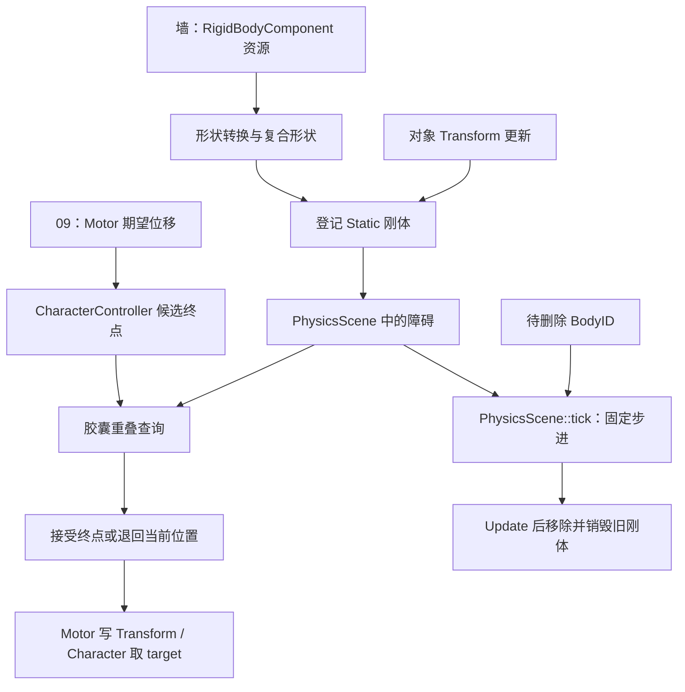

上一篇已经追到 Motor 计算期望位移，再让控制器决定是否采用目标位置。现在继续问：控制器查到的墙来自哪里？玩家是不是也作为动态刚体加入了物理世界？物理系统里虽然有重力、线程池和 Update，是否就意味着角色的位置由物理解算器决定？

另一个常见困惑是：对象缩放后画面已经变了，碰撞形状是否也同步了？刚体组件请求删除后，物理查询会不会立刻看不到旧形状？这些问题需要同时追创建、查询、更新与释放，不能只读一个 isOverlap。

> **读这篇之前**：[09 从按键到角色位移]() 负责输入、速度与目标位置；[04 对象与组件恢复]() 负责资源加载，[06 位置进入渲染表示]() 负责 Transform 与渲染。本文只接物理参与的路径，不重复整套运动计算。
>
> 源码基线：[BoomingTech/Piccolo，固定提交 `f5053707fed4`][revision]。已核对项目及随附 Jolt 源码、墙与 Player 资源；以原形状转换、步进和更新函数做独立 C++ 适配，使用原数学实现与记录替身。未运行完整引擎、Jolt 碰撞或实际角色画面，参数与调用序列检查不作为物理效果实测。

## 刚体、查询与模拟，分别回答什么

先把“物理参与运动”拆成几个问题：

| 层次 | 负责什么 | 需要另查的关系 |
| --- | --- | --- |
| 几何形状 | 描述盒、球、胶囊的尺寸与局部姿态 | 是否与可见网格一致 |
| 物理刚体 | 把形状、姿态与运动类型登记到物理世界 | 是否动态、谁更新其姿态 |
| 场景查询 | 回答某条线、某个形状位置或运动路径是否命中 | 是否改变世界状态 |
| 物理步进 | 推进约束、碰撞和刚体状态 | 使用什么时间步，结果由谁读回 |
| 引擎同步 | 在 Transform、组件与物理世界间交接 | 同步方向与生效时点 |

动态刚体驱动角色是一种设计：给刚体力或速度，再把解算结果交回游戏对象。另一种设计由游戏运动逻辑计算目标，再用查询限制它。两种方式都可能使用同一个物理库，不能仅凭依赖名判断是哪一种。

Piccolo 默认 Player 的这条路径属于后者。它的定义有 MotorComponent，却没有 RigidBodyComponent；控制器拿胶囊去查询，场景中的墙等对象则通过刚体组件建立障碍。

下面的实线表示当前路径的数据或调用交接；没有从物理 Update 返回 Player 位置的箭头，是因为这条实现中没有建立这样的回写链：



## 墙怎样从资源成为物理世界中的障碍

[Level::load()][level] 根据关卡 gravity 创建 PhysicsScene，再恢复关卡对象。刚体组件在 [postLoadResource()][rigidbody] 中找到父对象的 Transform 和当前物理场景，调用 createRigidBody，并保存返回的 BodyID。

这里的 BodyID 是物理库的刚体身份，不能直接当作 GObjectID、渲染 instance ID 或 Mesh asset ID。当前 PhysicsHitInfo 返回 body_id，也没有在这个结果结构里自动附上场景对象指针。

以 [wall.object.json][wall] 为例，刚体定义包含一个 Box：半尺寸为 `(0.15,5,3.5)`，局部位置为 `(0,0,3.5)`。在单位缩放、无额外旋转的条件下，盒子的完整尺寸是 `(0.3,10,7)`，Z 范围从 0 到 7；这不是根据网格三角形实时拟合出的碰撞形状。

[RigidBodyShape 资源][rigid-res] 把局部 Transform 和多态 geometry 放在一起。运行时还存在 m_type、包围盒等字段，但当前 [toShape()][jolt-utils] 实际根据 geometry 的类型名分派，不能只追枚举字段就认定已经找到几何创建入口。

### 先合成形状姿态，再决定尺寸

[createRigidBody()][physics-scene] 对每个形状建立：

```cpp
const Matrix4x4 shape_global_transform = global_transform.getMatrix() * shape.m_local_transform.getMatrix();
```

再分解该矩阵，将分解出的 scale 交给 toShape。当前转换规则为：

| 类型 | 传给 Jolt 构造器的尺寸 |
| --- | --- |
| Box | 三轴 half_extents 分别乘 scale.x/y/z |
| Sphere | radius 乘三轴 scale 的平均值 |
| Capsule | half_height 乘 scale.z，radius 乘 scale.x/y 的平均值 |

例如盒半尺寸 `(0.15,5,3.5)` 配比例 `(2,3,4)`，记录到构造器的半尺寸为 `(0.3,15,14)`。这是参数转换结果，不是已经验证任意旋转和非均匀缩放组合都具有预期碰撞轮廓。

球在非均匀缩放下仍被转成一个球，胶囊也使用平均半径；这不是将球精确变成椭球的通用几何缩放方案。负缩放、退化尺寸和旋转叠加还需要满足物理形状及矩阵约束，本文不凭几个乘法宣称全部支持。

所有有效形状随后进入 StaticCompoundShapeSettings；局部位置和旋转交给复合形状，刚体位置与旋转则来自对象的 global_transform。读代码时要分别标注：哪些缩放烘进几何尺寸，哪些变换放在子形状上，哪些放在刚体上。

toShape 虽有 Box/Sphere/Capsule 分支，也不代表资源全链路都同等完整。[RigidBodyShape 的复制构造][rigid-res-cpp] 当前只处理 Box；因此不能把形状转换分支表扩写成所有资源复制、反序列化和编辑路径都已覆盖三种几何。

## actor_type 字段存在，不代表创建了动态刚体

资源还保存 actor_type 与 inverse_mass。但固定实现的 createRigidBody 明确选择：

```cpp
JPH::EMotionType motion_type = JPH::EMotionType::Static;
JPH::ObjectLayer layer       = Layers::NON_MOVING;
```

这两个资源字段没有在该函数中决定运动类型、质量或层。随后 CreateBody、AddBody 将这个静态刚体登记到 Jolt，返回包含索引与序列信息的 BodyID。

所以不能说“把 actor_type 改一下，当前引擎就会自动掉落或受力运动”。底层库支持动态刚体，与 Piccolo 这条适配路径已经消费了哪些能力，是两件事。

[RigidBodyComponent::tick()][rigidbody-h] 本身为空。结合当前创建、Transform 更新和角色路径，也没有建立“动态刚体模拟后逐帧把位置读回 Player Transform”的闭环。默认 Player 更没有这个刚体组件，角色重力与跳跃沿用 09 中 Motor 的计算。

### 静态对象之间不产生模拟配对，为什么查询还能看到墙

PhysicsScene 初始化时传入 [BroadPhaseCanCollide/ObjectCanCollide][jolt-utils]。它们用于物理世界的层配对，例如 NON_MOVING 对 NON_MOVING 不通过这一组模拟碰撞筛选。

但角色不是再添加一个 NON_MOVING 刚体与墙做配对，它调用的是场景查询。[随附 Jolt 的 NarrowPhaseQuery][jolt-query] 为 CollideShape 提供默认查询过滤器；Piccolo 没有在这里显式传对象层或自身 BodyID 排除规则。[默认 ObjectLayerFilter][jolt-filter] 允许各层通过。

因此不能根据模拟层配对表推导“角色查询一定看不到静态墙”，也不能反过来宣称查询自动继承了游戏阵营、触发器或自身排除语义。需要分别核对世界配对过滤和本次查询参数。

## 控制器胶囊怎样放到角色脚下

[Player 的 Motor 配置][player] 给胶囊 half_height≈0.7、radius≈0.3。[随附 Jolt 的 CapsuleShape][jolt-capsule] 以局部 Y 轴放置胶囊，两端球心在 Y=±half_height，整体还要加两端半径。

[CharacterController 构造器][controller] 绕 X 旋转 90°，再把局部位置抬高 `half_height+radius`。于是单位缩放、脚点 z=0 时，胶囊中心约在 z=1，底部约 0，顶部约 2。这个半高参数是两端球心间线段的一半，不是包含球帽后的总半高。

```cpp
m_rigidbody_shape.m_local_transform =
    Transform(Vector3(0, 0, capsule.m_half_height + capsule.m_radius), orientation, Vector3::UNIT_SCALE);
```

这里创建的是用于查询的 RigidBodyShape。构造器没有调用 PhysicsScene::createRigidBody/AddBody，因此它不会仅因为名为 m_rigidbody_shape 就作为玩家刚体常驻世界。

move 每次使用 `current_position+displacement` 建候选 Transform，旋转取单位值、缩放取单位值，再调用 isOverlap。角色对象的朝向或缩放并没有在这里原样传成查询根变换。

## 一次 isOverlap 实际做了什么

[PhysicsScene::isOverlap()][physics-scene] 将候选对象矩阵与形状局部矩阵相乘，分解 scale，调用 toShape，再执行：

```cpp
JPH::AnyHitCollisionCollector<JPH::CollideShapeCollector> collector;
scene_query.CollideShape(jph_shape,
                         JPH::Vec3::sReplicate(1.0f),
                         toMat44(shape_global_transform),
                         JPH::CollideShapeSettings(),
                         collector);
```

它返回 collector.HadHit，只回答是否有重叠，没有把接触法线、穿透深度或可沿墙方向反馈给 Motor。控制器随后使用这个布尔值：有重叠整步退回，否则采用终点。

[Jolt 官方查询概述][jolt-doc-query] 可帮助理解线与形状查询的区别，但官网当前 API 与这里随附的旧接口已经有参数差异。本文逐项调用以固定提交中的头文件为准，不把新文档签名直接套到旧源码。

这条实现没有调用 sweep 检查起点到终点之间的整个运动路径。因此终点空闲不能保证途中没穿过薄障碍，碰撞时也没有自动沿法线滑墙、抬脚跨台阶或寻找实际地面。09 的 Z=0 落地特例仍是另一个 Motor 条件，不是这里的接触结果。

### false 可能不只表示空间安全

toShape 返回空指针时，isOverlap 直接返回 false。上层只接收布尔值，不能区分“有效形状未重叠”与“没有成功构造查询形状”。默认胶囊走支持分支，但排查自定义形状时不能跳过这一层。

形状使用的是裸指针。toShape 中创建了 Jolt 形状，而 isOverlap/sweep 返回前没有显式释放或用 Ref 承接；不能把临时查询形状当成已经建立完整自动回收协议。这里记录的是可见的所有权路径，未做进程内存增长测量，也没有修改实现。

缩放也要保留边界：尺寸已经按分解 scale 构造，查询又传入单位 shape scale 与合成矩阵。本文只用单位缩放的控制器解释轮廓，不据此证明任意带缩放矩阵都满足 Jolt 的形状/姿态约定。

## raycast、sweep 和 overlap 不是同一个问题

PhysicsScene 还定义了另外两种查询：

| 查询 | 当前包装的输入与输出 | 在角色移动中的实际位置 |
| --- | --- | --- |
| raycast | 起点、归一化方向×长度；收集并排序命中，输出位置/法线/距离/BodyID | 当前控制器没有调用 |
| sweep | 形状起始变换、归一化方向×长度；CastShape 后收集并排序命中 | 当前控制器没有调用 |
| isOverlap | 一个形状姿态；AnyHit 布尔结果 | CharacterController::move 的终点门槛 |

在固定 engine/source 范围核对调用，raycast/sweep 只有声明和定义，没有找到业务调用点。接口和 SweepPass 枚举存在，不等于玩家已实现 sweep 分步运动。编辑器对象拾取又走 [18 的整数 ID 图回读]()，不能把它补写成物理 raycast 的使用示例。

包装接口还有一个结果容器边界：raycast 和 sweep 在没有命中时提前返回 false，而 out_hits.clear 在成功分支里。如果调用者复用上次结果数组，就必须先看本次返回值；不能把数组里仍有旧条目当成本次又命中。

这些函数提供的是查询结果，不会仅因调用一次就把 GObject 自动推出障碍、生成游戏碰撞事件或施加伤害。响应策略仍需要调用者负责。

## Transform 怎样同步，缩放为什么会重建

[TransformComponent][transform] 在 tick 中交换 current/next；dirty 时查找 RigidBodyComponent，传入 current Transform 与 scale-dirty 标记。

[RigidBodyComponent::updateGlobalTransform()][rigidbody] 有两路：

- 只更新位置或旋转：调用 updateRigidBodyGlobalTransform，经 BodyInterface::SetPositionAndRotation 改已有刚体姿态。
- scale-dirty：先请求移除旧 BodyID，再按新 Transform 创建刚体，将组件保存的 ID 改为新值。

这条分支与前面把缩放烘进形状尺寸的选择相对应：改变 scale 需要重新构造形状。它不是只给刚体矩阵填一个 scale 字段。

与此同时，要确认写入是否真的经过 setter。编辑器反射直接写字段与 Transform::setScale 对 dirty 标志的影响并不相同，具体入口见 [08 编辑器修改与保存]()。

### 请求移除不等于立刻从查询世界消失

PhysicsScene::removeRigidBody 当前只把 ID 追加到 m_pending_remove_bodies。PhysicsScene::tick 的顺序是：

```text
Jolt PhysicsSystem::Update
遍历 pending：RemoveBody → DestroyBody
清空 pending
```

所以缩放重建时，旧刚体先进入待删列表，新刚体却在创建路径立即加入。到下一次 drain 之前，不能保证旧、新形状绝不同时在物理世界中可查询；正常控制流的那次 Update 也发生在旧刚体正式删除之前。

这并不等同于已在默认场景观测到双重碰撞，只是当前调用顺序允许的中间状态。独立记录替身确认了“排旧 → 建新 → Update → 移除旧 → 销毁旧”的调用次序，真实查询结果仍需运行观察。

组件析构也会请求移除刚体；C++ 对象释放、删除请求入队、Jolt Body 移除与销毁是不同完成点。编辑器删除和 Level 持有关系继续见 18 与 PCPP-1，不能只在对象表 erase 处宣称所有物理资源已经清完。

## 世界更新和物理步进，用的不是同一套时间规则

[Level::tick()][level] 先遍历对象并更新组件，再更新活动 Character，最后调用 PhysicsScene::tick。控制器查询在组件执行期间发生，位于本轮物理 Update 之前。

Transform 的位置同步又发生在各对象的组件更新里。Level 对象表是 [unordered_map][level-h]，不能假设运行中被修改的墙永远先于 Player 更新。静态场景中已稳定的障碍容易追清；运动障碍则必须记录本次查询看到的是哪一版姿态。

物理 tick 接收 delta_time，却实际计算：

```cpp
const float time_step = 1.f / m_config.m_update_frequency;
```

然后每次调用一次 Update。默认 [PhysicsConfig][physics-config] 的频率是 60，传入的 delta_time 没有参与步长或累积补步。

因此准确表述是“每 tick 固定推进 1/60 秒”，不能直接称为“已实现独立于渲染帧率的 60 Hz 固定模拟”。当前包装中没有根据累计真实时间决定执行零次、一次或多次的 accumulator。

例如在频率维持 60、每次 Update 正常执行的限定下，30 次调用传给物理世界的时间总和是 0.5 秒，120 次为 2 秒。若只是把它们对应为一秒内的不同渲染帧数，模拟时间自然不同；这不是本文测量到的设备帧率或模拟误差。

09 的 Motor 位移与跳跃使用外部传入的 delta_time，物理步进则使用自己的固定值。阅读时要分别标出两个时钟，不能因为二者在同一轮 Level::tick 里，就把它们当成相同时间积分。

PhysicsScene 确实将工作交给 Jolt JobSystemThreadPool，但不能据此把整段角色逻辑画成一个独立物理线程。本篇记录主调用顺序与库内任务入口，线程采样仍是另一项运行证据。

## 怎样验证物理究竟参与到了哪一步

本篇的最小程序复用原 toShape、PhysicsScene::tick、RigidBodyComponent::updateGlobalTransform 及控制器局部姿态片段，数学使用原实现。Jolt 构造器、Update 与 BodyInterface 使用记录替身，只验证参数和调用顺序。

检查包括盒尺寸、球平均半径、胶囊参数、Y→Z 姿态、单位缩放下胶囊底部/顶部，以及给定 delta_time=0.5/0.001 时均向 Update 传 1/60。没有编译/运行 Jolt 碰撞或真实刚体创建，不能把这些检查称为已复现墙面阻挡。

待 [完整构建与调试基线]() 可用后，可以沿以下检查点取证：

| 检查点 | 记录什么 | 能回答什么 |
| --- | --- | --- |
| Level/刚体 postLoad | 活动 PhysicsScene、对象与 BodyID、资源形状 | 查询世界里有没有这个障碍 |
| createRigidBody/toShape | 合成矩阵、分解 scale、尺寸、motion_type/layer | 文件字段实际消费成了什么 |
| 控制器 move | current、期望位移、候选终点、胶囊姿态 | 查询形状与可见角色是否对齐 |
| isOverlap | 有效 shape、过滤参数、collector、返回值 | 真未重叠，还是形状创建失败 |
| Transform/刚体更新 | dirty/scale-dirty、current、旧/新 BodyID | 碰撞形状何时采用新姿态 |
| PhysicsScene::tick | 外部 delta_time、实际 time_step、Update 次数、pending | 时间和删除在哪一步生效 |
| 后续 Motor/渲染 | 控制器返回、target、Transform 与画面 | 阻挡和实际位移是否一致 |

先用稳定静态墙与单位胶囊验证终点接受/拒绝，再单独测试贴边、薄墙、大位移、缩放重建和移动障碍。射线/扫掠接口的实验也应单独建立调用者，不能把未接入角色路径的函数当成已启用功能。

**读物理参与角色运动，要分别确认障碍的登记、查询的输入输出，以及目标位置与物理世界各自的更新时点。**

## 继续阅读

- [09：从按键到角色位移]()：回查期望位移、Z 平面特例与目标写入。
- [11：相机怎样跟随角色]()：继续追 Character 位置成为视图输入。
- [08：编辑器修改、保存与恢复]()：核对反射写入、setter 与资源持久化。
- [18：编辑器拾取、创建与删除]()：区分图形拾取、逻辑删除与物理清理。
- [PCPP-1：对象容器、借用与遍历]()：继续检查局部持有、组件析构与上下文寿命。

主线 [12 动画与蒙皮]() 已有正文，[13 粒子发射器与 GPU 模拟]() 已有正文，[14 Lua 脚本、组件与反射调用]() 已有正文；实际角色、物理和 GPU 验证按各篇记录保持独立状态。

Piccolo 与随附 Jolt 的源码节选按固定仓库中的 [MIT License][license] 及相应文件版权标注提供。条件参数、CPU 记录与引擎运行分别说明。

[revision]: https://github.com/BoomingTech/Piccolo/tree/f5053707fed4d3f94d270a436fb0d3a8ae54e3e5
[license]: https://github.com/BoomingTech/Piccolo/blob/f5053707fed4d3f94d270a436fb0d3a8ae54e3e5/LICENSE
[level]: https://github.com/BoomingTech/Piccolo/blob/f5053707fed4d3f94d270a436fb0d3a8ae54e3e5/engine/source/runtime/function/framework/level/level.cpp
[level-h]: https://github.com/BoomingTech/Piccolo/blob/f5053707fed4d3f94d270a436fb0d3a8ae54e3e5/engine/source/runtime/function/framework/level/level.h
[rigidbody]: https://github.com/BoomingTech/Piccolo/blob/f5053707fed4d3f94d270a436fb0d3a8ae54e3e5/engine/source/runtime/function/framework/component/rigidbody/rigidbody_component.cpp
[rigidbody-h]: https://github.com/BoomingTech/Piccolo/blob/f5053707fed4d3f94d270a436fb0d3a8ae54e3e5/engine/source/runtime/function/framework/component/rigidbody/rigidbody_component.h
[rigid-res]: https://github.com/BoomingTech/Piccolo/blob/f5053707fed4d3f94d270a436fb0d3a8ae54e3e5/engine/source/runtime/resource/res_type/components/rigid_body.h
[rigid-res-cpp]: https://github.com/BoomingTech/Piccolo/blob/f5053707fed4d3f94d270a436fb0d3a8ae54e3e5/engine/source/runtime/resource/res_type/components/rigid_body.cpp
[physics-scene]: https://github.com/BoomingTech/Piccolo/blob/f5053707fed4d3f94d270a436fb0d3a8ae54e3e5/engine/source/runtime/function/physics/physics_scene.cpp
[physics-config]: https://github.com/BoomingTech/Piccolo/blob/f5053707fed4d3f94d270a436fb0d3a8ae54e3e5/engine/source/runtime/function/physics/physics_config.h
[jolt-utils]: https://github.com/BoomingTech/Piccolo/blob/f5053707fed4d3f94d270a436fb0d3a8ae54e3e5/engine/source/runtime/function/physics/jolt/utils.cpp
[controller]: https://github.com/BoomingTech/Piccolo/blob/f5053707fed4d3f94d270a436fb0d3a8ae54e3e5/engine/source/runtime/function/controller/character_controller.cpp
[transform]: https://github.com/BoomingTech/Piccolo/blob/f5053707fed4d3f94d270a436fb0d3a8ae54e3e5/engine/source/runtime/function/framework/component/transform/transform_component.cpp
[player]: https://github.com/BoomingTech/Piccolo/blob/f5053707fed4d3f94d270a436fb0d3a8ae54e3e5/engine/asset/objects/character/player/player.object.json
[wall]: https://github.com/BoomingTech/Piccolo/blob/f5053707fed4d3f94d270a436fb0d3a8ae54e3e5/engine/asset/objects/environment/wall/wall.object.json
[jolt-query]: https://github.com/BoomingTech/Piccolo/blob/f5053707fed4d3f94d270a436fb0d3a8ae54e3e5/engine/3rdparty/JoltPhysics/Jolt/Physics/Collision/NarrowPhaseQuery.h
[jolt-filter]: https://github.com/BoomingTech/Piccolo/blob/f5053707fed4d3f94d270a436fb0d3a8ae54e3e5/engine/3rdparty/JoltPhysics/Jolt/Physics/Collision/ObjectLayer.h
[jolt-capsule]: https://github.com/BoomingTech/Piccolo/blob/f5053707fed4d3f94d270a436fb0d3a8ae54e3e5/engine/3rdparty/JoltPhysics/Jolt/Physics/Collision/Shape/CapsuleShape.h
[jolt-doc-query]: https://jrouwe.github.io/JoltPhysics/class_narrow_phase_query.html
