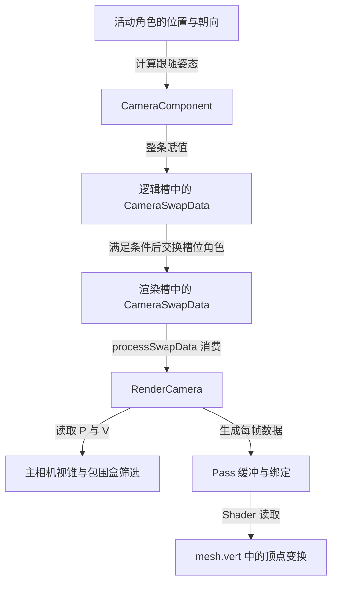

角色向前走，画面跟着移动；鼠标向右转，角色和视角也发生变化。读到相机代码时，很容易把它概括成一句话：相机跟随角色的位置，再把矩阵交给渲染器。

这句话留下了几个关键空白：跟随的是对象 Transform，还是另一份角色状态？相机绕谁旋转，朝哪里看？角色朝向在哪一步改变？渲染器收到的是相机组件，还是一份数值？FOV 改了，投影矩阵是否立刻变化？

本篇围绕第三人称相机回答这些问题。先建立不依赖引擎的视点与坐标模型，再沿 Piccolo 的实际数据流追到可见性与绘制输入。

> **读这篇之前**：建议看过 [06 位置怎样进入渲染表示]()。[03 一帧的调用与交接]() 和 [状态缓冲与线程边界]() 可按需查阅；本文会补齐读相机代码所需的观察、投影与视锥概念。
>
> 源码基线：[BoomingTech/Piccolo，固定提交 `f5053707fed4`][revision]。本篇为主线 11，[09 输入与运动]() 和 [10 刚体与碰撞查询]() 已有正文。源码和资源已核对，并独立编译原有数学与 RenderCamera 源文件做数值检查；未运行完整 Piccolo，未取得角色跟随画面、实际断点或 GPU 捕获。文中的帧间行为按明确条件推导。

## 先把角色、视点、观察与投影分开

先想象一根跟着角色移动的支架：支架末端放着相机，相机朝向角色上方的一个点。支架的偏移和旋转决定相机在哪里；目标点和上方向决定相机怎样看世界；投影再决定能够容纳多宽的范围。

这只是解释职责的模型，并不要求引擎真的建立支架对象或父子节点。

| 数据 | 回答的问题 | 不能直接替代什么 |
| --- | --- | --- |
| 角色位置与朝向 | 跟随目标现在处于什么状态 | 相机自己的世界姿态 |
| 视点 eye、目标点 target、上方向 up | 从哪里，朝哪里，以什么方向为上 | 投影参数 |
| 观察矩阵 V | 世界中的点相对这台相机在哪里 | 物体自己的模型矩阵 M |
| 投影矩阵 P | 怎样把观察空间映射到裁剪空间 | 最终屏幕像素坐标 |

对本文的非蒙皮顶点，可以用列向量写出：

```text
p_world = M * p_local
p_view  = V * p_world
p_clip  = P * p_view
```

其中位置使用齐次坐标 `(x, y, z, 1)`。观察变换可以理解为把相机的世界姿态反过来作用到世界上：相机移动后，物体的世界坐标可以完全不变，物体相对相机的位置却变了。

`p_clip` 还要经过裁剪、透视除法和视口映射等步骤，不能直接当作屏幕像素。矩阵的左右乘、坐标轴和深度范围也需要结合实现核对；本文采用的是 Piccolo 这条路径中的约定。

下面两条关系需要分开看。第一条是**数据的产生与交接**，第二条是**一个顶点的坐标变换**。




第一张图没有表示独立渲染线程或 GPU 执行时间。当前 [tickOneFrame()][engine] 顺序调用逻辑更新、交换和渲染更新；GPU 完成需要另外的同步证据。

## 找到活动角色，才能知道相机在跟随谁

默认 [关卡资源][level-asset] 的 `character_name` 是 `Player`。[Level::load()][level] 创建关卡对象后，按名字找到对应 GObject，用它建立活动 `Character`。这里的 Character 是围绕该对象的运行时角色封装。

[Player 对象定义][player-asset] 中，相机参数类型为 `ThirdPersonCameraParameter`，记录了 `horizontal_offset=3`、`vertical_offset=1.5` 和 `fov=70`。这些是文件中的配置；后面还要检查参数恢复、发布和消费，才能判断渲染端实际使用什么值。

[CameraComponent::postLoadResource()][camera-component] 根据参数的类型名选择第一人称、第三人称或自由模式；`tick()` 则检查：父对象仍存在、当前活动角色存在，而且活动角色的对象 ID 等于父对象 ID。通过后才进入对应模式。

因此，给其他对象添加一个相机组件，不等于它自动成为当前游戏相机。与此同时，[GObject::tick()][object] 在编辑器模式下只更新允许的组件类型；[编辑器入口][editor] 当前注册的是 TransformComponent 和 MeshComponent。观察游戏相机前，需要先确认自己走到了游戏模式下的相机更新。

还有一处容易读错：[Character::getPosition()/getRotation()][character-h] 返回 Character 自己保存的值，**没有在每次调用时重新查询 TransformComponent**。[Character::tick()][character] 才从 Motor 的目标位置更新其位置缓存，并处理部分旋转写入。

[Level::tick()][level] 的顺序是先遍历 GObject，再在游戏模式下更新活动 Character，最后推进物理场景。相机位于对象组件更新过程中，所以不能把“Motor 在相机前面执行”直接解释成“相机已读到本轮 Character::tick 更新后的位置”。判断某一次跟随使用哪个状态，必须同时记录组件顺序、Character 缓存和调用位置。

这里先把 Character 当前值作为相机函数的输入。[09 按键到角色位移]() 说明命令、Motor 目标和 Character 的更新顺序；[10 刚体与碰撞查询]() 再说明物理约束的来源与边界。

## 第三人称：偏移先决定视点，再从视点看向目标

在 [tickThirdPersonCamera()][camera-component] 中，`q_yaw` 来自绕世界 Z 轴的鼠标偏航增量，`q_pitch` 来自绕 X 轴的俯仰增量。俯仰累积到参数对象里：

```cpp
param->m_cursor_pitch = q_pitch * param->m_cursor_pitch;
```

四元数在这里用来表示旋转。读这段所需的规则只有两条：`q * vector` 旋转向量；连续旋转的乘法顺序需要保留，不能随意交换。

随后代码为：

```cpp
const float vertical_offset   = param->m_vertical_offset;
const float horizontal_offset = param->m_horizontal_offset;
Vector3     offset            = Vector3(0, horizontal_offset, vertical_offset);

Vector3 center_pos = current_character->getPosition() + Vector3::UNIT_Z * vertical_offset;
m_position =
    current_character->getRotation() * param->m_cursor_pitch * offset + current_character->getPosition();
```

把角色位置记为 C、当前朝向记为 R、累积俯仰记为 Q、水平偏移记为 h、竖直偏移记为 v，可以对应成：

```text
eye    = C + R * Q * (0, h, v)
target = C + (0, 0, v)
up     = R * Q * (0, 0, 1)
```

这个公式解释了三个设计选择：偏移向量会随角色朝向和俯仰旋转；目标点保持在角色的世界 Z 轴上方；上方向也来自旋转后的 Z 轴。因此，`horizontal_offset` 不应理解为“世界 Y 坐标永远增加 h”，`vertical_offset` 在有俯仰时也不只是对最终视点做一次简单抬高。

函数继续计算 `m_forward = center_pos - m_position`，最终调用：

```cpp
Matrix4x4 desired_mat = Math::makeLookAtMatrix(m_position, m_position + m_forward, m_up);
```

这里 `m_position + m_forward` 就是刚才的目标点。[makeLookAtMatrix()][math] 会归一化观察方向，再用叉积建立观察基底，把视点映射到观察空间原点。正常输入下，前方点在这套观察空间中具有负 Z 坐标。

调用前仍需保证 eye 与 target 不重合，上方向与观察方向不能平行。第三人称公式本身并不保证任意偏移、俯仰参数都避免退化；后续加入俯仰限制或异常恢复，是另一项设计工作。

### 保留本次偏航的真实读写顺序

关键的一行出现在视点、前方向和上方向已经计算之后：

```cpp
current_character->setRotation(q_yaw * current_character->getRotation());
```

[setRotation()][character-h] 此处只修改 Character 的旋转缓存。随后建立的 LookAt 仍使用本次已经算好的位置与方向。因此在**函数入口朝向为 R，且本次偏航为 Y**的条件下，本次视图使用 R，写回角色的却是 `Y * R`。

如果下次进入前没有其他写入，下次计算视点时才会读取这个新朝向。这是函数内部可直接推导的先后关系；实际可感知的延迟还取决于输入更新、其他写入和呈现时序，不能只凭这几行断言画面精确晚了一帧。

另外，该第三人称函数没有使用 delta_time 做插值，也没有查询遮挡物来缩短跟随距离。读到“跟随”时，先按直接位置计算理解；平滑、镜头避障和镜头碰撞都需要额外机制。

## 相机交接传递数值，整条赋值也会带来覆盖

第三人称函数把结果写入逻辑槽：

```cpp
CameraSwapData     camera_swap_data;
camera_swap_data.m_camera_type                     = RenderCameraType::Motor;
camera_swap_data.m_view_matrix                     = desired_mat;
swap_context.getLogicSwapData().m_camera_swap_data = camera_swap_data;
```

[CameraSwapData][swap-h] 有三个 optional 字段：横向 FOV、相机类型和观察矩阵。它们允许一次描述只提供部分更新；渲染端不必持有 CameraComponent 或 Character 才能使用这些值。

但需要区分两层规则：

| 位置 | 固定实现的行为 |
| --- | --- |
| 生产端写逻辑槽 | 给外层 `m_camera_swap_data` 整条赋值，替换此前记录 |
| 消费端应用到 RenderCamera | 仅调用本条记录中有值字段对应的 setter，其他状态保留 |

`postLoadResource()` 也写这同一个位置，但创建的记录只设置 `m_fov_x`。假设在同一次交换前，先执行加载发布 FOV，随后执行第三人称 tick 发布类型和观察矩阵，那么后者会替换前者；渲染侧最终看不到这次 FOV。

这不是 optional 自动合并各字段的队列。需要合并多个生产阶段时，应明确合并协议，或保证前一条已消费；本篇只说明当前行为，不修改引擎。

也不能据此认定默认编辑器启动一定丢失 FOV：编辑器模式下游戏相机 tick 通常被前面的组件筛选挡住，两次写入可能分属不同的发布区间。是否覆盖应看实际调用记录。

满足交换条件后，[RenderSwapContext][swap-cpp] 交换逻辑槽与渲染槽的角色。[processSwapData()][render-system] 按 FOV、观察矩阵、相机类型的顺序应用有值字段，再 reset 本次相机描述。reset 释放的是待消费记录，RenderCamera 中已写入的状态仍然保留；它也不是 GPU 已经结束使用这一帧数据的证明。

## RenderCamera：视图来源与投影参数各有更新条件

### Motor 与 Editor 决定从哪里取得观察矩阵

[RenderCamera::getViewMatrix()][render-camera] 有两条路径：

- **Motor**：返回 `setMainViewMatrix()` 保存的主观察矩阵。
- **Editor**：用 RenderCamera 自己的位置、forward 和 up 重新建立 LookAt。

这里的 Motor 是渲染相机类型名，不表示 GPU 每次都会调用运动组件。相机组件通过交接记录请求使用保存的游戏视图。

还有个需要连起来看的默认参数：[setMainViewMatrix()][render-camera-h] 的类型默认值是 Editor。`processSwapData()` 先调用它，再应用记录中的 Motor 类型，最终消费结束时才得到预期的模式。只在第一个 setter 内观察，会误以为游戏视图已经被错误切回 Editor。

该 setter 还从观察矩阵恢复 `m_position`。这是因为渲染不只需要 P、V：例如每帧数据也保存世界空间相机位置，供相关着色计算使用。

### 改横向 FOV，不等于纵向 FOV 已经重算

[getPersProjMatrix()][render-camera] 使用纵向 FOV、aspect 和近远裁剪参数建立投影，再乘一个翻转 Y 的修正矩阵。这里的翻转属于这条渲染路径的坐标约定，不能推广成所有引擎都要做的步骤。

头文件中的 `setFOVx()` 只给 `m_fovx` 赋值；`setAspect()` 才根据横向 FOV 重新计算纵向 FOV：

```text
tan(FOVy / 2) = tan(FOVx / 2) / aspect
```

所以，单独调用 `setFOVx(70)` 后，读取到的横向数值可以已经变化，但下一次 `getPersProjMatrix()` 仍可能使用旧的纵向数值。需要追到 `setAspect()` 执行，才能确认这组参数重新一致。

实际入口包括 [RenderSystem 初始化与 updateEngineContentViewport()][render-system]；后者由 [EditorUI 的视口更新][editor-ui] 调用。函数存在不代表在某个 setter 之后已经执行，具体生效时机要放回本次调用顺序检查。

这类状态依赖是实现选择。通用模型要求投影与其参数一致；如何通过即时重算、统一更新或脏标记维护一致性，可以有不同方案。

## 同一组 P、V，分别参与筛选和绘制

[RenderSystem::tick()][render-system] 先消费描述，再更新每帧数据、可见对象和 Pass 数据。这里有两条相机消费路径。

**CPU 筛选路径**：[RenderScene::updateVisibleObjectsMainCamera()][render-scene] 读取 P 和 V，计算 `P * V`，建立视锥，再测试经模型矩阵变换的实体包围盒。通过后，把实体加入主相机网格节点列表。

这解释了“转动相机可以改变主相机候选集合”，却不能保证集合一定变化：当前对象可能一直处于范围内。通过包围盒测试也不代表最终一定贡献像素，后续还涉及裁剪、遮挡与深度测试等条件；阴影用途还有自己的筛选路径。

**绘制数据路径**：[RenderResource::updatePerFrameBuffer()][render-resource] 把 `P * V` 和世界空间相机位置写入网格每帧数据。[MainCameraPass][main-pass] 准备阶段复制该结构，网格绘制阶段再写入上传环形缓冲区，并通过描述符与动态偏移绑定。

最后，在 [mesh.vert][mesh-vert] 的非蒙皮路径中，模型矩阵先得到世界位置，随后代码使用：

```glsl
gl_Position = proj_view_matrix * vec4(out_world_position, 1.0f);
```

至此，链路才从“相机组件算出矩阵”接到了实际 Shader 输入。只看 CPU 结构赋值，还少了 Pass 复制、缓冲写入和绑定；这些命令怎样提交、资源何时可以复用，接着读 [07 Pass 与 Vulkan 提交]()。

## 固定一组输入，把跟随关系算一遍

取一个便于检查的函数入口状态：Character 位置 C=`(10,20,0)`，R 和俯仰 Q 都为单位旋转，本次鼠标增量为零；h=3、v=1.5。这里假设这些运行状态已经恢复，不把它当成默认 Player 的实际初始帧。

按前面的公式：

```text
eye    = (10,23,1.5)
target = (10,20,1.5)
up     = (0,0,1)
```

LookAt 应把 eye 映射到观察空间原点，把 target 映射到 `(0,0,-3)`。相机此时朝世界 -Y 看，世界 +X 对应这套观察基底的负 X；不能把“世界向右”不加条件地等同于“屏幕向右”。

从这个基线分别改变一个输入：

| 条件变化 | 可推导的结果 | 检查范围 |
| --- | --- | --- |
| C 增加 `(2,-4,1)`，旋转和偏移不变 | eye 与 target 同量平移；跟随目标的观察坐标仍为 `(0,0,-3)` | 固定世界中的其他点相对相机会变化 |
| h 从 3 改为 6，其余输入保持基线 | eye 为 `(10,26,1.5)`，target 不变，在观察空间距视点 6 | 固定投影下，目标附近的同尺寸几何通常投得更小；具体覆盖还取决于几何 |
| 本次 yaw 绕 Z 为正 90°，其余保持基线 | 本次 eye 仍是 `(10,23,1.5)`；写回新 R 后，下次无其他变化时 eye 为 `(7,20,1.5)` | 验证函数内部读旧 R、写新 R 的顺序 |
| `setFOVx(70)`，尚未再次 setAspect | 横向字段变化，纵向字段与当前投影不因该 setter 自动变化 | 这只描述该 setter 的直接效果 |
| 随后 `setAspect(16/9)` | 纵向 FOV 约为 42.9957°，此后投影使用重算值 | 此处宽高比是练习输入，非默认资源尺寸 |

FOV 与移动相机是两类变化。固定 eye、V 和深度，只收窄一致生效的 FOV，会改变投影范围；它不会自动移动视点，也不需要为此重新上传对象的网格或纹理。

这些关系已用一个独立 C++17 检查程序验证：跟随位置与偏航顺序按本篇公式复现；LookAt、矩阵运算、Motor 视图、视点恢复与 FOV 更新使用固定版本原有数学和 RenderCamera 源文件。另用最小 optional 结构验证整条记录替换会丢弃未设置的旧字段。这个程序没有启动世界、输入系统、CameraComponent 或 GPU，不能替代实际跟随验证。

## 第一人称、自由相机与编辑器分别改变了什么

读完主线，再用差异定位其他模式：

| 路径 | 视点与朝向的主要来源 | 阅读时保留的区别 |
| --- | --- | --- |
| 第一人称 | 角色位置加竖直偏移；鼠标增量更新相机方向 | 更新后还把水平朝向写回 Character |
| 第三人称 | 角色状态、偏移和累积俯仰 | 本次偏航在视点计算之后写回 |
| 游戏自由模式 | 相机自身位置与方向，按命令移动 | 仍有活动角色前置条件，仍通过 CameraSwapData 发布 Motor 视图 |
| 编辑器 | 编辑器输入直接调用 RenderCamera 的 move/rotate/zoom | 走 Editor 视图来源，不能套成游戏组件发布路径 |

[PiccoloEditor::initialize()][editor] 将 `getRenderCamera()` 返回的共享指针交给 EditorSceneManager，因此“编辑器相机”与渲染相机在这里共享同一个 RenderCamera 对象。[编辑器输入][editor-input] 直接操作它；[模式切换 UI][editor-ui] 则切换 g_is_editor_mode，并在返回编辑模式时通过默认 Editor 类型的 setter 切换视图来源。

因此，观察错误视角时应先确认：当前处于什么模式、哪个入口在写、getViewMatrix 最终选择哪一份状态。不要先假设存在两台独立相机，只是切换了一个活动指针。

## 后续调试时，每一站要留下什么证据

完成 [构建与调试基线]() 的完整程序与符号验收后，可以按下面的观察表操作。以下尚未执行。

| 断点或观察入口 | 记录的数据 | 要回答的问题 |
| --- | --- | --- |
| GObject::tick、CameraComponent::tick | 编辑模式、组件类型、活动角色和父对象 ID | 相机是否执行、跟随谁 |
| 第三人称函数入口与 setRotation 前后 | Character 的 C/R、鼠标增量、俯仰 Q、eye/target/up | 本次用了哪个状态，偏航何时生效 |
| CameraSwapData 两处写入与交换 | 帧序号、物理槽位、三个 optional 的有值状态 | FOV 与视图是否在交换前互相覆盖 |
| processSwapData 消费结束 | 相机类型、保存的 V、恢复的位置 | 渲染端收到了什么 |
| setFOVx、setAspect、getPersProjMatrix | 调用顺序、FOVx/FOVy、aspect、投影元素 | 参数是否已经一致 |
| 主相机筛选与 updatePerFrameBuffer | P、V、候选实体 ID、每帧 P*V | 筛选与绘制数据是否使用预期视角 |
| MainCameraPass 与后续 GPU 捕获 | 缓冲偏移、绑定及 Shader 中的矩阵 | 数值是否真正成为该次 Draw 的输入 |

为了分清原因，先只平移角色，再单独改变偏移、鼠标 yaw 和 FOV，并在每次观察中记下前提。源码确定了应当寻找的状态；运行记录才说明这次执行是否满足它们。

相机跟随这条链真正要读懂的是：**从哪份角色状态计算视点，何时交接视图，以及渲染最终消费了哪组相机数据。**

## 继续阅读

- [12：一段动画怎样成为骨骼姿态与网格蒙皮]()：区分对象整体运动、视角变化与骨骼局部变形，再追关节矩阵怎样进入顶点 Shader。
- [06：位置怎样进入渲染表示]()：把相机视角变化与对象自身变换分开。
- [GFX-01：从场景对象到一帧画面]()：回到可见性、Pass、绘制与呈现的总图。
- [07：Pass 与 Vulkan 提交]()：继续检查矩阵数据的缓冲写入、绑定和提交。
- [状态缓冲与线程边界]()：理解交换、消费、复用与 GPU 完成的区别。

接着读 [15《网格与纹理怎样从文件成为 GPU 资源》]()，沿文件、CPU 载荷与缓存追到设备资源和绘制绑定；再读 [16《材质、光照与阴影怎样共同决定表面颜色》]()，追表面属性、阴影与照明怎样汇成场景颜色。这是学习顺序：相机数据、共享资源和表面数据会在实际绘制与光照中汇合，资源可跨帧复用，不是每帧顺次重新加载。

Piccolo 源码节选版权：Copyright (c) 2022 Contributors to the Piccolo Engine，按 [MIT License][license] 提供。关系图与条件推导为本文解释模型，数值检查与完整引擎运行的范围分别说明。

[revision]: https://github.com/BoomingTech/Piccolo/tree/f5053707fed4d3f94d270a436fb0d3a8ae54e3e5
[license]: https://github.com/BoomingTech/Piccolo/blob/f5053707fed4d3f94d270a436fb0d3a8ae54e3e5/LICENSE
[level-asset]: https://github.com/BoomingTech/Piccolo/blob/f5053707fed4d3f94d270a436fb0d3a8ae54e3e5/engine/asset/level/1-1.level.json
[player-asset]: https://github.com/BoomingTech/Piccolo/blob/f5053707fed4d3f94d270a436fb0d3a8ae54e3e5/engine/asset/objects/character/player/player.object.json
[level]: https://github.com/BoomingTech/Piccolo/blob/f5053707fed4d3f94d270a436fb0d3a8ae54e3e5/engine/source/runtime/function/framework/level/level.cpp
[object]: https://github.com/BoomingTech/Piccolo/blob/f5053707fed4d3f94d270a436fb0d3a8ae54e3e5/engine/source/runtime/function/framework/object/object.cpp
[character]: https://github.com/BoomingTech/Piccolo/blob/f5053707fed4d3f94d270a436fb0d3a8ae54e3e5/engine/source/runtime/function/character/character.cpp
[character-h]: https://github.com/BoomingTech/Piccolo/blob/f5053707fed4d3f94d270a436fb0d3a8ae54e3e5/engine/source/runtime/function/character/character.h
[camera-component]: https://github.com/BoomingTech/Piccolo/blob/f5053707fed4d3f94d270a436fb0d3a8ae54e3e5/engine/source/runtime/function/framework/component/camera/camera_component.cpp
[math]: https://github.com/BoomingTech/Piccolo/blob/f5053707fed4d3f94d270a436fb0d3a8ae54e3e5/engine/source/runtime/core/math/math.cpp
[swap-h]: https://github.com/BoomingTech/Piccolo/blob/f5053707fed4d3f94d270a436fb0d3a8ae54e3e5/engine/source/runtime/function/render/render_swap_context.h
[swap-cpp]: https://github.com/BoomingTech/Piccolo/blob/f5053707fed4d3f94d270a436fb0d3a8ae54e3e5/engine/source/runtime/function/render/render_swap_context.cpp
[render-system]: https://github.com/BoomingTech/Piccolo/blob/f5053707fed4d3f94d270a436fb0d3a8ae54e3e5/engine/source/runtime/function/render/render_system.cpp
[render-camera]: https://github.com/BoomingTech/Piccolo/blob/f5053707fed4d3f94d270a436fb0d3a8ae54e3e5/engine/source/runtime/function/render/render_camera.cpp
[render-camera-h]: https://github.com/BoomingTech/Piccolo/blob/f5053707fed4d3f94d270a436fb0d3a8ae54e3e5/engine/source/runtime/function/render/render_camera.h
[render-resource]: https://github.com/BoomingTech/Piccolo/blob/f5053707fed4d3f94d270a436fb0d3a8ae54e3e5/engine/source/runtime/function/render/render_resource.cpp
[render-scene]: https://github.com/BoomingTech/Piccolo/blob/f5053707fed4d3f94d270a436fb0d3a8ae54e3e5/engine/source/runtime/function/render/render_scene.cpp
[main-pass]: https://github.com/BoomingTech/Piccolo/blob/f5053707fed4d3f94d270a436fb0d3a8ae54e3e5/engine/source/runtime/function/render/passes/main_camera_pass.cpp
[mesh-vert]: https://github.com/BoomingTech/Piccolo/blob/f5053707fed4d3f94d270a436fb0d3a8ae54e3e5/engine/shader/glsl/mesh.vert
[engine]: https://github.com/BoomingTech/Piccolo/blob/f5053707fed4d3f94d270a436fb0d3a8ae54e3e5/engine/source/runtime/engine.cpp
[editor]: https://github.com/BoomingTech/Piccolo/blob/f5053707fed4d3f94d270a436fb0d3a8ae54e3e5/engine/source/editor/source/editor.cpp
[editor-ui]: https://github.com/BoomingTech/Piccolo/blob/f5053707fed4d3f94d270a436fb0d3a8ae54e3e5/engine/source/editor/source/editor_ui.cpp
[editor-input]: https://github.com/BoomingTech/Piccolo/blob/f5053707fed4d3f94d270a436fb0d3a8ae54e3e5/engine/source/editor/source/editor_input_manager.cpp
