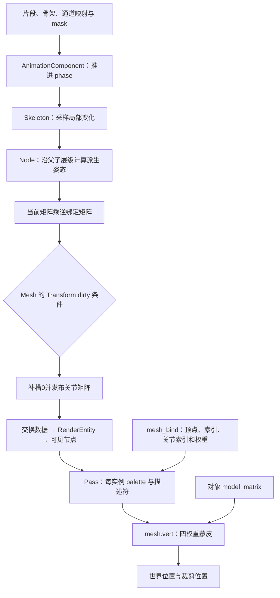

角色整体向前移动，与角色膝盖弯曲，是两种不同的变化。上一篇的 Motor 可以更新对象位置，却没有逐个修改网格顶点；那一段行走动画又是怎样让腿动起来的？

读到 skeleton、joint matrix、weight 时，很容易把它们都当成“动画数据”。但片段通道、骨骼局部姿态、最终蒙皮矩阵和顶点权重并不是同一份东西。即使 CPU 已算出姿态，后面还要确认 Mesh 是否发布、渲染批次是否携带、Shader 是否真正消费。

本篇用 Piccolo 默认 Player 的资源与主相机绘制路径，把这些交接接起来。对象整体运动接 09/10，GPU 资源上传接 15；不把这个案例扩写成完整动画状态机、IK 或通用混合系统。

> **读这篇之前**：建议读过 [04 对象与组件恢复]()、[06 位置与渲染表示]() 和 [15 GPU 资源]()。[09 输入与角色运动]() 说明对象位置来源，[07 Pass 与提交]() 说明批次与缓冲绑定。
>
> 源码基线：[BoomingTech/Piccolo，固定提交 `f5053707fed4`][revision]。已核对源码与实际动画/网格资源，独立编译原 Skeleton、Node 与数学实现，使用独立 JSON 桥接检查真实数据，并编译四份相关顶点 Shader。未运行完整引擎、动画播放或 GPU 蒙皮；CPU 示例、资源结构和源码时序分别说明范围。

## 先分清骨骼姿态与网格变形

最小模型可以分成四步：

1. 根据时间，从片段取得各骨骼通道的平移、旋转和缩放。
2. 沿父子层级计算骨骼在对象空间中的派生姿态。
3. 用绑定姿态的逆矩阵修正，得到作用于绑定网格的矩阵。
4. 每个顶点按自己的关节索引与权重组合这些矩阵，再乘对象整体变换。

在一致的坐标约定下，将骨骼 j 当前的对象空间矩阵记为 G_j(t)，绑定姿态下的矩阵记为 B_j，那么：

```text
S_j(t) = G_j(t) × inverse(B_j)
p_model(t) = Σ weight_j × S_j(t) × p_bind
p_world(t) = M_object × p_model(t)
```

这里 S 是蒙皮矩阵，不只是当前骨骼的局部 Transform。先消除绑定姿态的影响，才能把绑定网格送到当前姿态。Khronos 的 [蒙皮入门材料][skinning-model] 也用关节索引、权重和逆绑定矩阵解释这个模型；本文的资源格式与具体乘法仍以 Piccolo 为准。

没有骨骼变化时，对象可以只因 M_object 改变而平移；对象位置不变时，也可以因 S_j 改变而弯曲。这个区分决定调试时应该查 Motor/Transform，还是查动画与蒙皮。



这张图表示职责与数据交接，不表示独立线程，也没有把 CPU 已算出的矩阵直接当成 GPU 完成结果。

## 默认 Player 的几份文件各自负责什么

[Player 定义][player] 的 AnimationComponent 指向骨架与 blend_state；MeshComponent 则引用 robot.mesh_bind.json。它们通过编号约定汇合，不是把一份动画文件直接当成顶点数组。

| 资源 | 本例核对到的内容 | 负责什么 |
| --- | --- | --- |
| [skeleton_data_root.skeleton.json][skeleton-asset] | 58 根骨骼，flat、拓扑有序 | 初始局部姿态、父索引和绑定修正矩阵 |
| [行走 AnimationAsset][clip-asset] | total_frame=23、58 个通道，配置时长约 0.766670 秒 | 通道位置/旋转/缩放关键值 |
| [anim.skeleton_map.json][map-asset] | 58 个映射，值域 0～57，通道名与映射骨骼名一致 | 将片段通道序号转到骨骼数组序号 |
| [anim.skeleton_mask.json][mask-asset] | 213 个 enabled 条目 | 管理器准备逐骨骼权重所需的 mask；不是骨骼数量本身 |
| [robot.mesh_bind.json][mesh-asset] | 顶点、索引、绑定条目各 55500，索引顺序为 0～55499 | 绑定网格和每顶点四组索引/权重 |

mask 比本例骨架长，不能把 enabled.size 当成运行骨骼数。实际骨骼数组大小来自骨架定义；这些文件长度是否对应，应该逐层核对，而不是看到都叫 node 就假设相等。

[AnimationLoader][loader] 通过 AssetManager 读取资源；[AnimationManager][manager] 按路径缓存骨架、片段、映射和 mask。缓存减少重复文件读取，并不意味着所有计算都被缓存：getBlendStateWithClipData 仍会组装数据、复制片段与映射，并准备逐骨骼权重。

## 播放时间怎样成为关键帧位置

[AnimationComponent::postLoadResource()][animation-component] 加载骨架并 buildSkeleton。tick 时，代码更新第 0 个 blend_ratio：

```cpp
m_animation_res.blend_state.blend_ratio[0] +=
    (delta_time / m_animation_res.blend_state.blend_clip_file_length[0]);
m_animation_res.blend_state.blend_ratio[0] -= floor(m_animation_res.blend_state.blend_ratio[0]);
```

这里 ratio 表示片段内循环进度，不是混合权重。时长来自 blend_clip_file_length[0]，并非 tick 自己从关键帧时间戳推导；本例使用等间隔帧序号模型。

例如 phase=0.9，增加 0.2 后会回绕到约 0.1。资源里的 frame_position 字段没有参与这段播放计算；不能仅改这个同名概念字段，就认定运行采样位置已经改变。

[Skeleton::applyAnimation()][skeleton] 再计算：

```cpp
float exact_frame        = phase * (animation_clip.total_frame - 1);
int   current_frame_low  = floor(exact_frame);
int   current_frame_high = ceil(exact_frame);
float lerp_ratio         = exact_frame - current_frame_low;
```

位置和缩放使用线性插值，旋转调用 Quaternion::nLerp，并启用最短路径选择。这里不是逐通道 slerp，也不是已经实现任意稀疏时间戳的曲线求值器。

本例 phase=0.5 时 exact_frame=11，恰好落在第 11 帧；真正的邻帧插值可以用非整数位置或后面的两帧练习单独检查。

### 有 blend 数据，不等于当前已经做多片段混合

管理器准备了 clip_count、blend_weight 与 mask，骨骼应用函数却写着：

```cpp
for (size_t clip_index = 0; clip_index < 1; clip_index++)
```

而通道内的 weight 被固定为 1，没有读取已准备的逐骨骼权重。因此当前 Skeleton 路径只应用第 0 个片段；不能据资源字段宣称已经实现按权重混合跑、走、上半身动作等完整能力。

独立检查将传入权重改为全零，或增加第二个片段，当前输出仍与第 0 个片段单独应用一致。这验证的是固定函数的消费行为，不是动画系统应有的通用规则。

## 局部关键值怎样沿骨骼层级传播

buildSkeleton 当前要求 is_flat 与 in_topological_order 都成立：骨骼 index 对应数组位置，父节点在子节点之前。它按这个顺序建立 Bone，并找到此前已建好的父指针；不能把资源标记当成已在内部自动排序。

每次 applyAnimation 先 resetToInitialPose，再把采样结果加到初始姿态上。[Node][node] 当前使用的规则大致是：

- 旋转：默认 LOCAL，初始旋转右乘采样旋转。
- 缩放：初始 scale 与采样 scale 逐轴相乘。
- 平移：默认 AREN，在父空间坐标表达下加上采样 position。

因此不能把这些 keys 直接解释成“绝对局部姿态覆盖”。当前计算依赖资源按这套相对变化约定导出；也不会因为每帧再 apply，就无限把上一帧的变化累积下去，因为开头已经复位。

随后每根骨骼 update。对有父节点的骨骼，派生旋转由父旋转乘局部旋转，派生位置先受父缩放和旋转影响，再加父位置。当前实现逐项组合 TRS，代码明确没有表达通用剪切，不能把任意非均匀缩放层级都当成精确矩阵链。

最后 outputAnimationResult 取派生姿态建立对象空间矩阵，再乘 _getInverseTpose：

```cpp
auto resMat = objMat * bone->_getInverseTpose();
```

资源字段叫 tpose_matrix，运行时被存入 m_inverse_Tpose；它在这里承担逆绑定修正的角色。字段名不能证明每份导出数据的单位和绑定约定都正确，源码也保留了关节矩阵单位的 TODO。

### 用两根骨骼说明为什么需要逆绑定

构造一个限定例子：父骨骼在原点，子骨骼绑定位置为 x=1，子骨骼逆绑定矩阵平移 -1。

| 条件 | 子骨骼当前对象空间位置 | 作用到绑定顶点 x=1 的结果 |
| --- | --- | --- |
| 没有动画变化 | x=1 | `T(1)×T(-1)×p`，仍为 x=1 |
| 父骨骼增加平移 x=1 | x=2 | `T(2)×T(-1)×p`，变为 x=2 |

若省略逆绑定，绑定位置会被再加一次。独立程序用原 Skeleton/Node 验证了这个例子、两帧位置插值与重复采样复位；它是教学骨架，不是默认机器人的运行截图。

输入边界也要单独看：当前实现依赖合法映射、非空且适配的键数组。实际片段的通道键数有 22 和 23 两种，函数会缩减 high/low，而且这些帧索引在通道循环外共享，短通道会影响后续通道的端点选择。不能将它当成已经完成独立通道重采样、空键容错和全输入校验的通用采样器。

## 骨骼结果怎样成为渲染中的关节矩阵

[MeshComponent::tick()][mesh-component] 取得 AnimationComponent 的结果，但外层仍受 Transform::isDirty() 控制。动画组件更新本身没有在这里独立提交一条骨骼 dirty 通知。

进入分支后，Mesh 先插入一个单位矩阵，再按 animation_result.node 的数组顺序追加矩阵。与此同时，Skeleton 输出 index=bone ID+1。

```cpp
animation_result.m_transforms.push_back({Matrix4x4::IDENTITY});
```

于是本例的 58 根骨骼，交接后成为 59 槽 palette：0 槽保留，骨骼数组第 i 项对应 i+1 槽。mesh_bind 中带正权重的索引已经按这套约定记录，本例值域为 3～58，运行上传时不应再无条件加一次 1。

这里还有一个顺序契约：Mesh 追加时没有根据输出元素的 index 做散射重排。因此依赖骨骼数组顺序、骨骼 ID 与绑定编号一致；不能只看 AnimationResultElement 带 index 就认定它支持任意乱序结果。

### 姿态持续变化，为什么也要看 Transform dirty

默认 Player 的组件顺序是 Transform→Animation→Mesh→Motor→Camera→Lua。游戏模式中 Motor 在有效活动角色路径会调用 setPosition，即使目标没有变化也会置 dirty，供后续 Mesh 更新使用；编辑器选中对象的 scene manager 也会置 dirty。

这些是当前实现中的触发来源，不是动画独立刷新协议。如果一个有动画的对象没有相应 dirty 生产者，不能因为 Animation::tick 执行过，就保证最新 palette 已经被交出去。调试时要同时记录动画结果与 Mesh 实际提交。

[RenderSystem::processSwapData()][render-system] 消费描述，将矩阵复制到 RenderEntity，并依据矩阵数量是否大于 1 设置 enable_vertex_blending；[RenderScene][render-scene] 再把矩阵指针和数量放入可见节点。

主相机 Pass 按批次把每个实例的 palette 写进动态存储缓冲。[当前常量][shader-constants] 为每实例预留 1024 个关节槽，Shader 用 `1024×gl_InstanceIndex+jointIndex` 选择矩阵；对象 model_matrix 则是另一份实例数据。这里的上限还包含 0 槽，不能把 1024 直接理解为总能容纳 1024 根实际骨骼。

还要按 [Pass 的真实条件][main-pass] 看绑定：名为 least_one_enable_vertex_blending 的判断，实际会在任意实例没有 joint_matrices 时变为 false。本文沿默认已启用蒙皮的实例批次说明，不把变量名当成任意混合批次都已正确处理的证明。

## 绑定网格的四组索引与权重怎样接到 Shader

[loadMeshData()][resource-base] 读取 mesh_bind 的顶点、索引和 bind 条目；[RenderResource][resource] 在上传路径归一化四个权重。总权重为零时使用系数 1，并不会替顶点自动补上一个有效关节权重。

实际资源的原始权重和约为 0.999896～1.000001，归一化可以修正这些细小偏差；但它不能自动修复负权重、无效索引或没有有效影响的顶点。

上传还有一处编号关系要留意：joint binding 按 index_count 分配，循环用 index_buffer[index_index] 找原绑定，再写到 joint_binding[index_index]。Shader 却用 gl_VertexIndex 读绑定。

[GLSL 内建变量规则][glsl-builtins] 中，索引绘制的 gl_VertexIndex 与实际顶点索引有关，不能当成 index buffer 中第几个元素。默认 robot 的索引恰好是 0～55499 的顺序展开，所以本例两者一致；不能据此认定任意共享顶点、重排索引的网格也满足同一布局。

本篇只核对这个数据契约，不修改上传布局。缓冲创建、staging 和描述符生命周期继续见 15。

## mesh.vert 怎样把矩阵用在顶点上

[主相机顶点 Shader][mesh-vert] 从 set=1/binding=0 读取每顶点的 ivec4 索引与 vec4 权重，从 set=0/binding=2 读取当前批次 palette。它从零矩阵开始，对正权重且索引>0 的槽执行累加，例如：

```glsl
vertex_blending_matrix +=
    joint_matrices[m_mesh_vertex_blending_max_joint_count * gl_InstanceIndex + in_indices.x] * in_weights.x;
```

四个影响槽都按这个条件处理。索引 0 被跳过，因此 0 槽单位矩阵不是“所有无效顶点的自动兜底”：若没有任何有效影响，零矩阵仍不会自行变成单位矩阵。

实际位置的使用顺序是：

```glsl
model_position = (vertex_blending_matrix * vec4(in_position, 1.0)).xyz;
```

然后乘 model_matrix 得到世界位置，再乘 proj_view_matrix 得到裁剪位置。法线与切线也使用混合矩阵的 3×3 部分并归一化，之后继续经过对象矩阵；当前代码留有 normal matrix TODO，不能将其描述为已处理任意缩放下的精确逆转置法线方案。

CPU 矩阵字段、GLSL 缓冲 row_major 约定和数据布局也要一致，不能只根据数学里写的是列向量，就推断内存必定按列存。现有布局说明接 GFX-02，本篇只沿已经声明的缓冲接口追数据。

### 正常绘制、阴影与拾取需要逐条看消费点

主相机 mesh.vert 和两个阴影顶点 Shader 都将 model_position 用于后续世界位置。它们走到了蒙皮输出的消费端。

但 [拾取顶点 Shader][pick-vert] 虽计算 model_position，最终 gl_Position 仍用 in_position。这与 [18 拾取篇]() 的限制一致：不能只因几个 Pass 都绑定关节矩阵，就承诺拾取轮廓与动画姿态相同。

## 用真实资源做一次限定的 CPU 对照

独立程序用 JSON 读取桥接构造原 SkeletonData、AnimationClip 与 AnimSkelMap，再直接调用原 Skeleton、Node 和数学实现。它没有执行引擎生成的反序列化器、AnimationManager 缓存或 GPU 上传。

以默认片段 phase=0.5 为条件，CPU 产生 58 个结果矩阵，补单位槽后为 59。取实际网格第 0 个绑定顶点，按上传归一化规则和四权重公式计算：

| 模型空间数据 | 值，约为 |
| --- | --- |
| 绑定顶点 | `(0.525734,-0.044840,1.169006)` |
| 关节索引/原权重 | `34/0.511982`、`33/0.488018` |
| 蒙皮后顶点 | `(0.215444,-0.343468,1.187255)` |

这还没有乘对象 M、观察 V 和投影 P，也没有执行 GPU 浮点计算或实际显示。桥接代码对省略字段采用明确默认值，因此这是指定加载规则下的独立对照，不能替代引擎资源恢复的运行验收。

四份顶点 Shader 独立编译为 SPIR-V，说明它们可在当前编译器下生成程序；不证明绑定、实例矩阵、同步和实际顶点输出都已正确。

待 [完整调试基线]() 可用后，可按下表取证：

| 观察位置 | 记录什么 | 要解释的问题 |
| --- | --- | --- |
| Animation postLoad / 资源读取 | 文件路径、骨骼数、父索引、映射、键数组 | 加载的是不是同一套资源 |
| Animation tick / applyAnimation | phase、low/high、插值、实际 clip 与权重 | 时间是否推进，哪些字段真正生效 |
| Node update / 输出 | 局部与派生姿态、绑定修正矩阵、结果编号 | 骨骼姿态是否按约定传播 |
| Mesh tick | dirty、0 槽、结果顺序、描述矩阵 | 最新姿态是否已经发布 |
| RenderEntity / Pass | joint_count、实例偏移、描述符、上传内容 | 绘制是否读取同一份 palette |
| 主相机/阴影/拾取 | 原顶点、索引权重、蒙皮位置与最终位置 | 每个 Pass 是否实际消费动画 |

先固定单个对象、单片段、一个 phase 和一个顶点，再观察时间变化、对象整体移动与其他 Pass。这样能把采样错误、编号错位、漏发布和 Shader 未消费分别定位。

**从动画读到蒙皮，要追清局部变化、层级姿态、逆绑定修正，以及矩阵和顶点编号在 CPU/GPU 两端的同一份约定。**

## 继续阅读

- [09：从按键到角色位移]()：区分对象移动与局部骨骼变形。
- [15：网格与纹理怎样成为 GPU 资源]()：继续追静态绑定缓冲和上传生命周期。
- [07：Pass 与 Vulkan 提交]()：核对实例批次、dynamic offset 与 Draw。
- [GFX-02：从 GLSL 到 GPU]()：回看程序、矩阵布局和数据接口。
- [18：编辑器拾取、创建与删除]()：核对动画几何与拾取几何的差异。

[13 粒子发射器与 GPU 模拟]() 已接通 GPU 粒子模拟与后续绘制，[14 Lua 脚本、组件与反射调用]() 已有正文，原定主线正文齐备；完整动画播放和 GPU 蒙皮保持待验证。

Piccolo 源码与资源节选版权：Copyright (c) 2022 Contributors to the Piccolo Engine，按 [MIT License][license] 提供。独立桥接、CPU 数值与设备验证分别说明。

[revision]: https://github.com/BoomingTech/Piccolo/tree/f5053707fed4d3f94d270a436fb0d3a8ae54e3e5
[license]: https://github.com/BoomingTech/Piccolo/blob/f5053707fed4d3f94d270a436fb0d3a8ae54e3e5/LICENSE
[player]: https://github.com/BoomingTech/Piccolo/blob/f5053707fed4d3f94d270a436fb0d3a8ae54e3e5/engine/asset/objects/character/player/player.object.json
[loader]: https://github.com/BoomingTech/Piccolo/blob/f5053707fed4d3f94d270a436fb0d3a8ae54e3e5/engine/source/runtime/function/animation/animation_loader.cpp
[manager]: https://github.com/BoomingTech/Piccolo/blob/f5053707fed4d3f94d270a436fb0d3a8ae54e3e5/engine/source/runtime/function/animation/animation_system.cpp
[animation-component]: https://github.com/BoomingTech/Piccolo/blob/f5053707fed4d3f94d270a436fb0d3a8ae54e3e5/engine/source/runtime/function/framework/component/animation/animation_component.cpp
[skeleton]: https://github.com/BoomingTech/Piccolo/blob/f5053707fed4d3f94d270a436fb0d3a8ae54e3e5/engine/source/runtime/function/animation/skeleton.cpp
[node]: https://github.com/BoomingTech/Piccolo/blob/f5053707fed4d3f94d270a436fb0d3a8ae54e3e5/engine/source/runtime/function/animation/node.cpp
[mesh-component]: https://github.com/BoomingTech/Piccolo/blob/f5053707fed4d3f94d270a436fb0d3a8ae54e3e5/engine/source/runtime/function/framework/component/mesh/mesh_component.cpp
[render-system]: https://github.com/BoomingTech/Piccolo/blob/f5053707fed4d3f94d270a436fb0d3a8ae54e3e5/engine/source/runtime/function/render/render_system.cpp
[render-scene]: https://github.com/BoomingTech/Piccolo/blob/f5053707fed4d3f94d270a436fb0d3a8ae54e3e5/engine/source/runtime/function/render/render_scene.cpp
[main-pass]: https://github.com/BoomingTech/Piccolo/blob/f5053707fed4d3f94d270a436fb0d3a8ae54e3e5/engine/source/runtime/function/render/passes/main_camera_pass.cpp
[resource-base]: https://github.com/BoomingTech/Piccolo/blob/f5053707fed4d3f94d270a436fb0d3a8ae54e3e5/engine/source/runtime/function/render/render_resource_base.cpp
[resource]: https://github.com/BoomingTech/Piccolo/blob/f5053707fed4d3f94d270a436fb0d3a8ae54e3e5/engine/source/runtime/function/render/render_resource.cpp
[mesh-vert]: https://github.com/BoomingTech/Piccolo/blob/f5053707fed4d3f94d270a436fb0d3a8ae54e3e5/engine/shader/glsl/mesh.vert
[pick-vert]: https://github.com/BoomingTech/Piccolo/blob/f5053707fed4d3f94d270a436fb0d3a8ae54e3e5/engine/shader/glsl/mesh_inefficient_pick.vert
[shader-constants]: https://github.com/BoomingTech/Piccolo/blob/f5053707fed4d3f94d270a436fb0d3a8ae54e3e5/engine/shader/include/constants.h
[skeleton-asset]: https://github.com/BoomingTech/Piccolo/blob/f5053707fed4d3f94d270a436fb0d3a8ae54e3e5/engine/asset/objects/character/player/components/animation/data/skeleton_data_root.skeleton.json
[clip-asset]: https://github.com/BoomingTech/Piccolo/blob/f5053707fed4d3f94d270a436fb0d3a8ae54e3e5/engine/asset/objects/character/player/components/animation/data/W2_CrouchWalk_Aim_F_Loop_IP.animation_clip.json
[map-asset]: https://github.com/BoomingTech/Piccolo/blob/f5053707fed4d3f94d270a436fb0d3a8ae54e3e5/engine/asset/objects/character/player/components/animation/data/anim.skeleton_map.json
[mask-asset]: https://github.com/BoomingTech/Piccolo/blob/f5053707fed4d3f94d270a436fb0d3a8ae54e3e5/engine/asset/objects/character/player/components/animation/data/anim.skeleton_mask.json
[mesh-asset]: https://github.com/BoomingTech/Piccolo/blob/f5053707fed4d3f94d270a436fb0d3a8ae54e3e5/engine/asset/objects/character/player/components/animation/data/robot.mesh_bind.json
[skinning-model]: https://github.com/KhronosGroup/glTF-Tutorials/blob/main/gltfTutorial/gltfTutorial_020_Skins.md
[glsl-builtins]: https://docs.vulkan.org/glsl/latest/chapters/builtins.html
