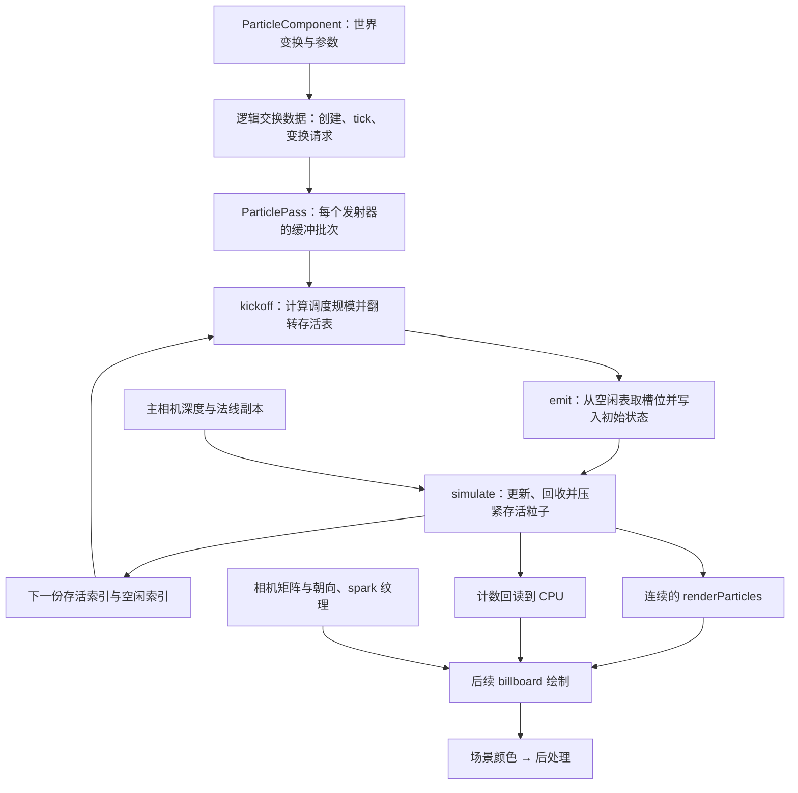

场景里放进一个粒子发射器，并不等于已经有一批能画出来的粒子。发射器的位置和参数在逻辑对象里，粒子的速度、寿命和存活数量却会持续变化；如果更新交给 GPU，CPU 又该怎样知道要画多少个？

更容易混淆的是，“GPU 粒子”可能只说明模拟发生在 GPU 上，并没有说明谁分配槽位、谁决定计算量、谁发起绘制，以及结果在哪一次绘制中被消费。

本篇沿 Piccolo 的实际路径回答这些问题：从组件提交发射器，进入固定容量的粒子池，经 kickoff、emit、simulate 三个计算阶段，再到四顶点实例 billboard。先建立数据模型，再追代码和状态，不要求先学完一套特效编辑器。

> **读这篇之前**：建议读过 [04 对象与组件]()、[06 位置与渲染表示]() 和 [07 Pass 与提交]()。[11 相机]() 补视图/投影，[15 GPU 资源]() 补缓冲与图像，[17 后处理]() 接场景颜色的后半程。
>
> 源码基线：[BoomingTech/Piccolo，固定提交 `f5053707fed4`][revision]。本篇已核对源码与实际粒子资源，独立检查原类型布局、字节解释和小池状态，编译五份相关 Shader。没有运行完整引擎或 GPU 粒子；文中的顺序和缺口来自源码，独立实验不充当设备画面证明。

## 先把发射器、粒子与绘制数据分开

一个最小粒子系统至少要回答四个问题：

1. **从哪里生**：发射器提供位置、方向、初速度、尺寸、寿命等生成规则。
2. **放在哪里**：粒子池保存各粒子的状态，空闲槽位可以重复使用。
3. **更新哪些**：存活索引列出需要模拟的槽位，避免把空槽当粒子处理。
4. **怎么画**：绘制需要可访问的数据和数量，可以复用模拟池，也可以另做紧凑数组。

发射器通常比粒子少得多。给对象移动一次位置，只需要更新发射器描述；已经发出的粒子是否跟着移动，则取决于粒子状态采用什么坐标和后续更新规则。

Piccolo 在生成时将世界位置写入粒子；后续模拟直接改这份位置。更新发射器不会遍历旧粒子并补上位移，因此这里更接近“移动喷口改变以后从哪里生成”，不能理解成所有旧粒子都附着在对象局部空间。

下图是**数据依赖图**，不是同一帧按箭头完成所有阶段的时间线：



## 对象组件怎样变成渲染端的发射器

入口是 [ParticleComponent][component]。`postLoadResource` 先用局部平移、单位缩放和局部旋转构造矩阵，再乘父对象的 Transform，分解出世界位置与旋转，交给 ParticleManager。

注意这里虽然分解了 scale，描述中实际写回的是位置 xyz 和旋转；不能据此推断对象缩放会等比例修改发射区域、粒子尺寸与速度。

[ParticleManager::createParticleEmitter][manager] 把组件资源和世界变换组合为 `ParticleEmitterDesc`，加入逻辑交换数据，再为组件分配 emitter ID。后续每次组件 tick 都提交这个 ID；只有父 Transform dirty 时才追加变换描述。传入组件的 `delta_time` 没有在这里推进粒子位置。

可以沿三个请求分别读：

| 请求 | 逻辑端生产什么 | 渲染端怎样消费 |
| --- | --- | --- |
| 创建 | 一批发射器描述 | `processSwapData` 按下标调用 `createEmitter`，初始化缓冲和描述符 |
| tick | 本轮要模拟的 emitter ID | `simulate` 遍历 ID，逐个记录计算工作 |
| 变换 | ID、世界位置与旋转 | `preparePassData` 中更新对应发射器描述缓冲 |

源码位置可顺着 [RenderSwapData][swap] → [RenderSystem::processSwapData][render-system] → [ParticlePass][pass] 查。`simulate` 末尾会清空 tick 与变换列表，不能仅凭发射器已创建就认为它会一直自动模拟。

另一个容易漏掉的门槛在编辑器：默认只注册 TransformComponent 和 MeshComponent 的编辑模式 tick，见 [editor.cpp][editor] 和 [GObject 的 tick 筛选][object]。加载时创建发射器与组件随后能否获得 tick，要分别观察。

### ID 是协议的一部分

这里的新建描述本身不携带 emitter ID；渲染端按本批描述的 `0..count-1` 建批次，后续却直接拿组件 ID 当批次数组下标。[Level::load][level] 在创建关卡对象前重置分配器，使初次整批加载可以按相同次序对应。

同时，`setEmitterCount` 会先释放旧批次的缓冲，再按本批数量 resize，**不是向已有池追加一个发射器**。阅读后续运行时创建、删除或重载时，必须核对“本次批次是否完整、ID 是否仍与下标对应、旧计数是否重置”，不能把已有对象创建/删除流程直接等同于完整的粒子增删管理。这些是固定源码的适用边界，本篇没有实测对应故障。

## GPU 上保存了几份不同的数据

[particle_common.h][common] 将每个发射器的容量设为 `300000`。初次创建的新批次存活数为 0，空闲数为容量；空闲表按倒序填槽位编号，从表尾取时先得到槽位 0。

[ParticlePass 的类型与缓冲][pass-h] 可以按职责读：

| 数据 | 保存什么 | 为什么单独存在 |
| --- | --- | --- |
| `m_position_device_buffer` | 完整粒子池，按稳定槽位编号访问 | 存活索引里的 ID 指向这里 |
| `m_alive_list_buffer` / `m_alive_list_next_buffer` | 两份存活槽位索引 | 本轮读取一份，向另一份追加下一轮存活者 |
| `m_dead_list_buffer` | 可重新分配的槽位编号 | 发射取出、死亡归还，避免每次新建 GPU 对象 |
| counter | 空闲、待模拟、模拟后存活、候选发射数量 | 给调度、分配和回读提供边界 |
| indirect argument | emit/simulate 的工作组数与 flap 标志 | GPU 计算后续 Dispatch 的规模 |
| `m_position_render_buffer` | 模拟后连续排列的存活粒子 | 绘制可以直接按实例编号读取，不再追槽位表 |
| 发射器描述与全局 UBO | 生成参数、随机数、固定步长、重力和视口 | 不必为每个粒子复制全部环境参数 |

每个 Particle 有位置与寿命、速度与横向尺寸、加速度与纵向尺寸、颜色，共 64 字节。一个容量为 300000 的粒子状态缓冲就是 `19,200,000` 字节，约 18.31 MiB；系统还分配绘制缓冲、主机缓冲和索引表，所以不能只拿存活数乘 64 当总内存成本。

索引表的 Shader 元素是 `ivec4`，只用 `.x` 保存槽位，源码按每项 16 字节分配；这里也不能把它当作紧凑的 4 字节整数数组来估预算。

## 先看实际顺序：这一轮绘制在模拟之前

[RenderPipeline][pipeline] 的 forward 和 deferred 路径都有同样的关键尾部：主相机绘制、debug draw、`submitRendering`，然后 `copyNormalAndDepthImage`，最后 `simulate`。

主相机内部先调用粒子 `draw`，再进入 tone mapping。因此按一次正常、没有提前退出的渲染调用，可以这样标记：

```text
渲染调用 k：
  用已有 renderParticles 与 CPU 缓存数量记录粒子 Draw
  提交主相机等绘制工作
  复制这轮主相机的深度、法线，供粒子计算读取
  kickoff → emit → simulate
  回读模拟后存活数量

后续正常渲染调用：
  用刚更新的数据和数量记录下一次粒子 Draw
```

这是 CPU 记录/提交路径的对应关系，不是“显示器严格晚一帧”的实测结论。初次新批次的数量为 0，第一轮模拟产生的数据要等后续 draw 才消费；交换链重建等提前返回还会改变哪些工作实际执行。

图像复制会等待帧 fence，提交时等待相应的纹理复制 semaphore，并在图形队列上等待空闲；计算与计数回读也有 fence 等待。看到独立 compute queue，不能直接写成计算与图形已经异步重叠。具体队列族、屏障覆盖和资源可见性仍要用设备验证核对，本篇不宣称同步路径已通过运行验证。

## 三个计算阶段怎样接起来

### kickoff：先决定工作量，再翻转表的角色

[particle_kickoff.comp][kickoff] 只 dispatch 一个工作组、一个 invocation。它用空闲数量与单次发射上限的较小值作为候选发射量，再准备两个间接参数：

```text
candidate = min(dead_count, xemit_count)
emit_groups = ceil(candidate / 256)
simulate_groups = ceil((candidate + previous_survivors) / 256)
```

后两个阶段的 `local_size_x` 都是 256。以候选 100000 个为例，需要 391 组，覆盖 100096 个 invocation，超出的线程由 Shader 内部数量判断挡住。工作组数不是粒子数，也不保证候选全部真正发射。

kickoff 随后重置本轮计数并翻转标志：

```glsl
    counter.alive_count = counter.alive_count_after_sim;

    // reset particle cnt
    counter.alive_count_after_sim = 0;

    counter.emit_count = emitCount;

    argument.alive_flap_bit = 1 - argument.alive_flap_bit;
```

`alive_flap_bit=0` 时本轮读 alive、写 alive_next；为 1 时反过来。初值为 1，第一次 kickoff 翻成 0。上轮模拟写出的表，在下轮成为输入，不需要把整份表复制回去。

两个间接参数分别从字节偏移 0 和 16 读取。CPU 在绑定 emit、simulate pipeline 后调用 `cmdDispatchIndirect`；参数由设备从缓冲读取，语义见 [Vulkan 的间接 Dispatch 定义][vk-dispatch]。这里的间接发生在计算调度，不能推成后面的绘制也采用 DrawIndirect。

### emit：从空闲栈拿槽位，加入本轮存活表

[particle_emit.comp][emit] 为符合条件的 invocation 计算初始位置、速度、加速度、颜色和寿命。取得槽位的核心是：

```glsl
            int deadCount = atomicAdd(counter.dead_count, -1);
            int index     = deadbuffer[deadCount - 1].x;

            // append to particle buffer
            Particles[index] = particle;
```

随后原子增加 `alive_count`，把 index 追加到**本轮输入表**，于是新粒子与旧存活者会一起进入紧接着的模拟。atomicAdd 返回操作前的值，各 invocation 据此取得不同位置；它不承诺槽位分配和追加的视觉顺序。

这里的“发射器类型”也要看实现。点发射分支使用位置扰动和锥形速度；类型 1 虽命名为 `MESH_TYPE_EMITTER`，实际是在旋转后的 `(0, rnd0, rnd1)` 平面上取点，并采样 Piccolo logo 图像。它没有读取任意网格的三角形。

[默认 particle.object.json][particle-asset] 恰好使用类型 1。logo alpha 大于 0.9 的样本采用图像颜色，并将速度和加速度归零；其他样本给随机颜色、随机速度和加速度。logo 是生成规则输入，[spark.HDR][spark] 则是后面每个 billboard 的亮度纹理，两张图不是同一种用途。

### simulate：更新状态，回收死者，压紧生者

[particle_simulate.comp][simulate] 根据本轮存活表找到 `particleId`，再读取池里的状态。无碰撞时，正寿命粒子的运动为：

```glsl
            particle.vel += particle.acc * dt;
            particle.pos += particle.vel * dt;
```

先更新速度，再用新速度更新位置。这里的 dt 来自全局 `fixed_time_step`，不是组件传入的帧 delta。当前资源为 0.004；每执行一次模拟推进这一个固定步长，没有在本路径看到按真实经过时间累计、补多步的循环。

处理完运动/碰撞后，代码检查 `life < 0`：负值回收槽位，否则追加到下一轮存活表，扣 dt，并写入紧凑绘制数组：

```glsl
            particle.life -= dt;

            renderParticles[nextAliveIndex] = particle;
```

最后把粒子状态写回原池槽位。模拟池继续保留稳定 ID，绘制数组则只保留本次压紧后的内容；`nextAliveIndex` 与 `particleId` 可以不同。

### 用四个槽位走一遍

下面是人为选定追加顺序的串行示意，初始空闲栈为 `[3,2,1,0]`，先发射三个寿命为 dt 的粒子。真实 GPU 的原子追加顺序不保证与表相同。

| 完成的操作 | 存活槽位 | 空闲栈 | 寿命边界 |
| --- | --- | --- | --- |
| 发射三个 | 0、1、2 | `[3]` | 三个都为 dt |
| 第一次 simulate | 0、1、2 | `[3]` | 扣到 0，仍写入绘制数组 |
| 第二次 simulate | 0、1、2 | `[3]` | 0 不进入运动分支，仍保留，再扣到 -dt |
| 第三次 simulate | 空 | `[3,0,1,2]` | 入口已为负，回收 |
| 再发射两个 | 2、1 | `[3,0]` | 旧槽位重新使用 |

关键不在这组编号，而在条件顺序：**死亡判断发生在扣寿命之前，且判断严格小于 0**。因此不能把本实现简写成“life 减到 0 立即删除”。正常回收后应满足“存活数 + 空闲数 = 容量”，活跃槽位与空闲槽位互不重复。

## 参数怎样读，不能只看字段名字

实际全局资源与组件资源分别是 [particle.global.json][global-asset] 和 [particle.object.json][particle-asset]。沿 CPU 写入和 Shader 读取，有几处会直接影响推导：

| 配置/名字 | 固定源码实际消费 | 阅读时的结论 |
| --- | --- | --- |
| `time_step=0.004` | 写入 UBO，simulate 用它更新 | 是每次模拟步长，不是显示帧时长 |
| 全局 `max_life=0.04` | 写入 UBO，但三个计算 Shader 未用其计算寿命 | 不能用它推算默认粒子只活 0.04 秒 |
| 组件 `life=(1.5,0)` | emit 用 `rnd0 * life.y + life.x` | 当前初始化寿命为 1.5，回收还受上述条件顺序影响 |
| 全局 `emit_count=100000` | `prepareUniformBuffer` 将 `xemit_count` 直接写成 100000 | 当前值碰巧相同，改 JSON 不等于改了该上限 |
| `emit_gap=10` | CPU UBO 首项是 int，计算 Shader 首项却是 float `emit_delta` | 相同四个字节不会自动做数值转换 |

最后一行尤其容易被字段名骗过。独立检查中，32 位整数 10 的字节按 float 解释约为 `1.40129846e-44`，不是 10.0。再看 emit 的入口：

```glsl
    emitterinfo.life.z += 1;
    uint threadId = gl_GlobalInvocationID.x;
    if (emitterinfo.life.z > ubo.emit_delta)
    {
        emitterinfo.life.z = 1;
```

多个 invocation 在数量判断之前非原子地改同一个 `life.z`，存在共享写竞争。因此，本篇不会把这段概括为可靠的“每十帧发射一次”，也不会用串行小例子预测实际 GPU 发射数量。类型契约与并发访问必须先分别核对；Shader 编译成功并不能排除这类问题。

这些差异说明调试参数应沿“资源 → CPU 值 → 上传字节 → Shader 字段 → 实际分支”追踪，不是看到同名配置就停止。

## 粒子碰撞借用了当前可见表面的信息

模拟还接收视图、投影视图、逆投影矩阵，以及主相机深度和法线的副本。路径是：

1. 将更新后的粒子世界位置投影到屏幕，检查 x/y 是否在视口范围。
2. 在对应像素采深度，用逆投影恢复视图空间表面位置。
3. 在厚度 0.5 的条件范围内，取法线，并检查速度是否朝向表面。
4. 以 `0.4 * reflect(velocity, normal)` 改速度，低速时归零，再修正位置。

这是一条**屏幕空间碰撞**路径。它依赖深度所记录的可见表面，无法天然覆盖屏幕外、遮挡后和没有写入这些附件的几何；不是 [10 中的 Jolt 碰撞查询]()。法线是否有效也要按当前渲染分支核对，不能因为 forward/deferred 都调用复制函数，就认定输入质量相同。

源码中的推离距离还将速度方向与视图空间位置差做点积，坐标一致性应单独验证。这里说明实际判断与读取关系，不把它认证为完整、精确的世界空间碰撞求解器。

## 模拟结果怎样成为一次 Draw

模拟完成后，`ParticlePass::simulate` 提交计算并等待 fence，再把 16 字节 counter 复制到主机缓冲，等待、invalidate、读取，将 `alive_count_after_sim` 缓存到 `m_num_particle`。粒子完整状态留在 GPU，CPU 主要回读这个数量。

后续 `draw` 对每个发射器绑定图形 pipeline 和 billboard 描述符，然后执行：

```cpp
            m_rhi->cmdDraw(m_render_command_buffer, 4, m_emitter_buffer_batches[i].m_num_particle, 0, 0);
```

按照 [Vulkan Draw 参数语义][vk-draw]，这是每实例四个顶点、实例数为缓存数量的非索引绘制。pipeline 拓扑为 triangle strip；顶点 Shader 用 `gl_VertexIndex` 从四个常量角点中选点，用 `gl_InstanceIndex` 从紧凑粒子数组中选粒子，不需要为每个粒子上传四个独立顶点。

[particlebillboard.vert][billboard-vert] 通常沿相机 right/up 展开面片；当速度在两个相机轴上的投影都越过相应尺寸门槛时，改为沿投影速度方向构造面片轴。它改变朝向，没有按速度大小连续拉长面片的公式。

所以这里的组合是：**GPU 计算发射/模拟调度规模，GPU 保存并压紧状态，CPU 回读数量后记录普通实例 Draw**。只说“用了 indirect”会丢掉后半段的实际依赖。

### 面片怎样进入场景颜色

[particlebillboard.frag][billboard-frag] 用 spark 纹理的红通道 r 输出：

```text
source.rgb = 4 × r × particle.color.rgb
source.a   = r
```

片元输出没有使用粒子 color.a 或 life 做淡出。因此 emit 分支把 color.a 设为 0，也不能单独证明这个粒子透明。

pipeline 开启深度测试、关闭深度写入，RGB 混合因子为 ONE 与 ONE_MINUS_SRC_ALPHA，对应 `source.rgb + destination.rgb × (1-source.a)`，alpha 采用源值。紧凑数组是原子追加结果，这里没有看到按深度排序，不能从“数组连续”推断透明面片已正确排序。

在 [MainCameraPass][main-pass] 中，粒子 draw 位于 forward lighting 子阶段，之后才进入 tone mapping。它把自己的颜色混入场景颜色，随后沿 17 的后处理路径继续；不是生成粒子颜色后直接绕过后处理显示。

## 已经验证什么，之后怎样动手查

本篇先做了三类独立检查：

- 使用 Piccolo 原数学/描述类型头文件，并提取原 Particle、counter、UBO 与间接参数声明，编译 C++17 布局程序：Particle=64、counter=16、UBO=80、EmitterDesc=160 字节；核对字段偏移和第二份间接参数偏移 16。GCC 有原头文件警告，不称为零警告构建。
- 独立检查 int/float 的字节解释、无碰撞单步数值、四槽串行状态与 0/1/256/257 等数量的组数边界。它们是布局与教学模型实验，没有执行并行原子、生成式反序列化或 GPU kernel。
- 用项目随附 glslangValidator 和原 include 路径编译 kickoff、emit、simulate、billboard 顶点/片元五份 Shader，均得到 SPIR-V 1.0。只证明该编译路径能产出程序，不证明描述符、同步、竞争和画面正确。

无碰撞数值例把 vz 设为 2.5，加速度取组件 -2.5 与全局重力 -30 之和，dt=0.004，得到新 vz=2.37、位移 z=0.00948。这是人为选定初始状态，不是默认随机发射器的实测粒子轨迹。

完整引擎可运行后，建议按下面的顺序收证据，每次只改变一个条件：

| 观察点 | 记录什么 | 先排除哪类问题 |
| --- | --- | --- |
| 组件创建与 tick | 资源路径、emitter ID、编辑/游戏模式、dirty 请求 | 对象已加载但未提交 tick，或变换未发布 |
| 渲染端建批次 | 本批描述数、ID 与下标、缓冲容量、初始 counter | 新建请求覆盖旧批次或身份不一致 |
| kickoff/emit | UBO 原始字节、间接参数、flap、发射前后 counter | 类型不匹配、发射门槛和数量变化 |
| simulate | 输入存活表、样本槽位、life/velocity、深度与法线 | 生命周期、固定步长和碰撞输入问题 |
| 后续 Draw | 四顶点、instanceCount、紧凑数组、纹理与混合 | 模拟已有数据但绘制数量/绑定不对应 |

捕获中可沿 `Particle Kickoff`、`Particle Emit`、`Particle Simulate`、`Copy Particle Counter Buffer` 与 `ParticleBillboard` 事件找位置。记录是哪次正常渲染调用生产、哪次消费，不要只数事件树中第几条命令。

<!-- DATA-TODO: 完成 Piccolo 构建基线后，记录固定 SHA/工具链/GPU/队列族/Validation Layer 结果；在游戏模式核对 emitter ID、UBO 字节、三个 Dispatch、flap/counter、深度法线副本、后续 billboard Draw 与画面。补发射间隔竞争、屏幕外碰撞、重载和运行时增删的实际证据。未取得前保留源码与独立实验边界。 -->

## 继续阅读

- [12：一段动画怎样成为骨骼姿态与网格蒙皮]()：对照 CPU 姿态交接与 GPU 粒子状态两种动态几何来源。
- [15：网格与纹理怎样从文件成为 GPU 资源]()：继续核对缓冲、图像与绑定的生命周期。
- [17：场景颜色怎样经过后处理成为最终画面]()：接粒子颜色之后的输出链。
- [PCPP-3：状态缓冲怎样交接，哪些地方真的跨线程]()：区分逻辑交换、GPU 同步和 CPU 等待。

[14 Lua 脚本、组件与反射调用]() 已有正文，原定 00—18 主线正文齐备；GPU 模拟与绘制的设备验证另按上表推进。

Piccolo 源码与资源节选版权：Copyright (c) 2022 Contributors to the Piccolo Engine，按 [MIT License][license] 提供。

[revision]: https://github.com/BoomingTech/Piccolo/tree/f5053707fed4d3f94d270a436fb0d3a8ae54e3e5
[license]: https://github.com/BoomingTech/Piccolo/blob/f5053707fed4d3f94d270a436fb0d3a8ae54e3e5/LICENSE
[component]: https://github.com/BoomingTech/Piccolo/blob/f5053707fed4d3f94d270a436fb0d3a8ae54e3e5/engine/source/runtime/function/framework/component/particle/particle_component.cpp
[manager]: https://github.com/BoomingTech/Piccolo/blob/f5053707fed4d3f94d270a436fb0d3a8ae54e3e5/engine/source/runtime/function/particle/particle_manager.cpp
[swap]: https://github.com/BoomingTech/Piccolo/blob/f5053707fed4d3f94d270a436fb0d3a8ae54e3e5/engine/source/runtime/function/render/render_swap_context.cpp
[render-system]: https://github.com/BoomingTech/Piccolo/blob/f5053707fed4d3f94d270a436fb0d3a8ae54e3e5/engine/source/runtime/function/render/render_system.cpp
[pass]: https://github.com/BoomingTech/Piccolo/blob/f5053707fed4d3f94d270a436fb0d3a8ae54e3e5/engine/source/runtime/function/render/passes/particle_pass.cpp
[pass-h]: https://github.com/BoomingTech/Piccolo/blob/f5053707fed4d3f94d270a436fb0d3a8ae54e3e5/engine/source/runtime/function/render/passes/particle_pass.h
[editor]: https://github.com/BoomingTech/Piccolo/blob/f5053707fed4d3f94d270a436fb0d3a8ae54e3e5/engine/source/editor/source/editor.cpp
[object]: https://github.com/BoomingTech/Piccolo/blob/f5053707fed4d3f94d270a436fb0d3a8ae54e3e5/engine/source/runtime/function/framework/object/object.cpp
[level]: https://github.com/BoomingTech/Piccolo/blob/f5053707fed4d3f94d270a436fb0d3a8ae54e3e5/engine/source/runtime/function/framework/level/level.cpp
[common]: https://github.com/BoomingTech/Piccolo/blob/f5053707fed4d3f94d270a436fb0d3a8ae54e3e5/engine/source/runtime/function/particle/particle_common.h
[pipeline]: https://github.com/BoomingTech/Piccolo/blob/f5053707fed4d3f94d270a436fb0d3a8ae54e3e5/engine/source/runtime/function/render/render_pipeline.cpp
[kickoff]: https://github.com/BoomingTech/Piccolo/blob/f5053707fed4d3f94d270a436fb0d3a8ae54e3e5/engine/shader/glsl/particle_kickoff.comp
[emit]: https://github.com/BoomingTech/Piccolo/blob/f5053707fed4d3f94d270a436fb0d3a8ae54e3e5/engine/shader/glsl/particle_emit.comp
[simulate]: https://github.com/BoomingTech/Piccolo/blob/f5053707fed4d3f94d270a436fb0d3a8ae54e3e5/engine/shader/glsl/particle_simulate.comp
[particle-asset]: https://github.com/BoomingTech/Piccolo/blob/f5053707fed4d3f94d270a436fb0d3a8ae54e3e5/engine/asset/objects/environment/particle/particle.object.json
[global-asset]: https://github.com/BoomingTech/Piccolo/blob/f5053707fed4d3f94d270a436fb0d3a8ae54e3e5/engine/asset/global/particle.global.json
[spark]: https://github.com/BoomingTech/Piccolo/blob/f5053707fed4d3f94d270a436fb0d3a8ae54e3e5/engine/asset/texture/default/spark.HDR
[billboard-vert]: https://github.com/BoomingTech/Piccolo/blob/f5053707fed4d3f94d270a436fb0d3a8ae54e3e5/engine/shader/glsl/particlebillboard.vert
[billboard-frag]: https://github.com/BoomingTech/Piccolo/blob/f5053707fed4d3f94d270a436fb0d3a8ae54e3e5/engine/shader/glsl/particlebillboard.frag
[main-pass]: https://github.com/BoomingTech/Piccolo/blob/f5053707fed4d3f94d270a436fb0d3a8ae54e3e5/engine/source/runtime/function/render/passes/main_camera_pass.cpp
[vk-dispatch]: https://docs.vulkan.org/refpages/latest/refpages/source/vkCmdDispatchIndirect.html
[vk-draw]: https://docs.vulkan.org/refpages/latest/refpages/source/vkCmdDraw.html
