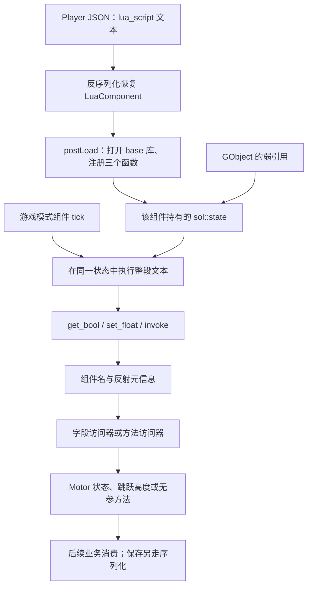

角色移动时，把跳跃高度改成 10；停下时，改成 5。这样的规则写在脚本里很短，但它要真正影响角色，仍需穿过几个边界：脚本在哪里执行，怎样找到当前对象，怎样拿到组件字段，又是谁在什么时候消费这个值？

“引擎接入了 Lua”只能说明有脚本执行能力。它没有自动回答所有 C++ 类型是否可见、成员读写是否安全、改值会不会触发业务更新，以及对象删除后脚本引用是否仍然有效。

本篇就沿 Piccolo 默认 Player 的这段规则，追到 LuaComponent、sol2 绑定和引擎反射。重点是读懂这条桥怎样接起来，不把它扩写成完整热更新框架或 Lua 语法课。

> **读这篇之前**：建议读过 [04 对象与组件恢复]()、[05 类型信息与序列化]() 和 [CPP-03 模板、宏与反射生成]()。[09 输入与角色运动]() 说明参数怎样参与运动，[CPP-01 对象生命周期]() 补弱引用。
>
> 源码基线：[BoomingTech/Piccolo，固定提交 `f5053707fed4`][revision]，随附 Lua 5.4.4、sol2 3.3.0。已核对源码与默认资源，独立编译随附 Lua、原 LuaComponent 和反射实现，通过最小宿主运行真实脚本文本；宿主对象、Motor 和日志用桩替代，反射元组手动注册。没有运行完整编辑器、角色、物理或 GPU。

## 先区分执行环境、桥接接口与业务对象

脚本接入最少可以拆成五部分：

| 部分 | 负责什么 | 容易混淆的地方 |
| --- | --- | --- |
| 脚本文本 | 描述条件和操作 | 一段文本不等于一个持续运行的对象 |
| 执行环境 | 保存 Lua 变量、函数和运行状态 | 重新执行文本，不一定重建环境 |
| 宿主绑定 | 将 Lua 调用变成 C++ 调用 | 有绑定库，不等于所有引擎 API 自动开放 |
| 对象与类型信息 | 定位实例、字段、方法及其访问入口 | 查到名字，不等于已验证类型和寿命 |
| 业务更新协议 | 决定新值怎样影响运动、渲染或持久化 | 赋值成功，不等于 setter、dirty 和保存都已执行 |

Lua 自身可以执行代码，宿主则注册它允许调用的 C/C++ 函数；这是 [Lua 官方手册对嵌入式使用的基本模型][lua-manual]。下面的点分字段路径、反射白名单和组件更新顺序，都是 Piccolo 在这个模型上的具体选择。



图表示调用和数据依赖，不表示每个节点都有独立线程。这个脚本入口由对象的组件 tick 同步调用；不能从“Lua VM”推断另有脚本线程。

## 默认脚本怎样进入组件

实际脚本不在单独的 `.lua` 文件里，而是内嵌在 [player.object.json][player] 的 LuaComponent `$context.lua_script` 中。将 JSON 转义还原并排版后，它是：

```lua
if (get_bool(GameObject, "MotorComponent.m_is_moving")) then
    set_float(GameObject, "MotorComponent.m_motor_res.m_jump_height", 10)
else
    set_float(GameObject, "MotorComponent.m_motor_res.m_jump_height", 5)
end
invoke(GameObject, "MotorComponent.getOffStuckDead")
```

先读出本对象 Motor 的运动状态，再改其资源成员中的跳跃高度；最后调用一个方法。Lua 里出现的三种函数和 `GameObject`，都不是 Lua 标准库给游戏引擎预留的名字，必须由宿主提供。

[LuaComponent 的声明][lua-h] 里有两种不同的状态：

- `m_lua_script` 标记 `META(Enable)`，属于反射白名单字段，序列化恢复的是这份文本。
- `m_lua_state` 是组件持有的 `sol::state`，不在字段白名单中，不会随文本一起反序列化成旧 VM。

启动时 [引擎先注册类型元信息][engine]；对象加载和具体组件恢复复用 04/05 的路径，再调用 `postLoadResource` 接线。字符串已恢复与脚本已运行，是两个不同的完成点。

## 每个组件怎样建立自己的执行环境

[LuaComponent::postLoadResource][lua-cpp] 保存父对象弱引用，然后完成绑定：

```cpp
        m_lua_state.open_libraries(sol::lib::base);
        m_lua_state.set_function("set_float", &LuaComponent::set<float>);
        m_lua_state.set_function("get_bool", &LuaComponent::get<bool>);
        m_lua_state.set_function("invoke", &LuaComponent::invoke);
        m_lua_state["GameObject"] = m_parent_object;
```

每个 LuaComponent 都有自己的 state。[随附 sol2 的 state 实现][sol-state] 负责创建 Lua 状态；这里没有把所有组件挂到同一个全局 Lua VM，也没有另建共享脚本模块管理器。

只打开 base 库，意味着不能直接把独立 Lua 解释器里常见的 `math`、`io`、`os`、`package` 等库当作已开放。base 中仍有 `type`、`pcall`、`load` 等功能；“只开 base”也不能单独证明已具备完整脚本沙箱、执行预算或错误恢复策略。

当前 tick 更短：

```cpp
        m_lua_state.script(m_lua_script);
```

它每次执行整个文本，没有查找并调用约定的 `Update(dt)`，也没有将 `delta_time` 作为参数或全局变量注入。沿 [sol2 的执行入口][sol-state-view] 可以看到字符串加载/执行路径；本组件没有缓存预编译 chunk 或函数句柄。

但是 **state 并没有每次重建**。脚本对全局变量的修改可以留到下次执行，顶层 `local` 则属于本次 chunk 的局部作用域。比如人为写入 `counter=(counter or 0)+1`，连续 tick 两次会得到 2；另一个组件的 state 不会因此自动拥有这个 counter。

改变组件里的脚本文本后，下次 tick 会读取新文本，但这不等于已经实现文件监视、状态迁移、失败回滚和依赖更新的热重载系统。

## 点分路径怎样找到字段地址

`GameObject` 保存的是父对象的弱引用，不是一张已经展开所有组件的 Lua table。`get_bool` 和 `set_float` 收到它后，进入同一个 `find_component_field`。

以 `MotorComponent.m_motor_res.m_jump_height` 为例，查找过程是：

1. `lock()` 对象，取得组件包装列表；第一段 `MotorComponent` 与包装的类型名比较。
2. 用该类型名创建 TypeMeta，把找到的组件实例作为当前实例。
3. 查到字段 `m_motor_res`，保存它的访问器及所属实例；再取字段地址和字段类型元信息，进入下一层。
4. 在 MotorComponentRes 的元信息中查 `m_jump_height`，得到最终字段的访问器和它的所属实例。

循环里的关键交接为：

```cpp
                target_instance = field_instance;

                // for next iteration
                field_instance = field_accessor.get(target_instance);
                field_accessor.getTypeMeta(meta);
```

这里需要同时认清两个地址：返回的 `target_instance` 是**最终字段的所属对象**，在本例中是 MotorComponentRes；再调用最终访问器的 get，才得到 float 字段地址。

| 遍历到的名字 | 当前所属实例 | 访问后取得什么 |
| --- | --- | --- |
| `MotorComponent` | GObject 的组件列表 | MotorComponent 实例与其 TypeMeta |
| `m_motor_res` | MotorComponent | 资源成员的地址及 MotorComponentRes 元信息 |
| `m_jump_height` | MotorComponentRes | 高度 float 的地址；写入时仍把资源成员地址传给访问器 |

如果只保留最终 float 地址，却把它当 MotorComponentRes 传给生成的 setter，类型转换会落到错误对象上。反射提供通用接口，实例地址的层级协议仍须正确。

### 路径名为什么保留 m_ 前缀

[反射模板][reflection-template] 返回字段的原 C++ 名称；[序列化模板][serializer-template] 使用 display name，而 [字段解析器][field-parser] 会据成员名生成去除前缀后的显示名。因此 JSON 是 `motor_res.jump_height`，脚本路径却是 `m_motor_res.m_jump_height`。

这两套名字服务不同接口，不能直接从 JSON 键拼出脚本路径。类中 `private` 也不是反射访问的最终判断：MotorComponent 的资源成员和运动标志虽为私有，但有 `META(Enable)`，生成访问器通过 friend 访问。具体白名单规则接 CPP-03，不能理解成脚本天然拥有所有私有成员。

这个查找器只按点分段查字段，没有处理数组下标、任意对象跳转或完整表达式语法；反射系统另有数组访问器，不代表此 Lua 入口已经接上。

## get_bool 与 set_float 的类型契约在哪里

两条绑定选择的 C++ 模板实例已经固定：`get<bool>` 和 `set<float>`。写入最终调用：

```cpp
            field_accessor.set(target_instance, &value);
```

读取最终调用：

```cpp
            return *(T*)field_accessor.get(target_instance);
```

[FieldAccessor][reflection-cpp] 转发到注册的函数元组；生成的 setter 会把实例转成所属类，把 value 转成字段真实类型，再直接赋值。这不是依据 Lua 数字和字段元信息自动完成的通用类型转换。

默认高度确实是 float，状态确实是 bool，所以示例满足约定。但桥接没有比较 `getFieldTypeName()` 与 T。若把 `set_float` 指向 bool、结构体或其他类型，不能期待它自动安全转换；字段路径有效，只解决了“找到了谁”。

失败路径也要分别看：

| 情况 | 固定实现怎样处理 | 调用侧应该怎样理解 |
| --- | --- | --- |
| set 找不到组件/字段 | 记错误日志，不写入 | 不是一个 Lua 可检查的成功/失败返回值 |
| get 找不到组件/字段 | 记日志，但返回 T 的函数没有返回值 | 不能把它当作可靠的 false 或 nil；不要用故意错路径做正常分支 |
| 仅传组件名、没有字段段 | 查找器可能返回 true，但没有有效最终访问器 | 不是合法字段读取形式 |
| 对象弱引用已失效 | 查找入口未检查 lock 结果便解引用 | 弱引用不会替调用者自动完成有效性检查 |
| 组件/字段名正确，类型不符 | 本桥没有执行类型核对 | 不能用名字匹配替代类型协议 |

独立编译也对 get 的无返回路径产生了编译器警告。本篇只对有效读取及可安全返回的失败分支做实验，没有执行这些可能导致未定义行为的错误访问。

## invoke 怎样进入 C++ 方法

`invoke(GameObject, "MotorComponent.getOffStuckDead")` 先按最后一个点拆出方法名与目标名。目标没有其他点时，它直接找组件，再从该类型的 MethodAccessor 列表里匹配方法名，最终传入组件实例调用。

这里的开放范围可由 [MotorComponent 声明][motor-h] 核对：类使用 `WhiteListMethods`，该方法标了 `META(Enable)`。[反射模板][reflection-template] 为方法生成的是无参调用，MethodAccessor 的接口是 `void invoke(void*)`；这条桥不传 Lua 实参，也不把方法返回值交回 Lua。

默认方法的名字看起来像“脱困”，实际函数体是：

```cpp
    void MotorComponent::getOffStuckDead() { LOG_INFO("Some get off stuck dead logic"); }
```

因此当前脚本每次执行都会到达一次日志调用，不能据此说引擎已经修复角色卡死。接口被调用与业务实现完成，是两个不同结论。

### 嵌套目标的分支还有实现缺口

如果目标是 `MotorComponent.m_motor_res.someMethod`，代码确实进入“先找字段，再找其类型方法”的分支。但该分支传给查找器的是包含方法名的完整 `name`，没有传去掉方法名后的 `target_name`。

结果是：正常的、并非同名字段的 someMethod 会被当成字段继续查找，通常先在这里失败。不能看到一段嵌套分支，就把它写成可用的任意深度方法调用。

独立宿主为嵌套资源注册了一个无参 touch 方法，原 invoke 仍报找不到字段，没有调用该方法。这个实验只证明此输入下的查找缺口；本篇没有顺手修复引擎，也没有把示例改成绕过原路径的替代实现。

## 参数写入以后，什么时候影响角色

默认 Player 的组件顺序是：

```text
Transform → Animation → Mesh → Motor → Camera → Lua
```

[GObject::tick][object-cpp] 按组件容器顺序调用。对象实例覆盖可能影响最终顺序，因此实际调试还要记录合并后的组件列表。编辑器默认只为 Transform/Mesh 注册编辑模式 tick，Lua 是否执行也要先分清游戏与编辑模式。

在上述默认顺序的有效角色路径中，Motor 先计算本轮运动，Lua 随后读取本轮 Motor 写下的 `m_is_moving`，再把 jump_height 改成 10 或 5。这个新高度不会倒回去重算已经完成的 Motor tick；通常要等后续 Motor 的相应分支消费。

[Motor 的纵向速度计算][motor-cpp] 在开始跳跃时用 `sqrt(jump_height × 2 × gravity)` 设置初速度。修改高度并不等于立刻平移角色，也不等于每次脚本执行都重算正在进行的跳跃。真实输入、状态和组件时序还需接 [09 的运动链]() 验证。

### 直接写字段不会自动走业务 setter

反射 setter 的行为是成员赋值。比如 [TransformComponent::setPosition][transform-cpp] 还会维护缓冲和 dirty；通过反射只改某个位置字段，不会自动运行这一套协议。

所以读脚本改值时，应继续问：消费方是每 tick 读字段，还是读缓存？是否需要发布、重建或置脏？本例改的是 Motor 后续会读取的资源成员；不能把它泛化为修改任意组件字段都立即更新渲染或物理。

写运行时字段也不会自动写回 JSON。显式保存另走 [08 的对象/组件序列化路径]()，其中当前可序列化字段可能被写出；Lua 全局变量、函数和 VM 栈不属于 m_lua_script，不会随组件字段自动保存成完整脚本快照。

## 对象寿命、脚本状态与错误怎样收口

GameObject 被存为 `std::weak_ptr` 的副本，不会因为 Lua 全局里还有这个值就保住对象。当前三个桥接函数中的查找入口并没有完整的失效防护，因此正常调度与销毁协议仍是前提。

组件销毁时，成员 sol::state 随之销毁，[随附 sol2 的 RAII 删除器][sol-raii] 最终调用 `lua_close`。这解释 VM 的持有关系，不代表已经证明所有外部回调、异步访问和退出顺序都安全；当前组件也没有实现独立的 OnDestroy 脚本回调。

错误处理同样不能只看函数名。LuaComponent 的 tick 没有检查执行结果、包本地 try/catch 或实现禁用故障脚本的策略。[随附 sol2 的错误处理][sol-error] 会受到异常和安全调用宏配置影响。在本篇独立宿主的默认编译配置中，`error('probe failure')` 产生 traceback 并抛出 `sol::error`，由实验宿主捕获；不是 LuaComponent 自己吞掉错误后继续一帧。

还有一层要区分：Lua 的 protected call 能处理 Lua 错误，不会把无效 C++ 地址或 get 缺失返回这样的宿主缺陷自动变成正常结果。调试时应分别记录 Lua 报错、C++ 异常、字段查找日志和对象访问有效性。

## 已做的独立验证与后续观察

本篇实验直接编译了项目随附 Lua 的 32 个 C 源文件，使用原 sol2 头文件，并编译原 `lua_component.cpp`、`reflection.cpp` 与 json11。GObject、Motor 和日志使用最小桩，字段/方法元组按原接口手动注册；没有执行 PiccoloParser、真实 Motor 或关卡系统。

| 已执行的检查 | 结果 | 证据范围 |
| --- | --- | --- |
| 从真实 Player JSON 提取脚本，运动状态设 false/true | 高度分别写成 5/10，组件方法分派各一次 | 原 Lua 桥与反射；方法用计数桩验证分派 |
| 查嵌套高度字段 | 所属地址是资源成员，最终地址是 float | 原字段查找与访问器 |
| 同一组件连续执行、另建第二组件 | 全局 counter 保留，顶层 local 重建，第二状态隔离 | 原 sol::state 与 tick 路径 |
| 改不同 tick dt、检查已打开库 | 未注入 delta_time，仅 base 库被打开 | 原 postLoad/tick，不是整套引擎库配置 |
| set 错字段、调用不存在方法、调用嵌套方法 | 分别走预期错误日志，嵌套方法未被调用 | 只覆盖这些可安全返回的输入 |
| Lua error、捕获后再次执行 | 宿主捕获 sol::error，同一 VM 可继续执行 | 此独立编译配置，捕获写在实验宿主 |
| 释放唯一对象强引用 | 宿主和 Lua 中保存的 weak_ptr 均失效 | 不再通过失效引用调用原桥 |

编译和程序运行均返回 0；原源码有 get 缺失返回、反射局部变量未使用等警告，不能写成完整引擎或零警告构建成功。真实默认角色是否以预期高度起跳，尚未取得运行证据。

以后调试时，可以按下面的顺序逐段确认：

1. 在 LuaComponent 恢复后记录实际文本、对象 ID 和最终组件顺序，确认没有被实例配置覆盖。
2. 在 postLoad 与 tick 处确认执行模式、state 身份、绑定函数和脚本执行次数。
3. 在 find_component_field 处记录每段名字、TypeMeta、所属实例与字段地址，核对实际字段类型。
4. 在 Motor 处记录读取前后的 jump_height、运动/跳跃状态和参数消费时机；不要只看赋值断点。
5. 在 invoke 处确认访问的是哪类方法；检查真实函数体，再判断是否有业务效果。
6. 单独检查脚本错误、对象重载/删除和显式保存；记录哪些运行状态重建，哪些字段确实写入文件。

<!-- DATA-TODO: 完成 Piccolo 构建基线后，记录固定 SHA、编译宏/异常设置、Player 最终组件顺序和游戏模式；跟踪 Lua state、三个绑定、反射 owner/leaf 地址、Motor 高度消费与实际跳跃。补脚本错误的引擎侧结果、重载/删除与保存恢复证据，不执行已知无效地址或类型错配访问来充当正常用例。 -->

**读懂脚本接入，要同时追清执行环境、对象寿命、反射类型与业务消费，才能从一次 Lua 调用走到可解释的引擎行为。**

## 继续阅读

- [CPP-03：模板、宏与反射代码生成]()：回查字段与方法如何进入注册表。
- [09：从一次按键到角色位移]()：继续观察脚本参数怎样被运动逻辑消费。
- [08：编辑器怎样修改、保存并恢复场景状态]()：区分运行状态、显式保存与重载。
- [06：位置变化怎样进入渲染表示]()：对照直接字段赋值与缓冲、dirty、发布协议。

至此，计划中的 00—18 主线文章已有正文；完整构建、断点、角色/编辑器与 GPU 运行验证仍按各篇记录推进。

Piccolo 源码与资源节选版权：Copyright (c) 2022 Contributors to the Piccolo Engine，按 [MIT License][license] 提供。

[revision]: https://github.com/BoomingTech/Piccolo/tree/f5053707fed4d3f94d270a436fb0d3a8ae54e3e5
[license]: https://github.com/BoomingTech/Piccolo/blob/f5053707fed4d3f94d270a436fb0d3a8ae54e3e5/LICENSE
[player]: https://github.com/BoomingTech/Piccolo/blob/f5053707fed4d3f94d270a436fb0d3a8ae54e3e5/engine/asset/objects/character/player/player.object.json
[lua-h]: https://github.com/BoomingTech/Piccolo/blob/f5053707fed4d3f94d270a436fb0d3a8ae54e3e5/engine/source/runtime/function/framework/component/lua/lua_component.h
[lua-cpp]: https://github.com/BoomingTech/Piccolo/blob/f5053707fed4d3f94d270a436fb0d3a8ae54e3e5/engine/source/runtime/function/framework/component/lua/lua_component.cpp
[engine]: https://github.com/BoomingTech/Piccolo/blob/f5053707fed4d3f94d270a436fb0d3a8ae54e3e5/engine/source/runtime/engine.cpp
[sol-state]: https://github.com/BoomingTech/Piccolo/blob/f5053707fed4d3f94d270a436fb0d3a8ae54e3e5/engine/3rdparty/sol2-3.3.0/include/sol/state.hpp
[sol-state-view]: https://github.com/BoomingTech/Piccolo/blob/f5053707fed4d3f94d270a436fb0d3a8ae54e3e5/engine/3rdparty/sol2-3.3.0/include/sol/state_view.hpp
[sol-raii]: https://github.com/BoomingTech/Piccolo/blob/f5053707fed4d3f94d270a436fb0d3a8ae54e3e5/engine/3rdparty/sol2-3.3.0/include/sol/raii.hpp
[sol-error]: https://github.com/BoomingTech/Piccolo/blob/f5053707fed4d3f94d270a436fb0d3a8ae54e3e5/engine/3rdparty/sol2-3.3.0/include/sol/state_handling.hpp
[reflection-template]: https://github.com/BoomingTech/Piccolo/blob/f5053707fed4d3f94d270a436fb0d3a8ae54e3e5/engine/template/commonReflectionFile.mustache
[serializer-template]: https://github.com/BoomingTech/Piccolo/blob/f5053707fed4d3f94d270a436fb0d3a8ae54e3e5/engine/template/allSerializer.ipp.mustache
[field-parser]: https://github.com/BoomingTech/Piccolo/blob/f5053707fed4d3f94d270a436fb0d3a8ae54e3e5/engine/source/meta_parser/parser/language_types/field.cpp
[reflection-cpp]: https://github.com/BoomingTech/Piccolo/blob/f5053707fed4d3f94d270a436fb0d3a8ae54e3e5/engine/source/runtime/core/meta/reflection/reflection.cpp
[motor-h]: https://github.com/BoomingTech/Piccolo/blob/f5053707fed4d3f94d270a436fb0d3a8ae54e3e5/engine/source/runtime/function/framework/component/motor/motor_component.h
[motor-cpp]: https://github.com/BoomingTech/Piccolo/blob/f5053707fed4d3f94d270a436fb0d3a8ae54e3e5/engine/source/runtime/function/framework/component/motor/motor_component.cpp
[object-cpp]: https://github.com/BoomingTech/Piccolo/blob/f5053707fed4d3f94d270a436fb0d3a8ae54e3e5/engine/source/runtime/function/framework/object/object.cpp
[transform-cpp]: https://github.com/BoomingTech/Piccolo/blob/f5053707fed4d3f94d270a436fb0d3a8ae54e3e5/engine/source/runtime/function/framework/component/transform/transform_component.cpp
[lua-manual]: https://www.lua.org/manual/5.4/manual.html
