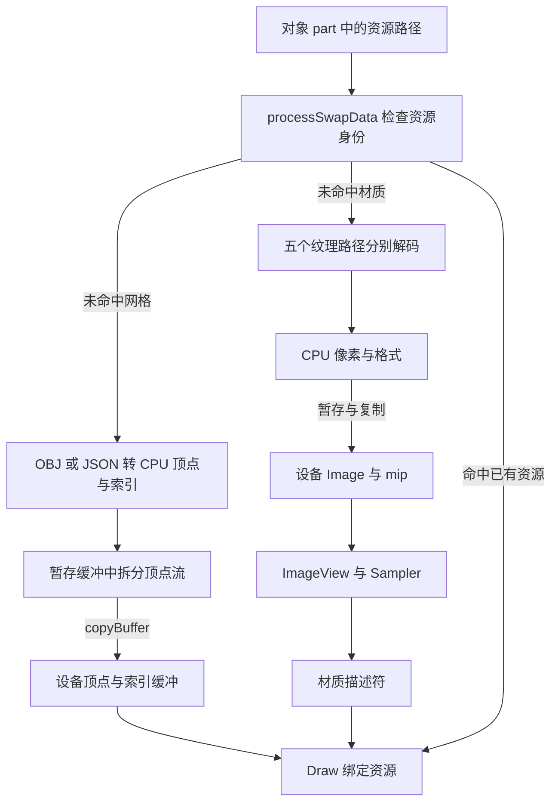

把第二面墙加入场景，通常不需要再上传一份相同的网格；移动已有墙面，也不应该每帧重新解码纹理。但两种材质引用同一张贴图时，底层一定只保存一份图像吗？删除最后一个对象后，设备资源又会不会立即释放？

这些问题不能仅靠“有资源管理器”来回答。需要分清文件里的内容、CPU 上的临时载荷、运行时资源身份，以及 GPU 访问的实际存储，再核对缓存和生命周期在哪里生效。

本篇继续使用前面出现过的 Wall 网格与 gold 材质，分别追网格和纹理两条路径，最后在一次绘制的资源绑定处汇合。

> **读这篇之前**：建议看过 [GFX-01：从场景对象到一帧画面]()。[05 资源与类型恢复]() 负责对象怎样恢复；[06 位置变化]() 负责实例变换；[11 相机篇]() 负责观察与投影。本文补上这些实例引用的共享资源怎样建立。
>
> 源码基线：[BoomingTech/Piccolo，固定提交 `f5053707fed4`][revision]。本篇为主线 15，内容来自固定源码、实际资源与 Vulkan 基础接口文档核对。已用同版本 tinyobj、stb 和资源键/GuidAllocator 做独立 CPU 检查；未运行完整 Piccolo 或 Vulkan 上传，未取得资源创建断点、GPU 捕获或采样画面。下文的设备行为按源码路径与成功执行前提说明。

## 先建立五层模型：文件、载荷、身份、存储与绑定

假设两面墙使用相同网格与材质，但位置不同。可以先把它们拆成两份实例状态和一组可共享的内容。

| 层次 | 本例中的对应物 | 主要职责 |
| --- | --- | --- |
| 文件描述 | wall.obj、gold.material.json、gold.tga | 保存可读取的内容及引用 |
| CPU 载荷 | 顶点/索引字节、解码后的像素 | 把文件内容转成上传所需的数据 |
| 资源身份 | mesh/material asset ID | 让多个实例找到相同资源，决定是否复用 |
| 设备存储 | 顶点与索引 Buffer、纹理 Image 及分配 | 承载图形命令实际访问的数据 |
| 访问与绑定 | 顶点输入布局、ImageView、Sampler、DescriptorSet | 告诉当前绘制怎样解释和访问存储 |

资源 ID 是查找关系，不能直接当成设备句柄；设备句柄也不是指向一份 OBJ 或 JPEG 文件的普通 CPU 指针。文件解析、资源创建、内容上传与绑定分别解决不同问题。

下面是两条**资源准备与访问关系**，不是所有对象每帧都要经过的固定加载流程：



这里“设备存储”不预设所有机器都有独立显存。Piccolo 使用 Vulkan/VMA 的资源和内存策略；具体物理内存位置仍由设备与分配结果决定。

## 从墙面的描述走到缓存：到底以什么作为同一份资源

[Wall 对象定义][wall-object] 的一个 submesh 指向 `wall.obj`，材质指向 `gold.material.json`。[gold 材质文件][gold-material] 再指向：

```text
base colour        → asset/objects/_textures/gold.tga
metallic roughness → asset/objects/_textures/mr.tga
normal             → asset/objects/_textures/n.tga
occlusion          → 空路径
emissive           → 空路径
```

[MeshComponent::postLoadResource()][mesh-component] 将网格和纹理引用转成完整路径，保存在 part 描述里。组件更新时把脏实例描述交给逻辑交换槽；描述如何到达渲染侧，沿用 06 的交接过程。

真正决定本次是否读取与创建资源的是 [RenderSystem::processSwapData()][render-system]。它为每个 part 建立 RenderEntity，保存实例矩阵，再分别检查：

- `MeshSourceDesc`：按网格路径字符串比较。
- `MaterialSourceDesc`：按基础颜色、金属度粗糙度、法线、遮蔽和自发光五个路径逐项比较。

这两类键由 [资源类型定义][render-type] 提供，[GuidAllocator][guid] 将键映射为运行时 ID。之后 [RenderResource][render-resource-h] 又用 ID 查找 `m_vulkan_meshes` 与 `m_vulkan_pbr_materials`。

因此有两层关系需要同时成立：**描述键能找到 ID，ID 能找到已建立的设备资源**。当前处理顺序会先分配 ID，再调用上传；ID 已存在本身不能证明上传成功，正常复用依赖此前创建成功。这里没有完整的 Loading/Ready/Failed 状态机，也不能把它理解成失败后自动重试的保证。

另一个重要边界是：**材质缓存不等于独立纹理缓存**。两份材质只要其中一个路径不同，就有不同的材质身份；创建新材质时会再次加载并创建它的各张纹理，即使其中的 gold.tga 与旧材质相同。这个路径没有按每个纹理文件统一复用 Image 的缓存层。

不同材质文件名但五个纹理路径完全相同，可以命中同一材质键；路径相同但磁盘内容改变，则不会仅因文件变化自动得到新 ID。这里的身份也不是跨进程稳定的资产 GUID 或内容哈希。

## 网格：解析出的顶点，还要变成绘制约定的缓冲布局

### OBJ 与 JSON 先形成 CPU 载荷

[loadMeshData()][resource-base] 按扩展名分支：OBJ 进入 `loadStaticMesh()`；JSON 恢复 MeshData，复制顶点、索引和骨骼绑定信息。两条路径都会形成 CPU 侧的 RenderMeshData，并保存包围盒缓存。

本例走 OBJ。tinyobj 读取位置、法线、UV 与面索引后，Piccolo 按三角形角点展开 `MeshVertexDataDefinition`。一个几何位置可以因不同面、法线或 UV 对应多个顶点；这里没有先做共享顶点去重。

独立读取固定 wall.obj 得到 8 个位置、12 个三角形；按当前展开规则得到 **36 个顶点和 36 个顺序索引**。在本次 x64 C++ 检查中，CPU 顶点结构为 44 字节，因此顶点载荷是 1584 字节，uint16 索引载荷是 72 字节。

不要用文件中 `v` 的行数直接推算最终顶点缓冲大小，也不要把这组小网格的结果推广到所有导入器。此加载器处理的是自己支持的三角形与属性路径；缺失法线或 UV 时另有补值分支。

索引也有明确限制：OBJ 分支对展开顶点数做 uint16 范围断言，JSON 分支把索引转换为 uint16，Draw 又绑定 `RHI_INDEX_TYPE_UINT16`。这是一组需要保持一致的约定，不是任意规模网格自动适配 32 位索引的实现。

### 从一条 CPU 结构拆成三路顶点流

[getOrCreateVulkanMesh() 与 updateVertexBuffer()][render-resource] 在未命中时建立 VulkanMesh。本文只走无骨骼绑定的静态路径，顶点数据被拆到三块设备缓冲：

| 顶点流 | 内容 | 本例 36 个顶点的有效载荷 |
| --- | --- | --- |
| position | 三个位置分量 | 432 字节 |
| normal + tangent | 两个三维向量 | 864 字节 |
| texcoord | 两个 UV 分量 | 288 字节 |

[MeshVertex 的输入定义][render-mesh] 为三路绑定分别声明步长，再把属性映射到 Shader 的 location。三路字节合计仍为 1584，但排列方式已经改变。不能把 CPU 的整块交错结构不加检查地绑定成当前三路输入。

有骨骼绑定时还会准备索引/权重存储缓冲与相应描述符；具体动画与蒙皮解释留给 12。

## 上传：先写暂存内存，再让设备复制

当前顶点、索引与材质常量上传都能找到类似结构：[创建 host-visible、host-coherent 的 staging buffer，map 后写入，再 unmap][render-resource]。目标缓冲通过 VMA 建立，并按用途设置顶点、索引或 uniform usage，同时允许作为 transfer destination。

例如索引缓冲的目标用途是：

```cpp
bufferInfo.usage = RHI_BUFFER_USAGE_INDEX_BUFFER_BIT | RHI_BUFFER_USAGE_TRANSFER_DST_BIT;
```

随后调用 `copyBuffer()`，把暂存中的有效字节复制到目标缓冲。这里需要分清：

- **map**：让 CPU 获得可写的映射地址。
- **memcpy 或逐字段写入**：准备 CPU 写出的内容。
- **copyBuffer**：录制并执行设备复制路径。
- **绑定目标缓冲**：让之后的 Draw 使用它。

`HOST_COHERENT` 涉及主机缓存一致性要求，不能替代设备工作完成条件，也不表示 GPU 已经读取了刚写入的数据。Vulkan 对映射内存仍要求正确安排主机与设备访问的同步，见 [Memory Allocation][vk-memory]。

### 为什么复制调用后就释放 staging

仅看上层会发现：`copyBuffer()` 返回，代码紧接着 destroyBuffer/freeMemory。若复制只是异步排队，这种寿命安排就需要额外的完成追踪。

沿 [VulkanUtil::copyBuffer()][vulkan-util] 往下读，实际链路是：

```text
beginSingleTimeCommands
→ vkCmdCopyBuffer
→ endSingleTimeCommands
→ 提交 graphics queue
→ vkQueueWaitIdle
→ 释放临时命令缓冲
```

[endSingleTimeCommands()][vulkan-rhi] 中包含相邻的两行：

```cpp
vkQueueSubmit(((VulkanQueue*)m_graphics_queue)->getResource(), 1, &submitInfo, VK_NULL_HANDLE);
vkQueueWaitIdle(((VulkanQueue*)m_graphics_queue)->getResource());
```

按 [vkQueueWaitIdle 的基础语义][vk-idle]，正常成功返回时，主机已经等待该队列此前相关工作完成。这为随后释放本次复制使用的暂存资源提供完成依据；仍需满足资源使用与内存依赖的其余条件，不能把一次 wait 当作所有同步问题的通用替代。

代价也很具体：它会等待整条队列已有工作，而非只追踪本次上传。当前实现便于理解和安排临时寿命，但不是后台持续流式加载、合批上传或精细异步回收方案。源码还没有在这两行检查返回值，设备丢失等失败不能当作成功路径继续解释。

## 纹理：文件字节、解码像素与 GPU Image 是三种表示

[loadMaterialData()][resource-base] 对五个路径分别调用 `loadTexture()`。普通纹理读取使用：

```cpp
texture->m_pixels = stbi_load(asset_manager->getFullPath(file).generic_string().c_str(), &iw, &ih, &n, 4);
```

最后的 4 要求输出四通道；原文件的通道数仍可由 n 记录。本例 gold.tga 原有三通道，但这一步输出的是 RGBA8 像素。磁盘文件大小既不等于解码后的像素大小，也不等于设备实际分配量。

本路径将基础颜色纹理标为 `R8G8B8A8_SRGB`，其他几张普通材质纹理标为 `R8G8B8A8_UNORM`。同样的四个字节，格式解释可以不同；法线、粗糙度等数据不能因为存成图片就一概按颜色处理。这里只说明固定实现的选择，不把所有语义纹理的色彩空间设计归纳成一条规则。

读取成功后，TextureData 保存像素、尺寸和格式；此时还没有创建 Vulkan Image。读取失败则返回 nullptr，由后续材质创建路径选择回退。

### 两种默认路径，以及回退像素的真实字节

“没有指定材质”与“材质里某个纹理读取失败”分别发生在不同层：前者在 processSwapData 中选择几张默认文件；后者在 getOrCreateVulkanMaterial 中使用 1×1 回退数据。

gold 材质的 occlusion、emissive 是空路径，也会经历解析与读取失败后的回退。该版本准备的回退数组是：

```cpp
float empty_image[] = { 0.5f, 0.5f, 0.5f, 0.5f };
```

但对应目标格式是 RGBA8。后端根据格式复制 1×1×4 个字节，不会把四个 float 逐个转换为八位通道。在本次 Windows x64、IEEE 754 小端检查中，复制的前四个字节是 **`0,0,0,63`**，来自第一个 float 的内存表示。

所以这里可以确认存在回退路径，却不能把它写成“四个通道均为 0.5 的中性灰图像”，更不能据此保证法线或其他材质语义得到理想默认值。实际采样结果仍需运行验证；修正回退编码属于后续代码工作，本篇不改引擎。

## Image 的建立：上传第零层，再准备完整 mip 链

[updateTextureImageData()][render-resource] 为五个槽位分别调用 `createGlobalImage()`；RHI 转交给 [VulkanUtil::createGlobalImage()][vulkan-util]。普通 RGBA8 路径可以分成以下步骤：

1. 根据宽、高与格式算上传字节数，创建暂存缓冲并复制 CPU 像素。
2. 按采样和复制用途，通过 VMA 创建 Image 与内存分配。
3. 把第 0 层从 UNDEFINED 转到 TRANSFER_DST，执行 buffer-to-image 复制。
4. 把第 0 层转为 TRANSFER_SRC；相关辅助命令提交并等待后，释放暂存缓冲。
5. 调用 `genMipmappedImage()`，逐级 blit，并为各级安排相应布局转换。
6. 将整组 mip 转为 SHADER_READ_ONLY，建立覆盖这些层级的 ImageView。

不能因为局部注释写着 shader read，就跳过实际枚举值：第 0 层在生成后续 mip 前仍需作为 transfer source。源码中的转换和最终屏障需要一起阅读。

当未显式传入 mip 数时，代码使用：

```cpp
uint32_t mip_levels =
    (miplevels != 0) ? miplevels : floor(log2(std::max(texture_image_width, texture_image_height))) + 1;
```

CPU TextureData 虽然先记录 `m_mip_levels=1`，这里的普通材质调用却没有把这个字段传成强制值，而是采用接口默认的 0，让 GPU 图像准备完整链。因此，“CPU 只解码一层”和“GPU 只有一层”不能画等号。

用固定资源的实际解码尺寸，按这套规则计算：

| 纹理 | 解码尺寸 | RGBA8 第 0 层字节 | 完整 mip 层数 | 各层 texel 字节总和 |
| --- | --- | --- | --- | --- |
| gold.tga | 1024×1024 | 4,194,304 | 11 | 5,592,404 |
| mr.tga | 64×64 | 16,384 | 7 | 21,844 |
| n.tga | 512×512 | 1,048,576 | 10 | 1,398,100 |

这张表是 CPU 解码与公式计算结果，未执行 GPU mip 生成。最后一列只计算像素载荷，不包含实现相关的对齐、tiling、分配粒度或其他对象，不能当成 VMA 实际显存占用报告。图像格式的过滤/blit 支持与设备能力还需在实际环境核对。

## Image、View、Sampler 与 Descriptor 怎样接到 Draw

纹理数据已经进入 Image 后，还需要告诉 Shader 访问哪部分、怎样采样。

| 对象 | 本路径中的职责 |
| --- | --- |
| Image 与分配 | 保存图像数据与子资源 |
| ImageView | 选择访问的图像类型、格式与 mip 范围 |
| Sampler | 提供过滤、寻址、LOD 等采样规则 |
| 材质 DescriptorSet | 把材质常量和五张纹理的访问关系放到约定 binding |
| Pipeline layout 与 Shader 声明 | 约定这些 binding 怎样被当前程序解释 |

材质创建函数拿到 ImageView，调用 `getOrCreateMipmapSampler()`，再填写 imageLayout、imageView 和 sampler。Sampler 自己也会按 mip 数缓存，这与按纹理路径复用 Image 是不同层次的复用。

依据 [VkDescriptorImageInfo][vk-image-info]，imageLayout 描述的是通过该描述符访问时图像应当处于的布局；给这个字段赋值不会执行布局转换。实际转换仍来自前面的设备命令。

该材质描述符中，binding 0 是材质常量缓冲，1—5 分别是基础颜色、金属度粗糙度、法线、遮蔽和自发光的 combined image sampler。[mesh_gbuffer.frag][gbuffer] 对应声明了：

```glsl
layout(set = 2, binding = 1) uniform sampler2D base_color_texture_sampler;
```

[MainCameraPass 的网格绘制][main-pass] 将材质描述符绑定到 set=2；网格侧绑定三路顶点缓冲与 uint16 索引缓冲，再记录索引绘制。顶点输入与材质采样在这里汇合，但还需要 11 的相机数据和每个实例的模型矩阵。

**updateDescriptorSets、绑定描述符、复制纹理是三件事。** 重新使用已有材质时，不能只因为出现一次绑定，就认定整张纹理又被重新上传。纹理与参数如何参与表面颜色计算，留给下一篇 16。

## 首次创建、后续复用和释放，要分别判断

以下表格假设前次资源创建成功、缓存仍保留，描述也沿正常路径到达渲染侧：

| 本次变化 | 网格路径 | 材质路径 | 本路径可推导的行为 |
| --- | --- | --- | --- |
| 第一个 Wall part | 未命中 | 未命中 | 解析网格、解码纹理，建立对应设备资源 |
| 新增相同资源的第二个实例 | 命中 | 命中 | 分配实例身份，复用网格和材质资源 |
| 只移动已有墙面 | 命中 | 命中 | 更新实例表示，不因此重读 OBJ 或解码所有纹理 |
| 换一个法线纹理路径 | 命中 | 未命中 | 建立新材质；其余相同路径的纹理也不能据此认定共享同一 Image |
| 修改同一路径文件的内容 | 仍可命中 | 仍可命中 | 当前缓存分支没有自动按内容变化刷新资源 |
| 删除墙面 | 需另查 | 需另查 | 删除实例不等于回收共享设备缓存 |

最后一行要再拆开三种寿命：

- **CPU 载荷**：局部 RenderMeshData/RenderMaterialData 及共享载荷持有结束后，BufferData/TextureData 的析构释放 CPU 数据。
- **暂存资源**：上传辅助路径等待后显式销毁；它们服务于复制，不需要与可见对象保持同样寿命。
- **长期设备资源**：VulkanMesh、VulkanPBRMaterial 保存在 RenderResource 的 map 中，供后续实例复用。

[deleteEntityByGObjectID()][render-scene] 删除的是场景中的实例表示，没有在该路径中按最后一个使用者去销毁这两张资源表。[RenderResource::clear()][render-resource] 在固定版本里还是空函数；资源结构保存句柄也不自动构成完整的 RAII 回收协议。

因此，本篇可以追清资源创建与复用，却不能把它登记成“已证明资源会在最后一个实例删除时安全回收”。长期释放还要分别核对对象、分配器、设备和在途访问的关系，也不能把进程退出或设备销毁当成逐资源清理已完成的证据。

## 先做独立检查，再为真实上传留下观察表

本篇的独立 C++17 检查执行了四组工作：用固定版本 tinyobj 读取 wall.obj 并统计角点；用原 stb 解码三张实际 TGA；用原 MeshSourceDesc、MaterialSourceDesc 与 GuidAllocator 检查身份复用；用合法字节复制核对回退数组的前四字节。mip 数和载荷大小按源码公式计算。

它没有调用完整 RenderResource、VMA 或 Vulkan，因此表中的上传次数与等待关系仍是源码推导。待 [完整构建与调试基线]() 可用后，建议分两次观察：先创建第一份资源，再只新增一个相同资源实例。

| 入口 | 应记录的数据 | 要区分的结论 |
| --- | --- | --- |
| processSwapData | part ID、完整路径、mesh/material ID、命中标记 | 实例身份与共享资源身份 |
| loadStaticMesh/loadTexture | 解码次数、顶点数、尺寸、格式、失败返回 | 是否重新读取文件 |
| getOrCreateVulkanMesh/Material | map 命中、设备句柄、创建结果 | ID 存在与资源就绪 |
| copyBuffer/createGlobalImage | 字节数、目标用途、mip 数 | 本次是否真的上传 |
| endSingleTimeCommands | 提交与等待时间、返回值 | 是否阻塞，是否成功完成 |
| 材质描述符与 Draw | View、Sampler、binding、顶点/索引缓冲 | Shader 实际能访问什么 |
| 删除对象前后 | 实例与资源表数量、在途使用 | 实例移除与资源回收 |

每个观察只改变一个条件：增加实例、移动实例、换材质路径或删除对象。这样才有机会把文件读取、设备分配、上传等待和绘制成本分别解释清楚。

**从文件到 GPU，要同时追清内容变换、资源身份、上传完成条件和绘制访问关系。**

## 继续阅读

- [13 粒子发射器与 GPU 模拟]()：对照固定粒子池、存活索引和紧凑绘制缓冲，追另一种 GPU 数据来源。

- [12：一段动画怎样成为骨骼姿态与网格蒙皮]()：补齐 mesh_bind 的四权重、关节编号、每实例 palette 与实际顶点变形，核对默认顺序索引的布局条件。
- [11：相机怎样跟随角色，并把视角交给渲染系统]()：把本篇的共享资源与视图、投影数据接起来。
- [06：位置怎样进入渲染表示]()：核对只修改实例位置时，哪些数据需要更新。
- [07：Pass 与 Vulkan 提交]()：继续沿批次、绑定和命令记录追到帧提交。
- [GFX-02：从 GLSL 到 GPU]()：补充程序产物、资源接口和系统边界。

接着读 [16《材质、光照与阴影怎样共同决定表面颜色》]()，从材质输入进入 G-buffer、方向光阴影与环境贡献，追到后处理前的场景颜色。相机 → GPU 资源 → 着色是本文采用的学习顺序；运行中这些数据在绘制与光照阶段汇合，已有资源会跨帧复用。

Piccolo 源码与资源节选版权：Copyright (c) 2022 Contributors to the Piccolo Engine，按 [MIT License][license] 提供。图表、独立 CPU 检查与运行验证范围已分别说明。

[revision]: https://github.com/BoomingTech/Piccolo/tree/f5053707fed4d3f94d270a436fb0d3a8ae54e3e5
[license]: https://github.com/BoomingTech/Piccolo/blob/f5053707fed4d3f94d270a436fb0d3a8ae54e3e5/LICENSE
[wall-object]: https://github.com/BoomingTech/Piccolo/blob/f5053707fed4d3f94d270a436fb0d3a8ae54e3e5/engine/asset/objects/environment/wall/wall.object.json
[gold-material]: https://github.com/BoomingTech/Piccolo/blob/f5053707fed4d3f94d270a436fb0d3a8ae54e3e5/engine/asset/objects/environment/_material/gold.material.json
[mesh-component]: https://github.com/BoomingTech/Piccolo/blob/f5053707fed4d3f94d270a436fb0d3a8ae54e3e5/engine/source/runtime/function/framework/component/mesh/mesh_component.cpp
[render-system]: https://github.com/BoomingTech/Piccolo/blob/f5053707fed4d3f94d270a436fb0d3a8ae54e3e5/engine/source/runtime/function/render/render_system.cpp
[render-type]: https://github.com/BoomingTech/Piccolo/blob/f5053707fed4d3f94d270a436fb0d3a8ae54e3e5/engine/source/runtime/function/render/render_type.h
[guid]: https://github.com/BoomingTech/Piccolo/blob/f5053707fed4d3f94d270a436fb0d3a8ae54e3e5/engine/source/runtime/function/render/render_guid_allocator.h
[render-resource-h]: https://github.com/BoomingTech/Piccolo/blob/f5053707fed4d3f94d270a436fb0d3a8ae54e3e5/engine/source/runtime/function/render/render_resource.h
[resource-base]: https://github.com/BoomingTech/Piccolo/blob/f5053707fed4d3f94d270a436fb0d3a8ae54e3e5/engine/source/runtime/function/render/render_resource_base.cpp
[render-resource]: https://github.com/BoomingTech/Piccolo/blob/f5053707fed4d3f94d270a436fb0d3a8ae54e3e5/engine/source/runtime/function/render/render_resource.cpp
[render-mesh]: https://github.com/BoomingTech/Piccolo/blob/f5053707fed4d3f94d270a436fb0d3a8ae54e3e5/engine/source/runtime/function/render/render_mesh.h
[vulkan-util]: https://github.com/BoomingTech/Piccolo/blob/f5053707fed4d3f94d270a436fb0d3a8ae54e3e5/engine/source/runtime/function/render/interface/vulkan/vulkan_util.cpp
[vulkan-rhi]: https://github.com/BoomingTech/Piccolo/blob/f5053707fed4d3f94d270a436fb0d3a8ae54e3e5/engine/source/runtime/function/render/interface/vulkan/vulkan_rhi.cpp
[gbuffer]: https://github.com/BoomingTech/Piccolo/blob/f5053707fed4d3f94d270a436fb0d3a8ae54e3e5/engine/shader/glsl/mesh_gbuffer.frag
[main-pass]: https://github.com/BoomingTech/Piccolo/blob/f5053707fed4d3f94d270a436fb0d3a8ae54e3e5/engine/source/runtime/function/render/passes/main_camera_pass.cpp
[render-scene]: https://github.com/BoomingTech/Piccolo/blob/f5053707fed4d3f94d270a436fb0d3a8ae54e3e5/engine/source/runtime/function/render/render_scene.cpp
[vk-idle]: https://docs.vulkan.org/refpages/latest/refpages/source/vkQueueWaitIdle.html
[vk-image-info]: https://docs.vulkan.org/refpages/latest/refpages/source/VkDescriptorImageInfo.html
[vk-memory]: https://docs.vulkan.org/spec/latest/chapters/memory.html
