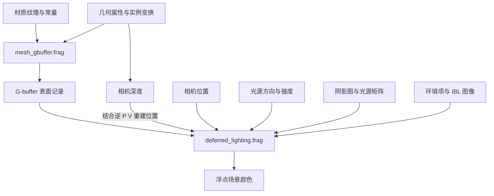
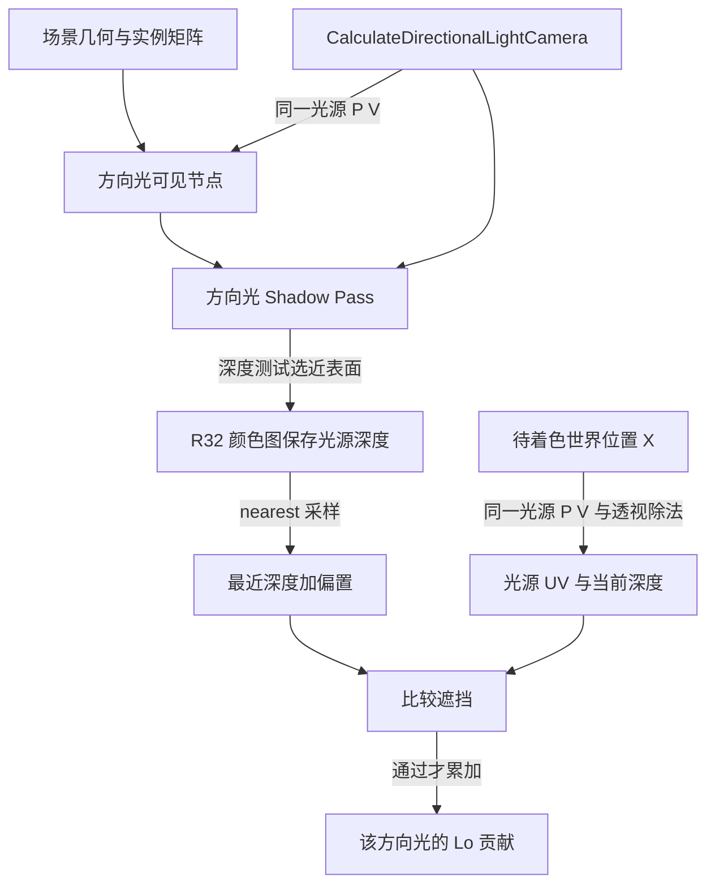

一面墙已经有网格和纹理，为什么转动相机，高光还会变化？为什么挡住一盏灯，墙面不一定变成黑色？把一张名为 occlusion 的纹理上传到 GPU，就能确认环境遮蔽已经生效吗？

这些现象涉及不同输入：材质描述表面怎样响应光，光源提供到达表面的照明，视角决定我们观察哪个方向的反射，阴影判断某个光源是否被几何遮住。需要把它们接到同一个表面位置，才能解释颜色从哪里来。

本篇接着 11 的相机与 15 的 GPU 资源，沿 Piccolo 默认延迟路径追一处不透明表面的着色，输出停在后处理前的场景颜色。

> **读这篇之前**：建议读过 [15 网格与纹理怎样成为 GPU 资源]()，了解材质常量、Image 与描述符。[11 相机篇]() 解释视图与相机位置的来源；[07 Pass 与提交]() 可用于定位本文的 Pass。
>
> 源码基线：[BoomingTech/Piccolo，固定提交 `f5053707fed4`][revision]。本篇为主线 16，主要讨论非蒙皮、DEFAULT_LIT 的延迟着色路径。已有源码、四个 GLSL 编译与独立 BRDF 数值检查；2026-10-26 另复用 07 的真实捕获，核对 Wall_1 的单点 G-buffer、深度、延迟光照输入及浮点附件，并取得片元调试值。实测与后面的条件练习分别说明；本次采样没有进入方向光阴影比较，阴影正确性、其他表面和后处理仍待验证。

## 先给每个输入一份职责

考虑一个表面位置 X：几何决定它的位置和朝向，材质提供基础颜色与粗糙度等属性，相机位置决定观察方向 V，光源决定入射方向 L 和强度。最后还要检查光源与 X 之间有没有遮挡。

| 输入 | 回答的问题 | 在本篇中的角色 |
| --- | --- | --- |
| 基础颜色、金属度、粗糙度等 | 表面怎样分配和响应反射 | 形成反射模型的参数 |
| 法线 N | 这个位置的表面朝哪边 | 参与入射角、反射方向等计算 |
| 光源方向与强度 | 光从哪来，有多强 | 形成当前光源的贡献 |
| 观察方向 V | 从表面的哪个方向看它 | 参与镜面反射与 Fresnel 等计算 |
| 光源可见性 | 这束光是否被场景几何挡住 | 决定是否计入该直接光贡献 |
| 环境与预计算图像 | 周围照明用什么近似表示 | 补充环境照明项 |

基础颜色不是已经打好所有光照的最终颜色。法线贴图改变的是着色用的方向，也不会仅因改变法线就移动几何轮廓或重新塑造阴影投射几何。

可以先用一个概念式组织直接光：

```text
某个直接光的贡献
≈ 可见性 × 到达表面的照明 × 表面对 L、V 的反射响应
```

这不是要求照抄的 Shader 公式。余弦、距离衰减和反射响应怎样组合，需要看所选模型与实现；下文会保留 Piccolo 的实际表达。

默认延迟路径把工作拆成“记录表面”与“计算照明”。图中箭头表示数据依赖，不表示所有输入都是当帧从文件重新加载：



## 材质参数先进入了哪里，哪些值真正可供着色

[15 GPU 资源篇]() 已追过 Wall 引用的 gold 材质。固定版本的 [MaterialRes][material-res] 主要保存五个纹理路径；不能因为 Shader 里有一个 factor，就假定在材质 JSON 中增加同名字段会自动打通整条链。

[RenderEntity][entity] 提供另一组默认值：base color factor 为 `(1,1,1,1)`，metallic/roughness factor 为 1，normal scale 和 occlusion strength 为 1，自发光 factor 为 0。[processSwapData()][render-system] 建立实体和纹理来源；[材质创建函数][render-resource] 再把实体中的值写入材质常量缓冲，经 set=2、binding=0 供 Shader 使用。

这里有两个实际限制。第一，要改变某个参数，必须确认数据确实到达这个常量缓冲，不能只改变某个未接入的资源字段。第二，15 已说明该材质按五个纹理路径缓存；已有缓存不会因为某个实体字段变化，就自动执行一次新的材质创建和常量上传。

所以后面的参数练习把值固定在**着色输入层**，不承诺当前编辑器已经具备对应操作面板或自动刷新机制。

### G-buffer 记录的是表面，尚未求出照明结果

在 [mesh_gbuffer.frag][gbuffer-frag] 中，基础颜色来自纹理采样乘 baseColorFactor；金属度取 metallic-roughness 纹理的 B 通道，粗糙度取 G 通道，再分别乘 factor。specular 在此写为常量 0.5，shading model 写为 DEFAULT_LIT。

```glsl
gbuffer.metallic       = texture(metallic_roughness_texture_sampler, in_texcoord).z * metallicFactor;
gbuffer.specular       = 0.5;
gbuffer.roughness      = texture(metallic_roughness_texture_sampler, in_texcoord).y * roughnessFactor;
gbuffer.shadingModelID = SHADINGMODELID_DEFAULT_LIT;
```

法线贴图先从 `[0,1]` 解码到有正负的方向分量，再用 T、B、N 组成的基底从切线空间转到当前世界空间着色方向：

```glsl
highp vec3 tangent_normal = texture(normal_texture_sampler, in_texcoord).xyz * 2.0 - 1.0;
```

随后代码归一化输入 normal、tangent，计算 `B = normalize(cross(N,T))`，最终归一化 `TBN * tangent_normal`。这里的法线方向需要与光源、观察方向处于兼容空间；贴图存在本身不能证明上游法线变换、切线基底或非均匀缩放处理已经正确。

[gbuffer.h][gbuffer-h] 将这些值分到三张附件，[MainCameraPass][main-pass] 决定它们的格式：

| 附件 | 编码内容 | 固定格式 |
| --- | --- | --- |
| A | RGB 为 `N*0.5+0.5` | RGBA8 UNORM |
| B | R 金属度、G specular、B 粗糙度、A shading model ID/255 | RGBA8 UNORM |
| C | RGB 为基础颜色 | RGBA8 SRGB |
| 独立深度附件 | 相机投影后的深度 | 由后端选择的深度格式 |

A、C 的 alpha 没有在该编码函数中赋予可依赖的表面语义。深度也不在这三张颜色附件的任意空闲通道里。

EncodeBaseColor/DecodeBaseColor 在 GLSL 中直接返回输入，不能据此认定整个过程没有 sRGB 格式转换。附件格式参与写入解释；[Vulkan framebuffer 规则][vk-framebuffer] 明确规定向 sRGB 附件写 RGB 时的编码。这里应连同格式与读取路径核对，避免手工再次做一遍不必要的 gamma 运算。

### 精度和未接入的字段也属于实现事实

RGBA8 是有限精度记录。比如理想法线 `(0,0,1)` 编码后的前两个分量为 0.5，按常见最近值量化为 128/255 再解码，会得到约 0.00392，而非精确的 0。固定代码的 DecodeNormal 没有再次归一化；不能把后续 N 无条件当成理想单位向量。

同时，沿这条延迟路径可以看到：

| 有声明或计算的内容 | 实际消费边界 |
| --- | --- |
| normalScale | 当前 calculateNormal 没有用它缩放贴图法线 |
| occlusion texture / occlusionStrength | 当前 G-buffer 和后续光照没有把这套 AO 数据接到结果 |
| emissive 纹理与 Le | G-buffer Shader 计算了 Le，但相关颜色输出被注释，G-buffer 也未打包 Le |

因此这些字段存在、纹理已上传或 Shader 编译通过，都不能证明相应效果已经出现。特别是本篇的最终场景颜色，不能凭字段名就额外加上一项“已生效的自发光”。

## 延迟光照怎样重新找到同一个表面位置

[deferred_lighting.frag][deferred-frag] 通过 input attachment 读取三张 G-buffer 与深度，调用 DecodeGBufferData，拿到 N、基础颜色、金属度等属性。

它没有从 G-buffer 直接读取世界位置，而是组合屏幕 UV 与深度，应用 `inverse(proj_view_matrix)`，最后除以齐次 w：

```glsl
highp vec4  in_world_position_with_w = inverse_proj_view_matrix * ndc;
in_world_position                    = in_world_position_with_w.xyz / in_world_position_with_w.www;
```

重建正确依赖于深度、UV 与相机 P、V 的约定一致，并且这里确实有有效表面。随后 [mesh_lighting.inl][lighting-inl] 建立：

```glsl
highp vec3 V = normalize(camera_position - in_world_position);
```

N 是表面法线，V 是从表面指向相机的方向，方向光的 L 来自归一化的 `scene_directional_light.direction`。因此读这份代码时，该方向字段用于“指向光源”的着色方向；不要不加检查地套用别处“光线传播方向”的符号。

相机位置、光源方向与颜色由 [updatePerFrameBuffer()][render-resource] 写入每帧数据；G-buffer 输入由 [MainCameraPass][main-pass] 绑定。两个来源在此共同决定同一个 X 的照明输入。

## 反射响应：知道 D、G、F 各做什么，再读实际公式

BRDF 可以先理解为：给定表面属性、入射方向 L 与观察方向 V，用什么反射响应把照明转到当前观察方向。它本身不负责发现附近有哪些灯，也不自动知道场景中是否有墙挡住灯。

[mesh_lighting.h][lighting-h] 采用一组微表面函数组织直接光响应：

| 量 | 代码中的入口 | 阅读时抓住的职责 |
| --- | --- | --- |
| H | normalize(V+L) | 光照与观察的半程方向 |
| D | D_GGX | 用粗糙度控制微表面法线分布 |
| G | G_SchlicksmithGGX | 近似微表面自身的遮蔽与掩蔽 |
| F | F_Schlick | 根据角度与 F0 计算反射权重 |
| kD | `(1-F)*(1-metallic)` | 该模型中的漫反射分配 |

这里的 G 是微表面统计模型，和后面读取阴影图、判断场景中另一堵墙是否挡光，是两个不同尺度的问题。

F0 由 dielectric_specular 与基础颜色按 metallic 混合；本路径的 dielectric_specular 来自 `0.08 * gbuffer.specular`，若暂不考虑量化，specular=0.5 对应 0.04。metallic=1 时这段直接光 BRDF 的 kD 为零，不能据此推断后面所有独立环境项也都自动为零。

对照源码时，还要保留它自己的选择：F_Schlick 在此传入 dotNV；组合输出写成：

```glsl
color += (kD * basecolor / PI + (1.0 - kD) * spec);
```

不能讲完常见公式后，悄悄把源码改读成另一个版本。D/G/F 是理解职责的入口，不是这份实现已通过能量守恒或物理一致性验证的证明。

该函数还把参与 D/G 的粗糙度下限设为 0.05。粗糙度通常会改变高光分布和环境反射 LOD，但“越粗糙整幅图就一定越暗”不是可由这几行推出的规律。参数仍应处于合理范围，并提供有效方向向量；源码中的少量保护不等于覆盖所有退化输入。

## 方向光阴影：同一个 X 换到光源视角再比较

方向光分支先计算 NoL。只有 NoL>0 时，才继续阴影与直接光累加；通过遮挡判断后，它构造光照项并调用 BRDF：

```glsl
highp vec3 En = scene_directional_light.color * NoL;
Lo += BRDF(L, V, N, F0, basecolor, metallic, roughness) * En;
```

NoL 在调用外侧参与 En。读 BRDF 时若又凭印象补乘一次，就改变了实际表达。

要回答该直接光为什么被挡住，还需要从阴影图的生产端读回来：



### 光源矩阵、投射集合与深度图分别从哪里来

[CalculateDirectionalLightCamera()][render-helper] 结合主相机视锥和场景包围范围，建立方向光观察与正交投影矩阵。[RenderScene][render-scene] 把同一个结果交给阴影 Pass 的每帧数据与后续光照数据，并用它筛选方向光用途的网格节点。

这里不能仅凭函数内引用 CSM 资料的注释，就认为当前已经实现多级联阴影。本文追踪的是这条单张方向光图的路径；主相机不可见也不直接等于不参与该阴影集合。

[DirectionalLightShadowPass][directional-pass] 有两个附件：用于深度测试的深度附件，以及可供之后采样的 R32_SFLOAT **颜色附件**。[阴影顶点 Shader][shadow-vert] 使用光源矩阵变换世界位置；[片元 Shader][shadow-frag] 写入：

```glsl
out_depth = gl_FragCoord.z;
```

深度测试采用 LESS 并写深度，颜色图保存相应通过测试的深度值。后续光照采样的是这个颜色 ImageView，不是直接把深度附件绑定成阴影纹理。颜色附件清为 1，并在 Pass 后转为 shader read 布局。

还要检查 Pass 中实际是否绘制网格。固定版本的方向光 draw 也受 `isPointLightShadowEnabled()` 控制，虽然这个名字写着 point light。[VulkanRHI 初始化][vulkan-rhi] 在 GNU/Mach 条件下关闭此标记，其他分支打开。不能从“方向光 Pass 被调用”就断言它已经画出遮挡几何。

### 比较的是同一套光源深度，偏置不是软阴影

光照 Shader 将 X 变到方向光裁剪空间，除以 w，把 XY 从 NDC 转成 UV，然后执行：

```glsl
highp float closest_depth = texture(directional_light_shadow, uv).r + 0.000075;
highp float current_depth = position_ndc.z;

shadow = (closest_depth >= current_depth) ? 1.0f : -1.0f;
```

这里 shadow 不是后面拿来直接乘颜色的负权重；代码用 `shadow > 0` 决定是否计入该光源。若 X 比记录的最近表面更远，就跳过该直接光贡献。

0.000075 是加在这套投影深度上的固定偏置，不能解释成世界空间的固定距离。偏置帮助处理表面自遮挡时的深度误差，也会影响接触关系；适用值依赖投影与精度。

该绑定使用 nearest sampler，比较发生在 GLSL 中，当前分支没有多点采样平均的 PCF 循环。不能把一个带偏置的单次比较讲成已经具备柔和阴影。UV 越界、投影覆盖范围和退化光源视图等条件，也需要在具体画面中另外观察。

点光源另算距离与半径衰减，使用按光源分层的双抛物面阴影路径，并把归一化距离恢复成比较长度，见 [点光源阴影片元代码][point-shadow-frag] 与 [光照代码][lighting-inl]。不要把方向光的投影深度公式直接套到点光源；本篇先把方向光一条链读完整。

## 阴影之后还剩什么：直接光、简单环境项与 IBL

直接光累积在 Lo，代码随后还准备两类独立贡献：

- `La = basecolor * ambient_light`：一项简单的环境补光，不是通过几何求出的间接反弹光。
- Libl：使用预计算环境图像近似周围照明，分别处理漫反射与镜面反射部分。

IBL 路径读取 irradiance cubemap、预过滤 specular cubemap 和 BRDF LUT。可以分别理解为：环境的漫反射照明、不同模糊程度的环境反射，以及辅助组合镜面响应的预积分查表。

反射方向由 N、V 计算，代码还按资源约定交换 cubemap 采样坐标的 Y/Z 分量。粗糙度用于指定 `textureLod` 的 LOD，当前比例常量为 8；这是本实现的资源约定，不是所有环境图都天然有同样层数或分布。

最后，[mesh_lighting.inl][lighting-inl] 明确写出：

```glsl
result_color = Lo + La + Libl;
```

因此，挡住方向光只会移除它在 Lo 中的贡献；其他光源、La 和 Libl 是否仍然有值，需要分别看输入。当前方向光阴影没有同时为 IBL 求出完整环境可见性，当前未接入的 AO 也不能被想象成已经补上这一层。

这一点也解释了金属度的边界：kD=0 会影响对应 BRDF/IBL 的漫反射分配，但当前独立 La 仍直接乘 basecolor。应按实际各项判断，不能把某一模型项的性质推广到整个着色结果。

[deferred_lighting.frag][deferred-frag] 输出 `vec4(result_color,1)`。主相机将延迟光照写入 RGBA16 浮点场景颜色附件，后续还有粒子等合成、tone mapping 和颜色分级。这里的颜色不是已经可以直接当作最终屏幕颜色的测量值；后处理留给 17。

## 实测：从 Wall_1 的表面记录走到场景颜色

07 已确认位置修改进入目标 Draw 的实例矩阵与顶点输出。这里继续使用同一进程的两份实际捕获：修改前第 6348 帧、修改后第 28131 帧；固定源码与两处兼容补丁产物不变，本轮只做离线回放，没有新增引擎修改。以下附件数据均来自捕获回放后的图像读回，没有在原始执行时另存显存快照。

这次要回答的不是“墙的颜色看起来怎样”，而是：**目标表面写了什么，延迟光照读的是不是同一份数据，最后存下了什么颜色？**

### 先确认像素属于哪一个表面

捕获图像为 1280×720，但场景 viewport 实际为 `(x=289,y=60,width=668,height=448)`。投影顶点时必须包含这个偏移与大小；不能把编辑器整张图都当成相机 viewport。RenderDoc 像素坐标采用左上角原点，这里在像素中心 `(x+0.5,y+0.5)` 计算重心坐标。

从实例槽 0 的顶点输出找三角形内部点，再比较预测深度与 D32 读回值，并用 G-buffer 片元调试中的世界位置反查同批七个实例。前后各自确认的结果为：

| 观察项 | 修改前 | 修改后 |
| --- | --- | --- |
| 采样像素 | `(663,242)` | `(650,266)` |
| 实例槽 / 网格三角形序号 | `0 / 4` | `0 / 4` |
| D32 深度读回 | `0.96295613` | `0.97492832` |
| 预测深度与读回的差 | 约 `4.1e-7` | 约 `6.8e-7` |
| 插值世界位置与片元输入的最大差 | 约 `2.95e-5` | 约 `1.01e-4` |

在 `1e-3` 世界坐标误差门限内，两点都只匹配目标槽 0。这里的三角形序号来自网格索引和几何插值，不采用像素历史返回的 primitive 编号作为精确归属。

为什么分别取点？在修改后重新检查旧坐标 `(663,242)`，它仍属于 Wall_1，却已经落到**另一面：三角形 3**，纹理 UV 也变了。因此，连“对象没变”都不足以证明同一屏幕坐标代表同一个表面点。上表两个取点用于串联各自的数据链，不用于宣称只有平移导致某个固定表面点变暗。

### 对照实际存储值与光照输入

事件 177 是目标 G-buffer Draw。其输出 A/B/C 的图像资源号分别为 `247/251/255`，深度为 `145`。事件 186 是 subpass 1 的延迟光照 Draw，set 1 的 binding 0—3 恰好引用这四张图像，输出为 `ResourceId::259` 的 RGBA16F 场景颜色。

脚本在两个事件分别读取采样位置的原始字节，四份输入均一致；光照片元调试取得的 A/B/C、深度也与读回值一致。以修改后的 `(650,266)` 为例：

| 数据 | 实际值与解释 |
| --- | --- |
| G-buffer A 原始 RGB | `[128,255,126]`；UNORM 解码后再乘 2 减 1，N 约为 `(0.00392163,1,-0.01176471)` |
| G-buffer B 原始 RGBA | `[0,127,190,1]`；metallic=0，specular=`127/255`，roughness=`190/255`，shading ID=1 |
| G-buffer C 原始 RGB | sRGB 字节 `[96,84,60]`；光照实际读到的线性 RGB 为 `(0.1171875,0.08886719,0.04516602)` |
| 深度重建的世界位置 | 光照片元调试约为 `(-1.026891,-0.229057,3.145753)`，与 G-buffer 片元的世界位置相符到约 `1.8e-5` |

片元在写 B 前的 specular 是 0.5，实际存储的则是 `127/255≈0.49803922`。这是这次硬件读回的结果，不能把条件练习中的理想 0.5 直接带入实际着色计算。C 的存储字节也不能直接除以 255 当成线性基础颜色，更不能在光照已取得线性值后再手工重复解码。A、C 的 alpha 没有约定表面语义，不参与本次结论。

### 为什么这一点没有方向光，仍然有颜色

实际每帧数据中，点光源数量为 0，环境补光为 `(0.03,0.03,0.03)`。方向光归一化后约为 `(0.57735,-0.57735,0.57735)`；该点解码法线与它的 `N·L≈-0.581878`。所以方向光分支在 `NoL>0` 检查处跳过，**没有执行该点的阴影图采样与深度比较**。

RenderDoc 片元调试得到：

| 分量 | 修改后采样点的近似 RGB |
| --- | --- |
| Lo | `(0,0,0)` |
| La | `(0.00351562,0.00266602,0.00135498)` |
| Libl | `(0.17552382,0.20671400,0.22254559)` |
| `result_color=Lo+La+Libl` | `(0.17903945,0.20938002,0.22390057)` |
| RGBA16F 附件实际存储的 RGB | `(0.17895508,0.20935059,0.22387695)` |

两点的调试值都满足三项求和，最大绝对差小于 `7e-9`；这把“环境项与 IBL 仍然有贡献”的源码解释落到了实际输入与输出。**Lo 为零的原因是光源数量和朝向分支，不能说成这堵墙被阴影挡住了。**

调试输出与附件存储值仍需分别保留：前者是回放的 shader 调试值，后者才是实际附件读回。两点 RGB 的差均小于对应 FP16 存储间隔的 0.7 倍。本次没有证明差异只来自最终格式舍入，也不将调试值当成原始 GPU 的逐位执行轨迹。

复跑脚本、两帧单点及旧坐标复查的完整数据、指纹见 [G-buffer 与延迟光照验证材料](https://github.com/twoeggdu/twoegg-tech-stack/blob/main/examples/piccolo-debug-validation/GBUFFER-LIGHTING.md)。本次 PixelHistory 虽列出相关事件，其 pre/post/shaderOut 数值均标无效，因此没有拿这些字段证明颜色或 primitive 归属；结论来自几何、实际附件字节和片元调试的交叉核对。

这一轮止于目标像素的延迟光照输出。方向光阴影比较、其他光源与表面、全部 IBL 输入的独立正确性，以及 17 的后处理和最终显示，仍是分别需要验证的范围。

## 固定一处着色输入，做一次条件练习

为了把职责拆开，假设一个理想着色点：单位向量 N=V=L=`(0,0,1)`，basecolor=`(0.8,0.4,0.2)`，metallic=0，roughness=0.5，F0=`(0.04,0.04,0.04)`。只保留一盏方向光，颜色为 `(2,2,2)`，因此 NoL=1、En=`(2,2,2)`。

另外指定 ambient_light=`(0.1,0.1,0.1)`，并把 Libl **直接给定**为 `(0.05,0.04,0.03)`；这里没有从环境贴图计算 Libl。忽略 G-buffer 量化与硬件浮点差异，按固定 BRDF 函数计算：

| 状态 | 近似 RGB |
| --- | --- |
| BRDF 返回值 | `(0.246498,0.124267,0.063152)` |
| 该方向光 Lo | `(0.492996,0.248535,0.126304)` |
| La | `(0.08,0.04,0.02)` |
| 方向光可见时的场景颜色 | `(0.622996,0.328535,0.176304)` |
| 仅移除该方向光贡献后 | `(0.13,0.08,0.05)` |

第二种状态没有自动归零；减少的正是该方向光的直接贡献。这组数值来自独立 C++ 检查：保留原 mesh_lighting.h 的 BRDF 函数文本，用最小向量运算适配 GLSL，并给定上述输入。

再分别改变一个条件：

| 单独改变什么 | 应该沿哪里解释 | 保留的前提 |
| --- | --- | --- |
| sampled depth=0.4，current depth=0.5 | 加偏置后仍小于 current，方向光被挡 | 投影与采样坐标有效，只改变比较输入 |
| sampled depth=0.4，current depth=0.40005 | 固定偏置使比较通过 | 不是所有尺度下都能使用这个偏置 |
| 正入射时粗糙度由 0.5 改成 0.2 或 0.8 | 本检查点的直接 BRDF 峰值分别上升或下降 | 不推广为任意方向、环境和全画面亮度规律 |
| BRDF 粗糙度改成 0 或 0.05 | D/G 使用的下限使这两次直接 BRDF 计算一致 | 不据此认为 IBL 的 LOD 也被同样钳制 |
| 改变观察方向，固定其余着色输入 | V、H、F 和反射方向等可能变化 | 完整运行中相机还可能改变阴影覆盖，不是只改一个变量 |
| 改变 normalScale 或自发光字段 | 先追常量更新和实际输出用途 | 当前延迟路径没有相应完整消费，不能预设画面应变化 |

检查程序同时验证了比较分支、La/Libl 的保留和理想 UNORM8 量化算式。四个 Shader 的 `-V100` 编译说明源文件可以生成对应 SPIR-V；它们都不证明某台 GPU 上已绑定正确纹理、正确生成阴影或显示出这些数值。

## 后续调试按输出反查输入

[完整构建与调试基线]() 已可用，上面的实测覆盖了目标点的 G-buffer 与延迟光照。继续验证时，仍可按下面清单补齐材质改动、实际阴影比较和其他照明条件：

| 入口或附件 | 记录什么 | 要回答的问题 |
| --- | --- | --- |
| 材质创建与描述符 | 实际 factor、纹理格式、句柄、缓存是否命中 | 改动有没有真的进入本次着色输入 |
| G-buffer A/B/C 和相机深度 | 法线、颜色、M/R、shading ID 与深度 | 表面数据是否正确，是否有量化或空间问题 |
| RenderScene 与阴影 Pass | 光源矩阵、投射节点、开关、实际 Draw | 阴影图是否画了应有几何 |
| 方向光 R32 图 | 同一光源 UV 的深度、偏置与 current depth | 该位置为什么通过或不通过比较 |
| 每帧光照数据 | 相机位置、光源方向/颜色、环境与 IBL 绑定 | 哪些贡献实际存在 |
| 延迟光照输出与后处理输入 | 浮点颜色及其变化 | 问题发生在表面/照明，还是后处理阶段 |

每次只改变一个已确认能进入 Shader 的输入，再比较中间附件。这样，看到“颜色不对”时，才能找到是材质没有更新、法线不对、阴影误判，还是环境项或后处理改变了结果。

**读懂表面颜色，要把表面属性、反射响应、光源可见性和每项照明贡献分别追到实际输出。**

## 继续阅读

- [15：网格与纹理怎样从文件成为 GPU 资源]()：回查纹理、材质常量与资源缓存的来源。
- [11：相机跟随与渲染视图]()：回查 V、P 与相机位置。
- [07：Pass 与 Vulkan 提交]()：把中间附件、绑定与提交放回整帧调用路径。
- [GFX-01：从场景对象到一帧画面]()：回到场景、几何、Pass 和图像的总图。

11、15、16 至此分别覆盖相机、GPU 资源与本篇着色路径。接着读 [17《场景颜色怎样经过后处理成为最终画面》]()，追浮点场景颜色怎样经过曲线、FXAA 和 UI 选色进入交换链，区分 LUT 透传与已实现的颜色变换；源码与独立检查不升级为引擎运行验收。

Piccolo 源码节选版权：Copyright (c) 2022 Contributors to the Piccolo Engine，按 [MIT License][license] 提供。概念图、条件数值检查与 GPU 运行的范围分别说明。

[revision]: https://github.com/BoomingTech/Piccolo/tree/f5053707fed4d3f94d270a436fb0d3a8ae54e3e5
[license]: https://github.com/BoomingTech/Piccolo/blob/f5053707fed4d3f94d270a436fb0d3a8ae54e3e5/LICENSE
[material-res]: https://github.com/BoomingTech/Piccolo/blob/f5053707fed4d3f94d270a436fb0d3a8ae54e3e5/engine/source/runtime/resource/res_type/data/material.h
[entity]: https://github.com/BoomingTech/Piccolo/blob/f5053707fed4d3f94d270a436fb0d3a8ae54e3e5/engine/source/runtime/function/render/render_entity.h
[render-system]: https://github.com/BoomingTech/Piccolo/blob/f5053707fed4d3f94d270a436fb0d3a8ae54e3e5/engine/source/runtime/function/render/render_system.cpp
[render-resource]: https://github.com/BoomingTech/Piccolo/blob/f5053707fed4d3f94d270a436fb0d3a8ae54e3e5/engine/source/runtime/function/render/render_resource.cpp
[gbuffer-frag]: https://github.com/BoomingTech/Piccolo/blob/f5053707fed4d3f94d270a436fb0d3a8ae54e3e5/engine/shader/glsl/mesh_gbuffer.frag
[gbuffer-h]: https://github.com/BoomingTech/Piccolo/blob/f5053707fed4d3f94d270a436fb0d3a8ae54e3e5/engine/shader/include/gbuffer.h
[deferred-frag]: https://github.com/BoomingTech/Piccolo/blob/f5053707fed4d3f94d270a436fb0d3a8ae54e3e5/engine/shader/glsl/deferred_lighting.frag
[lighting-h]: https://github.com/BoomingTech/Piccolo/blob/f5053707fed4d3f94d270a436fb0d3a8ae54e3e5/engine/shader/include/mesh_lighting.h
[lighting-inl]: https://github.com/BoomingTech/Piccolo/blob/f5053707fed4d3f94d270a436fb0d3a8ae54e3e5/engine/shader/include/mesh_lighting.inl
[render-helper]: https://github.com/BoomingTech/Piccolo/blob/f5053707fed4d3f94d270a436fb0d3a8ae54e3e5/engine/source/runtime/function/render/render_helper.cpp
[render-scene]: https://github.com/BoomingTech/Piccolo/blob/f5053707fed4d3f94d270a436fb0d3a8ae54e3e5/engine/source/runtime/function/render/render_scene.cpp
[directional-pass]: https://github.com/BoomingTech/Piccolo/blob/f5053707fed4d3f94d270a436fb0d3a8ae54e3e5/engine/source/runtime/function/render/passes/directional_light_pass.cpp
[main-pass]: https://github.com/BoomingTech/Piccolo/blob/f5053707fed4d3f94d270a436fb0d3a8ae54e3e5/engine/source/runtime/function/render/passes/main_camera_pass.cpp
[vulkan-rhi]: https://github.com/BoomingTech/Piccolo/blob/f5053707fed4d3f94d270a436fb0d3a8ae54e3e5/engine/source/runtime/function/render/interface/vulkan/vulkan_rhi.cpp
[point-shadow-frag]: https://github.com/BoomingTech/Piccolo/blob/f5053707fed4d3f94d270a436fb0d3a8ae54e3e5/engine/shader/glsl/mesh_point_light_shadow.frag
[shadow-vert]: https://github.com/BoomingTech/Piccolo/blob/f5053707fed4d3f94d270a436fb0d3a8ae54e3e5/engine/shader/glsl/mesh_directional_light_shadow.vert
[shadow-frag]: https://github.com/BoomingTech/Piccolo/blob/f5053707fed4d3f94d270a436fb0d3a8ae54e3e5/engine/shader/glsl/mesh_directional_light_shadow.frag
[vk-framebuffer]: https://docs.vulkan.org/spec/latest/chapters/framebuffer.html
