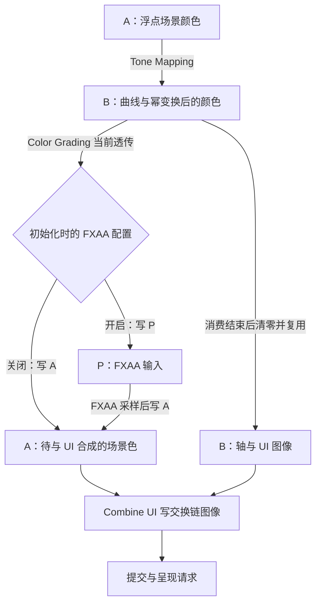

上一篇已经把材质、光源与阴影汇成场景颜色。接下来为什么还不能直接把这些值当成屏幕颜色？如果阴影和光照正确，画面仍然偏亮或边缘发硬，问题应该回到光照阶段，还是继续沿后处理排查？

还有两个容易被名字掩盖的问题：创建了 ColorGradingPass，是否意味着 LUT 已经改变颜色？调用了 CombineUIPass，是否意味着界面按透明度叠到了场景上？这些判断都要继续追到实际 Shader 输出。

本篇沿 Piccolo 默认延迟路径，从浮点场景颜色走到交换链图像与呈现请求。通用职责用于理解问题，具体能力以固定代码为准。

> **读这篇之前**：建议读过 [16 材质、光照与阴影怎样决定表面颜色]()。[07 Pass 与 Vulkan 提交]() 负责整帧绑定与提交；[15 GPU 资源篇]() 说明纹理、View 与描述符的区别，本文按需引用。
>
> 源码基线：[BoomingTech/Piccolo，固定提交 `f5053707fed4`][revision]。本篇为主线 17，已核对源码，独立编译五个相关 GLSL，并对原色调映射函数和限定分支做 C++ 数值检查。未运行完整引擎、GPU 后处理、实际界面或显示时序；数值与附件路径不充当画面实测。

## 光照算出的颜色，还需要哪些职责

可以先把后处理相关问题拆成五类：

| 职责 | 想解决什么 | 需要与什么分开 |
| --- | --- | --- |
| 色调映射 | 将较宽的场景亮度范围组织到输出所需的范围 | 颜色编码、自动曝光 |
| 颜色编码 | 用目标约定表示颜色数值 | 调色风格、场景照明 |
| 颜色分级 | 按映射调整颜色关系 | 是否已有 LUT 查色实现 |
| 图像抗锯齿 | 用已有图像信息缓解部分边缘伪影 | 几何采样、时间重建 |
| UI 合成与输出 | 决定场景和界面怎样进入最终图像 | 命令提交、屏幕实际显示完成 |

这套职责不要求所有引擎都按完全相同的顺序实现。比如 UI 放在哪里，会影响它是否经过场景色调映射或抗锯齿；颜色编码提前或延后，也会改变图像滤波面对的数值空间。

存储格式与数值含义也要分开：一个 RGBA16 浮点附件能保存大于 1 的值，却不能仅凭格式就认定当前内容仍是线性场景照明。它可能已经经过曲线与幂变换，接下来又被复用成另一种中间结果。

## 先画附件地图：odd、even 是名字，不是帧序号

[MainCameraPass::draw()][main-pass] 在延迟光照与粒子绘制之后，依次进入 tone mapping、color grading、FXAA、UI 和 combine UI 的 subpass。FXAA 的 draw 受开关控制，但仍会推进到后续 subpass。

为了读清实际交接，把三份中间附件简写为：

- **A**：`_main_camera_pass_backup_buffer_odd`。
- **B**：`_main_camera_pass_backup_buffer_even`。
- **P**：`_main_camera_pass_post_process_buffer_odd`。

它们在这里都是 RGBA16 浮点图像，是当前 render pass 中被读写与复用的附件。odd/even 不能理解为逻辑双缓冲，也不表示奇数帧与偶数帧轮流使用。

[默认全局配置][global-config] 的 enable_fxaa 为 false；开启时，主相机在创建 render pass 时选择另一组输出引用。两种配置的关系如下：

| 阶段 | FXAA 关闭 | FXAA 开启 |
| --- | --- | --- |
| 光照与粒子后 | 场景色在 A | 场景色在 A |
| Tone Mapping | 读取 A，写入 B | 读取 A，写入 B |
| Color Grading | 读取 B，写回 A | 读取 B，写入 P |
| FXAA subpass | 跳过 draw，A 保留场景结果 | 采样 P，写入 A |
| UI subpass | 清零 B，再绘制轴与 UI；保留 A | 相同 |
| Combine UI | 读取 A、B，写交换链图像 | 相同 |

图中同名附件在不同位置代表**同一图像的不同内容阶段**，不是为每个节点再分配一张新图：



这张表应结合 [render pass 附件与依赖定义][main-pass] 和 [RenderPipeline 初始化][pipeline] 一起读。后者将各输入 ImageView 交给对应 Pass，前者决定它们在 subpass 中读写哪里；只看 draw 调用顺序，无法确认输入连接是否一致。

这些阶段并不要求每次都显式复制整张图。读取前阶段附件与复用后续目标，是资源访问关系；具体布局与同步由相应引用、依赖和命令配合，不能只凭顺序认定全部同步已经经过运行验证。

## Tone Mapping：固定曲线、固定倍数与一次幂编码

[tone_mapping.frag][tone-frag] 用 subpassLoad 读取 A 当前像素的 RGB，然后执行：

```glsl
color = Uncharted2Tonemap(color * 4.5f);
color = color * (1.0f / Uncharted2Tonemap(vec3(11.2f)));
```

第一步使用固定 4.5 倍输入；第二步用曲线在 11.2 处的值做白点归一。该 Shader 没有在这里统计画面亮度或适应历史帧，因此不能把这个固定倍数叫成已经实现的自动曝光。

曲线逐通道计算，函数的核心是：

```glsl
return ((x * (A * x + C * B) + D * E) / (x * (A * x + B) + D * F)) - E / F;
```

其中 A—F 是该函数内的固定系数。它压缩较强输入的变化，却没有保证所有有限输入都落在 0—1；源码也没有在输出前 clamp。

接着，代码对 RGB 做 `pow(channel,1/2.2)`，最后写出 alpha=1。这里需要分别辨认：前面的曲线与白点归一负责亮度映射，后面的幂运算负责本实现采用的近似颜色编码。

`1/2.2` 幂函数不能与正式的 sRGB 分段传递函数完全等同；“做过 gamma”也不能替代对图像格式和输出约定的检查。对负输入等异常值，当前函数同样不能被当作通用安全处理器，数值练习限定为非负输入。

### 浮点附件保留了什么，不代表输出一定已经限幅

用原函数文本做独立 C++ 适配，在忽略 GPU 精度与附件转换的条件下，给三个通道相同输入 c，得到：

| 场景输入 c | 曲线、白点归一与幂变换后，约为 |
| --- | --- |
| 0.18 | 0.540080 |
| 1 | 0.877668 |
| 4 | 1.040841 |
| 16 | 1.099526 |

这不是实际场景截图或显示器亮度。它说明固定曲线的强输入可以继续大于 1；浮点 B 可以保存这种中间数值，后续写到规范化输出格式时还会有相应格式转换和范围限制。

另外，曲线自变量的白点是 11.2，而主函数先乘了 4.5。若只考虑这段计算，场景输入约为 `11.2/4.5` 时归一后等于 1；不能把场景输入 11.2 直接理解成未经曝光比例的最终白点。

## LUT：通用上应该做查色，当前 Shader 还没有做

通用的颜色 LUT 可以理解为一张映射：给定输入 RGB，在颜色空间中找到位置，取出目标 RGB。若以二维图片承载三维颜色表，还要约定切片怎样展开、坐标怎样计算、相邻格点怎样插值。

这个模型解释的是一类颜色分级设计。Piccolo 当前代码只完成了其中部分准备：

- [全局配置][global-config] 指定 color_grading_map 文件。
- [RenderResource][resource] 加载并创建该图像。
- [ColorGradingPass][grading-pass] 将输入附件与 LUT 的 ImageView/Sampler 分别写到 binding 0、1。

但实际 [color_grading.frag][grading-frag] 只是查询 LUT 尺寸，读取输入颜色，最后：

```glsl
out_color = color;
```

用于查色的 texture 调用仍在注释中，也没有把查表结果组合进输出。它在当前路径中是透传，不是已经按 LUT 调好颜色的阶段。

因此，把文件换成另一张 LUT，不能据此预期当前场景色一定变化。资源能够加载、描述符已经绑定、Shader 可以编译，都与“该资源的颜色确实参与最终输出”是不同证据。

按当前顺序，未来若补齐这段查色，它将读取 tone mapping 中已经做过幂变换的结果；需要先确定 LUT 期望的输入域，再设计采样，不能假定它面对的仍是原始线性 HDR 场景色。

## FXAA：为什么这一站需要邻域采样

Tone Mapping 和当前 Color Grading 都可用 subpassLoad 读对应像素。FXAA 则需要看周围像素，判断附近是否有值得处理的边缘。

[fxaa.frag][fxaa-frag] 声明普通 sampler2D；[FXAAPass][fxaa-pass] 对应绑定 combined image sampler，采用 linear sampler，读取 P。P 的创建用途也包含 SAMPLED_BIT，不能只因它同时出现在 subpass 输入表中，就把实际 Shader 访问误读成当前像素的 input attachment。

这份实现大致按下面顺序处理：

1. 用 textureSize 得到输入尺寸，建立一个像素的 UV 步长。
2. 采样 3×3 邻域，转成用于边缘检测的亮度近似值。
3. 比较中心与上下左右的范围；变化太小时直接返回原采样。
4. 判断边缘方向与梯度较强的一侧，沿边缘搜索。
5. 综合边缘与亚像素偏移，重新采样输出。

亮度近似的实际代码是：

```glsl
return dot(vec3(0.299, 0.578, 0.114), color);
```

旁边注释写的是 0.587，但当前执行表达式使用 0.578。读代码时应使用真实系数，不能根据熟悉的亮度公式默默替换。

提前返回的判定为：

```glsl
if(luma_range < max(EDGE_THRESHOLD_MIN, luma_max * EDGE_THRESHOLD_MAX)) {
    out_color = texture(in_color, in_uv);
    return;
}
```

这里两个阈值分别是 0.0312 和 0.125。平坦区域可走这条返回路径；高对比邻域则继续搜索。它并不是对整幅图无条件模糊，也不是只有最初 3×3 采样，后面还会沿边缘寻找偏移。

这条路径处理的是已经生成的单帧颜色，没有引入历史帧、运动矢量或几何重新采样。它能处理的边缘问题与 MSAA、时间抗锯齿或重建方法不同，不能因为开启了它，就保证所有细线闪烁和时间不稳定都消失。

### 开关控制的是成套的输入输出关系

默认关闭时，Color Grading 直接写 A，FXAA subpass 仍被经过，但没有执行 FXAA draw；最终合成仍从 A 取场景色。

开启时，Color Grading 改写 P，FXAA 采样 P 后写 A。[RenderPipeline 初始化][pipeline] 为 FXAA 连接 P 的 ImageView；主相机创建 subpass 时又按同一开关选定 Color Grading 输出。

因此，要验证开关，应核对初始化配置、render pass、pipeline 与输入 View 的一致性。只改某一处 if 条件，不能自动构成正确的运行时切换方案；本篇不宣称已有完整热切换流程。

## UI：先画到自己的附件，再看最后究竟怎样组合

进入 UI subpass 时，B 原先保存的 tone mapping 结果已经被 Color Grading 消费。[MainCameraPass][main-pass] 将 B 清为透明零，再画编辑器轴和 UI；该 subpass 同时声明保留 A。

[UIPass::draw()][ui-pass] 让 ImGui 建立一帧、执行窗口 UI 的 preRender，再将绘制数据录到当前命令缓冲。UI 绘制输出到 B，场景结果仍在 A；界面没有沿前面的场景 tone mapping 和 FXAA 再走一遍。

需要分清两次不同层次的组合：ImGui 在 B 内绘制多个 UI 元素时，[其 Vulkan 后端][imgui-backend] 确实配置了 alpha 混合；B 最后怎样与 A 组合，要看另一个 Shader。

### 当前 Combine UI 是条件选色，不是 alpha-over

对于普通非预乘颜色，常见的 RGB over 模型可以写为：

```text
output.rgb = ui.rgb * ui.a + scene.rgb * (1 - ui.a)
```

若 UI 目标已经保存了预乘 RGB，则相应公式需要调整。上式只用于说明透明叠加的职责，不能直接当作当前实现。

[combine_ui.frag][combine-frag] 读取 A、B 后，实际检查的是：

```glsl
if(ui_color.r<1e-6&&ui_color.g<1e-6&&ui_color.a<1e-6)
```

满足时返回 scene_color；否则对 UI 的 RGB 和 alpha 都做 `pow(channel,1/2.2)`，返回这份 UI 值。原代码在第一个分支里也计算 UI 的幂变换，但结果没有用于返回的场景色。

这里没有把 scene 与 UI 按 alpha 加权求和，而且条件没有检查 B 通道。[合成 Pass 的 pipeline][combine-pass] 还将 blendEnable 设为 false，不能指望固定功能混合在后面补上这个加权。因此不能把这个 Pass 的名字直接解释成“界面已按标准透明度叠到场景”。alpha 也被幂变换，是当前源代码的表达，不是通用透明度处理规则。

限定在**已经读取到 Combine UI 的输入值**，而不是某个 ImGui 控件的原始色值，取 scene=`(0.6,0.5,0.4,1)`，可以做以下条件推导：

| UI 输入 | 当前分支结果 |
| --- | --- |
| `(0,0,0,0)` | 返回 scene |
| `(0,0,0,1)` | 返回黑色 UI，alpha 为 1 |
| `(0.2,0.4,0.6,0.5)` | 返回幂变换后的 UI，约 `(0.481157,0.659353,0.792793,0.729740)` |
| `(0,0,0.8,0)` | R/G/A 都小于阈值，仍返回 scene |

最后一个输入只是检验条件遗漏 B 的边界，不表示默认 UI 必然产生这种像素。半透明示例也没有验证真实 ImGui 光栅化与其附件内混合；它说明的是最后这次选色没有按该 alpha 保留场景贡献。

## 写到交换链图像，还需要确认颜色约定和呈现边界

[CombineUIPass][combine-pass] 在最后 subpass 写当前交换链图像。至此，A/B 的中间含义结束，后续由 RenderPipeline 和后端继续完成提交与呈现。

读取输出颜色时，还要记录最终选择的 surface format。[chooseSwapchainSurfaceFormatFromDetails()][vulkan-rhi] 优先寻找：

```cpp
surface_format.format == VK_FORMAT_B8G8R8A8_UNORM &&
surface_format.colorSpace == VK_COLOR_SPACE_SRGB_NONLINEAR_KHR
```

找不到则返回可用列表第一项。UNORM 与 SRGB 是图像格式的不同选择；colorSpace 则约定呈现引擎接受怎样的颜色空间，见 [VkFormat][vk-format] 与 [VkColorSpaceKHR][vk-colorspace]。不能因为 colorSpace 名字含 sRGB，就认定这个 UNORM 附件写入时自动执行了同样的编码。

本路径的 Shader 采用固定的手工幂变换，源码也留下了改用 SRGB surface format 的 TODO。如果实际走 fallback 格式，就需要重新核对手工变换与格式转换是否匹配；不能无条件宣称所有设备上的输出约定都一致。浮点场景缓冲与这里的普通呈现选择，也不能直接当成已经实现 HDR 显示输出。

[submitRendering()][vulkan-rhi] 提交图形工作并使用同步对象衔接，然后调用 vkQueuePresentKHR，请求呈现当前交换链图像。[该接口的职责][vk-present] 是将图像排队用于呈现；调用成功不等于这张图已经在显示器上显示完成。实际扫描输出、延迟与颜色显示效果仍需另取运行证据。

交换链重建时，旧附件 View 也会变化。[passUpdateAfterRecreateSwapchain()][pipeline] 不仅重建帧缓冲，还更新 Tone Mapping、Color Grading、FXAA 和 Combine UI 的输入 View。排查窗口尺寸变化后的异常时，应同时检查图像身份、尺寸与描述符是否已经对应新的资源。

## 先验证关系，再验证画面

本篇独立检查保留了原 Uncharted2Tonemap 函数文本，用最小向量类型适配到 C++，复现固定倍数、白点归一与幂变换。FXAA 检查只给定亮度最小/最大值验证提前返回条件；UI 检查只复现最后的选色与幂变换。它们没有模拟整段 FXAA 搜索、LUT 采样、附件转换或屏幕显示。

五个 GLSL 独立编译成功，说明这些输入在当前编译器下能够生成 SPIR-V；不能由此推断 pipeline、subpass 兼容性、资源同步和实际颜色都已经通过设备验证。

待 [完整构建与调试基线]() 可用后，可按以下顺序留下证据：

| 观察位置 | 固定或记录什么 | 要解释的问题 |
| --- | --- | --- |
| 光照/粒子后的 A | 一块稳定表面的浮点 RGB | 问题是否在后处理之前 |
| Tone Mapping 后的 B | 输入、曲线后数值与幂编码后数值 | 亮度压缩与颜色编码分别改变了什么 |
| Color Grading 的输出 | 输入色与输出色、实际 LUT 绑定 | 当前透传是否与源码一致 |
| 两种 FXAA 配置 | 初始化开关、Color Grading 目标、FXAA 输入和 draw | 走的是哪条附件路径 |
| FXAA 邻域 | 同一边缘的采样尺寸、亮度范围与输出 | 是否越过阈值，是否出现预期边缘变化 |
| UI 清零与绘制后的 B | 清值、轴/UI Draw 和对应像素 | 最后合成读到了什么 UI 数据 |
| Combine UI 与交换链 | A/B 输入、选色结果、实际 format/colorSpace | 组合和颜色约定是否匹配 |
| 重建与呈现 | 新旧 View、描述符更新、提交与 Present 回执 | 资源是否仍有效，图像是否已排队呈现 |

先分别观察灰度块、固定高对比边缘和给定 UI 区域，每次只改变一个条件。先解释某一站输入与输出的差异，再判断画面；这样才能避免把缺失调色、重复编码、FXAA 路径错误或 UI 选色混成同一个“渲染不对”。

**从场景颜色到最终输出，要追清每次颜色变换、附件交接和组合规则，再区分写入图像、提交与实际呈现。**

## 继续阅读

- [13 粒子发射器与 GPU 模拟]()：补齐进入场景颜色前的粒子模拟、billboard 着色与混合。

- [16：材质、光照与阴影怎样决定表面颜色]()：回查本篇浮点场景颜色的来源。
- [07：Pass 与 Vulkan 提交]()：核对帧缓冲、同步对象、提交与 Present 的整帧位置。
- [GFX-02：从 GLSL 到 GPU]()：连接 Shader 编译、API 与驱动/系统边界。
- [08：编辑器修改、保存与恢复]()：把画面中的 UI 接回编辑器行为。

相机、GPU 资源、表面着色与后处理输出已有 11、15、16、17 四篇正文。接着读 [18《编辑器怎样拾取、创建和删除场景对象》]()，从最终画面回到像素身份、对象选择与世界修改；它使用额外的整数拾取图，不是从本篇最终颜色反推出对象。完整引擎调试与 GPU 画面验证保持独立状态。

Piccolo 源码节选版权：Copyright (c) 2022 Contributors to the Piccolo Engine，按 [MIT License][license] 提供。图表、条件数值与实际运行验证的范围分别说明。

[revision]: https://github.com/BoomingTech/Piccolo/tree/f5053707fed4d3f94d270a436fb0d3a8ae54e3e5
[license]: https://github.com/BoomingTech/Piccolo/blob/f5053707fed4d3f94d270a436fb0d3a8ae54e3e5/LICENSE
[global-config]: https://github.com/BoomingTech/Piccolo/blob/f5053707fed4d3f94d270a436fb0d3a8ae54e3e5/engine/asset/global/rendering.global.json
[main-pass]: https://github.com/BoomingTech/Piccolo/blob/f5053707fed4d3f94d270a436fb0d3a8ae54e3e5/engine/source/runtime/function/render/passes/main_camera_pass.cpp
[pipeline]: https://github.com/BoomingTech/Piccolo/blob/f5053707fed4d3f94d270a436fb0d3a8ae54e3e5/engine/source/runtime/function/render/render_pipeline.cpp
[tone-frag]: https://github.com/BoomingTech/Piccolo/blob/f5053707fed4d3f94d270a436fb0d3a8ae54e3e5/engine/shader/glsl/tone_mapping.frag
[grading-frag]: https://github.com/BoomingTech/Piccolo/blob/f5053707fed4d3f94d270a436fb0d3a8ae54e3e5/engine/shader/glsl/color_grading.frag
[fxaa-frag]: https://github.com/BoomingTech/Piccolo/blob/f5053707fed4d3f94d270a436fb0d3a8ae54e3e5/engine/shader/glsl/fxaa.frag
[combine-frag]: https://github.com/BoomingTech/Piccolo/blob/f5053707fed4d3f94d270a436fb0d3a8ae54e3e5/engine/shader/glsl/combine_ui.frag
[resource]: https://github.com/BoomingTech/Piccolo/blob/f5053707fed4d3f94d270a436fb0d3a8ae54e3e5/engine/source/runtime/function/render/render_resource.cpp
[grading-pass]: https://github.com/BoomingTech/Piccolo/blob/f5053707fed4d3f94d270a436fb0d3a8ae54e3e5/engine/source/runtime/function/render/passes/color_grading_pass.cpp
[fxaa-pass]: https://github.com/BoomingTech/Piccolo/blob/f5053707fed4d3f94d270a436fb0d3a8ae54e3e5/engine/source/runtime/function/render/passes/fxaa_pass.cpp
[ui-pass]: https://github.com/BoomingTech/Piccolo/blob/f5053707fed4d3f94d270a436fb0d3a8ae54e3e5/engine/source/runtime/function/render/passes/ui_pass.cpp
[combine-pass]: https://github.com/BoomingTech/Piccolo/blob/f5053707fed4d3f94d270a436fb0d3a8ae54e3e5/engine/source/runtime/function/render/passes/combine_ui_pass.cpp
[imgui-backend]: https://github.com/BoomingTech/Piccolo/blob/f5053707fed4d3f94d270a436fb0d3a8ae54e3e5/engine/3rdparty/imgui/backends/imgui_impl_vulkan.cpp
[vulkan-rhi]: https://github.com/BoomingTech/Piccolo/blob/f5053707fed4d3f94d270a436fb0d3a8ae54e3e5/engine/source/runtime/function/render/interface/vulkan/vulkan_rhi.cpp
[vk-format]: https://docs.vulkan.org/refpages/latest/refpages/source/VkFormat.html
[vk-colorspace]: https://docs.vulkan.org/refpages/latest/refpages/source/VkColorSpaceKHR.html
[vk-present]: https://docs.vulkan.org/refpages/latest/refpages/source/vkQueuePresentKHR.html
