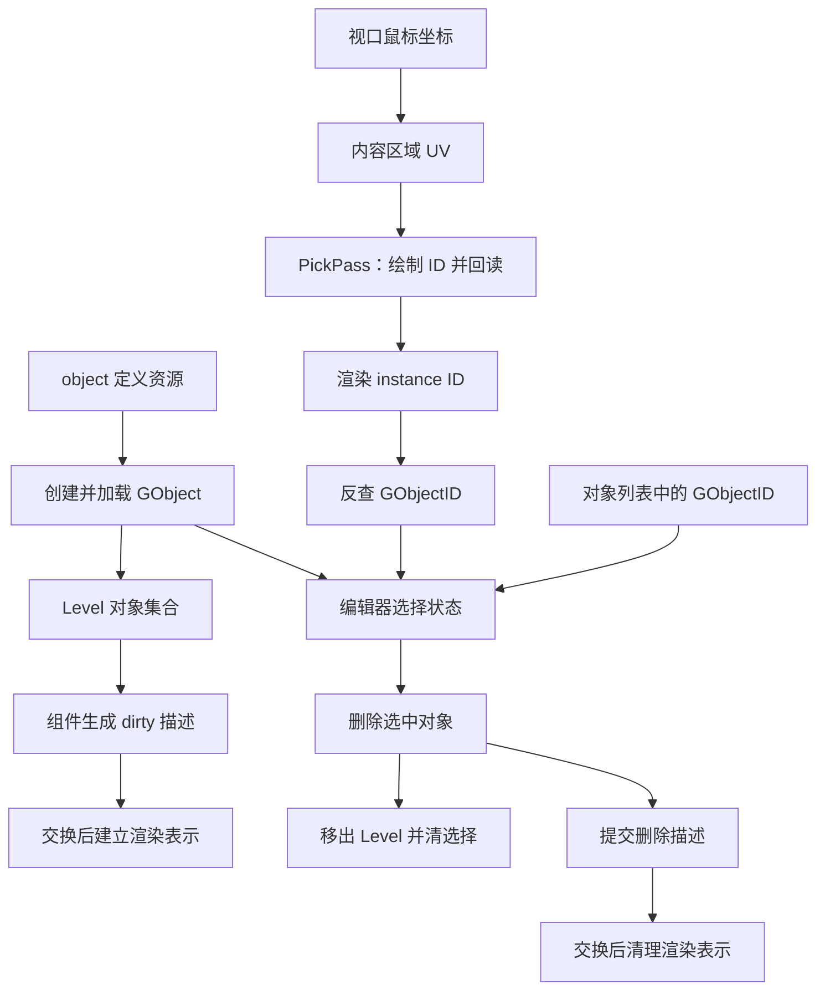

编辑器里点一下墙，属性面板为什么知道该显示哪个对象？点击资源树里的墙定义，是新建了一个文件，还是在当前关卡里加了一个实例？按下 Delete 后，列表消失、画面消失、组件析构和文件保存，又是不是同一件事？

如果把这些动作都概括为“编辑器操作场景”，代码很容易读散：一会儿是鼠标坐标，一会儿是网格 ID，一会儿又进入对象容器和交换数据。本篇把它们接成三条完整路径，再核对每一步实际改变的状态。

> **读这篇之前**：[04 场景文件成为对象与组件]() 负责对象恢复，[06 位置到渲染表示]() 负责逻辑到渲染的交接，[08 修改、保存与恢复]() 负责持久化。本篇集中解释选择、创建与删除，生命周期细节可回看 [PCPP-1 容器与借用]()。
>
> 源码基线：[BoomingTech/Piccolo，固定提交 `f5053707fed4`][revision]。已核对源码，独立编译两份拾取 GLSL，并对原 ID 映射、删除函数和坐标计算做最小 C++ 适配检查。未运行完整编辑器、实际拾取、GPU 回读或创建/删除/保存操作；源码路径与条件推导不充当运行结果。

## 先区分五份状态

一个可编辑对象至少牵涉以下几层：

| 状态 | 表达什么 | 本篇中的操作 |
| --- | --- | --- |
| 对象定义文件 | 哪些组件和默认数据组成一类对象 | 创建时读取，删除实例不等于删除定义文件 |
| Level 中的 GObject | 当前关卡实际持有哪个逻辑对象 | 创建后入表，删除时移出 |
| 渲染部件与实例 | 哪些网格部件进入渲染场景 | 经交换数据建立或移除 |
| 编辑器选择 | 当前面板和操作轴针对谁 | 保存一个 GObjectID，不复制整个对象 |
| 关卡持久化数据 | 哪些当前状态已经写入文件 | 需要另走保存路径 |

选择主要改变编辑器状态；创建和删除改变当前世界的对象集合，并继续影响渲染。保存则把当前对象集合写回资源。三者有联系，但完成条件各不相同。

下面的箭头表示调用与数据交接，不表示独立线程：



## 选中对象有两个入口，最后汇入同一份选择状态

[EditorUI 的对象列表][editor-ui] 遍历当前 Level 的对象表。每一项本来就携带 GObjectID，因此点击列表可以直接调用 onGObjectSelected；再次点击已选项时，列表分支传入无效 ID，取消选择。

视口没有这样的对象表项。鼠标只给出一个位置，必须先回答“这个位置对应哪个可拾取部件”，再找回逻辑对象。

两条路径最终都进入 [EditorSceneManager::onGObjectSelected()][scene-manager]：

1. 如果 ID 与原选择相同，直接返回。
2. 更新 m_selected_gobject_id。
3. 从当前 Level 查找对象；若存在，读取 TransformComponent 的矩阵。
4. 更新操作轴的显示状态。

选择保存的是身份。getSelectedGObject 每次仍通过当前 Level 查找，再返回 weak_ptr；后续调用者 lock 后才能访问实际对象。一个数值被登记为选择 ID，并不保证当前 Level 一定还有对应对象。

这里的实现还依赖被选对象具有 TransformComponent，不能把它扩写成对任意缺组件对象都已做完容错的通用选择系统。

## 鼠标位置怎样成为拾取图中的一个像素

[EditorInputManager::onMouseButtonClicked()][editor-input] 先检查编辑器模式、操作轴状态、活动 Level 和内容区域。m_cursor_on_axis 为 3 时才继续走场景网格拾取；轴操作本身使用另一段几何判定，不能将两者混成一次物理射线查询。

对左键，内容区域坐标归一化为：

```cpp
Vector2 picked_uv((m_mouse_x - m_engine_window_pos.x) / m_engine_window_size.x,
                  (m_mouse_y - m_engine_window_pos.y) / m_engine_window_size.y);
```

内容区域的位置和尺寸由 [EditorUI][editor-ui] 依据窗口与菜单栏区域更新，同时交给输入管理器和渲染 viewport。这里的 UV 表示内容区域内的相对位置，不能直接当成整张交换链图像的像素索引。

[PickPass::pick()][pick-pass] 再使用实际 viewport 的宽高与偏移计算像素：

```text
pixel_x = uint32(uv.x * viewport.width  + viewport.x)
pixel_y = uint32(uv.y * viewport.height + viewport.y)
index   = framebuffer_extent.width * pixel_y + pixel_x
```

这段是对源码表达式的简写。viewport 决定内容画在哪里，framebuffer extent 决定整幅拾取图的尺寸与行跨度，两种宽度不能互换。

例如 viewport 为 `(x=320,y=100,width=800,height=600)`，拾取图尺寸为 `1920×1080`。内容 UV `(0.5,0.5)` 对应图像像素 `(720,400)`，线性索引为 `1920×400+720=768720`。不是用内容宽度 800 计算行跨度，也没有在这里额外翻转 Y。

坐标边界仍应单独观察：输入区域检查包含右/下边界，PickPass 只检查换算后的像素是否超出整幅 extent，没有再将 UV 钳到内容区域内部。嵌入 viewport 的右边界可能落在 extent 内的内容区域之外；DPI、缩放与窗口变化也需要记录实际坐标。本篇的整数推导限定为非负、尺寸有效的给定输入，不宣称这些边界已在设备上验证。

另一个容易被函数名掩盖的事实是：回调参数虽有 action，当前这个函数并没有按 GLFW_PRESS 单独过滤左键。因此应描述为“符合条件的左键回调进入拾取”，不能承诺一次点击只在按下时执行一次。

## PickPass 绘制的是整数身份，不是最终画面的颜色

调用经 EditorSceneManager、RenderSystem 和 [RenderPipeline][pipeline] 转到 PickPass::pick。普通 PickPass::draw 本身为空，真正的拾取绘制在 pick 里按请求组织。

它遍历主相机可见网格节点，再按材质和网格组织实例批次。这份候选列表来自 RenderScene 的可见性更新；不能据此认为拾取回调重新加载了全世界对象，或对所有几何都进行了查询。

拾取使用独立的 `R32_UINT` 颜色附件。按 [Vulkan 的格式定义][vk-format]，这里每个像素保存一个 32 位无符号整数。它不用表面材质的最终 RGB，也不经过上一篇的 tone mapping、FXAA 或 UI 选色。

关键连接如下：

| 位置 | 写入或使用的身份 |
| --- | --- |
| RenderSystem 消费 dirty 描述 | 为 `(GObjectID,part_index)` 分配 instance GUID |
| RenderScene 建可见节点 | 将实体 m_instance_id 赋给 node_id |
| PickPass 的实例数据 | 把 node_id 写入 node_ids 数组 |
| 拾取顶点 Shader | 以 gl_InstanceIndex 取对应 ID，flat 传出 |
| 拾取片元 Shader | 将整数 ID 写入颜色附件 |

这里的 instance ID 表示一个对象的某个渲染部件，不是网格资源缓存的 asset ID，也不是 GObjectID 本身。多个对象可以共享同一网格资源，一个对象也可以有多个部件。

[拾取顶点 Shader][pick-vert] 的最后一行身份输出是：

```glsl
out_nodeid = node_ids[gl_InstanceIndex];
```

[片元 Shader][pick-frag] 使用 flat uint 输入，输出为：

```glsl
out_node_id = in_nodeid;
```

这使同一实例的三角形传递同一个整数身份，而不是把几个顶点的 ID 当颜色插值。

### 可见与可拾取并不天然完全等价

PickPass 的 pipeline 开启深度测试、深度写入，比较方式为 LESS，深度清为 1，并采用背面剔除。因而在这次拾取光栅化中，通过相应覆盖、剔除和深度条件的片元决定像素 ID；这里不是“遍历列表最后一个对象就获胜”。

但它并没有完整重放最终表面着色规则。片元 Shader 只写 ID，不依据材质纹理做透明度裁剪；粒子和编辑器操作轴也不属于这份网格列表的同一路身份输出。

动画对象还需要格外小心。顶点 Shader 虽然计算了 model_position，最终却写：

```glsl
gl_Position = proj_view_matrix * model_matrix * vec4(in_position, 1.0);
```

它使用原始 in_position，没有使用已经计算的蒙皮 model_position。所以不能看到关节矩阵绑定，就认定拾取轮廓已经跟随当前骨骼姿态。这是固定源码的数据消费事实；实际可见偏差仍需用动画对象与 ID 图捕获验证。

## 读一个 ID，当前实现会复制整张拾取图

整数图像位于设备内存，CPU 不能仅凭一个对象指针直接访问。当前 [pick 实现][pick-pass] 按以下阶段继续：

1. 准备命令上下文、等待相关 fence，记录并提交拾取绘制。
2. 推进当前帧索引，并等待帧 fence 列表满足完成条件。
3. 创建大小为 `extent.width×extent.height×4` 的 host-visible、host-coherent staging buffer。
4. 记录图像到 buffer 的复制，复制区域为整幅 extent。
5. 完成单次命令、映射内存，读取 data[picked_pixel_index]，再释放临时 buffer 和内存。

源码中 [endSingleTimeCommands()][vulkan-rhi] 还会提交并调用 vkQueueWaitIdle。结合 [fence 等待语义][vk-fence] 与 [图像到 buffer 复制接口][vk-copy]，可以把它理解为一条包含主机等待的回读路径；不能包装成后台异步、只复制鼠标下一个像素的实现。

以 `1920×1080` 的 R32_UINT 图像为例，复制 payload 为 8,294,400 字节，约 7.91 MiB。最终只用一个 uint32，并不意味着数据传输量只有四字节；这个计算也不是显存分配开销或耗时测量。

单像素复制、延迟消费回读结果、复用 staging 都是可以进一步讨论的设计方向；当前代码是否值得优化，要先测量请求频率与停顿，不在本篇直接修改同步和资源管理。

## 回读的 0 为什么不一定会取消选择

这是读完整条路径后才能发现的身份边界。

拾取附件清为 0；像素超出 extent 时，PickPass 也返回 0。[渲染 GUID 分配器][guid-allocator] 将 0 作为无效 GUID，正常分配从 1 开始。到这里，0 可以表达“没有取得有效渲染实例”。

可是 [RenderScene::getGObjectIDByMeshID()][render-scene] 在映射缺失时返回：

```cpp
return GObjectID();
```

GObjectID 是 size_t，这个值初始化结果是 0。与之不同，[逻辑对象的无效值][object-id] 定义为：

```cpp
constexpr GObjectID k_invalid_gobject_id = std::numeric_limits<std::size_t>::max();
```

[ObjectIDAllocator][object-id-cpp] 从 0 开始分配逻辑对象 ID。因此两种 ID 域的无效值并不相同：

| 身份域 | 有效值或无效值 | 映射失败后的实际情况 |
| --- | --- | --- |
| 渲染 instance GUID | 0 无效，分配从 1 开始 | 拾取背景通常得到 0 |
| 逻辑 GObjectID | 0 可以有效，size_t 最大值无效 | 当前映射函数缺失时返回 0 |
| 编辑器明确取消选择 | 传入 k_invalid_gobject_id | 对象列表再次点击已选项会这样做 |

于是，背景 ID 或不存在的实例 ID 经当前映射后，会把 0 交给 onGObjectSelected。如果当前 Level 仍有对象 0，它就可能成为选择目标；若不存在，对象查找失败，也不能把已保存的选择数值称为规范的无效 ID。

这里不能用期望行为补写成“点空白必然取消选择”。需要继续观察原始回读值、反查结果、逻辑查找结果，才能分清错误来自光栅化、映射，还是选择更新。

## 点击 object 资源，创建的是关卡实例

[资源树的叶子点击][editor-ui] 进入 onFileContentItemClicked，只接受文件类型为 object 的节点。[资源树服务][file-service] 依据扩展名建立类型，例如 `.object.json` 会成为 object 节点；这不是点任意图片或模型都直接建 GObject。

创建路径先取得活动 Level，然后构造 ObjectInstanceRes：

- 用文件名维护计数，名字形如 `New_wall_1`。
- m_definition 指向点击的对象定义路径。
- 这里没有填写实例组件覆盖，也没有把鼠标位置或相机前方位置写进 Transform。

随后调用 [Level::createObject()][level]。它分配新的 GObjectID、创建 shared_ptr 对象，调用 GObject::load；加载成功才加入 m_gobjects，失败返回逻辑无效 ID。UI 也只在成功返回时选中新对象。

[GObject::load()][object] 先处理实例组件，再加载定义文件，补入没有被实例组件覆盖的组件，并调用 postLoadResource。定义与实例覆盖的完整恢复过程沿用 04/05，本篇重点是：**编辑器的创建入口复用了现有对象加载路径，而不是手动拼出一套特别的编辑器对象。**

以仓库里的 [wall.object.json][wall] 为例，定义包含 Transform、Mesh 和 RigidBody，Transform 默认在原点、单位缩放、单位旋转，Mesh 只有一个部件。没有额外覆盖时，这条创建入口使用的就是这些默认值。

因此，从这个入口反复创建墙，不能描述为“自动放在鼠标点中处”或“沿相机射线摆放”。新名字计数也只是当前 UI 对文件名的记录，不是通过扫描 Level 已有名字实现的全局唯一性协议。

这条操作没有新写一份 object 定义文件，也没有在回调内调用 Level::save。对象进入当前关卡与关卡文件已经更新，需要分开验收。

### 创建成功后，怎样继续进入可见网格

创建回调没有直接调用 GPU Draw。它先完成逻辑对象加载与选择，后续继续依赖组件更新：

1. [TransformComponent::postLoadResource()][transform] 初始化缓冲并设 dirty。
2. [编辑器][editor] 登记了 TransformComponent 和 MeshComponent 的 tick；Level 的后续更新会处理对象。
3. [MeshComponent::tick()][mesh] 在 Transform dirty 时构造各部件描述，将对象 ID 和 dirty_mesh_parts 写入逻辑交换数据。
4. 交换后，[RenderSystem::processSwapData()][render-system] 为各 `(GObjectID,part_index)` 建立实体、登记 instance→object 映射，按需加载/上传网格与材质。
5. 可见性更新将符合主相机裁剪条件的实体整理为节点，之后才可能进入正常绘制和拾取候选。

资源上传与缓存的细节见 [15 GPU 资源篇]()。这里要留下的判断是：逻辑创建成功、渲染描述被消费、实际可见、可以拾取，是不同阶段；不能用一个有效返回 ID 代替后面所有证据。

## Delete 先移除逻辑对象，再通知渲染端

[输入管理器][editor-input] 在 Delete 按下时设置 delete_object 命令位，松开时清除；processEditorCommand 在 tick 中检查该位，再调用 onDeleteSelectedGObject。它并不是在按键回调里直接擦除所有渲染资源。

[EditorSceneManager][scene-manager] 的关键顺序是：

```cpp
current_active_level->deleteGObjectByID(m_selected_gobject_id);

RenderSwapContext& swap_context = g_editor_global_context.m_render_system->getSwapContext();
swap_context.getLogicSwapData().addDeleteGameObject(GameObjectDesc {selected_object->getID(), {}});
```

selected_object 在函数前面已经 lock 成局部 shared_ptr，因此 Level 移除自己的持有之后，这里仍能读取对象 ID 并提交删除描述。不能将 erase 那一行等同于“对象已经析构，下一行一定悬空”。其他持有关系与组件析构时机，可接回 PCPP-1。

[Level::deleteGObjectByID()][level] 还检查当前角色是否引用该对象，匹配时断开角色对象关系，再从对象表移除。组件析构属于最终所有权释放之后的另一层清理，例如 [RigidBodyComponent 的析构路径][rigidbody] 会请求移除刚体；不能仅凭对象表消失就断言所有子系统已完成清理。

正常路径末尾调用 onGObjectSelected(k_invalid_gobject_id)，清除选择并隐藏对应操作轴。若取不到活动 Level，函数提前返回；表述“必定清选择”也应带上这条控制流前提。

删除描述先进入逻辑侧缓冲。经过 [RenderSwapContext][swap] 交接，RenderSystem 消费 m_game_object_to_delete，逐项调用 RenderScene::deleteEntityByGObjectID，再清空这一批删除请求。这是状态交接，不是由双缓冲名字推断出的独立渲染线程。

## 渲染删除的实际范围：单部件与多部件要分开

追到 [RenderScene::deleteEntityByGObjectID()][render-scene] 后，不能就停在“删除对应实体”这个概括上。固定实现做了两段有限清理：

1. 遍历 instance→GObjectID 映射，找到第一个属于该对象的条目就 erase，然后 break。
2. 构造 `{go_id,0}`，找到它的 instance GUID，再从实体列表移除第一个对应实体。

第二段明确写的是：

```cpp
GameObjectPartId part_id = {go_id, 0};
```

函数没有遍历所有 part，也没有在这里调用 allocator 的 freeElement/freeGuid，更没有释放共享网格或纹理缓存。

| 删除前条件 | 由该函数可直接推导的结果 |
| --- | --- |
| 只有 part 0，映射与实体齐全 | 相应实体及一个映射被移除；allocator 中的 part 记录仍在 |
| 同一对象有 part 0 和 part 1 | part 0 实体被移除；part 1 实体仍在；映射只删一个 |
| 对上例重复调用删除 | 可能继续移除剩余映射，但仍只查 part 0，不能由此删掉 part 1 实体 |

第一段遍历的是无序映射，因此不能承诺它删掉的映射一定与 part 0 对应。未清理的实体或身份记录会使后续一致性检查更复杂；具体画面残留与拾取表现需结合可见性、资源和当前 Level 状态验证。

独立检查用原函数文本构造了单部件和双部件状态，确认上述容器结果。双部件是刻意建立的条件，不声称仓库里的 wall 样例就具有两个部件，也不把 CPU 容器结果描述成实际 GPU 已出现残影。

它与 [关卡重载时清空渲染场景][render-scene] 也不同：clearForLevelReloading 会清 allocator、映射与实体集合。不能用重载的完整清空效果，替代一次对象删除的实际实现范围。

## 怎样调试，才能知道操作完成到哪一层

本篇独立检查完成了三件事：两份原始拾取 GLSL 编译为 SPIR-V；复用原映射/删除函数和原 GUID 分配器检查容器状态；复用坐标计算前缀检查 viewport 偏移、extent 行跨度与边界。另读取了实际墙定义，确认默认 Transform 与部件数量。

这些检查没有执行 GPU 深度测试、真实窗口事件、fence 等待、对象加载或文件保存。待 [完整调试基线]() 可用后，可沿下表留下运行证据：

| 操作与断点位置 | 记录什么 | 能回答什么 |
| --- | --- | --- |
| 左键回调 → PickPass::pick | action、轴状态、内容区域、UV、viewport、extent 与像素 | 是否走到预期入口，坐标有没有混用 |
| 拾取绘制与 staging 回读 | 可见节点、ID 图/深度、回读 uint32、等待与复制范围 | 图像中有没有目标，读回的是哪个身份 |
| getGObjectIDByMeshID → onGObjectSelected | 原 instance ID、映射结果、逻辑对象查找、最终选择 | 未命中是否误落到对象 0 |
| onFileContentItemClicked → createObject/load | 定义路径、名字、实例覆盖、成功 ID 与 Level 表 | 创建了什么，是否只是更新了选择 |
| Mesh tick → processSwapData | dirty 描述、part_index、实体、资源与可见节点 | 对象从逻辑存在走到了渲染哪一步 |
| onDeleteSelectedGObject → Level erase | 局部持有、角色关系、对象表、选择与删除描述 | 逻辑删除是否完成，通知是否发出 |
| processSwapData → deleteEntityByGObjectID | 同一对象各 part 的映射、allocator、实体与可见列表 | 单部件与多部件清理是否一致 |
| 保存 → 重载 | 保存结果、关卡文件对象条目、恢复后的对象集合 | 编辑结果是否真正持久化 |

先用静态、单部件墙走通，再分别观察空白点击、对象 0、遮挡、内容区域边界和多部件对象。动画拾取应另加最终姿态与 ID 轮廓对照；不要一次混入所有条件。

创建和删除都先改变内存中的世界。是否留下文件结果，继续按 08 的保存与重载路径验证。本篇没有从“编辑器有了创建/删除”推导出已经具备 Undo/Redo、事务回滚或完整资源释放协议。

**读懂编辑器操作，要同时追踪输入对应的身份、当前世界中的对象、渲染表示与持久化状态。**

## 继续阅读

- [08：编辑器怎样修改、保存并恢复场景状态]()：接住创建与删除后的文件状态。
- [04：场景文件怎样成为对象与组件]()：回查新实例怎样从定义恢复组件。
- [06：位置变化怎样进入渲染表示]()：核对 dirty 描述与 part 身份。
- [PCPP-1：对象容器、借用与遍历]()：继续追 erase、临时持有与析构的区别。
- [17：场景颜色怎样成为最终画面]()：区分 UI 显示与本篇的逻辑编辑行为。

主线 [09 输入与角色运动]() 和 [10 刚体与碰撞查询]() 已有正文，可对照游戏命令与物理清理的不同完成点；[12 动画与蒙皮]() 已补齐，[13 粒子发射器与 GPU 模拟]() 已有正文，[14 Lua 脚本、组件与反射调用]() 已有正文，原定主线正文齐备，完整引擎运行与设备验证按各篇记录分别推进。

Piccolo 源码节选版权：Copyright (c) 2022 Contributors to the Piccolo Engine，按 [MIT License][license] 提供。独立条件检查与设备运行的范围分别说明。

[revision]: https://github.com/BoomingTech/Piccolo/tree/f5053707fed4d3f94d270a436fb0d3a8ae54e3e5
[license]: https://github.com/BoomingTech/Piccolo/blob/f5053707fed4d3f94d270a436fb0d3a8ae54e3e5/LICENSE
[editor-ui]: https://github.com/BoomingTech/Piccolo/blob/f5053707fed4d3f94d270a436fb0d3a8ae54e3e5/engine/source/editor/source/editor_ui.cpp
[editor-input]: https://github.com/BoomingTech/Piccolo/blob/f5053707fed4d3f94d270a436fb0d3a8ae54e3e5/engine/source/editor/source/editor_input_manager.cpp
[scene-manager]: https://github.com/BoomingTech/Piccolo/blob/f5053707fed4d3f94d270a436fb0d3a8ae54e3e5/engine/source/editor/source/editor_scene_manager.cpp
[file-service]: https://github.com/BoomingTech/Piccolo/blob/f5053707fed4d3f94d270a436fb0d3a8ae54e3e5/engine/source/editor/source/editor_file_service.cpp
[editor]: https://github.com/BoomingTech/Piccolo/blob/f5053707fed4d3f94d270a436fb0d3a8ae54e3e5/engine/source/editor/source/editor.cpp
[pick-pass]: https://github.com/BoomingTech/Piccolo/blob/f5053707fed4d3f94d270a436fb0d3a8ae54e3e5/engine/source/runtime/function/render/passes/pick_pass.cpp
[pick-vert]: https://github.com/BoomingTech/Piccolo/blob/f5053707fed4d3f94d270a436fb0d3a8ae54e3e5/engine/shader/glsl/mesh_inefficient_pick.vert
[pick-frag]: https://github.com/BoomingTech/Piccolo/blob/f5053707fed4d3f94d270a436fb0d3a8ae54e3e5/engine/shader/glsl/mesh_inefficient_pick.frag
[pipeline]: https://github.com/BoomingTech/Piccolo/blob/f5053707fed4d3f94d270a436fb0d3a8ae54e3e5/engine/source/runtime/function/render/render_pipeline.cpp
[render-system]: https://github.com/BoomingTech/Piccolo/blob/f5053707fed4d3f94d270a436fb0d3a8ae54e3e5/engine/source/runtime/function/render/render_system.cpp
[render-scene]: https://github.com/BoomingTech/Piccolo/blob/f5053707fed4d3f94d270a436fb0d3a8ae54e3e5/engine/source/runtime/function/render/render_scene.cpp
[guid-allocator]: https://github.com/BoomingTech/Piccolo/blob/f5053707fed4d3f94d270a436fb0d3a8ae54e3e5/engine/source/runtime/function/render/render_guid_allocator.h
[object-id]: https://github.com/BoomingTech/Piccolo/blob/f5053707fed4d3f94d270a436fb0d3a8ae54e3e5/engine/source/runtime/function/framework/object/object_id_allocator.h
[object-id-cpp]: https://github.com/BoomingTech/Piccolo/blob/f5053707fed4d3f94d270a436fb0d3a8ae54e3e5/engine/source/runtime/function/framework/object/object_id_allocator.cpp
[level]: https://github.com/BoomingTech/Piccolo/blob/f5053707fed4d3f94d270a436fb0d3a8ae54e3e5/engine/source/runtime/function/framework/level/level.cpp
[object]: https://github.com/BoomingTech/Piccolo/blob/f5053707fed4d3f94d270a436fb0d3a8ae54e3e5/engine/source/runtime/function/framework/object/object.cpp
[transform]: https://github.com/BoomingTech/Piccolo/blob/f5053707fed4d3f94d270a436fb0d3a8ae54e3e5/engine/source/runtime/function/framework/component/transform/transform_component.cpp
[mesh]: https://github.com/BoomingTech/Piccolo/blob/f5053707fed4d3f94d270a436fb0d3a8ae54e3e5/engine/source/runtime/function/framework/component/mesh/mesh_component.cpp
[rigidbody]: https://github.com/BoomingTech/Piccolo/blob/f5053707fed4d3f94d270a436fb0d3a8ae54e3e5/engine/source/runtime/function/framework/component/rigidbody/rigidbody_component.cpp
[swap]: https://github.com/BoomingTech/Piccolo/blob/f5053707fed4d3f94d270a436fb0d3a8ae54e3e5/engine/source/runtime/function/render/render_swap_context.cpp
[vulkan-rhi]: https://github.com/BoomingTech/Piccolo/blob/f5053707fed4d3f94d270a436fb0d3a8ae54e3e5/engine/source/runtime/function/render/interface/vulkan/vulkan_rhi.cpp
[wall]: https://github.com/BoomingTech/Piccolo/blob/f5053707fed4d3f94d270a436fb0d3a8ae54e3e5/engine/asset/objects/environment/wall/wall.object.json
[vk-format]: https://docs.vulkan.org/refpages/latest/refpages/source/VkFormat.html
[vk-copy]: https://docs.vulkan.org/refpages/latest/refpages/source/vkCmdCopyImageToBuffer.html
[vk-fence]: https://docs.vulkan.org/refpages/latest/refpages/source/vkWaitForFences.html
