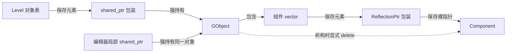

在编辑器里删除一个对象后，删除函数还会继续读取它的 ID；在属性面板中拿到一份组件列表副本，修改组件字段又会影响场景里的原组件。这两件事初看都容易让人疑惑：对象到底删没删？列表到底复制了什么？

再往下读，还会遇到另一种风险：即使手里的智能指针保证对象活着，遍历对象表的循环也可能已经不能继续。

这些问题需要分开追踪：**对象是否仍属于关卡、谁还持有对象，以及当前的访问路径是否仍然有效。** 容器变化可能只影响其中一项，也可能同时影响几项。

> **读这篇之前**：建议先看 [CXX-04：复制、移动与容器失效]() 和 [智能指针与对象生命周期]()，区分元素、目标与强弱持有；`ReflectionPtr` 的名字和类型协议见 [模板、宏与反射代码生成]()。下面保留容器规则速查，重点核对 Piccolo 的具体持有、删除和遍历协议。
>
> 源码基线：[BoomingTech/Piccolo，固定提交 `f5053707fed4`][revision]。本文的引擎行为来自源码核对；末尾独立 C++17 程序只验证语言与容器机制。Piccolo 实际删除、运行和断点观察仍待验证。

## 先拆开容器、元素与对象

阅读容器代码时，先把“里面存了对象”展开：容器里可能直接存一个对象，也可能存一个指向其他对象的包装。

Piccolo 的关卡对象表和组件数组属于后一种：



图中的实线分别标出包含、包装和访问关系；组件的释放责任由虚线说明。不能只看箭头的方向就认定它们都采用同一种所有权。

于是，手里的值也要分清落在哪一层：

| 手里的东西 | 它用于什么 | 需要继续确认什么 |
| --- | --- | --- |
| 对象 ID | 到当前对象表中重新查找 | 当前关卡是否仍登记这个 ID |
| 容器迭代器 | 找到元素，并继续遍历 | 容器操作是否使它失效 |
| 元素的引用或地址 | 访问容器中的指针包装 | 这个元素是否还存在、是否搬迁 |
| 复制出的 `shared_ptr<GObject>` | 在局部操作中持有对象 | 对象是否还属于世界，依赖的系统是否有效 |
| `GObject*` 或 `Component*` | 借用实际对象 | 谁负责保活，谁可能销毁它 |

**迭代器失效与对象析构是两个问题。** 下面沿两种容器分别核对。

## 对象表保存的是强持有，不是内嵌的 GObject

[level.h][level-h] 定义了对象表，并提供两个访问入口：

```cpp
using LevelObjectsMap = std::unordered_map<GObjectID, std::shared_ptr<GObject>>;
```

```cpp
const LevelObjectsMap& getAllGObjects() const { return m_gobjects; }
std::weak_ptr<GObject> getGObjectByID(GObjectID go_id) const;
```

第一个接口返回原表的 `const` 引用。通过这个引用不能插入或擦除元素，也不能替换元素里的 `shared_ptr`；它没有复制对象表。`const shared_ptr<GObject>` 也没有把所指的 `GObject` 变成只读对象，仍可通过它调用对象的非 `const` 方法。

第二个接口在 [level.cpp][level-cpp] 中查表，找到就返回对应的弱引用，找不到则返回空弱引用。调用者通过 `lock()` 成功获得局部强持有后，才进入本次对象操作。

这两个入口给的是不同能力：一个借用当前表来枚举，一个查找当前成员并允许调用者尝试保活。它们都没有承诺“以后关卡不会删除这个对象”。

### 编辑器为什么能在删除后读取 ID

[EditorSceneManager::onDeleteSelectedGObject][editor-scene] 先做：

```cpp
std::shared_ptr<GObject> selected_object = getSelectedGObject().lock();
```

成功后取得当前关卡，再执行下面两段代码。这里省略了中间的空值检查和获取交换上下文的语句，两个片段保持原文：

```cpp
current_active_level->deleteGObjectByID(m_selected_gobject_id);
```

```cpp
swap_context.getLogicSwapData().addDeleteGameObject(GameObjectDesc {selected_object->getID(), {}});
```

关键在于 `selected_object` 是一个独立的局部 `shared_ptr`。表中的强引用被移除后，这份强引用仍在，足以支持随后读取 ID、构造删除描述。渲染侧收到的是交接数据中的删除请求；这里不能把“对象表已移除”“C++ 对象已析构”“渲染表示已消失”当作同一个时刻。

再看 [Level::deleteGObjectByID][level-cpp]：它先查找对象，如果该对象是当前活动角色包装的对象，就调用 `m_current_active_character->setObject(nullptr)`，随后执行 `m_gobjects.erase(go_id)`。这是因为 [Character][character-h] 自己也保存着一份 `shared_ptr<GObject>`。

有一个作用域细节值得亲自核对：`deleteGObjectByID` 内部也复制了一个局部 `object`，但它位于前面的 `if` 作用域中，**在末尾 `erase` 之前已经离开作用域**。编辑器路径中，跨过 `erase` 继续保活的是调用者的 `selected_object`。

| 时点 | 当前表能否查到对象 | 对象是否仍存活 |
| --- | --- | --- |
| 编辑器成功 `lock()` 后、擦除前 | 能 | 能，表和调用者均强持有 |
| `erase` 完成、仍在编辑器的局部作用域内 | 不能 | 能，调用者仍强持有 |
| 调用者释放后 | 不能 | 取决于是否还存在其他强持有者 |

如果提前保存过一个旧 `weak_ptr`，擦除后它可能仍能 `lock()`；这是观察同一个存活对象。擦除后再按 ID 查询当前表，则会得到空弱引用。这两次查询回答的问题不同。

## 对象活着，迭代器也可能已经失效

对象表采用 `unordered_map`。插入元素可能触发重新组织桶的操作，也就是 rehash；它会使原迭代器失效，但不会使仍存在元素的指针、引用失效。擦除元素则使被擦除元素的迭代器、指针和引用失效，其他元素的对应访问保持有效。规则见标准草案 [无序关联容器要求][std-unordered]。

映射到 Piccolo，需要逐项判断：

| 操作 | 旧的 map 迭代器 | 指向原元素内 `shared_ptr` 的引用 | 已复制到局部的 `shared_ptr<GObject>` |
| --- | --- | --- | --- |
| 插入并触发 rehash | 失效，应重新取得 | 原元素仍在则有效 | 仍持有原对象 |
| 擦除当前元素 | 失效 | 失效，包装本身已销毁 | 仍持有原对象 |
| 擦除另一个元素 | 指向未删除元素的迭代器仍有效 | 指向未删除元素的引用仍有效 | 仍持有原对象 |

最后一列成立的前提，是已经独立复制了强引用。把 `auto& holder = it->second` 写在前面，只建立对槽位的借用，擦除槽位后不能再访问这个 `holder`。

[编辑器对象列表][editor-ui] 的写法就包含这两层：

```cpp
const LevelObjectsMap& all_gobjects = current_active_level->getAllGObjects();
for (auto& id_object_pair : all_gobjects)
```

循环体里又有：

```cpp
std::shared_ptr<GObject> object    = id_object_pair.second;
```

前者借用原表，后者复制一份当前对象的强引用。由于遍历的是 `const` 表，`auto&` 推导出来的元素引用也带 `const`。局部 `object` 可以保活当前对象，却不能保护遍历表的隐藏迭代器，也不能冻结其他地方对表的修改。

这里解释的是访问契约。不能仅凭存在 `tick()` 或编辑器调用，就断言当前版本已经在这个循环中触发了非法删除。

## 组件列表复制了包装，没有复制组件

[GObject::getComponents][object-h] 的返回类型非常关键：

```cpp
std::vector<Reflection::ReflectionPtr<Component>> getComponents() { return m_components; }
```

它按值返回一个 `vector`，复制的是 `m_components` 中的包装元素。再到 [reflection.h][reflection-h] 看复制构造：

```cpp
ReflectionPtr(const ReflectionPtr& dest) : m_type_name(dest.m_type_name), m_instance(dest.m_instance) {}
```

新包装保存同一个组件地址，没有新建组件，也没有像 `shared_ptr` 一样增加组件的强引用计数。这个类没有负责 `delete m_instance` 的析构函数；名称里的 `Ptr` 不能替代对实现的检查。甚至它的移动赋值也只是复制类型名与指针，并未把源指针置空，不能套用 `unique_ptr` 的所有权转移语义。

因此，复制列表以后：

- 清空副本的 `vector`，原对象的组件列表不随之清空。
- 在原组件仍存活的前提下，通过副本里的包装修改组件字段，修改的仍是原组件。
- 原组件被释放后，副本中的包装不会自动变空，继续解引用会访问失效对象。

同样，[GObject::save][object-cpp] 把 `m_components` 赋给输出资源的组件列表，也不能据此认定已经生成了一份独立拥有组件、冻结组件状态的深拷贝。随后如何序列化这些字段，继续看 [资源与类型恢复篇]()。

### `auto&&` 延长的是哪个对象的寿命

[编辑器属性面板][editor-ui] 这样接收返回值：

```cpp
auto&&                 selected_object_components = selected_object->getComponents();
for (auto component_ptr : selected_object_components)
```

这里必须先读函数签名，再读 `auto&&`：函数返回一个新的临时 `vector`，局部引用绑定它，使这个临时容器存活到该引用的作用域结束。这符合 [临时对象的生命周期延长规则][std-temporary]。`auto&&` 没有把函数的按值返回变成“借用原成员容器”。

循环中的 `auto component_ptr` 又复制一个 `ReflectionPtr`。这几次包装复制，都没有延长组件本身的寿命。临时列表仍在，只能证明列表和其中的包装仍在。

## vector 搬迁的是包装，显式删除才销毁组件

[GObject::load][object-cpp] 把实例组件放入 `m_components`，再通过 `push_back` 追加定义中缺少的组件。组件本身已经单独构造；这里追加的是指针包装。

如果 `vector` 扩容重分配，旧元素的引用、指针和迭代器都会失效；没有重分配时，插入点之前的访问可保留，插入点及之后受影响；擦除则使擦除点及之后的迭代器与引用失效。见 [容量规则][std-capacity] 和 [修改操作规则][std-vector]。

把这个规则落到 `vector<ReflectionPtr<Component>>`：

| 操作 | 指向包装元素的访问 | 预先借到的 `Component*` |
| --- | --- | --- |
| `push_back` 触发重分配 | 全部重新取得 | 单纯搬迁包装不会销毁组件；组件仍活着时可用 |
| 擦除某个包装 | 擦除点及之后的访问要重新取得 | 擦除包装本身不会调用 `delete Component` |
| `clear()` 包装数组 | 原包装访问全部失效 | 是否有效取决于组件是否另行释放 |
| GObject 析构并显式删除组件 | 成员容器随后销毁 | 指向已删除组件的裸指针和包装均不可解引用 |

最后一行来自真实析构代码：

```cpp
GObject::~GObject()
{
    for (auto& component : m_components)
    {
        PICCOLO_REFLECTION_DELETE(component);
    }
    m_components.clear();
}
```

[删除宏][reflection-h] 对包装指向的对象执行 `delete`，再把**当前这个包装**中的指针置空。它不会去其他副本里找到同一个地址并全部清空。

所以“组件列表能 `erase`”只是容器能力，还不等于引擎具备完整的“移除组件”协议。若直接擦除唯一登记着释放责任的包装，组件也不会因此自动释放；真正的组件移除还需要处理系统资源、依赖和销毁。反过来，先显式删除组件而保留其他借用，也会留下悬空访问。

源码中 `GObject::load` 开头的 `m_components.clear()` 也不能当作“原对象原地重载时，旧组件已被完整销毁”的证据。它只说明包装列表被清空。这里核对的是既有装配路径，不把它扩大成可重复调用的安全重载承诺。

## 范围 for 隐藏了迭代器，没有取消迭代器

[Level::tick][level-cpp] 使用 `for (const auto& id_object_pair : m_gobjects)` 更新对象；[GObject::tick][object-cpp] 再遍历组件并调用组件的 `tick`。它们在语法上很短，但循环仍需要取得起点、终点，并不断递增迭代器。

下面是帮助阅读的展开示意，并非 Piccolo 原文：

```cpp
auto&& range = m_gobjects;
auto it = range.begin();
auto end = range.end();
for (; it != end; ++it)
{
    const auto& pair = *it;
    pair.second->tick(delta_time);
}
```

如果将来某个组件在这里同步删除当前对象，隐藏的 `it` 就失效了；插入触发 rehash 也会让迭代器失效。给当前对象加一份局部 `shared_ptr` 只能解决保活，不能修复这些迭代器。

对于组件数组，即使事先 `reserve` 足够容量，遍历期间 `push_back` 仍会使旧的尾后迭代器失效。范围循环保存的终点同样在契约内，所以不能把“没有重分配”推成“范围循环中随便追加都安全”。

### 让修改发生在明确的阶段

如果当前代码自己控制整个擦除过程，可以显式接住 `erase` 返回的下一个有效迭代器：

```cpp
// 通用 C++17 教学示例，不是替换 Level::deleteGObjectByID 的实现。
for (auto it = objects.begin(); it != objects.end(); )
{
    if (should_remove(it->first))
        it = objects.erase(it);
    else
        ++it;
}
```

这个例子要求 `should_remove` 不修改容器。也不能直接拿它替换 Piccolo 的删除路径，因为它没有处理活动角色关系和渲染删除消息。

如果遍历中调用的组件或回调有修改场景的需求，更容易审查的设计是：遍历阶段记录待新增、待删除的请求，遍历结束后统一应用；再次执行请求时按当前表重新查 ID。这是设计建议，**不是说固定版本已经为所有对象增删提供了统一的延迟命令机制**。

另一种做法是先复制 `shared_ptr` 列表再遍历。它可以固定这一轮要访问的对象集合，并保活这些对象，但需要额外复制和存储；集合中的对象随后可能已被逻辑删除，仍需约定本轮是否继续更新。复制强引用也不会冻结对象字段，更不会自动解决线程同步。

## 动手验证：把四种变化分别做出来

下面程序把 Piccolo 的两种关系缩成最小模型：对象表保存 `shared_ptr`，对象内部保存不负责释放的组件包装，由对象显式清理组件。这里用自定义 `Handle` 代替真实 `ReflectionPtr`，省略反射类型名、系统资源和渲染逻辑。

程序只执行有效访问。注释指出的失效迭代器和失效组件指针都不再读取；未定义行为不能靠“运行一次没有崩溃”验证。

```cpp
#include <cassert>
#include <iostream>
#include <memory>
#include <unordered_map>
#include <vector>

struct Component { int value = 7; };
struct Handle { Component* ptr; }; // 复制包装不取得组件所有权

struct Object
{
    std::vector<Handle> components {{new Component}};
    Object() = default;
    Object(const Object&) = delete;
    Object& operator=(const Object&) = delete;
    ~Object()
    {
        for (auto h : components) delete h.ptr;
    }
    std::vector<Handle> getComponents() { return components; }
};

int main()
{
    std::unordered_map<int, std::shared_ptr<Object>> objects;
    objects.emplace(1, std::make_shared<Object>());
    auto keeper = objects.at(1);
    std::weak_ptr<Object> observed = keeper;
    Component* borrowed = keeper->components.front().ptr;

    // 1. 强制 rehash：不再使用旧迭代器，原元素地址保持有效。
    {
        auto old_it = objects.find(1);
        auto* slot = &old_it->second;
        objects.rehash(objects.bucket_count() * 2 + 1);
        assert(&objects.find(1)->second == slot);
        assert(slot->get() == keeper.get());
        // old_it 已失效，禁止递增、比较或解引用。
    }
    std::cout << "rehash: slot and object stay valid\n";

    // 2. 强制 vector 重分配：重新取得包装，组件地址仍相同。
    auto& handles = keeper->components;
    handles.reserve(handles.capacity() + 1);
    assert(handles.front().ptr == borrowed);
    assert(borrowed->value == 7);

    auto&& copy = keeper->getComponents();
    copy.front().ptr->value = 9;
    copy.clear();
    assert(handles.size() == 1 && borrowed->value == 9);
    std::cout << "component list: copied handles, shared pointee\n";

    // 3. 表中移除后，keeper 仍保活；释放它才结束本例对象寿命。
    auto saved_handles = keeper->getComponents();
    objects.erase(1);
    assert(objects.find(1) == objects.end());
    assert(!observed.expired() && borrowed->value == 9);
    keeper.reset();
    assert(observed.expired());
    // borrowed、saved_handles 内的指针已悬空，不再读取。
    saved_handles.clear(); // 销毁包装即可，不会再次 delete 组件。
    std::cout << "erase: membership ends before lifetime\n";

    // 4. 独立演示受控的迭代删除，不代表完整的引擎删除协议。
    objects.emplace(2, std::make_shared<Object>());
    objects.emplace(3, std::make_shared<Object>());
    for (auto it = objects.begin(); it != objects.end(); )
    {
        if (it->first == 2) it = objects.erase(it);
        else ++it;
    }
    assert(objects.size() == 1 && objects.count(3) == 1);
    std::cout << "erase loop: next iterator reacquired\n";
}
```

用 C++17、保留断言的配置编译运行，预期依次输出：

```text
rehash: slot and object stay valid
component list: copied handles, shared pointee
erase: membership ends before lifetime
erase loop: next iterator reacquired
```

2026-10-25 已在 Windows x64、MSVC 14.51 工具集下，以 `/std:c++17 /utf-8 /EHsc /W4 /Od /MDd /D_ITERATOR_DEBUG_LEVEL=2` 编译并运行这段完整程序：编译、运行退出码均为 0，断言和上述四行输出均通过。该结果验证的是独立模型中的有效访问，不是 Piccolo 引擎删除流程的运行验收。

可以逐项改变代码并先写出推导：如果没有 `keeper`，擦除后对象是否立刻析构？如果复制的是 `shared_ptr` 列表，清空原表后副本能否保活？如果把 `getComponents` 改成返回引用，清空调用结果会改到哪一个容器？这些变体要重新检查销毁责任，不能直接在失效指针上做试验。

## 回到源码，下一次要观察哪些状态

不用先启动引擎，也可以完成三项源码练习：

1. 在 `onDeleteSelectedGObject` 标出每份强引用的作用域，再沿 `deleteGObjectByID` 找到活动角色解除与 map 擦除；解释为什么后续读取 ID 仍有效。
2. 从 `getComponents` 的返回类型走到 `ReflectionPtr` 复制构造、GObject 析构和删除宏，分别标出谁复制包装、谁最终释放组件。
3. 从 `Level::tick` 走到 `GObject::tick`，给对象表和组件数组各写一条“遍历期间允许什么修改”的契约；把延迟修改建议与现有实现分开。

将来完整构建通过后，可以按下面的表验证引擎行为。它是观察计划，当前没有执行结果：

| 观察位置 | 要核对的状态 | 能回答的问题 |
| --- | --- | --- |
| 编辑器取得 `selected_object` 后 | ID、对象地址、局部强引用作用域 | 本次操作是否先成功保活 |
| `m_gobjects.erase` 前后 | 当前表是否包含 ID、活动角色是否解绑 | 世界成员资格在哪里结束 |
| 编辑器追加删除描述时 | `selected_object` 的对象地址、描述 ID | 擦除后读取的是否还是同一个对象 |
| GObject 析构与组件删除宏 | 最后强持有者、实际组件地址 | 对象与组件何时结束寿命 |
| 属性面板取得组件列表后 | 两个 vector 的元素地址与组件地址 | 包装复制与组件共享是否符合推导 |

这里只能把强持有用于有边界的局部操作。`Level::clear` 还会删除物理场景，[刚体组件的析构][rigidbody-cpp] 又依赖当前物理上下文；把一个 `GObject` 长期留到世界卸载后，不能仅凭它的 C++ 对象仍活着，就认定它的所有功能和清理路径仍安全。系统退出顺序继续看 [启动与退出篇]()。

**读容器修改，先确定手里访问的是哪一层，再分别检查成员资格、释放责任和遍历有效性。**

---

**继续阅读**

- [18：编辑器怎样拾取、创建和删除场景对象]()：把局部强持有接回完整删除路径，并区分对象表移除、渲染部件清理与持久化。
- [场景文件怎样成为世界中的对象与组件]()：把这里的持有与借用放回完整的对象组装路径。
- [编辑器怎样修改、保存并恢复场景状态]()：区分运行对象、字段保存与重载后的新身份。
- [窗口与编辑器回调怎样绑定、调用和注销]()：继续追保存的函数包装、目标对象寿命与退出时的订阅边界。
- [Piccolo 阅读入口]()：按需返回源码主线与专项目录。

Piccolo 源码节选版权：Copyright (c) 2022 Contributors to the Piccolo Engine，按 [MIT License][license] 提供。独立教学程序和阅读展开示意已在对应位置标明。

[revision]: https://github.com/BoomingTech/Piccolo/tree/f5053707fed4d3f94d270a436fb0d3a8ae54e3e5
[level-h]: https://github.com/BoomingTech/Piccolo/blob/f5053707fed4d3f94d270a436fb0d3a8ae54e3e5/engine/source/runtime/function/framework/level/level.h
[level-cpp]: https://github.com/BoomingTech/Piccolo/blob/f5053707fed4d3f94d270a436fb0d3a8ae54e3e5/engine/source/runtime/function/framework/level/level.cpp
[editor-scene]: https://github.com/BoomingTech/Piccolo/blob/f5053707fed4d3f94d270a436fb0d3a8ae54e3e5/engine/source/editor/source/editor_scene_manager.cpp
[editor-ui]: https://github.com/BoomingTech/Piccolo/blob/f5053707fed4d3f94d270a436fb0d3a8ae54e3e5/engine/source/editor/source/editor_ui.cpp
[character-h]: https://github.com/BoomingTech/Piccolo/blob/f5053707fed4d3f94d270a436fb0d3a8ae54e3e5/engine/source/runtime/function/character/character.h
[object-h]: https://github.com/BoomingTech/Piccolo/blob/f5053707fed4d3f94d270a436fb0d3a8ae54e3e5/engine/source/runtime/function/framework/object/object.h
[object-cpp]: https://github.com/BoomingTech/Piccolo/blob/f5053707fed4d3f94d270a436fb0d3a8ae54e3e5/engine/source/runtime/function/framework/object/object.cpp
[reflection-h]: https://github.com/BoomingTech/Piccolo/blob/f5053707fed4d3f94d270a436fb0d3a8ae54e3e5/engine/source/runtime/core/meta/reflection/reflection.h
[rigidbody-cpp]: https://github.com/BoomingTech/Piccolo/blob/f5053707fed4d3f94d270a436fb0d3a8ae54e3e5/engine/source/runtime/function/framework/component/rigidbody/rigidbody_component.cpp
[license]: https://github.com/BoomingTech/Piccolo/blob/f5053707fed4d3f94d270a436fb0d3a8ae54e3e5/LICENSE
[std-unordered]: https://eel.is/c++draft/unord.req
[std-capacity]: https://eel.is/c++draft/vector.capacity
[std-vector]: https://eel.is/c++draft/vector.modifiers
[std-temporary]: https://eel.is/c++draft/class.temporary
