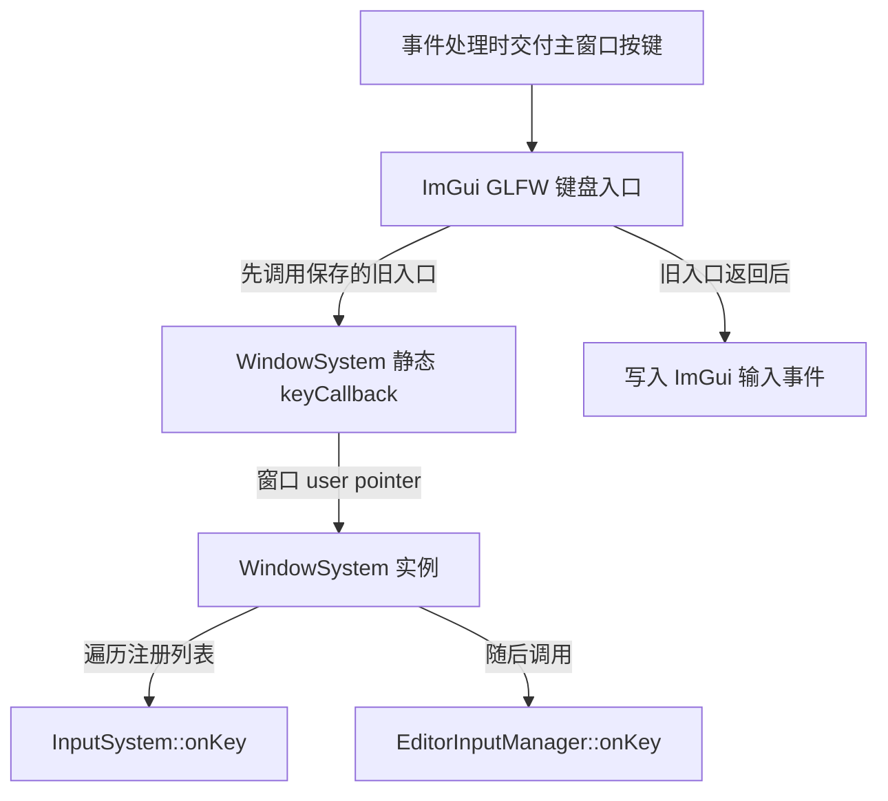

一个按键怎样从操作系统进入编辑器，最终让相机移动？编辑器退出时，窗口里保存的处理函数又由谁移除？

阅读这条路径，容易把几件事情连得太快：看见注册函数，就以为事件一定能到达；看见函数对象被复制保存，就以为接收者也会被保活；看见 `clear()`，就以为它已经取消了订阅。

这篇沿 Piccolo 的窗口、输入管理器和属性面板逐步核对。核心问题是：**谁保存调用方式，谁提供事件参数，以及每次调用时，目标对象和捕获的数据是否仍然有效。**

> **读这篇之前**：建议先读 [CXX-05：函数指针、Lambda、捕获与回调寿命]()、[智能指针与生命周期]() 和 [对象容器、借用与遍历]()。公共课集中解释调用类型与捕获，下面保留语言规则速查，重点追 Piccolo 的实际转接、分发和退出约定。
>
> 源码基线：[BoomingTech/Piccolo，固定提交 `f5053707fed4`][revision]。随仓 GLFW 头文件版本为 3.3.5，ImGui 行为以同一提交中的后端源码为准。引擎调用链来自静态核对，独立 C++17 程序只验证语言机制；实际窗口事件与退出过程仍待运行验证。

## 一次订阅里，至少有五个角色

先把一个回调系统拆开：事件源产生通知，转接函数把外部参数接入项目，注册表保存可调用对象，可调用对象找到接收者，接收者再执行具体操作。

| 角色 | 在 Piccolo 中的例子 | 需要回答的问题 |
| --- | --- | --- |
| 事件源 | GLFW 窗口 | 什么时候交付事件，在哪个调用上下文中交付 |
| 外部转接入口 | `WindowSystem::keyCallback` | 怎样从窗口找到项目对象 |
| 注册表 | `m_onKeyFunc` | 保存一项还是多项，怎样移除 |
| 可调用对象 | `std::bind` 返回的包装、Lambda | 保存了哪些参数、指针或引用 |
| 接收者 | `InputSystem`、`EditorInputManager` | 调用发生时是否仍存活，是否处于可处理状态 |

注册阶段通常只把“以后怎么调用”存起来。真正的按键值、动作和修饰键，要到分发阶段才传入。接收者的寿命也不会因为注册动作而自动延长。

## 先读签名，再拆开绑定表达式

[WindowSystem][window-h] 的按键回调类型和注册函数是：

```cpp
typedef std::function<void(int, int, int, int)> onKeyFunc;
```

```cpp
void registerOnKeyFunc(onKeyFunc func) { m_onKeyFunc.push_back(func); }
```

四个 `int` 按调用路径对应 `key`、`scancode`、`action`、`mods`，返回值为 `void`。`std::function` 可以把满足该调用签名的普通函数、绑定表达式或 Lambda 放在同一种包装中保存、复制和调用，参见 [标准草案的 function 说明][std-function]。

注册函数只是追加一份包装。它不在这里调用处理函数，也没有去重或返回可用于取消订阅的句柄。若对同一个管理器重复执行注册，列表会继续增加条目。

### 成员函数地址还缺一个对象

[InputSystem::initialize][input-cpp] 向窗口注册按键处理：

```cpp
window_system->registerOnKeyFunc(std::bind(&InputSystem::onKey,
                                           this,
                                           std::placeholders::_1,
                                           std::placeholders::_2,
                                           std::placeholders::_3,
                                           std::placeholders::_4));
```

`&InputSystem::onKey` 是非静态成员函数指针，表示要调用哪个类的哪个成员，还需要一个具体对象。这里绑定的 `this` 就提供了接收者；`_1` 到 `_4` 则把未来调用包装时收到的四个参数，按顺序交给成员函数。

可以用下面的 Lambda 帮助理解效果。它是阅读示意，不是原源码，也不是要求改写实现：

```cpp
[this](int key, int scancode, int action, int mods)
{
    this->onKey(key, scancode, action, mods);
}
```

在这个具体表达式中，`std::bind` 保存的是 `this` 的指针值；复制包装并不复制 `InputSystem`，也不增加接收者的强引用计数。把它换成 `[this]` 仍有同样的接收者寿命约束。绑定参数与占位符的规则见 [bind 说明][std-bind]。

### 三个参数也可能只转发两个

[EditorInputManager::registerInput][editor-input] 中还有一个很容易误读的绑定：

```cpp
g_editor_global_context.m_window_system->registerOnMouseButtonFunc(
    std::bind(&EditorInputManager::onMouseButtonClicked, this, std::placeholders::_1, std::placeholders::_2));
```

窗口的鼠标回调签名是 `void(int, int, int)`，参数为按钮、动作和修饰键；编辑器的 `onMouseButtonClicked` 只有两个参数。这里的绑定表达式使用 `_1` 和 `_2`，没有使用第三个调用参数，因此不会把 `mods` 传给该成员函数。

所以读绑定时，不要只数原成员函数有几个参数，还要把“固定参数、占位符和调用时参数”逐项对应起来。

## 从 GLFW 的静态入口回到对象

[WindowSystem::initialize][window-cpp] 建立另一层连接：

```cpp
glfwSetWindowUserPointer(m_window, this);
glfwSetKeyCallback(m_window, keyCallback);
```

GLFW 接收的键盘入口带有 `GLFWwindow*`，而普通非静态成员函数还隐含需要对象，不能直接把前面的成员函数指针当成这种入口传入。Piccolo 使用静态成员函数转接：

```cpp
static void keyCallback(GLFWwindow* window, int key, int scancode, int action, int mods)
{
    WindowSystem* app = (WindowSystem*)glfwGetWindowUserPointer(window);
    if (app)
    {
        app->onKey(key, scancode, action, mods);
    }
}
```

静态函数没有隐含的 `this`。它通过窗口的 user pointer 找回 `WindowSystem`，再进入项目分发函数：

```cpp
void onKey(int key, int scancode, int action, int mods)
{
    for (auto& func : m_onKeyFunc)
        func(key, scancode, action, mods);
}
```

窗口 user pointer 保存的是应用提供的地址，不负责管理这个对象的寿命；相关约定见 [GLFW 窗口指南][glfw-window]。`if (app)` 只排除了空指针，不能识别一个非空地址所指的对象是否已经销毁。

到这里可以区分两种注册：`glfwSetKeyCallback` 为窗口设置一个该类事件的入口，Piccolo 的 `registerOnKeyFunc` 则往自己的列表中追加一个接收者。两者的覆盖与追加语义不同。

## ImGui 安装了新入口，原链路为什么还在

继续阅读 [UIPass::initializeUIRenderBackend][ui-pass]，会看到：

```cpp
ImGui_ImplGlfw_InitForVulkan(std::static_pointer_cast<VulkanRHI>(m_rhi)->m_window, true);
```

这里的 `true` 要求后端安装 GLFW 回调。只看到这一行，容易以为它覆盖 Piccolo 的入口后，游戏和编辑器就再也收不到事件。

实际要继续追固定版本的 [imgui_impl_glfw.cpp][imgui-glfw]。后端设置自己的键盘入口时，把旧入口保存在 `PrevUserCallbackKey`；收到主窗口的按键事件后，会先转调旧入口，再处理自己的输入队列：

```cpp
if (bd->PrevUserCallbackKey != NULL && window == bd->Window)
    bd->PrevUserCallbackKey(window, keycode, scancode, action, mods);
```

因此，完成 UI 初始化后，主窗口按键路径可以画为：



图中箭头表示调用关系与先后，不表示线程切换。运行时输入系统在引擎系统启动时注册，编辑器输入管理器随后初始化，因此通常按该顺序进入列表；这里的分发函数没有“已消费事件就中止”的返回值协议。

[InputSystem::onKey][input-cpp] 只在 `!g_is_editor_mode` 时进入游戏按键处理；[EditorInputManager::onKey][editor-input] 则在 `g_is_editor_mode` 时进入编辑器处理。**模式切换改变的是处理函数内部的分支，注册项仍保留在列表中。** 不能据此认为游戏输入订阅被注销，也不能把 ImGui 的输入捕获约定直接等同于这里已有自动拦截。

### 按下 W，与相机真正移动之间还有一步

编辑器的 `onKeyInEditorMode` 在 W 按下时设置 `EditorCommand::camera_foward` 位，释放时清除。`processEditorCommand` 再读取命令位，计算相机相对位移并调用相机移动。

结合 [编辑器循环][editor-cpp] 与 [tickOneFrame][engine-cpp]，当前显式轮询路径是：

1. 本轮先执行编辑器场景和输入管理器的 `tick`，消费已有命令状态。
2. 引擎推进逻辑和渲染，然后调用 `WindowSystem::pollEvents()`，内部进入 `glfwPollEvents()`。
3. 如果按键在这里交付，回调修改命令位，下一轮编辑器输入 `tick` 再消费它；若本轮已经退出，就没有下一轮消费。

这是对这条显式调用路径的推导，不是“所有 GLFW 回调只会发生在帧末”的保证。GLFW 也可能在其他窗口操作中同步交付事件，见 [事件处理指南][glfw-input]；回调这个概念本身也不表示另开线程。主线程约束见 [GLFW 3.3 指南][glfw-intro]。

## 属性面板保存的是另一类可调用对象

窗口订阅之外，[EditorUI][editor-ui-h] 还在自己的成员表中保存字段绘制函数：

```cpp
std::unordered_map<std::string, std::function<void(std::string, void*)>> m_editor_ui_creator;
```

[构造函数][editor-ui] 按 `Transform`、`bool`、`float`、`std::string` 等类型名字放入 Lambda；属性面板读取反射字段后，再按字段类型调用表中的函数，传入字段名和字段地址。

这是一种同步的类型分派：选择函数并立即调用，不经过操作系统窗口事件。函数表里的 `void*` 仍是借来的字段地址，需要由反射类型和当前对象寿命保证有效；`std::function` 不会替它验证字段类型。

### 引用捕获要追到实际被引用的对象

构造函数中有下面这个局部别名：

```cpp
const auto& asset_folder            = g_runtime_global_context.m_config_manager->getAssetFolder();
```

字符串字段绘制函数采用 `[this, &asset_folder]` 捕获。这里不能只看到“引用捕获了构造函数里的局部名字”，就判定构造结束后一定悬空。继续读 [ConfigManager::getAssetFolder][config-cpp]：

```cpp
const std::filesystem::path& ConfigManager::getAssetFolder() const { return m_asset_folder; }
```

`asset_folder` 本来就是配置对象成员的引用别名。Lambda 引用捕获这个别名，后续使用指向的是它所绑定的对象；有效性取决于那个配置成员的寿命，不取决于这个局部引用名字是否离开作用域，见 [Lambda 捕获规则][std-capture]。

这也没有保活 `ConfigManager`。配置对象销毁后，再通过这个捕获使用其路径仍不成立；`[this]` 同样要求所属 `EditorUI` 有效。把 Lambda 放在自身成员表中，和把它复制到寿命更长的外部事件总线中，约束并不相同。

## 已注册的回调，是否真的接通了

现在回头检查“注册成功”这个说法。[EditorInputManager][editor-input] 注册过 `onWindowClosed`，其函数体会调用引擎 `shutdownEngine()`。但窗口的真正关闭入口是：

```cpp
static void windowCloseCallback(GLFWwindow* window) { glfwSetWindowShouldClose(window, true); }
```

它只设置关闭标志，没有遍历 `m_onWindowCloseFunc`。所以不能画成“关闭窗口 → 编辑器 onWindowClosed → 立即 shutdown”的实际链路。

同一份窗口头文件中还有两种对照：

| 事件/入口 | 固定版本做了什么 | 应当怎样描述 |
| --- | --- | --- |
| 键盘、鼠标、滚轮等入口 | 转接到对应的列表分发函数 | 具有实际转接与分发路径 |
| 窗口尺寸入口 | 只更新 `m_width`、`m_height` | 没有调用已有的 `onWindowSize` 列表分发函数 |
| 窗口关闭入口 | 只设置 should-close 标志 | 保存的关闭订阅没有经这里调用 |
| reset 列表 | 有注册和 `onReset` 分发函数 | 在项目主源码中未找到触发该分发函数的调用点 |

`onReset` 的注册也不能推成已具备焦点丢失或模式切换时的完整输入复位协议。读回调的最低证据链应当是：**注册点 → 实际保存处 → 事件入口 → 分发调用 → 目标处理函数。**

## 退出时，取消订阅与停止事件源要分开

标题中的“注销”，必须如实回答固定版本实现到了哪里。

### 接收者没有独立的注销句柄

`WindowSystem` 提供追加回调的接口，但没有按订阅 ID 移除的接口。`EditorInputManager` 的声明中也没有对应的注销过程；[EditorGlobalContext::clear][editor-context] 直接删除场景管理器和输入管理器。

`InputSystem::clear()` 又是另一件事，它只把 `m_cursor_delta_x`、`m_cursor_delta_y` 清零，并不移除窗口中保存的函数包装。函数名不足以证明清理了什么，必须读函数体。

注册项中绑定的裸 `this` 会随着接收者销毁而失效，包装本身仍可能留在窗口列表里。若此时再次分发到该项，就不能安全调用原接收者。窗口模式分支也无法保护一个已经销毁的目标，因为进入成员函数本身就要求对象有效。

### 正常主入口先离开循环，再清理对象

[编辑器 main][main-cpp] 的正常顺序是：`editor->run()` 返回，调用 `editor->clear()`，再调用 `engine->clear()` 和 `engine->shutdownEngine()`。

窗口关闭时，[tickOneFrame][engine-cpp] 在事件处理后读取 should-close 标志并返回 `false`，编辑器循环随之返回。后续 [shutdownSystems][global-context] 再清理系统。`WindowSystem` 析构时执行 `glfwDestroyWindow` 和 `glfwTerminate`；随仓 GLFW 的 [窗口销毁实现][glfw-window-c] 会清空该窗口的回调，随后 C++ 成员容器析构也会销毁保存的函数包装。

这说明退出路径依靠阶段顺序结束事件处理，最后销毁整个事件源；它没有为“窗口继续存在，但某个编辑器工具提前卸载”提供可复用的取消订阅协议。编辑器接收者已经删除、窗口尚未销毁的区间，尤其需要审查是否还可能发生回调，不能只因不再显式调用 `pollEvents` 就宣称绝对安全。本文没有运行退出过程，不能把源码顺序记成完整验收。

### 后端有恢复函数，不代表项目已经调用

固定版本的 [ImGui GLFW 后端][imgui-glfw] 在 `ImGui_ImplGlfw_Shutdown()` 中包含恢复旧窗口回调的逻辑。但在 Piccolo 的 `engine/source` 中，未找到该函数的调用；不能把第三方库“提供了清理函数”写成项目已经完成后端恢复。

恢复 GLFW 的旧入口，和移除 Piccolo 列表中的某个管理器，是两个层次。前者改变窗口的入口函数，后者改变这个入口之后的订阅集合。

同理，不能直接把遗漏的关闭分发接上，然后在 GLFW 回调栈中执行完整 `shutdownEngine()`。这会继续涉及系统和窗口销毁；GLFW 明确限制在回调中调用 `glfwDestroyWindow`、`glfwTerminate` 等操作，见 [重入约束][glfw-intro]。更合适的扩展方式是记录关闭请求，让主循环退出后统一清理。这是设计建议，本篇不修改引擎实现。

## 如果要支持工具卸载，需要明确什么契约

一个可取消的订阅通常需要：注册返回句柄，订阅方持有该句柄，在释放接收者之前取消注册；或者由一个有明确寿命的连接对象管理这段关系。事件源与连接对象谁先结束，也必须有约定。

常见捕获方式承担的责任不同：

| 保存方式 | 是否保活接收者 | 还需要什么 |
| --- | --- | --- |
| 绑定裸 `this` / `[this]` | 否 | 保证每次调用时接收者有效，提前注销或停止事件源 |
| 捕获 `shared_ptr` | 是 | 决定何时释放订阅，审查是否形成循环持有 |
| 捕获 `weak_ptr` 并在调用时 `lock()` | 不持续保活，成功调用期间局部保活 | 过期时跳过处理；仍要考虑清理失效订阅 |
| 引用捕获局部或成员数据 | 否 | 被引用对象覆盖每次调用的时间范围 |

固定版本的 `EditorInputManager` 由 `new/delete` 管理，不能不改所有权设计就直接对它使用 `weak_from_this()`。这些是选择方案的条件，不是可原样贴回源码的修复。

还要接上上一篇的容器规则：`onKey` 正在范围遍历 `vector` 时，回调中追加条目可能使迭代器失效；在未来增加的注销接口里直接擦除当前条目，也有同类问题。延迟到分发结束后应用修改，是一种明确的契约；若采用分发快照，则要另外定义“本轮已排入快照的订阅被取消后，还会不会再调用”。跨线程的取消还涉及正在执行的回调，不能只靠删除一个条目保证调用已结束。

## 动手验证：函数包装和接收者分别活多久

下面程序独立验证绑定参数、引用别名捕获，以及强/弱捕获与显式注销。`Hub` 是带订阅 ID 的教学模型，**不是固定版本 WindowSystem 已有的接口**。它只用于单线程、分发期间不修改订阅的情形。

```cpp
#include <cassert>
#include <functional>
#include <iostream>
#include <map>
#include <memory>
#include <string>
#include <utility>

struct Receiver
{
    int total = 0;
    int button = -1;
    int action = -1;
    void key(int k, int, int a, int) { if (a == 1) total += k; }
    void mouse(int b, int a) { button = b; action = a; }
};

struct Hub
{
    unsigned next = 0;
    std::map<unsigned, std::function<void(int)>> slots;
    unsigned connect(std::function<void(int)> fn)
    {
        auto id = ++next;
        slots.emplace(id, std::move(fn));
        return id;
    }
    bool disconnect(unsigned id) { return slots.erase(id) == 1; }
    void emit(int value)
    {
        for (auto& item : slots) item.second(value);
    }
};

std::function<std::size_t()> makeReader(const std::string& backing)
{
    const auto& alias = backing;
    return [&alias] { return alias.size(); };
}

int main()
{
    using namespace std::placeholders;
    auto receiver = std::make_shared<Receiver>();
    std::weak_ptr<Receiver> observed = receiver;
    std::function<void(int, int, int, int)> raw =
        std::bind(&Receiver::key, receiver.get(), _1, _2, _3, _4);
    raw(7, 0, 1, 0);
    assert(receiver->total == 7);
    std::function<void(int, int, int)> mouse =
        std::bind(&Receiver::mouse, receiver.get(), _1, _2);
    mouse(2, 1, 99); // 第三个参数不转发给 Receiver::mouse。
    assert(receiver->button == 2 && receiver->action == 1);
    std::cout << "bind: receiver and arguments matched\n";

    auto copied = raw;
    receiver.reset();
    assert(observed.expired() && raw && copied);
    // 包装仍非空，目标已销毁；禁止调用 raw、copied 或 mouse。
    raw = nullptr; copied = nullptr; mouse = nullptr;
    std::cout << "wrapper copy: receiver is not kept alive\n";

    std::string folder = "asset";
    auto read = makeReader(folder); // makeReader 已返回，folder 仍存活。
    assert(read() == 5);
    folder += "/mesh";
    assert(read() == 10);
    std::cout << "reference capture: follows the backing object\n";

    Hub hub;
    int delivered = 0;
    auto weak_owner = std::make_shared<Receiver>();
    auto weak_id = hub.connect(
        [weak = std::weak_ptr<Receiver>(weak_owner), &delivered](int v)
        {
            if (auto live = weak.lock())
            {
                live->total += v;
                ++delivered;
            }
        });
    hub.emit(3);
    assert(weak_owner->total == 3 && delivered == 1);
    weak_owner.reset();
    hub.emit(3); // 仍有订阅，但目标过期，安全跳过。
    assert(delivered == 1 && hub.slots.size() == 1);
    const bool removed_weak = hub.disconnect(weak_id);
    assert(removed_weak && hub.slots.empty());
    std::cout << "weak capture: expired target skipped, slot removed explicitly\n";

    auto strong_owner = std::make_shared<Receiver>();
    std::weak_ptr<Receiver> strong_observed = strong_owner;
    auto strong_id = hub.connect([hold = strong_owner](int v) { hold->total += v; });
    strong_owner.reset();
    assert(!strong_observed.expired());
    hub.emit(4);
    {
        auto live = strong_observed.lock();
        assert(live && live->total == 4);
    }
    const bool removed_strong = hub.disconnect(strong_id);
    assert(removed_strong && strong_observed.expired());
    std::cout << "strong capture: disconnect releases the last owner\n";
}
```

保留断言，以 C++17 编译运行，预期依次输出：

```text
bind: receiver and arguments matched
wrapper copy: receiver is not kept alive
reference capture: follows the backing object
weak capture: expired target skipped, slot removed explicitly
strong capture: disconnect releases the last owner
```

2026-10-25 已从正文提取这段完整程序，在 Windows x64、MSVC 14.51 工具集下，以 `/std:c++17 /utf-8 /EHsc /W4 /Od /MDd /D_ITERATOR_DEBUG_LEVEL=2` 编译运行：编译与运行退出码均为 0，断言和五行输出全部通过。这个结果没有覆盖 GLFW、ImGui 或 Piccolo 的实际事件分发与退出过程。

其中第二项尤其值得停下来想：`std::function` 转为 `bool` 为真，只说明包装里存有调用目标，不会替你检查所绑定的裸指针对象是否仍存活。程序故意不执行那些失效调用，不能用“没崩溃”证明它们安全。

## 回到 Piccolo，按这张表继续读和调试

源码练习可以先做三件事：把一个键盘订阅的四个参数逐项对应；分别沿键盘和关闭事件走完整条链，标出关闭订阅未被调用的位置；从字符串 UI Lambda 的捕获一路追到配置成员，画出实际寿命依赖。

将来完整构建通过后，再验证实际窗口事件：

| 观察位置 | 要记录的状态 | 要验证的问题 |
| --- | --- | --- |
| 输入系统与编辑器注册点 | 接收者地址、回调列表长度 | 注册顺序与重复注册是否符合推导 |
| ImGui 键盘入口 | 当前窗口、旧入口地址、四个事件参数 | 后端是否先链回 Piccolo |
| WindowSystem 静态入口与列表分发 | user pointer、当前条目、调用栈 | 事件怎样进入正确实例和管理器 |
| 编辑器按键处理与下一轮输入 tick | 模式、action、命令位、相机位移 | 标记与消费分别发生在哪一步 |
| should-close 检查、editor clear 与窗口析构 | 退出顺序、订阅是否仍在、是否仍有回调 | 停止分发与接收者销毁的边界是否成立 |

这些是未来的观察任务，尚未取得 Piccolo 的断点或事件运行回执。现阶段应保留最明确的阅读判断：**注册只保存调用方式；每次调用的可达性、目标寿命和结束订阅的责任，都需要沿实际代码分别找到。**

---

**继续阅读**

- [一帧怎样推进]()：把事件分发放回实际循环，区分调用顺序与线程证据。
- [编辑器怎样修改、保存并恢复场景状态]()：继续追字段回调怎样写入当前对象。
- [状态缓冲怎样交接，哪些地方真的跨线程]()：继续区分数据交接、线程执行与发布/复用条件。
- [Piccolo 阅读入口]()：按需返回源码主线与专项目录。

Piccolo 源码节选版权：Copyright (c) 2022 Contributors to the Piccolo Engine，按 [MIT License][license] 提供。ImGui 后端片段遵循随仓 [ImGui License][imgui-license]；阅读示意和独立教学程序已单独标明。

[revision]: https://github.com/BoomingTech/Piccolo/tree/f5053707fed4d3f94d270a436fb0d3a8ae54e3e5
[window-h]: https://github.com/BoomingTech/Piccolo/blob/f5053707fed4d3f94d270a436fb0d3a8ae54e3e5/engine/source/runtime/function/render/window_system.h
[window-cpp]: https://github.com/BoomingTech/Piccolo/blob/f5053707fed4d3f94d270a436fb0d3a8ae54e3e5/engine/source/runtime/function/render/window_system.cpp
[input-cpp]: https://github.com/BoomingTech/Piccolo/blob/f5053707fed4d3f94d270a436fb0d3a8ae54e3e5/engine/source/runtime/function/input/input_system.cpp
[editor-input]: https://github.com/BoomingTech/Piccolo/blob/f5053707fed4d3f94d270a436fb0d3a8ae54e3e5/engine/source/editor/source/editor_input_manager.cpp
[editor-ui-h]: https://github.com/BoomingTech/Piccolo/blob/f5053707fed4d3f94d270a436fb0d3a8ae54e3e5/engine/source/editor/include/editor_ui.h
[editor-ui]: https://github.com/BoomingTech/Piccolo/blob/f5053707fed4d3f94d270a436fb0d3a8ae54e3e5/engine/source/editor/source/editor_ui.cpp
[config-cpp]: https://github.com/BoomingTech/Piccolo/blob/f5053707fed4d3f94d270a436fb0d3a8ae54e3e5/engine/source/runtime/resource/config_manager/config_manager.cpp
[ui-pass]: https://github.com/BoomingTech/Piccolo/blob/f5053707fed4d3f94d270a436fb0d3a8ae54e3e5/engine/source/runtime/function/render/passes/ui_pass.cpp
[imgui-glfw]: https://github.com/BoomingTech/Piccolo/blob/f5053707fed4d3f94d270a436fb0d3a8ae54e3e5/engine/3rdparty/imgui/backends/imgui_impl_glfw.cpp
[editor-cpp]: https://github.com/BoomingTech/Piccolo/blob/f5053707fed4d3f94d270a436fb0d3a8ae54e3e5/engine/source/editor/source/editor.cpp
[engine-cpp]: https://github.com/BoomingTech/Piccolo/blob/f5053707fed4d3f94d270a436fb0d3a8ae54e3e5/engine/source/runtime/engine.cpp
[main-cpp]: https://github.com/BoomingTech/Piccolo/blob/f5053707fed4d3f94d270a436fb0d3a8ae54e3e5/engine/source/editor/source/main.cpp
[editor-context]: https://github.com/BoomingTech/Piccolo/blob/f5053707fed4d3f94d270a436fb0d3a8ae54e3e5/engine/source/editor/source/editor_global_context.cpp
[global-context]: https://github.com/BoomingTech/Piccolo/blob/f5053707fed4d3f94d270a436fb0d3a8ae54e3e5/engine/source/runtime/function/global/global_context.cpp
[glfw-window-c]: https://github.com/BoomingTech/Piccolo/blob/f5053707fed4d3f94d270a436fb0d3a8ae54e3e5/engine/3rdparty/glfw/src/window.c
[license]: https://github.com/BoomingTech/Piccolo/blob/f5053707fed4d3f94d270a436fb0d3a8ae54e3e5/LICENSE
[imgui-license]: https://github.com/BoomingTech/Piccolo/blob/f5053707fed4d3f94d270a436fb0d3a8ae54e3e5/engine/3rdparty/imgui/LICENSE.txt
[std-function]: https://eel.is/c++draft/func.wrap.func
[std-bind]: https://eel.is/c++draft/func.bind.bind
[std-capture]: https://eel.is/c++draft/expr.prim.lambda.capture
[glfw-window]: https://www.glfw.org/docs/3.3/window_guide.html
[glfw-intro]: https://www.glfw.org/docs/3.3/intro_guide.html
[glfw-input]: https://www.glfw.org/docs/3.3/input_guide.html#events
