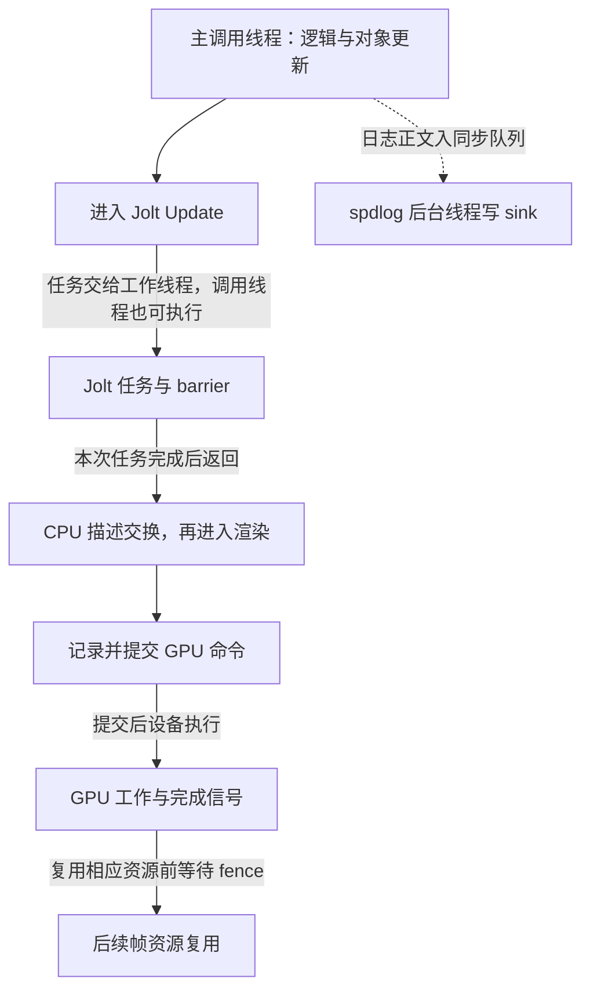

引擎里有两份变换、两份逻辑渲染交换数据，还有多份正在使用的 GPU 帧资源。看到这些缓冲，很容易画出“逻辑线程写一份、渲染线程读另一份”的图。

但缓冲数量没有说明谁在执行代码，也没有说明另一方何时能看到新值、何时允许覆盖旧值。即使读写碰巧落在不同槽里，角色切换的一刻仍然需要协议。

这篇继续读 Piccolo，重点回答：**交接的数据由谁拥有，引用指向哪个槽位，消费者完成后怎样归还，以及源码里哪里真正创建了线程并建立等待。**

> **读这篇之前**：建议先看 [对象容器、借用与遍历]() 与 [窗口和编辑器回调]()，掌握值、借用与调用者寿命。完整的一帧入口见 [主线 03]()，具体位置变化和 Vulkan 提交分别见主线 06、07。
>
> 源码基线：[BoomingTech/Piccolo，固定提交 `f5053707fed4`][revision]。引擎线程与同步结论来自固定源码，尚未取得实际运行采样；独立 C++17 程序只验证本文的最小交接模型。布局、字节与转换的公共规则见 [CXX-06]()；并发完整单元 CXX-11 仍待写，状态见 [公共目录]()。

## 读缓冲，先找四个动作

不论最终是否跨线程，都可以先按四个动作阅读：

| 动作 | 要找到的事实 | 最容易遗漏的边界 |
| --- | --- | --- |
| 写入 | 写哪个槽，数据是值还是借用 | 写入后是否仍引用临时对象 |
| 发布 | 哪一步使本批数据成为可消费状态 | 换索引是否也建立了跨线程可见性 |
| 消费 | 谁读取，读到哪里，是否留下内部地址 | 容器清理后借用是否仍被使用 |
| 归还与复用 | 谁确认旧数据已用完 | 发布新值不能代替确认旧值已无人使用 |

“发布”在这里表示把准备好的内容交给下一阶段的协议动作。同线程路径可以依靠明确的调用先后完成交接；跨线程路径还需要语言和库定义的同步关系，不能仅靠函数名叫 swap 或 publish。

先把 Piccolo 中三类缓冲分开：

| 缓冲 | 承载什么 | 索引和完成条件 |
| --- | --- | --- |
| Transform 的两份运行状态 | 单个组件的变换值 | current/next 在组件 tick 中交换，更新顺序决定读到哪份 |
| RenderSwapContext 的两个槽 | 对象变化、删除、相机、粒子等描述 | logic/render 角色交换前，旧渲染槽的七项 optional 必须全部无值 |
| [Vulkan 的在途帧资源][vulkan-h] | 命令缓冲、同步对象等帧资源 | 当前帧资源索引和相应 GPU 完成信号；该版本资源槽数为 3 |

它们没有一一对应关系。CPU 交换槽索引、Vulkan 帧资源索引、取得的交换链图像索引，也不能互相替代。

## 第一层：Transform 的两份值由组件顺序推进

[TransformComponent][transform-h] 同时保留反射与持久化使用的 `m_transform`，以及运行时的 `m_transform_buffer[2]`。setter 写 next 对应的运行缓冲，同时更新持久字段并设脏标记：

```cpp
void TransformComponent::setPosition(const Vector3& new_translation)
{
    m_transform_buffer[m_next_index].m_position = new_translation;
    m_transform.m_position                      = new_translation;
    m_is_dirty                                  = true;
}
```

[tick][transform-cpp] 交换 current/next，按脏状态尝试更新刚体；在编辑器模式下，还把 `m_transform` 复制到下一份缓冲。getter 读取哪份也不同：

```cpp
const Transform& getTransformConst() const { return m_transform_buffer[m_current_index]; }
Transform&       getTransform() { return m_transform_buffer[m_next_index]; }
```

这是一套读写角色约定，没有在这些成员上使用 mutex 或 atomic。固定主线中，组件由对象更新按顺序调用；不能仅凭两个数组元素，就让一个线程调用 setter、另一个线程调用 tick，并认为数据自动安全。

这里也有借用问题：`getTransformConst()` 返回的引用固定指向某个数组元素。交换索引后，它不会跟着 current 角色重新绑定；旧元素仍在，但可能已经成为下一次要写入的缓冲。具体位置数值怎样推进，继续看 [主线 06]()。

## 第二层：送往渲染的是描述值，交接本身仍然有复制

[MeshComponent::tick][mesh-cpp] 在变换脏时整理 part 描述，将当前变换矩阵复制进去，再把它们组成 `GameObjectDesc` 加到逻辑侧：

```cpp
logic_swap_data.addDirtyGameObject(GameObjectDesc {m_parent_object.lock()->getID(), dirty_mesh_parts});
```

[GameObjectDesc][render-object-h] 的构造函数把传入的 part vector 保存为自己的成员：

```cpp
GameObjectDesc(size_t go_id, const std::vector<GameObjectPartDesc>& parts) :
    m_go_id(go_id), m_object_parts(parts)
{}
```

这里的矩阵、资源路径字符串和 part 列表形成按值保存的描述。Mesh 随后恢复原始 part 矩阵、离开局部作用域，不会因此把已复制的矩阵改回去。对象表里的 `GObject` 也没有整体被克隆到渲染侧；交接的是变化描述，已有的渲染表示保存在另一套 RenderScene 数据中。

### 参数上有 `&&`，不能直接判定零复制

[addDirtyGameObject][swap-cpp] 接收 `GameObjectDesc&& desc`，但它调用的下层接口是：

```cpp
void GameObjectResourceDesc::add(GameObjectDesc& desc) { m_game_object_descs.push_back(desc); }
```

函数体内，具名的 `desc` 表达式按左值使用，`push_back(desc)` 复制描述。第一次建立 optional 中的队列时，也有容器赋值。不能从调用点传入临时对象或参数写着 `&&`，就推成“所有数据只移动一次”。

同样，`std::move` 主要用于改变表达式的值类别，使相应移动操作有机会被选择；它不是发送到工作线程的指令，也不提供锁或通知。规则见 [C++ move helper][std-move]。本篇不展开完整移动语义课程，只要求沿调用链确认本次到底是复制、移动还是借用。

## 交换的是角色，引用仍指向物理槽位

[RenderSwapContext][swap-h] 的两个索引初始为 logic=0、render=1。getter 的实现很短：

```cpp
RenderSwapData& RenderSwapContext::getLogicSwapData() { return m_swap_data[m_logic_swap_data_index]; }

RenderSwapData& RenderSwapContext::getRenderSwapData() { return m_swap_data[m_render_swap_data_index]; }
```

若先执行 `auto& cached = context.getLogicSwapData()`，得到的是槽 0 的引用。交接时交换两个索引，槽 0 变成渲染侧要消费的数据；`cached` 仍指向槽 0。

| 时点 | logic / render 索引 | 先前取得的 cached 指向哪里 |
| --- | --- | --- |
| 初始、逻辑正在写 | 0 / 1 | 槽 0，此时承担逻辑角色 |
| 成功交换之后 | 1 / 0 | 仍为槽 0，此时承担渲染角色 |
| 后续需要再次产生逻辑数据 | 1 / 0 | 应重新通过 getter 取得槽 1，不能继续把 cached 当逻辑侧 |

这里没有发生 C++ 引用失效，但业务角色已经改变。与上一篇的悬空访问不同，这类问题可能一直读写有效内存，却把数据放进了错误阶段。

因此，这类 getter 返回值适合在明确阶段内短期使用，跨过交接点后重新取得所需角色。也不要从槽位引用进一步借出元素地址，再让它跨过消费、reset 或下一次复用。

### 内部队列清空，还不等于交接完成

[isReadyToSwap][swap-cpp] 检查当前渲染槽的七个 optional，包括资源、对象变化、删除、相机与三类粒子请求。只有全部 `has_value()` 为 false，才会交换。

这意味着，一个已经没有对象描述的队列，如果外层 optional 仍然有值，依然会挡住交换。[RenderSystem::processSwapData][render-system] 因而同时做两件事：逐项消费并 `pop()`，再调用对应的 reset，把 optional 变为无值。

交换前的 reset 作用于旧渲染槽，随后才交换索引。交换失败也没有阻塞等待：它只是保持索引不变，调用方仍会继续进入渲染消费路径。调试时需要同时观察“角色索引”和“optional 是否有值”，只看队列长度不够。

## 消费以后，还有一段借用窗口

消费端读取队首时使用：

```cpp
GameObjectDesc gobject = swap_data.m_game_object_resource_desc->getNextProcessObject();
```

虽然 `getNextProcessObject()` 返回队首引用，这个局部声明却又复制了一个描述值。RenderSystem 再把矩阵等字段放入 RenderEntity，处理完描述后才从队列移除，最终 reset。

但后面的渲染准备并非全部继续复制。[RenderScene::updateVisibleObjectsMainCamera][render-scene-cpp] 中的可见节点会借用实体的矩阵地址：

```cpp
temp_node.model_matrix    = &entity.m_model_matrix;
```

这些实体位于 [vector<RenderEntity>][render-scene-h] 中。当前 [RenderSystem::tick][render-system] 先消费变化，再更新可见对象并准备 Pass，让后续绘制使用这些节点。若在这段使用窗口中让另一个线程追加实体导致 vector 重分配，或者删除相应实体，借用地址就不能继续照常使用。

所以，把渲染阶段改成并行，不只是保护两个交换索引。还需要重新设计描述所有权、RenderScene 更新、可见节点借用以及帧资源的复用边界。已有数据分层提供了阅读入口，并不等于并发改造已经完成。

## 真跨线程时，还缺两项保证

[tickOneFrame][engine-cpp] 在调用逻辑更新后，顺序执行 `swapLogicRenderData()` 和 `rendererTick()`。这些直接调用与交换实现一起，说明当前主路径的逻辑到渲染交接不需要假定另一条专用 CPU 渲染线程。

如果以后真的拆到两个线程，必须额外证明：

1. **发布后可见**：生产者填好的 payload，消费者通过同步关系读到完整内容。
2. **完成后复用**：消费者结束本次访问后，生产者才允许覆盖这一槽的数据。

只给索引加一个 atomic，至多解决特定索引访问及选定内存序下的发布问题；它并不自动提供“消费者已经读完”的反馈。生产者绕一圈再次写回同一槽时，仍可能撞上旧消费者。`volatile` 也不是这里的线程同步方案。

当两个线程访问同一内存位置、至少一个写入、涉及非原子访问且没有适当的 happens-before 关系时，可能构成数据竞争，后果是未定义行为，见 [C++ 数据竞争规则][std-races]。happens-before 表示语言保证的先后与可见性关系，不能用“两条日志时间看着有先后”替代。

用 mutex 可以同时保护共享状态并建立可见性；condition_variable 用于等待可写、可读或退出条件。等待条件必须由同一套锁保护并在唤醒后重新检查，不能只把一次通知当成数据已经存在。规则见 [mutex][std-mutex] 和 [条件变量][std-cv]。

## 哪些路径确实创建了 CPU 工作线程

确认真实并行，要继续找到“线程创建 → 工作入口 → 交接与完成”。下面是固定版本中的两类代表，不是整台进程的线程总数统计。

### Jolt：Update 内部可以并行，外层仍等待完成

[PhysicsConfig][physics-config] 默认 `m_max_concurrent_job_count` 为 4。[PhysicsScene][physics-scene] 把它作为 `JobSystemThreadPool` 构造函数的第三个参数传入。继续读 [Jolt 的线程池实现][jolt-pool-cpp]，该参数进入 `StartThreads`，循环创建线程：

```cpp
mThreads.emplace_back([this, name, i] { ThreadMain(name, i); });
```

这里才有实际的线程创建证据。第三个参数在 [Jolt 接口][jolt-pool-h] 中表示要启动的工作线程数量，不能仅按 Piccolo 的字段名字理解为“整个物理系统最多只有 4 个任务同时执行”。调用线程在等待 barrier 时也可以执行可运行任务。

[PhysicsScene::tick][physics-scene] 调用 Jolt `PhysicsSystem::Update`。进入其任务路径后，[Update][jolt-physics] 创建 barrier、安排相关任务，结束前执行：

```cpp
inJobSystem->WaitForJobs(barrier);

// We're done with the barrier for this update
inJobSystem->DestroyBarrier(barrier);
```

`WaitForJobs` 进入的 barrier 等待过程既可以执行可运行任务，也会通过同步原语等待其他线程推进。因此，外层看到一个同步返回的 `Update()`，内部仍可包含并行工作；而 `Update` 返回前完成这批任务，又不等于主循环把整次物理模拟扔到后台后立刻继续渲染。

还有条件边界：Jolt 在没有活动刚体或时间步不大于零时走提前返回路径。线程池存在，不代表每次 tick 都实际把计算分给了全部 worker，更不代表 4 个核持续满载。线程创建路径是源码事实，某次负载分布与提速必须以后采样。

### 异步日志：队列才是跨线程交接协议

[LogSystem][log-cpp] 配置：

```cpp
spdlog::init_thread_pool(8192, 1);
```

随后创建使用 `async_overflow_policy::block` 的异步 logger。随仓 [spdlog 线程池][spdlog-pool] 确实创建后台线程并运行 `worker_loop_`，从队列取得消息，再调用后端 sink。

这条路径很适合与 RenderSwapContext 对照：它不仅有存储，还具有跨线程协议。[log_msg_buffer][spdlog-buffer] 为日志正文和 logger 名称维护自己的缓冲；[阻塞队列][spdlog-queue] 在 mutex 保护下入队、出队，配合条件变量等待空位或消息。

8192 是这里配置的队列容量，1 是后台工作线程数。策略为 block 时，队列满会让生产者等待，所以“异步”不等于日志调用永不阻塞。消息中拥有正文，也不意味着任意外部指针都自动变成有所有权的数据。

还要分清完成条件：[async_logger::flush_][spdlog-async] 把 flush 请求交给线程池，不应仅凭一次 `flush()` 调用返回就断言后台已经排空。线程池析构中另有退出消息与 `join()`；项目何时释放线程池及退出是否完整，需要沿生命周期继续验证。

## GPU 提交有自己的完成条件

CPU 把交换描述复制到 RenderEntity 后，可以按 CPU 协议 reset 那份描述；GPU 是否完成是另一条时间线。

[VulkanRHI::submitRendering][vulkan-cpp] 将命令缓冲提交到 graphics queue，并关联当前帧资源槽的 fence。`vkQueueSubmit` 成功表示提交被接受，不能据此认定提交的设备工作已经结束；对应 fence 何时发出信号才与这批提交的完成相关，见 [Khronos 提交说明][vk-submit]。

后续复用对应帧资源前，[渲染管线][pipeline-cpp] 会调用 `waitForFences()`；[实现][vulkan-cpp] 等待 `m_is_frame_in_flight_fences[m_current_frame_index]`。这是主机等待所选 fence，等待成功条件见 [vkWaitForFences][vk-wait]。信号量则参与图像可用、渲染结束和呈现等设备工作之间的依赖。

需要同时保留两个限定：一个 fence 的完成只覆盖其同步范围，不能推成全部 GPU 工作都完成；CPU 的 `processSwapData` 清空，也不能代替 GPU 帧资源等待。更不能拿这个 GPU fence 直接当作任意两个 CPU 线程共享 vector 的互斥协议。

下面画的是职责关系，没有比例尺，也不是采样得到的时间线：



Jolt worker 是 CPU 线程，GPU 执行是设备工作，日志线程又是独立的后台消费者。三者的完成条件各自成立，不应合并成笼统的“异步渲染”。

## 动手验证：角色交换与跨线程通道分别做

下面程序分两部分。`Slots` 是只保留一个 optional 字段的同线程教学模型，用来验证复制、角色切换和清空条件；`Mailbox` 是另写的单槽跨线程通道，用 mutex 和条件变量落实可写、可读与关闭协议。**它不是 Piccolo 已有的线程安全 RenderSwapContext。**

程序只执行有效访问，不包含没有同步的对照运行；数据竞争不能靠反复跑出相同输出证明安全。

```cpp
#include <cassert>
#include <condition_variable>
#include <iostream>
#include <mutex>
#include <optional>
#include <thread>
#include <utility>
#include <vector>

struct Packet { std::vector<int> values; };

struct Slots // 只能由一个线程或有外部同步的阶段顺序使用。
{
    std::optional<Packet> data[2];
    int logic = 0, render = 1;
    auto& write() { return data[logic]; }
    auto& read() { return data[render]; }
    bool exchange()
    {
        if (read().has_value()) return false;
        std::swap(logic, render);
        return true;
    }
};

class Mailbox // 单生产者、单消费者；容量为一个 Packet。
{
    std::mutex mutex;
    std::condition_variable changed;
    std::optional<Packet> slot;
    bool closed = false;
public:
    bool publish(Packet packet)
    {
        std::unique_lock<std::mutex> lock(mutex);
        changed.wait(lock, [this] { return closed || !slot.has_value(); });
        if (closed) return false;
        slot = std::move(packet);
        lock.unlock();
        changed.notify_all();
        return true;
    }
    std::optional<Packet> take()
    {
        std::unique_lock<std::mutex> lock(mutex);
        changed.wait(lock, [this] { return closed || slot.has_value(); });
        if (!slot) return std::nullopt;
        auto result = std::move(slot);
        slot.reset(); // move 后仍需明确将原 optional 变成无值。
        lock.unlock();
        changed.notify_all();
        return result; // 消费者拥有独立 Packet，不把槽位引用带出锁。
    }
    void close()
    {
        {
            std::lock_guard<std::mutex> lock(mutex);
            closed = true;
        }
        changed.notify_all();
    }
};

int main()
{
    Slots slots;
    auto& cached = slots.write();
    Packet local {{10}};
    cached = local;
    local.values[0] = 99;
    const bool first = slots.exchange();
    assert(first && slots.read()->values.front() == 10);
    assert(&cached == &slots.read() && &cached != &slots.write());
    std::cout << "slots: copied values and changed roles\n";

    slots.read()->values.clear();
    const bool blocked = slots.exchange();
    assert(!blocked && slots.read().has_value());
    slots.read().reset();
    const bool released = slots.exchange();
    assert(released);
    std::cout << "optional: empty payload still blocks exchange\n";

    Mailbox mailbox;
    std::vector<int> received; // 只由 consumer 写，主线程 join 后读。
    const auto main_id = std::this_thread::get_id();
    std::thread::id producer_id, consumer_id;
    std::thread consumer([&]
    {
        consumer_id = std::this_thread::get_id();
        while (auto packet = mailbox.take())
            received.push_back(packet->values.front());
    });
    std::thread producer([&]
    {
        producer_id = std::this_thread::get_id();
        for (int value = 1; value <= 3; ++value)
        {
            const bool sent = mailbox.publish(Packet {{value}});
            assert(sent);
        }
        mailbox.close();
    });
    producer.join();
    consumer.join();
    assert(producer_id != main_id && consumer_id != main_id);
    assert((received == std::vector<int> {1, 2, 3}));
    std::cout << "threads: received 1,2,3; all workers joined\n";

    const auto drained = mailbox.take();
    const bool late = mailbox.publish(Packet {{4}});
    assert(!drained && !late);
    std::cout << "close: drained data, later publication rejected\n";
}
```

保留断言，以 C++17 编译运行，预期输出：

```text
slots: copied values and changed roles
optional: empty payload still blocks exchange
threads: received 1,2,3; all workers joined
close: drained data, later publication rejected
```

2026-10-25 已从正文直接提取这段完整程序，在 Windows x64、MSVC 14.51 工具集下，以 `/std:c++17 /utf-8 /EHsc /W4 /Od /MDd /D_ITERATOR_DEBUG_LEVEL=2` 编译运行：编译与运行退出码均为 0，断言与四行输出全部通过，两个工作线程均已正常 join。结果覆盖独立模型，没有运行 Piccolo、Jolt、spdlog 或 Vulkan。

对照四个动作再读一次：生产者持锁填入槽位；消费者取得同一把锁后检查条件并移出 payload；槽位清空后通知可复用；关闭后允许已发布的最后一项被取走，再结束消费。主线程通过 `join()` 等待线程结束后才检查结果，依据是 [thread::join 的同步保证][std-join]。

这里选择了简单的阻塞协议，没有实现无锁双缓冲、丢旧帧或最新值覆盖策略。它的目的，是让发布与归还各自有一个能指出来的状态和同步位置。换成其他设计，也必须回答相同的问题。

## 下一次调试，记录能区分层次的证据

现在可以先做源码练习：选一个 GameObjectDesc，标出它经过的值复制和借用；给逻辑/渲染两个索引写一张物理槽位表；分别从 Jolt 和日志线程池的构造入口走到工作入口、等待和退出。

完整构建通过后，再按下面的表收集引擎证据：

| 位置 | 要记录的字段 | 能支持什么结论 |
| --- | --- | --- |
| 逻辑交换前后与 processSwapData | 当前线程 ID、两个索引、槽地址、optional 状态 | 交接是否发生，是否由同一线程消费 |
| 描述入队、RenderEntity 更新与可见节点建立 | 对象 ID、矩阵值、容器元素与矩阵地址 | 哪些是复制，哪些是阶段内借用 |
| Jolt ThreadMain、任务 Execute 与 WaitForJobs | 线程 ID、任务标识、调用栈 | 具体任务由谁执行，Update 何时返回 |
| 日志入队与后台 sink | 生产者/worker 线程 ID、消息序号、队列状态 | 实际日志是否跨线程，是否发生排队等待 |
| Vulkan 提交与对应 fence 等待 | 帧资源槽、提交标识、fence、交换链图像索引 | CPU 提交和该同步范围内的 GPU 完成怎样对应 |

日志本身是异步输出，终端里出现一行的时刻不一定是源代码到达那行的时刻。跨线程分析应保留事件时间、线程 ID 和可关联的任务/提交标识；GPU 时间与 CPU 时间也不能直接混用。这些是待执行的观察计划，当前没有 Piccolo 线程采样或图形捕获结果。

**理解缓冲交接，要同时找到数据的所有权、发布的顺序，以及允许下一次复用的完成条件。**

---

**继续阅读**

- [一帧怎样推进]()：把本篇的协议放回完整调用顺序。
- [改一个位置，怎样沿逻辑数据追到渲染表示]()：逐值追踪矩阵、对象身份与渲染实体。
- [从渲染场景进入 Pass 与 Vulkan 提交]()：继续核对上传、命令记录、同步和呈现。
- [Piccolo 阅读入口]()：返回源码主线与专项目录。

Piccolo 源码节选版权：Copyright (c) 2022 Contributors to the Piccolo Engine，按 [MIT License][license] 提供；Jolt 片段遵循随仓 [Jolt License][jolt-license]。独立教学程序与角色推导已在对应位置标明。

[revision]: https://github.com/BoomingTech/Piccolo/tree/f5053707fed4d3f94d270a436fb0d3a8ae54e3e5
[transform-h]: https://github.com/BoomingTech/Piccolo/blob/f5053707fed4d3f94d270a436fb0d3a8ae54e3e5/engine/source/runtime/function/framework/component/transform/transform_component.h
[transform-cpp]: https://github.com/BoomingTech/Piccolo/blob/f5053707fed4d3f94d270a436fb0d3a8ae54e3e5/engine/source/runtime/function/framework/component/transform/transform_component.cpp
[mesh-cpp]: https://github.com/BoomingTech/Piccolo/blob/f5053707fed4d3f94d270a436fb0d3a8ae54e3e5/engine/source/runtime/function/framework/component/mesh/mesh_component.cpp
[render-object-h]: https://github.com/BoomingTech/Piccolo/blob/f5053707fed4d3f94d270a436fb0d3a8ae54e3e5/engine/source/runtime/function/render/render_object.h
[swap-h]: https://github.com/BoomingTech/Piccolo/blob/f5053707fed4d3f94d270a436fb0d3a8ae54e3e5/engine/source/runtime/function/render/render_swap_context.h
[swap-cpp]: https://github.com/BoomingTech/Piccolo/blob/f5053707fed4d3f94d270a436fb0d3a8ae54e3e5/engine/source/runtime/function/render/render_swap_context.cpp
[render-system]: https://github.com/BoomingTech/Piccolo/blob/f5053707fed4d3f94d270a436fb0d3a8ae54e3e5/engine/source/runtime/function/render/render_system.cpp
[render-scene-cpp]: https://github.com/BoomingTech/Piccolo/blob/f5053707fed4d3f94d270a436fb0d3a8ae54e3e5/engine/source/runtime/function/render/render_scene.cpp
[render-scene-h]: https://github.com/BoomingTech/Piccolo/blob/f5053707fed4d3f94d270a436fb0d3a8ae54e3e5/engine/source/runtime/function/render/render_scene.h
[engine-cpp]: https://github.com/BoomingTech/Piccolo/blob/f5053707fed4d3f94d270a436fb0d3a8ae54e3e5/engine/source/runtime/engine.cpp
[physics-config]: https://github.com/BoomingTech/Piccolo/blob/f5053707fed4d3f94d270a436fb0d3a8ae54e3e5/engine/source/runtime/function/physics/physics_config.h
[physics-scene]: https://github.com/BoomingTech/Piccolo/blob/f5053707fed4d3f94d270a436fb0d3a8ae54e3e5/engine/source/runtime/function/physics/physics_scene.cpp
[jolt-pool-cpp]: https://github.com/BoomingTech/Piccolo/blob/f5053707fed4d3f94d270a436fb0d3a8ae54e3e5/engine/3rdparty/JoltPhysics/Jolt/Core/JobSystemThreadPool.cpp
[jolt-pool-h]: https://github.com/BoomingTech/Piccolo/blob/f5053707fed4d3f94d270a436fb0d3a8ae54e3e5/engine/3rdparty/JoltPhysics/Jolt/Core/JobSystemThreadPool.h
[jolt-physics]: https://github.com/BoomingTech/Piccolo/blob/f5053707fed4d3f94d270a436fb0d3a8ae54e3e5/engine/3rdparty/JoltPhysics/Jolt/Physics/PhysicsSystem.cpp
[log-cpp]: https://github.com/BoomingTech/Piccolo/blob/f5053707fed4d3f94d270a436fb0d3a8ae54e3e5/engine/source/runtime/core/log/log_system.cpp
[spdlog-pool]: https://github.com/BoomingTech/Piccolo/blob/f5053707fed4d3f94d270a436fb0d3a8ae54e3e5/engine/3rdparty/spdlog/include/spdlog/details/thread_pool-inl.h
[spdlog-buffer]: https://github.com/BoomingTech/Piccolo/blob/f5053707fed4d3f94d270a436fb0d3a8ae54e3e5/engine/3rdparty/spdlog/include/spdlog/details/log_msg_buffer-inl.h
[spdlog-queue]: https://github.com/BoomingTech/Piccolo/blob/f5053707fed4d3f94d270a436fb0d3a8ae54e3e5/engine/3rdparty/spdlog/include/spdlog/details/mpmc_blocking_q.h
[spdlog-async]: https://github.com/BoomingTech/Piccolo/blob/f5053707fed4d3f94d270a436fb0d3a8ae54e3e5/engine/3rdparty/spdlog/include/spdlog/async_logger-inl.h
[pipeline-cpp]: https://github.com/BoomingTech/Piccolo/blob/f5053707fed4d3f94d270a436fb0d3a8ae54e3e5/engine/source/runtime/function/render/render_pipeline.cpp
[vulkan-cpp]: https://github.com/BoomingTech/Piccolo/blob/f5053707fed4d3f94d270a436fb0d3a8ae54e3e5/engine/source/runtime/function/render/interface/vulkan/vulkan_rhi.cpp
[vulkan-h]: https://github.com/BoomingTech/Piccolo/blob/f5053707fed4d3f94d270a436fb0d3a8ae54e3e5/engine/source/runtime/function/render/interface/vulkan/vulkan_rhi.h
[license]: https://github.com/BoomingTech/Piccolo/blob/f5053707fed4d3f94d270a436fb0d3a8ae54e3e5/LICENSE
[jolt-license]: https://github.com/BoomingTech/Piccolo/blob/f5053707fed4d3f94d270a436fb0d3a8ae54e3e5/engine/3rdparty/JoltPhysics/LICENSE
[std-move]: https://eel.is/c++draft/forward
[std-races]: https://eel.is/c++draft/intro.races
[std-mutex]: https://eel.is/c++draft/thread.mutex.requirements
[std-cv]: https://eel.is/c++draft/thread.condition.condvar
[std-join]: https://eel.is/c++draft/thread.thread.member
[vk-submit]: https://docs.vulkan.org/refpages/latest/refpages/source/vkQueueSubmit.html
[vk-wait]: https://docs.vulkan.org/refpages/latest/refpages/source/vkWaitForFences.html
