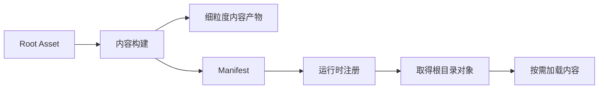

> 版本说明：本篇依据 Unity 6.6（6000.6）公开手册与 API，资料核查于 2026-10-22。代码按文档核对，尚未在 Unity Editor 中编译运行。

做一个角色预览界面，业务上只需要当前角色的模型、材质和贴图。但在资源系统里，你还要考虑：它们在哪些 Bundle 里，共享依赖会带进哪些容器，关闭界面后又能释放哪些内容。

这些问题会反过来影响构建布局。资源按类型集中，容易共享，也容易让生命周期互相牵连；按功能拆得很细，又会增加分包和依赖治理的工作。

Unity 6.6 引入的 Content Directories，值得从这个矛盾开始理解：**让内容的构建组织与运行时加载边界更容易分开。**

这组三篇依次回答：

1. 本篇：它是什么，以及怎样走通构建到释放的流程。
2. [与 AssetBundle 的对比]()：两者改变了哪些工程取舍。
3. [为什么可能更快]()：收益来自哪段链路，怎样验证。

## 1. 先拆开四个问题

设计资源系统时，至少有四件事需要分别回答：

| 问题 | 负责的边界 |
|---|---|
| 哪些内容进入这次构建 | 内容入口与引用可达性 |
| 构建产物怎样存放 | 文件、归档、压缩 |
| 何时加载与释放 | 运行时依赖与所有权 |
| 怎样到达玩家设备 | 安装包、下载、缓存、版本与回滚 |

这里最容易发生的混淆，是用一套目录或分组同时回答全部问题。例如，“把它们放在一起构建”，被默认理解成“它们应该一起常驻内存”。

Content Directories 提供了一种新的组织方式：用入口定义构建范围，用可按需加载的引用表达运行时需求，交付策略再由项目决定。

## 2. Content Directory 是构建输出，Root Asset 是内容入口

一个 Content Directory 包含内容构建的产物，以及加载它们所需的 manifest。项目通过 `ScriptableObject` 形式的 **Root Asset** 定义入口；构建过程从入口沿可追踪引用收集内容。

这里的 Directory 不是要求你在 `Assets` 下创建某种特殊文件夹，Root Asset 也不用对应旧项目的每个 Bundle。官方建议大多数项目先使用一个根入口，有独立可选内容时再考虑更多入口。[创建流程与 Root Asset 说明](https://docs.unity.com/en-us/engine/6000.6/manual/assets-and-media/assets-managing-runtime/content-directories/create)



这个模型里，根目录可以列出一百个角色，但打开目录并不要求加载一百个角色。能否做到这一点，取决于下面的引用方式。

## 3. Loadable 把构建包含与立即加载分开

假设内容入口这样定义，脚本放在 `GameContentRoot.cs`：

```csharp
using Unity.Loading;
using UnityEngine;

[CreateAssetMenu(menuName = "Content/Game Root")]
public sealed class GameContentRoot : ScriptableObject
{
    public Loadable<Texture2D> previewIcon;
    public Loadable<GameObject> characterPrefab;
    public LoadableSceneId gameplayScene;
}
```

字段表达了三类内容的入口，但它们还没有因此全部加载。

- 普通直接引用：加载持有者时，会把对应的直接依赖一起带入。
- `Loadable<T>`：构建时追踪目标，运行时由代码调用加载。
- `LoadableSceneId`：让场景进入内容构建，再通过 `SceneManager` 加载。

如果你只把资源路径放进字符串，构建器无法据此自动发现那个运行时目标，仍需保证它从根入口可达。[引用规则](https://docs.unity.com/en-us/engine/6000.6/manual/assets-and-media/assets-managing-runtime/content-directories/references)

因此，根入口适合保存轻量描述与按需引用。把大量大贴图、Prefab 都改成普通直接引用，会重新把“读取目录”变成一次大范围加载。

## 4. 最小构建流程

在 Project 窗口创建 `Game Root` 资产，保存为 `Assets/Content/GameContentRoot.asset`，为字段指定对应资产。

接着把构建脚本放进 `Assets/Editor/BuildGameContent.cs`：

```csharp
using System;
using UnityEditor;
using UnityEditor.Build.Reporting;

public static class BuildGameContent
{
    [MenuItem("Build/Game Content")]
    public static void Build()
    {
        var parameters = new BuildContentDirectoryParameters
        {
            outputPath = "Builds/GameContent",
            rootAssetPaths = new[]
            {
                "Assets/Content/GameContentRoot.asset"
            }
        };

        BuildReport report = BuildPipeline.BuildContentDirectory(parameters);
        if (report.summary.result != BuildResult.Succeeded)
            throw new InvalidOperationException("Content build failed.");
    }
}
```

调用前先在 Build Profiles 选择目标平台。`BuildContentDirectory` 使用当前激活的构建目标，输出目录名本身不会决定平台。[构建 API 契约](https://docs.unity3d.com/6000.6/Documentation/ScriptReference/BuildPipeline.BuildContentDirectory.html)

这里特意把输出放在 `Assets` 外。这样可以避免 Unity 再导入大量构建产物。部署 Player 时，需要另行把完整内容输出复制到目标位置，不能只完成内容构建，就认为 Player 已经带上它。[构建输出的部署说明](https://docs.unity.com/en-us/engine/6000.6/manual/assets-and-media/assets-managing-runtime/content-directories/load)

**构建 Player 还要接上代码裁剪信息。** 独立内容中使用、启动场景却没有使用的脚本类型或引擎模块，可能被 Player 构建裁掉。应先构建内容，再按当前版本的构建接口把内容的构建报告目录传入 Player 构建流程；仅复制内容文件不能解决类型被裁剪的问题。具体接口以所用 6000.6 补丁的文档为准。[内容与代码裁剪](https://docs.unity.com/en-us/engine/6000.6/manual/programming-environment/script-compilation/managed-code-stripping/content)

**构建 Player 还要接上代码裁剪信息。** 独立内容中使用、启动场景却没有使用的脚本类型或引擎模块，可能被 Player 构建裁掉。应先构建内容，再按当前版本的构建接口把内容的构建报告目录传入 Player 构建流程；仅复制内容文件不能解决类型被裁剪的问题。具体接口以所用 6000.6 补丁的文档为准。[内容与代码裁剪](https://docs.unity.com/en-us/engine/6000.6/manual/programming-environment/script-compilation/managed-code-stripping/content)

## 5. 运行时：注册、取得根、加载、释放

下面是一个只读取贴图名称的同步探针，放在 `ContentProbe.cs`。在 Play Mode 或 Player 中，向 `Inspect` 传入已部署内容目录的本地路径：

```csharp
using Unity.Loading;
using UnityEngine;

public static class ContentProbe
{
    public static void Inspect(string localDirectoryPath)
    {
        var directory = ContentLoadManager.RegisterContentDirectory(
            localDirectoryPath);
        try
        {
            foreach (var root in
                     ContentLoadManager.GetRootAssets<GameContentRoot>(directory))
            {
                var icon = new Loadable<Texture2D>(
                    root.previewIcon.LoadableObjectId);
                try
                {
                    icon.Load();
                    if (icon.Status != LoadableStatus.Loaded)
                        throw new System.InvalidOperationException(
                            "Preview icon failed to load.");

                    Debug.Log(icon.Target.name);
                }
                finally
                {
                    icon.Release();
                }
            }
        }
        finally
        {
            ContentLoadManager.UnregisterContentDirectory(directory);
        }
    }
}
```

这个探针只在方法内部使用对象，所以能在 `finally` 中释放。真实 UI 如果仍在显示贴图，就需要把加载引用保留到 UI 使用结束；不能照搬这段短作用域。

同步的 `Load()` 会等待完成。需要异步时可使用 `await icon.LoadAsync()`，完成后检查状态，再读取 `Target`。[Loadable API](https://docs.unity3d.com/6000.6/Documentation/ScriptReference/Unity.Loading.Loadable_1.html)

生产项目通常把注册放进启动流程，保持目录可用，再按界面、场景或角色生命周期持有加载引用。场景卸载和资源释放都完成之后，才注销目录；注销不能代替这些清理工作。[注销 API 的前置条件](https://docs.unity3d.com/6000.6/Documentation/ScriptReference/Unity.Loading.ContentLoadManager.UnregisterContentDirectory.html)

平台路径也要单独处理。尤其 Web 的预加载与虚拟文件系统有专门部署流程，不能把桌面文件夹示例直接当成所有平台的接入方案。

## 6. 最容易写错的是引用所有权

例子里没有直接把 `root.previewIcon` 分给所有使用者，而是通过它的 ID 创建了自己的 `Loadable<Texture2D>`。

原因是：**每个 Loadable 实例最多持有一份加载引用。** 同一个实例重复调用 `Load`，不会为不同调用者各增加一份所有权。两处 UI 共用同一个实例时，一处调用 `Release`，就可能结束两处共同依赖的那份引用。

更稳的约定是：独立使用者各自持有实例，各自释放；共享管理器统一持有时，则由管理器统一结束生命周期。

另一个细节是 `Release` 不会递归释放目标对象内部已经加载的其他 Loadable。加载了哪些实例，就需要明确清理哪些实例。[Release 的引用计数与非递归契约](https://docs.unity3d.com/6000.6/Documentation/ScriptReference/Unity.Loading.Loadable_1.Release.html)

## 7. 编辑器能显示，还需要验证构建内容

在 Play Mode 中，从 AssetDatabase 取得的项目资产，其 Loadable 可以解析到项目中的最新内容。这条路径的释放行为也不同于构建内容。

因此，只验证“在编辑器里能显示角色”，还没有验证内容构建是否完整。应从已注册的构建目录取得根资产，再测试对应加载路径，并最终在目标 Player 上复核。

还要留意：按当前 6000.6 API 说明，Loadable 字段的内容构建支持来自 `BuildContentDirectory`；直接把带这类字段的对象放进普通 Player 或 AssetBundle 构建，不能假定引用同样有效。[Play Mode 与构建支持范围](https://docs.unity3d.com/6000.6/Documentation/ScriptReference/Unity.Loading.Loadable_1.html)

## 8. 把它放回完整工程

Unity 6.6 提供的是本地内容构建与加载基础。远程下载、版本切换、失败恢复和回滚仍需另行设计，或继续使用现有 AssetBundle 分发方案；Addressables 可以使用 Content Directories，业务管理层也不必因底层变化而被整体替换。[Unity 6.6 功能边界](https://docs.unity.com/en-us/engine/6000.6/manual/assets-and-media/assets-managing-runtime/content-directories/introduction)

第一次接入时，建议先做一份小内容：一个根、两个共享贴图的 Prefab、一张可按需加载的图标。依次走通构建、部署、注册、加载、释放和退出，再扩大内容范围。

<!-- DATA-TODO: 在固定的 Unity 6000.6 补丁版本和目标平台运行上述探针，补充构建报告、Player 日志与加载前后内存截图；当前仅完成公开 API 核查。 -->

接下来读[与 AssetBundle 的对比]()，重点看容器、依赖和生命周期究竟在哪里分开了。

**Content Directories 的关键，是用根入口定义构建范围，再用明确的加载所有权控制内容何时驻留。**
