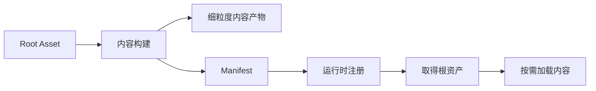

> 版本说明：本篇依据 Unity 6.6（6000.6）公开手册与 API，资料复核于 2026-10-23。最小接入限定 Windows x64；示例已做 API 静态核对，尚未在 Unity 6.6 Editor 中编译运行。

做一个角色预览界面，业务上只需要当前角色的模型、材质和贴图。但在资源系统里，你还要考虑：它们在哪些 Bundle 里，共享依赖会带进哪些容器，关闭界面后又能释放哪些内容。

这些问题会反过来影响构建布局。资源按类型集中，容易共享，也容易让生命周期互相牵连；按功能拆得很细，又会增加分包和依赖治理的工作。

Unity 6.6 引入的 Content Directories，值得从这个矛盾开始理解：**让内容的构建组织与运行时加载边界更容易分开。**

这组三篇依次回答：

1. 本篇：它是什么，以及怎样走通构建到释放的流程。
2. [与 AssetBundle 的对比]()：两者改变了哪些工程取舍。
3. [为什么可能更快]()：收益来自哪段链路，怎样验证。

## 1. 先拆开四个问题

设计资源系统时，至少有四件事需要分别回答：

| 问题 | 负责的边界 |
|---|---|
| 哪些内容进入这次构建 | 内容入口与引用可达性 |
| 构建产物怎样存放 | 文件、归档、压缩 |
| 何时加载与释放 | 运行时依赖与所有权 |
| 怎样到达玩家设备 | 安装包、下载、缓存、版本与回滚 |

这里最容易发生的混淆，是用一套目录或分组同时回答全部问题。例如，“把它们放在一起构建”，被默认理解成“它们应该一起常驻内存”。

Content Directories 提供了一种新的组织方式：用入口定义构建范围，用可按需加载的引用表达运行时需求，交付策略再由项目决定。

## 2. Content Directory 是构建输出，Root Asset 是内容入口

一个 Content Directory 包含内容构建的产物，以及加载它们所需的 manifest。项目通过 `ScriptableObject` 形式的 **Root Asset** 定义入口；构建过程从入口沿可追踪引用收集内容。

这里的 Directory 指**内容构建的输出目录**；Root Asset 指项目中的 **ScriptableObject 根资产**。两者分别回答“产物在哪里”和“从哪里收集内容”。根资产不用对应旧项目的每个 Bundle；官方建议大多数项目先使用一个根入口，有独立可选内容时再扩展。[创建流程与 Root Asset 说明](https://docs.unity3d.com/6000.6/Documentation/Manual/content-directories-create.html)

一次未归档构建的产物可以概括为：

```text
GameContent/                       内容输出目录
├─ BuildManifestHash.txt            指向本次 manifest 的哈希
├─ <hash>.json                     manifest：内容、依赖与加载入口
├─ <hash>.cf                       Content File：序列化 Unity 对象
├─ <hash>.resS                     纹理、网格等流式数据
└─ <hash>.resource                 音频、视频等数据
```

这些是面向目标平台构建的内容，不是把 PNG、FBX 原样复制过去。源资产经过导入、对象收集和序列化后形成产物，**一个源资产不保证严格对应一个文件**。例如，模型中的对象层级与网格数据可以落在不同产物中。

设置 `BuildContentOptions.UseArchive`，或把 `BuildContentDirectoryParameters.compression` 设为压缩模式，会把内容文件、资源数据和 manifest 装入 `content0.archive`，旁边只保留 `BuildManifestHash.txt`。归档改变物理存储组织，内层仍有自己的内容与依赖边界；运行时仍注册 `GameContent` 目录，无需把代码改成注册单个 `.cf` 或归档文件。以上是 6.6 手册描述的产物形态，不应作为手写内部 manifest 解析器的稳定格式协议。[构建产物与可选归档](https://docs.unity.com/en-us/engine/6000.6/manual/assets-and-media/assets-managing-runtime/content-directories/create)



注册目录会读取 manifest、建立运行时索引，并加载根资产及其直接依赖。因此注册有成本；只有根资产通过按需引用列出的重内容，才会留到后续请求时加载。

## 3. Loadable 把构建包含与立即加载分开

假设内容入口这样定义，脚本放在 `GameContentRoot.cs`：

```csharp
using Unity.Loading;
using UnityEngine;

[CreateAssetMenu(menuName = "Content/Game Root")]
public sealed class GameContentRoot : ScriptableObject
{
    public Loadable<Texture2D> previewIcon;
}
```

例子先只放一张预览图。扩展到角色和场景时，可以分别增加 `Loadable<GameObject>` 与 `LoadableSceneId` 字段。三种引用要从构建与运行时两侧理解：

- 普通直接引用：构建时跟随引用收集内容；加载持有者时，也需要加载目标及其直接依赖。
- `Loadable<T>`：构建时同样追踪目标；运行时把目标的加载时机留给代码，已加载引用由所有者释放。
- `LoadableSceneId`：把场景纳入内容构建，运行时再通过 `SceneManager` 管理场景加载和卸载。

如果你只把资源路径放进字符串，构建器无法据此自动发现那个运行时目标，仍需保证它从根入口可达。[引用规则](https://docs.unity.com/en-us/engine/6000.6/manual/assets-and-media/assets-managing-runtime/content-directories/references)

因此，根入口适合保存轻量描述与按需引用。把大量大贴图、Prefab 都改成普通直接引用，会重新把“读取目录”变成一次大范围加载。

## 4. Windows 最小接入：先准备资产与启动场景

以下流程针对 Unity 6.6 的 **Windows x64 Player**，工程需安装对应构建模块：

1. 导入一张 PNG，命名为 `PreviewIcon`。
2. 保存前面的 `GameContentRoot.cs`，创建 `Content > Game Root` 资产，保存为 `Assets/Content/GameContentRoot.asset`，把贴图拖入 `previewIcon`。
3. 创建场景 `Assets/Scenes/Bootstrap.unity`，添加一个空 GameObject，挂上下一节的 `ContentProbe`。场景中不要直接挂载根资产或贴图。
4. 在 Build Profiles 激活 Windows 的 x64 目标；等平台切换完成后，再执行下面的构建菜单。

### 内容输出与构建报告分别交给谁

这里有三条路径，不能相互替代：

| 对象 | 本例位置或取得方式 | 用途 |
|---|---|---|
| 内容输出目录 | `Builds/ContentDirectories/GameContent` | 部署到 Player，供运行时注册 |
| 内容构建报告目录 | 用本次报告的 `buildSessionGuid` 查询 `BuildHistory` | 交给 Player 构建，保留内容使用的类型与模块 |
| `ScriptsOnlyCache.yaml` | 位于该构建报告目录内 | 类型使用记录，不作为运行时内容分发 |

把内容放在 `Assets` 外，避免重新导入产物。构建 Player 时，一路把内容加入 StreamingAssets，另一路把报告目录传给裁剪流程。[部署手册](https://docs.unity3d.com/6000.6/Documentation/Manual/content-directories-load.html)、[代码裁剪手册](https://docs.unity3d.com/6000.6/Documentation/Manual/managed-code-stripping-content.html)

将下面的完整构建脚本保存为 `Assets/Editor/BuildGameContent.cs`：

```csharp
using System;
using System.IO;
using UnityEditor;
using UnityEditor.Build;
using UnityEditor.Build.Reporting;

public static class BuildGameContent
{
    internal const string ContentParent = "Builds/ContentDirectories";
    internal static bool BuildingDemo;

    [MenuItem("Build/Content Demo/Windows x64")]
    public static void BuildWindows()
    {
        if (EditorUserBuildSettings.activeBuildTarget !=
            BuildTarget.StandaloneWindows64)
            throw new InvalidOperationException("Activate Windows x64 first.");

        const string root = "Assets/Content/GameContentRoot.asset";
        const string scene = "Assets/Scenes/Bootstrap.unity";
        if (!File.Exists(root) || !File.Exists(scene))
            throw new FileNotFoundException("Create the root asset and scene first.");

        var contentReport = BuildPipeline.BuildContentDirectory(
            new BuildContentDirectoryParameters
            {
                outputPath = ContentParent + "/GameContent",
                rootAssetPaths = new[] { root }
            });
        RequireSuccess(contentReport);

        if (!BuildHistory.TryGetBuildReportDirectory(
                contentReport.summary.buildSessionGuid, out string reportDirectory))
            throw new InvalidOperationException("Content build report not found.");

        Directory.CreateDirectory("Builds/Win64");
        BuildingDemo = true;
        try
        {
            var playerReport = BuildPipeline.BuildPlayer(new BuildPlayerOptions
            {
                scenes = new[] { scene },
                locationPathName = "Builds/Win64/ContentDemo.exe",
                target = BuildTarget.StandaloneWindows64,
                options = BuildOptions.Development,
                previousBuildReportDirectories = new[] { reportDirectory }
            });
            RequireSuccess(playerReport);
        }
        finally
        {
            BuildingDemo = false;
        }
    }

    static void RequireSuccess(BuildReport report)
    {
        if (report == null || report.summary.result != BuildResult.Succeeded)
            throw new InvalidOperationException("Build failed; inspect Editor.log.");
    }
}

public sealed class ContentDemoDeployment : BuildPlayerProcessor
{
    public override int callbackOrder => 0;

    public override void PrepareForBuild(BuildPlayerContext context)
    {
        if (BuildGameContent.BuildingDemo)
            context.AddAdditionalPathToStreamingAssets(
                Path.GetFullPath(BuildGameContent.ContentParent));
    }
}
```

`BuildContentDirectory` 使用当前激活平台；脚本先检查目标，避免把其他平台的内容带入 Windows Player。回调把 `ContentDirectories` 下的子目录一起带到 StreamingAssets，保留 `GameContent` 这一层。[构建 API](https://docs.unity3d.com/6000.6/Documentation/ScriptReference/BuildPipeline.BuildContentDirectory.html)、[官方完整构建示例](https://docs.unity3d.com/6000.6/Documentation/Manual/build-script-build.html)

代码裁剪明确使用 `BuildPlayerOptions.previousBuildReportDirectories`，传入**内容构建报告目录**。采用 `BuildPlayerProcessor` 统一构建入口的项目，也可在回调中调用 `AddPreviousBuildReportDirectory`；本例只用前一种接法。[报告目录 API](https://docs.unity3d.com/6000.6/Documentation/ScriptReference/BuildPlayerOptions-previousBuildReportDirectories.html)

## 5. 从 Start 调用：注册、取得根、加载、释放

将以下脚本保存为 `Assets/ContentProbe.cs`，挂到 Bootstrap 场景中。它只读取贴图名称，使用结束便清理：

```csharp
using System;
using System.IO;
using Unity.Loading;
using UnityEngine;

public sealed class ContentProbe : MonoBehaviour
{
    void Start()
    {
#if UNITY_EDITOR
        string localPath = Path.GetFullPath(
            "Builds/ContentDirectories/GameContent");
#else
        string localPath = Path.Combine(
            Application.streamingAssetsPath, "GameContent");
#endif
        if (!Directory.Exists(localPath))
            throw new DirectoryNotFoundException(localPath);

        var directory = ContentLoadManager.RegisterContentDirectory(localPath);
        try
        {
            var roots = ContentLoadManager.GetRootAssets<GameContentRoot>(directory);
            if (roots.Length != 1)
                throw new InvalidOperationException(
                    $"Expected one GameContentRoot, found {roots.Length}.");
            if (roots[0].previewIcon == null)
                throw new InvalidOperationException("previewIcon is not assigned.");

            var iconId = roots[0].previewIcon.LoadableObjectId;
            var icon = new Loadable<Texture2D>(ref iconId);
            try
            {
                icon.Load();
                if (icon.Status != LoadableStatus.Loaded || icon.Target == null)
                    throw new InvalidOperationException("Preview icon load failed.");

                Debug.Log($"CONTENT_PROBE_OK: {icon.Target.name}");
            }
            finally
            {
                icon.Release();
            }
        }
        finally
        {
            ContentLoadManager.UnregisterContentDirectory(directory);
        }
    }
}
```

构造函数专页当前列出的签名是 `Loadable<T>(ref LoadableObjectId id)`。这里先复制 ID 到局部变量，再以 `ref` 传入，得到探针独立持有的加载实例。部分官方示例省略了 `ref`，与签名专页存在差异；本例暂按签名页编写，尚未用目标 Editor 的程序集编译确认。[构造函数签名](https://docs.unity3d.com/6000.6/Documentation/ScriptReference/Unity.Loading.Loadable_1-ctor.html)

`GetRootAssets<T>(handle)` 只查询指定目录，空参数重载则查询所有已注册目录。`Load()` 同步等待；`LoadAsync()` 返回 `Awaitable<T>`，可以 `await`，完成后检查 `Status == LoadableStatus.Loaded` 与 `Target`。[根资产查询](https://docs.unity3d.com/6000.6/Documentation/ScriptReference/Unity.Loading.ContentLoadManager.GetRootAssets.html)、[异步加载签名](https://docs.unity3d.com/6000.6/Documentation/ScriptReference/Unity.Loading.Loadable_1.LoadAsync.html)

### 执行与成功标志

执行 `Build > Content Demo > Windows x64`。输出结构应包含：

```text
Builds/Win64/
├─ ContentDemo.exe
└─ ContentDemo_Data/StreamingAssets/GameContent/
   └─ 完整的内容构建输出
```

从 PowerShell 启动 Player，并指定日志文件：

```powershell
.\Builds\Win64\ContentDemo.exe -logFile .\Builds\Win64\ContentDemo.log
```

日志出现 `CONTENT_PROBE_OK: PreviewIcon`，表示探针取得了根资产并成功加载目标贴图；根资产数量不符、路径缺失或加载失败会抛出异常，不会静默当作成功。执行到 `finally` 时先释放贴图加载引用，再注销目录。

这段代码的使用期只有一次名称读取。真实 UI 显示贴图时，要把加载引用保留到 UI 退出；已加载的场景也应先经 `SceneManager` 卸载，再注销目录。[注销前置条件](https://docs.unity3d.com/6000.6/Documentation/ScriptReference/Unity.Loading.ContentLoadManager.UnregisterContentDirectory.html)

## 6. 最容易写错的是引用所有权

例子里没有直接把 `root.previewIcon` 分给所有使用者，而是通过它的 ID 创建了自己的 `Loadable<Texture2D>`。

原因是：**每个 Loadable 实例最多持有一份加载引用。** 同一个实例重复调用 `Load`，不会为不同调用者各增加一份所有权。两处 UI 共用同一个实例时，一处调用 `Release`，就可能结束两处共同依赖的那份引用。

更稳的约定是：独立使用者各自持有实例，各自释放；共享管理器统一持有时，则由管理器统一结束生命周期。

另一个细节是 `Release` 不会递归释放目标对象内部已经加载的其他 Loadable。加载了哪些实例，就需要明确清理哪些实例。[Release 的引用计数与非递归契约](https://docs.unity3d.com/6000.6/Documentation/ScriptReference/Unity.Loading.Loadable_1.Release.html)

## 7. 编辑器能显示，还需要验证构建内容

在 Play Mode 中，从 AssetDatabase 取得的项目资产，其 Loadable 始终解析到项目中的最新内容，即使已经注册了包含该资产旧版本的内容目录。这条路径不使用构建内容的引用计数，`Release` 不会卸载目标。相反，从已注册构建内容取得的根资产，其 Loadable 解析到构建版本。

因此，只验证“在编辑器里能显示角色”，还没有验证内容构建是否完整。应从已注册的构建目录取得根资产，再测试对应加载路径，并最终在目标 Player 上复核。

当前 6000.6 API 对普通 Player／AssetBundle 构建的后果也有明确说明：如果它们的序列化数据里包含 Loadable 字段，输出中的底层引用会被设为 null，并记录错误。`BuildOptions.SuppressLoadableErrors` 和 `BuildAssetBundleOptions.SuppressLoadableErrors` 只抑制对应错误，不会让这种引用获得支持。

所以本例的 Bootstrap 只挂不含 Loadable 字段的探针；含 Loadable 字段的根资产通过 `BuildContentDirectory` 构建，再从已注册内容中取得。**把运行时代码编进 Player，与把含 Loadable 字段的资产直接序列化进 Player，是两件事。**[Play Mode 与构建支持范围](https://docs.unity3d.com/6000.6/Documentation/ScriptReference/Unity.Loading.Loadable_1.html)

## 8. 把它放回完整工程

Unity 6.6 提供的是本地内容构建与加载基础。远程下载、版本切换、失败恢复和回滚仍需另行设计，或继续使用现有 AssetBundle 分发方案；Addressables 可以使用 Content Directories，业务管理层也不必因底层变化而被整体替换。[Unity 6.6 功能边界](https://docs.unity.com/en-us/engine/6000.6/manual/assets-and-media/assets-managing-runtime/content-directories/introduction)

本例只读取名称，展示的是接入链路。接到真实角色或场景后，再让业务所有者决定加载引用的持有期。Android、Web 等平台的内容部署与路径访问应按各自平台流程接入，不照搬 Windows 文件路径。

<!-- DATA-TODO: 在固定的 Unity 6000.6 补丁版本和目标平台运行上述探针，补充构建报告、Player 日志与加载前后内存截图；当前仅完成公开 API 核查。 -->

接下来读[与 AssetBundle 的对比]()，重点看容器、依赖和生命周期究竟在哪里分开了。

**Content Directories 的关键，是用根入口定义构建范围，再用明确的加载所有权控制内容何时驻留。**
