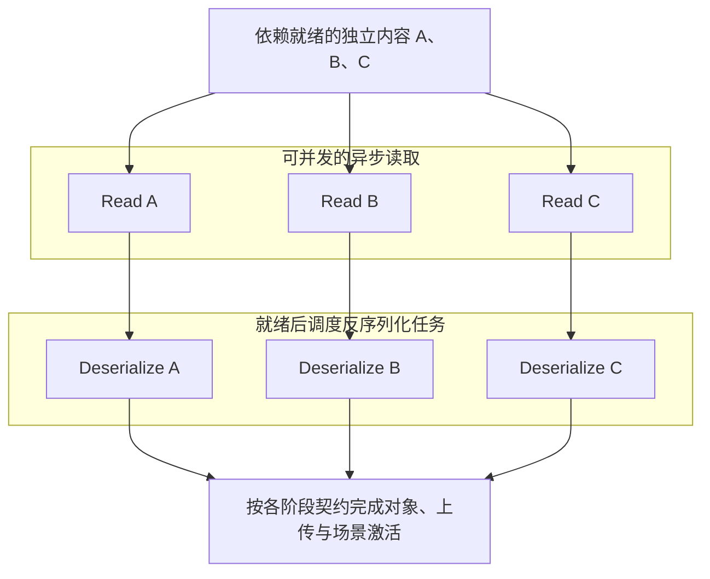

> 版本说明：依据 Unity 6.6（6000.6）公开资料，核查于 2026-10-22。架构主线来自 Unity 官方博客；Slime Rancher 2 数字是官方案例，本仓未复测。

改一张角色贴图之后，等待内容构建的时间缩短；进入场景时，内容准备更快；离开活动页后，不再使用的海报可以独立释放。这些收益发生在不同阶段，不能用一句“文件更小，所以更快”解释。

[上一篇]()已经区分引擎内容后端与上层框架。本篇沿 Unity 官方文章的 **Build、Addressing、Load** 展开：构建怎样复用和并行，内容身份怎样降低变化传播，加载怎样减少工作并提高流水线利用率。[官方架构介绍](https://unity.com/blog/content-directories-beyond-the-assetbundle)

## 1. Build：需要重做的工作更少，必须执行的工作并行度更高

### 逐资产构建，让缓存有更细的复用边界

假设角色内容包括网格、材质、贴图和动画，这次只修改衣服贴图的像素。

在 AB 管线里，已有缓存可以复用未失效任务，但受影响的 Bundle 仍要按它的布局处理和重新输出。若贴图与大量其他内容同包，这次变化的打包边界就比贴图本身更大。

CD 把内容构建放进资产导入框架，逐资产生成产物。项目中已存在的网格、动画等未变化产物可以从 Asset Database 缓存复用，构建集中处理失效资产及其真实构建依赖。

**第一条收益是减少本次必须完成的工作量。** AB 和 Scriptable Build Pipeline 同样具备缓存能力；这里比较的是失效与复用边界，不是“有缓存”与“没缓存”。[6.6 增量构建说明](https://docs.unity3d.com/6000.6/Documentation/Manual/content-directories-introduction.html)

### 多进程与 Accelerator，进一步缩短剩余工作的等待

如果同时修改十份互不依赖的角色内容，只缩小失效范围还不够：这些任务仍要执行。

官方说明，新管线复用标准资产导入框架，每份资产由进程外的 importer 独立构建，具备确定性、Asset Database 缓存和原生 Accelerator 支持。独立任务可以利用多个工作进程，已缓存的结果还可以通过 Accelerator 在机器之间共享。[官方 Build 设计](https://unity.com/blog/content-directories-beyond-the-assetbundle)

对团队构建机而言，这带来第二条收益：剩余任务能够并行处理；存在可复用共享结果时，也可直接取得结果。它与上一条“只需重做更少任务”可以叠加，但不是同一件事。机器 CPU、存储吞吐、任务依赖和共享缓存命中率，决定并行与复用能兑现多少。

这也解释了增量与干净构建为何可能表现不同：增量构建通常能复用较多结果；干净构建若缺少可用缓存，就需要承担更多真实构建工作。

## 2. Addressing：内容哈希负责识别产物，稳定 ID 隔开变化传播

细粒度产物还需要回答：如何识别“相同的内容”，又怎样避免一个内容变化让整条引用链都改名？

CD 用产物内容的哈希标识文件。相同构建产物可合并复用，变化后的产物则拥有不同的内容身份。问题在于，如果每个引用者都把被引用文件的当前哈希嵌进自身数据，目标一变，引用者的数据也跟着变。

下面用材质 M 引用贴图 T 说明稳定 ID 的作用。**这是逻辑关系示意，不是 manifest 的真实字段格式：**

```text
修改前：
材质 M ──引用稳定 ID tex-T──> manifest: tex-T → 内容哈希 H1

只改变贴图内容后：
材质 M ──仍引用 tex-T──────> manifest: tex-T → 内容哈希 H2
```

假设材质参数、Shader 和其他构建输入不变，贴图内容变化只要求映射指向新的贴图产物；引用者不必仅仅为了嵌入 H2 而改写自身。CD 的 Content File 之间使用稳定 ID，再由 manifest 解析到内容哈希，就是为了削弱这种由地址变化造成的级联。[官方 Addressing 设计](https://unity.com/blog/content-directories-beyond-the-assetbundle)

这里讨论的是 CD 对内容寻址问题的解决方式，不是在描述所有 AB 的二进制引用。AB 的命名、哈希策略与内部引用本来就存在不同层次；真实依赖、Shader 或导入设置发生变化时，两种管线都可能需要扩大重建范围。

### 三种“变化”要分别看

沿着同一个贴图修改案例，可以出现三种不同结果：

- **构建任务重新执行**：缓存失效或缺少缓存，需要重新计算。
- **输出文件变化**：计算结果与旧产物字节不同，才有新的内容身份。任务重跑也可能输出相同结果。
- **客户端重新下载**：由分发单位、客户端已有内容和版本策略决定。某个文件改变，不等于 6.6 已内置对应的细粒度远程补丁流程。

稳定 ID 主要减少引用者因地址变化而发生的输出变化；它也为后续差量交付提供基础，但并不独自实现远程下载。

## 3. Load：同样内容处理得更快，与少准备了内容，是两条收益

### 同样的内容：读取与反序列化进入任务化流水线

官方加载示意对比了单个 SerializedFile 内顺序推进的处理，与 Content File 的 jobified 流水线。新系统的异步不止发生在发起加载请求这一层，还覆盖读取和反序列化，因而可以更充分利用平台异步读取能力。

取三个独立的网格、材质或纹理内容文件 A、B、C。A 的读取完成后，可以开始处理 A 的反序列化；B、C 的读取或其他就绪任务可以继续推进。等待一次 I/O 完成的时间，不必总是变成整个内容流水线的空闲时间。

下面依据官方设计绘制**概念示意**：箭头只表示先后依赖，没有时间刻度，也不是本仓 Profiler 时间线。



这种安排优化的是任务调度、阶段重叠与硬件利用率。三个文件仍要读取和恢复对象；收益来自缩短关键路径，而不是跳过必要工作。[官方 Load 流水线说明与原图](https://unity.com/blog/content-directories-beyond-the-assetbundle)

AB 已有异步 API，并非所有 AB 加载都只能全程串行。这里的变化是底层内容结构与流水线提供了更好的调度基础。业务脚本、Instantiate、Awake、GPU 上传和驱动工作仍分别遵守自己的线程与完成契约；“读取和反序列化异步”不等于这些步骤全部能在任意线程并行。

### 更少的内容：依赖粒度缩小准备范围

另一个案例中，角色 A 和活动物件 B 被放在同一个 Bundle；它们分别依赖纹理包 X、Y。框架若按该 Bundle 的汇总依赖调度，即使这次只请求 A，也会准备汇总依赖中的容器。

这不表示 Y 中所有对象都会被实例化。Bundle 依赖、容器加载和具体对象恢复要分开看；AB 内部也有对象加载所需的引用信息。[AB 的依赖追踪层次](https://docs.unity3d.com/6000.6/Documentation/Manual/AssetBundles-Dependencies.html)

CD 的依赖追踪更细，A 的加载不必仅因与 B 同处一个旧容器而准备 B 的无关依赖。**这一条收益来自少准备内容；上一条来自把同样内容处理得更有效率。** 总加载耗时下降本身，不能区分两者分别贡献多少。

## 4. 内存：加载边界细化，使无用内容更容易结束驻留

沿用第二篇的案例：大厅图标常驻，活动海报已退出。两者互不依赖，却曾被同一个 AB 容器的释放策略绑在一起。

CD 将它们组织为独立内容产物后，海报的最后一份加载引用结束，就可以独立结束它的加载生命周期；无需为了释放海报而让仍在使用的大厅图标一同退出。因而，细粒度的加载与卸载可以降低不必要驻留，减少后续工作面对的内存压力。[Loadable 的释放契约](https://docs.unity3d.com/6000.6/Documentation/ScriptReference/Unity.Loading.Loadable_1.Release.html)

这是驻留范围的改善，不是说一次 Release 调用本身耗时更短。共享依赖仍被持有时要保留，直接依赖仍需满足，循环引用也可能重新把内容连成加载单元。Unity 对象销毁后，分配器、驱动和操作系统的内存统计也未必立即同步下降。

这里不再展开框架释放策略，具体基线与 Unload(false) 的边界见[第二篇的同包案例]()。涉及内部布局时，采用的是 [UnityDataTools 固定提交](https://github.com/Unity-Technologies/UnityDataTools/blob/db19dffbf40008e3a61e7566a5ddd6888eb68717/Documentation/contentdirectory-format.md)中明确标为 6.6 的说明，不套用其 6.7 示例结构。

## 5. 官方案例：Slime Rancher 2

Unity 官方对已有 Addressables 项目 Slime Rancher 2 更换后端的结果如下：

| 指标 | Addressables / AssetBundle | Addressables / Content Directories |
|---|---:|---:|
| 增量构建 | 32 分 16 秒 | 3 分 4 秒 |
| 干净构建 | 58 分 6 秒 | 37 分 13 秒 |
| Player 构建大小 | 4 GB | 2.88 GB |
| 启动到菜单再到游戏 | 45 秒 | 30 秒 |

测试环境为 **Unity 6.6 Beta 6000.6.0b10、MacBook Pro M5 Max**。这是官方案例数据，本仓未复测。[官方结果及环境](https://unity.com/blog/content-directories-beyond-the-assetbundle)

这些数据与前面的机制相吻合：增量、干净构建和运行时加载都可能受益，但变化幅度不同。官方没有在这里给出逐项归因实验，因此不能把总共节省的时间精确分配给多进程、缓存或依赖粒度中的某一项。

## 6. 适用条件与验证，集中看关键路径

收益是否显著，取决于旧布局中有多少额外牵连、缓存是否可复用，以及加载关键路径是否落在内容系统。直接引用很重的根资产、长时间持有的业务缓存，或以业务初始化为主的等待，都可能缩小收益。散文件与归档、压缩策略也会改变目标设备的 I/O 成本；官方手册还明确保留了干净构建可能慢于 AB 的情况。

实际对照时，保留合理的 AB 基线布局，固定内容提交、Unity 补丁、框架版本、目标设备、Player 设置和压缩策略，再按三个问题采集：

| 问题 | 条件与采集重点 |
|---|---|
| 单资产修改少重做了什么 | 分开干净、无修改和单资产增量构建；记录 Asset Database／构建产物缓存、Accelerator 命中与 Shader 缓存状态，比较任务、产物与总时间 |
| 同样内容是否处理得更快 | 对齐内容与依赖集合，记录 OS 文件缓存和框架已加载状态；在 Player 采集读取、反序列化、激活的时间线 |
| 是否减少无用驻留 | 两份内容都曾加载，再退出其中一份；记录句柄、底层内容和 Unity 对象状态，并分别看分配、保留与图形内存 |

重复运行并保留原始值。冷启动不自动等于冷 OS 缓存；编辑器 AssetDatabase 加载也不代替构建内容的 Player 路径。记录采集时实际满足的条件，便于解释结果。

<!-- DATA-TODO: 在 Unity 6000.6 的固定补丁与目标设备上补充两后端原始结果、缓存状态、构建报告及 Player 时间线；本篇现阶段只有官方案例与静态机制核查。 -->

## 7. 后续远程交付规划属于另一阶段

官方博客在远程部分描述了利用内容哈希识别设备缺少的产物、按细粒度获取差异的方向，并表示将在 2027 年分享更多信息。这是后续规划；Unity 6.6 已有能力仍是本地内容构建与加载。现在自行从 CDN 下载完整内容后再注册，与引擎内置细粒度远程交付工作流，是不同的工程完成度。[官方远程交付规划](https://unity.com/blog/content-directories-beyond-the-assetbundle)

这也把三篇串成了一条链：[第一篇]()说明内容怎样构建与接入，[第二篇]()说明底层边界改变了什么，本篇解释这些边界变化怎样影响实际工作量与关键路径。

**Content Directories 的性能价值来自更细的复用和驻留边界，以及更充分的构建、读取与反序列化流水线。**
