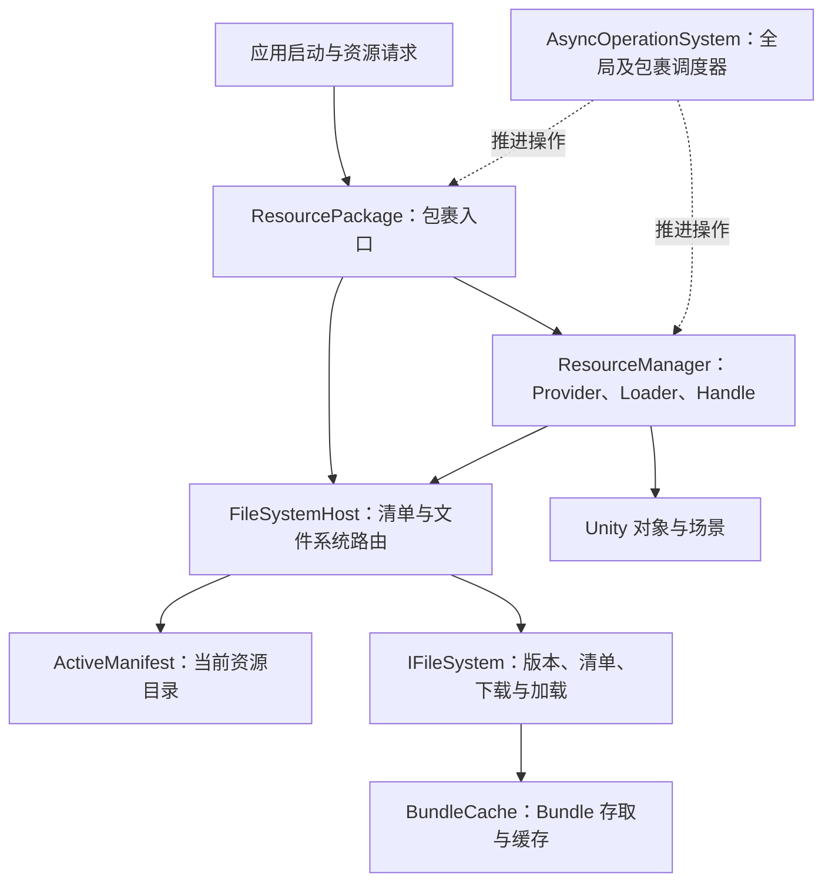
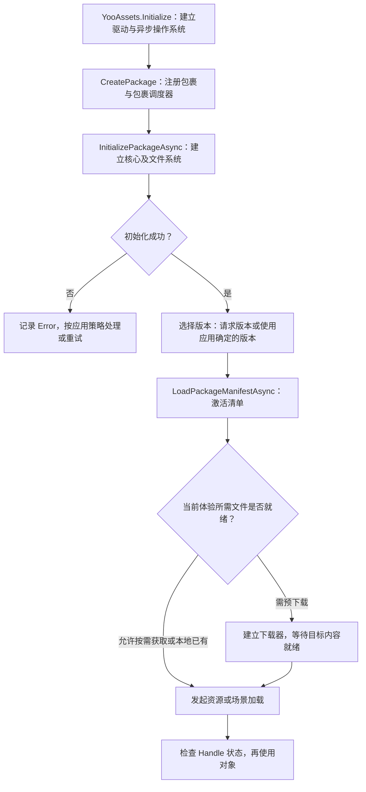

> 专题首页：[YooAsset 资源管理与交付]() · [两个系统的对比与选型]()

资源启动流程里，一个常见问题是：日志已经打印了“初始化成功”，紧接着加载资源仍然报错。另一种情况是，资源版本和清单都已拿到，进入场景却还在等待下载。

这几条日志描述的是不同层的完成状态。要判断应用能否进入下一阶段，需要分别回答：运行环境是否建立、资源目录是否激活、当前需要的文件是否就绪，以及对象是否已经加载完成。

本篇先把这几个条件放到一张结构图中，再沿初始化源码说明它们在哪一步成立。

> 版本基线：YooAsset **3.0.6**，提交 `3b4cfb36cc2e81b9558ab74d65fee2cf2eac2804`。文中的代码使用 3.x 原生 API；旧接口的兼容层另有条件编译开关，不作为本文的调用基线。

## 一、先区分目录、文件与对象

资源系统至少需要管理三种不同的东西。

**目录**描述资源有哪些、地址怎样定位、资源属于哪个 Bundle，以及依赖谁。**文件**是构建出的 Bundle 和本地或远端的存储内容。**对象**是已经从 Bundle 中取出的 Prefab、纹理或其他 Unity 对象。

目录可用，不代表所有文件都在设备上；文件已经缓存，不代表对象已经进入内存；一个对象已经取出，也不代表应用已经管理好它的使用期限。

YooAsset 的模块围绕这些条件协作：



这张图是职责图。具体资源加载中的子操作关系，继续看[运行时加载链路]()。

## 二、Package 是运行上下文，不是一个 Bundle 文件

一个 `ResourcePackage` 可以管理许多 Bundle。Package 提供初始化、清单、下载、加载和卸载入口；单个 Bundle 是打包粒度，影响依赖、下载量和资源回收。

创建两个 Package，意味着建立两个包裹上下文。每个已初始化的上下文有自己的 `ResourceManager` 和 `FileSystemHost`，后者持有当前激活清单。文件目录如何划分，还受到文件系统参数中的 `packageRoot` 等设置影响，不能仅凭 Package 名称推断所有磁盘隔离条件。

`YooAssets.CreatePackage` 把包裹加入注册表，并为它创建调度器，此时还没有初始化文件系统。见 [YooAssets.CreatePackage 源码](https://github.com/tuyoogame/YooAsset/blob/3b4cfb36cc2e81b9558ab74d65fee2cf2eac2804/Assets/YooAsset/Runtime/YooAssets.cs#L127)。

| 对象 | 负责什么 | 不能据此推断什么 |
|---|---|---|
| Package | 对外提供某套资源上下文的操作入口 | 创建后立刻可以加载资源 |
| Manifest | 描述当前版本的资源目录和依赖 | 清单成功就等于内容文件全部下载 |
| Bundle | 文件和依赖管理的构建单元 | 一个 Package 只有一个 Bundle |
| Handle | 某次资源访问的持有凭证 | 句柄释放就等于所有相关内存立即下降 |

多 Package 适合需要独立组织内容的情况，但应用仍需定义各包的初始化顺序、资源归属和更新关系。它们不会自动组成一个跨包的版本事务。

## 三、初始化建立了什么

`InitializePackageAsync(options)` 创建 `InitializePackageOperation`，将它提交给当前 Package 的调度器。操作先识别运行模式，检查参数，然后建立核心模块。

在 `CreateCore` 阶段，源码创建 `ResourceManager` 和 `FileSystemHost`，把后者交给前者，再将两者设置到 Package 上。随后按运行模式初始化文件系统列表，全部成功后才把初始化操作标为成功。见 [InitializePackageOperation](https://github.com/tuyoogame/YooAsset/blob/3b4cfb36cc2e81b9558ab74d65fee2cf2eac2804/Assets/YooAsset/Runtime/ResourcePackage/Operations/InitializePackageOperation.cs#L79)。

它建立的是后续操作的运行环境。初始化操作本身没有替应用选择资源版本，也没有激活一份新清单。



应用可以自行确定版本，不必每次都采用远端版本文件的结果。关键是把确定的版本交给清单加载操作，并在失败时保留阶段和错误信息。

## 四、初始化成功和资源可加载是两个门槛

`InitializeStatus` 来自初始化操作。`PackageValid` 则检查 `FileSystemHost` 是否存在，以及 `ActiveManifest` 是否非空。两者表达的条件不同。

加载资源时，`ResourcePackage.CheckInitialized()` 默认还会检查激活清单；请求版本和加载清单自身则使用不检查清单的入口，避免产生“先有目录才能取目录”的循环。见 [状态属性](https://github.com/tuyoogame/YooAsset/blob/3b4cfb36cc2e81b9558ab74d65fee2cf2eac2804/Assets/YooAsset/Runtime/ResourcePackage/ResourcePackage.cs#L26)和 [CheckInitialized](https://github.com/tuyoogame/YooAsset/blob/3b4cfb36cc2e81b9558ab74d65fee2cf2eac2804/Assets/YooAsset/Runtime/ResourcePackage/ResourcePackage.cs#L1002)。

清单加载成功时，`LoadPackageManifestOperation` 才将结果设置为 `ActiveManifest`。它还可以在目标版本已经激活时直接成功；这并不是一次对全部 Bundle 的重新检查。见 [清单激活路径](https://github.com/tuyoogame/YooAsset/blob/3b4cfb36cc2e81b9558ab74d65fee2cf2eac2804/Assets/YooAsset/Runtime/ResourcePackage/Operations/LoadPackageManifestOperation.cs#L52)。

因此，启动日志最好至少区分：

- 文件系统初始化完成。
- 目标版本清单激活完成。
- 当前体验要求预先具备的内容下载完成。
- 登录页或首场景对象加载完成。

这四个时间点可以帮助定位等待发生在哪层，不应被合并成一个含义不清的“资源准备完成”。

## 五、一个最小离线初始化示例

下面的协程用于已有内置资源的离线实验。前提是测试工程已用 3.0.6 构建 `DefaultPackage`，并将它的内置产物放到默认内置目录。它演示状态检查顺序，不包含联网更新和应用级重试。

```csharp
using System.Collections;
using UnityEngine;
using YooAsset;

public sealed class PackageBootstrapProbe : MonoBehaviour
{
    private IEnumerator Start()
    {
        if (!YooAssets.IsInitialized)
            YooAssets.Initialize();

        var package = YooAssets.CreatePackage("DefaultPackage");
        var options = new OfflinePlayModeOptions
        {
            BuiltinFileSystemParameters =
                FileSystemParameters.CreateDefaultBuiltinFileSystemParameters()
        };
        var init = package.InitializePackageAsync(options);
        yield return init;
        if (init.Status != EOperationStatus.Succeeded)
        {
            Debug.LogError($"Initialize: {init.Error}");
            yield break;
        }

        Debug.Log($"Initialized; manifest valid = {package.PackageValid}");
        var version = package.RequestPackageVersionAsync();
        yield return version;
        if (version.Status != EOperationStatus.Succeeded)
        {
            Debug.LogError($"Version: {version.Error}");
            yield break;
        }

        var manifest = package.LoadPackageManifestAsync(
            new LoadPackageManifestOptions(version.PackageVersion, 60));
        yield return manifest;
        if (manifest.Status != EOperationStatus.Succeeded)
        {
            Debug.LogError($"Manifest: {manifest.Error}");
            yield break;
        }

        Debug.Log($"Manifest ready: {package.PackageValid}");
    }
}
```

在独立测试场景中只放一个探针实例，使用全新包裹会话运行，避免对同名 Package 重复创建。实际项目的引导层应该集中管理 Package 的创建和复用。

### 动手验证

1. 使用前述离线产物运行探针，分别记录初始化结束和清单加载结束的状态。
2. 预期观察：初始化成功后尚未激活清单时，`PackageValid` 为 `false`；清单激活成功后为 `true`。
3. 在测试产物副本中移走版本文件，再以新会话运行。观察失败停在请求版本阶段，而不是初始化阶段。
4. 恢复版本文件，改为移走清单文件，记录清单操作的状态与 `Error`。
5. 移走一个内容 Bundle，再观察清单激活和该资源实际加载的结果。这个实验用于分辨目录可用和文件可用。

以上是依源码设计的复现步骤与预期观察，尚未提供运行实测结果；记录实验时应附 Unity 版本、运行模式、构建版本和日志。

## 六、初始化之外的工程边界

资源系统负责执行操作，应用负责选择进入下一阶段的条件。审核包选哪个资源版本、弱网时是否允许使用已有内容、下载多大的内容后进入游戏，都需要产品与工程共同定义。

在清单切换前，`LoadPackageManifestAsync` 还会检查是否存在已加载的 Bundle，并输出建议先卸载的警告。这个检查不是自动完成的一次旧对象到新对象迁移。应将更新放到明确的切换边界，协调业务实例、句柄、卸载和新清单的启用。

下一步可以阅读[文件系统与运行模式]()，理解“同一份 Bundle 描述最后由哪里提供”；遇到加载后回收的问题，则进入[资源生命周期与卸载]()。

初始化完成只建立了运行环境。资源能否被使用，还要继续检查当前目录、文件和对象各自的完成条件。
