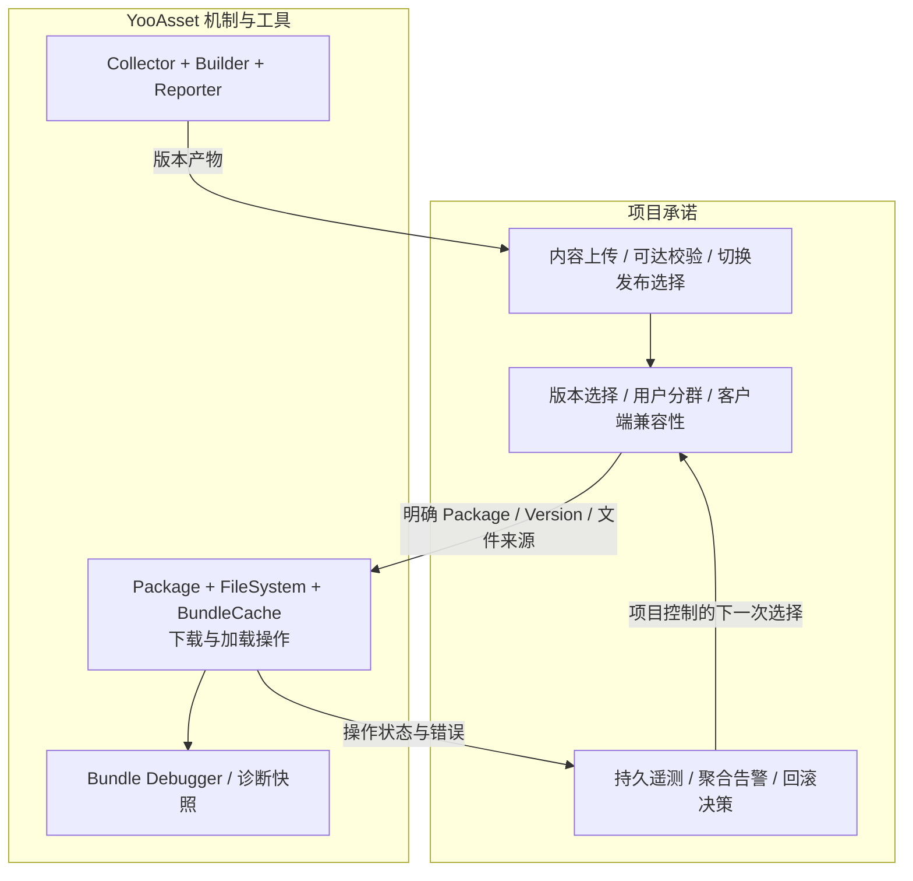
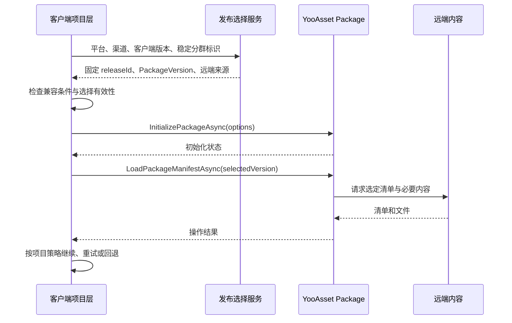
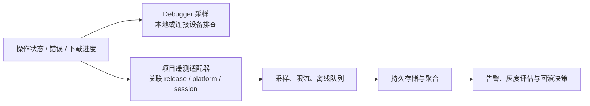

> 专题首页：[YooAsset 资源管理与交付]() · [两个系统的对比与选型]()

接入资源框架后，团队常遇到两种相反的问题：已经有报告和运行时调试工具，却按“没有工具”的印象重做；已经能下载并加载资源，却把它当成生产发布体系已经完成。

两种问题都来自同一个混淆：没有给能力写清输入、输出和验收条件。“有调试器”不等于“已有全量线上监控”，“有版本字符串”也不等于“已经实现灰度”。

**评估边界应先列出现成能力，再定义项目需要承诺的行为，最后验证两者之间的接口。** 这比用“官方或社区”“控制力强或弱”直接导出选型结论更可操作。

> 版本基线：官方仓库 YooAsset **3.0.6**，固定提交 [`3b4cfb36cc2e81b9558ab74d65fee2cf2eac2804`](https://github.com/tuyoogame/YooAsset/tree/3b4cfb36cc2e81b9558ab74d65fee2cf2eac2804)。本文核查源码和样例，没有执行 Unity、连接设备或部署发布服务；不声称已测得框架间的性能、可靠性或维护成本差异。

## 一、用能力契约替代功能有无表

一项能力至少需要回答四个问题：谁给输入，执行什么，返回什么，失败由谁决定后续动作。

以资源更新为例，框架可以执行选定版本清单的加载、文件可用性查询、下载和资源加载；项目必须给出可接受的版本选择，决定失败后重试、回退还是阻止进入游戏。执行机制和产品决策的接口才是真正的边界。



这张图并不要求每个团队自建同一套后台。现成 CI、对象存储、配置服务和遥测系统都可以承担项目层职责；需要的是有人对契约负责，而不是必须重复开发全部基础设施。

## 二、先盘点 3.0.6 已经提供什么

### 1. 收集、构建与报告已经是 Editor 工具

固定源码中有 `Bundle Collector`、`Bundle Builder`、`Bundle Reporter`、`Bundle Debugger` 四个核心窗口。Reporter 能导入构建报告，分别查看汇总、资产、bundle；报告含资产列表、bundle 列表、未被依赖资产，bundle 记录还包含大小、文件标识、依赖方、被引用方与包内资源。因此“YooAsset 没有编辑器分析入口”“只能自建文本解析工具”都不符合本版代码。[Reporter 窗口](https://github.com/tuyoogame/YooAsset/blob/3b4cfb36cc2e81b9558ab74d65fee2cf2eac2804/Assets/YooAsset/Editor/BundleReporter/BundleReporterWindow.cs#L13-L22)、[报告结构](https://github.com/tuyoogame/YooAsset/blob/3b4cfb36cc2e81b9558ab74d65fee2cf2eac2804/Assets/YooAsset/Editor/BundleReporter/BuildReport.cs#L20-L38)、[bundle 报告字段](https://github.com/tuyoogame/YooAsset/blob/3b4cfb36cc2e81b9558ab74d65fee2cf2eac2804/Assets/YooAsset/Editor/BundleReporter/ReportBundleInfo.cs#L12-L74)

构建检查也并非空白。收集阶段检查配置和地址，构建任务检查参数及未保存场景；SBP 在开启 `VerifyBuildingResult` 后比较计划与实际 bundle 集合。自动共享依赖处理另有开关，不能用“没有 DependCollector，所以框架不会发现任何问题”替代真实分析。[SBP 结果检查](https://github.com/tuyoogame/YooAsset/blob/3b4cfb36cc2e81b9558ab74d65fee2cf2eac2804/Assets/YooAsset/Editor/BundleBuilder/BuildPipeline/ScriptableBuildPipeline/BuildTasks/TaskVerifyBuildResult_SBP.cs#L18-L68)

这里应再区分三件事：收集阶段的规则验证、构建后的真实包体与依赖报告、项目定义的预算门禁。前两者已有基础能力，第三者需要把项目目标写成规则。它们不等价于“构建前精确预知压缩后大小”。

关于 Scanner 也应按版本和职责核对：本固定提交没有名为 Scanner 的 Editor 窗口；缓存内部的 `ScanMarkerFilesOperation` 是恢复缓存索引的扫描操作，不能当成资产预算分析器。其他版本或扩展中的工具名字不应直接移植为 3.0.6 的能力承诺，也不能由此概括本版“没有分析工具”。

### 2. 运行时诊断已经有现成入口

Bundle Debugger 不只是空窗口。它能向 Editor 模拟连接或已连接 Player 发出采样命令，查看资产、bundle 和操作数据，还能导出 JSON。`DiagnosticBehaviour` 接收单次/自动采样命令，采集诊断报告并通过 PlayerConnection 或 Editor mock 发送。[Debugger 入口与采样导出](https://github.com/tuyoogame/YooAsset/blob/3b4cfb36cc2e81b9558ab74d65fee2cf2eac2804/Assets/YooAsset/Editor/BundleDebugger/BundleDebuggerWindow.cs#L281-L322)、[运行时采样通道](https://github.com/tuyoogame/YooAsset/blob/3b4cfb36cc2e81b9558ab74d65fee2cf2eac2804/Assets/YooAsset/Runtime/DiagnosticSystem/DiagnosticBehaviour.cs#L27-L85)

诊断组件的挂载受 `YooAssets.Initialize` 中 `#if DEBUG` 控制。能否在目标 Player 上使用，还取决于实际编译符号、连接和平台条件。因此既不能写“运行时诊断完全依赖项目自建”，也不能承诺所有发行包都无条件带着完整调试通道。[挂载条件](https://github.com/tuyoogame/YooAsset/blob/3b4cfb36cc2e81b9558ab74d65fee2cf2eac2804/Assets/YooAsset/Runtime/YooAssets.cs#L51-L65)

### 3. Samples 是可复用起点，不是生产验收报告

`package.json` 列出 Space Shooter、Mini Game、Extension Sample、UniTask Sample、Test Sample。源码中还包含包比较器、扩展操作、监视面板、自定义规则和小游戏文件系统等例子。包比较器会比较两份清单中 bundle 的 `FileHash`；它说明存在可借鉴的版本对照工具，不能据此断言任何项目的上传或回滚已经打通。[样例目录声明](https://github.com/tuyoogame/YooAsset/blob/3b4cfb36cc2e81b9558ab74d65fee2cf2eac2804/Assets/YooAsset/package.json#L11-L38)、[包比较器](https://github.com/tuyoogame/YooAsset/blob/3b4cfb36cc2e81b9558ab74d65fee2cf2eac2804/Assets/YooAsset/Samples~/Extension%20Sample/Editor/PackageComparator/PackageComparatorWindow.cs#L104-L145)

阅读样例时还要检查是否经过兼容层。当前原生 Package API 是 `InitializePackageAsync(InitializePackageOptions)`、`RequestPackageVersionAsync(...)`、`LoadPackageManifestAsync(LoadPackageManifestOptions)`；`InitializeAsync`、`HostPlayModeParameters` 等旧入口位于 `YOOASSET_LEGACY_API` 条件编译下。样例中出现旧入口不意味着旧文章代码已迁移为原生 3.0.6 API。[原生入口](https://github.com/tuyoogame/YooAsset/blob/3b4cfb36cc2e81b9558ab74d65fee2cf2eac2804/Assets/YooAsset/Runtime/ResourcePackage/ResourcePackage.cs#L91-L174)、[兼容入口](https://github.com/tuyoogame/YooAsset/blob/3b4cfb36cc2e81b9558ab74d65fee2cf2eac2804/Assets/YooAsset/Runtime/Compatibility/CompatibleResourcePackage.cs#L1-L65)

## 三、版本选择和灰度：框架消费选择，项目定义选择

版本字符串可以指向某份清单，却不包含“哪些用户可以使用它”的业务含义。一个可审计的发布选择至少要有 Package、内容版本、平台与客户端兼容条件、远端文件来源和可追溯的发布记录。

下面是一种项目层契约示意，并非 YooAsset 已内置的类：

```text
ReleaseSelection
  releaseId
  platform + channel
  supportedClientBuilds
  packages[]: packageName + packageVersion + remoteRoots
  cohortId + policyRevision
```

框架端的衔接点已经足够明确：

1. 用 `HostPlayModeOptions` 配置内置与缓存文件系统参数。
2. 用 `FileSystemParameters.CreateDefaultSandboxFileSystemParameters(...)` 注入远端服务。
3. `IRemoteService.GetRemoteUrls(fileName)` 返回按优先级排列的候选 URL；它不是用户分群服务，也不是旧版查询接口。
4. 调用 `LoadPackageManifestAsync(new LoadPackageManifestOptions(selectedVersion, timeout))` 消费已选择版本，再生成相应下载操作。

[初始化选项](https://github.com/tuyoogame/YooAsset/blob/3b4cfb36cc2e81b9558ab74d65fee2cf2eac2804/Assets/YooAsset/Runtime/ResourcePackage/Operations/InitializePackageOptions.cs#L48-L62)、[沙盒参数工厂](https://github.com/tuyoogame/YooAsset/blob/3b4cfb36cc2e81b9558ab74d65fee2cf2eac2804/Assets/YooAsset/Runtime/FileSystem/FileSystemParameters.cs#L123-L148)、[远端 URL 契约](https://github.com/tuyoogame/YooAsset/blob/3b4cfb36cc2e81b9558ab74d65fee2cf2eac2804/Assets/YooAsset/Runtime/Interfaces/IRemoteService.cs#L5-L16)

灰度因此不要求“一组用户一个新 Package”。同一 Package 可以按稳定分群选择不同内容版本；多 Package 更适合表达独立内容域，是否采用仍取决于依赖、代码兼容和生命周期设计。复用 Package 也不意味着可以无条件在活跃加载过程中切换清单，切换时机必须遵守 Package 状态与加载资源的约束。



请求最新 `.version` 是一种版本发现方式；服务端已固定选择时，不能随后又无条件请求“最新”覆盖它，否则用户分群的决定会在客户端丢失。回退也需要项目先确认旧版本内容仍可取得，而不是仅把一个字符串改回去。

## 四、CI 与发布：执行构建 API 之后还有一次提交过程

YooAsset 提供构建参数、管线和结构化构建结果，可由 Editor 脚本和 CI 调用。3.0.6 的 SBP 参数启用构建缓存，因此“没有某个 content state 文件”不能推导为“不依赖任何环境状态”，更不能推导为“每次都重新生成全部字节”。详见[构建链路]()。

项目发布器要补的是围绕产物的事务：保存构建身份，确认内容可用，再让客户端看见新选择。顺序应明确，而不是上传目录成功后立即宣告上线。

| 项目契约 | 输入证据 | 交付证据 |
|---|---|---|
| 构建身份可复核 | 源码修订、Unity/YooAsset/SBP、收集与构建参数 | 产物清单、报告、hash、构建日志 |
| 清单引用文件完整 | 选定版本清单与发布布局 | 远端文件存在、大小及约定校验结果 |
| 选择切换可审计 | 发布 ID、兼容条件、灰度规则修订 | 切换记录与回读结果 |
| 回滚仍可执行 | 旧选择与旧文件保留策略 | 旧客户端/旧内容组合的实际加载测试 |

完整版本目录、差异上传、设备增量下载是三个不同机制。CDN 路径若按版本隔离，文件同 hash 也不自动等于同一 URL；发布器必须明确复制或复用方式。清单校验值用于完整性判断，也不能直接充当发布授权或数字签名。

不应据“官方 CI 原生支持”给任一方案直接加上可靠性保证，也不应据“可以写 Editor 脚本”低估项目投入。验收对象是具体 CI、目标平台、发布权限和回滚路径。

## 五、调试快照与持久监控之间的边界

Debugger 的问题是“现在有哪些资产、bundle、操作，状态是什么”；持久监控的问题是“某版本在某群用户上，过去一小时失败率是否异常”。两者可以共享状态数据，但采样生命周期和责任不同。



框架已经暴露可利用的信息：下载操作有总文件数、总字节数与进度，底层 `DownloadReport` 记录 HTTP code、错误、已下载字节与进度。项目应围绕“某次操作”定义开始、结束和结果，再聚合到发布版本；不能把每帧进度回调数量当成功次数。[下载操作](https://github.com/tuyoogame/YooAsset/blob/3b4cfb36cc2e81b9558ab74d65fee2cf2eac2804/Assets/YooAsset/Runtime/ResourcePackage/Operations/DownloaderOperation.cs#L9-L67)、[下载报告](https://github.com/tuyoogame/YooAsset/blob/3b4cfb36cc2e81b9558ab74d65fee2cf2eac2804/Assets/YooAsset/Runtime/DownloadSystem/DownloadReport.cs#L7-L48)

一组可实施的指标契约可以是：

| 指标 | 分母或关联条件 | 防止的误判 |
|---|---|---|
| 清单加载成功率 | 同一 release 下清单加载尝试数 | 重试成功掩盖首次失败 |
| 下载会话完成率 | 实际有下载需求的会话 | 零文件下载被算作网络成功 |
| 下载/加载耗时分布 | 平台、设备档位、冷热缓存、目标范围 | 不同样本混算后得出框架速度结论 |
| 内容缺失或校验失败 | PackageVersion、文件标识、发布来源 | 把发布不完整误诊为网络抖动 |

这些是建议的项目契约，不是本次已采集的指标。地址、URL 和用户标识还应按项目的数据规范做采样、脱敏和保留管理；指标维度也要控制数量，避免每个文件 URL 都变成无限增长的标签。

## 六、动手验证：三个实验检查边界是否接住

下面三组测试分别验收工具、发布选择和遥测。本文没有运行它们，预期记录项也不是实测结果。

### 实验 A：先使用现成诊断能力

在锁定版本的测试项目构建两份 Package，导入 `.report` 到 Bundle Reporter，找出同一个 prefab 的包归属、依赖和大小；运行带实际诊断编译条件的测试 Player，加载一个资产，在 Bundle Debugger 中采样，再导出 JSON。释放相应 handle，并在约定的卸载流程之后再次采样。

留存报告、导出快照、编译符号、连接方式和操作日志。验收重点是“工具能否在当前目标工作、看到哪些状态”，不能仅凭 handle 已释放推断底层对象必然在同一帧消失。资源生命周期另见[Handle 与卸载]()。

### 实验 B：固定同一 Package 的两个发布选择

为同一 Package 准备 `vA/vB` 两个版本，让资源内容可见地区别开。测试配置给分群 A 固定返回 `vA`，给分群 B 返回 `vB`。每次记录 `releaseId`、实际 `PackageVersion`、请求清单的 URL 和最终资源内容；重启后再做一次，验证分群稳定性。

随后另开一轮冷缓存实验：使用全新的专用缓存根和包裹会话，选择新版本实际加载必需、且没有被内置目录接管的一个 Bundle，只在测试发布区让该文件缺失。主动加载这个目标，并用请求日志确认确实请求了缺失文件，再观察失败是否被识别、选择是否仍固定，以及项目回退是否转向一份已验证可用的旧选择。恢复文件后再验证。若继续复用前面已下载的文件或已激活的同版本清单，可能不会发起目标请求，不能据此判断故障分支。测试仅操作隔离发布区与缓存副本。

这里验收的是“项目选择和框架消费是否一致”。看到 CDN 请求成功，却没有记录实际资源内容，仍不能证明分群正确；看到旧资源，也可能是加载流程或缓存判定错误，不能一律解释成回滚成功。

### 实验 C：让诊断结果与遥测结果对得上

分别运行冷缓存、有完整缓存、取消下载、网络失败四种受控场景。为每次下载操作生成项目操作 ID，记录选定发布、下载需求量、开始/结束、最终状态和重试次数，再与应用日志、实际请求和 Debugger 快照交叉检查。

验收条件是一次操作只有一个终态，取消不算成功，零需求不被记为网络下载成功；关闭诊断通道的发行配置仍有项目需要的持久记录。P95/P99 需要足够样本，四次功能测试只能验事件语义，不能得出性能分位数。

## 七、把选型和升级问题变成可验证成本

源码能说明机制和扩展点，不能保证目标 Unity、SBP、平台插件与内容组合天然兼容。`package.json` 声明本版依赖 SBP `1.21.25`；项目若使用其他版本，应记录实际依赖解析，再跑构建、冷/热启动、更新、加载和卸载用例。[依赖声明](https://github.com/tuyoogame/YooAsset/blob/3b4cfb36cc2e81b9558ab74d65fee2cf2eac2804/Assets/YooAsset/package.json#L43-L48)

同样，社区维护和官方维护都不能替代升级验证。评估时可比较：团队需要多少适配代码，现有 CI/监控能否复用，问题定位需要多少工时，目标设备上的下载量与加载行为是否满足需求。没有同条件测试，就保留未知，不写“更快”“更安全”或某个项目寿命必然该选谁。

YooAsset 3.0.6 已经提供收集、构建、报告、诊断以及可扩展的运行时机制；项目需要把版本选择、发布顺序、兼容条件和长期观测接成可验收的契约。边界不是框架名字决定的一张优劣表，而是每项生产承诺都有明确输入、责任人与证据。
